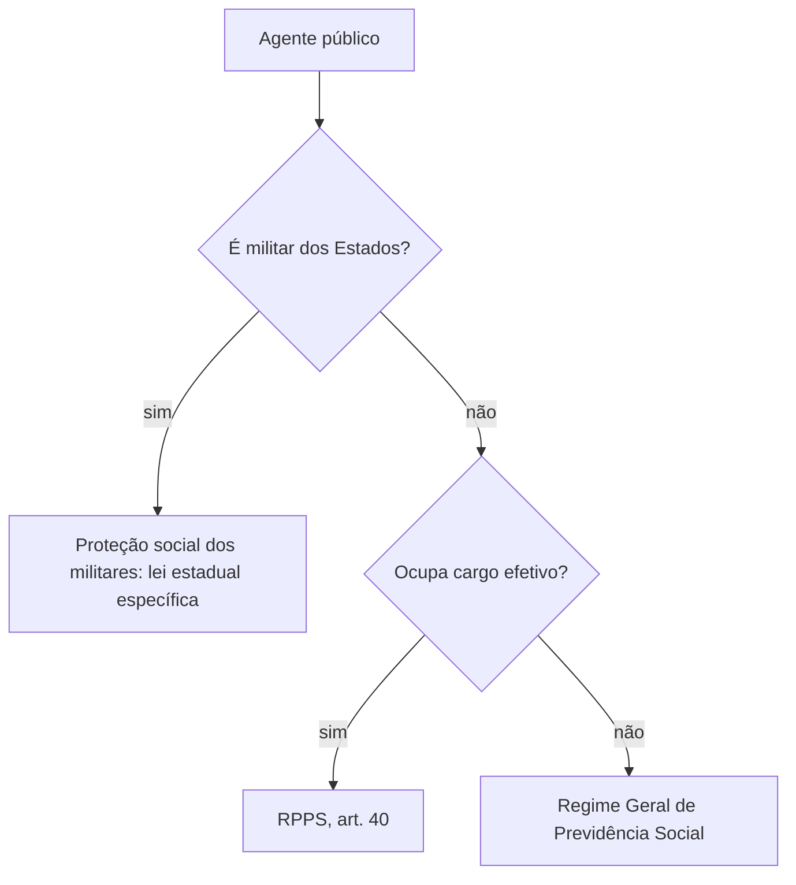

Este capítulo reúne três assuntos que parecem separados e têm o mesmo fio: o que acontece quando o servidor **deixa de trabalhar temporariamente** (licença), **sob qual regime** ele está vinculado e **como se aposenta**. A licença à gestante e a licença-paternidade tratam do afastamento por maternidade e paternidade; o regime jurídico define se o vínculo é estatutário ou celetista; e a previdência dos servidores diz quem se aposenta, em que idade e com que valor. A prova de concurso explora cada um com detalhes de prazo, de remissão constitucional e de jurisprudência recente.

> [!objetivos]
> - Indicar os prazos das licenças à gestante e paternidade e a jurisprudência sobre adoção e servidoras temporárias.
> - Explicar o que era o regime jurídico único e o que mudou depois da reforma de 1998 e da decisão do STF.
> - Descrever as linhas gerais do regime próprio de previdência (RPPS) e quem fica fora dele.
> - Distinguir o regime previdenciário do servidor civil do sistema de proteção social dos militares dos Estados.

## Licença à gestante

A Constituição assegura à gestante a licença, sem prejuízo do cargo e da remuneração, com duração de **120 dias** (art. 7º, XVIII), direito estendido aos servidores pelo art. 39, § 3º. O prazo conta a partir do parto ou da data indicada pelo médico, e a servidora não pode sofrer redução do valor recebido durante o afastamento.

O Programa Empresa Cidadã (Lei 11.770/2008) permite **prorrogar a licença por 60 dias**, totalizando 180. Na administração pública, a prorrogação depende de lei ou ato do ente federativo, que decide aderir. Na União, a adesão se deu por decreto. Nos Estados e nos Municípios, é preciso verificar a lei local, e a prova costuma dizer expressamente de que ente se trata.

| Situação | Prazo | Fundamento |
| --- | --- | --- |
| Licença à gestante (regra geral) | 120 dias | art. 7º, XVIII |
| Prorrogação pelo programa Empresa Cidadã | mais 60 dias, se o ente aderir | Lei 11.770/2008 |
| Licença-paternidade (regra transitória) | 5 dias | ADCT, art. 10, § 1º |
| Prorrogação da paternidade pelo programa | mais 15 dias, se o ente aderir | Lei 11.770/2008 |

### Entendimentos do STF sobre licença-maternidade

O Supremo ampliou o alcance da licença em três situações que as bancas exploram.

- **Mãe adotante**: a licença da mãe que adota não pode ser menor que a da gestante, e o prazo não varia conforme a idade da criança adotada (RE 778.889, tema 782 da repercussão geral). A diferença de tratamento entre filho biológico e adotivo violaria a igualdade.
- **Servidora gestante em vínculo precário**: a servidora, mesmo contratada por prazo determinado ou ocupante de cargo em comissão, tem direito à licença-maternidade e à **estabilidade provisória** da gestante, que vai da confirmação da gravidez até cinco meses depois do parto (RE 842.844, tema 542). A precariedade do vínculo não afasta o direito.
- **Internação**: quando a mãe ou o recém-nascido permanecem internados por tempo longo depois do parto, o STF entendeu que o prazo deve ser contado a partir da alta, para que a mãe de fato conviva com o filho (ADI 6.327).

> [!jurisprudencia] STF, RE 842.844 (tema 542)
> A gestante em cargo em comissão ou com contrato temporário também tem direito à licença-maternidade e à estabilidade provisória, porque a proteção constitucional da maternidade vale para qualquer vínculo com a administração.

> [!pegadinha] Estabilidade da gestante não é estabilidade do servidor
> A estabilidade provisória da gestante (ADCT, art. 10, II, b) é uma proteção contra dispensa arbitrária durante a gravidez e os cinco meses seguintes. Ela não transforma o cargo em comissão ou o contrato temporário em vínculo permanente. Findo o prazo, o vínculo segue as suas regras próprias.

## Licença-paternidade

A Constituição prevê licença-paternidade "nos termos fixados em lei" (art. 7º, XIX). Até a lei existir, o ADCT manda aplicar um prazo transitório de **cinco dias** (art. 10, § 1º). O programa Empresa Cidadã autoriza prorrogar por mais 15 dias, para o ente que aderir.

Em 2023, o STF reconheceu que o Congresso estava em **omissão** por não ter editado essa lei (ADO 20). A lei veio em março de 2026 e amplia a licença-paternidade de forma gradual: 10 dias a partir de 2027, 15 a partir de 2028 e 20 a partir de 2029, com salário-paternidade pago pela Previdência. Para o servidor público, o prazo é o do estatuto do ente (na União, 5 dias, art. 208 da Lei 8.112/1990, mais a prorrogação de 15 dias). Em prova, confira o ano da questão: até 2026, a resposta esperada é o prazo transitório de cinco dias, com prorrogação por adesão.

> [!bizu] 120, 60, 5 e 15
> Gestante: 120 dias, mais 60 se houver adesão. Pai: 5 dias, mais 15 se houver adesão. Os números repetem-se em provas e costumam ser trocados entre si.

## Regime jurídico: do "único" ao possível

O regime jurídico define as regras do vínculo entre o servidor e o ente público. Há duas grandes opções: o **estatutário**, regido por lei do ente (estatuto), em que o servidor ocupa **cargo** público, e o **celetista**, regido pela CLT, em que o agente ocupa **emprego** público.

Na redação original de 1988, o art. 39 mandava a União, os Estados, o Distrito Federal e os Municípios instituir, no âmbito da sua competência, um **regime jurídico único** para os servidores da administração direta, das autarquias e das fundações, e planos de carreira. A ideia era que todos os servidores do ente seguissem as mesmas regras, o que a prática predominante identificou com o regime estatutário.

A Emenda Constitucional 19/1998 apagou essa exigência do texto do art. 39: os entes poderiam adotar regimes diferentes, inclusive o celetista, para quadros distintos. Em 2007, o STF suspendeu essa alteração em decisão liminar na ADI 2.135, por vício de procedimento na votação da emenda, e a regra do regime jurídico único voltou a valer. Em 2024, ao julgar o mérito da ação, o STF validou a redação introduzida pela EC 19/1998 e **encerrou a obrigatoriedade do regime jurídico único**, com modulação para preservar as situações já constituídas.

| Momento | Regra | Efeito prático |
| --- | --- | --- |
| Texto de 1988 | regime jurídico único obrigatório | em regra, estatutário para todos |
| EC 19/1998 | exigência retirada do art. 39 | possibilidade de regimes diferentes |
| Liminar na ADI 2.135 (2007) | texto da EC suspenso | volta o regime jurídico único |
| Julgamento de mérito (2024) | EC 19 validada, com modulação | fim da obrigatoriedade do regime único |

> [!atencao] Cuidado com a data da prova
> Questões antigas afirmam que "o regime jurídico único é obrigatório" e consideram a alternativa correta. Questões recentes, posteriores ao julgamento de 2024, trabalham a ideia de que a obrigatoriedade deixou de existir. Leia sempre o enunciado em busca do ano e da referência à ADI 2.135.

### E as carreiras típicas de Estado?

A possibilidade de contratar pela CLT não significa que qualquer função possa ser exercida em regime celetista. As atividades que exigem **poder de império** (polícia, fiscalização, atividades jurídicas de Estado, ensino militar) são, por sua natureza, desempenhadas por ocupantes de **cargo público** e submetem-se a regras de estabilidade e controle. A doutrina e a jurisprudência tratam essas carreiras como núcleo do regime estatutário. Os militares dos Estados, por exemplo, têm estatuto próprio, previsto no art. 42 e em lei estadual específica, e jamais estiveram no regime celetista.

## Regime de previdência dos servidores

A previdência dos servidores titulares de cargo efetivo é organizada em **regimes próprios** de previdência social (RPPS), instituídos pelos entes e regulados pelo art. 40 da Constituição. O regime tem **caráter contributivo e solidário**: o ente e os servidores contribuem, e o equilíbrio financeiro e atuarial é exigido. Os ocupantes de cargo em comissão, os temporários e os empregados públicos não participam do RPPS; vinculam-se ao **Regime Geral** (RGPS).

> [!lei] CF, art. 40, caput
> Aos servidores titulares de cargos efetivos da União, dos Estados, do Distrito Federal e dos Municípios, incluídas suas autarquias e fundações, é assegurado regime próprio de previdência social, de caráter contributivo e solidário, mediante contribuição do respectivo ente federativo, de servidores ativos, de aposentados e de pensionistas, observados critérios que preservem o equilíbrio financeiro e atuarial.

### As aposentadorias

Depois da Emenda 103/2019, as principais modalidades são:

1. **Por incapacidade permanente** para o trabalho, quando o servidor não puder ser readaptado.
2. **Compulsória**, aos 75 anos de idade, com proventos proporcionais ao tempo de contribuição (Lei Complementar 152/2015).
3. **Voluntária**, preenchidos os requisitos de idade mínima, tempo de contribuição, tempo no serviço público e tempo no cargo.

Na União, a regra permanente exige 62 anos de idade, se mulher, e 65, se homem. Nos Estados e Municípios, a idade mínima é fixada pela Constituição estadual ou pela lei orgânica. Em ambos os casos há exigência mínima de tempo de contribuição, de dez anos de serviço público e de cinco anos no cargo em que a aposentadoria for concedida. Existem regras de transição para quem ingressou antes da reforma, com integralidade e paridade para certos casos.

| Modalidade | Quando | Observação |
| --- | --- | --- |
| Incapacidade permanente | doença ou acidente que impede o trabalho | proventos conforme a lei |
| Compulsória | 75 anos | proventos proporcionais ao tempo |
| Voluntária | idade, contribuição, serviço público e cargo | idade mínima fixada por ente |
| Especial (atividade de risco, magistério, deficiência) | requisitos reduzidos conforme a lei | depende da regulamentação |

O servidor que reúne os requisitos da aposentadoria voluntária e decide continuar em atividade tem direito ao **abono de permanência**, equivalente ao valor da sua contribuição previdenciária, até a idade da aposentadoria compulsória. O benefício serve de estímulo à permanência e é devolvido ao servidor na forma de pagamento mensal.

> [!pegadinha] Servidor temporário ou comissionado não se aposenta pelo RPPS
> O regime próprio é para quem ocupa cargo efetivo. Quem exerce cargo em comissão sem vínculo efetivo, quem tem contrato temporário e quem ocupa emprego público contribui para o Regime Geral. A banca costuma incluir o "ocupante de cargo em comissão" para ver se o candidato acerta o regime.

### Militares dos Estados: outro sistema

Os bombeiros e policiais militares dos Estados não se aposentam pelo RPPS dos servidores civis. A Constituição os trata como **militares**, e a inatividade é feita pela passagem à **reserva remunerada** ou pela **reforma**. O art. 42, § 2º remete à **lei específica do ente** a disciplina das pensões dos militares dos Estados, e a legislação federal de 2019 (Lei 13.954/2019) estabeleceu normas gerais do **sistema de proteção social dos militares**. A contribuição existe, mas o desenho do sistema é próprio.

> [!esquema] Quem usa o quê
> | Agente | Regime previdenciário |
> | --- | --- |
> | Servidor efetivo civil | RPPS (art. 40) |
> | Cargo em comissão sem vínculo efetivo | RGPS |
> | Empregado público | RGPS |
> | Temporário (art. 37, IX) | RGPS |
> | Militar dos Estados | sistema próprio de proteção social, com lei estadual específica |

## Casos práticos de licença

As regras ficam mais claras quando aplicadas a situações concretas. Os nomes a seguir são fictícios.

**Joana e a licença paga pelo ente.** Joana é servidora efetiva do Estado e está de licença à gestante. Seu **salário** continua a ser pago integralmente pelo ente, como se ela estivesse trabalhando. Na previdência geral, quem paga é o INSS (salário-maternidade, adiantado pela empresa), mas no regime estatutário o afastamento é custeado pelo próprio ente, sem redução de vencimentos. A prova costuma perguntar quem paga a licença e a resposta, para o servidor estatutário, é a administração.

**Juliana e a companheira.** Juliana e sua companheira vivem em união homoafetiva. A companheira de Juliana teve o filho e usou a licença. O STF, em julgamento do Plenário com repercussão geral, decidiu que a mãe não gestante em união homoafetiva também tem direito à licença-maternidade; se a companheira já tiver usufruído a licença, a segunda mãe tem direito a prazo equivalente ao da licença-paternidade. O fundamento é a igualdade e a proteção ao núcleo familiar, que não depende da forma da família.

**A jornada e a amamentação.** A Constituição não detalha a jornada reduzida da servidora que amamenta. Os estatutos, em regra, concedem horários especiais por lei do ente. Em prova, a resposta correta é que o direito existe por **lei local** e não por comando constitucional.

**Licença parental.** O tema da licença parental, em que o casal divide os dias entre si, ainda depende de lei. A Constituição prevê licença à gestante e licença-paternidade, em prazos diferentes, e a reforma dessa estrutura é discutida no Congresso. Na ausência de lei, aplicam-se os prazos já vistos.

> [!resolvido] Qual prazo?
> **Situação:** uma servidora temporária de um Município que aderiu ao programa Empresa Cidadã dá à luz e pergunta qual será o prazo da licença e se pode ser dispensada ao final do contrato.
>
> **Resposta:** a licença é de 120 dias, mais 60 de prorrogação, por força da adesão do ente. A servidora tem estabilidade provisória da gestante até cinco meses depois do parto, conforme a jurisprudência do STF; o contrato não pode ser encerrado antes desse prazo por simples decisão da administração.

## Cálculos e exemplos de previdência

Dois exemplos ajudam a entender o RPPS.

**Abono de permanência.** Um servidor tem 66 anos, mais de 25 anos de contribuição e preenche todas as condições da aposentadoria voluntária. Ele pode optar por continuar trabalhando e passa a receber, a título de abono, o equivalente à contribuição previdenciária que paga. Se ele contribui com 1.000 reais por mês, o abono é de 1.000 reais, e esse valor acompanha o servidor até a compulsória.

**Aposentadoria compulsória.** Ao completar 75 anos, o servidor é aposentado compulsoriamente, com proventos calculados proporcionalmente ao tempo de contribuição. A Lei Complementar 152/2015 estende a mesma idade aos ocupantes de cargos **vitalícios**, como magistrados, membros do Ministério Público e dos Tribunais de Contas. A regra não alcança quem ocupa só cargo em comissão, sem vínculo efetivo (STF, Tema 763).

> [!exemplo] Pensão por morte
> Se um servidor aposentado falece, seus dependentes recebem pensão. Pelas regras federais pós-reforma, a pensão equivale a uma cota familiar de 50% mais 10% por dependente, até o limite de 100%. Cada ente pode fixar percentuais próprios, e a prova costuma indicar o ente. Para militares dos Estados, a pensão segue lei específica.

## Cargo, emprego e função: a ligação com o regime

O regime jurídico explica a diferença entre três palavras que a prova mistura.

| Termo | O que é | Regime típico |
| --- | --- | --- |
| Cargo público | conjunto de atribuições e responsabilidades previsto em lei, com denominação própria e número certo, criado por lei | estatutário |
| Emprego público | posto de trabalho regido por contrato, na administração que adota a CLT | celetista |
| Função pública | atribuição ou conjunto de atribuições sem cargo ou emprego, como a função de confiança dos cargos efetivos ou a contratação temporária | variável |

O ingresso em cargo ou emprego efetivo depende de **concurso público**, de provas ou de provas e títulos, com as exceções de cargos em comissão, de livre nomeação e exoneração. A contratação temporária depende de lei e de **excepcional interesse público** (art. 37, IX). Esses pontos explicam por que o regime previdenciário muda conforme o vínculo.

A função de confiança, por sua vez, só pode ser exercida por servidores ocupantes de cargo efetivo e destina-se apenas às atribuições de direção, chefia e assessoramento. O cargo em comissão, também voltado a essas atribuições, é preenchido por livre nomeação, e a lei fixa percentuais mínimos para ocupantes de cargos de carreira. Quem exerce função de confiança ou cargo em comissão não adquire estabilidade por esse motivo, pois ela decorre de cargo efetivo e do estágio probatório.

### O estatuto como lei do ente

A lei que reúne os direitos, os deveres e as responsabilidades dos servidores de cada ente é chamada de **estatuto**. Na União, é a Lei 8.112/1990. Nos Estados e nos Municípios, cada ente edita a sua, porque a competência para legislar sobre o regime dos próprios servidores é de cada ente federativo, em respeito à autonomia. Por isso, o prazo de uma licença, o valor de um adicional ou o número de faltas permitido variam, e a prova sempre indica de qual ente se trata ou pede a regra constitucional.

> [!atencao] A Lei 8.112 não vale para Estados e Municípios
> Um erro frequente é aplicar a Lei 8.112/1990 a servidores estaduais ou municipais. Ela é lei **federal**, aplicável aos servidores da União, das autarquias e das fundações federais. Os demais entes seguem os seus estatutos, e as regras só valem para eles se a lei local as adotar.

Para o aluno de bombeiros, vale a lembrança de que o **estatuto dos militares estaduais** é uma lei estadual específica e que os direitos, os deveres e a carreira dependem dela. O estatuto dos servidores civis do Estado não se aplica ao militar, e o inverso também é verdadeiro.

## Mapa do capítulo

O capítulo trata de três pontos que se ligam pela ideia de **tratamento diferenciado conforme o vínculo**: licença, regime jurídico e previdência.

| Tema | Regra central | Armadilha |
| --- | --- | --- |
| Licença à gestante | 120 dias, mais 60 se houver adesão | esquecer a adesão do ente |
| Mãe adotante | mesmo prazo da gestante (tema 782) | ligar a licença à idade da criança |
| Gestante em cargo precário | tem licença e estabilidade provisória (tema 542) | achar que só o efetivo tem direito |
| Licença-paternidade | 5 dias transitórios, mais 15 se houver adesão | confundir com o prazo da gestante |
| Regime jurídico | obrigatoriedade do regime único encerrada | usar entendimento anterior a 2024 |
| RPPS | cargo efetivo, caráter contributivo e solidário | incluir comissionados e temporários |
| Militares estaduais | sistema próprio, lei específica | aplicar o art. 40 aos militares |

### Para fixar
- A licença à gestante é de 120 dias e pode ser prorrogada por mais 60 se o ente aderir ao programa Empresa Cidadã.
- A mãe adotante tem licença igual à da gestante, sem variar com a idade da criança (tema 782).
- A servidora gestante em cargo em comissão ou contrato temporário tem licença e estabilidade provisória (tema 542).
- A licença-paternidade é de 5 dias pelo ADCT, com prorrogação de 15 dias para quem aderir ao programa.
- O regime jurídico único era obrigatório em 1988, foi retirado pela EC 19/1998, voltou por liminar em 2007 e foi encerrado em definitivo pelo STF em 2024.
- Atividades que exigem poder de império continuam ligadas ao cargo público e ao regime estatutário.
- O RPPS é para servidores de cargo efetivo e tem caráter contributivo e solidário.
- Comissionados sem vínculo efetivo, temporários e empregados públicos ficam no Regime Geral.
- A aposentadoria compulsória é aos 75 anos, com proventos proporcionais.
- Os militares dos Estados têm sistema próprio de proteção social, regulado por lei estadual específica.
