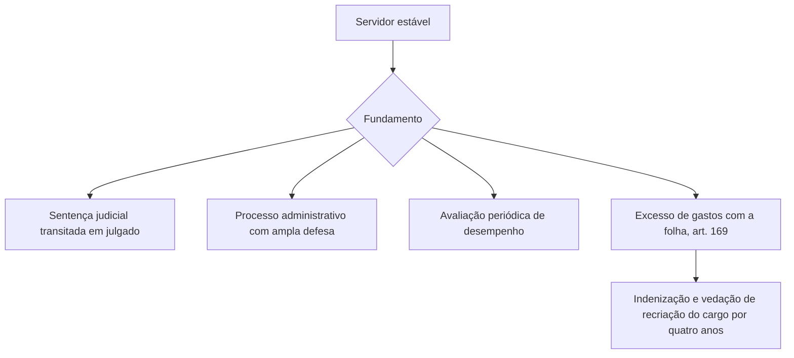

Entrar no serviço público por concurso não significa ficar para sempre. A Constituição criou três palavras que descrevem a **segurança** do vínculo e que as bancas adoram trocar: efetividade, estabilidade e vitaliciedade. Cada uma tem dono, prazo e condição de perda. Depois, a Constituição regula o que acontece com o servidor demitido por engano (reintegração), com quem ocupou a vaga dele (recondução) e com quem perde o cargo porque ele foi extinto (disponibilidade e aproveitamento). Este capítulo organiza esse quadro e inclui os militares dos Estados.

> [!objetivos]
> - Distinguir efetividade (do cargo), estabilidade (do servidor) e vitaliciedade (de certas carreiras).
> - Indicar o prazo, o requisito e as hipóteses de perda da estabilidade.
> - Diferenciar reintegração, recondução, disponibilidade e aproveitamento e saber quem tem direito a cada um.
> - Aplicar as súmulas básicas sobre estágio probatório e explicar a situação do oficial militar.

## Efetividade, estabilidade e vitaliciedade

| Conceito | Atributo de | Como se adquire | Quem tem |
| --- | --- | --- | --- |
| Efetividade | o **cargo** | provimento por concurso público | cargos efetivos |
| Estabilidade | o **servidor** | três anos de exercício e avaliação especial de desempenho | servidores nomeados para cargo efetivo por concurso |
| Vitaliciedade | o **servidor**, em carreiras específicas | prazo fixado pela Constituição ou pela lei da carreira | magistrados, membros do Ministério Público e dos tribunais de contas |

A **efetividade** é característica do cargo: o provimento efetivo exige concurso, tem caráter, em princípio, permanente e não depende da confiança de quem nomeia. Quem ocupa cargo efetivo pode, ou não, ter estabilidade. A **estabilidade** é uma garantia do próprio servidor, adquirida depois de cumpridos os requisitos. O cargo em comissão, de livre nomeação e exoneração, não é efetivo, e quem o ocupa sem ter cargo efetivo nunca adquire estabilidade por isso.

> [!bizu] Efetivo é o cargo, estável é o servidor
> Uma frase resolve metade das questões: o cargo é **efetivo**; o servidor, depois de três anos e da avaliação, fica **estável**. "Servidor efetivo" é uma expressão comum, mas tecnicamente significa o ocupante de cargo efetivo.

### Estabilidade: três anos e avaliação

Pelo art. 41, caput, a estabilidade chega depois de **três anos** de exercício efetivo, e só para quem foi nomeado, mediante concurso, para um cargo de provimento efetivo. A aprovação em **avaliação especial de desempenho**, feita por comissão instituída para essa finalidade, é condição para adquirir a estabilidade (art. 41, § 4º). O prazo de três anos corresponde ao estágio probatório, que o STF e o STJ passaram a tratar como coincidente com o de aquisição da estabilidade depois da Emenda 19/1998.

> [!pegadinha] Nomeação por concurso é requisito
> A estabilidade exige nomeação para cargo **efetivo** por **concurso público**. Quem foi nomeado para cargo em comissão, ainda que por dez anos, não adquire estabilidade por isso. E quem tem contrato temporário também não.

### Perda do cargo pelo estável

O servidor estável só perde o cargo em três hipóteses (art. 41, § 1º):

1. **Sentença judicial transitada em julgado**, o que inclui a condenação criminal com perda do cargo e a ação de improbidade.
2. **Processo administrativo**, com ampla defesa.
3. **Avaliação periódica de desempenho**, que depende de lei complementar e de oportunidade de defesa.

Há ainda a perda por **excesso de gastos com a folha** (art. 169, § 4º): se a redução de 20% dos cargos em comissão e a exoneração dos servidores não estáveis forem insuficientes para voltar ao limite, o servidor estável pode perder o cargo, com **indenização** de um mês de remuneração por ano de serviço. Nesse caso, o cargo é extinto e a administração não pode criar outro com atribuições iguais ou assemelhadas por quatro anos.

### Súmulas sobre estágio probatório e demissão

> [!jurisprudencia] STF, Súmulas 20, 21 e 22
> Mesmo em estágio probatório, o servidor aprovado em concurso não pode ser demitido ou exonerado sem processo em que se apurem sua capacidade e os fatos, com defesa (Súmulas 20 e 21). Já o estágio probatório não impede a **extinção do cargo** (Súmula 22).

Em outras palavras, a demissão de quem já está empregado depende de procedimento. Já a **extinção do cargo** por lei, por razões de organização administrativa, não ofende a estabilidade, porque o servidor passa à disponibilidade.

### O processo administrativo e o advogado

No processo administrativo disciplinar, a falta de defesa técnica por advogado, por si só, não viola a Constituição (Súmula Vinculante 5). A ampla defesa fica assegurada pela oportunidade de manifestação do servidor, e o acompanhamento por advogado é facultado.

## Vitaliciedade

A vitaliciedade é um nível mais forte de garantia, reservado a **carreiras de Estado** em que a independência é essencial: **magistrados** (art. 95, I), **membros do Ministério Público** (art. 128, § 5º, I, a) e **membros dos tribunais de contas** (por remissão do art. 73, § 3º). O prazo para adquiri-la é de **dois anos** de exercício, no caso dos magistrados e membros do Ministério Público, período em que a perda do cargo pode ocorrer por deliberação do tribunal ou do órgão a que estiverem vinculados. Depois dele, só se perde o cargo por **sentença judicial transitada em julgado**, o que afasta a demissão por processo administrativo.

| Aspecto | Estabilidade | Vitaliciedade |
| --- | --- | --- |
| Prazo | 3 anos | 2 anos (magistrados e membros do MP) |
| Perda | sentença transitada, processo administrativo, avaliação periódica, excesso de despesa | apenas sentença judicial transitada em julgado |
| Beneficiários | servidores de cargo efetivo por concurso | magistrados, membros do MP e dos tribunais de contas |

> [!atencao] Vitalício não se demite por processo administrativo
> A banca aproveita a diferença: afirma que o magistrado vitalício pode ser demitido em processo administrativo por falta grave, e a afirmativa está errada. Aplicam-se as sanções disciplinares previstas em lei, como a aposentadoria compulsória, mas a **perda do cargo** exige sentença judicial.

## O oficial militar dos Estados

O oficial das polícias e dos corpos de bombeiros militares dos Estados tem um regime próprio de garantia do posto e da patente. A Constituição determina que o **tribunal competente** decida sobre a perda do posto e da patente dos oficiais e da graduação das praças (art. 125, § 4º). Para os militares dos Estados, aplicam-se, ainda, as regras dos §§ 2º e 3º do art. 142, por força do art. 42, § 1º. Entre elas, está a de que o oficial só perde o posto e a patente se for julgado indigno do oficialato ou com ele incompatível, por decisão de tribunal militar permanente, em tempo de paz, ou de tribunal especial, em tempo de guerra.

> [!pegadinha] Quem perde o posto é o tribunal, não o comandante
> O comandante pode aplicar sanções disciplinares, mas a perda do **posto e da patente** do oficial é decisão de **tribunal**. Sem decisão judicial, o oficial não perde a patente por ato administrativo. A banca também troca "posto e patente" (oficiais) por "graduação" (praças).

Para as praças, a perda da graduação é decidida pelo tribunal competente, quando a questão decorre de condenação ou de processo próprio. A estabilidade dos militares estaduais é fixada por lei estadual específica, na linha do art. 142, § 3º, X, e normalmente alcança os praças com mais de dez anos de serviço, por exemplo. O candidato deve conferir a lei do Estado.

## Reintegração, recondução, disponibilidade e aproveitamento

O art. 41, §§ 2º e 3º trata do que acontece em duas situações: a demissão invalidada e a extinção do cargo.

### Demissão invalidada: reintegração e recondução

Se a demissão do servidor estável for **invalidada por sentença judicial**, ele será **reintegrado**: volta ao cargo de origem, com direito aos vencimentos e vantagens que deixou de receber, como se não tivesse saído. Quem ocupava a vaga, se for estável, volta ao cargo de onde veio (**recondução**), sem receber indenização por isso; se não houver lugar, é encaminhado a outro cargo ou colocado em disponibilidade, com pagamento proporcional.

> [!lei] CF, art. 41, § 2º
> Invalidada por sentença judicial a demissão do servidor estável, será ele reintegrado, e o eventual ocupante da vaga, se estável, reconduzido ao cargo de origem, sem direito a indenização, aproveitado em outro cargo ou posto em disponibilidade com remuneração proporcional ao tempo de serviço.

### Cargo extinto: disponibilidade e aproveitamento

Se o cargo é **extinto** ou declarado desnecessário, o servidor estável não é demitido: passa à **disponibilidade**, recebendo de modo proporcional ao tempo trabalhado, enquanto a administração não o **aproveita** de modo adequado em outro cargo (art. 41, § 3º). A disponibilidade não é demissão: o servidor continua vinculado, aguardando.

| Instituto | Quando ocorre | Efeito |
| --- | --- | --- |
| Reintegração | demissão invalidada por decisão judicial | volta ao cargo com ressarcimento das vantagens |
| Recondução | volta do ocupante anterior da vaga ao cargo de origem (ou inabilitação em estágio de outro cargo) | retorno ao cargo anterior, sem indenização |
| Disponibilidade | cargo extinto ou declarado desnecessário | servidor estável fica fora do exercício, com remuneração proporcional |
| Aproveitamento | fim da disponibilidade | retorno a cargo compatível com o anterior |

> [!exemplo] Quem fica com a vaga
> Marta foi demitida em 2022 e Pedro foi nomeado para a vaga dela. Em 2025 uma sentença anula a demissão de Marta. Marta é **reintegrada**. Pedro, se for estável, é **reconduzido** ao seu cargo de origem; se não tinha cargo de origem, será aproveitado em outro cargo ou posto em disponibilidade. Se Pedro não for estável, será exonerado.

### Outras formas de retorno

Além dessas, a doutrina e os estatutos tratam de outros institutos de provimento derivado: a **reversão** (volta do aposentado, nos casos legais), a **readaptação** (investidura em cargo compatível com limitação física ou mental superveniente) e a **promoção**. A prova trabalha mais as quatro anteriores, previstas na Constituição.

## Poderes, deveres e prerrogativas do servidor

A segurança do vínculo é uma **prerrogativa**, e toda prerrogativa vem acompanhada de deveres. O servidor tem o direito de permanecer no cargo enquanto não ocorrer uma das hipóteses de perda, mas deve cumprir os deveres funcionais: assiduidade, lealdade às instituições, observância das normas, zelo, urbanidade e sigilo sobre assuntos da repartição. O descumprimento é o que alimenta o processo administrativo que pode levar à demissão. Daí a ligação entre os temas: o estatuto define o que é falta, e a Constituição define as garantias de defesa e de decisão para perder o cargo.

No estágio probatório, o servidor é avaliado por fatores como **assiduidade, disciplina, capacidade de iniciativa, produtividade e responsabilidade**, lista usada pela Lei 8.112/1990 para os servidores federais e adotada, com variações, por muitos estatutos locais. Serve de modelo para o raciocínio, mas a prova indica de qual ente se trata.

### Legislação pertinente

Para o tema, as fontes de direito mais cobradas são:

1. **Constituição Federal**, art. 41 (estabilidade e institutos de retorno), art. 169 (despesa com pessoal e perda por excesso) e art. 37, I, II e V (acesso, concurso, cargo em comissão e função de confiança).
2. **Estatuto do ente**, que regula a avaliação, a disponibilidade e o aproveitamento. Na União, é a Lei 8.112/1990.
3. **Súmulas do STF**, que tratam de estágio probatório e de nomeação.
4. **Estatuto dos militares estaduais**, para oficiais e praças.

> [!bizu] Posse e nomeação
> A Súmula 16 do STF garante ao funcionário nomeado por concurso o direito à posse, e a Súmula 15 protege o candidato aprovado quando a vaga é preenchida fora da ordem de classificação. A jurisprudência mais recente reconheceu direito subjetivo à nomeação do aprovado dentro do número de vagas do edital. Esses temas conversam com a efetividade: o cargo efetivo é conquistado pelo concurso, e a ordem de classificação protege quem conquistou.

### Estágio probatório e a avaliação em números

O prazo de três anos não é só uma contagem de calendário. A avaliação especial deve acompanhar o servidor durante o estágio e produzir resultado antes do fim do prazo. Se a administração não faz a avaliação, o servidor não pode ser prejudicado pela omissão, e a jurisprudência tem reconhecido a estabilidade nesses casos, desde que cumprido o exercício efetivo. Se o servidor é reprovado, a exoneração exige procedimento com contraditório. Por isso o estágio probatório é descrito como **período de prova**, e não de livre dispensa: o que o diferencia do cargo em comissão é justamente a necessidade de motivação e defesa.

Na prática, vale uma regra de leitura: sempre que o enunciado falar em "exonerar servidor em estágio probatório", procure o procedimento. Se ele não existe, a exoneração é nula; se existe, com defesa e motivação, ela pode ser válida mesmo antes de completados os três anos.

## Mapa do capítulo

O capítulo explica a **segurança do vínculo**: quem a tem, como se adquire, como se perde e o que acontece quando ela é violada ou quando o cargo acaba.

| Tema | Regra | Armadilha |
| --- | --- | --- |
| Efetividade | do cargo, por concurso | chamar o servidor de "estável" por ocupar cargo efetivo |
| Estabilidade | 3 anos e avaliação especial | contar tempo em cargo em comissão |
| Perda da estabilidade | sentença, processo, avaliação, excesso de despesa | esquecer a avaliação periódica |
| Vitaliciedade | 2 anos, perda só por sentença | admitir demissão administrativa |
| Oficial militar estadual | perda do posto por decisão de tribunal | trocar posto e patente por graduação |
| Reintegração | demissão invalidada | confundir com recondução |
| Disponibilidade | cargo extinto, remuneração proporcional | confundir com demissão |

### Para fixar
- Efetividade é do cargo; estabilidade e vitaliciedade são garantias pessoais.
- A estabilidade exige três anos de exercício em cargo efetivo por concurso e avaliação especial de desempenho.
- O estável perde o cargo por sentença transitada, processo administrativo, avaliação periódica ou excesso de gastos com a folha.
- Mesmo no estágio probatório, a demissão exige procedimento; a extinção do cargo, porém, é possível (Súmula 22).
- A vitaliciedade se adquire em dois anos e só se perde por sentença judicial transitada em julgado.
- Os oficiais militares só perdem posto e patente por decisão de tribunal, e as praças perdem a graduação conforme o tribunal competente.
- Reintegração é o retorno do demitido por decisão invalidada; recondução é o retorno do ocupante anterior da vaga.
- Extinto o cargo, o estável fica em disponibilidade com remuneração proporcional até o aproveitamento.
- A falta de advogado no processo disciplinar, por si só, não gera nulidade (SV 5).
- O cargo em comissão não gera estabilidade nem efetividade.
