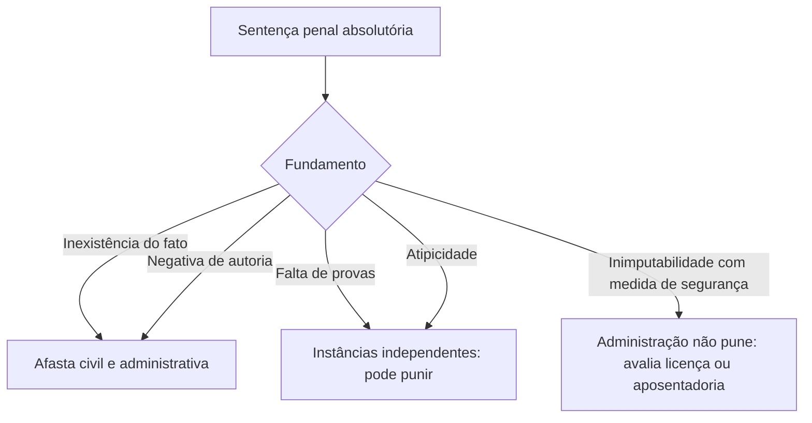

O servidor público responde por seus atos em três mundos: pode ser obrigado a indenizar, pode ser condenado como criminoso e pode ser punido pelo próprio órgão em que trabalha. Cada um desses mundos tem lógica, prova e consequência próprias. A regra é a **independência** das instâncias, e a exceção que importa à prova é o efeito da sentença penal que nega o fato ou a autoria. O capítulo fecha o volume com um painel de jurisprudência recente do STF e do STJ sobre agentes públicos, que as bancas têm cobrado em questões de atualização.

> [!objetivos]
> - Distinguir as responsabilidades civil, penal e administrativa e indicar o fundamento e a sanção de cada uma.
> - Aplicar a regra da independência das instâncias e suas exceções, incluindo a falta residual.
> - Descrever em linhas gerais a sindicância, o processo administrativo disciplinar e o processo sumário.
> - Reconhecer as teses recentes do STF e do STJ sobre remuneração, concurso, férias, FGTS e requisitos de ingresso.

## As três esferas de responsabilidade

| Esfera | Fundamento | Consequência típica |
| --- | --- | --- |
| Civil | dano ao erário ou a terceiros causado por ação ou omissão com dolo ou culpa | dever de ressarcir |
| Penal | conduta definida em lei como crime ou contravenção | pena (prisão, multa, perda do cargo, conforme o caso) |
| Administrativa | infração dos deveres e proibições do estatuto | advertência, suspensão, demissão, cassação de aposentadoria, destituição de função |

Elas **se somam**. Um mesmo fato pode gerar, ao mesmo tempo, o dever de pagar o prejuízo, a condenação criminal e a demissão. E a absolvição em uma não elimina, em regra, a condenação em outra.

### Responsabilidade civil

A responsabilidade civil do servidor é **subjetiva**: exige dolo ou culpa em sentido estrito (negligência, imprudência ou imperícia). Se o prejuízo foi causado à própria administração, o servidor responde diretamente a ela. Se o dano foi causado a terceiro, quem responde perante a vítima é o Estado, de forma objetiva, e só depois a administração cobra o servidor, por meio da **ação regressiva**, se ficar provado dolo ou culpa (art. 37, § 6º, da Constituição).

> [!exemplo] A cadeia da indenização
> O servidor A, dirigindo a viatura em alta velocidade por imprudência, bate no carro do cidadão B. B processa o Estado, que paga a indenização porque responde sem precisar provar culpa. Em seguida, o Estado move ação regressiva contra A, que só responderá se se demonstrar dolo ou culpa.

A obrigação de reparar o dano alcança os sucessores, até o limite do valor do patrimônio transferido (art. 5º, XLV, da Constituição), ou seja, o herdeiro não responde com o próprio bolso além da herança recebida.

### Responsabilidade penal

A responsabilidade penal diz respeito aos **crimes e contravenções** que o servidor pratica nessa qualidade. O Código Penal reserva um capítulo aos crimes praticados por funcionário público contra a administração em geral nos artigos 312 a 326 desse Código, como peculato, concussão, corrupção passiva, prevaricação e abandono de função. A legislação especial também prevê figuras específicas, como o abuso de autoridade.

### Responsabilidade administrativa

A administrativa decorre da infração dos deveres funcionais, das proibições e dos regimes de acumulação. As sanções vão da advertência, passando pela suspensão, até a **demissão** e a cassação da aposentadoria. Para aplicá-las, a administração precisa de **processo** com contraditório e ampla defesa.

> [!pegadinha] Condenação criminal não substitui o processo administrativo
> A condenação criminal pode ter como efeito a perda do cargo, mas isso depende de declaração na sentença e de requisitos legais. A demissão por falta disciplinar, por outro lado, exige o processo administrativo. A banca troca uma coisa pela outra.

## Sindicância, processo disciplinar e processo sumário

A apuração das infrações segue três caminhos principais, descritos aqui com base no modelo federal da Lei 8.112/1990 (cada ente tem o seu estatuto).

| Instrumento | Finalidade | Observação |
| --- | --- | --- |
| Sindicância | apuração preliminar de fatos e autoria | pode levar ao arquivamento, a penas leves (advertência ou suspensão de até 30 dias) ou à instauração do processo disciplinar |
| Processo administrativo disciplinar (PAD) | apuração de faltas graves e aplicação de penas mais severas | fases de instauração, inquérito (instrução, defesa e relatório) e julgamento |
| Processo sumário | rito reduzido para casos específicos | acumulação ilegal de cargos, abandono de cargo e inassiduidade habitual |

O **PAD** é obrigatório para aplicar penalidades como a demissão, e deve garantir ao acusado conhecimento das acusações, produção de provas e manifestação final. No modelo federal, o inquérito do PAD tem prazo de sessenta dias, prorrogável por mais sessenta, e o processo sumário é mais curto. O **abandono de cargo** se configura com a ausência intencional por mais de trinta dias consecutivos, e a **inassiduidade habitual**, com faltas por sessenta dias, interpoladamente, em um período de doze meses.

> [!atencao] Lei 8.112 como referência
> A Lei 8.112/1990 é lei federal e vale para os servidores da União. A prova de nível estadual costuma pedir o princípio geral (processo com ampla defesa, graus de punição, independência das instâncias) ou indica a lei local. Para os militares estaduais, o regime disciplinar é regido por lei estadual própria, com procedimentos como o conselho de disciplina para as praças e o conselho de justificação para os oficiais.

## Independência das instâncias e suas exceções

A regra é que cada esfera decide por si. Por isso, a pessoa pode ser condenada civil e administrativamente e absolvida no crime. Mas há situações em que a esfera penal **vincula** as demais.

| Resultado no processo penal | Efeito nas demais esferas |
| --- | --- |
| Absolvição que **nega a existência do fato** | afasta a responsabilidade administrativa e civil |
| Absolvição que **nega a autoria** | afasta a responsabilidade administrativa e civil |
| Absolvição por **falta de provas** | não vincula; a administração pode punir |
| Absolvição por **atipicidade** (a conduta não é crime) | não vincula; a conduta pode ser falta funcional |
| Absolvição por falta de culpabilidade | não vincula, salvo a hipótese do STJ de 2024 abaixo |

O fundamento é o rigor probatório: o processo penal exige prova mais forte do que o administrativo. Se o juiz criminal concluiu que o fato não ocorreu ou que o acusado não foi o autor, não há como punir o mesmo fato em outra esfera.

> [!jurisprudencia] STF, Súmula 18
> Se o juízo criminal absolve, mas deixa de fora uma falta que o processo penal não examinou, a administração pode punir essa parte restante, chamada falta residual.

Imagine um servidor absolvido do crime de peculato por não se ter provado que se apropriou do dinheiro, mas que deixou o caixa desorganizado e descumpriu o dever de zelo. A conduta residual (o descumprimento do dever) pode ser punida na via administrativa.

### A novidade do STJ em 2024

O STJ acrescentou uma exceção. Quando o juiz criminal reconhece a **inimputabilidade** do acusado (incapaz de entender o caráter ilícito do fato por doença mental) e o julgamento termina com absolvição acompanhada de tratamento compulsório, a administração fica impedida de punir. Em vez disso, deve examinar se cabe afastar o servidor para cuidar da saúde ou aposentá-lo por invalidez. Essa hipótese só interessa se a questão exigir jurisprudência; em regra, as bancas trabalham com as duas exceções clássicas (fato inexistente e autoria negada).

## Painel de jurisprudência recente

### Súmulas vinculantes sobre agentes públicos

| Súmula Vinculante | Ideia |
| --- | --- |
| 5 | a falta de advogado no processo disciplinar, por si só, não gera nulidade |
| 15 | gratificações não incidem sobre o abono usado para chegar ao salário mínimo |
| 16 | o salário mínimo vale para a remuneração total, não só para o básico |
| 37 | o Judiciário não aumenta vencimento por isonomia |
| 42 | é inconstitucional vincular reajuste de servidor estadual ou municipal a índice federal |
| 43 | é inconstitucional o provimento em cargo de outra carreira sem concurso |
| 44 | só lei pode exigir exame psicotécnico em concurso |
| 55 | o auxílio-alimentação não se estende aos inativos |

### Teses recentes

**Direito à nomeação e corte de gastos.** O candidato aprovado dentro do número de vagas tem direito subjetivo à nomeação (RE 598.099, Tema 161), que só cede em situações excepcionais, marcadas por superveniência, imprevisibilidade, gravidade e necessidade. Em 2025, o STF decidiu que a extinção dos cargos oferecidos no edital, por causa do limite de despesa com a folha de servidores, pode mitigar esse direito, desde que seja motivada e ocorra antes do fim do prazo de validade do concurso (Tema 1.164). Se a extinção vier depois do prazo, o direito já estava consolidado.

> [!jurisprudencia] STF, Tema 1.164
> A extinção motivada dos cargos do edital, por excesso de gastos com a folha, pode afastar o direito à nomeação do aprovado dentro das vagas, mas só se acontecer antes de vencer a validade do concurso.

**Abono de permanência e verbas calculadas sobre a remuneração.** O STJ (Tema Repetitivo 1.233) entendeu que o abono de permanência, por ter natureza remuneratória e permanente, entra na base de cálculo do adicional de férias e do décimo terceiro. Se ele é considerado remuneração para fins de imposto, também entra no cálculo dessas verbas.

**Remuneração fixada por ato do Executivo.** É inconstitucional a lei que delega ao Executivo o poder de fixar ou alterar o valor de parcela remuneratória (Tema 1.427). O STF aplicou o princípio da reserva de lei formal, mas decidiu que o reconhecimento da inconstitucionalidade não autoriza reduzir o valor nem exigir devolução do que foi pago, em nome da segurança jurídica e da irredutibilidade.

**Contratação temporária nula e FGTS.** O servidor temporário contratado de forma irregular tem direito ao saldo de salários e ao levantamento do FGTS (Tema 916). O prazo para cobrar é de **cinco anos**, e não o de dois anos aplicável ao trabalhador em geral, porque o vínculo é jurídico-administrativo (Tema 1.189).

**Altura mínima na Polícia Militar.** A exigência de altura mínima para ingresso na carreira de segurança pública exige **lei** e deve respeitar os parâmetros do Exército: 1,60 m para homens e 1,55 m para mulheres, além de se relacionar com as atribuições do cargo (Tema 1.424). Edital sem base em lei não pode fixar altura.

**Candidatos casados ou com filhos.** O STF declarou inconstitucional a regra do Estatuto dos Militares que condicionava o ingresso e a permanência nos cursos de formação à inexistência de vínculo conjugal, união estável, maternidade, paternidade ou dependência socioafetiva (Tema 1.388).

**Aposentadoria especial das guardas municipais.** As guardas municipais integram o Sistema Único de Segurança Pública, mas não têm direito à aposentadoria especial, porque o rol constitucional de carreiras beneficiadas é taxativo (ADPF 1.095).

**Férias e licença para tratamento de saúde.** O Município não pode reduzir o período de férias do servidor sob o argumento de que ele esteve em licença médica; o afastamento por doença não substitui o descanso anual (Tema 221 e ADPF 1.132).

**Subsídio e gratificações.** O regime de subsídio é compatível com gratificação por cargo em comissão ou função de confiança, respeitado o teto, mas essas gratificações não se incorporam ao subsídio (ADI 3.228). O STF admite, no subsídio, os direitos sociais do art. 39, § 3º, como o décimo terceiro, o terço de férias, a hora extra e o adicional noturno, além das verbas indenizatórias.

> [!bizu] Palavras-chave dos temas
> Nomeação: dentro das vagas, direito subjetivo, exceções motivadas. Altura: lei + parâmetros do Exército. FGTS temporário: cinco anos. Subsídio: sem acréscimos, mas com 13º, férias, hora extra, adicional noturno e indenizações. Guarda municipal: sem aposentadoria especial.

> [!resolvido] Altura mínima
> **Situação:** o edital de um concurso estadual para a Polícia Militar exige 1,70 m de altura mínima para homens, e a lei estadual prevê o mesmo valor.
>
> **Resposta:** a exigência é inconstitucional por violar a razoabilidade. O STF aceita a altura mínima apenas quando prevista em lei e no patamar da carreira do Exército (1,60 m para homens e 1,55 m para mulheres), com relação com o cargo. Exigir mais do que isso, mesmo com lei, é excessivo.

### A responsabilidade do Estado e a regra do art. 37, § 6º

A base constitucional da responsabilidade civil por danos causados a terceiros está no art. 37, § 6º. Ele atribui ao Estado e às prestadoras de serviço público a responsabilidade **objetiva**, e ao servidor a responsabilidade **subjetiva** na ação de regresso.

> [!lei] CF, art. 37, § 6º
> As pessoas jurídicas de direito público e as de direito privado prestadoras de serviços públicos responderão pelos danos que seus agentes, nessa qualidade, causarem a terceiros, assegurado o direito de regresso contra o responsável nos casos de dolo ou culpa.

O servidor, portanto, não é demandado diretamente pela vítima na via da responsabilidade objetiva; essa regra protege o cidadão, que não precisa identificar quem agiu, e protege também o agente, que só responde se a administração provar dolo ou culpa. O STF reconheceu, em repercussão geral, que o terceiro vítima de dano **não pode** processar diretamente o servidor com base nessa norma, pois a garantia da dupla via é do Estado. Em prova, a pergunta típica é quem deve ser réu na ação de indenização: o ente público.

### Dever de comunicar e de apurar

Todo servidor tem o dever de levar ao conhecimento da autoridade as irregularidades de que tenha ciência, e a autoridade tem o dever de promover a apuração imediata (sindicância ou PAD). A omissão pode configurar infração funcional e, em certos casos, crime (condescendência criminosa). É por isso que o direito disciplinar combina a proteção do acusado com a obrigação do órgão de agir.

### Como a prova combina os temas

As bancas raramente cobram uma tese isolada. Um enunciado típico narra um servidor que causou dano a um cidadão, foi absolvido no crime por falta de provas e acabou demitido, e pergunta quais consequências são válidas. A resposta exige ligar três ideias: o Estado responde objetivamente pelo dano, a absolvição por falta de provas não vincula a esfera administrativa e a demissão só vale se houve processo com ampla defesa. Treine esse encadeamento antes de decorar teses.

## Mapa do capítulo

O capítulo tem duas partes: a **teoria das três responsabilidades** e o **painel de teses recentes**.

| Tema | Regra | Armadilha |
| --- | --- | --- |
| Esferas | civil, penal e administrativa, independentes | achar que absolvição criminal sempre livra o servidor |
| Exceção | fato inexistente ou autoria negada | incluir "falta de provas" |
| Falta residual | punição administrativa do que a sentença não alcançou | confundir com bis in idem |
| Dano a terceiro | Estado responde; regresso contra o servidor com dolo ou culpa | pensar que o servidor responde primeiro |
| PAD | processo com ampla defesa; sindicância é apuração prévia | achar que sindicância sempre demite |
| Altura mínima | lei + parâmetros do Exército | admitir edital sem lei |
| FGTS do temporário nulo | prazo de cinco anos | usar o prazo de dois anos |

### Para fixar
- O servidor responde nas esferas civil, penal e administrativa, que são independentes entre si.
- A responsabilidade civil do servidor é subjetiva; o Estado responde perante o terceiro e depois move ação regressiva se houver dolo ou culpa.
- A sentença penal que nega o fato ou a autoria afasta a responsabilidade administrativa e civil; a absolvição por falta de provas não afasta.
- Pela Súmula 18, é possível punir a falta residual que a absolvição criminal não abrangeu.
- A inimputabilidade com medida de segurança impede a sanção administrativa, segundo o STJ em 2024.
- Sindicância apura previamente; o PAD é exigido para penas graves; o processo sumário trata de acumulação ilegal, abandono e inassiduidade.
- Aprovado dentro das vagas tem direito à nomeação, com exceções motivadas e anteriores ao fim da validade do concurso.
- Remuneração só se fixa por lei: a delegação ao Executivo é inconstitucional (Tema 1.427), mas sem desconto nem devolução.
- Altura mínima na Polícia Militar exige lei e segue 1,60 m e 1,55 m.
- Subsídio admite 13º, férias, hora extra, adicional noturno e indenizações, mas não incorpora gratificações de função.
