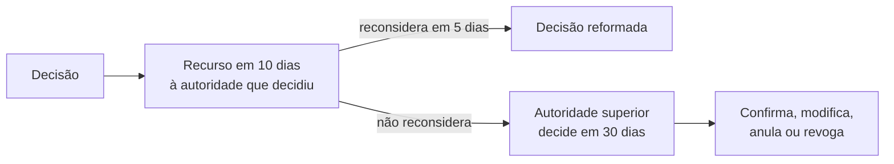

Este capítulo segue o caminho natural do processo estadual depois que ele começa: o cuidado com a intimação, a instrução com as provas, o parecer e o relatório, o dever de decidir e de motivar a decisão, os recursos e a revisão, e as regras de contagem de prazos. É a parte mais cobrada da Lei 11.781/2000, porque reúne números e conceitos que se confundem, como o efeito suspensivo, o prazo próprio e impróprio e a reforma para pior.

> [!objetivos]
> - Aplicar as regras de intimação, nulidade e efeitos do não comparecimento.
> - Descrever a instrução, o ônus da prova, a consulta pública e os pareceres.
> - Identificar quando a decisão deve ser motivada e quais são os modos de extinção do processo.
> - Distinguir recurso e revisão e aplicar prazos, efeitos e a Súmula Vinculante 21.

## Intimação: nulidade e consequências

Para interessados indeterminados, desconhecidos ou de domicílio indefinido, a intimação é feita por **publicação oficial** (art. 26, § 4º). A regra geral é que a intimação feita sem observar as formalidades legais é **nula**, mas o **comparecimento do administrado supre a falta ou a irregularidade** (art. 26, § 5º). Isso é aplicação da instrumentalidade das formas: se a finalidade foi atingida, a irregularidade se considera sanada. A falta de intimação, porém, continua sendo causa de nulidade quando o administrado não comparece.

O art. 27 protege o administrado: o **desatendimento da intimação não importa reconhecimento da verdade dos fatos**, nem renúncia a direito. Ele continua com a garantia de ampla defesa no prosseguimento do processo. Portanto, não há preclusão: quem não atendeu à intimação pode se defender depois, e a Administração deve analisar a defesa antes da decisão.

> [!pegadinha] Silêncio não é confissão
> "O interessado que não atende à intimação aceita como verdadeiros os fatos alegados" é erro. O desatendimento não equivale ao reconhecimento dos fatos nem à renúncia de direitos.

## Instrução

**Instrução** é a fase destinada a averiguar e comprovar os dados necessários à decisão. As atividades de instrução se realizam de ofício ou por impulso do órgão responsável, sem prejuízo do direito dos interessados de propor provas (art. 29). O órgão faz constar dos autos os dados necessários à decisão, e os atos que dependem do interessado devem ser realizados do modo **menos oneroso** para ele. Prova conseguida por meio ilícito não pode ser usada (art. 30).

### Participação de terceiros

Se a matéria for de interesse geral, o órgão competente pode abrir **consulta pública**, por despacho motivado, antes da decisão, se isso não prejudicar a parte interessada (art. 31). A abertura é divulgada por meios oficiais, com prazo para alegações escritas. Quem comparece à consulta **não se torna interessado** no processo, mas tem direito a resposta fundamentada, que pode ser comum a alegações substancialmente iguais. Pode haver também **audiência pública** para debates (art. 32), outros meios de participação por organizações e associações (art. 33) e reunião conjunta com outros órgãos, com ata juntada aos autos (art. 35).

### Ônus da prova

Cabe ao interessado provar o que alegou, sem prejuízo do dever do órgão de instrução (art. 36). Se o interessado declarar que os dados constam de documentos da própria Administração ou de outro órgão, o órgão de instrução os obtém **de ofício** (art. 37). Durante a instrução e antes da decisão, o interessado pode juntar documentos e pareceres, requerer diligências e perícias e apresentar alegações (art. 38).

Quando a prestação de informações ou a produção de provas pelo interessado ou por terceiros for necessária, expedem-se intimações com data, prazo, forma e condições. Se a intimação não for atendida, o órgão pode, se julgar a matéria relevante, **suprir de ofício a omissão**, sem se eximir de decidir (art. 39). Mas, se os dados solicitados forem necessários à apreciação de **pedido do próprio interessado** e ele não os apresentar no prazo, o processo é **arquivado**, por decisão motivada e comunicada (art. 40).

Para provas e diligências, a intimação exige antecedência mínima de três dias úteis, com data, hora e local.

### Pareceres e laudos

Quando devem ser ouvidos órgãos consultivos, o parecer deve ser emitido em **até quinze dias**, salvo norma especial ou necessidade comprovada de mais tempo (art. 42). Se o prazo não for cumprido, as consequências dependem do tipo de parecer.

| Parecer | Se não for emitido no prazo |
| --- | --- |
| Obrigatório e vinculante | O processo **não segue** até a apresentação; responsabiliza-se quem causou o atraso |
| Obrigatório e não vinculante | O processo **pode prosseguir** e ser decidido sem o parecer; quem se omitiu responde |

Se laudos técnicos obrigatórios não forem entregues no prazo, o órgão de instrução solicita laudo de outro órgão com qualificação equivalente (art. 43).

### Manifestação, vista e relatório

Encerrada a instrução, o interessado tem direito a manifestar-se em prazo máximo de **dez dias**, salvo outro prazo legal (art. 44). Em caso de risco iminente, a Administração pode adotar **providências acauteladoras** sem ouvir previamente o interessado, de forma motivada (art. 45). Os interessados têm direito à vista do processo e a certidões e cópias, com exceção das informações de terceiros que a lei protege por sigilo ou por respeito à privacidade, à honra e à imagem (art. 46).

Se o órgão de instrução não for o competente para decidir, elabora um **relatório** que resume o que foi pedido, o que ocorreu em cada fase e uma proposta de decisão bem justificada, e remete o processo a quem pode decidir (art. 47).

## Decisão e motivação

A Administração é obrigada a **decidir** os processos e responder a pedidos e reclamações que sejam de sua alçada (art. 48). O prazo é de **até trinta dias** após a instrução, **prorrogável por até trinta dias** com motivação expressa (art. 49).

Exige-se **motivação**, isto é, a explicação dos fatos e das razões jurídicas, nos atos que (art. 50):

1. neguem, limitem ou afetem direitos ou interesses;
2. imponham ou agravem deveres, encargos ou sanções;
3. decidam concurso, licitação ou seleção pública;
4. dispensem licitação ou declarem sua inexigibilidade;
5. decidam recursos administrativos;
6. decorram de reexame de ofício;
7. deixem de aplicar jurisprudência firmada ou discrepem de pareceres, laudos, propostas e relatórios oficiais;
8. importem anulação, revogação, suspensão ou convalidação de ato.

A motivação deve ser **explícita, clara e congruente** e pode consistir em concordância com fundamentos de pareceres e decisões anteriores, que passam a integrar o ato (a chamada motivação *aliunde*). Para vários assuntos de mesma natureza, pode-se usar meio mecânico ou eletrônico que reproduza os fundamentos, se isso não prejudicar direitos. A motivação das decisões de órgãos colegiados, de comissões ou decisões orais consta da ata ou de termo escrito.

> [!bizu] Quando motivar
> Memorize a ideia central: ato que **tira ou limita direitos**, que **impõe deveres**, que **decide recurso, concurso ou licitação** ou que **desfaz ato anterior** precisa de motivação. O resto é variação desses grupos.

### Desistência e extinção

O interessado pode, por manifestação escrita, **desistir** total ou parcialmente do pedido ou **renunciar** a direitos disponíveis (art. 51). Com vários interessados, a desistência atinge só quem a formulou. E a Administração pode continuar o processo se o interesse público exigir. O processo é declarado **extinto** quando a sua finalidade já foi alcançada ou quando um fato novo torna o objeto impossível, inútil ou sem sentido (art. 52).

## Recurso administrativo

O **recurso** é o pedido de reforma ou reexame da decisão, dentro do prazo. A **revisão**, ao contrário, ocorre a qualquer tempo, a pedido ou de ofício, para adequar sanção diante de fatos novos ou circunstâncias relevantes. Cabe recurso por razões de **legalidade e de mérito** (art. 56).

| Aspecto | Regra |
| --- | --- |
| Destinatário | A própria autoridade que decidiu, que pode reconsiderar em cinco dias ou encaminhar à autoridade superior (recurso hierárquico) |
| Caução | Dispensada; a exigência de depósito ou arrolamento prévios é inconstitucional |
| Instâncias | No máximo três instâncias administrativas, salvo disposição legal diversa |
| Legitimados | Titulares de direitos que são parte; quem tem direitos indiretamente afetados; organizações e associações (coletivos); cidadãos e associações (difusos) |
| Prazo para recorrer | Dez dias, contados da ciência ou divulgação oficial (prazo próprio, preclusivo) |
| Prazo para decidir | Trinta dias do recebimento dos autos, prorrogáveis por igual período (prazo impróprio) |
| Efeito | Em regra só devolutivo; efeito suspensivo apenas se a lei previr ou por decisão fundamentada |
| Contrarrazões | Os demais interessados são intimados para alegações em cinco dias úteis |

> [!jurisprudencia] STF, Súmula Vinculante 21
> Não pode a Administração condicionar o conhecimento de recurso administrativo a depósito ou arrolamento prévio de dinheiro ou de bens, sob pena de inconstitucionalidade.

Por causa da súmula, a ressalva do art. 56, § 2º ("salvo exigência legal") perdeu aplicação prática: o recurso administrativo independe de caução.

O prazo de dez dias para recorrer é **próprio**: o recurso intempestivo não é conhecido. O prazo de trinta dias para a Administração decidir é **impróprio**: se a decisão sair depois, não há nulidade; a consequência é eventual responsabilização do agente pelo atraso.

Não se **conhece** do recurso (art. 63) quando interposto fora do prazo, perante órgão incompetente, por quem não é legitimado ou depois de exaurida a esfera administrativa. Se for apresentado a órgão incompetente, indica-se a autoridade competente e **devolve-se o prazo**. O não conhecimento não impede a revisão de ofício do ato ilegal, desde que não tenha ocorrido preclusão administrativa.

### Efeitos do recurso

O **efeito devolutivo** leva toda a matéria à instância superior, que pode anular, reformular ou manter a decisão; os efeitos da decisão continuam em vigor enquanto o recurso não é decidido. O **efeito suspensivo** paralisa a execução até a análise do recurso. A regra é a **ausência** de efeito suspensivo (art. 61), mas, se houver justo receio de prejuízo de difícil ou incerta reparação, a autoridade recorrida ou a imediatamente superior pode concedê-lo, de ofício ou a pedido.

Ao julgar, o órgão competente pode **manter, alterar, anular ou revogar** a decisão, no todo ou em parte (art. 64). Pode inclusive piorar a situação de quem recorreu (*reformatio in pejus*), mas só depois de avisar o recorrente para que ele se manifeste.

## Revisão

A revisão alcança os processos que terminaram em sanção. Ela pode ocorrer **a qualquer tempo**, por pedido do interessado ou por iniciativa da Administração, sempre que aparecerem fatos novos ou circunstâncias relevantes que mostrem que a pena aplicada foi inadequada (art. 65). Há uma garantia importante: na revisão, a pena **não pode ser agravada**. O servidor que pede a revisão, portanto, não corre o risco de sair pior do que entrou. Isso a diferencia do recurso, em que a lei admite a reforma para pior, mas só depois de dar ao recorrente a chance de se manifestar. A revisão não tem prazo, o que a torna um instrumento de correção de injustiças mesmo muito depois da decisão final.

| Instituto | Prazo | Reforma para pior |
| --- | --- | --- |
| Recurso | Dez dias | Possível, com ciência prévia do recorrente |
| Revisão | A qualquer tempo | **Vedada** |

> [!atencao] Reformatio in pejus
> A lei permite agravar a situação do recorrente apenas no recurso, e proíbe no caso de revisão de sanção. Alternativas que invertam isso são falsas.

## Contagem de prazos

As regras dos arts. 66 e 67 são cobradas literalmente.

1. Os prazos começam da **cientificação oficial**, excluindo-se o dia do começo e incluindo-se o do vencimento.
2. Se o vencimento cair em dia sem expediente ou com expediente reduzido, prorroga-se até o primeiro dia útil seguinte.
3. Na contagem em dias, computam-se **somente dias úteis**.
4. Prazos em meses ou anos contam-se de data a data; se não houver o dia equivalente, o termo é o último dia do mês.
5. Os prazos **não se suspendem**, salvo força maior comprovada.

Há uma suspensão especial: o período de **20 de dezembro a 20 de janeiro**, inclusive, suspende o prazo processual e a realização de audiências e sessões de julgamento, mas não alcança os processos licitatórios.

## Sanções e disposições finais

A lei trata pouco de sanções, remetendo-as às leis específicas. O art. 68 diz que elas são aplicadas por autoridade competente, segundo as disposições estatutárias do servidor, assegurado o contraditório, e só depois de esgotadas as instâncias recursais. Os processos administrativos específicos continuam regidos por lei própria, e a Lei 11.781/2000 se aplica **subsidiariamente** (art. 69).

Têm **prioridade** na tramitação os processos de pessoas com 60 anos ou mais, com deficiência, mobilidade reduzida, doença grave ou rara, autismo e ostomizadas, quando forem parte ou intervenientes (art. 69-A). O interessado prova a condição e requer o benefício, e a prioridade vai até o trânsito em julgado.

> [!resolvido] Questão comentada
> **Enunciado:** o chefe de uma repartição inadmite recurso administrativo por falta de depósito prévio exigido por lei. Ele agiu de acordo com o ordenamento? 
>
> **Resolução:** não. A Súmula Vinculante 21 do STF declara inconstitucional a exigência de depósito ou arrolamento prévios para admitir recurso administrativo. Mesmo que haja lei prevendo a garantia, ela não pode ser exigida.

## Quem decide cada coisa

Para fixar quem pratica cada ato, organize em um quadro.

| Ato | Quem pratica |
| --- | --- |
| Instrução | Órgão responsável pelo processo, de ofício, com participação dos interessados |
| Relatório e proposta | Órgão de instrução, quando não for o competente para decidir |
| Decisão | Autoridade competente, em trinta dias |
| Recurso | Autoridade que decidiu e, se não reconsiderar, a superior |
| Revisão | A Administração, de ofício, ou o interessado, a pedido |

Essa divisão mostra que o processo tem papéis distintos: quem investiga, quem propõe e quem decide, o que protege a imparcialidade e a qualidade da decisão. Nada impede que o mesmo órgão seja o competente para instruir e decidir; nesse caso, o relatório é dispensável.

Sobre as **modalidades** de processo, a lei estadual cuida do processo comum, que se inicia de ofício ou a pedido, e remete os processos específicos, como o disciplinar, o licitatório e o de concurso, às leis próprias, aplicando-se a ela apenas de modo subsidiário. É por isso que o processo administrativo disciplinar, com sindicância e rito sumário, tem regras detalhadas em outra norma, estudada nos capítulos seguintes. Conceito, princípios e fases, vistos aqui e no capítulo anterior, formam a base comum a todas as modalidades.

Em resumo, a lei estadual oferece ao administrado um caminho previsível, com prazos curtos e garantias claras, e exige da Administração transparência e motivação em cada passo.

## Resumo dos números

Reunir os números evita a troca na hora da prova.

| Situação | Número |
| --- | --- |
| Parecer de órgão consultivo | 15 dias |
| Manifestação após a instrução | Até 10 dias |
| Decisão após a instrução | 30 dias, prorrogáveis por 30 |
| Intimação para prova ou diligência | 3 dias úteis de antecedência |
| Recurso (prazo para interpor) | 10 dias |
| Reconsideração pela autoridade recorrida | 5 dias |
| Alegações dos demais interessados no recurso | 5 dias úteis |
| Decisão do recurso | 30 dias, prorrogáveis por igual período |
| Instâncias recursais | No máximo três |

> [!lei] Lei estadual 11.781/2000, art. 61
> Salvo disposição legal em contrário, o recurso não tem efeito suspensivo.

> [!bizu] Recurso sem freio
> O recurso administrativo, por si, **não segura** a execução da decisão. Só com previsão legal ou com decisão fundamentada, diante de risco de dano de difícil reparação, o efeito suspensivo é concedido.

## Treino comentado

**Uma empresa pede benefício e tem o pedido negado.** O indeferimento deve ser motivado, porque nega direito. Dessa decisão cabe recurso, dirigido à própria autoridade que decidiu; se ela não reconsiderar em cinco dias, remete o recurso à autoridade superior.

**Um servidor punido descobre fato novo que o favorece.** Ele pode pedir revisão a qualquer tempo, mas a pena não poderá ser agravada. Quem diz que a revisão pode piorar a situação do servidor, como no recurso, troca os institutos.

**O prazo de decisão do recurso foi ultrapassado.** A decisão não é nula, porque o prazo é impróprio. A consequência possível é a responsabilização do agente que causou o atraso.

**O recurso chega ao órgão errado.** Não será conhecido por incompetência, mas a Administração indica a autoridade correta e devolve o prazo ao recorrente.

**Pedido do interessado sem os dados necessários.** Se os dados são indispensáveis ao pedido e o interessado não os apresenta no prazo, o processo é arquivado, com decisão motivada. Já em processo instaurado de ofício, a Administração pode suprir a omissão.

## Mapa do capítulo

| Tema | Regra central | Armadilha |
| --- | --- | --- |
| Intimação | Nula sem as formalidades, mas o comparecimento supre | Dizer que a falta nunca é nula |
| Desatendimento | Não gera confissão nem renúncia | Presumir verdadeiros os fatos |
| Instrução | Provas ilícitas inadmissíveis; ônus do interessado | Aceitar prova ilícita |
| Parecer | 15 dias; vinculante trava o processo | Trocar vinculante por não vinculante |
| Decisão | 30 dias, prorrogáveis por 30, motivada | Dispensar motivação |
| Recurso | 10 dias; sem efeito suspensivo, em regra | Dar efeito suspensivo automático |
| Caução | Dispensada (SV 21) | Admitir depósito prévio |
| Revisão | Qualquer tempo; sem agravamento | Permitir reforma para pior |
| Prazos | Dias úteis; suspensão de 20/12 a 20/01 | Contar dias corridos |

### Para fixar

1. A intimação feita sem as formalidades é nula, mas o comparecimento do administrado supre a falha.
2. O desatendimento da intimação não importa reconhecimento dos fatos nem renúncia a direito.
3. As provas obtidas por meio ilícito são inadmissíveis, e a consulta pública não torna o participante um interessado.
4. O parecer deve sair em quinze dias; se for obrigatório e vinculante, o processo aguarda; se não vinculante, pode seguir.
5. Após a instrução, o interessado tem até dez dias para se manifestar, e a decisão sai em trinta dias, prorrogáveis por trinta.
6. Devem ser motivados os atos que neguem direitos, imponham deveres, decidam recursos, concursos ou licitações e desfaçam atos anteriores.
7. O recurso tem prazo de dez dias, em regra só efeito devolutivo, e dispensa caução (SV 21).
8. O prazo de dez dias para recorrer é próprio; o de trinta para decidir é impróprio.
9. A reforma para pior é possível no recurso, com ciência prévia, e vedada na revisão.
10. Na contagem de prazos, computam-se dias úteis, e o período de 20 de dezembro a 20 de janeiro suspende o prazo processual.
