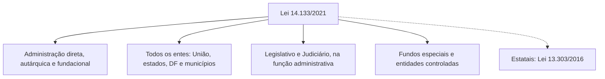

Quando a Administração precisa de algo que não produz sozinha, como a pintura de uma escola, a compra de viaturas ou a construção de um quartel, ela contrata um terceiro. A pergunta que o Direito faz é: quem será esse terceiro e como ele será escolhido? A resposta, na maioria dos casos, é a licitação. Este capítulo apresenta o conceito, mostra de onde vem a competência para legislar sobre o tema e delimita quem deve licitar, o que se licita e quais contratações ficam fora da Lei 14.133/2021, a norma geral hoje em vigor.

> [!objetivos]
> - Definir licitação e explicar para que ela serve.
> - Indicar o fundamento constitucional e a repartição de competência legislativa sobre licitações.
> - Distinguir as duas normas gerais vigentes (Lei 14.133/2021 e Lei 13.303/2016) e entender a transição que acabou em 2023.
> - Listar quem se sujeita à Lei 14.133/2021, os objetos a que ela se aplica e as contratações que ficam de fora.

## Para que serve a licitação

Imagine que a escola do bairro precisa de nova pintura. O poder público pode usar os próprios servidores ou contratar uma empresa. Na maior parte dos casos, a segunda via é a escolhida. De um lado há uma necessidade da Administração; do outro, um terceiro que pode atendê-la. A relação entre os dois será formalizada por um contrato administrativo. A licitação é o caminho que leva da necessidade ao contrato: um procedimento prévio que escolhe quem vai contratar.

Quem tem uma empresa particular escolhe livremente com quem negociar, até mesmo amigos e parentes. Com o dinheiro público é diferente. A escolha precisa ser objetiva, aberta e igual para todos, por duas razões:

- respeitar a **isonomia** e a **impessoalidade**, para que ninguém seja favorecido ou prejudicado sem motivo;
- selecionar a **proposta mais vantajosa** para o interesse público, e a pessoa que vai firmar o contrato, por critérios objetivos.

## Conceito de licitação

Em termos formais, licitação é um **procedimento administrativo** em que o poder público, ao exercer função administrativa, convida os interessados a competir. Quem aceita as condições do edital pode apresentar proposta, e a Administração escolhe a que melhor atende ao interesse público para então contratar.

Cada parte dessa definição guarda uma ideia cobrada em prova:

| Elemento | Significado |
| --- | --- |
| Procedimento administrativo | Conjunto de atos encadeados, praticados em sequência, que levam a um resultado final (divulgação do edital, propostas, julgamento, habilitação, homologação) |
| Função administrativa | Quem licita está administrando, mesmo que seja o Legislativo ou o Judiciário |
| Aberto aos interessados | Todos que cumprirem as condições do edital podem participar |
| Instrumento convocatório | O edital (ou instrumento equivalente) fixa as regras da disputa e do futuro contrato; quem participa aceita essas regras |
| Propostas | A Administração recebe propostas e escolhe a mais vantajosa |
| Finalidade | Celebrar um contrato |

> [!bizu] Licitação é procedimento, não ato isolado
> Se a alternativa disser que a licitação é um único ato administrativo, está errada. Ela é uma sequência de atos (fases) que termina na adjudicação e na homologação, e só depois leva ao contrato.

A licitação também é um **dever de regra, com exceções**. A Constituição manda licitar, mas admite que a lei especifique casos em que não se licita (dispensa e inexigibilidade, estudadas adiante). Quando houver dúvida em uma assertiva, lembre que a regra é licitar e a contratação direta é a exceção, sempre dependente de previsão legal.

## Fundamento constitucional e competência legislativa

O alicerce das licitações está no **art. 37, XXI, da Constituição**. A regra manda licitar quando o poder público quer realizar obras, contratar serviços, comprar ou vender, e a licitação deve tratar todos os concorrentes de forma igual. A proposta vencedora tem de manter as condições com que foi apresentada, e o edital só pode pedir comprovação técnica e econômica que seja realmente indispensável para garantir o cumprimento do contrato. A própria Constituição abre espaço para que a lei crie exceções.

> [!lei] CF/88, art. 37, XXI
> Ressalvados os casos especificados na legislação, as obras, serviços, compras e alienações serão contratados mediante processo de licitação pública que assegure igualdade de condições a todos os concorrentes, com cláusulas que estabeleçam obrigações de pagamento, mantidas as condições efetivas da proposta, nos termos da lei, o qual somente permitirá as exigências de qualificação técnica e econômica indispensáveis à garantia do cumprimento das obrigações.

Duas observações decorrem do texto:

1. a expressão "ressalvados os casos especificados na legislação" legitima a existência de contratações diretas;
2. a Constituição fala em **obras, serviços, compras e alienações**, e a lei detalha esse alcance.

### Quem legisla sobre licitações

O **art. 22, XXVII**, da Constituição reserva à União a competência **privativa** de editar as normas gerais sobre licitar e contratar. Essas normas alcançam a administração direta, as autarquias e as fundações de qualquer ente, além das estatais, conforme o art. 173, § 1º, III.

O desenho resultante é este:

| Quem | Competência |
| --- | --- |
| União | Normas **gerais**, que valem para todos os entes |
| Estados, Distrito Federal e Municípios | Normas **específicas**, que valem apenas para o respectivo ente |

Não existe lista fechada do que seja norma geral. Considera-se geral o que precisa ser uniforme no país inteiro, por exemplo o rol de modalidades, as hipóteses de contratação sem licitação, a forma de julgar propostas e os requisitos para habilitar licitantes.

> [!atencao] Delegação não é necessária
> Em outras matérias do art. 22, a União pode autorizar os estados a legislar por lei complementar (art. 22, parágrafo único). Em licitações isso não acontece: estados, DF e municípios podem editar normas específicas por competência própria, sem delegação. A União pode editar normas específicas também, mas elas valem apenas para a própria União.

### Estatuto das estatais

A Emenda Constitucional 19/1998 mandou criar um estatuto jurídico para empresas públicas e sociedades de economia mista, com regras próprias de licitação e contratação (art. 173, § 1º, III). Esse estatuto é a **Lei 13.303/2016**. Por isso existem **duas normas gerais** de licitação vigentes:

| Norma | Aplica-se a |
| --- | --- |
| Lei 14.133/2021 | Administrações diretas, autárquicas e fundacionais de todos os entes |
| Lei 13.303/2016 | Empresas públicas, sociedades de economia mista e suas subsidiárias |

## A Lei 14.133/2021 e o fim do regime antigo

A Lei 14.133/2021, chamada de Lei de Licitações e Contratos Administrativos (LLC), regulamenta o art. 37, XXI, da Constituição. Para fins de leitura, ela também aparece nas provas como Estatuto Geral de Licitações ou Nova Lei de Licitações.

Antes dela havia três normas principais: a **Lei 8.666/1993** (regime geral), a **Lei 10.520/2002** (pregão) e o **Regime Diferenciado de Contratações (RDC)**, da Lei 12.462/2011. A nova lei começou a valer na publicação, mas conviveu com as antigas durante um período de transição.

- Foram revogados de imediato os artigos 89 a 108 da Lei 8.666, que tratavam dos crimes e das penas em licitações. Esses crimes foram transferidos para o Código Penal (arts. 337-E a 337-P).
- A Lei 8.666, a Lei 10.520 e os artigos 1º a 47-A do RDC foram revogados em **30 de dezembro de 2023**, ao fim da transição (art. 193).

Durante a transição, o gestor podia escolher entre o regime antigo e o novo, mas **sem misturá-los**. Hoje todas as novas licitações seguem a Lei 14.133/2021. Os contratos, porém, podem conviver: quem foi licitado ou contratado diretamente sob o regime antigo continua regido por ele **durante toda a vigência do contrato** (arts. 190 e 191).

> [!lei] Lei 14.133/2021, art. 190
> Art. 190. O contrato cujo instrumento tenha sido assinado antes da entrada em vigor desta Lei continuará a ser regido de acordo com as regras previstas na legislação revogada.

O quadro da transição fica assim:

| Ponto | Regra |
| --- | --- |
| Vigência da Lei 14.133 | Desde a publicação, em abril de 2021 |
| Vigência da Lei 8.666, da Lei 10.520 e do RDC | Até 30/12/2023, quando foram revogados |
| Regime do contrato | Segue a norma usada na licitação ou na contratação direta, até o fim do contrato |
| Mistura de regimes | Proibida |

> [!pegadinha] "A Lei 8.666 foi revogada, logo não existe mais contrato por ela"
> Alternativas assim erram ao ignorar a regra de sobrevivência. Existem contratos antigos que continuam sendo regidos pela Lei 8.666 até acabar a vigência. O que não existe mais é licitação nova pelas leis antigas.

## Âmbito de aplicação: quem deve licitar

O art. 1º define os destinatários da Lei 14.133/2021:

1. a administração **direta**, as **autarquias** e as **fundações** (estas, tanto de direito público quanto de direito privado);
2. de **qualquer ente** da federação: União, estados, Distrito Federal e municípios.

O texto ainda inclui:

- os órgãos do **Legislativo e do Judiciário** da União, dos estados e do DF, bem como os do **Legislativo municipal**, sempre que atuarem em **função administrativa** (município não tem Judiciário próprio);
- os **fundos especiais** e as demais **entidades que a Administração controle**, de forma direta ou indireta.

Vale explicar cada ponto, porque as bancas costumam cobrar o texto de modo literal.

**Legislativo e Judiciário.** Licitar é função administrativa, e todos os Poderes a exercem para cuidar das próprias necessidades. Por isso um tribunal que compra computadores ou uma assembleia que contrata limpeza seguem a lei. A ressalva "quando no desempenho de função administrativa" aparece no texto e costuma ser cobrada.

**Fundos especiais.** Um fundo é um conjunto de recursos destinado por lei a uma finalidade, como o fundo da educação básica. Quem licita, na prática, é o órgão que gere esses recursos, mas a lei diz que os fundos se submetem a ela.

**Entidades controladas.** A lei não explica com precisão quais são. Para a prova, basta saber que elas **devem licitar**.

**Fundações.** Tanto as fundações públicas de direito público quanto as de direito privado seguem a Lei 14.133/2021. Uma pegadinha comum afirma que a lei vale só para as de direito público.

> [!pegadinha] Estatais não seguem a Lei 14.133 em regra
> As empresas públicas, as sociedades de economia mista e suas subsidiárias **não** são abrangidas pela Lei 14.133/2021, porque têm lei própria (Lei 13.303/2016). Isso não significa que não licitem: elas licitam, mas pelas regras do estatuto delas. Afirmar que "estatais não fazem licitação" é erro. Dizer que "estatais seguem a Lei 14.133" também é erro, com uma exceção: as disposições **penais** da Lei 14.133 (crimes do art. 178, inseridos no Código Penal) aplicam-se também às estatais (art. 185).

Resumindo o alcance subjetivo:

| Sujeito | Segue a Lei 14.133/2021? |
| --- | --- |
| Administração direta, autarquias e fundações (União, estados, DF e municípios) | Sim |
| Legislativo e Judiciário, na função administrativa | Sim |
| Fundos especiais e entidades controladas | Sim |
| Empresas públicas, sociedades de economia mista e subsidiárias | Não, em regra (Lei 13.303/2016), mas sim quanto aos crimes |

### Situações especiais do art. 1º

Os parágrafos do art. 1º criam exceções pontuais. Em geral, só interessam em questões com afirmações absolutas ("sempre", "todos", "apenas"). São três:

- **Repartições no exterior.** As compras e contratações de uma embaixada, por exemplo, respeitam os princípios básicos da lei, mas seguem regulamento específico, editado por ministro de Estado, que leva em conta as condições do país onde a repartição fica. Nem todas as regras brasileiras cabem na realidade local.
- **Recursos de organismos internacionais.** Quando a obra ou a compra é paga com dinheiro emprestado ou doado por agência estrangeira de cooperação ou por banco de desenvolvimento do qual o Brasil participa, aceitam-se regras vindas de tratados aprovados pelo Congresso e ratificados, ou regras próprias do financiador. Há limites: a regra precisa ser condição para obter o recurso, não pode ferir a Constituição e deve vir descrita no contrato de financiamento, após parecer favorável do órgão jurídico do contratante.
- **Reservas internacionais.** A administração das reservas em moeda estrangeira do país, e os serviços acessórios a ela, seguem norma editada pelo Banco Central, que deve respeitar os princípios do art. 37 da Constituição.

> [!lei] Lei 14.133/2021, art. 1º, § 2º
> § 2º As contratações realizadas no âmbito das repartições públicas sediadas no exterior obedecerão às peculiaridades locais e aos princípios básicos estabelecidos nesta Lei, na forma de regulamentação específica a ser editada por ministro de Estado.

## Objetos a que a lei se aplica

Saber quem licita é metade da questão. A outra metade é saber **o quê** se licita. O art. 2º diz que a Lei 14.133/2021 se aplica a:

1. **alienação** de bens e concessão de direito real de uso;
2. **compra**, inclusive por encomenda;
3. **locação**;
4. **concessão e permissão de uso** de bens públicos;
5. **prestação de serviços**, inclusive os técnico-profissionais especializados;
6. **obras** e serviços de **arquitetura e engenharia**;
7. contratações de **tecnologia da informação e de comunicação**.

Há um detalhe importante: nessa lista não aparecem as **concessões e permissões de serviços públicos**. Elas são contratos de delegação de serviços públicos e têm leis próprias. Não confunda com a concessão e a permissão de **uso de bens públicos**, que constam da lista. Por exemplo, a licitação para a concessão de uso de um quiosque no calçadão da praia segue a Lei 14.133/2021 como regra principal, porque é uso de bem público, e não serviço público.

### Leis especiais e aplicação subsidiária

Em alguns casos existe uma lei especial que vem primeiro. A Lei 14.133/2021 se aplica apenas de forma **subsidiária**, isto é, completando as lacunas, quando o contrato for regido por:

| Lei especial | Assunto |
| --- | --- |
| Lei 8.987/1995 | Concessão e permissão de serviços públicos |
| Lei 11.079/2004 | Parcerias público-privadas (PPPs) |
| Lei 12.232/2010 | Serviços de publicidade prestados por agências de propaganda |

> [!bizu] Quando a pergunta for genérica, use a Lei 14.133
> Não é preciso decorar caso a caso quando se usa a Lei 14.133. Se a questão tratar de "contratos administrativos" de forma geral, a base é a Lei 14.133/2021. Memorize apenas os três casos de lei especial acima.

O art. 184 acrescenta outra aplicação subsidiária: a lei vale, no que couber e na falta de norma específica, para **convênios, acordos, ajustes** e instrumentos parecidos firmados pela Administração, nos termos de regulamento do Poder Executivo federal.

### O que fica de fora: art. 3º

O art. 3º lista dois casos que **não se subordinam** ao regime da Lei 14.133/2021:

1. os contratos de **operação de crédito**, interna ou externa, e de gestão da dívida pública, o que inclui contratar o agente financeiro e dar a garantia ligada a essas operações;
2. contratações sujeitas a normas previstas em **legislação própria**.

O primeiro caso é simples: quando a União contrata um financiamento ou refinancia dívida, não faz licitação nos moldes da lei. No segundo, a Administração obedece a norma específica. Um exemplo é a locação em que o poder público é o **inquilino**, regida pela Lei do Inquilinato (Lei 8.245/1991). A locação aparece como objeto no art. 2º, mas o art. 3º, II, afasta a lei quando existe legislação própria. Para a prova, guarde o texto literal dos dois artigos e não tente conciliá-los com exemplos de fora da lei.

> [!atencao] Compra x alienação x locação
> No art. 2º, a alienação é a **venda** de bens pelo poder público. A compra é a **aquisição** pelo poder público. Esses termos aparecem juntos na lei, mas têm sentidos opostos. Troque-os numa alternativa e a questão ficará errada.

## Valores da lei e atualização por decreto

A Lei 14.133/2021 contém vários valores em reais, como os limites da dispensa por valor e do contrato verbal. O art. 182 manda atualizá-los **anualmente** por decreto, conforme índice previsto na própria lei. Isso cria uma diferença entre o texto original e o valor efetivamente aplicado. Para as provas, trabalhe com os dois: o valor que está no texto da lei (muito cobrado literalmente) e o valor atualizado, quando a questão indicar o decreto vigente.

O Decreto 12.807/2025 fixou, para o ano em que foi editado, estes valores de referência:

| Situação | Valor no texto da lei, em reais | Valor atualizado pelo Decreto 12.807/2025, em reais |
| --- | --- | --- |
| Contrato de grande vulto (art. 6º, XXII) | 200.000.000,00 | 261.968.421,04 |
| Dispensa por valor: obras, serviços de engenharia e manutenção de veículos (art. 75, I) | 100.000,00 | 130.984,20 |
| Dispensa por valor: compras e demais serviços (art. 75, II) | 50.000,00 | 65.492,11 |
| Contrato verbal (art. 95, § 2º) | 10.000,00 | 13.098,41 |

> [!atencao] Valores mudam todo ano
> Esses números são de consulta. Eles são atualizados periodicamente por novo decreto. Em prova, a banca costuma usar o valor da lei, salvo se citar o decreto ou o ano. Se houver conflito entre a lei e o decreto, leia o enunciado para saber qual dos dois está sendo pedido.

## Como a banca cobra este assunto

As questões de âmbito de aplicação costumam seguir quatro padrões:

1. **Troca de destinatário.** Afirmar que a Lei 14.133 vale para as empresas estatais, ou que não se aplica às fundações de direito privado.
2. **Absolutos.** Dizer que as repartições no exterior seguem "integralmente" a lei, ou que as estatais "não licitam".
3. **Troca de objeto.** Incluir as concessões de serviço público no art. 2º, ou excluir a concessão de uso de bem público.
4. **Transição.** Dizer que um contrato assinado após a revogação ainda pode seguir a Lei 8.666, ou que é possível combinar as duas leis.

> [!resolvido] Questão comentada: estatais e licitação
> Uma sociedade de economia mista estadual precisa comprar equipamentos. Ela deve seguir a Lei 14.133/2021?
>
> **Resolução.** Em regra, não. As sociedades de economia mista e suas subsidiárias têm regime próprio, a Lei 13.303/2016 (art. 1º, § 1º, da Lei 14.133). Isso não as dispensa de licitar: elas licitam pelo estatuto delas. A exceção é que os crimes licitatórios da Lei 14.133 (art. 178) também as alcançam (art. 185).

> [!exemplo] Exemplo prático: quiosque e delegação
> A prefeitura quer permitir que um comerciante explore um quiosque na orla. Isso é concessão de uso de **bem público**: regime principal da Lei 14.133. Se a prefeitura quiser delegar o serviço de transporte coletivo, trata-se de concessão de **serviço público**: Lei 8.987/1995 em primeiro lugar, com a Lei 14.133 apenas como apoio nas omissões.

## Mapa do capítulo

| Tema | Ideia central | Armadilha |
| --- | --- | --- |
| Licitação | Procedimento administrativo aberto para escolher a proposta mais vantajosa e firmar contrato | Tratar como ato isolado ou como faculdade livre |
| Fundamento | CF, art. 37, XXI | Esquecer a ressalva dos casos previstos em lei |
| Competência | União, normas gerais (art. 22, XXVII); demais entes, normas específicas sem delegação | Exigir lei complementar de delegação |
| Normas gerais | Lei 14.133/2021 e Lei 13.303/2016 | Aplicar a Lei 14.133 às estatais |
| Transição | Antigas leis revogadas em 30/12/2023; contrato segue a norma da licitação | Permitir mistura dos regimes |
| Destinatários | Administração direta, autárquica e fundacional, Legislativo e Judiciário (função administrativa), fundos e entidades controladas | Excluir fundação de direito privado |
| Objetos | Alienação, compra, locação, uso de bens, serviços, obras, engenharia, TIC | Incluir concessão de serviço público |
| Fora da lei | Operação de crédito, legislação própria | Dizer que a Lei 14.133 vale sempre |
| Valores | Lei traz o valor nominal; decreto atualiza anualmente | Confundir valor original e atualizado |

### Para fixar

1. Licitação é o procedimento administrativo, aberto aos interessados que aceitem o edital, para escolher a proposta mais vantajosa e firmar um contrato.
2. A Constituição, no art. 37, XXI, manda licitar, ressalvados os casos que a lei especificar.
3. A União edita normas gerais de licitação (art. 22, XXVII); estados, DF e municípios editam normas específicas sem precisar de delegação.
4. Há duas normas gerais: a Lei 14.133/2021 (administração direta, autárquica e fundacional) e a Lei 13.303/2016 (estatais).
5. As Leis 8.666/1993, 10.520/2002 e o RDC foram revogados em 30/12/2023; os contratos seguem a lei adotada na licitação, sem mistura de regimes.
6. A Lei 14.133/2021 vale para todos os entes, para o Legislativo e o Judiciário na função administrativa, para fundos especiais e entidades controladas, e para fundações públicas de direito público ou privado.
7. As estatais não seguem a Lei 14.133 em regra, mas os crimes licitatórios dela as alcançam.
8. O art. 2º abrange alienação, compra, locação, uso de bens públicos, serviços, obras, engenharia e TIC, mas não as concessões de serviço público.
9. As leis 8.987/1995, 11.079/2004 e 12.232/2010 têm regras especiais; a Lei 14.133 vale subsidiariamente.
10. O art. 3º exclui operações de crédito e contratações sujeitas a legislação própria.
