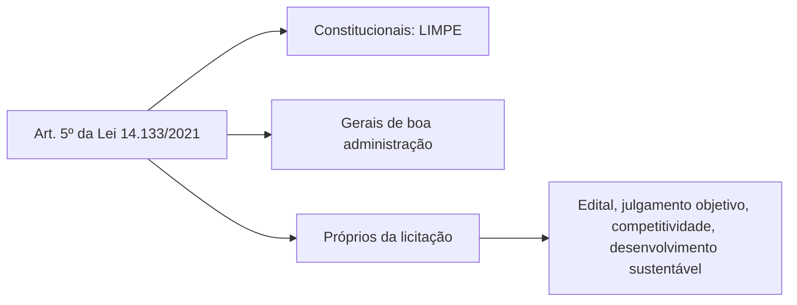

Os princípios são as ideias gerais que orientam a aplicação e a interpretação das regras. Em licitações, eles têm peso especial, porque a lei é longa e as situações reais sempre trazem casos que o texto não previu. Nesses momentos, é o princípio que indica o caminho. O art. 5º da Lei 14.133/2021 traz uma lista extensa e, como as provas costumam cobrar o texto de forma literal, é preciso conhecer a lista e o sentido de cada item. Este capítulo organiza os princípios em grupos, explica o significado de cada um e mostra as regras da lei que os concretizam.

> [!objetivos]
> - Reproduzir a lista de princípios do art. 5º e agrupá-los para memorizar.
> - Explicar o conteúdo de legalidade, impessoalidade, moralidade, probidade, igualdade, competitividade e dos demais princípios.
> - Relacionar cada princípio com regras da lei, como as vedações ao agente público (art. 9º) e a proibição de parentesco (art. 48).
> - Reconhecer princípios que não estão no art. 5º, mas são aceitos pela doutrina.

## A lista do art. 5º

Na aplicação da Lei 14.133/2021, observam-se os princípios abaixo, além das disposições da Lei de Introdução às Normas do Direito Brasileiro (LINDB).

> [!lei] Lei 14.133/2021, art. 5º
> Art. 5º Na aplicação desta Lei, serão observados os princípios da legalidade, da impessoalidade, da moralidade, da publicidade, da eficiência, do interesse público, da probidade administrativa, da igualdade, do planejamento, da transparência, da eficácia, da segregação de funções, da motivação, da vinculação ao edital, do julgamento objetivo, da segurança jurídica, da razoabilidade, da competitividade, da proporcionalidade, da celeridade, da economicidade e do desenvolvimento nacional sustentável, assim como as disposições do Decreto-Lei nº 4.657, de 4 de setembro de 1942 (Lei de Introdução às Normas do Direito Brasileiro).

São **vinte e dois** princípios. Dizer que uma lista tão grande deixa pouco espaço para princípios implícitos é um bom resumo, mas a doutrina ainda aponta alguns, como a licitação sustentável, o sigilo das propostas, a adjudicação compulsória e o formalismo moderado.

Há uma diferença entre princípios **expressos na Constituição** e princípios **expressos na lei**. Quando se fala em "princípios expressos", costuma-se pensar só nos cinco do art. 37, caput, da Constituição. A Lei 14.133/2021, porém, tem seus próprios princípios expressos, e todos os vinte e dois são "expressos" para quem estuda licitações.

### Como memorizar: três blocos

Para decorar sem se perder, vale agrupar a lista em três blocos:

| Bloco | Princípios | Ideia |
| --- | --- | --- |
| Constitucionais (art. 37, caput) | Legalidade, impessoalidade, moralidade, publicidade, eficiência | Valem para toda a Administração |
| Gerais de boa administração | Interesse público, probidade, igualdade, planejamento, transparência, eficácia, segregação de funções, motivação, segurança jurídica, razoabilidade, proporcionalidade, celeridade, economicidade | Valem em qualquer atuação pública, e aqui ganham aplicação concreta |
| Próprios das licitações | Vinculação ao edital, julgamento objetivo, competitividade, desenvolvimento nacional sustentável | Só fazem sentido numa disputa |

> [!bizu] LIMPE e o resto
> Os cinco princípios do art. 37 formam a sigla **LIMPE** (legalidade, impessoalidade, moralidade, publicidade, eficiência). Gravada a sigla, o aluno só precisa lembrar os dezessete que vêm depois. Os quatro "da licitação" são fáceis porque só cabem numa disputa pública: edital, julgamento, competição e sustentabilidade.

## Legalidade

Pela legalidade, a Administração só pode fazer o que a lei autoriza ou determina. O agente público não tem a liberdade do particular, que pode fazer tudo o que a lei não proíbe. Em licitações, isso se traduz em três consequências:

1. o agente deve seguir a lei de licitações, os regulamentos e os demais atos normativos;
2. a licitação deve respeitar o devido processo legal, com o rito e a modalidade que a lei previu para cada caso;
3. a contratação direta, sem licitação, só pode ocorrer nos casos que a lei autoriza.

A antiga Lei 8.666/1993 falava em princípio do **procedimento formal**. A Lei 14.133 não repete a expressão, mas a licitação continua sendo um processo administrativo e exige as formalidades essenciais. Esse rigor, porém, não pode ser exagerado, e por isso se fala em **formalismo moderado**, visto adiante.

## Impessoalidade e interesse público

A impessoalidade mostra-se na constante busca do interesse público. O administrador atua em nome do Estado, e por isso não pode privilegiar nem perseguir ninguém. Os dois princípios são ligados, e a impessoalidade também é chamada de princípio da **finalidade**.

Ela se desdobra em outros princípios do art. 5º, como a **igualdade** e o **julgamento objetivo**. A Administração deve tratar os licitantes de forma igual e julgar as propostas por critérios objetivos, definidos antes da disputa, sem preferências pessoais.

> [!atencao] Impessoalidade não é indiferença
> Impessoalidade não quer dizer que o agente não pode ter opinião ou que a Administração não pode escolher. Ela quer dizer que a escolha precisa decorrer de critérios objetivos e do interesse público, e não de vontade própria, favorecimento ou perseguição.

## Moralidade e probidade

Moralidade e probidade administrativa estão muito próximas. Ambas exigem que o comportamento da Administração seja não apenas legal, mas também honesto, justo e conforme as regras de boa administração. Por exemplo, o agente que favorece um amigo numa licitação viola a impessoalidade e também a moralidade.

Um ponto de prova: **moralidade e probidade** costumam ser tratadas como equivalentes, mas **imoralidade e improbidade** não são sinônimas. A improbidade é mais ampla, e a Lei 8.429/1992 prevê vários atos de improbidade, dos quais a ofensa aos princípios é só uma espécie.

A Lei 14.133 materializa esses valores em regras concretas.

### Programa de integridade

Quando a contratação for de **obra, serviço ou fornecimento de grande vulto**, o edital precisa obrigar o vencedor a implantar um **programa de integridade**, em até **seis meses** a partir da assinatura do contrato (art. 25, § 4º). O programa reúne medidas para prevenir fraudes e irregularidades dentro da empresa.

Contrato de **grande vulto** é o de valor estimado acima de R$ 200 milhões, no texto original da lei (art. 6º, XXII), valor atualizado anualmente por decreto, como visto no capítulo anterior. A exigência vale para obras, serviços e fornecimentos, e não para locações, embora a locação também possa ser de grande vulto.

### Vedação ao nepotismo no contrato

Enquanto o contrato durar, a empresa contratada não pode admitir como empregado o **cônjuge, o companheiro ou um parente** (por consanguinidade ou por afinidade, de qualquer linha) **até o terceiro grau** de:

- dirigente do órgão ou da entidade contratante; ou
- agente público que atue na licitação, na fiscalização ou na gestão do contrato.

Essa proibição deve constar expressamente do edital (art. 48, parágrafo único).

| Quem não pode ser contratado | Parentesco | Quem é o "alvo" do parentesco |
| --- | --- | --- |
| Cônjuge e companheiro | Em qualquer caso | Dirigente do órgão contratante |
| Parente em linha reta, colateral ou por afinidade, até o 3º grau | Pai, filho, irmão, tio, sobrinho, sogro, cunhado e similares | Agente público da licitação, da fiscalização ou da gestão do contrato |

> [!pegadinha] Nepotismo na lei de licitações: quem sofre a vedação
> A proibição recai sobre o **contratado**, que não pode empregar esses parentes enquanto o contrato estiver em vigor. Não é a Administração que está proibida de contratá-los: o texto restringe a conduta da empresa contratada. Verifique também o limite do parentesco: **até o terceiro grau**, não até o segundo nem o quarto.

## Igualdade e competitividade

A igualdade, ou isonomia, proíbe discriminações, favorecimentos e exigências indevidas. Todos os licitantes devem disputar em condições equivalentes. A Constituição, no art. 37, XXI, já exige igualdade de condições a todos os concorrentes e permite apenas as exigências de qualificação técnica e econômica **indispensáveis** ao cumprimento das obrigações.

A licitação, portanto, não serve só para escolher a proposta mais vantajosa. Se bastasse isso, o gestor poderia comprar da empresa do irmão que apresentasse o menor preço do mercado. A licitação garante também que todos os interessados tenham chance real de contratar.

A **competitividade** está ligada diretamente à igualdade. Um processo isonômico e sem restrições indevidas atrai mais concorrentes, e mais concorrentes significam melhores preços e propostas. Exigências sem justificativa, sem relação com o objeto ou exageradas restringem a disputa e podem configurar **direcionamento do certame**, a prática de escrever o edital de modo a favorecer um participante.

Exemplo: num contrato complexo, é legítimo exigir comprovação de experiência anterior em projetos semelhantes. Já pedir que o licitante tenha sede na cidade da prefeitura, ou que comprove quinze anos de mercado para um serviço simples, é restrição indevida.

A lei traz regras para proteger a isonomia e a competição:

- em regra, o edital **não pode indicar marca ou modelo** (art. 41, I), a não ser em situações excepcionais justificadas;
- também não se pode, em regra, **vedar** uma marca ou produto, salvo se, em processo administrativo, ficar provado que o produto adquirido antes não atendeu a requisitos indispensáveis ao contrato.

### Vedações ao agente de licitações (art. 9º)

O art. 9º proíbe ao agente público que atua na área de licitações e contratos, salvo casos previstos em lei:

| Vedação | Conteúdo |
| --- | --- |
| Restrição à competição | Aceitar, criar ou deixar passar, em qualquer ato seu, condição que reduza ou elimine a disputa, o que vale também para a participação de cooperativas |
| Preferência por origem | Estabelecer preferência ou distinção por naturalidade, sede ou domicílio dos licitantes |
| Exigência impertinente | Prever situações impertinentes ou irrelevantes para o objeto do contrato |
| Tratamento diferenciado | Dar tratamento diferente a empresas brasileiras e estrangeiras (comercial, legal, trabalhista, previdenciário), inclusive quanto à moeda e ao local de pagamento, mesmo havendo financiamento de agência internacional |
| Inércia injustificada | Criar obstáculo sem motivo ao andamento do processo, adiar indevidamente um ato que lhe cabia ou praticá-lo em desacordo com texto expresso de lei |

O art. 9º também impede a participação de certos sujeitos:

- **Agente público do órgão ou entidade licitante ou contratante**: não pode participar, direta ou indiretamente, da licitação nem da execução do contrato, observadas as regras sobre conflito de interesses durante e após o exercício do cargo (art. 9º, § 1º). Note que a vedação alcança qualquer agente do órgão, e não só quem trabalha no setor de compras.
- **Terceiros que ajudam a contratação**: as proibições chegam também a quem apoia a condução do processo, seja como membro da equipe de apoio, como profissional especializado, seja como empregado ou representante de empresa de assessoria técnica (art. 9º, § 2º). Exemplo: a consultoria que ajudou a Administração a montar o projeto básico não pode, depois, disputar a licitação desse projeto.

> [!lei] Lei 14.133/2021, art. 9º, § 1º
> Não poderá participar, direta ou indiretamente, da licitação ou da execução do contrato agente público de órgão ou entidade licitante ou contratante, devendo ser observadas as situações que possam configurar conflito de interesses no exercício ou após o exercício do cargo ou emprego, nos termos da legislação que disciplina a matéria.

## Publicidade e transparência

A **publicidade** exige que os atos do processo sejam públicos (art. 13). As exceções são os casos em que o sigilo é imprescindível à segurança da sociedade e do Estado. A lei também prevê **publicidade diferida**: o conteúdo das propostas só se torna público quando elas são abertas, e o orçamento estimado pode ficar em sigilo, nos termos do art. 24. Assim se protege a disputa de um modo coerente com o princípio.

A **transparência** é mais ampla. Ela exige abertura de informações e justificativas, para que o cidadão e os órgãos de controle acompanhem o processo. Os atos devem ser, preferencialmente, digitais (art. 12, VI), e a publicação em meio oficial ocorre no Portal Nacional de Contratações Públicas (PNCP).

> [!atencao] Publicidade não é abertura imediata de tudo
> Dizer que a publicidade impõe a divulgação imediata de todas as propostas é erro. O conteúdo das propostas só se abre no momento previsto, e o orçamento estimado pode ser sigiloso. Isso é uma exceção expressa da lei, e não uma violação do princípio.

## Eficiência, eficácia e economicidade

Esses três princípios pertencem à mesma família e são confundidos com frequência.

| Princípio | Ideia | Pergunta que responde |
| --- | --- | --- |
| Eficiência | Fazer bem, com o melhor uso dos recursos | O processo foi conduzido com qualidade e sem desperdício? |
| Eficácia | Alcançar o resultado pretendido | A contratação atendeu à necessidade que a motivou? |
| Economicidade | Obter o melhor custo-benefício | Gastou-se bem, considerando todo o ciclo de vida do objeto? |

A lei expressa essa preocupação no art. 11, que lista os objetivos do processo licitatório: escolher a proposta de resultado mais vantajoso, o que inclui olhar o **ciclo de vida do objeto**, isto é, o custo de usá-lo e mantê-lo até o descarte; assegurar tratamento isonômico e justa competição; evitar sobrepreço, preços inexequíveis e superfaturamento; e incentivar a inovação e o desenvolvimento nacional sustentável.

O parágrafo único do art. 11 atribui à **alta administração** a governança das contratações, com gestão de riscos e controles internos. É dela a responsabilidade por criar processos e estruturas que assegurem a integridade e o alinhamento das compras ao planejamento estratégico.

## Planejamento e segregação de funções

O **planejamento** é um dos grandes avanços da lei. Contratar mal começa com planejar mal. A lei prevê um plano de contratações anual (art. 12, VII), que alinha as compras ao planejamento estratégico e subsidia as leis orçamentárias, e uma fase preparatória cuidadosa, estudada em capítulo próprio.

A **segregação de funções** impede que a mesma pessoa concentre atividades que, juntas, aumentam o risco de fraude ou de erro escondido. Quem planeja a compra não deve ser quem aprova o pagamento, por exemplo. O art. 7º, § 1º, proíbe designar o mesmo agente, ao mesmo tempo, para funções mais suscetíveis a riscos.

Quem exerce funções essenciais na contratação deve ser, de preferência, efetivo ou empregado de carreira, com atribuições ou formação adequadas, e não pode ter laços de casamento ou parentesco, até o terceiro grau, com licitantes ou contratados habituais (art. 7º).

> [!exemplo] Segregação de funções na prática
> Se a mesma servidora define o objeto, conduz a licitação, fiscaliza a execução e atesta o pagamento, não há quem revise o seu trabalho. A lei quer que essas funções sejam divididas entre pessoas diferentes, para que um erro ou uma fraude seja percebido por outro agente.

## Motivação, segurança jurídica, razoabilidade e proporcionalidade

A **motivação** exige que as decisões indiquem os fatos e os fundamentos jurídicos que as sustentam. Decisões sem explicação podem ser anuladas, e a motivação permite o controle.

A **segurança jurídica** protege a estabilidade das relações. A lei manda observar a LINDB, que, desde a Lei 13.655/2018, tem os arts. 20 a 30 dedicados à interpretação do direito público: as decisões não podem se basear em valores abstratos sem examinar as consequências, e a mudança de interpretação deve considerar as situações já consolidadas.

A **razoabilidade** e a **proporcionalidade** pedem equilíbrio entre meios e fins. A Administração não deve impor exigências ou sanções exageradas em relação ao que o caso pede. Exemplo: aplicar a mais grave das penalidades por um atraso de um dia, sem prejuízo, viola a proporcionalidade.

> [!bizu] Motivação e controle
> Quando a banca perguntar o que permite o controle do ato, pense em **motivação**. Quando perguntar o que impede mudanças de entendimento que prejudiquem situações consolidadas, pense em **segurança jurídica**. Quando perguntar o que condena o excesso, pense em **razoabilidade e proporcionalidade**.

## Celeridade

A **celeridade** busca a conclusão do processo em tempo adequado, sem prejuízo da segurança. A lei prevê instrumentos para isso, como a possibilidade de inverter fases, o uso de meios eletrônicos e a prioridade para os atos digitais. A celeridade, porém, não dispensa as garantias: acelerar não é pular etapas obrigatórias.

Um exemplo ajuda a ver a diferença. Se o edital permite que a habilitação seja examinada só do vencedor, depois do julgamento das propostas, o processo ganha tempo, porque a Administração deixa de analisar a documentação de todos os participantes. Isso é celeridade legítima. Já cortar o prazo mínimo para apresentação de propostas abaixo do que a lei fixa não é: é violação da legalidade e da competitividade, porque o interessado não terá tempo de preparar uma boa oferta.

A celeridade também se liga à eficiência. Um processo que dura mais do que o necessário gasta recursos, deixa a necessidade pública sem atendimento e pode até tornar a contratação inútil quando a solução chega tarde. Por isso, a lei estimula o uso de meios digitais, a padronização de documentos e o planejamento, que reduzem retrabalho e atrasos.

## Princípios próprios das licitações

### Vinculação ao edital

O edital funciona como a norma que rege a disputa. Tanto a Administração quanto os licitantes devem cumprir o que nele consta. A Administração não pode exigir ou aceitar o que o edital não previu, nem alterar regras no meio do processo sem seguir os caminhos formais, que normalmente exigem nova divulgação. O licitante que se inscreve aceita as condições.

### Julgamento objetivo

As propostas devem ser analisadas por **critérios previamente definidos no edital**, e não por impressão pessoal. O julgamento objetivo é a garantia contra o capricho e dá previsibilidade ao resultado. Os critérios de julgamento são estudados em capítulo posterior.

### Competitividade

Já tratada acima, é a exigência de que o processo permita a maior disputa possível. Toda cláusula que afaste interessados sem razão relevante afronta esse princípio.

### Desenvolvimento nacional sustentável

A licitação serve também para promover o desenvolvimento nacional sustentável, que inclui o uso de bens e serviços com menor impacto ambiental, o fomento a empresas nacionais e o incentivo à inovação (art. 11, IV). É por essa linha que a lei admite margens de preferência e critérios de sustentabilidade.

## Princípios implícitos e correlatos

Alguns princípios não aparecem no art. 5º, mas são reconhecidos pela doutrina:

| Princípio | Conteúdo |
| --- | --- |
| Formalismo moderado | Exige o cumprimento das formalidades essenciais, mas não o rigor excessivo; falhas meramente formais que não comprometam a análise não eliminam o licitante (art. 12, III) |
| Sigilo das propostas | O conteúdo das propostas permanece reservado até o momento da abertura |
| Adjudicação compulsória | Concluída a licitação, o objeto deve ser adjudicado ao vencedor, e não a terceiro, salvo se houver desistência ou impedimento |
| Licitação sustentável | Consideração de critérios ambientais, sociais e econômicos nas compras |

> [!pegadinha] Princípio expresso ou implícito?
> Formalismo moderado, sigilo das propostas e adjudicação compulsória **não** estão no rol do art. 5º. Se a alternativa disser que a lei os lista expressamente no art. 5º, está errada, embora o formalismo moderado tenha apoio direto em outros dispositivos da lei, como o art. 12, III.

## Ciclo de vida, sustentabilidade e preço

Duas ideias merecem atenção porque a lei as trata como objetivo expresso do processo. A primeira é o **ciclo de vida do objeto**. A proposta de menor preço de compra nem sempre é a mais econômica: uma viatura barata que consome mais combustível e quebra com frequência custa mais ao longo dos anos do que outra, mais cara na compra e mais durável. Por isso o art. 11, I, manda considerar o custo total, e não só o desembolso inicial. É a economicidade vista em prazo longo.

A segunda é o **desenvolvimento nacional sustentável**. A lei admite que a licitação sirva a objetivos que vão além do preço, como a redução do impacto ambiental, a geração de emprego e o incentivo à inovação. Em contrapartida, essa finalidade não autoriza o gestor a criar preferências por conta própria: qualquer favorecimento precisa estar previsto em lei e no edital. Do contrário, o princípio da igualdade seria sacrificado sem base legal.

Os dois objetivos se encontram com a vedação de **sobrepreço** e de **superfaturamento**. O sobrepreço é o preço orçado ou contratado acima do referencial de mercado. O superfaturamento aparece na execução, quando o pagamento supera o valor do que de fato foi entregue. A licitação existe, em boa parte, para evitar essas duas distorções.

## Como a banca cobra este assunto

A cobrança mais frequente é a **literalidade do art. 5º**. A banca troca um princípio por outro de nome parecido, ou inclui um que não está na lista. Outro padrão é a cobrança do **conceito** de um princípio com termos trocados, como confundir eficiência com eficácia, ou impessoalidade com publicidade. Um terceiro padrão é a **relação com regras concretas**, como o art. 9º, o art. 41, I, e o art. 48, parágrafo único.

> [!resolvido] Questão comentada: parentesco e contrato
> Uma empresa contratada pela Administração, durante a execução do contrato, emprega a esposa do fiscal do contrato. A conduta é válida?
>
> **Resolução.** Não. O art. 48, parágrafo único, da Lei 14.133/2021 proíbe ao contratado, durante a vigência do contrato, contratar cônjuge, companheiro ou parente até o terceiro grau de agente público que atue na fiscalização ou na gestão do contrato. A esposa é cônjuge. A proibição deve constar do edital e está ligada aos princípios da moralidade, da impessoalidade e da probidade.

## Mapa do capítulo

| Tema | Ideia central | Armadilha |
| --- | --- | --- |
| Art. 5º | Vinte e dois princípios expressos, mais a LINDB | Incluir princípio que não está na lista |
| Legalidade | Só se faz o que a lei autoriza; contratação direta só nos casos legais | Admitir contratação direta por conveniência |
| Impessoalidade e interesse público | Escolha por critérios objetivos | Confundir com ausência de opinião |
| Moralidade e probidade | Equivalentes; imoralidade e improbidade não | Tratar improbidade como sinônimo de imoralidade |
| Integridade | Programa em seis meses nos contratos de grande vulto | Aplicar também à locação |
| Nepotismo | Contratado não emprega parente até o 3º grau de dirigente ou agente do contrato | Trocar o grau ou o destinatário da vedação |
| Igualdade e competitividade | Sem exigências indevidas; marca só em exceção | Admitir sede local como requisito |
| Art. 9º | Vedações a agentes e a quem auxilia a contratação | Limitar ao setor de compras |
| Publicidade | Atos públicos, com publicidade diferida das propostas e do orçamento | Exigir divulgação imediata de tudo |
| Eficiência, eficácia e economicidade | Fazer bem, atingir o fim, gastar bem | Misturar os conceitos |
| Segregação de funções | Funções de risco em pessoas diferentes | Admitir a mesma pessoa em todas as etapas |
| Vinculação e julgamento objetivo | Edital como lei interna e critérios prévios | Julgar por critério não previsto |

### Para fixar

1. O art. 5º lista vinte e dois princípios, e a Lei de Introdução às Normas do Direito Brasileiro também deve ser observada.
2. Legalidade exige seguir o rito da lei e só dispensar licitação nos casos que ela prevê; impessoalidade e interesse público se ligam à igualdade e ao julgamento objetivo.
3. Moralidade e probidade equivalem-se, mas imoralidade e improbidade não são sinônimas.
4. Nas contratações de grande vulto, o vencedor implanta programa de integridade em seis meses (art. 25, § 4º).
5. O contratado não pode empregar cônjuge, companheiro ou parente até o terceiro grau de dirigente ou de agente do contrato (art. 48, parágrafo único).
6. O edital, em regra, não indica nem veda marca (art. 41, I).
7. O art. 9º impede o agente de restringir a competição, de dar preferência por sede ou domicílio e de atrasar o processo sem justificativa, e a vedação alcança quem auxiliou a contratação como terceiro.
8. Publicidade admite sigilo das propostas até a abertura e do orçamento estimado, nos termos da lei.
9. A segregação de funções impede que o mesmo agente atue ao mesmo tempo em funções de maior risco (art. 7º, § 1º).
10. Vinculação ao edital, julgamento objetivo, competitividade e desenvolvimento nacional sustentável são os princípios mais próprios da licitação.
