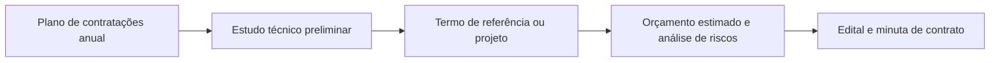

O capítulo anterior apresentou os princípios do art. 5º em visão de conjunto. Aqui o foco é aprofundar aqueles que mais aparecem em prova e que têm regras concretas na lei: publicidade, transparência e sigilo; eficiência, eficácia, economicidade e efetividade; planejamento; segregação de funções; motivação; vinculação ao edital; e julgamento objetivo. Também se examinam os objetivos do processo licitatório fixados no art. 11.

> [!objetivos]
> - Distinguir publicidade, transparência, publicidade diferida e sigilo, e aplicar as regras do art. 13 e do art. 24.
> - Diferenciar eficiência, eficácia, economicidade e efetividade.
> - Explicar o planejamento, o estudo técnico preliminar e o plano de contratações anual.
> - Identificar o conteúdo da segregação de funções, da motivação, da vinculação ao edital e do julgamento objetivo.

## Publicidade, transparência e sigilo

A **publicidade** é o dever de divulgar as informações do processo para que qualquer interessado possa participar da licitação e fiscalizá-la. A **transparência** vai além: pede que a informação seja apresentada de forma clara e compreensível, de modo que o cidadão comum consiga entendê-la. Divulgar um documento ilegível, sem contexto, cumpre a publicidade formal, mas não a transparência.

Como instrumento da publicidade, a lei criou o **Portal Nacional de Contratações Públicas (PNCP)**, site oficial para a divulgação centralizada e obrigatória dos atos exigidos pela lei e, de modo facultativo, para a realização das contratações (art. 174). O portal reúne, entre outras informações, os planos de contratações anuais, os editais, as atas de registro de preços e os contratos com seus aditivos. Os entes federativos podem manter, ainda, um sítio eletrônico oficial próprio para divulgação complementar (art. 175). Portanto, o PNCP é obrigatório; o site do ente é complementar.

> [!lei] Lei 14.133/2021, art. 174, caput
> Art. 174. É criado o Portal Nacional de Contratações Públicas (PNCP), sítio eletrônico oficial destinado à:
> I - divulgação centralizada e obrigatória dos atos exigidos por esta Lei;
> II - realização facultativa das contratações pelos órgãos e entidades dos Poderes Executivo, Legislativo e Judiciário de todos os entes federativos.

### A publicidade não é absoluta

O art. 13 declara públicos os atos do processo licitatório, ressalvadas as informações cujo sigilo seja imprescindível à segurança da sociedade e do Estado. A regra se repete para os contratos: eles e seus aditivos devem ficar disponíveis em sítio oficial, mas é possível manter sigilo quando isso for indispensável à segurança da sociedade e do Estado, nos termos da legislação sobre acesso à informação (art. 91). Há apoio direto na Constituição, que admite o sigilo das informações imprescindíveis à segurança da sociedade e do Estado (art. 5º, XXXIII).

Além do sigilo por segurança, existe a **publicidade diferida**, isto é, adiada para um momento posterior. O parágrafo único do art. 13 prevê dois casos:

| Informação | Quando se torna pública |
| --- | --- |
| Conteúdo das propostas | Depois da abertura |
| Orçamento da Administração | Conforme a lei, que admite sigilo em certas condições (art. 24) |

### Sigilo das propostas

Imagine que uma empresa registre sua oferta no sistema até a data limite. Se a Administração deixar vazar o valor para uma concorrente, esta terá vantagem injusta: poderá ajustar a oferta ao que viu. Por isso, o conteúdo das propostas é reservado até a sessão de abertura. Depois dela, as propostas são públicas.

A violação desse segredo é tão grave que virou crime: o art. 337-J do Código Penal pune com detenção de dois a três anos, e multa, quem devassa o sigilo de proposta em licitação ou dá a terceiro a oportunidade de fazê-lo.

> [!bizu] Propostas e abertura
> O sigilo das propostas é **temporário**: dura até a abertura. Depois, tudo é público. Alternativa que diga que a licitação é pública "em todas as fases", inclusive quanto ao conteúdo das propostas antes da abertura, está errada.

### Sigilo do orçamento estimado

Na fase preparatória, a Administração calcula o preço aproximado do contrato, o **orçamento estimado**. Divulgar esse valor nem sempre convém, porque os licitantes podem gravitar em torno dele e oferecer preços próximos, em vez de usar suas reais condições de custo.

Por isso, o art. 24 permite que o orçamento estimado seja sigiloso, desde que haja **justificativa**. Algumas regras completam a ideia:

- o sigilo **não vale** para os órgãos de controle interno e externo, como o Tribunal de Contas, que podem examinar o valor;
- mesmo com orçamento sigiloso, a Administração divulga o detalhamento das quantidades e as demais informações necessárias à elaboração das propostas;
- se o critério de julgamento for o **maior desconto**, o preço estimado ou o máximo aceitável **consta do edital**, porque sem um preço de referência não se calcula o desconto.

> [!atencao] Sigilo é opção justificada, não regra
> A lei diz que o orçamento "poderá" ser sigiloso. A regra continua sendo a transparência. Quem opta pelo sigilo deve motivar a escolha, inclusive sobre o momento da divulgação (art. 18, XI).

| Situação | O orçamento pode ser sigiloso? |
| --- | --- |
| Critério de menor preço, com justificativa | Sim |
| Critério de maior desconto | Não: o preço estimado ou máximo consta do edital |
| Pedido do Tribunal de Contas | O sigilo não vale para o controle |
| Quantidades e informações para formular propostas | Devem ser divulgadas |

## Eficiência, economicidade, eficácia e efetividade

Esses conceitos medem o desempenho das contratações, e a diferença entre eles é cobrada com frequência.

- **Eficiência**: relação entre o que se gasta (tempo, dinheiro, trabalho) e o que se obtém. Uma licitação feita na metade do tempo, com o mesmo resultado, é mais eficiente. Um contrato que compra o mesmo objeto por metade do preço também é.
- **Economicidade**: minimização de custos sem sacrificar a qualidade. Está muito próxima da eficiência, mas o foco é o custo menor.
- **Eficácia**: cumprimento dos objetivos fixados. Se o plano era assinar três contratos de fornecimento de medicamentos no ano, há eficácia quando os três são assinados.
- **Efetividade**: resultado concreto na realidade, o impacto da ação estatal. Não é princípio do art. 5º, mas a lei a menciona como dever da alta administração (art. 11, parágrafo único).

> [!exemplo] Vacinas: os quatro conceitos juntos
> Uma secretaria compra vacinas para conter uma doença que aumenta a mortalidade infantil. Se a licitação é rápida e o preço é bom, houve **eficiência**. Se o preço baixo não derrubou a qualidade, houve **economicidade**. Se a meta de comprar as doses previstas foi atingida, houve **eficácia**. E se, depois da vacinação, a mortalidade caiu, houve **efetividade**.

## Planejamento

A lei antiga se preocupava sobretudo com a fase externa da licitação, aquela que começa com a divulgação do edital. A Lei 14.133/2021 dá muita atenção à **fase interna**, isto é, à preparação. O objetivo é evitar desperdícios, compras apressadas e emergências criadas por falta de organização.

Dois instrumentos merecem destaque.

**Plano de contratações anual.** A partir dos documentos que formalizam as demandas, os órgãos de planejamento de cada ente podem elaborar um plano anual, com o fim de racionalizar as compras, alinhá-las ao planejamento estratégico e dar base às leis orçamentárias (art. 12, VII). Ele é divulgado no site oficial do ente.

**Estudo técnico preliminar (ETP).** É o documento que inaugura o planejamento da contratação (art. 6º, XX). Ele descreve o interesse público envolvido, mostra o problema a resolver e indica a melhor solução, dando base para o termo de referência, o anteprojeto ou o projeto básico. Entre outros elementos, o ETP traz a descrição da necessidade, a previsão da contratação no plano anual, os requisitos, as estimativas de quantidade, o levantamento de mercado, a estimativa do valor e a justificativa da solução escolhida (art. 18, § 1º).

A fase preparatória, descrita no art. 18, abrange ainda a definição do objeto, as condições de execução e de pagamento, o orçamento estimado, a elaboração do edital e da minuta de contrato, a escolha da modalidade, do critério de julgamento e do modo de disputa, a análise de riscos e a motivação das exigências do edital.

## Segregação de funções

A segregação de funções é um princípio de controle interno: separar as tarefas de autorizar, aprovar, executar, controlar e contabilizar as operações, para que nenhum agente reúna poderes demais. Se a mesma pessoa pedisse a compra, escrevesse o edital, conduzisse a licitação, assinasse o contrato, atestasse o recebimento, pagasse e ainda controlasse tudo, poderia cometer irregularidades e escondê-las sozinha.

Por isso a lei determina que a autoridade máxima do órgão, ou quem faça suas vezes, observe a segregação e não designe o mesmo agente para atuar, ao mesmo tempo, em funções mais sujeitas a risco (art. 7º, § 1º). A regra vale também para os órgãos de assessoramento jurídico e de controle interno.

Exemplos práticos:

- quem faz o pedido da compra não deve emitir o parecer jurídico sobre o edital;
- quem conduz a licitação não deve, em regra, fiscalizar o contrato que dela nasce;
- a **homologação** é feita por autoridade diferente do agente que conduziu o certame, o que já é uma forma de segregação.

Esse é o sentido **interno**, voltado aos agentes públicos. Há também um sentido **externo**: a empresa que elaborou o projeto básico não pode participar da licitação nem da execução do contrato (art. 14, I). Como esse sentido restringe a competição, depende de previsão legal.

## Motivação

Motivar é indicar os fatos e o direito que fundamentam a decisão. O **pressuposto de direito** é a norma que permite o ato. O **pressuposto de fato** é a situação concreta que o justifica. Na compra de computadores, o fato é a necessidade comprovada do órgão, e o direito é a norma que manda licitar.

A motivação é a regra para todos os atos da licitação, mas é **ainda mais necessária nas exceções**. A lei exige justificativa, por exemplo:

| Situação | Regra | Exceção que exige motivação |
| --- | --- | --- |
| Marca ou modelo | O edital não indica | Indicação formalmente justificada |
| Licitação | É a regra | Contratação direta, com processo instruído e parecer sobre os requisitos |
| Consórcios | Podem participar | Vedação devidamente justificada |
| Orçamento | Tende a ser divulgado | Sigilo justificado |

> [!pegadinha] Motivação não é só para o ato que nega
> Alguns candidatos acham que apenas a recusa precisa de justificativa. Na verdade, todo ato relevante precisa ser motivado, inclusive o que concede uma exceção. A exceção sem motivação é ilegal.

## Vinculação ao edital

O edital divulga a licitação e fixa as regras do jogo. A analogia com o concurso público ajuda: assim como o edital do concurso define provas, critérios e prazos, o da licitação define o que se compra, como se disputa e como se contrata. O edital contém o objeto e as regras de convocação, julgamento, habilitação, recursos, penalidades, fiscalização e gestão do contrato, entrega do objeto e condições de pagamento (art. 25).

A vinculação obriga **os dois lados**:

- a **Administração** deve conduzir o processo conforme o edital, e se descumprir regras fixadas o procedimento pode ser anulado;
- o **licitante** que apresenta proposta ou documento em desacordo com o edital pode ser desclassificado ou inabilitado.

Por isso se diz que o edital é a "lei interna" da licitação. Ele regula também a execução do contrato: traz a minuta do contrato como anexo e o índice de reajuste de preços. Se o edital prevê um critério de atualização de valores e o contrato aplica outro, mais favorável ao contratado, há violação do edital e do princípio.

Todos os elementos do edital, como minuta, termo de referência, anteprojeto e anexos, devem ser divulgados em sítio oficial **na mesma data** da divulgação do edital, sem exigência de cadastro ou identificação para acesso (art. 25, § 3º).

O edital serve de instrumento convocatório também em outros procedimentos auxiliares, como a pré-qualificação, o credenciamento, o procedimento de manifestação de interesse e o registro de preços.

> [!atencao] Edital e "instrumento convocatório"
> A lei antiga falava em vinculação ao **instrumento convocatório**, porque havia o edital e a carta-convite. Como a carta-convite acabou, hoje só existe o edital. Por isso, "vinculação ao instrumento convocatório" e "vinculação ao edital" são expressões equivalentes. Não considere errada a questão só porque usa o nome antigo.

> [!pegadinha] A vinculação não obriga só a Administração
> Dizer que o princípio da vinculação ao edital obriga somente a Administração é erro. Os licitantes também ficam presos às regras, e a proposta em desconformidade leva à desclassificação.

## Julgamento objetivo

Pelo julgamento objetivo, as propostas são analisadas com **critérios fixados no edital**, o que reduz ou elimina a subjetividade. Esse princípio se liga à impessoalidade, à legalidade e à vinculação ao edital.

Os critérios de julgamento são listados no art. 33. O edital escolhe um deles e, quando necessário, detalha como será aplicado. São eles:

| Critério | Resumo |
| --- | --- |
| Menor preço | Vence o menor valor |
| Maior desconto | Vence o maior desconto sobre o preço de referência |
| Melhor técnica ou conteúdo artístico | Pontuação técnica ou artística |
| Técnica e preço | Combinação ponderada |
| Maior lance | Usado no leilão |
| Maior retorno econômico | Usado em contratos de eficiência |

Se o critério for técnica e preço, o edital precisa definir os pesos de cada parte. A escolha do critério é feita na fase preparatória, e a decisão deve ser motivada.

### Vedação à oferta de vantagens

Uma consequência do julgamento objetivo é a proibição de aceitar vantagens que o edital não previu. Em uma licitação para comprar um carro, o licitante não poderia oferecer, como diferencial, "tanque cheio" ou "tapetes extras". A oferta deve ter relação com o que foi pedido, e vantagens extras desequilibram a disputa.

> [!resolvido] Questão comentada: publicidade e propostas
> Afirma-se que, pelo princípio da publicidade, a licitação não pode ser sigilosa, devendo todos os seus atos ser públicos em todas as fases, inclusive o conteúdo das propostas. A afirmativa está correta?
>
> **Resolução.** Está errada. O art. 13 declara públicos os atos do processo, com ressalva para o sigilo imprescindível à segurança da sociedade e do Estado, e prevê a publicidade diferida: o conteúdo das propostas só se torna público com a abertura, e o orçamento pode ser sigiloso nos termos do art. 24. Dizer que tudo é público em todas as fases ignora essas exceções.

## Objetivos do processo licitatório

O art. 11 fixa o que a licitação deve alcançar. A lista é cobrada literalmente:

1. selecionar a proposta que gere o resultado mais vantajoso, inclusive no ciclo de vida do objeto;
2. garantir tratamento isonômico e justa competição;
3. evitar sobrepreço, preços inexequíveis e superfaturamento;
4. incentivar a inovação e o desenvolvimento nacional sustentável.

Esses quatro objetivos explicam o desenho de toda a lei. O primeiro se liga à eficiência e à economicidade; o segundo, à igualdade e à competitividade; o terceiro, à integridade dos preços; o quarto, à sustentabilidade e ao fomento. A alta administração responde pela governança das contratações, com gestão de riscos e controles internos que assegurem um ambiente íntegro e a eficiência, a efetividade e a eficácia das contratações.

> [!bizu] Quatro objetivos, quatro palavras
> Para lembrar o art. 11: **vantajosidade** (melhor resultado), **isonomia** (justa competição), **preço** (sem sobrepreço ou superfaturamento) e **inovação** (com sustentabilidade).

## Como a banca cobra este assunto

As bancas gostam de duas armadilhas neste tema. A primeira é a **absolutização**: dizer que tudo é público sempre, que o orçamento é sempre sigiloso, ou que a vinculação ao edital só obriga a Administração. A segunda é a **troca de conceitos** de desempenho, atribuindo a eficácia o que é eficiência, ou chamando de economicidade o cumprimento de metas. Há ainda a cobrança literal dos objetivos do art. 11 e dos critérios do art. 33.

## Mapa do capítulo

| Tema | Ideia central | Armadilha |
| --- | --- | --- |
| Publicidade e transparência | Divulgar com clareza, pelo PNCP | Confundir publicidade formal com transparência |
| Publicidade diferida | Propostas até a abertura; orçamento nos termos do art. 24 | Dizer que tudo é público em todas as fases |
| Orçamento sigiloso | Possível, com justificativa; não vale para o controle | Aceitar sigilo no maior desconto |
| Eficiência e economicidade | Custo e benefício; menor custo com qualidade | Tratar como eficácia |
| Eficácia e efetividade | Cumprir metas; impacto real | Chamar efetividade de princípio do art. 5º |
| Planejamento | Plano anual e estudo técnico preliminar | Achar que a fase preparatória é facultativa |
| Segregação de funções | Dividir tarefas de risco | Admitir a mesma pessoa em todas as etapas |
| Motivação | Regra, mais forte nas exceções | Exigir só para a recusa |
| Vinculação ao edital | Obriga Administração e licitantes | Dizer que obriga só a Administração |
| Julgamento objetivo | Critérios do edital (art. 33); sem vantagens extras | Admitir oferta fora do edital |

### Para fixar

1. Publicidade é divulgar para permitir participação e fiscalização; transparência é divulgar de modo claro e compreensível.
2. O PNCP é o site oficial obrigatório; o sítio do ente é complemento facultativo.
3. A publicidade é diferida quanto ao conteúdo das propostas, até a abertura, e quanto ao orçamento, nos termos do art. 24.
4. Violar o sigilo da proposta é crime previsto no art. 337-J do Código Penal.
5. O orçamento estimado pode ser sigiloso, com justificativa, mas não para os órgãos de controle e não no critério de maior desconto.
6. Eficiência relaciona custo e produto; economicidade minimiza custos; eficácia cumpre metas; efetividade mede o impacto.
7. O estudo técnico preliminar abre o planejamento da contratação, e o plano de contratações anual alinha as compras ao planejamento do ente.
8. A segregação de funções proíbe designar o mesmo agente para funções de maior risco e se aplica também a assessoria jurídica e controle interno.
9. A motivação é regra e pesa mais nas exceções, como marca indicada, contratação direta e vedação de consórcios.
10. A vinculação ao edital obriga Administração e licitantes; o julgamento objetivo usa os critérios do art. 33 e veda vantagens não previstas.
