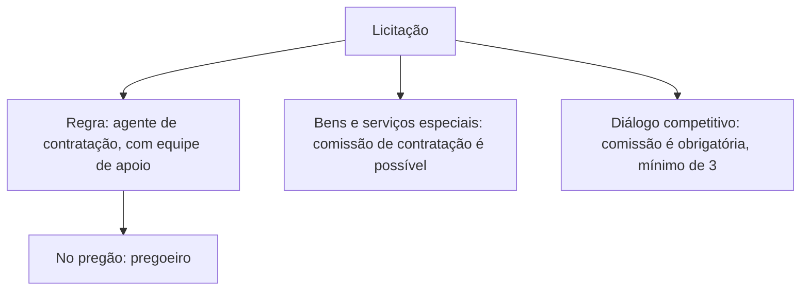

Uma licitação não se conduz sozinha: alguém decide, alguém analisa documentos, alguém emite parecer. A Lei 14.133/2021 dedica um capítulo à definição de quem são essas pessoas, de que requisitos precisam e de que forma respondem pelos seus atos. É um tema cobrado quase sempre de forma literal, e com bastante atenção a números e nomes: quem pode ser agente de contratação, quando uma comissão substitui o agente, quantos membros ela tem, como é a responsabilidade e quando a advocacia pública defende o servidor.

> [!objetivos]
> - Aplicar o conceito de agente público da Lei 14.133/2021 e os requisitos de designação do art. 7º.
> - Descrever o papel do agente de contratação, da equipe de apoio, do pregoeiro e da comissão de contratação.
> - Indicar as regras de responsabilidade e o apoio de assessoria externa.
> - Explicar a assistência jurídica prevista no art. 10.

## Agente público na lei de licitações

Para a Lei 14.133/2021, **agente público** é quem ocupa, por qualquer forma de investidura (eleição, nomeação, designação, contrato ou outra), um mandato, cargo, emprego ou função dentro de uma pessoa jurídica que integra a Administração Pública (art. 6º, V). Esse conceito é um pouco mais estreito do que o usado em outros ramos do direito administrativo, que incluem quem exerce função pública mesmo em entidades privadas. Em questões sobre a lei de licitações, adote a definição da própria lei.

> [!atencao] Conceito vale para este contexto
> Fora da lei de licitações, o agente público pode ser qualquer pessoa que exerça função pública, inclusive em entidades privadas. Dentro dela, o agente está ligado a uma pessoa jurídica da Administração. Leia o enunciado para saber qual conceito está sendo cobrado.

## Quem designa e quais os requisitos

Cabe à **autoridade máxima do órgão ou da entidade**, ou a quem as normas de organização indicarem, promover a gestão por competências e designar os agentes públicos que cumprirão as funções essenciais à execução da lei (art. 7º). A designação vale para os agentes em geral: o agente de contratação, a equipe de apoio, os membros de comissões e outros que atuem na área.

Os designados devem atender a três requisitos:

| Requisito | Conteúdo |
| --- | --- |
| Vínculo | Ser, de preferência, servidor efetivo ou empregado público dos quadros permanentes |
| Qualificação | Ter atribuições ligadas a licitações e contratos, ou formação compatível, ou qualificação atestada por certificação profissional de escola de governo mantida pelo poder público |
| Imparcialidade | Não ser cônjuge ou companheiro de licitantes ou contratados habituais, nem ter com eles parentesco até o terceiro grau, nem vínculos de natureza técnica, comercial, econômica, financeira, trabalhista ou civil |

Na designação, a autoridade respeita a **segregação de funções**: não pode escolher o mesmo agente para atuar ao mesmo tempo em funções mais sujeitas a risco, de modo a reduzir a ocultação de erros e fraudes. Essas regras valem também para os órgãos de assessoramento jurídico e de controle interno (art. 7º, §§ 1º e 2º).

> [!bizu] Preferencialmente, mas não sempre
> O art. 7º diz "preferencialmente" servidor efetivo ou empregado de carreira. Já para o **agente de contratação**, o art. 8º exige que seja escolhido **entre** servidores efetivos ou empregados públicos dos quadros permanentes, sem a palavra "preferencialmente". É um detalhe que aparece em prova.

## O agente de contratação

A licitação é conduzida pelo **agente de contratação**. Ele é escolhido pela autoridade competente, sempre dentre os servidores efetivos ou os empregados públicos de carreira, e tem a missão de decidir, acompanhar o trâmite, impulsionar o procedimento e praticar os atos necessários para que o certame corra bem (art. 6º, LX, e art. 8º). Na lei antiga, a regra era a comissão de licitação. Agora, a regra é uma pessoa à frente do certame, com poder de decisão.

A lei diz que o agente conduz a licitação **até a homologação**. Em termos precisos, a fase final de encerramento cabe à autoridade superior, que pode retornar os autos para saneamento, revogar, anular ou adjudicar e homologar (art. 71). Para a prova, porém, guarde a literalidade: o agente conduz o certame até a homologação.

O agente de contratação conta com a **equipe de apoio**, que o auxilia. Mesmo assim, ele **responde individualmente** pelos atos que pratica, pois é ele quem decide. A responsabilidade só é afastada quando ele foi induzido a erro pela atuação da equipe (art. 8º, § 1º).

| Figura | Papel | Responsabilidade |
| --- | --- | --- |
| Agente de contratação | Decide e conduz a licitação | Individual, salvo se induzido a erro pela equipe |
| Equipe de apoio | Auxilia o agente | Responde pelos seus próprios atos e pela indução a erro |
| Pregoeiro | Agente de contratação do pregão | Mesma do agente |

Na modalidade **pregão**, o agente que conduz o certame recebe o nome de **pregoeiro** (art. 8º, § 5º). Nas demais modalidades, o nome é agente de contratação.

> [!pegadinha] Equipe de apoio não assume a responsabilidade do agente
> Dizer que a existência de equipe de apoio dilui a responsabilidade do agente é erro. Ele continua respondendo individualmente. A exceção é a indução a erro pela própria equipe.

## Comissão de contratação

A **comissão de contratação** é o conjunto de agentes públicos indicados pela Administração, em caráter permanente ou especial, para receber, examinar e julgar documentos relativos às licitações e aos procedimentos auxiliares (art. 6º, L). Ela pode substituir o agente de contratação em dois momentos distintos.

1. **Possibilidade.** Em licitação que envolva **bens ou serviços especiais**, o agente de contratação pode ser substituído por uma comissão de no mínimo **três membros**, que respondem **solidariamente** por todos os atos praticados (art. 8º, § 2º). Bens e serviços especiais são os que, por sua heterogeneidade ou complexidade, não podem ser descritos objetivamente por especificações usuais de mercado. Os bens e serviços comuns são o contrário disso: seus padrões de desempenho e qualidade são definidos de forma objetiva, como uma caneta azul.
2. **Obrigatoriedade.** No **diálogo competitivo**, a licitação é conduzida por comissão de contratação de, no mínimo, três servidores efetivos ou empregados públicos dos quadros permanentes, admitida a contratação de profissionais para assessoramento técnico (art. 32, § 1º, XI).

A responsabilidade solidária tem uma exceção: não responde o membro que apresentar **posição individual divergente, fundamentada e registrada em ata** da reunião em que a decisão foi tomada.

Os requisitos dos membros da comissão são os mesmos do art. 7º. Embora a lei prefira o nome "comissão de contratação", não há problema em encontrar na prova a expressão "comissão de licitação".

| Situação | Quem conduz | Observação |
| --- | --- | --- |
| Licitação comum | Agente de contratação | Responde individualmente |
| Pregão | Pregoeiro | Nome próprio do agente |
| Bens ou serviços especiais | Agente ou comissão (mínimo de 3) | Comissão responde solidariamente |
| Diálogo competitivo | Comissão (mínimo de 3 servidores efetivos) | Obrigatória |

> [!lei] Lei 14.133/2021, art. 8º, § 2º
> § 2º Em licitação que envolva bens ou serviços especiais, desde que observados os requisitos estabelecidos no art. 7º desta Lei, o agente de contratação poderá ser substituído por comissão de contratação formada por, no mínimo, 3 (três) membros, que responderão solidariamente por todos os atos praticados pela comissão, ressalvado o membro que expressar posição individual divergente fundamentada e registrada em ata lavrada na reunião em que houver sido tomada a decisão.

## Assessoria e regulamento

Quando a licitação envolver bens ou serviços especiais cujo objeto a Administração não costuma contratar, ela pode contratar, por **prazo determinado**, uma empresa ou um profissional especializado para assessorar os agentes responsáveis pela condução da licitação (art. 8º, § 4º). Um exemplo seria o órgão que contrata um projeto arquitetônico específico e, por nunca ter feito isso, busca um profissional que o ajude.

As regras detalhadas sobre a atuação do agente de contratação e da equipe de apoio, o funcionamento da comissão e a atuação dos fiscais e gestores de contratos ficam para **regulamento**. Esse regulamento deve garantir que todos eles possam pedir ajuda ao setor jurídico e ao controle interno quando precisarem.

Na prática, isso significa que o agente não trabalha isolado. Ele decide, mas conta com a equipe que o auxilia, com a assessoria externa quando o objeto é incomum e com os órgãos de apoio da própria Administração. A lei quer evitar dois extremos: o agente sem preparo, que erra por falta de orientação, e o agente protegido demais, que decide sem assumir responsabilidade. Por isso combina a responsabilidade individual com mecanismos de apoio e com a assistência jurídica do art. 10, tratada a seguir.

## Assistência jurídica ao agente

O art. 10 trata de um problema real: o servidor que seguiu a orientação do parecer jurídico e depois é questionado por órgãos de controle ou pela Justiça. Se as autoridades e os servidores que participaram das licitações e dos contratos precisarem se defender, nas esferas administrativa, controladora ou judicial, por ato praticado com **estrita observância de parecer jurídico** elaborado na forma do art. 53, § 1º, a **advocacia pública** promoverá, a critério do agente, a sua representação judicial ou extrajudicial.

Há limites e extensões:

- a regra não vale quando constarem dos autos provas de **atos ilícitos dolosos**;
- ela se aplica mesmo que o agente **já não ocupe** o cargo, emprego ou função em que praticou o ato.

> [!atencao] Quem escolhe é o agente
> A representação pela advocacia pública ocorre "a critério do agente público". Ela não é imposta, e o agente pode preferir outro advogado. Dizer que a advocacia pública deve sempre representar o servidor, sem opção, é erro.

> [!exemplo] Parecer seguido, defesa garantida
> Um agente de contratação segue o parecer jurídico que aprovou a minuta do edital. Anos depois, o Tribunal de Contas questiona uma cláusula. Como o agente agiu em estrita observância do parecer, a advocacia pública pode defendê-lo, mesmo que ele já tenha sido transferido de função. A defesa cai se houver provas de ilícito doloso.

## Como a banca cobra este assunto

O tema costuma vir em afirmativas que trocam números e atribuições. Os erros mais comuns são: dizer que a comissão tem "no mínimo dois" membros; atribuir ao agente de contratação a prerrogativa de ser qualquer servidor, inclusive comissionado sem vínculo; esquecer que o pregoeiro é o agente do pregão; afirmar que o diálogo competitivo é conduzido pelo agente; e dizer que a equipe de apoio responde no lugar do agente. Também aparece a cobrança do conceito de agente público restrito à lei de licitações.

> [!resolvido] Questão comentada: diálogo competitivo
> Um órgão vai licitar na modalidade diálogo competitivo. A licitação pode ser conduzida por um único agente de contratação?
>
> **Resolução.** Não. No diálogo competitivo a condução é obrigatoriamente de uma comissão de contratação com no mínimo três servidores efetivos ou empregados públicos dos quadros permanentes (art. 32, § 1º, XI), admitida a contratação de profissionais para assessoramento técnico. A substituição do agente por comissão, em outras modalidades, é possível apenas para bens ou serviços especiais.

## Mapa do capítulo

| Tema | Ideia central | Armadilha |
| --- | --- | --- |
| Agente público | Quem exerce função em pessoa jurídica da Administração | Aplicar o conceito amplo de outros ramos |
| Designação | Autoridade máxima, com gestão por competências | Esquecer a segregação de funções |
| Requisitos do art. 7º | Vínculo preferencial, qualificação, sem parentesco até o 3º grau | Dizer que servidor efetivo é obrigatório para todos |
| Agente de contratação | Servidor efetivo ou empregado de carreira; conduz até a homologação | Aceitar comissionado sem vínculo |
| Responsabilidade | Individual do agente, salvo indução a erro | Atribuir à equipe de apoio |
| Pregoeiro | Nome do agente no pregão | Confundir com comissão |
| Comissão | Mínimo de 3 membros; solidária; dissidente fundamentado fica de fora | Dizer que o dissidente responde |
| Diálogo competitivo | Comissão obrigatória | Admitir agente único |
| Assistência jurídica | Advocacia pública, a critério do agente, salvo dolo | Impor a representação |

### Para fixar

1. Para a lei de licitações, agente público é quem exerce mandato, cargo, emprego ou função em pessoa jurídica integrante da Administração.
2. A autoridade máxima designa os agentes e promove a gestão por competências, observando a segregação de funções.
3. Os designados devem ser preferencialmente servidores efetivos ou empregados de carreira, ter qualificação e não ter parentesco até o terceiro grau com licitantes ou contratados habituais.
4. O agente de contratação é escolhido entre servidores efetivos ou empregados dos quadros permanentes e conduz a licitação até a homologação.
5. O agente responde individualmente por seus atos, salvo se induzido a erro pela equipe de apoio.
6. No pregão, o agente de contratação chama-se pregoeiro.
7. Em bens ou serviços especiais, uma comissão de no mínimo três membros pode substituir o agente, com responsabilidade solidária.
8. O membro que registrar em ata posição divergente fundamentada não responde solidariamente.
9. No diálogo competitivo, a condução por comissão de no mínimo três servidores efetivos é obrigatória.
10. A advocacia pública representa o agente, a seu critério, quando o ato seguiu parecer jurídico, exceto se houver provas de ilícito doloso.
