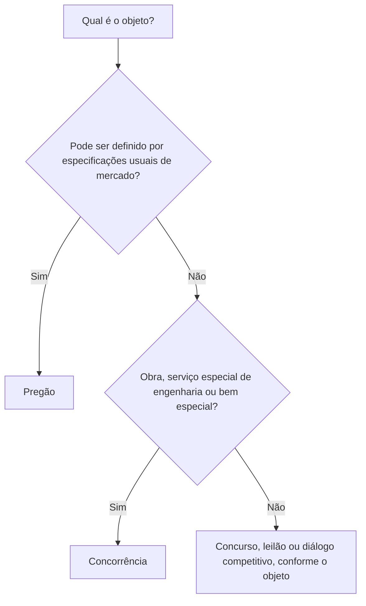
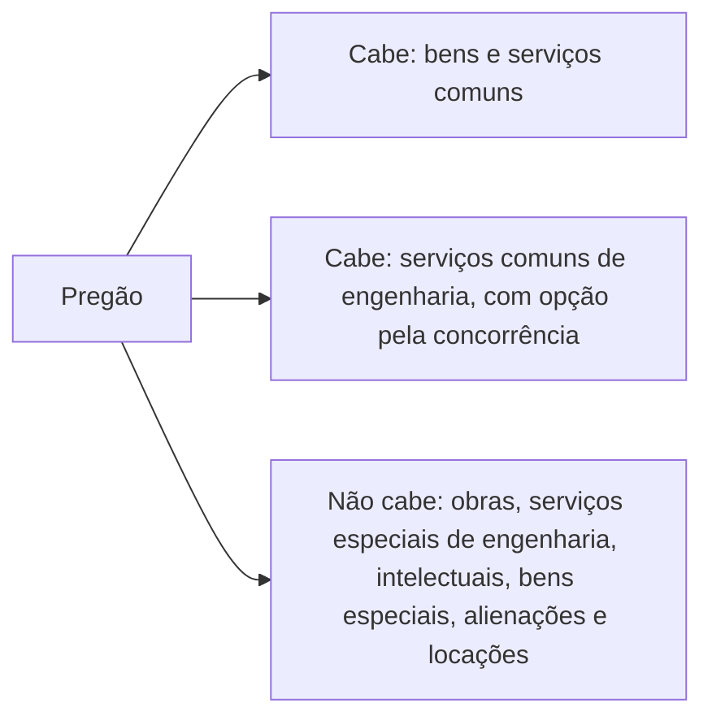

Antes de qualquer proposta, de qualquer disputa de lances, a Administração precisa responder a uma pergunta simples: **por qual caminho** vou licitar? Esse caminho é a modalidade. A Lei 14.133/2021 reduziu a lista a cinco opções e mudou a lógica de escolha, que deixou de olhar o valor da contratação e passou a olhar o objeto. Este capítulo apresenta a visão geral das modalidades e estuda as duas mais usadas no dia a dia, o pregão e a concorrência, com seus conceitos auxiliares. É um dos temas que mais caem em prova de licitações, e quase sempre de forma literal.

> [!objetivos]
> - Enumerar as modalidades da Lei 14.133/2021 e explicar o critério que define cada uma.
> - Distinguir modalidade, critério de julgamento e procedimento auxiliar.
> - Indicar quando cabe o pregão e quando ele é vedado.
> - Descrever a concorrência e os conceitos de bem especial, obra e serviço de engenharia.
> - Relacionar o pregão com as empresas estatais.

## O que é modalidade e como ela se escolhe

A modalidade é o **rito** da licitação: o conjunto de etapas pelo qual o certame caminha. Não se confunde com o **critério de julgamento**, que responde a outra pergunta, a de como as propostas serão comparadas (menor preço, melhor técnica e assim por diante). A lei antiga chamava os critérios de "tipos de licitação", e é comum misturar as duas ideias. Guarde: modalidade é caminho; critério é régua.

A grande mudança está no fator de escolha. A lei anterior definia parte das modalidades pelo **valor estimado** do contrato (convite, tomada de preços, concorrência). A Lei 14.133/2021 abandonou isso. Hoje, o que define a modalidade é a **natureza do objeto**, e o valor é irrelevante para essa decisão. O valor só importa para outro assunto, o da dispensa de licitação de pequeno valor.

| Objeto | Modalidade |
| --- | --- |
| Bens e serviços comuns | Pregão |
| Bens e serviços especiais, obras e serviços de engenharia | Concorrência |
| Trabalho técnico, científico ou artístico | Concurso |
| Alienação de bens | Leilão |
| Objeto complexo, que exige diálogo prévio com o mercado | Diálogo competitivo |

### Por que o valor saiu de cena

Na lógica antiga, uma obra de pequeno valor podia ser licitada por convite, e a mesma obra, se maior, exigia tomada de preços ou concorrência. O resultado era um sistema com limites numéricos que precisavam ser atualizados e que estimulavam o fracionamento de contratações. Ao adotar a natureza do objeto como critério, a lei simplificou a escolha: se o que se quer é um bem de prateleira, a via é o pregão; se é uma obra, a concorrência. O valor volta a importar apenas em dois pontos, a **dispensa** por pequeno valor (art. 75, I e II) e o limite de certas contratações diretas, que não pertencem a este capítulo.

| Situação | Modalidade | Por quê |
| --- | --- | --- |
| Compra de 200 cadeiras de escritório de modelo corrente | Pregão | Padrão de mercado, descrição objetiva |
| Construção de um quartel novo | Concorrência | Obra, vedada ao pregão |
| Troca do revestimento de um corredor, por metro quadrado | Pregão ou concorrência | Serviço comum de engenharia |
| Reforma estrutural complexa de uma ponte | Concorrência | Serviço especial de engenharia |
| Venda de viaturas inservíveis | Leilão | Alienação de bens |

### As cinco modalidades

O art. 28 lista: **pregão, concorrência, concurso, leilão e diálogo competitivo**. Não existem mais a tomada de preços e o convite, e também não consta a modalidade do regime diferenciado de contratações. O diálogo competitivo é a novidade, e o pregão, que antes vivia numa lei separada, passou a integrar a mesma lei das demais.

> [!lei] Lei 14.133/2021, art. 28, § 2º
> "É vedada a criação de outras modalidades de licitação ou, ainda, a combinação daquelas referidas no caput deste artigo."

Essa vedação dirige-se ao administrador e ao legislador de normas específicas. Um agente de contratação não pode inventar uma modalidade nem misturar duas existentes, e um estado não pode criar a sua, porque as normas gerais de licitação são competência privativa da União (Constituição, art. 22, XXVII). Em prova, porém, a frase genérica "é vedada a criação ou combinação de modalidades" deve ser marcada como correta, por ser literal.

Há duas observações para quem quer evitar surpresas. A primeira: a Lei das Agências (Lei 9.472/1997) prevê uma modalidade chamada **consulta**, de uso restrito às agências reguladoras federais. A segunda: a Lei Complementar 182/2021, o marco legal das startups, criou uma modalidade especial para contratar o teste de soluções inovadoras. Só considere essa modalidade se o edital do seu concurso cobrar a LC 182; do contrário, trabalhe somente com as cinco da Lei 14.133.

> [!pegadinha] Procedimentos auxiliares não são modalidades
> Credenciamento, sistema de registro de preços, registro cadastral, pré-qualificação e procedimento de manifestação de interesse **auxiliam** a contratação, mas não são modalidades. Se a alternativa os listar entre as modalidades do art. 28, está errada.

### Rito comum

O pregão e a concorrência seguem o **rito comum** do art. 17, detalhado mais adiante, no capítulo das fases do certame. As outras modalidades têm procedimentos com particularidades. Quando a questão fala nas fases da licitação sem indicar a modalidade, adote o procedimento padrão do art. 17.

## Pregão

O pregão é a modalidade **obrigatória** para a aquisição de **bens e serviços comuns**, e seu critério de julgamento só pode ser o **menor preço** ou o **maior desconto** (art. 6º, XLI). A lei o adota sempre que o objeto tiver padrões de desempenho e qualidade que o edital consiga definir objetivamente, por especificações usuais de mercado (art. 29, *caput*).

> [!lei] Lei 14.133/2021, art. 6º, XIII
> "bens e serviços comuns: aqueles cujos padrões de desempenho e qualidade podem ser objetivamente definidos pelo edital, por meio de especificações usuais de mercado."

Dois exemplos tornam a ideia concreta. Um aparelho de telefone celular pode ser descrito pelo tamanho da tela, pela capacidade da bateria, pela velocidade do processador e pela memória, que são as mesmas características que as lojas usam para vendê-lo; é objeto de pregão. Um serviço de pintura de paredes, medido por metro quadrado em condições definidas, também. O critério de teste é: consigo descrever o que quero sem depender de uma capacidade técnica particular do fornecedor?

### Quando o pregão não cabe

O parágrafo único do art. 29 afasta o pregão de três objetos: as **obras**, os **serviços especiais de engenharia** e os serviços técnicos especializados em que predomina o trabalho intelectual. Por coerência, também ficam de fora o que não é comum, a venda de bens e a locação de imóveis, pois nenhum desses é "aquisição de bem ou serviço comum".

| Cabe pregão | Não cabe pregão |
| --- | --- |
| Bens e serviços comuns | Bens e serviços especiais |
| Serviços comuns de engenharia | Obras |
| | Serviços especiais de engenharia |
| | Serviços técnicos especializados, de predominância intelectual |
| | Alienações e locações imobiliárias |

### A exceção dos serviços comuns de engenharia

Aqui existe um pequeno defeito de redação, que a doutrina e os tribunais de contas ainda vão acomodar. Durante a tramitação, a redação da concorrência foi mudada para abranger os serviços comuns de engenharia e o menor preço, mas o texto do pregão ficou como estava. Na prática: o serviço comum de engenharia, por ser descritível com objetividade, comporta o pregão, mas **a Administração também pode optar pela concorrência**, a critério discricionário da Administração.

> [!atencao] "O pregão é obrigatório" e a regra geral
> A afirmação genérica "o pregão é obrigatório para bens e serviços comuns" deve ser tida como verdadeira. A única ressalva envolve o serviço comum de engenharia, que admite pregão **ou** concorrência. Se o enunciado tratar especificamente desse serviço, a obrigatoriedade deixa de valer.

### Conceitos de apoio

Dois conceitos do art. 6º ajudam a localizar o pregão. **Compra** é a aquisição paga de bens, entregues de uma só vez ou em parcelas; a compra é imediata quando a entrega ocorre em até 30 dias contados da data prevista para a proposta (inciso X). **Serviço** é a atividade, material ou intelectual, que a Administração contrata para obter uma utilidade (inciso XI). Resmas de papel e cartuchos de tinta são compras; limpeza, pintura e manutenção de equipamentos são serviços.

### Pregão e empresas estatais

A Lei das Estatais (Lei 13.303/2016) tem regime próprio de licitação, mas recomenda o pregão como opção **preferencial** na compra de bens e serviços comuns (art. 32, IV). Como a nova lei de licitações determina que remissões da legislação à lei antiga do pregão passem a ser lidas como remissões a ela mesma (art. 189), o pregão da Lei 14.133 vale, como modalidade **preferencial**, para as estatais. Note a diferença: para a Administração direta é obrigatório; para a estatal, é preferencial.

> [!resolvido] Questão comentada: pregão para obra
> Um órgão quer construir um posto de saúde orçado em R$ 350.000 e propõe fazer a licitação na modalidade pregão. A escolha é possível?
>
> **Resolução.** Não. A construção é uma **obra**, e o pregão é vedado para obras (art. 29, parágrafo único). O valor do contrato é irrelevante para escolher a modalidade; o que pesa é a natureza do objeto. A modalidade adequada é a concorrência.

## Concorrência

A concorrência é a via dos objetos que o pregão não alcança: contrata **bens e serviços especiais**, além de **obras** e de **serviços de engenharia**, sejam estes comuns ou especiais (art. 6º, XXXVIII). Ela segue o rito comum do art. 17 e comporta todos os critérios de julgamento previstos na lei, **menos o maior lance**, reservado ao leilão. Podem ser usados o menor preço, a melhor técnica ou o conteúdo artístico, a combinação de técnica e preço, o maior retorno econômico e o maior desconto.

### Conceitos que a concorrência pressupõe

Para entender o que cabe na concorrência, é preciso dominar três definições do art. 6º.

**Bens e serviços especiais** são, por exclusão, os que não são comuns: aqueles que, por sua alta heterogeneidade ou complexidade, não conseguem ser descritos de forma objetiva (art. 6º, XIV). A regra é tratar o objeto como comum; para classificá-lo como especial, a Administração precisa de **justificativa prévia**.

**Obra** é a atividade privativa, por lei, das profissões de arquiteto e engenheiro que intervém no ambiente por um conjunto coordenado de ações que, somadas, inovam o espaço físico da natureza ou alteram de forma substancial as características originais de um imóvel (art. 6º, XII). Construir um prédio num terreno vazio é obra. Transformar um pequeno complexo esportivo num centro de padrão olímpico também.

**Serviço de engenharia** é o trabalho que gera uma utilidade, intelectual ou material, para o interesse da Administração, depende de profissional de arquitetura, engenharia ou técnico especializado por exigência legal e **não chega a ser obra** (art. 6º, XXI). Essa última nota, o caráter residual, é a que você mais usará para separar os dois conceitos. A modernização do sistema de climatização de uma repartição, sem alterar substancialmente o imóvel, é um bom exemplo. Divide-se em dois:

| Espécie | Característica | Modalidade |
| --- | --- | --- |
| Serviço comum de engenharia | Ações padronizáveis de manutenção, adequação e adaptação que preservam o bem como ele era | Pregão ou concorrência |
| Serviço especial de engenharia | Alta heterogeneidade ou complexidade, sem padronização objetiva | Concorrência |

O metro quadrado de revestimento colocado é um exemplo de serviço comum de engenharia, porque o desempenho se mede de modo padronizado. Já um serviço cujas características dependem de uma capacidade técnica singular do profissional é especial.

> [!exemplo] Comum ou especial: quem decide
> Um software de gestão de pessoal pode ser comprado de prateleira, com especificações usuais de mercado, ou desenvolvido sob medida, com requisitos que só um fornecedor consegue atender. No primeiro caso o objeto tende a ser comum e vai a pregão. No segundo, a Administração precisa demonstrar, por escrito e antes da licitação, por que o objeto é especial. A regra é presumir o objeto comum; o ônus de justificar recai sobre quem o enquadra como especial.

> [!bizu] Obra nunca vai a pregão
> Se a pergunta fala em **obra**, a resposta é concorrência. Só os serviços comuns de engenharia têm duas portas. Você não precisa classificar casos "cinzentos" de obra versus serviço; as provas cobram os conceitos expressos na lei.

> [!resolvido] Questão comentada: engenharia e valor
> Um órgão da Administração direta federal vai contratar empresa de engenharia para realizar uma obra em sua sede e pretende escolher entre concorrência e pregão, qualquer que seja o valor estimado. A afirmação está correta?
>
> **Resolução.** Está errada. A concorrência cabe para a obra, independentemente do valor. Mas o pregão é expressamente vedado para obras (art. 29, parágrafo único). Não há opção entre as duas modalidades quando o objeto é obra.

> [!pegadinha] Pregão presencial ou eletrônico
> A vedação ao pregão para obras vale para qualquer forma de realização do certame, presencial ou eletrônica. Não caia na alternativa que mude a forma para tornar possível o impossível.

## Pregão e concorrência lado a lado

Como as duas modalidades compartilham o rito do art. 17, a diferença está no objeto e nos critérios, e é aí que as provas apertam.

| Aspecto | Pregão | Concorrência |
| --- | --- | --- |
| Objeto | Bens e serviços comuns | Bens e serviços especiais, obras e serviços de engenharia |
| Critérios de julgamento | Menor preço e maior desconto | Todos, exceto maior lance |
| Serviço comum de engenharia | Cabe | Cabe |
| Obra | Vedado | Cabe |
| Natureza para o órgão | Obrigatório quando o objeto é comum | Escolha quando o objeto não é comum |

Repare que o pregão é a modalidade mais restrita nos critérios (só dois) e a concorrência é a mais ampla. Se a questão disser que o pregão pode julgar por técnica e preço, está errada; se disser que a concorrência admite o maior lance, também.

## Como a banca cobra este assunto

Os enunciados costumam apresentar uma situação curta, com um objeto e, às vezes, um valor, e perguntar qual modalidade se aplica; o valor aparece como distrator, pois não decide nada. Outra forma comum é a afirmação genérica, que deve ser lida com atenção ao contexto: "o pregão é obrigatório" é correta em regra, mas deixa de ser quando o objeto é serviço comum de engenharia. As bancas exploram a mudança de lógica: a modalidade depende da natureza do objeto, e não do valor, e quem afirma o contrário erra. Também cobram a lista fechada de modalidades (o convite e a tomada de preços não existem), a vedação à criação e à combinação, a distinção entre modalidade, critério de julgamento e procedimento auxiliar, o conceito literal de bens e serviços comuns, a vedação de pregão para obras e a posição particular dos serviços comuns de engenharia. Quanto à concorrência, o ponto recorrente é que ela aceita todos os critérios, menos o maior lance.

## Mapa do capítulo

| Tema | Ideia central | Armadilha |
| --- | --- | --- |
| Escolha da modalidade | Natureza do objeto | Dizer que depende do valor |
| Modalidades | Pregão, concorrência, concurso, leilão e diálogo competitivo | Incluir convite ou tomada de preços |
| Criação de modalidades | Vedada, bem como a combinação | Achar que o agente pode misturar modalidades |
| Procedimentos auxiliares | Apoiam, mas não são modalidades | Listá-los entre as modalidades |
| Pregão | Obrigatório para bens e serviços comuns; menor preço ou maior desconto | Aplicá-lo a obras |
| Serviço comum de engenharia | Pregão ou concorrência | Dizer que só cabe pregão |
| Concorrência | Bens e serviços especiais, obras e serviços de engenharia; todos os critérios, menos o maior lance | Incluir o maior lance |
| Estatais | Pregão preferencial | Dizer que é obrigatório |

### Para fixar

1. A Lei 14.133/2021 tem cinco modalidades: pregão, concorrência, concurso, leilão e diálogo competitivo.
2. A modalidade é definida pela natureza do objeto, e não pelo valor estimado.
3. É vedada a criação de novas modalidades e a combinação das existentes.
4. Credenciamento e registro de preços são procedimentos auxiliares, não modalidades.
5. O pregão é obrigatório para bens e serviços comuns e julga por menor preço ou maior desconto.
6. O pregão não cabe para obras, serviços especiais de engenharia, serviços intelectuais especializados, alienações e locações.
7. Os serviços comuns de engenharia podem ser licitados por pregão ou por concorrência.
8. A concorrência atende bens e serviços especiais, obras e serviços de engenharia.
9. A concorrência admite todos os critérios de julgamento, exceto o maior lance.
10. Para as empresas estatais, o pregão é modalidade preferencial para bens e serviços comuns.
