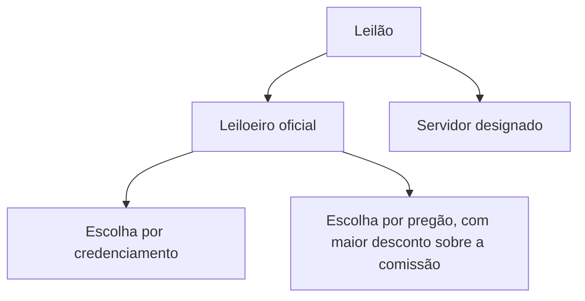

Os dois capítulos anteriores trataram das modalidades de uso corrente. Sobram três, menos frequentes no dia a dia, porém muito cobradas: o **concurso**, o **leilão** e o **diálogo competitivo**. Cada uma resolve um problema específico: escolher um trabalho criativo, vender um bem público e descobrir como resolver um problema para o qual ainda não há solução de mercado. Este capítulo percorre as três, com atenção aos prazos e aos números que as bancas gostam de trocar, e termina com um quadro-resumo de todas as modalidades.

> [!objetivos]
> - Descrever o concurso, seu critério de julgamento, o conteúdo do edital e a cessão de direitos do projeto.
> - Explicar o leilão: objeto, condução, divulgação e características do procedimento.
> - Identificar os requisitos e as etapas do diálogo competitivo.
> - Indicar a comissão e os prazos mínimos de cada modalidade.
> - Comparar as cinco modalidades pelo objeto, pelo critério e pelo rito.

## Concurso

O concurso é a modalidade usada para **escolher um trabalho técnico, científico ou artístico** e, em troca, **conceder prêmio ou remuneração** ao vencedor. O critério de julgamento só pode ser a **melhor técnica ou o conteúdo artístico** (art. 6º, XXXIX). Se o seu primeiro pensamento foi "concurso público", pare: o nome coincide, mas a finalidade e a lei são outras. Aqui ninguém busca um cargo; a Administração busca uma obra intelectual.

Imagine que um órgão público fará cem anos e queira uma obra de arte para a entrada da sede, que expresse a sua história. Convida artistas, promete um prêmio e escolhe o melhor projeto. Algumas pessoas gostarão mais de uma proposta, outras de outra. Mesmo assim, haverá um vencedor, definido pelos critérios fixados previamente.

### Julgamento: subjetivo, mas não arbitrário

Como o objeto é criativo, o julgamento tem uma dose de subjetividade, mais do que o de um pregão, em que se compara apenas o preço. Por isso se diz que, no concurso, o julgamento objetivo é **flexibilizado**. O ponto de prova é que flexibilizar não é liberar: a avaliação precisa seguir os parâmetros do edital e não pode ser direcionada. Subjetividade decorrente de pontos de vista diferentes é aceitável; arbitrariedade, não.

### O edital do concurso

O edital do concurso define as regras do jogo. Ele deve indicar (art. 30):

| Elemento | Conteúdo |
| --- | --- |
| Qualificação | O que se exige de quem pode participar |
| Apresentação | As diretrizes e as formas de entrega do trabalho |
| Condições e prêmio | Como o concurso será realizado e o que o vencedor receberá |

O prazo mínimo de divulgação do edital é de **35 dias úteis**, o mesmo previsto para o critério de melhor técnica ou conteúdo artístico (art. 55, IV).

### Concurso para elaboração de projeto

Entre os trabalhos técnicos que se pode licitar por concurso está a elaboração de projetos, como o projeto arquitetônico de uma vila planejada. Quando o objeto é um projeto, o vencedor deve **ceder à Administração todos os direitos patrimoniais** sobre ele e autorizar a sua execução, segundo a conveniência e a oportunidade das autoridades competentes (art. 30, parágrafo único). A consequência prática é que o autor, depois de receber o prêmio ou a remuneração, não pode reclamar direitos autorais nem pagamento adicional além do combinado no concurso.

> [!lei] Lei 14.133/2021, art. 30, parágrafo único
> Parágrafo único. Nos concursos destinados à elaboração de projeto, o vencedor deverá ceder à Administração Pública, nos termos do art. 93 desta Lei, todos os direitos patrimoniais relativos ao projeto e autorizar sua execução conforme juízo de conveniência e oportunidade das autoridades competentes.

> [!bizu] Três marcas do concurso
> Trabalho técnico, científico ou artístico; prêmio ou remuneração; melhor técnica ou conteúdo artístico. Se uma alternativa trouxer "menor preço" ou "maior lance" para o concurso, descarte.

> [!resolvido] Questão comentada: concurso e subjetividade
> Afirma-se que o concurso é modalidade de caráter intelectual, cujo julgamento técnico é relativamente subjetivo, mas não arbitrário, e deve seguir o critério de melhor técnica ou conteúdo artístico. A afirmação está correta?
>
> **Resolução.** Sim. O concurso escolhe obras intelectuais, o que traz alguma subjetividade, ligada às diferentes percepções sobre o trabalho. Isso não se confunde com arbitrariedade, que é o direcionamento do resultado. O critério é, de fato, o de melhor técnica ou conteúdo artístico (art. 6º, XXXIX).

## Leilão

O leilão é a modalidade da **alienação de bens**, isto é, da transferência de propriedade a terceiro, cuja forma principal é a venda. O vencedor é quem oferece o **maior lance** (art. 6º, XL). Um exemplo: o Exército tem veículos antigos que não servem mais ao serviço, mas valem para colecionadores. Esses bens móveis inservíveis podem ser leiloados.

### O que mudou em relação à lei antiga

Na lei de 1993, o leilão servia, em regra, para bens móveis, e a venda de imóveis seguia pela concorrência. Hoje são duas mudanças:

1. A concorrência **não** serve mais para alienar bens.
2. O leilão passa a ser a modalidade para **toda alienação** de bens, móveis ou imóveis, quando a lei exige licitação (art. 76).

Também deixou de haver limite de valor. E o leilão é a **única modalidade** que adota o critério do **maior lance**; costuma-se dizer que os dois formam uma dupla inseparável.

> [!atencao] Conceito literal e alcance real
> O art. 6º, XL, descreve o leilão para "bens imóveis" e "bens móveis inservíveis ou legalmente apreendidos". Em sentido estrito, isso poderia sugerir que outros bens móveis ficam de fora. Mas o art. 76 manda alienar bens móveis por leilão sem criar essa restrição, e o maior lance só combina com o leilão. Para a prova, sustente os dois: o conceito legal é o do art. 6º, XL, e a regra geral é que o leilão serve a qualquer alienação de bens que dependa de licitação.

### Quem conduz o leilão

Há duas formas de condução, e a doutrina as nomeia:

- **Leilão comum**, quando o certame é feito por **leiloeiro oficial**, particular habilitado e credenciado na junta comercial, que colabora com o poder público;
- **Leilão administrativo**, quando o certame é feito por **servidor designado** pela autoridade competente.

Se a Administração opta pelo leiloeiro oficial, ela o seleciona por **credenciamento** ou por **licitação na modalidade pregão**, com critério de **maior desconto** sobre a comissão do leiloeiro, tomando como teto os percentuais da lei da profissão e observando o valor dos bens (art. 31, § 1º).

### Rito e divulgação

O leilão não segue por inteiro o rito do art. 17. A lei remete a **regulamento** os procedimentos operacionais. Quanto à divulgação, o edital deve ser publicado em **sítio eletrônico oficial** e afixado em **local de ampla circulação** de pessoas, na sede da Administração, podendo ser divulgado por outros meios que ampliem a publicidade e a competitividade (art. 31, §§ 2º e 3º). Os dois primeiros meios são obrigatórios; os demais, facultativos.

O prazo mínimo de divulgação é de **15 dias úteis**, correspondente ao critério do maior lance (art. 55, III). Como nas demais modalidades, a forma preferencial é a **eletrônica**. A forma presencial só é aceita quando se comprova inviabilidade técnica ou desvantagem para a Administração, e então o edital indica o local, o dia e a hora do ato.

| Característica do leilão | Regra |
| --- | --- |
| Objeto | Alienação de bens |
| Critério | Maior lance |
| Condução | Leiloeiro oficial ou servidor designado |
| Divulgação obrigatória | Sítio oficial e local de ampla circulação |
| Prazo mínimo | 15 dias úteis |
| Registro cadastral prévio | Não exige |
| Fase de habilitação | Não tem |
| Homologação | Após os lances, a fase recursal e o pagamento pelo vencedor |

> [!pegadinha] Leilão não tem habilitação
> A ausência de fase de habilitação e de exigência de registro cadastral é uma peculiaridade. Se a alternativa afirmar que o leilão exige habilitação jurídica, fiscal e técnica dos licitantes, está errada. A homologação ocorre depois de concluídos os lances, vencida a fase de recursos e efetuado o pagamento.

> [!resolvido] Questão comentada: leilão e concurso
> Para promover atividades de natureza artística, técnica ou científica, a modalidade adequada é o leilão. A afirmação procede?
>
> **Resolução.** Não. O que se busca é a escolha de um trabalho técnico, científico ou artístico, e isso é função do **concurso**. O leilão vende bens a quem oferecer o maior lance. A afirmação está errada.

> [!resolvido] Questão comentada: imóvel e valor
> O leilão é a modalidade cabível para vender bem imóvel da Administração, qualquer que seja o valor?
>
> **Resolução.** Sim. A alienação de imóveis depende de interesse público justificado, avaliação prévia, autorização legislativa (no caso de órgãos da Administração direta, autarquias e fundações) e licitação na modalidade de leilão (art. 76, I). O valor não limita o uso do leilão.

## Diálogo competitivo

O diálogo competitivo é a **grande novidade** da Lei 14.133/2021. Serve à contratação de obras, serviços e compras em que a Administração conversa com licitantes escolhidos por critérios objetivos para desenvolver uma ou mais alternativas capazes de atender à sua necessidade. Encerrado o diálogo, os licitantes apresentam a proposta final (art. 6º, XLII). A modalidade não existia na lei de 1993 nem nos outros regimes anteriores.

> [!lei] Lei 14.133/2021, art. 6º, XLII
> "diálogo competitivo: modalidade de licitação para contratação de obras, serviços e compras em que a Administração Pública realiza diálogos com licitantes previamente selecionados mediante critérios objetivos, com o intuito de desenvolver 1 (uma) ou mais alternativas capazes de atender às suas necessidades, devendo os licitantes apresentar proposta final após o encerramento dos diálogos;"

### O problema que ela resolve

Pense numa região do país isolada por causa do relevo, o que trava seu desenvolvimento. Vários especialistas já tentaram, e o mercado não oferece solução. Como descrever no edital aquilo que se quer licitar, se ainda não se sabe como fazer? Nem a concorrência nem as demais modalidades resolvem, porque todas partem de um objeto já definido. O diálogo competitivo inverte a ordem: primeiro se constrói a solução em conjunto com o mercado; depois se disputa a execução.

### Quando pode ser usado

Por ser uma modalidade excepcional, exige **justificativa** e o preenchimento de dois blocos de requisitos (art. 32). O primeiro bloco trata da natureza do objeto, que deve reunir três condições:

1. envolver **inovação tecnológica ou técnica**;
2. não poder ter a necessidade satisfeita sem **adaptar soluções** que já existem no mercado;
3. não permitir que a Administração defina as **especificações técnicas** com a precisão necessária.

O segundo bloco é a verificação, pela Administração, de que precisa definir e identificar os meios e as alternativas que atendam à sua necessidade, com foco em três pontos: a **solução técnica** mais adequada, os **requisitos técnicos** para concretizá-la e a **estrutura jurídica ou financeira** do contrato.

### As etapas

| Etapa | O que ocorre | Prazo |
| --- | --- | --- |
| 1. Edital de pré-seleção | Divulga as necessidades e as exigências já definidas, em sítio oficial | Mínimo de 25 dias úteis para manifestar interesse |
| 2. Pré-seleção | Entram todos os que atendem aos requisitos objetivos do edital | Sem prazo em lei |
| 3. Diálogos | A Administração conversa com os pré-selecionados para identificar soluções | Enquanto necessário, até decisão fundamentada |
| 4. Edital da fase competitiva | Descreve a solução escolhida e os critérios de seleção | Divulgação |
| 5. Propostas finais | Os pré-selecionados entregam propostas para o projeto | Mínimo de 60 dias úteis |

A pré-seleção chama-se assim porque ninguém é escolhido entre os candidatos que cumprem os requisitos: quem atende, entra; quem não atende, fica de fora da fase seguinte.

### Regras da fase de diálogo

Como é uma fase sensível, a lei estabelece cuidados. Os diálogos podem prosseguir até que a Administração, em decisão fundamentada, encontre uma ou mais soluções que atendam à sua necessidade, e o edital pode prever **fases sucessivas** para ir afunilando as discussões. As reuniões são **registradas em ata e gravadas** em áudio e vídeo. A Administração **não pode revelar** aos demais licitantes as soluções propostas ou as informações sigilosas de um participante sem o consentimento dele, e é **vedada** a divulgação discriminatória de informações que dê vantagem a um licitante.

Encerrado o diálogo, a Administração o declara concluído, junta aos autos os registros e as gravações e abre a fase competitiva, com novo edital. Nessa fase, o julgamento segue critérios divulgados no início dela e a Administração pode pedir **esclarecimentos ou ajustes** nas propostas, desde que isso não discrimine nem distorça a concorrência.

### Comissão de contratação

Aqui está uma exceção importante. Em regra, as decisões de julgamento e classificação cabem ao agente de contratação. No diálogo competitivo, porém, a condução é de uma **comissão de contratação** com **no mínimo três** servidores efetivos ou empregados públicos dos quadros permanentes. A lei admite que a Administração contrate profissionais para assessorar tecnicamente a comissão, e esses profissionais assinam termo de confidencialidade e devem evitar atividades que gerem conflito de interesses (art. 32, § 2º).

> [!bizu] Números do diálogo competitivo
> **25** dias úteis para a manifestação de interesse e **60** dias úteis para as propostas finais. Comissão com **três** ou mais servidores efetivos. Se a alternativa disser que o agente de contratação conduz o diálogo sozinho, está errada.

> [!resolvido] Questão comentada: comissão do diálogo
> O diálogo competitivo será realizado por comissão de contratação composta por, no mínimo, três membros. A afirmação está correta?
>
> **Resolução.** Sim. A lei exige comissão com pelo menos três servidores efetivos ou empregados públicos de quadros permanentes, admitido o assessoramento técnico externo (art. 32, § 1º, XI). A regra de ter agente de contratação isolado não vale para esta modalidade.

## Quadro-resumo das modalidades

Reunindo o que vimos até aqui:

| Modalidade | Objeto | Critério de julgamento | Rito |
| --- | --- | --- | --- |
| Pregão | Bens e serviços comuns | Menor preço ou maior desconto | Comum |
| Concorrência | Bens e serviços especiais, obras e serviços de engenharia | Todos, exceto maior lance | Comum |
| Concurso | Trabalho técnico, científico ou artístico | Melhor técnica ou conteúdo artístico | Especial |
| Leilão | Alienação de bens | Maior lance | Especial |
| Diálogo competitivo | Objeto inovador sem solução definida | Definido no edital da fase competitiva | Especial |

> [!resolvido] Questão comentada: ponte complexa
> Um município quer construir uma ponte pequena, mas complexa, sem especificação usual, por causa do terreno, orçada em cerca de R$ 1,6 milhão. Qual modalidade pode escolher: convite, concorrência, pregão, leilão ou concurso?
>
> **Resolução.** A concorrência. O convite não existe mais. O pregão é vedado para obras. O leilão serve para vender bens, e o concurso, para escolher trabalho técnico, científico ou artístico. O valor é irrelevante para a escolha.

## Como a banca cobra este assunto

As alternativas costumam trocar justamente os números: 35, 15, 25 e 60 dias úteis, e o mínimo de três membros da comissão. Também cobram o critério de cada modalidade (maior lance só no leilão, melhor técnica ou conteúdo artístico no concurso), a ausência de habilitação no leilão, a cessão dos direitos do projeto no concurso e as condições excepcionais do diálogo competitivo. Fique atento ao verbo: "poderá" e "deverá" mudam a resposta, e a lista de requisitos do diálogo exige as três condições do primeiro bloco, e não qualquer uma delas.

## Mapa do capítulo

| Tema | Ideia central | Armadilha |
| --- | --- | --- |
| Concurso | Trabalho técnico, científico ou artístico; melhor técnica ou conteúdo artístico | Confundir com concurso público |
| Prazo do concurso | 35 dias úteis | Trocar por 15 ou 25 |
| Projeto no concurso | Cessão dos direitos patrimoniais | Dizer que o autor mantém tudo |
| Leilão | Alienação de bens por maior lance | Usar concorrência para vender |
| Condução do leilão | Leiloeiro oficial ou servidor designado | Dizer que só leiloeiro pode |
| Prazo do leilão | 15 dias úteis | Trocar por 35 |
| Leilão e habilitação | Sem registro cadastral e sem habilitação | Exigir habilitação |
| Diálogo competitivo | Objeto inovador, sem solução definida | Aplicar a objetos comuns |
| Prazos do diálogo | 25 dias úteis (interesse) e 60 dias úteis (propostas) | Inverter os números |
| Comissão | Mínimo de três servidores efetivos | Entregar a um agente isolado |

### Para fixar

1. O concurso escolhe trabalho técnico, científico ou artístico e concede prêmio ou remuneração ao vencedor.
2. O critério do concurso é a melhor técnica ou o conteúdo artístico, e o prazo mínimo do edital é de 35 dias úteis.
3. No concurso de projeto, o vencedor cede à Administração os direitos patrimoniais e autoriza a execução.
4. O leilão serve à alienação de bens e é a única modalidade com critério de maior lance.
5. O leilão pode ser conduzido por leiloeiro oficial, escolhido por credenciamento ou por pregão de maior desconto, ou por servidor designado.
6. O edital do leilão é divulgado em sítio oficial e em local de ampla circulação, com prazo mínimo de 15 dias úteis.
7. O leilão não exige registro cadastral nem tem fase de habilitação.
8. O diálogo competitivo é novidade da lei e serve a objetos inovadores que o mercado não sabe resolver de imediato.
9. As etapas são edital de pré-seleção (25 dias úteis), pré-seleção, diálogos, edital competitivo e propostas finais (60 dias úteis).
10. A comissão do diálogo competitivo tem no mínimo três servidores efetivos ou empregados dos quadros permanentes.
