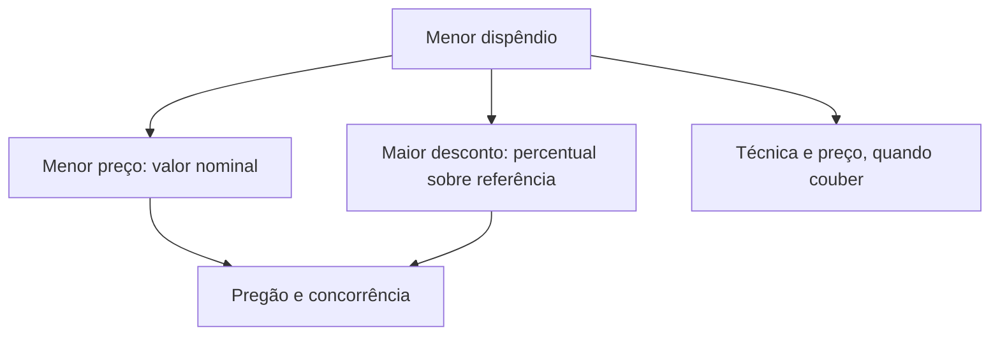
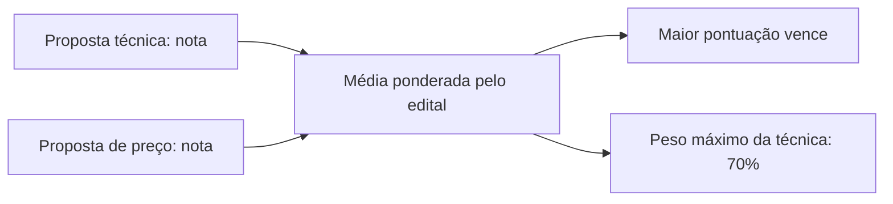

Escolhida a modalidade, resta saber **como as propostas serão comparadas**. É o papel do critério de julgamento: uma régua que a Administração fixa antes de abrir qualquer envelope e que lhe diz qual proposta é a mais vantajosa. A lei antiga chamava isso de "tipo" de licitação. A Lei 14.133/2021 prefere "critério de julgamento" e o disciplina nos arts. 33 a 39. Neste capítulo você estudará os quatro critérios mais comuns: menor preço, maior desconto, melhor técnica ou conteúdo artístico e técnica e preço. No próximo, virão o maior lance e o maior retorno econômico.

> [!objetivos]
> - Listar os critérios de julgamento do art. 33 e distingui-los das modalidades.
> - Explicar o menor dispêndio, o padrão mínimo de qualidade e a diferença entre menor preço e maior desconto.
> - Descrever a melhor técnica ou conteúdo artístico, seu objeto e as modalidades compatíveis.
> - Aplicar a ponderação do critério de técnica e preço e o limite de 70%.

## Visão geral dos critérios

Imagine dois pais que querem descobrir qual filho é o mais alto e qual é o mais pesado. No primeiro caso usam uma fita métrica; no segundo, uma balança. Mesma pergunta ("quem é maior?"), instrumentos diferentes. Os critérios de julgamento cumprem esse papel: definem a grandeza pela qual as propostas serão medidas.

O art. 33 relaciona seis critérios:

| Critério | Em uma frase |
| --- | --- |
| Menor preço | Vence o valor nominal mais baixo |
| Maior desconto | Vence o maior abatimento sobre um preço de referência |
| Melhor técnica ou conteúdo artístico | Vence a melhor proposta técnica ou artística, sem preço |
| Técnica e preço | Vence a maior nota ponderada entre qualidade e custo |
| Maior lance | Vence quem oferece mais, no leilão |
| Maior retorno econômico | Vence o que mais economiza à Administração, em contratos de eficiência |

> [!pegadinha] Modalidade não é critério
> Modalidade é o rito (pregão, concorrência, concurso, leilão, diálogo competitivo); critério é a forma de comparar propostas (menor preço, maior lance e os demais). Uma alternativa que descreva "o critério de julgamento concorrência" ou "a modalidade menor preço" erra por trocar os conceitos.

## Menor preço e maior desconto: o menor dispêndio

Os dois critérios são tratados em conjunto porque ambos buscam o **menor dispêndio**, isto é, o **menor custo** para a Administração. Segundo o art. 34, a melhor proposta é a que gasta menos dinheiro público **e** atende aos **parâmetros mínimos de qualidade** definidos no edital.

### O padrão mínimo de qualidade

O requisito de qualidade é um filtro, não uma fonte de pontos. Se a Administração exige que as viaturas tenham ar-condicionado e um licitante oferece a menor cifra para um modelo sem ar, a proposta é desclassificada, porque não alcançou o mínimo. Se outra proposta atende ao mínimo e ainda oferece rádio com navegação não pedido, o acréscimo não melhora a posição: o que passa do mínimo não ajuda nem atrapalha. É isso que distingue esses critérios da técnica e preço, em que a qualidade acima do exigido pode render pontos.

> [!lei] Lei 14.133/2021, art. 34, caput
> "O julgamento por menor preço ou maior desconto e, quando couber, por técnica e preço considerará o menor dispêndio para a Administração, atendidos os parâmetros mínimos de qualidade definidos no edital de licitação."

### Como os dois critérios diferem

No **menor preço**, comparam-se valores nominais. Se o licitante A cobra 100 reais e o B cobra 110 reais, A vence. No **maior desconto**, o valor aparece de forma indireta: vence quem oferece o maior abatimento sobre um preço de referência. Se uma tabela oficial fixa o preço do remédio X em 100 reais, e A oferece 5% de desconto enquanto B oferece 10%, vence B, e a Administração pagará 90 reais. Ambos entregam o mesmo resultado, o gasto mais baixo, mas por caminhos distintos.

| Aspecto | Menor preço | Maior desconto |
| --- | --- | --- |
| Elemento comparado | Valor nominal da proposta | Percentual sobre referência |
| Vencedor | Menor valor expresso | Maior abatimento |
| Referência de preço | Não precisa de tabela | Exige preço de referência |
| Ponto específico | Valor expresso | Incide sobre o preço global e se estende aos aditivos |

No maior desconto, a referência é o **preço global** fixado no edital, e o percentual se estende a **termos aditivos** futuros (art. 34, § 2º). Se uma obra de reparo é licitada por desconto sobre o preço global e, adiante, um aditivo inclui outro trecho de parede dentro dos limites legais, o mesmo desconto incide também sobre o acréscimo.

### Custos indiretos

Ao apurar o menor dispêndio, a Administração pode considerar, além do preço de aquisição, custos indiretos ligados à manutenção, ao uso, à reposição, à depreciação, ao impacto ambiental e a outros fatores do ciclo de vida do objeto (art. 34, § 1º). A condição é que esses custos possam ser **medidos objetivamente**, conforme regulamento. Na compra de uma frota, por exemplo, o custo das revisões nos anos previstos de uso pode entrar no cálculo, se for possível mensurá-lo com precisão.

### Modalidades compatíveis

O menor preço e o maior desconto combinam com **pregão** e **concorrência**. O pregão só admite esses dois critérios. A concorrência admite esses e outros. Eles não servem ao concurso (que exige melhor técnica ou conteúdo artístico), ao leilão (que usa maior lance) nem ao diálogo competitivo (que é incompatível com a aferição objetiva própria desses critérios).

> [!bizu] Qualidade só como filtro
> Menor preço e maior desconto exigem **qualidade mínima**, mas não premiam qualidade superior. Quem quiser premiar a qualidade acima do mínimo deve usar a técnica e preço, que é excepcional.

> [!resolvido] Questão comentada: maior desconto e menor dispêndio
> No julgamento por maior desconto, deve ser considerado o menor dispêndio para a Administração, atendidos os parâmetros mínimos de qualidade do edital. A afirmação está correta?
>
> **Resolução.** Sim, é o que diz o art. 34. Se a proposta com o maior desconto, digamos 18%, é a vencedora, será também a que implica menor gasto para a Administração.

## Melhor técnica ou conteúdo artístico

Neste critério, o julgamento leva em conta **exclusivamente** as propostas técnicas ou artísticas dos licitantes, e o edital fixa o **prêmio ou a remuneração** dos vencedores (art. 35). Em consequência, **não existe proposta de preço**: o valor é definido pela Administração, e os licitantes competem apenas pela qualidade do trabalho.

Pense numa corrida de rua. Se o organizador oferece um prêmio muito pequeno, só aparecem corredores amadores; se oferece um prêmio generoso, atrai atletas de elite. O prêmio influencia quem participa, mas os corredores não o negociam: apenas correm. Do mesmo modo, os licitantes apresentam sua proposta técnica, sem mexer no preço.

### Objeto e modalidades

Esse critério se aplica à contratação de **projetos** e de **trabalhos técnicos, científicos ou artísticos** (art. 35, parágrafo único). Um exemplo: a Administração quer um projeto arquitetônico para uma futura obra e escolhe o melhor entre os apresentados. As modalidades compatíveis são o **concurso**, que só admite este critério, e a **concorrência**, que também admite outros. Ficam de fora o pregão e o leilão, que têm critérios próprios, e o diálogo competitivo, que usa critérios definidos no edital.

### Um critério ou dois?

A lei costuma tratar "melhor técnica ou conteúdo artístico" como um critério único. Mas os arts. 37 e 38 mencionam só "melhor técnica", sem o "conteúdo artístico". Não se sabe se foi intenção de separar em dois ou falha de redação. A recomendação é tratar como um critério, e prestar atenção nos casos em que aparece apenas "melhor técnica". Note ainda que não é a "melhor técnica" da lei antiga, que considerava também o preço e não podia ser usada em concurso.

> [!atencao] Sem preço, sem desempate por valor
> Se o critério é melhor técnica ou conteúdo artístico, o licitante não oferece preço. Uma alternativa que diga que o licitante "propõe o preço do projeto" nesse critério está errada. A remuneração é um dado do edital.

> [!resolvido] Questão comentada: projeto arquitetônico
> Um município quer contratar arquiteto para elaborar o projeto de uma obra. É possível usar o concurso, com o critério de melhor técnica ou conteúdo artístico?
>
> **Resolução.** Sim. O critério serve a projetos e a trabalhos técnicos, científicos ou artísticos (art. 35, parágrafo único), e o concurso é a modalidade para escolher esse tipo de trabalho, que só admite esse critério (art. 6º, XXXIX).

## Técnica e preço

O terceiro critério avalia o **custo-benefício**. Cada licitante entrega duas propostas separadas, a **técnica** e a **de preço**. Ambas recebem notas segundo fatores objetivos do edital, e a vencedora é a que obtém a **maior pontuação ponderada** (art. 36). É como pedir a agências de turismo dois envelopes: um só com a descrição da viagem, outro só com o valor. Você dá nota a cada envelope, combina as notas com pesos e fica com a melhor combinação.

### Uso excepcional

A regra geral é adotar menor preço ou maior desconto. Quem quiser usar técnica e preço deve **justificar** por que os outros critérios não servem. A escolha só se sustenta quando o **estudo técnico preliminar** demonstrar que avaliar e ponderar a qualidade das propostas que **superam os requisitos mínimos** é relevante para os fins da Administração. Em termos práticos: se o mínimo atende bem, use menor preço; se vale pagar mais por algo que excede o mínimo, use técnica e preço.

### Quando pode ser adotada

A lei restringe a técnica e preço às contratações de (art. 36, § 1º):

1. **serviços técnicos especializados de natureza predominantemente intelectual**, caso em que o critério deve ser, de preferência, o de técnica e preço;
2. serviços que dependem em grande parte de **tecnologia sofisticada e de domínio restrito**, atestada por autoridades técnicas de reconhecida qualificação;
3. **bens e serviços especiais de tecnologia da informação e de comunicação**;
4. **obras e serviços especiais de engenharia**;
5. objetos que **admitam soluções alternativas e variações de execução**, com efeitos mensuráveis sobre qualidade, produtividade, rendimento e durabilidade, que possam ser escolhidas livremente pelos licitantes.

Só a primeira hipótese carrega a nota de "preferencial". Nos serviços técnicos especializados (art. 6º, XVIII), o componente humano pesa muito: pareceres, consultorias, treinamento de pessoal e defesa de causas judiciais são exemplos. Já a última hipótese cobre objetos em que cada licitante tem o seu método e todos chegam ao resultado procurado, como a construção de uma pista de atletismo que cumpra um padrão de desempenho, por caminhos diferentes.

### A ponderação e o limite de 70%

Os pesos de técnica e de preço são definidos no edital. A lei limita apenas o peso da técnica: a **proporção máxima é de 70%** para a proposta técnica. Isso quer dizer que a técnica pode valer até 70% e o preço, no mínimo, 30%. Não há teto para o peso do preço: nada impede um edital de dar 80% ou 90% ao preço.

O cálculo é uma média ponderada. Com pesos de 60% para a técnica e 40% para o preço, multiplicam-se as notas por 0,6 e por 0,4.

| Empresa | Nota técnica | Nota de preço | Cálculo (60% e 40%) | Resultado | Posição |
| --- | --- | --- | --- | --- | --- |
| A | 8,0 | 10,0 | 4,8 + 4,0 | 8,80 | 2º |
| B | 9,0 | 8,0 | 5,4 + 3,2 | 8,60 | 3º |
| C | 7,0 | 9,0 | 4,2 + 3,6 | 7,80 | 4º |
| D | 10,0 | 7,5 | 6,0 + 3,0 | 9,00 | 1º |

Pela média simples (pesos iguais), A seria a primeira; com a ponderação, D passa à frente. Perceba como o peso decide o resultado: por isso o edital precisa fixar os pesos antes de abrir as propostas.

### Nota técnica e modalidade

O desempenho anterior do licitante em contratos com a Administração deve ser considerado na pontuação técnica; essas informações constam do registro cadastral. A lei prevê o critério de técnica e preço apenas para a **concorrência**.

> [!atencao] 70% é limite para a técnica
> O teto de 70% vale para a **técnica**, não para o preço. Alternativas que digam que o preço não pode passar de 30% ou que o peso do preço tem limite máximo estão erradas.

> [!pegadinha] Técnica e preço não é o padrão
> Dizer que técnica e preço é o critério normal das licitações de obras e serviços é errado. Mesmo nas hipóteses do art. 36, § 1º, o uso depende de justificativa baseada no estudo técnico preliminar. Só nos serviços intelectuais especializados a lei diz que o critério deve ser preferencial.

> [!resolvido] Questão comentada: ponderação
> Em uma licitação por técnica e preço, o edital fixa 75% para a técnica e 25% para o preço. É válido?
>
> **Resolução.** Não. O limite máximo para a técnica é de 70%. O edital pode atribuir até 70% à técnica e, por consequência, no mínimo 30% ao preço. Pesos maiores para o preço, como 80% ou 90%, são permitidos.

## Como a banca cobra este assunto

As provas exploram principalmente: a diferença entre critério e modalidade; o menor dispêndio e o padrão mínimo de qualidade, que não rende pontos extras; o desconto sobre o preço global estendido aos aditivos; a inexistência de proposta de preço na melhor técnica ou conteúdo artístico; o caráter excepcional da técnica e preço; as hipóteses do art. 36, § 1º, em especial a preferência pelos serviços intelectuais; e o limite de 70% para a técnica. Cuidado com as palavras "somente", "sempre" e "obrigatoriamente", que costumam transformar uma regra em erro.

## Mapa do capítulo

| Critério | Ideia central | Armadilha |
| --- | --- | --- |
| Menor preço | Valor nominal mais baixo, com qualidade mínima | Premiar qualidade acima do mínimo |
| Maior desconto | Maior abatimento sobre preço global de referência | Esquecer o efeito sobre aditivos |
| Menor dispêndio | Menor custo, com custos indiretos mensuráveis | Contar custos não mensuráveis |
| Melhor técnica ou conteúdo artístico | Só proposta técnica; prêmio fixado pelo edital | Admitir proposta de preço |
| Técnica e preço | Média ponderada; uso excepcional e justificado | Tratá-lo como critério ordinário |
| Limite de ponderação | Máximo de 70% para a técnica | Aplicá-lo ao preço |
| Modalidades | Pregão só com menor preço e maior desconto; técnica e preço só em concorrência | Admitir técnica e preço no pregão |

### Para fixar

1. Critério de julgamento é a forma de comparar propostas; modalidade é o rito.
2. Menor preço e maior desconto buscam o menor dispêndio, respeitado o padrão mínimo de qualidade.
3. Qualidade acima do mínimo não gera pontos no menor preço nem no maior desconto.
4. No maior desconto, a referência é o preço global do edital, e o desconto se aplica aos aditivos.
5. Custos indiretos podem entrar no menor dispêndio se forem objetivamente mensuráveis.
6. O pregão só admite menor preço e maior desconto.
7. Na melhor técnica ou conteúdo artístico não há proposta de preço, e o edital fixa o prêmio ou a remuneração.
8. Esse critério serve a projetos e a trabalhos técnicos, científicos ou artísticos, no concurso e na concorrência.
9. A técnica e preço é excepcional, depende de justificativa no estudo técnico preliminar e se limita às hipóteses do art. 36, § 1º.
10. A ponderação em favor da técnica não pode passar de 70%.
