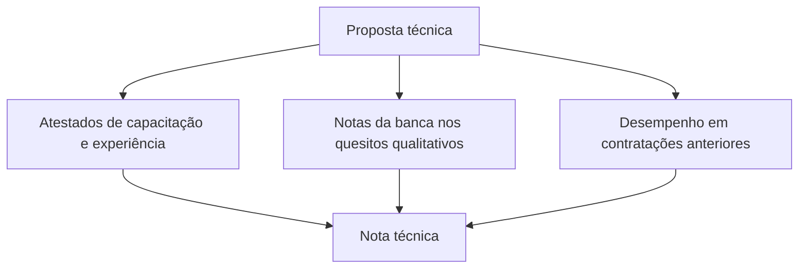
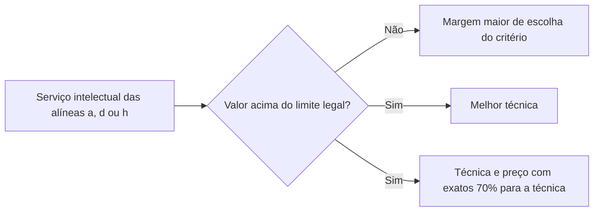

O capítulo anterior apresentou a lógica dos critérios de menor preço, maior desconto, melhor técnica e técnica e preço. Aqui vamos completar o mapa. Primeiro, o **aprofundamento** dos critérios técnicos: quem dá as notas, o que se avalia e quais regras especiais valem para os serviços intelectuais de valor elevado. Depois, os dois critérios de uso restrito, o **maior retorno econômico**, próprio dos contratos de eficiência, e o **maior lance**, exclusivo do leilão. No fim, um quadro que relaciona todos os critérios com as modalidades e uma amostra de decisões do STF sobre normas gerais de licitação.

> [!objetivos]
> - Descrever como se avalia a proposta técnica: atestados, banca e desempenho anterior.
> - Aplicar a regra da participação direta e pessoal do profissional e as regras do art. 37, § 2º.
> - Explicar o critério de maior retorno econômico e o contrato de eficiência.
> - Reconhecer o maior lance como critério exclusivo do leilão.
> - Relacionar cada critério com as modalidades em que cabe.

## Avaliação da proposta técnica

Esta parte é um aprofundamento. Se o tempo está curto, leia os quadros e a tabela-resumo; mas as bancas mais exigentes cobram os detalhes. As regras valem tanto para a melhor técnica ou conteúdo artístico quanto para a técnica e preço, porque ambas examinam a qualidade da proposta. A diferença é que a primeira só tem proposta técnica, e a segunda tem proposta técnica e de preço. Os arts. 37 e 38 mencionam só "melhor técnica", e a recomendação é tratá-los como aplicáveis aos dois critérios, com o cuidado de reparar na redação literal quando a questão a cobrar.

### Os três ingredientes da nota técnica

Ao avaliar a técnica, a Administração considera três coisas (art. 37):

| Ingrediente | O que se examina |
| --- | --- |
| Capacitação e experiência | Atestados de obras, produtos ou serviços já realizados pelo licitante |
| Quesitos qualitativos | Notas dadas por uma banca, segundo orientações e limites fixados no edital |
| Desempenho anterior | Notas de contratações passadas, extraídas dos documentos de fiscalização e do registro cadastral unificado no Portal Nacional de Contratações Públicas |

Nos quesitos qualitativos, o edital orienta a banca a olhar quatro pontos: se o licitante domina o objeto, qual método e plano de trabalho propõe, que formação tem a equipe e quais produtos se compromete a entregar. Pense na escolha de uma agência de viagens: você dá nota ao hotel, às refeições e aos passeios. A banca do certame faz o mesmo com os atributos da proposta técnica.

### A banca avaliadora

A banca que atribui as notas dos quesitos qualitativos tem **no mínimo três membros**. Pode ser composta por:

1. **servidores efetivos ou empregados públicos** dos quadros permanentes da Administração;
2. **profissionais contratados** pelo saber, pela experiência ou pelo renome na matéria avaliada, contanto que profissionais designados pela Administração, nos termos do art. 7º, **supervisionem** o que fizerem.

A banca é uma figura à parte: não faz o papel do agente de contratação nem o da comissão. Seu trabalho é dar notas técnicas, e quem segue conduzindo o certame é o agente de contratação.

> [!pegadinha] Banca não é comissão de contratação
> A banca de técnica tem pelo menos três membros e só pontua os quesitos qualitativos. Quem conduz o certame é o agente de contratação (ou a comissão, quando a lei a exige, como no diálogo competitivo). Alternativa que atribua à banca a condução da licitação inteira está errada.

### Participação direta do profissional

Já viu alguém contratar um fotógrafo famoso, pagar o preço de quem é renomado e ver um assistente aparecer no dia do evento? A lei evita essa situação. Quando a pontuação decorre da **capacitação técnico-profissional**, a execução do contrato exigirá a **participação direta e pessoal** do profissional que gerou a pontuação (art. 38). Se uma empresa ganhou pontos por contar com um engenheiro especialista, é esse engenheiro que deve executar o serviço, e não um substituto.

> [!lei] Lei 14.133/2021, art. 38
> "No julgamento por melhor técnica ou por técnica e preço, a pontuação decorrente da capacitação técnico-profissional exigirá que a execução do respectivo contrato tenha participação direta e pessoal do profissional correspondente."

### Por que a lei exige tanto da avaliação técnica

O risco de um julgamento técnico é a subjetividade. Se uma só pessoa dá a nota, a escolha pode ser dirigida. Por isso a lei exige uma banca plural, com no mínimo três membros, que as notas sigam parâmetros do edital e que a experiência seja comprovada por atestados e pelo histórico de contratos. Cada exigência reduz a margem para o favorecimento e aumenta a chance de a Administração contratar o licitante mais capaz. Para o seu estudo, o raciocínio é útil: sempre que a questão trouxer algum mecanismo de controle da nota, ele provavelmente tem apoio na lei.

### Serviços técnicos especializados de valor elevado

Os serviços técnicos especializados de natureza predominantemente intelectual são definidos no art. 6º, XVIII, e abrangem atividades em que o componente humano é decisivo, como consultoria, pareceres e projetos. Em alguns casos, são contratados diretamente por inexigibilidade; fora disso, há o dever de licitar, e o critério preferencial, como vimos, é a técnica e preço.

Mas três subgrupos desses serviços têm regra especial quando o valor estimado é **superior ao limite fixado na lei**, que era de 300 mil reais no texto original e é atualizado periodicamente (art. 37, § 2º). São eles:

| Alínea do art. 6º, XVIII | Serviço |
| --- | --- |
| a | Estudos técnicos, planejamentos, projetos básicos e projetos executivos |
| d | Fiscalização, supervisão e gerenciamento de obras e serviços |
| h | Controles de qualidade, análises, testes e ensaios, instrumentação e monitoramento de obras e do meio ambiente |

Nesses três casos, ressalvada a inexigibilidade, o julgamento só pode ser por:

- **melhor técnica**; ou
- **técnica e preço**, na proporção de **70%** de valoração para a proposta técnica.

Atenção ao detalhe: a lei diz "na proporção de 70%", e não "até 70%". Aqui a ponderação é **fixa**: 70% para a técnica e 30% para o preço. É o único caso em que a lei trava os pesos. Na regra geral do capítulo anterior, o 70% era um teto; neste caso especial, é um valor exato.

> [!atencao] Teto geral e peso fixo
> Na técnica e preço em geral, a técnica vale **no máximo** 70% (art. 36, § 2º). Nos serviços intelectuais das alíneas a, d e h acima do limite, a técnica vale **exatamente** 70% quando se escolhe técnica e preço (art. 37, § 2º, II). Não confunda "até" com "de".

> [!resolvido] Questão comentada: peças e técnica e preço
> Um hospital público optou por pregão para comprar peças sobressalentes de equipamentos, cujo padrão de qualidade está definido por especificações usuais de mercado. Deve adotar, como critério, a técnica e preço?
>
> **Resolução.** Não. O pregão só admite menor preço ou maior desconto. E a técnica e preço serve às hipóteses do art. 36, § 1º, entre as quais não está a compra de bens comuns com padrão de mercado.

## Maior retorno econômico

O maior retorno econômico é um critério de **uso exclusivo nos contratos de eficiência** (art. 39). A melhor proposta é a que gera a **maior economia** para a Administração, e a remuneração do contratado é um **percentual da economia efetivamente obtida** durante a execução.

### O contrato de eficiência

Imagine uma empresa com conta de energia muito alta. Uma consultoria promete fazer obras de adequação, como mudar janelas, trocar o sistema de refrigeração e reformar a iluminação, e garante uma redução de 30% na conta. Desconfiado, o dono propõe: "pago pela obra um percentual do que eu realmente economizar". Esse arranjo é o contrato de eficiência.

Para a lei, é o contrato de **prestação de serviços**, eventualmente acompanhado de **obras e de fornecimento de bens**, que visa **gerar economia** ao contratante por meio da **redução de despesas correntes** e paga o contratado com um **percentual do que foi poupado** (art. 6º, LIII).

### As duas propostas

Quando o critério é o maior retorno econômico, o licitante apresenta duas peças:

| Proposta | Conteúdo |
| --- | --- |
| De trabalho | As obras, serviços ou bens, com prazos, e a economia estimada, em unidade de medida e em unidade monetária |
| De preço | Um percentual sobre a economia estimada para certo período, expresso em unidade monetária |

O resultado, para o julgamento, é a **economia estimada menos a proposta de preço** (art. 39, § 3º). Veja um exemplo numérico. A empresa promete economizar 200 mil reais por mês e cobra 30% disso, ou seja, 60 mil reais. O retorno econômico para a Administração é de 140 mil reais por mês. Vence quem apresentar o maior retorno líquido.

| Licitante | Economia mensal prometida | Percentual cobrado | Preço mensal | Retorno líquido |
| --- | --- | --- | --- | --- |
| X | 200 mil | 30% | 60 mil | 140 mil |
| Y | 180 mil | 20% | 36 mil | 144 mil |
| Z | 250 mil | 40% | 100 mil | 150 mil |

Pela conta, Z teria o maior retorno líquido, mesmo cobrando o maior percentual, e seria o vencedor. O que decide é o saldo para o órgão, não o percentual isolado.

### Se a economia não se realizar

O edital deve trazer **parâmetros objetivos** para medir a economia, e essa medição serve de base para a remuneração (art. 39, § 2º). Se a economia efetiva ficar abaixo da contratada, a diferença é **descontada da remuneração** do contratado. Se a diferença ultrapassar o limite máximo previsto no contrato, o contratado sofre ainda outras sanções. No exemplo do contrato de 200 mil reais mensais de economia, se só se alcançarem 170 mil reais, a diferença de 30 mil reais é deduzida do pagamento, e a remuneração cai de 60 mil para 30 mil reais,, já que a diferença se deduz por inteiro.

### Modalidade

O maior retorno econômico é compatível com a **concorrência**.

> [!bizu] Maior retorno só em contrato de eficiência
> Se o enunciado fala em remuneração proporcional à economia obtida, o critério é o maior retorno econômico. Se disser que o critério serve para qualquer contrato, está errado.

> [!resolvido] Questão comentada: critério obrigatório?
> O julgamento dos contratos de eficiência será necessariamente feito pelo critério do maior retorno econômico, que considera a maior economia. A afirmação procede?
>
> **Resolução.** Sim, no sentido de que esse critério é de uso exclusivo para a celebração de contrato de eficiência e leva em conta a maior economia, com remuneração em percentual proporcional à economia efetivamente obtida (art. 39).

## Maior lance

O maior lance é o critério **exclusivo do leilão**. O leilão só admite o maior lance, e o maior lance só cabe no leilão. A lei não dedica artigo próprio a ele, mas a ideia é simples: vence quem oferece o **valor mais alto** pelo objeto alienado. Num leilão de um veículo inservível, quem der o lance mais alto leva o carro.

Por exemplo, na venda de um prédio desocupado, a Administração fixa um valor mínimo de avaliação, e vence quem ofertar o maior valor acima dele. Diferentemente do pregão, aqui a Administração não quer gastar menos; quer **receber mais**. Por isso a lógica é invertida: nas demais modalidades, o melhor é o menor custo ou a maior qualidade; no leilão, o melhor é a maior receita.

> [!bizu] Dupla inseparável
> Leilão e maior lance andam juntos. Se a alternativa disser que o leilão pode adotar menor preço, ou que a concorrência pode julgar por maior lance, marque como errada.

## Critérios e modalidades

O quadro a seguir resume a relação entre critérios e modalidades. Ele é o ponto mais cobrado do tema.

| Modalidade | Critérios admitidos |
| --- | --- |
| Pregão | Só os dois de menor dispêndio: menor preço e maior desconto |
| Concorrência | Cinco dos seis critérios (todos, menos o maior lance) |
| Concurso | Apenas a melhor técnica ou o conteúdo artístico |
| Leilão | Maior lance |
| Diálogo competitivo | Critérios divulgados no início da fase competitiva |

E, do outro lado, as características resumidas de cada critério:

| Critério | Característica central | Modalidades |
| --- | --- | --- |
| Menor preço e maior desconto | Menor dispêndio, com qualidade mínima | Pregão e concorrência |
| Melhor técnica ou conteúdo artístico | Só proposta técnica; prêmio ou remuneração no edital | Concurso e concorrência |
| Técnica e preço | Ponderação de notas, limite de 70% para a técnica | Concorrência |
| Maior retorno econômico | Economia menos preço; contratos de eficiência | Concorrência |
| Maior lance | Valor mais alto pelo bem alienado | Leilão |

> [!pegadinha] Diálogo competitivo não tem critério pré-definido
> A lei não fixa um critério de julgamento para o diálogo competitivo. Determina que o julgamento siga critérios divulgados no início da fase competitiva. Alternativa que diga que o diálogo adota sempre o menor preço está errada.

## Normas gerais e jurisprudência do STF

A União tem competência privativa para editar **normas gerais de licitação e contratação**, em todas as modalidades, para a Administração direta, autárquica e fundacional de todos os entes (Constituição, art. 22, XXVII). Estados e municípios podem legislar de forma **suplementar**, desde que respeitem as normas gerais da União. Se a lei local contrariar uma regra geral, ela é inconstitucional, e é isso que o STF tem reconhecido em várias ações diretas. Veja três decisões que ilustram o limite:

> [!jurisprudencia] ADI 3735 (STF, 2016)
> Lei estadual que exigia, para habilitação, uma certidão sobre violações a direitos do consumidor foi declarada inconstitucional. O STF entendeu que o estado criou restrição à participação em licitações em desacordo com as normas gerais da União.

> [!jurisprudencia] ADI 4658 e ADI 4748 (STF)
> Leis estaduais que ampliaram hipóteses de dispensa de licitação além do que a lei federal permitia, ou que obrigaram a Administração a comprar um percentual mínimo dos bens de um sistema de registro de preços, também invadiram a competência da União sobre normas gerais.

> [!jurisprudencia] ADI 7004 e RE 910.552 (STF, 2023)
> A venda direta de armas de fogo a integrantes de órgãos de segurança, prevista em lei estadual, é inconstitucional por violar a competência da União. Já o STF considerou constitucional a lei municipal, editada em competência suplementar, que proíbe a participação em licitação ou contratação de agentes eletivos, de ocupantes de cargos em comissão ou funções de confiança, de seus cônjuges, companheiros ou parentes até o terceiro grau e dos demais servidores municipais (Tema 1001).

Do STJ, vale guardar uma orientação de moralidade que se repete em provas: a empresa que tem servidor do órgão contratante, ou responsável pelo certame, entre os seus empregados não pode participar da licitação, por ferir a impessoalidade e a igualdade entre os licitantes. A licença do servidor na época do certame não muda isso, pois quem está licenciado continua sendo servidor. Em prova, o enunciado costuma tentar afastar a vedação com o argumento da licença, e esse argumento não procede.

## Como a banca cobra este assunto

Um método útil é montar, para cada modalidade, a sua "linha" completa: objeto, rito, critério, prazo de divulgação e condução. Quem tem essa linha memorizada acerta as questões de combinação sem esforço. O tema aparece em questões que pedem o par correto entre critério e modalidade, em afirmações sobre a banca de técnica (três membros), na participação direta do profissional, no peso exato de 70% para a técnica nos serviços intelectuais acima do limite legal e no cálculo do retorno líquido do contrato de eficiência. Também são frequentes as perguntas sobre a exclusividade do maior lance e sobre a competência da União em normas gerais. Leia o enunciado procurando as palavras "somente", "sempre", "necessariamente" e "até", pois a mudança de um termo altera a resposta.

## Mapa do capítulo

| Tema | Ideia central | Armadilha |
| --- | --- | --- |
| Nota técnica | Atestados, banca e desempenho anterior | Esquecer o desempenho anterior |
| Banca de técnica | No mínimo três membros; efetivos ou contratados supervisionados | Confundir com comissão de contratação |
| Capacitação técnico-profissional | Participação direta e pessoal do profissional | Admitir substituição livre |
| Art. 37, § 2º | Alíneas a, d, h acima do limite: melhor técnica ou técnica e preço com 70% fixos | Ler "até 70%" |
| Maior retorno econômico | Economia menos preço; só contratos de eficiência | Aplicar a qualquer contrato |
| Economia não atingida | Desconto na remuneração; sanções se passar o limite | Dizer que nada muda |
| Maior lance | Exclusivo do leilão | Usá-lo na concorrência |
| Diálogo competitivo | Critérios divulgados na fase competitiva | Fixar menor preço |
| Normas gerais | Competência privativa da União | Atribuir ao estado |

### Para fixar

1. A nota técnica combina atestados de experiência, notas da banca e desempenho em contratações anteriores.
2. A banca dos quesitos qualitativos tem no mínimo três membros e não se confunde com a comissão de contratação.
3. A pontuação por capacitação técnico-profissional exige participação direta e pessoal do profissional.
4. Nos serviços das alíneas a, d e h do art. 6º, XVIII, acima do limite legal, só cabem melhor técnica ou técnica e preço com 70% fixos para a técnica.
5. O maior retorno econômico é exclusivo dos contratos de eficiência e cabe na concorrência.
6. No contrato de eficiência, o retorno é a economia estimada menos a proposta de preço.
7. Se a economia contratada não se realizar, a diferença é descontada da remuneração.
8. O maior lance é exclusivo do leilão, e o leilão só admite o maior lance.
9. O pregão aceita só menor preço e maior desconto; o concurso, só melhor técnica ou conteúdo artístico.
10. As normas gerais de licitação são competência privativa da União; estados e municípios só legislam de forma suplementar.
