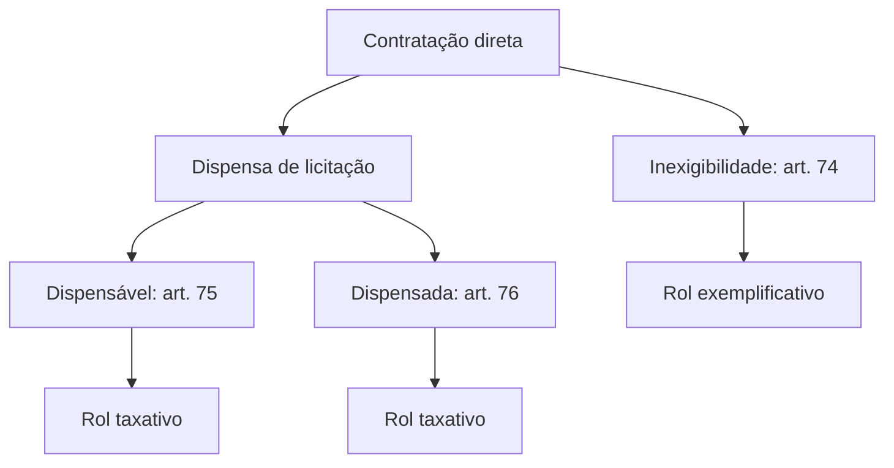
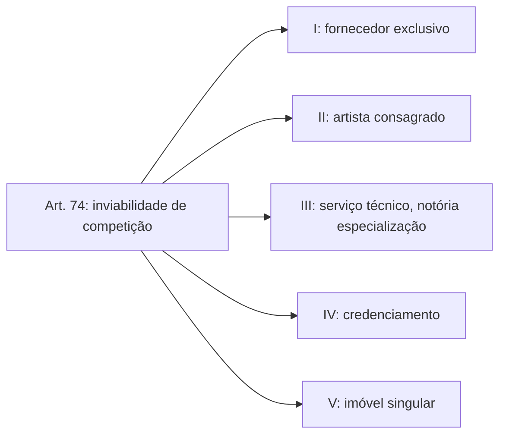

A regra do direito administrativo é licitar antes de contratar. Mas, assim como nem toda travessia exige uma ponte, nem toda contratação exige um certame. Há situações em que competir é impossível, e outras em que a lei permite, ou até manda, que a Administração contrate diretamente. Esses casos formam a **contratação direta**, assunto que a Lei 14.133/2021 trata nos arts. 72 a 76 e que as bancas cobram de forma intensa. Este capítulo apresenta a classificação geral da contratação sem licitação, as formalidades do processo, a responsabilidade por contratações indevidas e a primeira espécie: a **inexigibilidade**.

> [!objetivos]
> - Distinguir inexigibilidade, licitação dispensável e licitação dispensada.
> - Indicar quais rols são taxativos e qual é exemplificativo.
> - Listar os documentos que instruem a contratação direta (art. 72) e a responsabilidade do art. 73.
> - Descrever as cinco hipóteses de inexigibilidade do art. 74 e seus requisitos.

## Mapa da contratação direta

A contratação direta é aquela feita **sem licitação**. Ela se divide em duas espécies: a **inexigibilidade** e a **dispensa**. A dispensa, por sua vez, tem duas subespécies: a licitação **dispensável** e a licitação **dispensada**.

| Característica | Inexigibilidade | Licitação dispensável | Licitação dispensada |
| --- | --- | --- | --- |
| Fundamento | Inviabilidade de competição | A lei autoriza não licitar | A lei determina não licitar |
| Artigo | 74 | 75 | 76 |
| Rol | Exemplificativo | Taxativo | Taxativo |
| Natureza da decisão | Não se discute | Discricionária | Vinculada |
| Objeto | Variado | Variado (valor, objeto, situação, pessoa) | Alienação de bens |

O ponto de partida é entender o fundamento de cada uma. Na **inexigibilidade**, a competição é impossível, e sem competição não há como licitar. Na licitação **dispensável**, a competição é possível, mas o legislador autoriza o gestor a escolher entre licitar ou não. Na licitação **dispensada**, o legislador determina que não se licite, e o gestor não tem escolha. Em todas as situações de licitação dispensada, o objeto é a venda ou a cessão de bens da Administração.

> [!pegadinha] Só a inexigibilidade tem rol exemplificativo
> O art. 74 diz que a licitação é inexigível "em especial" nos casos que enumera. A expressão mostra que há outros: se a Administração demonstrar que a competição é inviável por outro motivo, a licitação também será inexigível. Já as hipóteses de dispensa, tanto a dispensável quanto a dispensada, são **taxativas**. O administrador não pode inventar uma hipótese de dispensa.

> [!resolvido] Questão comentada: o rol da inexigibilidade
> O rol de casos de inexigibilidade é fechado, sem espaço para outras situações?
>
> **Resolução.** Não. A inexigibilidade tem rol exemplificativo (art. 74, "em especial"). Os casos de licitação dispensável e dispensada é que são taxativos, previstos nos arts. 75 e 76.

## O processo de contratação direta

Contratação direta não é contratação sem processo. O que não existe é a licitação. A Administração precisa demonstrar por que escolheu aquele fornecedor e por que paga aquele preço, e por isso o processo de contratação direta, que abrange a inexigibilidade e a dispensa, deve ser instruído com os documentos do art. 72.

| Documento | Para que serve |
| --- | --- |
| Pedido formal do setor interessado, com os estudos e o termo de referência ou projeto que o caso pedir | Descrever a necessidade e o objeto |
| Estimativa do valor da despesa, calculada pelas regras do art. 23 | Saber quanto se espera gastar |
| Parecer jurídico e, quando couber, pareceres técnicos | Confirmar que os requisitos legais foram cumpridos |
| Indicação de que há previsão orçamentária para a despesa | Mostrar de onde virá o dinheiro |
| Prova de que o escolhido tem habilitação e qualificação mínimas | Verificar a capacidade de executar |
| Explicação da escolha daquele contratado | Afastar a suspeita de favorecimento |
| Justificativa do preço | Mostrar que o valor é compatível com o mercado |
| Autorização da autoridade competente | Aprovar a contratação |

Para uma compra de baixo valor, por exemplo, o processo é bem mais simples do que numa licitação, mas existe: um pedido do setor interessado, uma cotação para justificar o preço, o parecer do jurídico, a indicação de onde sairá o dinheiro e a autorização do dirigente. Tanto o ato de autorização quanto o extrato do contrato dele resultante têm de ser publicados em página oficial e continuar acessíveis a qualquer pessoa (art. 72, parágrafo único).

### Responsabilidade por contratação direta indevida

O procedimento simplificado é terreno fértil para desvios, e por isso a lei trata do tema de forma específica. Quando a contratação direta é indevida e o fato envolve **dolo, fraude ou erro grosseiro**, quem foi contratado e o agente público responsável pelo ato respondem **solidariamente** pelo prejuízo ao erário, além de outras sanções cabíveis (art. 73). Solidariedade significa que o ressarcimento pode ser exigido de qualquer um dos dois, isolada ou conjuntamente.

> [!lei] Lei 14.133/2021, art. 74, caput
> "É inexigível a licitação quando inviável a competição, em especial nos casos de:"

> [!atencao] Erro simples não gera solidariedade
> A responsabilidade solidária do art. 73 exige dolo, fraude ou **erro grosseiro**. Um erro de interpretação razoável, sem má-fé nem grosseria, não gera a mesma consequência. Se a alternativa omitir esses requisitos e afirmar que qualquer contratação direta irregular gera solidariedade, desconfie.

> [!resolvido] Questão comentada: contratação direta sem processo
> Quem contrata por inexigibilidade fica livre de abrir um processo administrativo?
>
> **Resolução.** Não. A contratação direta depende de processo instruído com os documentos do art. 72. Dispensa-se a licitação, e não o processo.

## Inexigibilidade: o princípio

A licitação é um procedimento competitivo. Se é impossível competir, não há como realizar a licitação. A inexigibilidade traduz esse raciocínio: **sem competição, sem licitação**. O art. 74 enumera cinco hipóteses, a título de exemplo:

1. fornecedor exclusivo;
2. profissional do setor artístico consagrado;
3. serviços técnicos especializados de natureza predominantemente intelectual, com notória especialização;
4. objetos contratáveis por credenciamento;
5. imóvel cujas características e localização tornem necessária a escolha.

### Fornecedor exclusivo

A primeira hipótese diz respeito a bens e serviços que apenas um produtor, uma empresa ou um representante comercial pode fornecer (art. 74, I). Se há um só fornecedor no mercado, não existe com quem competir, e a licitação perde o sentido. Pense num medicamento fabricado por um único laboratório, que o distribui no País por um único representante autorizado.

Atenção à diferença entre **um único interessado** e **um único fornecedor**. Se existem vários fornecedores do produto, mas só um compareceu à licitação, o certame segue o seu curso, com análise de proposta e habilitação: não é contratação direta. Já na exclusividade, antes mesmo de licitar a Administração constata que só uma pessoa pode fornecer o objeto.

A Administração prova a exclusividade com um atestado, com o contrato de exclusividade, com uma declaração do fabricante ou com outro documento idôneo (art. 74, § 1º). E há uma vedação importante: a lei proíbe a **preferência por marca específica**. Se uma empresa tem contrato exclusivo para a marca X, mas outras marcas atendem igualmente à necessidade, a competição é viável e a inexigibilidade não se configura. Basta imaginar que um fabricante de celulares assine contrato de exclusividade com uma loja: como há celulares de outras marcas, a Administração pode licitar a compra do tipo de aparelho de que precisa.

### Profissional do setor artístico

Quando a Administração quer contratar um artista conhecido, a licitação é inexigível, desde que o profissional seja reconhecido pela crítica especializada ou pela opinião pública e a contratação ocorra diretamente com ele ou com o seu empresário exclusivo (art. 74, II). Vale para qualquer arte: música, dança, pintura, teatro. A lógica é a da obra única: o show de determinado cantor não pode ser comparado com o de outro, pois cada artista é insubstituível.

A parte delicada é o **empresário exclusivo**. A lei o define como quem tem contrato, declaração, carta ou outro documento que comprove a representação exclusiva do artista de forma **permanente e contínua**, em todo o País ou em um estado específico (art. 74, § 2º). Ficam excluídos os empresários cuja representação vale só para um evento ou para um local.

| Aspecto | Regra |
| --- | --- |
| Quem pode ser contratado | O artista consagrado ou o seu empresário exclusivo |
| Consagração | Pela crítica especializada ou pela opinião pública |
| Exclusividade | Permanente e contínua |
| Alcance territorial | Nacional ou de um estado específico |
| O que não vale | Exclusividade restrita a um evento ou a um local |

A vedação à exclusividade "para um evento" combate uma fraude antiga: agências obtinham, só no papel, "exclusividade" para um show específico, de modo que o mesmo artista aparecia como exclusivo de várias agências, e o gestor contratava por inexigibilidade sem que existisse inviabilidade real de competição.

> [!pegadinha] Artista consagrado é inexigibilidade, não dispensa
> Uma alternativa clássica troca "inexigibilidade" por "dispensa" na contratação de artista. Está errada: o fundamento é a inviabilidade de competição (art. 74), e não a autorização para dispensar (art. 75).

### Serviços técnicos especializados e notória especialização

A terceira hipótese permite contratar, sem licitação, serviços técnicos especializados em que predomina o trabalho intelectual, desde que o contratado tenha **notória especialização**. Contratar serviços de publicidade e divulgação por esse caminho é proibido (art. 74, III). O rol de serviços tem oito alíneas:

| Alínea | Serviço |
| --- | --- |
| a | Estudos técnicos, planejamentos, projetos básicos ou projetos executivos |
| b | Pareceres, perícias e avaliações em geral |
| c | Assessorias ou consultorias técnicas e auditorias financeiras ou tributárias |
| d | Fiscalização, supervisão ou gerenciamento de obras ou serviços |
| e | Patrocínio ou defesa de causas judiciais ou administrativas |
| f | Treinamento e aperfeiçoamento de pessoal |
| g | Recuperação de obras de arte e de bens históricos |
| h | Controle de qualidade, ensaios e testes de campo e de laboratório, monitoramento de obras e do meio ambiente e outros serviços de engenharia desse tipo |

Tem **notória especialização** o profissional ou a empresa cujo prestígio na área, construído com desempenho anterior, estudos, experiência, publicações, estrutura, equipe e outros elementos, leve à conclusão de que o seu trabalho é essencial e comprovadamente adequado ao que o contrato exige (art. 74, § 3º). Não basta ser competente: é preciso um reconhecimento que torne a escolha praticamente única.

Nas contratações desse tipo, é **proibido subcontratar** outras empresas ou trocar os profissionais que justificaram a inexigibilidade (art. 74, § 4º). A razão é lógica: contrata-se a especialização de alguém, e permitir que outro execute o serviço esvazia a justificativa.

A lei ainda reconhece que os serviços profissionais de advocacia são, por sua natureza, técnicos e singulares quando comprovada a notória especialização (Estatuto da Advocacia, art. 3º-A, incluído em 2020), o que reforça o alcance da alínea "e".

> [!bizu] Publicidade não entra
> O rol de serviços técnicos especializados é amplo, mas nele **não cabe** publicidade e divulgação. Se a questão descrever a contratação de uma agência de propaganda por inexigibilidade, a resposta é que a lei veda.

### Objetos contratados por credenciamento

A quarta hipótese envolve objetos que devam ou possam ser contratados por **credenciamento** (art. 74, IV). No credenciamento, a Administração abre um cadastro a todos os interessados que cumpram os requisitos, e todos os credenciados podem prestar o serviço ou fornecer o bem. Como não se escolhe um vencedor, e sim se aceitam todos os habilitados, a competição é inviável. Um exemplo comum é o credenciamento de clínicas e laboratórios para atender servidores, com valores fixados pela Administração: quem cumpre os requisitos entra. Na lei de 1993, o credenciamento não vinha previsto de forma expressa e era aceito pela doutrina e pela jurisprudência; na lei atual, consta expressamente do art. 74.

### Imóvel de características singulares

A quinta hipótese cobre a compra ou a locação de um imóvel que, pelas instalações e pela localização, se torna a única opção possível (art. 74, V). É o caso de um quartel que precisa de um terreno contíguo, ou de um órgão que só funciona bem em prédio com estrutura específica. Como o risco de escolha dirigida é grande, a lei exige cautelas (art. 74, § 5º):

- avaliação prévia do imóvel, incluindo estado de conservação, custos de adaptação indispensáveis e prazo para amortizar os investimentos;
- certificação de que nenhum imóvel público vago e disponível atende à necessidade;
- justificativas que mostrem por que o imóvel é singular e vantajoso para a Administração.

## Credenciamento em detalhe

O credenciamento merece uma seção própria porque é a hipótese de inexigibilidade que mais cresce na prática. A lei o trata como **procedimento auxiliar** (art. 79) e o admite em quatro situações:

| Hipótese | Ideia | Exemplo |
| --- | --- | --- |
| Paralela e não excludente | Contratações simultâneas, em condições padronizadas, são viáveis e vantajosas | Credenciar várias oficinas para manutenção da frota, pagando tabela única |
| Seleção a critério de terceiros | Quem escolhe o prestador é o beneficiário direto do serviço | Credenciar profissionais de saúde para que o servidor escolha o seu |
| Mercados fluidos | O preço e as condições mudam o tempo todo, o que inviabiliza licitar | Credenciar fornecedores de passagens ou de combustível com cotação diária |
| Comércio eletrônico | A Administração compra bens e serviços comuns padronizados pela plataforma federal de compras expressas | Compra de itens de baixo valor em catálogo eletrônico |

As regras de funcionamento são rigorosas. A Administração deve divulgar edital de chamamento em sítio oficial, mantendo o cadastro **aberto** a novos interessados de forma permanente. Quando o objeto não permite contratar todos os credenciados ao mesmo tempo, usam-se critérios objetivos para distribuir a demanda. O edital define as condições padronizadas e, nas duas primeiras hipóteses, também o valor da contratação. Nos mercados fluidos, a Administração registra as cotações vigentes no momento da contratação. É proibido repassar o objeto a terceiros sem autorização expressa, e qualquer das partes pode denunciar o credenciamento nos prazos do edital.

> [!atencao] Credenciamento é inexigibilidade, não dispensa
> O art. 74, IV, trata os objetos contratados por credenciamento como inexigibilidade. A razão é a mesma de todo o artigo: a Administração não escolhe um vencedor, aceita todos os que cumprirem os requisitos. Se a alternativa classificar o credenciamento como dispensável por valor, está errada.

## Como distinguir inexigibilidade e dispensa

A pergunta decisiva é: **a competição é possível?** Se não é, trata-se de inexigibilidade. Se é possível, mas a lei autoriza ou manda não licitar por razões de conveniência, trata-se de dispensa. Um teste prático ajuda.

| Situação | Competição possível? | Classificação |
| --- | --- | --- |
| Único laboratório fabrica o medicamento | Não | Inexigibilidade |
| Compra de material de escritório de pequeno valor | Sim | Dispensa (valor) |
| Contratação de artista consagrado | Não | Inexigibilidade |
| Obra urgente após enchente | Sim, mas há urgência | Dispensa (emergência) |
| Venda de imóvel a outro órgão público | Sim, mas a lei manda não licitar | Dispensa (licitação dispensada) |

Repare que a diferença não depende do valor nem da urgência, mas da possibilidade de competir. Em inexigibilidade, o gestor não escolhe entre licitar ou não; simplesmente não há como licitar. Na dispensa, o gestor tem (dispensável) ou não tem (dispensada) escolha.

## Cuidados do gestor na inexigibilidade

Mesmo sem licitação, a inexigibilidade exige método. Em cada hipótese, o processo deve conter a prova concreta de que a competição era inviável: o atestado de exclusividade no fornecedor único, o contrato de representação do artista, o currículo e as publicações do especialista, o termo de adesão no credenciamento, o laudo de avaliação do imóvel. Sem essa prova, a contratação é indevida, e o gestor responde nos termos do art. 73 se houver dolo, fraude ou erro grosseiro.

Outro cuidado: a justificativa de preço continua obrigatória. Nas contratações em que não há outras ofertas para comparar, o preço costuma ser justificado por contratos que o mesmo fornecedor tem com outros órgãos, por notas fiscais de venda a particulares ou por tabelas oficiais. A ideia é impedir que a ausência de competição vire pretexto para pagar mais do que o mercado cobra.

> [!bizu] Resumo para memorizar o art. 74
> **E**xclusivo, **A**rtista, **S**erviço técnico, **C**redenciamento e **I**móvel: cinco hipóteses, uma ideia comum, a inviabilidade de competição. O mnemônico EASCI não é oficial, mas ajuda a lembrar a lista.

## Casos para treinar

Os casos a seguir mostram como se raciocina diante de uma situação concreta. Em cada um, a primeira pergunta é sempre: há competição possível?

**Caso 1: a oficina da marca.** O corpo de bombeiros precisa consertar uma viatura de determinada marca, ainda dentro da garantia, e o fabricante só reconhece as revisões feitas na rede autorizada. Existem várias oficinas autorizadas na cidade. Aqui não há fornecedor único: várias oficinas podem competir, de modo que a exclusividade do art. 74, I, não se aplica. Dependendo do valor, o caso pode ser de dispensa (conserto abaixo do limite) ou de licitação. A garantia, por si só, não cria inexigibilidade quando há mais de um prestador.

**Caso 2: o consultor de reputação nacional.** Um órgão precisa de um parecer técnico sobre a viabilidade de um projeto complexo e escolhe um catedrático universitário autor de livros e estudos sobre o tema, reconhecido em todo o País. Tratando-se de parecer (alínea b do inciso III), com profissional de notória especialização, a inexigibilidade é possível. O parecer deve ser feito por ele mesmo: o órgão não pode aceitar que outro profissional o assine.

**Caso 3: a agência de propaganda.** O órgão quer contratar divulgação de uma campanha de vacinação e escolhe uma agência de reputação ilibada, sem licitação. A tentativa de enquadrar na inexigibilidade do serviço técnico especializado é inválida, porque a lei veda a inexigibilidade para publicidade e divulgação. A contratação deve seguir o rito comum, salvo outra hipótese de dispensa.

**Caso 4: o show da festa da cidade.** A prefeitura contrata uma banda famosa por meio de uma agência que apresentou carta de exclusividade "para o evento de aniversário da cidade". A exclusividade restrita a um evento não vale. Para haver inexigibilidade, é necessário contratar diretamente com a banda ou com empresário de exclusividade permanente e contínua. Do contrário, a contratação é indevida e pode gerar responsabilização.

**Caso 5: o terreno ao lado.** Um quartel precisa ampliar suas instalações e escolhe um terreno vizinho. Para dispensar a licitação com base na singularidade do imóvel, o gestor deve juntar avaliação prévia, certificar que não há imóvel público disponível e justificar a vantagem. Se falta algum desses documentos, o processo está irregular.

Esses casos mostram o padrão de raciocínio das bancas: o enunciado descreve uma situação próxima da hipótese legal, mas retira ou acrescenta um detalhe (marca, publicidade, exclusividade de evento, ausência de certificação) que muda a resposta.

## Como a banca cobra este assunto

As bancas cobram: a classificação dos tipos de contratação direta e os rols taxativos ou exemplificativos; a existência do processo de contratação direta e os documentos do art. 72; a responsabilidade solidária do art. 73, que exige dolo, fraude ou erro grosseiro; a vedação de preferência por marca na exclusividade; o conceito de empresário exclusivo e a exclusividade permanente; a lista de serviços técnicos especializados e a vedação da publicidade; a notória especialização e a vedação à subcontratação. Fique atento à troca de "inexigibilidade" por "dispensa", que é a pegadinha mais frequente.

## Mapa do capítulo

| Tema | Ideia central | Armadilha |
| --- | --- | --- |
| Contratação direta | Inexigibilidade e dispensa | Achar que dispensa o processo |
| Rol da inexigibilidade | Exemplificativo | Dizer que é taxativo |
| Rols de dispensa | Taxativos | Criar hipótese nova |
| Art. 72 | Documentos de instrução | Esquecer a justificativa de preço |
| Art. 73 | Solidariedade com dolo, fraude ou erro grosseiro | Aplicá-la a qualquer erro |
| Fornecedor exclusivo | Prova por atestado, contrato ou declaração | Admitir preferência por marca |
| Artista | Consagrado, direto ou empresário exclusivo | Chamar de dispensa |
| Empresário exclusivo | Exclusividade permanente e contínua | Aceitar exclusividade de evento |
| Serviços técnicos | Rol de oito, com notória especialização | Incluir publicidade |
| Subcontratação | Vedada na hipótese do inciso III | Permitir troca de profissional |
| Imóvel | Singularidade e cautelas do § 5º | Dispensar avaliação prévia |

### Para fixar

1. A contratação direta tem duas espécies: inexigibilidade e dispensa; a dispensa é dispensável (art. 75) ou dispensada (art. 76).
2. O rol de inexigibilidade é exemplificativo; os de dispensa são taxativos.
3. A licitação dispensável é decisão discricionária; a dispensada é vinculada e trata de alienação de bens.
4. A contratação direta exige processo instruído com os documentos do art. 72, inclusive razão da escolha e justificativa de preço.
5. Na contratação direta indevida com dolo, fraude ou erro grosseiro, contratado e agente respondem solidariamente.
6. A inexigibilidade por fornecedor exclusivo exige prova da exclusividade e veda a preferência por marca.
7. O artista consagrado pode ser contratado diretamente ou por empresário de exclusividade permanente e contínua, nacional ou estadual.
8. Exclusividade restrita a um evento ou local específico não autoriza a inexigibilidade.
9. Os serviços técnicos especializados exigem notória especialização, com vedação à publicidade e à subcontratação.
10. O imóvel singular exige avaliação prévia, certificação de inexistência de imóvel público disponível e justificativa de vantagem.
