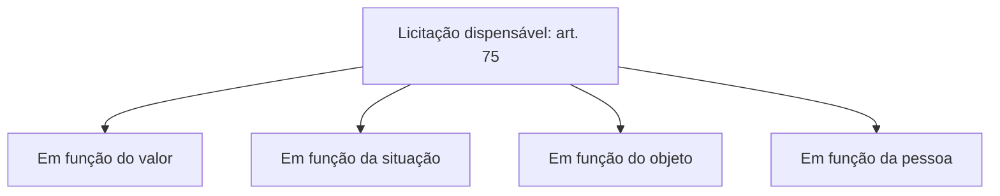

O capítulo anterior apresentou a lista de hipóteses de inexigibilidade. Este mostra como duas delas, o credenciamento e o imóvel singular, aparecem em situações do dia a dia, resume em um quadro tudo o que se estudou sobre inexigibilidade e, ao final, abre o assunto seguinte com o conceito de **licitação dispensável**, que é o ponto de partida do art. 75.

> [!objetivos]
> - Reconhecer o credenciamento e a locação de imóvel singular em casos concretos.
> - Explicar a mudança de tratamento do imóvel em relação à lei antiga.
> - Revisar as características de cada hipótese de inexigibilidade.
> - Definir licitação dispensável e suas três características.

## Credenciamento em casos práticos

O credenciamento serve a situações em que a Administração quer contratar **todos** os interessados que cumpram os requisitos, e não apenas um. Duas ilustrações ajudam.

A primeira é a merenda escolar. Uma prefeitura em região de acesso difícil não consegue atrair grandes fornecedores de hortifrutigranjeiros, mas tem estrutura para consumir toda a produção local. Ela publica um edital de credenciamento e contrata todos os pequenos produtores rurais que tiverem interesse e atenderem às exigências. Os contratos são paralelos e não excludentes: ninguém "vence", e a Administração fomenta a produção local. Não há competição, então a licitação é inexigível.

A segunda é a rede de saúde. Um município precisa de atendimento complementar em consultas e exames e credencia todas as clínicas que aceitarem a tabela de preços. O usuário escolhe onde ser atendido, e a Administração paga pelo serviço efetivamente prestado.

Em ambos os casos, o credenciamento é um **procedimento auxiliar**. Nele há chamamento público, requisitos objetivos e cadastro aberto. Mas, do ponto de vista da contratação, o que importa é que se trata de **hipótese de inexigibilidade**.

> [!resolvido] Questão comentada: credenciamento de produtores
> Um município credenciou fornecedores de hortifrutigranjeiros, pequenos produtores rurais, para a merenda escolar. Essa contratação é hipótese de inexigibilidade?
>
> **Resolução.** Sim. O credenciamento cria uma lista de fornecedores aptos, sem competição entre eles, e a contratação é paralela e não excludente, pois todos os interessados que cumprirem os requisitos são contratados. O art. 74, IV, prevê a inexigibilidade para objetos que possam ser contratados por credenciamento.

## Imóvel singular na prática

Imagine que uma secretaria de saúde queira instalar uma unidade de pronto-atendimento. Um imóvel específico reúne o tamanho adequado, a facilidade de adaptação para acessibilidade, a capacidade de abrigar equipamentos médicos e a localização favorável ao acesso de ambulâncias e de transporte público. Outro exemplo: uma cidade sedia um torneio esportivo e precisa de pista de atletismo, piscina olímpica e estádio; só um clube privado do município reúne as três estruturas. Nesses casos, as características e a localização do imóvel condicionam a escolha, e não há com quem competir.

As exigências do art. 74, § 5º, já conhecidas, são três: avaliação prévia do imóvel e dos custos de adaptação, certificação de que não há imóvel público vago e disponível e demonstração da singularidade, com a vantagem para a Administração. A segunda é a mais intuitiva: ninguém aluga um prédio se tem um próprio desocupado que atende à necessidade.

### Mudança em relação à lei antiga

Na lei de 1993, a compra ou a locação de imóvel cuja instalação e localização condicionassem a escolha era **dispensa**. A mudança para a inexigibilidade acompanha a lógica: a licitação dispensável pressupõe que seja possível licitar, e, se o imóvel é único, não há competição possível. Se outro imóvel atendesse, o caso exigiria licitação, e não dispensa nem inexigibilidade.

> [!pegadinha] Imóvel singular não é mais dispensa
> Questões baseadas na lei antiga ainda circulam. Se a alternativa disser que a compra ou locação de imóvel com localização condicionante é caso de licitação dispensável, está errada para a Lei 14.133/2021: hoje, é inexigibilidade (art. 74, V).

## Quadro-resumo da inexigibilidade

| Hipótese | Elementos essenciais | Vedações ou cuidados |
| --- | --- | --- |
| Fornecedor exclusivo | Só um produtor, empresa ou representante pode fornecer | Provar a exclusividade; vedada a preferência por marca |
| Artista consagrado | Crítica especializada ou opinião pública; direto ou por empresário exclusivo | Exclusividade permanente e contínua; nada de exclusividade de evento ou local |
| Serviço técnico especializado | Natureza predominantemente intelectual com notória especialização | Vedadas a publicidade e a subcontratação |
| Credenciamento | Chamamento público, todos os habilitados contratam | Sem competição; procedimento auxiliar |
| Imóvel | Instalação e localização condicionam a escolha | Avaliação prévia, certificação de imóvel público e singularidade |

Em todos os casos, vale o mesmo princípio: não há licitação porque não há como competir. A lista é apenas exemplificativa, e outras situações de inviabilidade também levam à inexigibilidade.

## Licitação dispensável

Passamos agora ao outro lado da contratação direta. A licitação **dispensável** ocorre quando é possível licitar, mas o legislador **retira a obrigatoriedade**. Diante de um caso do art. 75, a autoridade pode licitar ou contratar diretamente, e a decisão é sua. Ao contrário da inexigibilidade, aqui a competição é materialmente viável.

Três características resumem a licitação dispensável:

1. é possível licitar, mas a lei dispensa a obrigatoriedade;
2. a decisão é **discricionária**: licitar ou dispensar;
3. o rol é **taxativo**: o administrador não pode criar novas hipóteses.

O art. 75 é extenso. Para estudar, vale organizá-lo em quatro grupos, que seguem a lógica dos próximos capítulos:

| Grupo | Critério | Exemplos |
| --- | --- | --- |
| Em função do valor | O baixo valor da contratação | Incisos I e II |
| Em função da situação | Circunstâncias excepcionais | Licitação deserta, emergência, guerra |
| Em função do objeto | Natureza do bem ou do serviço | Peças de garantia, pesquisa, perecíveis |
| Em função da pessoa | Quem será contratado | Associação de pessoas com deficiência, instituições de pesquisa |

A classificação é apenas didática. As provas cobram os incisos, e não o nome do grupo. O que importa é lembrar, para cada hipótese, qual é o requisito: valor, situação, objeto ou pessoa.

> [!bizu] Diferença em uma frase
> Na inexigibilidade, **não dá** para licitar. Na licitação dispensável, **dá** para licitar, mas a lei deixa o gestor optar. Na dispensada, a lei **proíbe** licitar.

## Como a banca cobra este assunto

Duas linhas de cobrança se repetem. A primeira compara os conceitos: pergunta qual das três figuras (inexigibilidade, dispensável, dispensada) corresponde a uma descrição. A segunda mistura hipóteses: apresenta um caso de inexigibilidade, como o credenciamento ou o imóvel singular, e o chama de dispensa, ou o contrário. Em ambas, a pergunta decisiva é se a competição é possível e, se for, se a lei autoriza ou manda dispensar.

## Mapa do capítulo

| Tema | Ideia central | Armadilha |
| --- | --- | --- |
| Credenciamento | Chamamento público; todos os habilitados contratam | Chamá-lo de dispensa |
| Contratos paralelos e não excludentes | Vários contratados ao mesmo tempo | Pensar em um único vencedor |
| Imóvel singular | Instalação e localização condicionam a escolha | Tratá-lo como dispensa, como na lei antiga |
| Requisitos do imóvel | Avaliação, certificação e singularidade | Esquecer a certificação de imóvel público |
| Licitação dispensável | Licitar é possível, mas facultativo | Dizer que a decisão é vinculada |
| Rol da dispensa | Taxativo | Criar hipóteses por analogia |

### Para fixar

1. O credenciamento é um procedimento auxiliar e hipótese de inexigibilidade.
2. No credenciamento, os contratos são paralelos e não excludentes, e todos os habilitados contratam.
3. A compra ou locação de imóvel cuja localização e instalação condicionam a escolha é inexigibilidade, e não mais dispensa.
4. O imóvel singular exige avaliação prévia, certificação de inexistência de imóvel público disponível e demonstração de singularidade.
5. A inexigibilidade parte da impossibilidade de competir; a dispensável, de uma escolha do legislador.
6. A licitação dispensável é decisão discricionária: licitar ou dispensar.
7. O rol da licitação dispensável é taxativo.
8. O art. 75 pode ser estudado em quatro grupos: valor, situação, objeto e pessoa.
9. A licitação dispensada, ao contrário, é decisão vinculada e trata de alienação de bens.
10. Em prova, identifique primeiro se a competição era possível; depois, se a lei autoriza ou determina dispensar.
