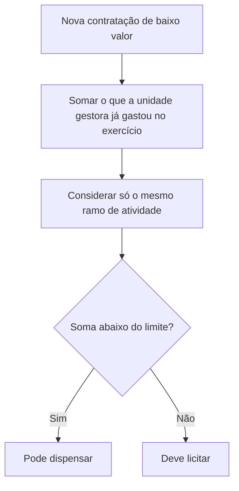

Licitar custa tempo, dinheiro e trabalho. Quando o valor do objeto é muito pequeno, ou quando algo impede o caminho normal, a lei autoriza a Administração a contratar diretamente. Este capítulo estuda os dois primeiros grupos de **licitação dispensável**, a dispensa **em função do valor** (art. 75, I e II) e a dispensa **em função da situação**, em especial a licitação deserta ou fracassada (art. 75, III) e a emergência ou calamidade pública (art. 75, VIII). São assuntos muito cobrados, porque exigem números e prazos precisos.

> [!objetivos]
> - Indicar os limites de valor da dispensa e as regras para apurá-los.
> - Explicar o dobro do limite, a exceção dos 8 mil reais e os procedimentos do art. 75, §§ 3º e 4º.
> - Distinguir licitação deserta e fracassada e aplicar os requisitos do inciso III.
> - Aplicar os requisitos e as vedações da dispensa por emergência e a tese do STF sobre a recontratação.

## Dispensa em função do valor

Realizar uma licitação tem custos: o tempo dos servidores, a publicação do edital, a análise das propostas. Se o objeto vale pouco, o custo do certame pode superar o benefício. Por isso o art. 75, I e II, dispensa a licitação para contratações de baixo valor:

| Inciso | Objeto | Limite na lei |
| --- | --- | --- |
| I | Obras, serviços de engenharia e serviços de manutenção de veículos automotores | Inferior a 100 mil reais |
| II | Outros serviços e compras | Inferior a 50 mil reais |

Duas observações sobre a redação. Primeiro, a lei diz "inferior a", e não "até". Se a contratação vale exatamente 100 mil reais, não é possível dispensar. Na lei antiga a expressão era "até", e esse é um ponto em que as bancas gostam de trocar. Segundo, os serviços de manutenção de veículos foram incluídos na faixa mais alta, a de 100 mil. Aqui é preciso cuidado: o **conserto** de um veículo é serviço de manutenção e segue o limite de 100 mil; a **compra** de um veículo é compra e segue o limite de 50 mil.

### Valores atualizados por decreto

O art. 182 manda o Poder Executivo federal atualizar os valores da lei todo dia 1º de janeiro, pelo IPCA-E ou por índice que o substitua, com divulgação no Portal Nacional de Contratações Públicas. Assim, a lei continua trazendo os valores originais, e o decreto traz os valores "reais". Algumas bancas cobram a literalidade da lei, e outras, o valor atualizado. A tabela a seguir reúne os dois, com base no Decreto 12.807/2025.

| Situação | Valor na lei | Valor atualizado (Decreto 12.807/2025) |
| --- | --- | --- |
| Dispensa para obras, engenharia e manutenção de veículos (art. 75, I) | 100 mil reais | 130.984,20 reais |
| Dispensa para compras e outros serviços (art. 75, II) | 50 mil reais | 65.492,11 reais |
| Manutenção de veículos sem somatório (art. 75, § 7º) | 8 mil reais | 10.478,74 reais |
| Contrato verbal (art. 95, § 2º) | 10 mil reais | 13.098,41 reais |

> [!atencao] Literal ou atualizado
> Quando a questão não indicar nada, siga a literalidade da lei (100 mil e 50 mil). Se o enunciado mencionar o decreto de atualização ou pedir o valor vigente, use o valor atualizado. Se houver dúvida, leia as alternativas: normalmente apenas uma das duas versões aparece.

### Dobro para consórcios e agências executivas

Os limites são **duplicados** para compras, obras e serviços contratados por consórcio público ou por autarquia ou fundação qualificada como agência executiva (art. 75, § 2º). Um consórcio público é a pessoa jurídica que vários entes criam para um objetivo comum, como administrar um hospital. A agência executiva é a autarquia ou fundação que recebe essa qualificação ao firmar um contrato de gestão e aceitar metas, em troca de mais autonomia, inclusive nos limites de dispensa. Em prova, só aplique o dobro se o enunciado mencionar expressamente um consórcio ou uma agência executiva.

| Contratante | Obras, engenharia, manutenção de veículos | Compras e outros serviços |
| --- | --- | --- |
| Regra geral | Inferior a 100 mil | Inferior a 50 mil |
| Consórcio ou agência executiva | Inferior a 200 mil | Inferior a 100 mil |

### Como se apura o valor

O gestor não pode olhar cada contratação isoladamente, porque isso permitiria fracionar a despesa. A lei manda considerar (art. 75, § 1º):

1. o **somatório** do que a unidade gestora despendeu no **exercício financeiro** (que no Brasil coincide com o ano civil);
2. o somatório das despesas com **objetos de mesma natureza**, isto é, contratações do mesmo ramo de atividade.

Um exemplo. Em determinado ano, o órgão compra material de escritório em janeiro (5 mil reais), março (15 mil), junho (15 mil) e agosto (10 mil), totalizando 45 mil reais. Tudo pôde ser dispensado, pois o total ficou abaixo de 50 mil. Se em dezembro surgir uma nova compra de 10 mil reais do mesmo material, ela não poderá ser dispensada, porque o total do ano chegaria a 55 mil. Em janeiro do ano seguinte, o limite recomeça.

Já a compra de 45 mil reais em material de expediente e de 40 mil em material de informática é possível, porque são objetos de natureza distinta, cada um com o seu limite de 50 mil reais no exercício. E quem quiser comprar cem computadores a 10 mil reais cada não escapa da licitação contratando um de cada vez: o somatório passaria em muito do limite.

> [!pegadinha] Apuração por unidade gestora, ano e natureza
> O limite é apurado por **unidade gestora**, por **exercício financeiro** e por **natureza do objeto**. Alternativas que falem em limite por contrato isolado, por mês ou por órgão inteiro, ignorando a natureza, estão erradas.

### A exceção dos 8 mil reais

Há uma exceção à regra do somatório. Nas contratações de **até 8 mil reais** de serviços de manutenção de veículos automotores de propriedade do órgão, incluído o fornecimento de peças, a regra de somar o ano não se aplica (art. 75, § 7º). Cada contratação é analisada individualmente. A razão é prática: se uma viatura quebra no meio de uma operação no interior, a oficina mais próxima não terá contrato prévio, e o conserto precisa ser feito com quem estiver à mão, várias vezes ao longo do ano. É uma exceção estreita, e você só deve lembrar dela quando for o foco da questão.

### Procedimento mínimo

Dispensar a licitação não é abrir mão dos princípios. As contratações dos incisos I e II são, de preferência, precedidas de aviso em sítio oficial, por **no mínimo três dias úteis**, com a descrição do objeto e a manifestação de interesse em receber propostas adicionais, devendo ser escolhida a proposta mais vantajosa (art. 75, § 3º). É uma "minicompetição". E o pagamento deve ser feito, de preferência, por **cartão de pagamento**, com extrato divulgado no PNCP (art. 75, § 4º).

> [!resolvido] Questão comentada: conserto de aparelho
> Um hospital tem um aparelho de diagnóstico parado por defeito e o diretor determina o conserto por dispensa, ao custo de 20 mil reais. O aparelho novo custaria 500 mil. O fundamento da dispensa é o custo do conserto ser inferior a 10% do valor do aparelho novo?
>
> **Resolução.** Não. O fundamento correto é o valor da contratação (outros serviços, inferior a 50 mil reais, art. 75, II). Comparar o conserto com o preço do equipamento novo não é critério legal.

## Dispensa em função da situação

O segundo grupo reúne casos em que uma circunstância concreta, como o fracasso de uma licitação ou uma calamidade, justifica contratar sem licitar.

### Licitação deserta e fracassada

Na licitação **deserta**, ninguém aparece. Na licitação **fracassada**, aparecem interessados, mas todos são desclassificados ou inabilitados. Uma imagem ajuda: numa corrida de rua, se ninguém comparece à largada, a prova é deserta; se cem corredores largam, mas nenhum conclui, a prova é fracassada.

A lei trata as duas como hipóteses de dispensa (art. 75, III). A licitação é dispensável para contratação que **mantenha todas as condições do edital** de uma licitação realizada **há menos de um ano**, quando naquela licitação:

- não apareceram interessados, ou não foram apresentadas propostas válidas;
- as propostas tinham preços manifestamente superiores aos de mercado ou incompatíveis com os fixados por órgãos oficiais.

| Requisito | Conteúdo |
| --- | --- |
| Licitação anterior | Deserta ou fracassada |
| Prazo | Realizada há menos de um ano |
| Condições | Todas as do edital mantidas |
| Causas | Ausência de interessados, propostas inválidas ou preços excessivos |

O prazo de um ano e a manutenção das condições evitam o abuso. Se o edital pedia internet móvel para trinta aparelhos com franquia de 30 gigabytes, a contratação direta não pode trocar por 100 gigabytes: mudando a condição, a dispensa não se sustenta.

Um ponto delicado: a lei não menciona expressamente o caso em que a licitação fracassa porque todos os licitantes foram **inabilitados**. Literalmente, não consta do inciso. Se esse tema ganhará interpretação mais ampla (por exemplo, considerar que "proposta válida" abrange a inabilitação), só o tempo dirá. Para a prova, siga o texto: ausência de interessados, ausência de propostas válidas e preços excessivos.

### Deserta e fracassada lado a lado

| Aspecto | Licitação deserta | Licitação fracassada |
| --- | --- | --- |
| Interessados | Nenhum compareceu | Compareceram, mas nenhum permaneceu |
| Resultado | Sessão sem participantes | Todos desclassificados ou inabilitados |
| Casos expressos na lei | Ausência de interessados | Propostas inválidas ou com preços excessivos |
| Consequência | Dispensa possível por até um ano, com as mesmas condições | Dispensa possível por até um ano, com as mesmas condições |

Repare que a consequência é a mesma. O que muda é a causa, e as bancas gostam de pedir que o candidato diga se o caso descrito foi de licitação deserta ou fracassada antes de aplicar a regra.

> [!resolvido] Questão comentada: licitação deserta
> Um município licitou o fornecimento de materiais de uso corrente e não apareceu ninguém. O caso é de licitação fracassada ou deserta? A dispensa é possível?
>
> **Resolução.** É licitação deserta, pois não houve interessados (fracassada é aquela em que há interessados, mas nenhuma proposta é válida). A dispensa é possível, desde que a licitação anterior tenha ocorrido há menos de um ano e as condições do edital sejam mantidas (art. 75, III, a).

### Emergência e calamidade pública

A licitação é dispensável em caso de emergência ou calamidade pública, quando a urgência de agir for real, isto é, quando a demora puder gerar dano, interromper um serviço público ou pôr em risco pessoas e bens, sejam públicos, sejam particulares (art. 75, VIII).

Dois pontos não podem ser esquecidos. O primeiro: o evento, por si só, não basta. Um temporal que não afeta serviços nem a segurança não autoriza dispensa. Se o temporal compromete uma ponte e uma escola, é preciso atuar rápido para evitar que a ponte caia e que o ano letivo seja prejudicado. O segundo: a dispensa é restrita ao que depende de atendimento urgente. Se um ginásio desabou, a prefeitura não pode dispensar a licitação para reformar todas as escolas do município. Sem correlação com a situação, não há emergência.

A dispensa serve para:

1. a **aquisição dos bens** necessários ao atendimento da situação;
2. as **etapas de obras e de serviços** que consigam ficar prontas em até **um ano**, a contar do dia em que a emergência ou a calamidade ocorreu.

A lógica do prazo de um ano é simples: se a obra ou o serviço exige mais tempo para ficar pronto, não é assim tão urgente. Por isso, uma reconstrução longa deve ser dividida: o que couber no ano segue por dispensa; o restante, por licitação. A lei veda a **prorrogação dos contratos** e a **recontratação da empresa** já contratada com base nesse inciso.

### O que decidiu o STF

No julgamento da ADI 6890, em setembro de 2024, o STF considerou **constitucional** a vedação à recontratação. A vedação alcança a recontratação fundada **na mesma situação emergencial** que ultrapasse o limite de um ano. Ela **não impede** que a empresa: (i) participe da licitação que substitua a dispensa; (ii) seja contratada diretamente com base em outro fundamento legal; ou (iii) seja contratada com o mesmo fundamento, se surgir uma **nova** emergência ou calamidade.

> [!jurisprudencia] ADI 6890 (STF, 2024)
> A vedação à recontratação da empresa contratada por dispensa emergencial é constitucional, mas só incide na recontratação fundada na mesma emergência que passe de um ano. A empresa pode disputar a licitação que substituirá a dispensa, ser contratada por outro fundamento ou por nova emergência.

> [!bizu] Literal ou tese do STF
> Em prova, leia o comando. Se a questão pedir a previsão literal da lei, a vedação é à prorrogação e à recontratação. Se pedir o entendimento do STF, lembre as três portas que a decisão deixa abertas à empresa.

## Como a banca cobra este assunto

Os números dominam as provas: 100 mil e 50 mil reais; "inferior a" em vez de "até"; o dobro para consórcios e agências executivas; 8 mil reais na manutenção de veículos; três dias úteis de aviso; um ano para a licitação deserta e para a emergência. Também são cobrados os conceitos de deserta e fracassada, a necessidade de manter as condições do edital e a restrição da dispensa emergencial ao que é urgente. Fique atento ao enunciado que pede o valor atualizado por decreto: se não pedir, responda com o valor literal.

## Mapa do capítulo

| Tema | Ideia central | Armadilha |
| --- | --- | --- |
| Dispensa por valor | Inferior a 100 mil (obras, engenharia, manutenção de veículos) e a 50 mil (compras e outros serviços) | Usar "até" |
| Dobro | Consórcio público e agência executiva | Aplicar o dobro sem menção |
| Apuração | Unidade gestora, exercício e mesma natureza | Considerar cada contrato isolado |
| Manutenção de veículos | Até 8 mil sem somatório | Estender a qualquer serviço |
| Procedimento | Aviso por 3 dias úteis e cartão de pagamento, preferencialmente | Tratar como obrigatório |
| Licitação deserta | Sem interessados | Confundir com fracassada |
| Licitação fracassada | Propostas inválidas ou preços excessivos | Esquecer o prazo de um ano |
| Emergência | Urgência, um ano, vedada a prorrogação e a recontratação | Dispensar tudo o que for conexo |
| ADI 6890 | Constitucional; admite três hipóteses de participação | Dizer que a empresa nunca mais contrata |

### Para fixar

1. A licitação é dispensável para valores inferiores a 100 mil reais (obras, engenharia e manutenção de veículos) e a 50 mil reais (compras e outros serviços).
2. A lei diz "inferior a", e não "até".
3. Os valores são duplicados para consórcios públicos e agências executivas.
4. O valor é apurado por unidade gestora, exercício financeiro e objetos de mesma natureza.
5. Até 8 mil reais em manutenção de veículos do órgão, não se aplica o somatório anual.
6. A dispensa por valor é preferencialmente precedida de aviso por três dias úteis e paga por cartão.
7. Licitação deserta é a sem interessados; fracassada, a com interessados, mas sem proposta válida ou com preços excessivos.
8. A dispensa por licitação deserta ou fracassada exige licitação de menos de um ano e as mesmas condições do edital.
9. A emergência exige urgência e se limita aos bens necessários e às parcelas de obra e serviço concluíveis em um ano.
10. São vedadas a prorrogação e a recontratação na dispensa emergencial; o STF considerou a vedação constitucional, com três exceções para a empresa.
