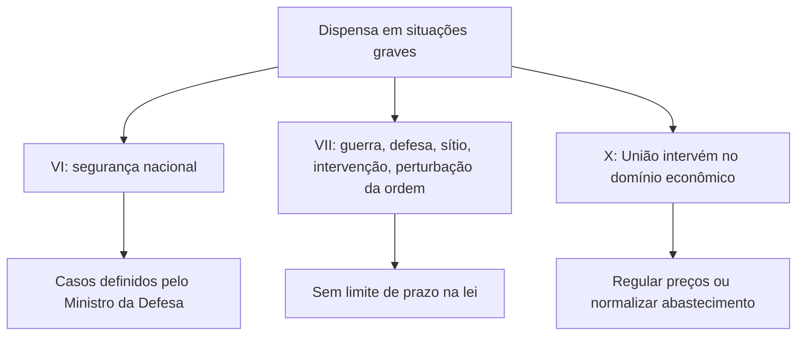

Depois de ver a dispensa por valor e a dispensa por licitação fracassada, o estudo do art. 75 continua com três blocos. O primeiro é a chamada **emergência provocada**, em que o atraso do próprio Estado cria a urgência. O segundo reúne as situações de máxima gravidade: segurança nacional, guerra, estado de defesa, estado de sítio, intervenção federal e grave perturbação da ordem, além da intervenção da União no domínio econômico. O terceiro é a dispensa **em função do objeto**, que lista contratações específicas, de peças em garantia a obras de arte. O art. 75 é um dos trechos mais longos da lei, e dominá-lo exige método.

> [!objetivos]
> - Explicar a contratação emergencial para manter a continuidade do serviço e seus requisitos.
> - Descrever as dispensas por segurança nacional, guerra e demais situações graves.
> - Reconhecer a dispensa por intervenção da União no domínio econômico.
> - Enumerar as hipóteses de dispensa em função do objeto (art. 75, IV) e distingui-las da inexigibilidade.

## Emergência provocada

O capítulo anterior mostrou que a emergência autoriza a dispensa quando há urgência real. Mas existe um caso incômodo: aquele em que a urgência nasce do **descaso dos agentes públicos**. Imagine uma prefeitura que precisava licitar a merenda do ano seguinte e deixou o processo parado por meses. Chega o início do ano letivo, e não há contrato. Isso é chamado de **emergência provocada**.

Durante muito tempo, tal dispensa foi considerada ilegal. Mas há um dilema: se a contratação for anulada, a merenda deixa de ser servida e o serviço de educação é prejudicado. Os órgãos de controle passaram a admitir a dispensa nesses casos, desde que seja apurada a responsabilidade dos culpados. A lei atual incorpora esse entendimento (art. 75, § 6º): considera-se emergencial a contratação por dispensa feita para manter a continuidade do serviço público, desde que:

| Requisito | Conteúdo |
| --- | --- |
| Objetivo | Manter a continuidade do serviço público |
| Preço | Compatível com os valores praticados no mercado (art. 23) |
| Providências | A Administração adota as medidas necessárias para concluir o processo licitatório |
| Responsabilização | Apura-se a responsabilidade dos agentes que causaram a situação |

Nem toda emergência provocada decorre de negligência. Às vezes, o processo foi iniciado com antecedência, mas se prolongou por judicialização ou outras razões. A contratação emergencial para garantir o serviço enquanto a licitação não termina também se enquadra no parágrafo.

> [!atencao] Dispensa emergencial não livra o agente de responsabilidade
> A lei é clara: o reconhecimento da emergência não afasta a apuração de responsabilidade de quem deu causa à situação. A contratação é válida para proteger o serviço; a punição do culpado é um dever autônomo.

> [!resolvido] Questão comentada: limite de prazo
> Após um temporal que causou danos a uma cidade, tornou-se urgente contratar o serviço de retirada de entulhos. A licitação será dispensável, desde que os serviços possam ser concluídos em até um ano, prorrogáveis por igual período. O que está errado?
>
> **Resolução.** A prorrogação. A dispensa por emergência vale para as parcelas que possam ser concluídas em até um ano da data da ocorrência, e a lei veda a prorrogação desses contratos e a recontratação da mesma empresa (art. 75, VIII).

## Segurança nacional e situações graves

### Comprometimento da segurança nacional

Quando uma contratação, se feita por licitação, puder ameaçar a segurança nacional, a lei permite dispensá-la (art. 75, VI). Quem define esses casos é o **Ministro de Estado da Defesa**, e o pedido parte dos comandos das Forças Armadas ou de outros ministérios, como o das Relações Exteriores. A lei é econômica no tema: o que importa lembrar é quem define (o Ministro da Defesa) e quem pede (comandos militares ou ministérios). Não há lei do Congresso para cada caso.

### Guerra, estado de defesa e outras situações

O inciso VII autoriza a dispensa quando o País enfrenta **guerra, estado de defesa, estado de sítio, intervenção federal ou grave perturbação da ordem**. A lista cresceu em relação à lei antiga, que só previa guerra e grave perturbação da ordem. Hoje incluem-se três medidas extremas do Estado, todas decretadas pelo Presidente da República e dependentes de aprovação ou autorização do Congresso Nacional (Constituição, arts. 84, IX, X e XIX, e 49, II e IV).

A grave perturbação da ordem é diferente: não é declarada, decorre de um fato, como conflitos civis. Estado de defesa e estado de sítio são justamente instrumentos para evitar ou restabelecer a ordem.

| Situação | Natureza |
| --- | --- |
| Guerra | Declarada pelo Presidente, com autorização do Congresso |
| Estado de defesa | Decretado pelo Presidente, com controle do Congresso |
| Estado de sítio | Decretado pelo Presidente, com autorização do Congresso |
| Intervenção federal | Decretada pelo Presidente |
| Grave perturbação da ordem | Fato concreto, não decretado |

Compare com a emergência do inciso VIII. Lá, há requisitos e limites: urgência, bens necessários, parcelas concluíveis em um ano, vedação de prorrogação. Nas situações graves do inciso VII, o legislador não impôs essas condições, em razão da gravidade do momento. Durante uma guerra, por exemplo, o contrato pode durar enquanto durar a necessidade, e a empresa pode ser recontratada: não se pode deixar uma tropa à espera de munição por causa de um certame.

> [!pegadinha] Não confunda os incisos VII e VIII
> A emergência e a calamidade (inciso VIII) têm limite de um ano e vedam a prorrogação e a recontratação. A guerra, o estado de defesa, o estado de sítio, a intervenção federal e a grave perturbação da ordem (inciso VII) não trazem essas limitações. Uma alternativa que aplique o limite de um ano à guerra está errada.

### Intervenção da União no domínio econômico

Se a União precisar atuar na economia para controlar preços ou restabelecer o abastecimento, a licitação é dispensável (art. 75, X). Três palavras bastam: quem (a União), o quê (intervenção no domínio econômico) e para quê (regular preços ou normalizar o abastecimento). Um exemplo: o preço de um medicamento essencial dispara, e a União o compra para distribuí-lo gratuitamente, o que força a queda do preço de mercado. É medida excepcional, que exige interesse público relevante. Perceba que o inciso se aplica **só à União**: estados e municípios não podem invocá-lo.

## Dispensa em função do objeto

Chegamos ao grupo mais extenso. O art. 75, IV, relaciona treze hipóteses (alíneas a a m) em que o **objeto** da contratação, às vezes combinado com a pessoa contratante ou com uma situação, autoriza a dispensa. A seguir, as mais relevantes.

| Alínea | Objeto | Observação |
| --- | --- | --- |
| a | Peças e componentes para manutenção de equipamentos, comprados do fornecedor original durante a garantia | Quando a exclusividade for indispensável à vigência da garantia |
| b | Bens, serviços, alienações ou obras previstas em acordo internacional aprovado pelo Congresso | Condições manifestamente vantajosas |
| c | Produtos para pesquisa e desenvolvimento | Obras e serviços de engenharia limitados a 300 mil reais, valor original e atualizável |
| d | Transferência de tecnologia ou licença de criação protegida | Por instituição científica, tecnológica e de inovação pública ou agência de fomento, com vantagem demonstrada |
| e | Hortifrutigranjeiros, pães e outros perecíveis | Pelo tempo necessário à licitação, pelo preço do dia |
| f | Bens ou serviços nacionais que envolvam, cumulativamente, alta complexidade tecnológica e defesa nacional | Os dois requisitos juntos |
| g | Materiais de uso das Forças Armadas | Para manter a padronização do apoio logístico, com ato do comandante; excluídos os de uso pessoal e administrativo |
| h | Bens e serviços para contingentes militares em operações de paz no exterior | Preço e escolha justificados e ratificados pelo comandante |
| i | Abastecimento de efetivos militares em estada eventual de curta duração | Por movimentação operacional ou adestramento |
| j | Coleta e processamento de resíduos recicláveis por cooperativas de catadores | Associações formadas exclusivamente por pessoas físicas de baixa renda |
| k | Aquisição ou restauração de obras de arte e objetos históricos | Autenticidade certificada e relação com a finalidade do órgão |
| l | Serviços e equipamentos para rastreamento e provas em investigação sigilosa | Nos termos da lei sobre organizações criminosas, com necessidade de sigilo |
| m | Medicamentos para doenças raras | Doenças definidas pelo Ministério da Saúde |

### Pontos que as bancas gostam

**Peças em garantia (alínea a).** É a lógica do automóvel novo: durante a garantia, usar peças genuínas da concessionária evita perder a cobertura. A dispensa vale quando essa exclusividade é indispensável para manter a garantia.

**Pesquisa e desenvolvimento (alínea c).** Há duas partes. Para produtos, não há limite de valor. Para obras e serviços de engenharia, o limite é de 300 mil reais (valor original), e a lei manda aplicar procedimentos especiais definidos em regulamento (art. 75, § 5º).

**Perecíveis (alínea e).** O batalhão que precisa de frutas e pães enquanto a licitação não termina compra diretamente, pelo **preço do dia**, e só pelo período necessário à licitação.

**Materiais das Forças Armadas (alínea g).** Exige autorização do comandante do Exército, da Marinha ou da Aeronáutica e a necessidade de padronização. Munição específica para um armamento, com sistema próprio de transporte, é um exemplo; uniformes (uso pessoal) e cartuchos de impressora (uso administrativo) ficam de fora.

**Operações de paz e estada eventual (alíneas h e i).** Combinam objeto e situação: bens e serviços para missões de paz no exterior, e abastecimento de unidades que passam poucos dias fora da sede em treinamento.

**Catadores (alínea j).** Combina objeto e pessoa: só associações ou cooperativas formadas por pessoas físicas de baixa renda reconhecidas como catadores, com equipamentos compatíveis com as normas técnicas, ambientais e de saúde pública.

### Obras de arte: cuidado com a confusão

A alínea k permite dispensar a licitação para **adquirir ou restaurar** obras de arte e objetos históricos, desde que a autenticidade seja certificada e a contratação tenha relação com as finalidades do órgão (faz sentido para um museu, não para uma secretaria de saúde).

Isso se confunde com a inexigibilidade do art. 74, III, g, que trata do **serviço técnico especializado** de restauração, exercido por profissional ou empresa de notória especialização. A distinção: a dispensa da alínea k cobre a **compra** de uma obra e também a restauração em geral; a inexigibilidade cobre a **restauração** feita por especialista de notória especialização. Se a questão falar de especialista renomado e de serviço intelectual, pense em inexigibilidade; se falar de aquisição de obra certificada, pense em dispensa.

> [!bizu] Combinações de fatores
> Nem toda dispensa "do objeto" depende só do objeto. Na alínea d, o objeto se une à pessoa (ICT ou agência de fomento). Na alínea h, o objeto se une à situação (operação de paz). A classificação em grupos é didática: o que cai em prova são os requisitos de cada alínea.

> [!resolvido] Questão comentada: segurança nacional
> A licitação é dispensável quando houver comprometimento da segurança nacional nos casos estabelecidos por lei aprovada pelo Congresso no início do ano legislativo. A afirmação está correta?
>
> **Resolução.** Não. A definição dos casos cabe ao Ministro da Defesa, a pedido dos comandos militares ou de ministérios (art. 75, VI), e não ao Congresso por meio de lei.

### Resumo dos três blocos

| Bloco | Incisos | Pergunta-chave | Limite de prazo |
| --- | --- | --- | --- |
| Emergência e calamidade | VIII e § 6º | Há urgência real ou serviço a manter? | Um ano, sem prorrogação |
| Situações graves | VI, VII e X | Há ameaça à segurança, à ordem ou ao abastecimento? | Sem prazo expresso |
| Em função do objeto | IV (a a m) | O objeto se encaixa em uma das alíneas? | Depende de cada alínea |

Veja que o "prazo de um ano" está ligado apenas ao primeiro bloco. Nos outros dois, ou não há prazo expresso, ou ele varia conforme a alínea, como no caso dos perecíveis, que só valem pelo tempo da licitação.

## Como a banca cobra este assunto

As provas cobram: os requisitos do § 6º da emergência provocada (continuidade do serviço, preço de mercado, providências para licitar e apuração de responsabilidade); a diferença entre a emergência do inciso VIII e as situações graves do inciso VII; quem define os casos de segurança nacional; a ampliação do rol de situações graves em relação à lei antiga; e os requisitos das alíneas do inciso IV, em especial as que combinam fatores (peças em garantia, perecíveis pelo preço do dia, materiais militares padronizados, catadores). Outra armadilha frequente é trocar a dispensa por inexigibilidade na restauração de obras de arte.

## Mapa do capítulo

| Tema | Ideia central | Armadilha |
| --- | --- | --- |
| Emergência provocada | Cabe para manter o serviço; exige preço de mercado, providências e apuração | Achar que não há responsabilização |
| Segurança nacional | Casos definidos pelo Ministro da Defesa, a pedido dos comandos ou ministérios | Dizer que é por lei do Congresso |
| Guerra e afins | Guerra, defesa, sítio, intervenção federal e perturbação da ordem | Aplicar o limite de um ano |
| Domínio econômico | Só a União, para regular preços ou abastecimento | Estender a estados e municípios |
| Peças em garantia | Fornecedor original, se for condição da garantia | Esquecer a condição |
| Pesquisa e desenvolvimento | Produtos sem limite; engenharia até 300 mil reais | Aplicar o limite a todos |
| Perecíveis | Preço do dia, pelo tempo da licitação | Contratar por prazo longo |
| Materiais militares | Padronização, ato do comandante; sem uso pessoal ou administrativo | Incluir uniformes |
| Obras de arte | Autenticidade certificada e relação com a finalidade | Confundir com a inexigibilidade do serviço de restauração |

### Para fixar

1. A emergência provocada pode justificar dispensa para manter a continuidade do serviço, com preço de mercado, providências para licitar e apuração de responsabilidade.
2. A dispensa por segurança nacional depende de casos fixados pelo Ministro da Defesa, a pedido dos comandos militares ou de ministérios.
3. A dispensa vale em guerra, estado de defesa, estado de sítio, intervenção federal e grave perturbação da ordem.
4. Esse rol é mais amplo que o da lei antiga, que previa só guerra e grave perturbação da ordem.
5. Nas situações graves, a lei não impõe o limite de um ano da emergência.
6. A União pode dispensar a licitação para intervir no domínio econômico e regular preços ou normalizar o abastecimento.
7. Peças de equipamento podem ser compradas do fornecedor original durante a garantia, se a exclusividade for condição dela.
8. Produtos de pesquisa e desenvolvimento não têm limite de valor; obras e serviços de engenharia, sim.
9. Perecíveis são comprados pelo preço do dia, pelo tempo necessário à licitação.
10. A aquisição ou restauração de obras de arte exige autenticidade certificada e ligação com as finalidades do órgão; a restauração por especialista de notória especialização é caso de inexigibilidade.
