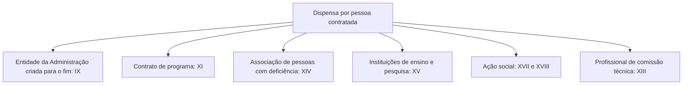

Nos capítulos anteriores, a dispensa dependeu do valor, da situação ou do objeto. Existe ainda um último grupo, o da dispensa **em função da pessoa**: aqui o que justifica a contratação sem licitação é **quem** será contratado, seja uma entidade criada pelo próprio Estado para prestar o serviço, seja uma associação de pessoas com deficiência, uma instituição de pesquisa ou uma cooperativa de baixa renda. O legislador reconhece nessas entidades uma finalidade social ou pública que justifica a contratação direta. Como são muitos incisos curtos e cheios de requisitos, o segredo é separar, em cada um, a pessoa contratada e a condição que a lei impõe. Para estudar, monte uma ficha por inciso, com duas colunas: quem é a pessoa e qual condição a lei exige dela, como preço de mercado, ausência de fins lucrativos ou prestação exclusiva por determinado grupo.

> [!objetivos]
> - Identificar as pessoas cuja contratação direta é autorizada pelo art. 75.
> - Lembrar os requisitos de cada hipótese (preço compatível, ausência de fins lucrativos, finalidade específica).
> - Diferenciar as hipóteses de contrato de programa e de entidades criadas para um fim específico.
> - Reconhecer as hipóteses recentes de saúde e de ação social.

## Entidades da própria Administração

### Aquisição de bens ou serviços de entidade criada para esse fim

Uma pessoa jurídica de direito público interno pode adquirir bens produzidos ou serviços prestados por **órgão ou entidade da Administração Pública criados especificamente para esse fim**, desde que o preço contratado seja **compatível com o praticado no mercado** (art. 75, IX). É o caso de uma prefeitura que contrata a empresa pública municipal de processamento de dados, criada para atender à própria prefeitura.

| Elemento | Regra |
| --- | --- |
| Quem contrata | Pessoa jurídica de direito público interno (União, estados, DF, municípios, autarquias e fundações públicas de direito público) |
| O que se contrata | Bens ou serviços, mas não obras |
| Quem é contratado | Órgão ou entidade da Administração, criado para esse fim; pode ser empresa estatal |
| Requisito | Preço compatível com o praticado no mercado |

Duas observações importantes. Primeiro, a entidade precisa ter sido criada **para aquele fim**; se foi criada com outra finalidade, não vale. Segundo, o preço continua precisando ser compatível com o do mercado, para evitar que a dispensa seja usada para superfaturar. Na lei antiga, havia um limite temporal de criação da entidade; a regra atual não o repete.

### Contrato de programa

Também se dispensa a licitação para o **contrato de programa** firmado com outro ente federativo ou com entidade da sua Administração indireta, quando o objetivo é a prestação associada de serviços públicos, conforme previsto em consórcio público ou convênio de cooperação (art. 75, XI). Imagine três municípios que se unem em consórcio para organizar o transporte coletivo. Cada município pode firmar com o consórcio um contrato de programa, que define as regras da prestação do serviço em seu território, sem licitação.

> [!atencao] Contrato de programa não se confunde com as compras do consórcio
> A dispensa vale para o contrato de programa, que regula a prestação associada do serviço público. As compras e contratações de obras que o próprio consórcio faz para funcionar seguem a lei de licitações e, em regra, dependem de licitação.

## Instituições com finalidade social, científica ou de ensino

| Inciso | Pessoa contratada | Condições |
| --- | --- | --- |
| XIV | Associação de pessoas com deficiência, sem fins lucrativos, de comprovada idoneidade | Preço compatível com o mercado e serviços prestados exclusivamente por pessoas com deficiência |
| XV | Instituição brasileira cuja finalidade estatutária é dar suporte a projetos de ensino, pesquisa, extensão e inovação, inclusive na gestão administrativa e financeira, ou instituição voltada à recuperação social da pessoa presa | Inquestionável reputação ética e profissional e ausência de fins lucrativos |
| XVII | Entidades privadas sem fins lucrativos para implantar cisternas e tecnologias sociais de acesso à água | Beneficiar famílias rurais de baixa renda atingidas pela seca |
| XVIII | Entidades privadas sem fins lucrativos para o Programa Cozinha Solidária | Fornecer alimentação gratuita, preferencialmente a pessoas em situação de vulnerabilidade |

Algumas notas sobre essas hipóteses:

- **Associação de pessoas com deficiência (XIV):** o requisito do preço compatível se soma à exigência de que os serviços sejam prestados **exclusivamente** por pessoas com deficiência. Não basta empregar algumas pessoas com deficiência.
- **Instituições de apoio à pesquisa e ao ensino (XV):** o ponto central é a combinação de duas qualidades, a ausência de fins lucrativos e a inquestionável reputação ética e profissional. É a hipótese das chamadas fundações de apoio às universidades.
- **Ação social (XVII e XVIII):** são hipóteses mais recentes, incluídas por lei em 2023, que reforçam o caráter de política pública: acesso à água para famílias atingidas pela seca e alimentação para quem está em vulnerabilidade.

> [!atencao] Sem fins lucrativos aparece em quase todas
> Nas hipóteses que envolvem associações, fundações, cooperativas e entidades do terceiro setor, a ausência de fins lucrativos é requisito. Se a alternativa disser que uma empresa com fins lucrativos pode ser contratada diretamente por esses incisos, está errada.

## Saúde e inovação

Algumas hipóteses em função da pessoa se relacionam com saúde pública e inovação:

- **Transferência de tecnologia de produtos estratégicos para o SUS (XII):** a dispensa cobre as parcerias em que o SUS recebe tecnologia de produtos estratégicos, inclusive a compra dos produtos enquanto a tecnologia está sendo absorvida, desde que os valores sejam compatíveis com o instrumento firmado.
- **Produtos estratégicos de saúde via fundação de apoio (XVI):** o inciso permite que um ente público de direito interno compre, de produtores públicos, produtos considerados estratégicos para a saúde. A intermediação é de uma fundação de apoio à Administração, que precisa ter sido criada para esse fim específico **antes da entrada em vigor da lei**, regra que evita a criação de novas entidades apenas para serem contratadas por dispensa. Em qualquer caso, o preço deve ser compatível com o de mercado. Como a redação do inciso foi alterada recentemente, vale conferir o texto vigente.
- **Inovação (V):** a contratação para o cumprimento dos arts. 3º, 3º-A, 4º, 5º e 20 da lei de inovação (Lei 10.973/2004), observados os princípios gerais de contratação ali previstos.

## Profissional para a comissão de avaliação técnica

Existe uma dispensa curiosa, ligada ao julgamento por técnica: a lei dispensa a licitação para contratar **profissionais que integrarão a comissão que avalia os critérios técnicos** das propostas, desde que sejam técnicos de notória especialização (art. 75, XIII). A explicação é lógica: quem avalia a proposta técnica precisa de reconhecimento na área, e a lei admite escolher esses profissionais diretamente. É o mesmo grupo de especialistas de que fala a regra da banca de técnica, que pode ser composta de profissionais contratados por conhecimento, experiência ou renome.

> [!pegadinha] Profissional da comissão técnica não é serviço técnico especializado
> O inciso XIII é dispensa, e não inexigibilidade. Se a questão falar em serviços técnicos especializados de natureza predominantemente intelectual prestados por profissional de notória especialização (parecer, consultoria, projeto), a hipótese é de **inexigibilidade** (art. 74, III). Se falar especificamente no profissional técnico que vai compor a comissão de avaliação dos critérios de técnica, a hipótese é de **dispensa** (art. 75, XIII). A diferença é sutil, e as bancas exploram isso.

> [!pegadinha] Pessoa e preço de mercado
> Em vários incisos (IX, XIV, XVI), o preço precisa ser **compatível com o praticado no mercado**. Em outros (XV), o requisito é a reputação e a ausência de fins lucrativos. Não generalize: leia o inciso inteiro.

> [!resolvido] Questão comentada: associação de pessoas com deficiência
> Um órgão deseja contratar diretamente, por dispensa, uma associação sem fins lucrativos de pessoas com deficiência para um serviço de digitalização de documentos. Quais requisitos devem ser observados?
>
> **Resolução.** A associação deve ter comprovada idoneidade, o preço deve ser compatível com o de mercado e os serviços devem ser prestados exclusivamente por pessoas com deficiência (art. 75, XIV). A ausência de qualquer um desses requisitos impede a dispensa.

## Comparando as três vias de saída da licitação

Antes de fechar, vale rever o conjunto. Uma contratação direta por causa da pessoa contratada pode ser dispensa (art. 75) ou inexigibilidade (art. 74). A pergunta é sempre a mesma: a competição é possível?

| Situação | Via | Fundamento |
| --- | --- | --- |
| Empresa pública criada para atender à prefeitura | Dispensa | Art. 75, IX |
| Associação de pessoas com deficiência | Dispensa | Art. 75, XIV |
| Banca técnica de notória especialização | Dispensa | Art. 75, XIII |
| Parecer de jurista de notória especialização | Inexigibilidade | Art. 74, III |
| Artista consagrado | Inexigibilidade | Art. 74, II |

## Como a banca cobra este assunto

O foco das questões é combinar a pessoa com o requisito correto: associação de pessoas com deficiência (serviços exclusivamente por elas), instituição de pesquisa (reputação ética e sem fins lucrativos), entidade criada para fim específico (preço compatível), contrato de programa (consórcio ou convênio de cooperação). Também aparecem itens que trocam o tipo de contratada (por exemplo, uma empresa com fins lucrativos) ou omitem o preço compatível. Como os incisos são numerosos, o melhor método é associar a cada inciso um exemplo concreto.

## Mapa do capítulo

| Tema | Ideia central | Armadilha |
| --- | --- | --- |
| Entidade criada para o fim | Preço compatível com o mercado | Aceitar entidade de outra finalidade |
| Contrato de programa | Serviço público associado, via consórcio ou convênio | Dizer que exige licitação |
| Pessoas com deficiência | Associação sem fins lucrativos; serviços exclusivos | Admitir equipe mista |
| Ensino e pesquisa | Reputação ética; sem fins lucrativos | Aplicar a entidades lucrativas |
| Ação social | Cisternas e Cozinha Solidária | Esquecer o caráter sem fins lucrativos |
| Saúde | Produtos estratégicos para o SUS | Ignorar preço de mercado |
| Comissão técnica | Profissional de notória especialização | Confundir com banca comum |

### Para fixar

1. A dispensa em função da pessoa depende de quem é o contratado.
2. A entidade da Administração criada para fim específico pode ser contratada, com preço compatível com o mercado.
3. O contrato de programa exige consórcio público ou convênio de cooperação.
4. A associação de pessoas com deficiência deve ser sem fins lucrativos e prestar o serviço exclusivamente com pessoas com deficiência.
5. A instituição de apoio a ensino e pesquisa exige reputação ética e ausência de fins lucrativos.
6. A dispensa para cisternas e Cozinha Solidária só vale para entidades sem fins lucrativos.
7. Produtos estratégicos para o SUS têm hipóteses próprias de dispensa.
8. O profissional técnico de notória especialização pode ser contratado diretamente para a comissão de avaliação de técnica.
9. Vários incisos exigem preço compatível com o praticado no mercado.
10. O rol de dispensa continua taxativo, mesmo com tantas hipóteses.
