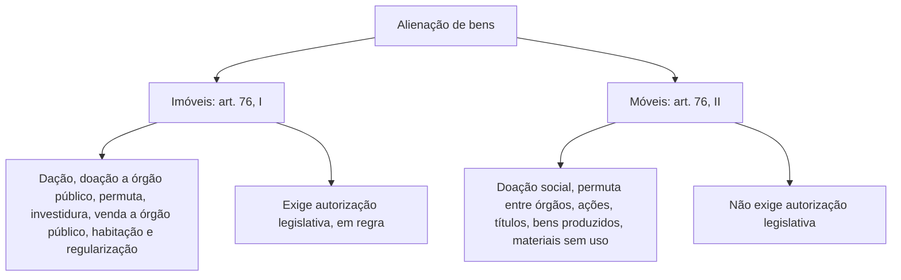

Vender, doar ou trocar um bem público não é como vender o próprio carro a um amigo. O patrimônio público tem regras de proteção, e a Lei 14.133/2021 as reúne no art. 76. O princípio é simples de enunciar e cheio de detalhes na aplicação: **alienar bem público exige interesse público justificado e avaliação prévia**; para imóveis, exige também **autorização legislativa**; e, como regra, a alienação se faz por **licitação na modalidade leilão**. Mas há uma série de situações em que a lei **dispensa** a licitação, e é nelas que as bancas mais cobram. Este capítulo percorre as regras gerais e as hipóteses de licitação dispensada.

> [!objetivos]
> - Explicar por que os bens públicos têm restrições à alienação e o papel da desafetação.
> - Indicar os requisitos da alienação de bens móveis e imóveis.
> - Reconhecer que o leilão e o maior lance são regra, e quando a autorização legislativa é dispensada.
> - Enumerar as hipóteses de licitação dispensada para imóveis e para móveis.
> - Descrever o direito de preferência do ocupante do imóvel.

## Bens públicos e inalienabilidade

**Alienar** é transferir a propriedade de um bem a outro, por venda, troca, doação ou outro meio. Como os bens públicos pertencem ao povo, a ordem jurídica os protege contra alienações descuidadas. De nada adiantaria controlar com rigor as compras do Estado se os bens pudessem ser vendidos de qualquer forma.

O Código Civil divide os bens públicos em três categorias (art. 99):

| Categoria | Descrição | Exemplos |
| --- | --- | --- |
| Uso comum do povo | Destinados à utilização geral | Rios, mares, estradas, ruas, praças |
| Uso especial | Destinados a serviço ou estabelecimento da Administração | Prédios de escolas e quartéis |
| Dominicais | Sem destinação pública específica | Imóvel sem uso, veículo inutilizado, mobiliário inservível |

Enquanto mantiverem a destinação pública, os bens de uso comum do povo e os de uso especial **não podem ser alienados** (Código Civil, art. 100). Não se pode vender o prédio onde funciona uma escola pública. Para que seja possível alienar, é preciso retirar a destinação pública do bem, o que se chama **desafetação**. Um exemplo: o município constrói uma nova escola, transfere as aulas e, com autorização legislativa, passa a poder vender o prédio antigo. Outro exemplo: o município compra cinquenta ambulâncias novas e declara inservíveis as cinquenta antigas, que deixam de ter destinação pública e podem ser vendidas.

> [!bizu] Afetado é protegido, desafetado é alienável
> Afetação é a destinação do bem a um fim público. A desafetação retira esse fim. Só os bens dominicais (ou os que foram desafetados) podem ser alienados nos termos do art. 76.

O art. 76 trata dos bens da Administração direta, autárquica e fundacional. As empresas estatais seguem regras próprias, previstas na Lei das Estatais.

## Requisitos da alienação

A lei exige que a alienação seja precedida de **avaliação** e subordinada à existência de **interesse público devidamente justificado**. As demais regras variam conforme o bem.

| Requisito | Bem imóvel | Bem móvel |
| --- | --- | --- |
| Interesse público justificado | Sim | Sim |
| Avaliação prévia | Sim | Sim |
| Autorização legislativa | Sim, em regra | Não |
| Licitação na modalidade leilão | Sim, salvo licitação dispensada | Sim, salvo licitação dispensada |

A autorização legislativa é exigida para a venda de um terreno ou de um prédio, mas não para a venda de mobiliário, veículos ou computadores inservíveis. E, quando a licitação é necessária, a modalidade é sempre o **leilão**, com critério de julgamento de **maior lance**, qualquer que seja o valor do bem e a forma pela qual a Administração o adquiriu. Na lei antiga, a concorrência era a regra para os imóveis; hoje, só o leilão serve à alienação de bens.

### Exceção: imóveis de dação em pagamento ou de processo judicial

Os imóveis que a Administração adquiriu por **dação em pagamento** (o devedor entrega um imóvel para quitar a dívida) ou por **procedimento judicial** (penhora de imóvel do devedor, revertido ao Estado) podem ser alienados **sem autorização legislativa**, exigindo-se apenas avaliação prévia e leilão (art. 76, § 1º). A razão: o poder público nem desejava o bem, recebeu-o como pagamento.

> [!resolvido] Questão comentada: imóvel recebido em processo judicial
> Um imóvel adquirido pela Administração por procedimento judicial precisa ser alienado. Qual a modalidade e é necessária autorização legislativa?
>
> **Resolução.** A modalidade é o leilão, e não se exige autorização legislativa (art. 76, § 1º). Pela lei antiga, admitia-se concorrência ou leilão; pela lei atual, só o leilão.

## Direito de preferência

Na venda de imóvel, tem **direito de preferência** o licitante que **ocupa o imóvel** licitado, desde que cumpra todas as exigências do edital (art. 77). É como o inquilino que tem preferência na compra do apartamento alugado. A lei não detalha o modo de exercer a preferência, e isso deve ser disciplinado no edital ou em regulamento. Perceba que a preferência não elimina a licitação: o ocupante precisa participar do leilão e se submeter às regras comuns.

## Licitação dispensada

Nos casos de licitação **dispensada**, a lei proíbe licitar: o administrador não tem escolha. Tratam-se sempre de alienações, e a decisão é vinculada. O rol é taxativo e se divide em imóveis (art. 76, I) e móveis (art. 76, II).

### Imóveis

Para os imóveis, a autorização legislativa continua exigida, mas a licitação é dispensada nos casos a seguir.

| Alínea | Hipótese | Observação |
| --- | --- | --- |
| a | Dação em pagamento | O devedor entrega o imóvel para quitar a dívida |
| b | Doação, só para outro órgão ou entidade da Administração, de qualquer esfera | Ressalvadas as alíneas f, g e h; o imóvel volta ao doador se cessarem as razões da doação |
| c | Permuta por outros imóveis que atendam às finalidades da Administração | A diferença não pode passar de metade do valor do imóvel ofertado pela União, com torna de valores quando necessário |
| d | Investidura | Alienação ao dono de imóvel vizinho, de área inaproveitável isoladamente, com regras de preço |
| e | Venda a outro órgão ou entidade da Administração de qualquer esfera | Entre entes públicos |
| f | Cessão ou venda, gratuita ou onerosa, e outras formas de destinar imóveis residenciais a programas de habitação ou de regularização fundiária de interesse social | Programas desenvolvidos por órgão ou entidade da Administração |
| g | Cessão ou venda de pequenos imóveis comerciais locais, de até 250 metros quadrados, em programas de regularização fundiária de interesse social | Programas de órgão ou entidade da Administração |
| h | Terras públicas rurais da União e do Incra com ocupações até o limite legal | Servem à regularização da ocupação, cumpridas as condições da lei |
| i | Legitimação de posse, nos termos da lei de terras | Por iniciativa e deliberação dos órgãos competentes |
| j | Legitimação fundiária e de posse, nos termos da lei de regularização fundiária | Lei 13.465/2017 |

> [!pegadinha] Duas "dações" diferentes
> A dação em pagamento aparece em dois lugares, com sentidos opostos. No art. 76, I, a, a **Administração é devedora** e paga a sua dívida entregando um imóvel: a licitação é dispensada. No art. 76, § 1º, o **particular é devedor** e quita a dívida com a Administração entregando um imóvel; depois, ao vender esse imóvel, a Administração faz leilão sem precisar de autorização legislativa. Identificar quem deve a quem resolve a questão.

Alguns pontos merecem destaque.

- **Doação (b):** só pode ser feita a outro órgão ou entidade pública. Se cessarem as razões que justificaram a doação, o imóvel **reverte** ao doador, e o beneficiário não pode aliená-lo (art. 76, § 2º).
- **Investidura (d):** consiste na venda, ao dono do imóvel lindeiro, de uma área remanescente ou resultante de obra pública que se tornou inaproveitável isoladamente, por preço não inferior ao da avaliação nem superior a 50% do valor máximo permitido para a dispensa de licitação de bens e serviços (art. 76, § 5º, I). Um exemplo: uma estreita faixa que sobrou depois do alargamento de uma avenida e que só interessa ao dono do terreno ao lado.
- **Cessão a outro órgão e agricultor (art. 76, § 3º):** a Administração pode conceder título de propriedade ou direito real de uso, com dispensa de licitação, quando o uso se destinar a outro órgão ou entidade pública ou a pessoa natural que preencha requisitos de ocupação mansa e pacífica e exploração direta de área rural, até o limite legal.
- **Doação com encargo (art. 76, § 6º):** em regra será licitada, e o instrumento deve conter o encargo, o prazo e a cláusula de reversão, sob pena de nulidade. A licitação pode ser dispensada em caso de interesse público justificado.

### Móveis

Para os bens móveis, a licitação por leilão é a regra, e é dispensada em seis hipóteses.

| Alínea | Hipótese | Condição |
| --- | --- | --- |
| a | Doação | Apenas para finalidade e uso de interesse social, depois de avaliar a conveniência socioeconômica frente a outras formas de alienar |
| b | Permuta | Só entre órgãos ou entidades da Administração |
| c | Venda de ações | Podem ser negociadas em bolsa, conforme a legislação específica |
| d | Venda de títulos | Segue a legislação pertinente |
| e | Venda de bens que a própria entidade produz ou comercializa | Em razão de suas finalidades |
| f | Venda a outros órgãos de materiais e equipamentos sem uso previsível | Quem dispõe do material não tem previsão de utilizá-lo |

Para tornar concreto: uma venda de ações que a União tenha em empresa de capital misto é feita em bolsa de valores, sem leilão. Já a venda de títulos refere-se à emissão de títulos da dívida pública para financiar obras ou outras ações estatais. A alínea e tem alcance limitado, porque a Lei 14.133 não se aplica às empresas estatais, que são as que mais comercializam produtos; um exemplo teórico seria uma autarquia criada para produzir computadores para os órgãos públicos, cuja comercialização, por ser a finalidade da entidade, dispensa licitação.

> [!pegadinha] Doação de móvel versus doação de imóvel
> A doação de móvel é permitida só para fins e uso de **interesse social**. A doação de imóvel com dispensa de licitação é permitida só para **outro órgão ou entidade da Administração**, ressalvados os programas de habitação e regularização. Não troque as condições.

> [!atencao] Permuta de móveis e de imóveis
> A permuta de móveis só vale **entre órgãos ou entidades da Administração**. A permuta de imóveis exige que os imóveis recebidos atendam às finalidades precípuas da Administração e que a diferença de valor não passe da metade do valor do imóvel ofertado, com torna de valores. As regras são diferentes.

## Doação com encargo

A doação é, em regra, hipótese de licitação dispensada, tanto para imóveis quanto para móveis, quando atendidos os requisitos que vimos. Mas a **doação com encargo**, em que o beneficiário assume uma obrigação, deve ser **licitada**. Exemplo: a União doa equipamentos hospitalares a uma entidade privada, impondo como encargo o atendimento gratuito da população. Como a doação cria obrigações, a Administração precisa escolher bem o donatário.

O instrumento da doação com encargo precisa trazer, **obrigatoriamente**, o encargo, o prazo para cumpri-lo e a **cláusula de reversão**, isto é, a devolução do bem ao doador se o encargo não for cumprido; sem esses itens, o ato é nulo. Se houver interesse público devidamente justificado, a licitação pode ser dispensada (art. 76, § 6º). E, se o donatário precisar oferecer o imóvel em garantia de financiamento, a cláusula de reversão e as demais obrigações são garantidas por **hipoteca de segundo grau em favor do doador** (art. 76, § 7º).

> [!bizu] Quatro elementos da doação com encargo
> Encargo, prazo, reversão e licitação. Se faltarem os três primeiros no instrumento, o ato é nulo; a licitação, por sua vez, pode ser dispensada se o interesse público for justificado.

> [!resolvido] Questão comentada: venda a outro órgão
> Não se realiza licitação na alienação de bem imóvel da Administração para outro órgão ou entidade também da Administração. Está correto?
>
> **Resolução.** Sim. A venda a outro órgão ou entidade da Administração, de qualquer esfera de governo, é hipótese de licitação dispensada (art. 76, I, e). Persistem os demais requisitos: interesse público justificado, avaliação e, em regra, autorização legislativa.

## Roteiro de resolução

Diante de uma questão sobre alienação, siga três perguntas na ordem. Primeiro: o bem é móvel ou imóvel? Se for imóvel, a regra é a autorização legislativa; se for móvel, não há essa exigência. Segundo: a alienação cabe numa hipótese de licitação dispensada? Se sim, a decisão é vinculada e não se licita; se não, a licitação é leilão, por maior lance. Terceiro: há alguma peculiaridade, como a dação em pagamento do particular (sem autorização legislativa, mas com leilão), o direito de preferência do ocupante ou a doação com encargo (que em regra é licitada)? Com esse roteiro de três perguntas, quase toda alternativa pode ser testada em poucos segundos, e você identifica a que mistura regras de móveis e de imóveis.

## Resumo das regras de alienação

| Aspecto | Imóveis | Móveis |
| --- | --- | --- |
| Interesse público e avaliação | Exigidos | Exigidos |
| Autorização legislativa | Em regra, sim; não na dação em pagamento ou no procedimento judicial | Não |
| Regra de licitação | Leilão, maior lance | Leilão, maior lance |
| Doação dispensada | Para outro órgão ou entidade pública, e em programas habitacionais | Para fins de interesse social |
| Permuta dispensada | Com imóveis que atendam às finalidades da Administração | Só entre órgãos ou entidades públicas |
| Direito de preferência | Ocupante que cumpra o edital | Não se aplica |

## Como a banca cobra este assunto

As bancas exploram: o fato de a alienação sempre exigir justificativa de interesse público e avaliação; a necessidade de autorização legislativa apenas para imóveis; o leilão como única modalidade e o maior lance como único critério; a exceção da dação em pagamento e do procedimento judicial; o direito de preferência do ocupante; e as hipóteses de licitação dispensada, em especial a doação de móveis (interesse social), a doação de imóveis (para outro ente público) e a permuta (entre órgãos, no caso dos móveis). Preste atenção também à terminologia: licitação dispensada é decisão vinculada; licitação dispensável, discricionária.

## Mapa do capítulo

| Tema | Ideia central | Armadilha |
| --- | --- | --- |
| Bens de uso comum e especial | Inalienáveis enquanto afetados | Vender prédio com escola em funcionamento |
| Desafetação | Retira o fim público e permite alienar | Confundir com autorização legislativa |
| Requisitos | Interesse público e avaliação para todos; autorização legislativa só para imóveis | Exigir autorização para móvel |
| Modalidade e critério | Leilão e maior lance | Falar em concorrência |
| Dação e processo judicial | Sem autorização legislativa | Dizer que não há leilão |
| Preferência | Ocupante do imóvel que cumpre o edital | Dispensar o edital |
| Licitação dispensada | Decisão vinculada; rol taxativo; só alienações | Chamar de discricionária |
| Doação de móvel | Interesse social | Aceitar qualquer doação |
| Permuta de móvel | Só entre órgãos públicos | Aceitar permuta com particular |

### Para fixar

1. Bens de uso comum do povo e de uso especial são inalienáveis enquanto afetados; a desafetação retira o fim público.
2. A alienação exige interesse público justificado e avaliação prévia.
3. A alienação de imóvel exige autorização legislativa, em regra; a de móvel, não.
4. Quando a licitação é necessária, a modalidade é o leilão e o critério é o maior lance.
5. Imóveis obtidos por dação em pagamento ou procedimento judicial dispensam autorização legislativa, mas exigem avaliação e leilão.
6. O ocupante do imóvel que comprove a ocupação e cumpra as regras do edital tem direito de preferência.
7. A licitação dispensada é decisão vinculada, rol taxativo e sempre de alienação de bens.
8. A doação de imóvel com dispensa de licitação é, em regra, para outro órgão ou entidade da Administração.
9. A doação de móvel dispensada de licitação exige fins e uso de interesse social.
10. A permuta de móveis dispensada de licitação é permitida somente entre órgãos ou entidades da Administração.
