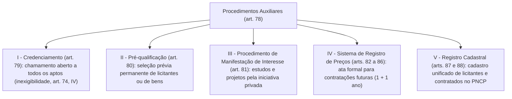

Depois de estudar as sete fases do processo licitatório até o seu encerramento pela autoridade superior, ingressamos no exame dos **procedimentos auxiliares** das licitações e contratações públicas (Lei 14.133/2021, arts. 78 a 88). Vale notar desde logo que as normas de encerramento do certame estudadas no capítulo anterior (retorno para saneamento, revogação por fato superveniente, anulação por vício insanável com análise consequencialista de interesse público e adjudicação/homologação) aplicam-se também, no que couber, às contratações diretas e aos próprios procedimentos auxiliares (Lei 14.133/2021, art. 71, § 4º). Neste quarto capítulo, analisamos o conceito e o rol dos instrumentos auxiliares (art. 78), o credenciamento (art. 79), a pré-qualificação (art. 80), o procedimento de manifestação de interesse — PMI (art. 81) e a estrutura do sistema de registro de preços — SRP (arts. 82 a 86).

> [!objetivos]
> - Distinguir os cinco procedimentos auxiliares das modalidades de licitação e dos critérios de julgamento.
> - Reconhecer as quatro hipóteses legais de credenciamento e suas regras procedimentais.
> - Aplicar os prazos e requisitos da pré-qualificação subjetiva e objetiva e do procedimento de manifestação de interesse (PMI).
> - Compreender a estrutura do sistema de registro de preços (SRP), seus sujeitos e a vigência da ata.

## Revisão integrada do encerramento e visão geral dos instrumentos auxiliares

Antes de detalhar cada ferramenta auxiliar, convém fixar um esquema visual e um exemplo prático sobre o encerramento da licitação (Lei 14.133/2021, arts. 71 e 147), que abre a transição para o estudo dos procedimentos auxiliares na doutrina e na lei. Quando os recursos administrativos se esgotam e os autos chegam à mesa da autoridade superior, quatro caminhos decisórios se apresentam:

| Decisão da autoridade superior (art. 71) | Pressuposto fático e jurídico | Consequência prática no processo |
|---|---|---|
| **1. Retorno dos autos (inciso I)** | Existência de defeito formal ou irregularidade **sanável**. | O processo volta à fase afetada para correção do ato, aproveitando-se os demais atos válidos. |
| **2. Revogação (inciso II e § 2º)** | Razões de **conveniência e oportunidade** decorrentes de **fato superveniente devidamente comprovado**. | Desconstitui o certame válido com efeitos prospectivos (*ex nunc*), exigindo prévia oitiva dos interessados (§ 3º). |
| **3. Anulação (inciso III, § 1º e art. 147)** | Presença de **ilegalidade insanável**, avaliado previamente se a nulidade atende ao interesse público (art. 147). | Invalida os atos viciados e os subsequentes dependentes, exige contraditório prévio (§ 3º) e apura responsabilidade de quem deu causa. |
| **4. Adjudicação e homologação (inciso IV)** | Procedimento regular, válido e conveniente ao interesse público. | Atribui formalmente o objeto ao licitante vencedor (adjudicação) e ratifica a lisura de todo o certame (homologação). |

> [!exemplo] Ponderação de consequências antes de anular obra em andamento (art. 147)
> Suponha que um Município licite a construção de um hospital público ou de uma escola municipal e, quando 80% do prédio já está erguido, uma auditoria aponte falha insanável na fase de habilitação. Paralisar e anular imediatamente o contrato geraria deterioração da estrutura exposta ao tempo, demissão de operários, custo de desmobilização e atraso grave no atendimento de saúde ou educação da população local. Diante disso, o art. 147, parágrafo único, da Lei 14.133/2021 determina que o poder público **opte pela continuidade do contrato**, resolvendo a irregularidade por meio de indenização por perdas e danos e responsabilização dos agentes públicos culpados, sem interromper a entrega do equipamento social.

Compreendida essa ponte, passemos às noções gerais sobre os **cinco procedimentos auxiliares** (Lei 14.133/2021, art. 78). Eles **não são modalidades de licitação** (as modalidades são apenas cinco: pregão, concorrência, concurso, leilão e diálogo competitivo — art. 28) nem se confundem com os critérios de julgamento. Trata-se de procedimentos técnico-administrativos regidos por critérios objetivos de regulamento (art. 78, § 1º), criados para dar agilidade, economia de escala e segurança técnica às contratações públicas.



> [!lei] Lei 14.133/2021, art. 78, *caput* e §§ 1º e 2º
> "Art. 78. São procedimentos auxiliares das licitações e das contratações regidas por esta Lei:
> I - credenciamento;
> II - pré-qualificação;
> III - procedimento de manifestação de interesse;
> IV - sistema de registro de preços;
> V - registro cadastral.
> § 1º Os procedimentos auxiliares de que trata o *caput* deste artigo obedecerão a critérios claros e objetivos definidos em regulamento.
> § 2º O julgamento que decorrer dos procedimentos auxiliares das licitações previstos nos incisos II e III do *caput* deste artigo seguirá o mesmo procedimento das licitações."

| Procedimento auxiliar | Dispositivos na Lei 14.133/2021 | Função prática no sistema de contratações |
|---|---|---|
| **1. Credenciamento** | Art. 6º, XLIII, art. 74, IV, e art. 79 | Chamamento público permanente para cadastrar todos os interessados que preencham os requisitos editalícios, viabilizando contratação direta por **inexigibilidade de licitação**. |
| **2. Pré-qualificação** | Art. 6º, XLIV, e art. 80 | Exame antecipado (total ou parcial) da habilitação de futuros licitantes ou da qualidade técnica de bens antes da abertura do certame. |
| **3. Procedimento de Manifestação de Interesse (PMI)** | Art. 81 | Edital de chamamento pelo qual o Estado convida particulares a apresentarem estudos, levantamentos, investigações e projetos inovadores. |
| **4. Sistema de Registro de Preços (SRP)** | Art. 6º, XLV a XLIX, e arts. 82 a 86 | Registro formal de preços em ata (via pregão, concorrência ou contratação direta) para eventuais aquisições, serviços, obras padronizadas ou locações futuras. |
| **5. Registro Cadastral** | Arts. 87 e 88 (e art. 174, § 3º, I) | Sistema cadastral unificado mantido no PNCP (substituindo e modernizando a lógica do Sicaf) para armazenar documentos de habilitação e atestar o desempenho contratual. |

> [!pegadinha] Procedimento auxiliar nunca é modalidade de licitação
> As bancas frequentemente inserem o credenciamento, a pré-qualificação ou o sistema de registro de preços como se fossem "novas modalidades de licitação" ao lado do diálogo competitivo. Errado! A única modalidade nova trazida pela Lei 14.133/2021 foi o **diálogo competitivo** (art. 28, V). Os cinco institutos do art. 78 são **procedimentos auxiliares**. Note também que o julgamento decorrente da **pré-qualificação** (inciso II) e do **PMI** (inciso III) segue o mesmo rito procedimental das licitações (art. 78, § 2º).

## Credenciamento: conceito, hipóteses legais e regras

O **credenciamento** consiste em um processo administrativo de **chamamento público** pelo qual o órgão ou entidade convoca interessados em fornecer bens ou prestar serviços para que, uma vez atendidos os requisitos exigidos no edital, se credenciem e passem a executar o objeto quando chamados (Lei 14.133/2021, art. 6º, XLIII).

Qual é a diferença essencial entre uma licitação comum e o credenciamento? Na licitação comum, há competição excludente: a empresa "A" vence e exclui as empresas "B", "C" e "D". No credenciamento, **não há disputa excludente**, pois a Administração quer e precisa contratar **todos os interessados que aceitarem as condições padronizadas do edital**. Como todos podem ser contratados sem exclusão mútua, resta configurada a inviabilidade de competição, razão pela qual as contratações derivadas de credenciamento enquadram-se legalmente como **inexigibilidade de licitação** (Lei 14.133/2021, art. 74, IV).

### As quatro hipóteses de uso do credenciamento (art. 79, I a IV)

O texto original da Lei 14.133/2021 contemplava três hipóteses de credenciamento (incisos I a III do art. 79). Posteriormente, a **Lei 15.266/2025** acrescentou o inciso IV ao art. 79, instituindo o credenciamento para **comércio eletrônico** por meio do **Sistema de Compras Expressas (Sicx)**. Examine as quatro hipóteses:

> [!lei] Lei 14.133/2021, art. 79, *caput*, I a IV
> "Art. 79. O credenciamento poderá ser usado nas seguintes hipóteses de contratação:
> I - paralela e não excludente: caso em que é viável e vantajosa para a Administração a realização de contratações simultâneas em condições padronizadas;
> II - com seleção a critério de terceiros: caso em que a seleção do contratado está a cargo do beneficiário direto da prestação;
> III - em mercados fluidos: caso em que a flutuação constante do valor da prestação e das condições de contratação inviabiliza a seleção de agente por meio de processo de licitação.
> IV - comércio eletrônico: caso em que a Administração visa a contratar bens e serviços comuns padronizados ofertados no Sistema de Compras Expressas (Sicx)." *(Incluído pela Lei nº 15.266, de 2025)*

| Hipótese de credenciamento (art. 79) | Quem escolhe o prestador e como funciona o preço? | Exemplo concreto de prova |
|---|---|---|
| **I — Paralela e não excludente** | A **própria Administração** convoca simultaneamente os credenciados (ou distribui a demanda por critérios objetivos impessoais, como rodízio ou sorteio). O **preço é fixado previamente no edital** (§ 1º, II e III). | Prefeitura credencia agricultores familiares rurais da região para fornecerem itens de merenda escolar pelo valor fixo da tabela oficial, comprando de todos proporcionalmente. |
| **II — Com seleção a critério de terceiros** | O **beneficiário direto (usuário/cidadão)** escolhe livremente qual credenciado irá atendê-lo. O **preço também é fixado previamente no edital** (§ 1º, III). | Secretaria de Saúde credencia diversos laboratórios de análises clínicas pelo valor da tabela do SUS; o paciente escolhe em qual laboratório credenciado fará seu exame de sangue. |
| **III — Em mercados fluidos** | Os preços sofrem **variação constante e dinâmica** no mercado, tornando inviável fixar valor estático no edital. A Administração **registra as cotações vigentes no exato momento da compra** (§ 1º, IV). | Quando um servidor precisa viajar a serviço e o órgão compra passagens aéreas cujas tarifas mudam a cada hora: credenciam-se as companhias e emite-se o bilhete na menor cotação do instante da compra. |
| **IV — Comércio eletrônico via Sicx** *(Lei 15.266/2025)* | Plataforma eletrônica oficial integrada ao PNCP (**Sistema de Compras Expressas — Sicx**) para compra ágil de bens e serviços comuns padronizados, com **pagamento em até 30 dias** do recebimento (§ 1º, VII, "e"). | Aquisição eletrônica rápida de suprimentos padronizados no catálogo de comércio eletrônico governamental, acessível inclusive a estatais e entidades privadas sem fins lucrativos (§ 2º). |

### Regras procedimentais obrigatórias do credenciamento (art. 79, § 1º, I a VII)

Para garantir impessoalidade e transparência, qualquer procedimento de credenciamento deve obedecer às seguintes regras (Lei 14.133/2021, art. 79, § 1º, I a VII):
- **Cadastramento permanente de novos interessados (inciso I)**: o edital de chamamento deve permanecer publicado no sítio eletrônico oficial de forma contínua, permitindo que novos fornecedores ingressem na rede credenciada a qualquer tempo;
- **Critérios objetivos quando não couber contratação imediata de todos (inciso II)**: na contratação paralela e não excludente (inciso I do *caput*), se a demanda momentânea não comportar acionar todos os credenciados ao mesmo tempo, o edital aplicará regras objetivas de distribuição (rodízio, ordem cronológica ou sorteio), vedada a escolha subjetiva pelo gestor;
- **Definição do preço no edital versus cotação momentânea (incisos III e IV)**: nas hipóteses I (paralela) e II (critério de terceiros), o edital **fixa previamente o valor**; já na hipótese III (mercados fluidos), a Administração **registra as cotações vigentes no ato da contratação**;
- **Proibição de subcontratação desautorizada e direito de denúncia (incisos V e VI)**: o credenciado não pode transferir a execução a terceiros sem anuência expressa da Administração (inciso V), e qualquer das partes pode rescindir o vínculo (**denúncia**) respeitando os prazos do edital (inciso VI);
- **Prazo máximo de pagamento de 30 dias no Sicx (inciso VII, "e", Lei 15.266/2025)**: nas compras eletrônicas pelo Sicx, o regulamento federal deve assegurar pagamento em **prazo não superior a 30 (trinta) dias** a partir do recebimento do bem ou serviço.

## Pré-qualificação: seleção prévia de licitantes e de bens

Em certames complexos ou recorrentes, analisar do zero a habilitação técnica de dezenas de empresas ou testar laboratorialmente a qualidade de produtos durante a própria sessão da licitação pode atrasar meses a conclusão do processo. Para resolver esse gargalo, a lei oferece o procedimento técnico-administrativo da **pré-qualificação** (Lei 14.133/2021, art. 6º, XLIV, e art. 80).

A pré-qualificação desdobra-se em duas espécies conforme o seu objeto de avaliação (Lei 14.133/2021, art. 80, *caput*, I e II):
1. **Pré-qualificação subjetiva (focada nos licitantes — inciso I)**: seleciona antecipadamente empresas ou profissionais que comprovem reunir as condições de habilitação exigidas para disputar futura licitação ou programa de obras e serviços;
2. **Pré-qualificação objetiva (focada nos bens — inciso II)**: avalia e aprova antecipadamente mercadorias, equipamentos ou marcas que cumpram os padrões técnicos e de qualidade fixados pela Administração (inclusive mediante exigência de amostras ou prova de conceito — art. 41, II, e art. 80, § 1º, II).

```mermaid Funcionamento e prazos da Pré-Qualificação na Lei 14.133/2021 (art. 80)
flowchart LR
    A["1. Edital permanentemente aberto (§ 2º) indicando modalidade, forma e critério da futura licitação (§ 3º)"] --> B["2. Interessado entrega documentos ou amostras (dispensados os já constantes do registro cadastral — § 1º, I)"]
    B --> C["3. Comissão examina em até 10 DIAS ÚTEIS e manda corrigir se necessário (§ 4º)"]
    C --> D["4. Certificado válido por no máximo 1 ANO, limitado à validade dos documentos (§ 8º)"]
    D --> E["5. Futura licitação PODE SER RESTRITA aos licitantes ou bens pré-qualificados (§ 10)"]
```

Confira na tabela abaixo todas as regras numéricas e operacionais dos §§ 1º a 10 do art. 80 da Lei 14.133/2021:

| Regra da pré-qualificação | Disciplina expressa na Lei 14.133/2021 (art. 80) |
|---|---|
| **Abertura contínua (§ 2º)** | O procedimento de pré-qualificação fica **permanentemente aberto** para inscrição de novos interessados. |
| **Conteúdo obrigatório do edital (§ 3º)** | Deve trazer: I) as informações mínimas para definir o objeto; e II) a **modalidade, a forma da futura licitação e os critérios de julgamento**. |
| **Prazo de análise pela comissão (§ 4º)** | O órgão ou comissão designada deve examinar a documentação no **prazo máximo de 10 (dez) dias úteis**, determinando correções ou reapresentação quando cabível para ampliar a disputa. |
| **Catálogo, grupos e escopo (§§ 5º, 6º e 7º)** | Os bens e serviços aprovados passam a integrar o **catálogo da Administração** (§ 5º). A pré-qualificação pode ser feita por **grupos ou segmentos** de especialidade (§ 6º) e ser **parcial** (só alguns requisitos) **ou total** (todos os requisitos de habilitação — § 7º). |
| **Prazo de validade (§ 8º, I e II)** | Vale por **no máximo 1 (um) ano** (atualizável a qualquer momento), mas **nunca pode ultrapassar o prazo de validade dos próprios documentos** apresentados pelo interessado. |
| **Publicidade e restrição do certame (§§ 9º e 10)** | A lista de licitantes e bens pré-qualificados é pública (§ 9º), e a **futura licitação poderá ser restrita** apenas aos licitantes ou bens pré-qualificados (§ 10), como ocorre na seleção prévia de marcas de canetas ou insumos técnicos de alto desempenho. |

> [!esquema] Síntese comparativa: Pré-Qualificação Subjetiva vs. Objetiva (art. 80)
> - **Pré-qualificação subjetiva (art. 80, I)**: avalia antecipadamente a **habilitação de licitantes** (dispensados os documentos que já constem do registro cadastral — § 1º, I).
> - **Pré-qualificação objetiva (art. 80, II)**: avalia antecipadamente a **qualidade técnica de bens** (admitida exigência de amostra ou prova de conceito — § 1º, II), integrando os aprovados ao catálogo da Administração (§ 5º).
> - **Regras comuns a ambas**: edital **permanentemente aberto** (§ 2º); exame pela comissão em até **10 dias úteis** (§ 4º); validade máxima de **1 ano**, respeitada a validade dos documentos (§ 8º); futura licitação **pode ser restrita** aos pré-qualificados (§ 10).

## Procedimento de Manifestação de Interesse (PMI)

Quando a Administração precisa modelar um projeto inovador ou complexo — como uma concessão de saneamento, uma parceria tecnológica ou a reestruturação energética de prédios públicos —, ela pode recorrer à inteligência técnica do setor privado sem gastar dinheiro público antecipadamente. Para isso serve o **Procedimento de Manifestação de Interesse (PMI)** (Lei 14.133/2021, art. 81).

Iniciado com a publicação de **edital de chamamento público**, o PMI permite que o órgão solicite à iniciativa privada a propositura e a elaboração de **estudos, investigações, levantamentos e projetos de soluções inovadoras** voltados a questões de relevância pública (Lei 14.133/2021, art. 81, *caput*).

> [!lei] Lei 14.133/2021, art. 81, §§ 1º e 2º
> "§ 1º Os estudos, as investigações, os levantamentos e os projetos vinculados à contratação e de utilidade para a licitação, realizados pela Administração ou com a sua autorização, estarão à disposição dos interessados, e o vencedor da licitação deverá ressarcir os dispêndios correspondentes, conforme especificado no edital.
> § 2º A realização, pela iniciativa privada, de estudos, investigações, levantamentos e projetos em decorrência do procedimento de manifestação de interesse previsto no *caput* deste artigo:
> I - não atribuirá ao realizador direito de preferência no processo licitatório;
> II - não obrigará o poder público a realizar licitação;
> III - não implicará, por si só, direito a ressarcimento de valores envolvidos em sua elaboração;
> IV - será remunerada somente pelo vencedor da licitação, vedada, em qualquer hipótese, a cobrança de valores do poder público."

As bancas de concurso cobram exaustivamente os cinco efeitos jurídicos do PMI extraídos dos §§ 1º a 4º do art. 81:
1. **Zero direito de preferência (§ 2º, I)**: a empresa que elaborou os estudos aprovados no PMI **não ganha nenhuma preferência ou vantagem** caso decida disputar a futura licitação;
2. **Liberdade de não licitar (§ 2º, II)**: receber os estudos no PMI **não obriga o Poder Público a abrir a licitação**;
3. **Quem paga é exclusivamente o vencedor da futura licitação (§ 1º e § 2º, III e IV)**: a simples entrega do estudo não gera direito automático a reembolso. Se o estudo for aprovado (mediante parecer fundamentado da Administração — § 3º) e a licitação ocorrer, **quem ressarcirá os custos ao autor dos estudos será unicamente o licitante vencedor do certame**, sendo **proibido, em qualquer hipótese, cobrar valores dos cofres públicos**;
4. **Possibilidade de PMI exclusivo para *startups* (§ 4º)**: o chamamento do PMI **pode ser restrito a *startups*** — definidas na lei como os **microempreendedores individuais (MEI), as microempresas (ME) e as empresas de pequeno porte (EPP)**, de natureza emergente e alto potencial, dedicadas a pesquisar, desenvolver e implementar novos produtos ou serviços tecnológicos inovadores de alto impacto, exigindo-se validação prévia baseada em métricas objetivas.

## Sistema de Registro de Preços (SRP): estrutura, edital e ata

O **Sistema de Registro de Preços (SRP)** compreende o conjunto de procedimentos para registrar formalmente preços de serviços, obras, compras e locações de bens visando a **contratações futuras** (Lei 14.133/2021, art. 6º, XLV). Esse registro formal fica documentado na **ata de registro de preços**, que tem natureza vinculativa para o fornecedor quanto aos preços e quantidades registrados (art. 6º, XLVI).

Em vez de celebrar um contrato imediato com entrega integral, o SRP funciona como um "banco de preços compromissados": o fornecedor vencedor assina a ata comprometendo-se a manter aquele preço unitário durante a vigência da ata, e a Administração só contrata as parcelas se e quando surgir a necessidade efetiva.

| Elemento estrutural do SRP | Regra na Lei 14.133/2021 (arts. 6º, XLV, e 82 a 85) |
|---|---|
| **Como se origina o SRP?** | Por licitação nas modalidades **pregão** ou **concorrência**, ou ainda por **contratação direta** (dispensa e inexigibilidade para mais de um órgão/entidade — art. 6º, XLV, e art. 82, § 6º). |
| **Quais os critérios de julgamento?** | Exclusivamente **menor preço** ou **maior desconto** sobre tabela praticada no mercado (art. 82, V). O menor preço **por grupo de itens** só cabe se comprovada a inviabilidade da adjudicação por item e demonstrada a vantagem técnica e econômica, exigindo-se pesquisa prévia na compra posterior de item isolado do grupo (art. 82, §§ 1º e 2º). |
| **Obrigatoriedade de contratar? (art. 83)** | A ata gera **compromisso unilateral de fornecimento** para a empresa, mas **NÃO obriga a Administração a contratar**, podendo o órgão até realizar outra licitação específica desde que motivada. |
| **Vigência da ata vs. do contrato (art. 84)** | A **ata de registro de preços** dura **1 (um) ano**, **prorrogável por igual período (mais 1 ano)**, se comprovado preço vantajoso. Já o **contrato** assinado a partir da ata segue os prazos normais dos contratos administrativos (art. 84, parágrafo único). |
| **Cabe SRP para obras de engenharia? (art. 85)** | **SIM!** Diferentemente da jurisprudência antiga da Lei 8.666/1993, a Lei 14.133/2021 autoriza expressamente contratar **obras e serviços de engenharia pelo SRP**, desde que cumpridos dois requisitos cumulativos: I) **projeto padronizado, sem complexidade técnica e operacional**; e II) **necessidade permanente ou frequente** da obra ou serviço. |

### Preços diferentes na ata e SRP sem quantitativo total (art. 82)

Duas novidades importantes do art. 82 da Lei 14.133/2021 merecem destaque especial:
1. **Previsão de preços diferentes para o mesmo item na ata (art. 82, III, "a" a "d")**: o edital de SRP pode admitir cotações com preços distintos para um mesmo produto em quatro situações: (a) entrega ou execução em **locais geográficos diferentes** (ex.: frete mais caro para o interior do que para a capital); (b) forma e local de **acondicionamento**; (c) cotação variável conforme o **tamanho do lote**; ou (d) outros motivos justificados nos autos;
2. **Registro de preços sem indicação do quantitativo total (art. 82, §§ 3º e 4º)**: como regra, o edital precisa fixar a quantidade máxima de cada item (art. 82, I). Excepcionalmente, admite-se registrar preços indicando apenas a unidade de contratação, **sem fixar o quantitativo total a ser adquirido**, unicamente em **três hipóteses taxativas** (§ 3º):
   - Na hipótese de **primeira licitação daquele item** quando a repartição ainda não detiver histórico de consumo anterior;
   - Na compra de **alimento perecível** (como laticínios, queijo ou hortifrutigranjeiros para refeitórios públicos);
   - Na hipótese em que a prestação do serviço estiver conjugada à entrega de mercadorias ou bens.
   Atenção à trava legal do § 4º do art. 82: nessas três situações sem quantitativo total, é **obrigatório indicar o valor financeiro máximo da despesa** e fica **terminantemente proibida a participação de outro órgão ou entidade na ata** (só o próprio órgão licitante pode usar a ata!).

> [!bizu] Exemplo prático dos três atores do SRP: INSS, IBGE e Anatel
> Imagine que o **INSS** (autarquia federal) decida abrir um pregão de registro de preços para adquirir computadores e publique a Intenção de Registro de Preços (IRP). O **IBGE** manifesta interesse dentro dos 8 dias úteis da IRP e soma sua demanda inicial ao edital. Meses depois de assinada a ata, a **Anatel**, que não participou da IRP inicial, solicita adesão tardia à ata vigente:
> - **INSS** = **Órgão ou entidade gerenciadora** (conduz o certame e gerencia a ata — art. 6º, XLVII);
> - **IBGE** = **Órgão ou entidade participante** (participou dos procedimentos iniciais e integra a ata desde a origem — art. 6º, XLVIII);
> - **Anatel** = **Órgão ou entidade não participante / "carona"** (não participou na origem e pede adesão posterior com justificativa — art. 6º, XLIX).

> [!esquema] Os três atores do Sistema de Registro de Preços (Lei 14.133/2021, art. 6º, XLVII a XLIX)
> - **Órgão ou entidade gerenciadora (art. 6º, XLVII)**: conduz a licitação (ou contratação direta) para registro de preços e administra a ata resultante (ex.: Polícia Federal abrindo pregão de SRP para compra de computadores).
> - **Órgão ou entidade participante (art. 6º, XLVIII)**: atende ao chamado da **Intenção de Registro de Preços (IRP)** ainda na fase preparatória (prazo mínimo de **8 dias úteis** — art. 86, *caput*) e já entra na ata desde o edital somando sua demanda à do gerenciador (ex.: PRF e Depen entrando como participantes na ata da PF).
> - **Órgão ou entidade não participante ("carona" — art. 6º, XLIX)**: não participou da IRP inicial nem consta originalmente da ata, mas pede adesão posterior durante a vigência da ata (cujos limites de 50% e do dobro estudaremos no início do Capítulo 5).

## Mapa do capítulo

| Procedimento auxiliar | Base na Lei 14.133/2021 | Pontos mais cobrados em prova |
|---|---|---|
| **Visão geral (5 instrumentos)** | Art. 78, I a V | Credenciamento, pré-qualificação, PMI, SRP e registro cadastral. **Não são modalidades de licitação**. |
| **Credenciamento** | Art. 6º, XLIII, art. 74, IV, e art. 79 | Fundamenta **inexigibilidade de licitação**. 4 hipóteses: I) paralela e não excludente; II) seleção a critério de terceiros; III) mercados fluidos; IV) comércio eletrônico (**Sicx** — Lei 15.266/2025, pagamento em até **30 dias**). Edital permanentemente aberto. |
| **Pré-qualificação** | Art. 6º, XLIV, e art. 80 | Subjetiva (licitantes) ou objetiva (bens). Permanentemente aberta. Exame dos documentos em até **10 dias úteis**. Validade máxima de **1 ano** (limitada à validade dos documentos). Futura licitação pode ser restrita aos pré-qualificados. |
| **PMI** | Art. 81 | Chamamento à iniciativa privada para estudos/projetos. **Não dá preferência** na licitação, **não obriga a licitar** e é **pago apenas pelo vencedor da licitação** (vedada cobrança contra o Poder Público). Pode ser restrito a ***startups* (MEI, ME e EPP)**. |
| **SRP (fundamentos e ata)** | Arts. 82 a 85 | Modalidades: **pregão ou concorrência** (ou dispensa/inexigibilidade coletiva). Critérios: **menor preço ou maior desconto**. Vigência da ata: **1 ano, prorrogável por mais 1 ano**. Cabe para **obras de engenharia** (projeto padronizado sem complexidade + necessidade frequente). |

### Para fixar

- Os cinco procedimentos auxiliares da Lei 14.133/2021 são o credenciamento, a pré-qualificação, o procedimento de manifestação de interesse (PMI), o sistema de registro de preços (SRP) e o registro cadastral (art. 78).
- O credenciamento fundamenta contratação direta por inexigibilidade de licitação (art. 74, IV) e aplica-se a quatro hipóteses: paralela e não excludente, seleção a critério de terceiros, mercados fluidos e comércio eletrônico via Sistema de Compras Expressas — Sicx (art. 79, I a IV).
- Na pré-qualificação, o procedimento fica permanentemente aberto, a comissão analisa os documentos em até 10 dias úteis e o certificado vale por no máximo 1 ano, respeitada a validade dos documentos entregues (art. 80, §§ 2º, 4º e 8º).
- Os estudos elaborados no Procedimento de Manifestação de Interesse (PMI) não conferem direito de preferência ao autor, não obrigam a Administração a licitar e somente são remunerados pelo futuro vencedor da licitação, sendo proibida qualquer cobrança contra o Poder Público (art. 81, § 2º).
- A ata de registro de preços vigora por 1 (um) ano, admitindo prorrogação por mais 1 (um) ano caso reste demonstrada a manutenção de preço vantajoso, vinculando o fornecedor sem obrigar a Administração a contratar (arts. 83 e 84).
- Admite-se o uso do SRP para obras e serviços de engenharia, desde que exista projeto padronizado sem complexidade técnica e operacional e haja necessidade permanente ou frequente do objeto (art. 85).
