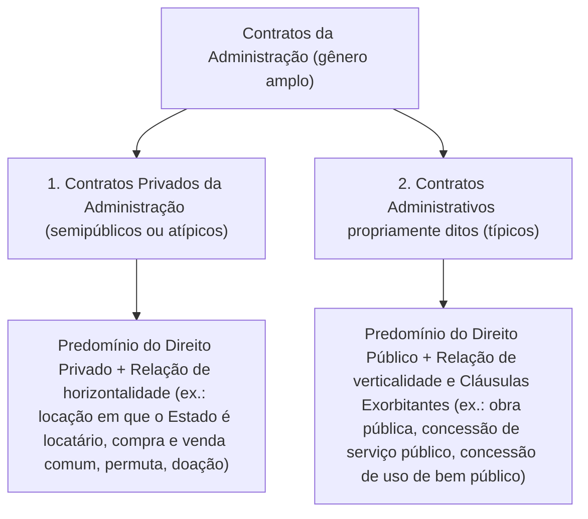

Quando um particular contrata a pintura de sua residência ou a compra de um automóvel, as partes negociam em pé de igualdade sob a regência do Direito Civil. Quando o Poder Público celebra um ajuste para construir um quartel, reformar um hospital ou manter a limpeza de uma delegacia, entra em cena o regime jurídico dos **contratos administrativos**, disciplinado pela **Lei 14.133/2021**. Neles, a busca do interesse coletivo confere à Administração prerrogativas especiais — as chamadas **cláusulas exorbitantes**. Elas colocam o ente estatal em posição de superioridade jurídica perante o contratado, mas sem suprimir a natureza bilateral do acordo nem o direito do particular ao equilíbrio econômico-financeiro. Este capítulo abre as noções introdutórias dos contratos públicos, apresentando seus conceitos fundamentais, o âmbito de aplicação da lei, a transição normativa e as distinções técnicas entre obras e serviços.

> [!objetivos]
> - Compreender a sistemática de atualização anual dos valores da Lei 14.133/2021 (art. 182) e distinguir os contratos administrativos típicos dos contratos privados da Administração.
> - Identificar o âmbito de aplicação primária, subsidiária e de exclusão da Lei 14.133/2021 (art. 3º), bem como a regra de direito intertemporal dos contratos em curso (arts. 190 e 191).
> - Aplicar a regra de regência dos contratos administrativos pelo direito público com incidência apenas supletiva da teoria geral dos contratos e do direito privado (art. 89).
> - Diferenciar os conceitos legais de obra, serviço, serviço de engenharia (comum e especial), serviço por escopo e serviço contínuo (art. 6º).

## Noções introdutórias e atualização anual dos valores da lei

Antes de ingressarmos na teoria contratual, convém observar uma regra prática indispensável para as provas de concurso público. Ao longo de toda a **Lei 14.133/2021**, diversos dispositivos mencionam **valores monetários em reais**. É o caso do teto para celebração de contrato verbal (art. 95, § 2º), dos limites de dispensa de licitação por baixo valor (art. 75, I e II) e da definição de contrato de grande vulto (art. 6º, XXII).

Nos termos do **art. 182 da Lei 14.133/2021**, o Poder Executivo federal deve **atualizar, a cada dia 1º de janeiro**, pelo Índice Nacional de Preços ao Consumidor Amplo Especial (IPCA-E) ou por índice que venha a substituí-lo, os valores fixados na Lei. Esses montantes atualizados são divulgados no Portal Nacional de Contratações Públicas (PNCP). A atualização é feita anualmente por **decreto presidencial** (como o Decreto 12.807/2025), que corrige o poder de compra das faixas financeiras **sem alterar a redação literal impressa no texto da Lei 14.133/2021**.

Por isso, as bancas examinadoras podem cobrar a matéria de duas maneiras. Na maioria das vezes, pedem a **literalidade da Lei 14.133/2021** (quando o enunciado diz *"nos termos literais da Lei 14.133/2021"*). Em outras questões, mencionam expressamente os **valores atualizados pelo decreto anual**. Veja a tabela comparativa dos principais parâmetros:

| Hipótese legal na Lei 14.133/2021 | Dispositivo | Valor literal na Lei | Valor atualizado (Decreto 12.807/2025) |
| --- | --- | --- | --- |
| **Obras, serviços e fornecimentos de grande vulto** | Art. 6º, XXII | 200 milhões de reais | R$ 261.968.421,04 |
| **Banca especial nos critérios de melhor técnica / técnica e preço** | Art. 37, § 2º | 300 mil reais | R$ 392.952,63 |
| **Dispensa de documentos de habilitação em produto de P&D** | Art. 70, III | 300 mil reais | R$ 392.952,63 |
| **Dispensa por valor: obras, serviços de engenharia e manutenção de veículos** | Art. 75, I | 100 mil reais | R$ 130.984,20 |
| **Dispensa por valor: compras e outros serviços** | Art. 75, II | 50 mil reais | R$ 65.492,11 |
| **Dispensa para produtos de pesquisa e desenvolvimento em obras/engenharia** | Art. 75, IV, *c* | 300 mil reais | R$ 392.952,63 |
| **Exceção ao somatório anual para manutenção de veículos automotores** | Art. 75, § 7º | 8 mil reais | R$ 10.478,74 |
| **Pequenas compras ou serviços de pronto pagamento (contrato verbal)** | Art. 95, § 2º | 10 mil reais | R$ 13.098,41 |
| **Limite para regime simplificado em convênios e repasses da União** | Art. 184-A | 1,5 milhão de reais | R$ 1.646.430,90 |

## Contratos da Administração: contratos privados versus contratos administrativos

Em sentido amplo, **contrato** é todo acordo de vontades celebrado entre duas ou mais partes, com objetivo determinado, pelo qual se ajustam obrigações recíprocas. Ao contrário do **ato administrativo** (que é manifestação **unilateral** da vontade estatal, como a aplicação de uma multa de trânsito ou a cassação de um alvará), o contrato é sempre um negócio jurídico **bilateral**, pois depende da convergência de vontades entre a Administração e o terceiro.

A doutrina clássica (Maria Sylvia Zanella Di Pietro e José dos Santos Carvalho Filho) utiliza a expressão **contratos da Administração** como o **gênero** que abrange todo e qualquer ajuste firmado pelo Poder Público, dividindo-o em **duas espécies**:

### Contratos privados da Administração (semipúblicos ou atípicos)

Nos **contratos privados da Administração**, o Poder Público atua no mercado em posição de **horizontalidade** (igualdade ou quase igualdade jurídica) perante o particular, sob regência predominante do **Direito Privado** (Direito Civil ou Empresarial). Exemplos clássicos são o contrato de locação de um prédio privado para instalar uma repartição pública (em que o Estado figura como locatário), a permuta, a doação e certos contratos financeiros.

Contudo, mesmo nesses contratos privados, a Administração **não desfruta da autonomia da vontade livre dos particulares**: ela continua submetida às **sujeições e restrições de direito público** quanto à forma escrita, à competência do agente signatário, à finalidade pública, à publicidade e à exigência de licitação prévia (ou processo formal de contratação direta). Além disso, se o interesse público exigir e houver previsão expressa, podem incidir neles determinadas prerrogativas públicas.

### Contratos administrativos propriamente ditos (típicos)

Segundo a definição de José dos Santos Carvalho Filho, o **contrato administrativo** em sentido estrito é o ajuste firmado entre a Administração Pública, agindo nessa qualidade, e um particular, regulado basicamente pelo **Direito Público**, tendo por objeto uma atividade que traduza, direta ou indiretamente, o interesse público. Exemplos típicos são os contratos de **obra pública**, de **prestação de serviços**, de **fornecimento contínuo**, de **concessão de serviço público** e de **concessão de uso privativo de bem público**.

A marca distintiva essencial dos contratos administrativos é a **verticalidade** da relação jurídica, materializada na presença das **cláusulas exorbitantes**: prerrogativas conferidas à Administração para alterar ou extinguir unilateralmente o ajuste, fiscalizar a execução, aplicar sanções diretamente e restringir a oposição da exceção do contrato não cumprido.

| Critério comparativo | Contratos Privados da Administração | Contratos Administrativos (típicos) |
| --- | --- | --- |
| **Regime jurídico predominante** | Direito Privado (Civil/Empresarial), derrogado parcialmente por normas públicas | Direito Público (Lei 14.133/2021), com aplicação apenas supletiva do Direito Privado |
| **Posição das partes** | **Horizontalidade** (igualdade jurídica como regra) | **Verticalidade** (supremacia do interesse público) |
| **Cláusulas exorbitantes** | Não decorrem automaticamente da natureza do ajuste | **Presentes por força de lei** (traço diferenciador central) |
| **Formalidades e sujeições públicas** | Presentes (competência, finalidade, forma escrita, publicidade, licitação/dispensa) | Presentes (competência, finalidade, forma escrita, publicidade, licitação/dispensa) |

*Observação importante*: Na prática da **Lei 14.133/2021**, essa fronteira doutrinária foi bastante atenuada, porque a nova lei não separa um capítulo para "contratos privados" e manda aplicar as prerrogativas do art. 104 (como a alteração unilateral quantitativa) também aos contratos de compras e de locação regidos por ela. Em prova, se a questão cobrar a classificação doutrinária, aponte a **verticalidade** e as **cláusulas exorbitantes** como o elemento que diferencia os contratos administrativos dos contratos privados da Administração.

## Legislação aplicável, exclusões e regime de transição

Pelo **art. 22, XXVII, da Constituição Federal**, cabe privativamente à **União** editar as **normas gerais** sobre licitações e contratos públicos. Essa competência alcança a Administração direta, as autarquias e as fundações públicas de todos os entes federados (União, Estados, DF e Municípios). Alcança também as empresas públicas e sociedades de economia mista, que seguem o estatuto específico previsto no art. 173, § 1º, III, da Carta Magna.

Atualmente, convivem no Brasil **dois grandes diplomas gerais** para as contratações estatais, além de leis setoriais específicas:
1. **Lei 14.133/2021**: aplica-se aos órgãos da Administração **direta**, às **autarquias** e às **fundações públicas** de todas as esferas federativas.
2. **Lei 13.303/2016 (Estatuto Jurídico das Estatais)**: aplica-se às **empresas públicas, sociedades de economia mista** e suas subsidiárias. Abrange tanto as estatais que exploram atividade econômica quanto as que prestam serviços públicos.

### Contratos excluídos e aplicação subsidiária da Lei 14.133/2021

Conforme o **art. 3º da Lei 14.133/2021**, ficam **fora da subordinação** desta Lei dois grupos de ajustes:
- As contratações voltadas a **operações de crédito** (no mercado interno ou externo) e à **administração da dívida pública**. Essa exclusão abrange também a escolha de **agente financeiro** e a outorga de **garantias** ligadas a tais operações financeiras (art. 3º, I);
- Os ajustes que possuam **disciplina própria em lei específica** (art. 3º, II).

Nos casos regidos por legislação específica, a Lei 14.133/2021 incide apenas de modo **subsidiário**, conforme determina o seu **art. 186**. É o que ocorre com a **Lei 8.987/1995** (concessões e permissões de serviços públicos), a **Lei 11.079/2004** (parcerias público-privadas — PPPs) e a **Lei 12.232/2010** (contratação de serviços de publicidade por meio de agências de propaganda).

### Regra de transição e regência supletiva do direito privado (arts. 89, 190 e 191)

As antigas leis gerais — **Lei 8.666/1993**, **Lei 10.520/2002 (Lei do Pregão)** e os arts. 1º a 47-A da **Lei 12.462/2011 (RDC)** — foram definitivamente **revogadas** após o encerramento do período de transição em 30 de dezembro de 2023. Todavia, dois preceitos de direito intertemporal continuam caindo com força em provas:
- **Contratos assinados antes da entrada em vigor da Lei 14.133/2021 (art. 190)**: continuam a ser regidos pelas normas da legislação revogada que lhes deu origem.
- **Contratos decorrentes de licitações ou contratações diretas realizadas sob a legislação antiga durante o período de transição (art. 191, parágrafo único)**: o contrato **segue a lei da licitação**! Se a Administração optou tempestivamente por licitar ou contratar diretamente pela Lei 8.666/1993 na fase de transição, o contrato respectivo **será regido pelas regras da lei antiga durante toda a sua vigência** (inclusive em suas prorrogações e termos aditivos). É vedada a combinação híbrida de leis.

Já para os contratos regidos pela nova lei, o **art. 89 da Lei 14.133/2021** fixa a hierarquia normativa interna do ajuste:

> [!lei] Lei 14.133/2021, art. 89, caput
> Art. 89. Os contratos de que trata esta Lei regular-se-ão pelas suas cláusulas e pelos preceitos de direito público, e a eles serão aplicados, supletivamente, os princípios da teoria geral dos contratos e as disposições de direito privado.

> [!pegadinha] Aplicação primária versus aplicação supletiva do Direito Privado
> As bancas adoram afirmar que *"os contratos administrativos regulam-se primariamente por suas cláusulas, pelos preceitos de direito público e pela teoria geral dos contratos privados"*. **Errado!** Pelo art. 89, caput, da Lei 14.133/2021, a regência primária pertence exclusivamente **às cláusulas contratuais e aos preceitos de direito público**. A teoria geral dos contratos e as normas de direito privado incidem apenas de forma **supletiva**, isto é, para suprir lacunas quando não contrariarem o direito público.

## Obras, serviços e serviços de engenharia na Lei 14.133/2021

O **art. 6º da Lei 14.133/2021** traz definições técnicas precisas para diferenciar **obra**, **serviço** e **serviço de engenharia**. Essa distinção define quais modalidades licitatórias (pregão ou concorrência) e quais profissionais técnicos podem atuar na contratação:

> [!lei] Lei 14.133/2021, art. 6º, XII e XXI
> XII - obra: toda atividade estabelecida, por força de lei, como privativa das profissões de arquiteto e engenheiro que implica intervenção no meio ambiente por meio de um conjunto harmônico de ações que, agregadas, formam um novo espaço físico ou que acarretam alteração substancial das características originais de bem imóvel;
> XXI - serviço de engenharia: toda atividade ou conjunto de atividades destinadas a obter determinada utilidade, intelectual ou material, de interesse para a Administração e que, não enquadradas no conceito de obra a que se refere o inciso XII do caput deste artigo, são estabelecidas, por força de lei, como privativas das profissões de arquiteto, de engenheiro ou de técnicos especializados (...).

### Obra versus Serviço e Serviço de Engenharia

Analisando os dispositivos legais acima, destacam-se três diferenças práticas essenciais:

1. **Obra (art. 6º, XII)**: exige, por força de lei, atuação **privativa de arquiteto e engenheiro**. Do ponto de vista material, caracteriza-se por **inovar o espaço físico** da natureza (ex.: construir um prédio, uma ponte ou uma escola em terreno vazio) ou por **modificar substancialmente** as feições originais de um imóvel existente (ex.: ampliação estrutural que transforma um pequeno ginásio comunitário em um complexo olímpico).
2. **Serviço (art. 6º, XI)**: busca proporcionar uma **utilidade intelectual** (estudos, projetos, consultorias) ou **material** (limpeza, vigilância, conserto de equipamentos) em proveito da própria Administração. Não confunda o **contrato de prestação de serviço** (em que a utilidade serve ao aparelho administrativo) com a **concessão de serviço público** do art. 175 da CF (em que a utilidade, como água ou transporte coletivo, é fruída diretamente pelos cidadãos usuários).
   - **Serviços comuns (art. 6º, XIII)**: são aqueles cujos padrões de qualidade e desempenho comportam definição objetiva no edital mediante especificações usuais de mercado (licitadas obrigatoriamente por **pregão**).
   - **Serviços especiais (art. 6º, XIV)**: são aqueles que apresentam **elevada complexidade ou heterogeneidade**, impedindo sua padronização como comuns (licitados por **concorrência** ou diálogo competitivo).
3. **Serviço de engenharia (art. 6º, XXI)**: abrange atividades técnicas que **não configuram obra** (não criam prédio novo nem alteram a estrutura substancial do imóvel) e que a lei reserva aos **arquitetos, engenheiros ou técnicos especializados** (ex.: manutenção interna do sistema de climatização ou substituição de piso cerâmico). Subdivide-se em:
   - **Serviço comum de engenharia (art. 6º, XXI, *a*)**: compreende atividades padronizáveis de manutenção, adequação ou adaptação de móveis e imóveis, desde que **mantidas as características originais do bem**. Neles, o gestor pode licitar tanto por **pregão** quanto por **concorrência** (art. 29, parágrafo único).
   - **Serviço especial de engenharia (art. 6º, XXI, *b*)**: envolve intervenção técnica de **elevada complexidade ou heterogeneidade**, que escapa à padronização ordinária (veda o pregão, exigindo **concorrência** ou diálogo competitivo).

| Categoria | Profissionais habilitados por lei | Impacto físico no imóvel | Modalidade licitatória |
| --- | --- | --- | --- |
| **Obra** (art. 6º, XII) | Privativa de **arquiteto e engenheiro** (não inclui técnicos) | Cria **novo espaço físico** ou **altera substancialmente** as características originais | Concorrência ou Diálogo Competitivo (vedado o pregão) |
| **Serviço comum de engenharia** (art. 6º, XXI, *a*) | Arquiteto, engenheiro **ou técnicos especializados** | Manutenção/adequação padronizável **com preservação das características originais** | **Pregão** ou **Concorrência** (art. 29, parágrafo único) |
| **Serviço especial de engenharia** (art. 6º, XXI, *b*) | Arquiteto, engenheiro **ou técnicos especializados** | Não é obra, mas possui **alta heterogeneidade ou complexidade** | Concorrência ou Diálogo Competitivo (vedado o pregão) |

> [!atencao] Detalhe muito cobrado: onde entram os "técnicos especializados"?
> Compare com atenção os incisos XII e XXI do art. 6º da Lei 14.133/2021. A **obra** é atividade privativa exclusivamente das profissões de **arquiteto e engenheiro**. Já o **serviço de engenharia** abrange atividades privativas de arquiteto, engenheiro **ou técnicos especializados** (como técnicos industriais e de edificações, dentro de suas atribuições legais). Se a prova afirmar que a execução de obra pública pode ser atividade privativa de técnicos especializados, o item estará **incorreto**!

### Serviços não contínuos (por escopo) versus serviços contínuos

Quanto ao modo como o tempo atua sobre a obrigação contratual, os incisos XV e XVII do art. 6º da Lei 14.133/2021 distinguem duas espécies de contratações:

1. **Serviços não contínuos ou contratados por escopo (art. 6º, XVII)**: obrigam o particular a entregar uma **prestação específica dentro de um prazo determinado** (ex.: pintar a fachada de um prédio público, desenvolver um software específico ou realizar uma auditoria pontual). Neles, o interesse da Administração concentra-se na **entrega do resultado final (o escopo)**, e o prazo funciona apenas como limite para a conclusão. Por isso, o contrato extingue-se naturalmente com a entrega do objeto. Se o escopo não for concluído no tempo inicial, **o prazo de vigência será automaticamente prorrogado** pelo tempo necessário à conclusão, sem prejuízo da apuração de culpa e sanções ao contratado (art. 111).
2. **Serviços e fornecimentos contínuos (art. 6º, XV)**: destinam-se à **manutenção rotineira da atividade administrativa**, atendendo a **necessidades permanentes ou prolongadas** do órgão (ex.: limpeza e conservação predial, vigilância patrimonial, manutenção de elevadores). Neles, a obrigação renova-se dia após dia, e o tempo mede a própria quantidade da prestação (vigência inicial de até 5 anos, prorrogável até 10 anos nos termos dos arts. 106 e 107).

> [!bizu] Síntese rápida: Contrato por Escopo versus Contrato Contínuo
> - **Por escopo (art. 6º, XVII, e art. 111)**: foco no **resultado específico** (pintura do prédio, obra civil). O contrato acaba quando o objeto fica pronto; se atrasar, o prazo prorroga-se pelo tempo necessário à conclusão do objeto.
> - **Contínuo (art. 6º, XV, e arts. 106-107)**: foco na **necessidade permanente** (limpeza, vigilância). A obrigação não se esgota num ato único; quando o prazo vence, o contrato termina, salvo prorrogação formal por vantajosidade.

## Mapa do capítulo

| Instituto / Conceito | Base legal (Lei 14.133/2021) | Regra-chave para a prova |
| --- | --- | --- |
| **Atualização de valores** | Art. 182 | Anual (todo dia 1º de janeiro) pelo IPCA-E via Decreto (ex.: contrato verbal de 10 mil reais na lei foi a R$ 13.098,41 no Decreto 12.807/2025). |
| **Contratos Administrativos × Privados** | Doutrina / Art. 104 | Contratos administrativos têm **verticalidade** e **cláusulas exorbitantes**; privados têm horizontalidade e direito privado predominante. |
| **Exclusões e Subsidiariedade** | Art. 3º e Art. 186 | Excluídos: operações de crédito e dívida pública. Aplicação **subsidiária**: concessões (Lei 8.987), PPPs (Lei 11.079) e publicidade (Lei 12.232). |
| **Direito Intertemporal** | Arts. 190 e 191, par. único | O contrato segue a norma da licitação ou contratação direta de origem durante toda a sua vigência. |
| **Regência do Contrato** | Art. 89, caput | Regula-se pelas **cláusulas e preceitos de direito público**; teoria geral dos contratos e direito privado aplicam-se **supletivamente**. |
| **Obra × Serviço de Engenharia** | Art. 6º, XII e XXI | **Obra** (arquiteto/engenheiro) inova o espaço físico ou altera substancialmente o imóvel; **Serviço de engenharia** (inclui técnicos) não é obra. |
| **Escopo × Contínuo** | Art. 6º, XV e XVII | **Escopo**: prestação específica em prazo certo (conclusão do objeto). **Contínuo**: necessidade permanente ou prolongada da Administração. |

### Para fixar

- Os valores expressos na Lei 14.133/2021 são os **valores originais literais**, atualizados anualmente em 1º de janeiro pelo IPCA-E por decreto federal (art. 182), como o limite do contrato verbal de 10 mil reais (atualizado para R$ 13.098,41 pelo Decreto 12.807/2025).
- O gênero **contratos da Administração** divide-se em **contratos privados da Administração** (relação horizontal e predomínio do direito privado, embora sujeitos a formalidades públicas) e **contratos administrativos** (relação vertical marcada pelas **cláusulas exorbitantes**).
- A **Lei 14.133/2021** rege as administrações diretas, autárquicas e fundacionais, enquanto a **Lei 13.303/2016** rege as empresas estatais; operações de crédito e gestão da dívida pública estão excluídas da Lei 14.133/2021 (art. 3º, I), e concessões e PPPs recebem sua aplicação apenas **subsidiariamente** (art. 186).
- Pela regra de transição dos **arts. 190 e 191, parágrafo único**, os contratos assinados antes da nova lei ou decorrentes de licitações feitas sob as leis revogadas permanecem regidos pela legislação antiga durante toda a sua vigência.
- Nos termos do **art. 89, caput**, os contratos administrativos regulam-se primariamente por suas cláusulas e pelos preceitos de **direito público**, aplicando-se os princípios da teoria geral dos contratos e o direito privado apenas **supletivamente**.
- **Obra** (art. 6º, XII) é atividade privativa de arquiteto e engenheiro que inova o espaço físico ou altera substancialmente o imóvel; **serviço de engenharia** (art. 6º, XXI) inclui técnicos especializados, não é obra e divide-se em **comum** (preserva as características originais e admite pregão ou concorrência) e **especial** (alta complexidade, vedado o pregão).
- Os **serviços por escopo** (art. 6º, XVII) visam à entrega de um objeto específico em prazo predeterminado (prorrogando-se até a conclusão), enquanto os **serviços contínuos** (art. 6º, XV) atendem a necessidades permanentes da atividade administrativa.
