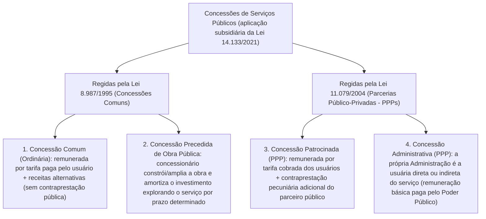

Avançando no estudo das espécies contratuais da Administração Pública, este capítulo examina em profundidade cinco figuras jurídicas de presença constante nas provas. Analisaremos primeiro os **serviços contínuos** (e o regime especial de **dedicação exclusiva de mão de obra**). Em seguida, veremos os **contratos de fornecimento (compras)** e a modalidade de **fornecimento e prestação de serviço associado**. Passaremos então pelos contratos de **concessão e permissão de serviços públicos**, contrastando-os com a **concessão de uso privativo de bens públicos**. Por fim, traçaremos a fronteira clássica entre os **contratos administrativos** (marcados por interesses contrapostos) e os **convênios e parcerias** (marcados por interesses comuns e mútua cooperação), incluindo o regime simplificado da União.

> [!objetivos]
> - Compreender o caráter relativo da natureza contínua de um serviço e os três requisitos cumulativos da dedicação exclusiva de mão de obra (art. 6º, XVI).
> - Distinguir as compras de entrega imediata (até 30 dias), os fornecimentos contínuos e a contratação de fornecimento e prestação de serviço associado (art. 6º, X, XV e XXXIV).
> - Diferenciar as quatro espécies de concessão de serviço público (comum, precedida de obra, patrocinada e administrativa), a permissão de serviço público e a concessão de uso de bem público.
> - Contrastar o contrato administrativo com o convênio administrativo e conhecer o regime simplificado de convênios da União até 1,5 milhão de reais (art. 184-A).

## Serviços contínuos e dedicação exclusiva de mão de obra

No capítulo anterior, vimos que os **serviços contínuos** (art. 6º, XV, da Lei 14.133/2021) destinam-se à manutenção da atividade administrativa, atendendo a necessidades permanentes ou prolongadas. Sua vigência é estipulada por prazo determinado (até 5 anos inicialmente, prorrogável até 10 anos nos termos dos arts. 106 e 107), porque a demanda do órgão público renova-se todos os dias, como ocorre na limpeza e na vigilância predial.

### A natureza contínua depende da missão de cada órgão

Segundo a jurisprudência consolidada do Tribunal de Contas da União (**Acórdão 132/2008 – 2ª Câmara**), o caráter contínuo de um serviço **não é definido em abstrato apenas pelo nome da atividade**. Ele decorre da sua **essencialidade concreta** para preservar a integridade rotineira do patrimônio estatal ou manter em funcionamento as atividades finalísticas do órgão. Se a paralisação daquela atividade prejudicar o atendimento ao público ou o cumprimento dos deveres institucionais da repartição, o serviço será contínuo para aquele contratante.

Um exemplo prático esclarece essa relatividade:
- Para uma **Controladoria ou Tribunal de Contas** cujos auditores viajam todas as semanas para realizar inspeções presenciais no interior do Estado, o serviço de **emissão e fornecimento de passagens aéreas** atende a uma necessidade permanente e ininterrupta: trata-se de **serviço contínuo**.
- Para uma **repartição local** cujos servidores só viajam uma vez a cada dois anos para participar de um congresso eventual, a aquisição de passagens aéreas é uma demanda episódica e pontual: **não configura serviço contínuo**.

> [!jurisprudencia] TCU, Acórdão 132/2008 – 2ª Câmara (essencialidade do serviço contínuo)
> A natureza contínua de um serviço não pode ser definida de forma genérica apenas pela atividade em si. Ela deve ser aferida a partir da essencialidade de sua prestação para o ente administrativo, verificando-se se a sua interrupção comprometeria a continuidade das atividades finalísticas ou a integridade rotineira do patrimônio público.

### Regime de dedicação exclusiva de mão de obra

Dentro do universo dos serviços contínuos, a Lei 14.133/2021 destaca uma subespécie que exige cautelas redobradas de fiscalização. Trata-se dos contratos contínuos executados sob **dedicação exclusiva de mão de obra**, como ocorre nos postos terceirizados de vigilância armada, recepção e limpeza com funcionários fixos no prédio público.

> [!lei] Lei 14.133/2021, art. 6º, XVI, e art. 121, § 2º
> Art. 6º, XVI - serviços contínuos com regime de dedicação exclusiva de mão de obra: aqueles cujo modelo de execução contratual exige, entre outros requisitos, que:
> a) os empregados do contratado fiquem à disposição nas dependências do contratante para a prestação dos serviços;
> b) o contratado não compartilhe os recursos humanos e materiais disponíveis de uma contratação para execução simultânea de outros contratos;
> c) o contratado possibilite a fiscalização pelo contratante quanto à distribuição, controle e supervisão dos recursos humanos alocados aos seus contratos;
> Art. 121, § 2º Exclusivamente nas contratações de serviços contínuos com regime de dedicação exclusiva de mão de obra, a Administração responderá solidariamente pelos encargos previdenciários e subsidiariamente pelos encargos trabalhistas se comprovada falha na fiscalização do cumprimento das obrigações do contratado.

Observe que **nem todo serviço contínuo envolve dedicação exclusiva de obreiros**. O fornecimento contínuo de passagens aéreas ou de manutenção preventiva mensal de elevadores é contínuo, mas os empregados da empresa não ficam alocados exclusivamente dentro da repartição pública. Quando os **três requisitos do art. 6º, XVI**, estão presentes, a Lei 14.133/2021 impõe **duas consequências jurídicas específicas**:

1. **Responsabilidade pelos encargos trabalhistas e previdenciários (art. 121, § 2º)**: quando houver alocação exclusiva dos trabalhadores nas dependências do órgão, o Poder Público assume **responsabilidade solidária quanto às contribuições previdenciárias** e **responsabilidade subsidiária quanto às verbas trabalhistas**, mas esta última depende da prova de falha na fiscalização (*culpa in vigilando*). Para evitar esse passivo, o art. 121, § 3º, autoriza a conta-depósito vinculada e o pagamento direto aos trabalhadores em caso de inadimplência da empresa.
2. **Reajustamento por meio de repactuação (art. 6º, LIX, e art. 135)**: enquanto os demais contratos utilizam o reajuste em sentido estrito por índices de preços, os contratos contínuos com alocação exclusiva ou predominante de trabalhadores têm seus preços atualizados mediante **repactuação**. Demonstra-se analiticamente a variação dos custos da mão de obra (de acordo com o novo acordo, convenção ou dissídio coletivo da categoria) e dos insumos necessários à execução.

## Contrato de fornecimento (compras) e serviço associado

O **contrato de fornecimento** é o ajuste administrativo pelo qual o Poder Público adquire **bens móveis** (materiais de expediente, gêneros alimentícios, medicamentos, viaturas, computadores) necessários à manutenção de suas atividades, à prestação de serviços públicos ou à execução de obras. Equivale, no Direito Público, ao contrato de compra e venda.

Nos termos do **art. 6º, X, da Lei 14.133/2021**, **compra** é toda aquisição remunerada de bens móveis para entrega **em parcela única** ou **de forma fracionada**, qualificando-se como **entrega imediata** aquela cujo prazo não ultrapasse **30 (trinta) dias contados do pedido formal de fornecimento**. A partir desse conceito, o fornecimento pode assumir três configurações:

| Modalidade de fornecimento | Característica central na Lei 14.133/2021 | Exemplo prático |
| --- | --- | --- |
| **Fornecimento de entrega imediata** (art. 6º, X) | Entrega integral dos bens em prazo máximo de **30 dias** a partir do pedido de fornecimento. | Compra de 50 mesas de escritório entregues de uma só vez em 15 dias (dispensa inclusive o termo formal de contrato se não gerar obrigações futuras, art. 95, II). |
| **Fornecimento contínuo** (art. 6º, XV, e art. 106) | Compras realizadas para manutenção da Administração decorrentes de **necessidades permanentes ou prolongadas**, com entregas parceladas ao longo do tempo. | Fornecimento mensal contínuo de combustível para a frota de viaturas ou de cartuchos de impressão para órgão emissor de carteiras de identidade. |
| **Fornecimento e prestação de serviço associado** (art. 6º, XXXIV) | Regime em que o contratado responsabiliza-se por **fornecer o objeto** e, concomitantemente, por sua **operação, manutenção ou ambas**, por tempo determinado. | Aquisição de um tomógrafo hospitalar de alta complexidade em que o fabricante fornece o equipamento (1ª etapa) e realiza sua manutenção e operação técnica por 5 anos (2ª etapa). |

> [!bizu] Vigência especial no fornecimento e prestação de serviço associado
> No regime de **fornecimento e prestação de serviço associado** (art. 6º, XXXIV), o contrato possui claramente **duas etapas**: a entrega do bem e a prestação subsequente de operação ou manutenção. Por isso, o **art. 113 da Lei 14.133/2021** estabelece que o prazo máximo desse contrato equivale ao **somatório do tempo de entrega inicial do bem (ou obra) com o período subsequente de operação e manutenção**. Este segundo período fica limitado a **5 (cinco) anos** a partir do recebimento da primeira etapa, admitindo-se ainda a prorrogação decenal do art. 107.

## Concessões, permissões e uso privativo de bens públicos

Pelo **art. 175 da Constituição Federal**, cabe ao Estado prestar os serviços públicos diretamente ou mediante delegação por **concessão ou permissão**, exigindo-se sempre prévia **licitação**. Nas concessões e permissões ocorre a **delegação por colaboração**: a titularidade do serviço permanece com o Estado, que transfere ao particular apenas a execução temporária da atividade.

### As quatro espécies de concessão de serviço público e a permissão

No ordenamento brasileiro, o contrato administrativo de **concessão de serviço público** divide-se em **quatro espécies**, distribuídas entre a **Lei 8.987/1995** (concessões comuns) e a **Lei 11.079/2004** (parcerias público-privadas — PPPs). Em todas elas, a **Lei 14.133/2021 aplica-se apenas subsidiariamente** (art. 186):

Veja os pontos essenciais que diferenciam essas figuras na prova:
1. **Concessão comum e concessão precedida de obra pública (Lei 8.987/1995, art. 2º, II e III)**: são delegadas mediante licitação nas modalidades **concorrência** ou **diálogo competitivo**. Só podem ser firmadas com **pessoa jurídica ou consórcio empresarial** (nunca com pessoa física!), que executa o serviço por sua conta e risco e por prazo determinado, remunerando-se basicamente pela **tarifa paga pelo usuário**. Não confunda a *concessão precedida de obra pública* com o *contrato de empreitada de obra pública*: no contrato de obra da Lei 14.133/2021, a Administração paga diretamente a construtora e recebe o prédio pronto; na concessão precedida de obra, o concessionário constrói ou duplica a rodovia com recursos próprios e recupera o investimento cobrando pedágio dos usuários ao explorar o serviço.
2. **Concessão patrocinada e concessão administrativa (PPPs — Lei 11.079/2004, art. 2º, §§ 1º e 2º)**:
   - Na **PPP patrocinada**, a tarifa cobrada dos usuários é insuficiente para remunerar o alto investimento (ex.: linha de metrô), razão pela qual o Estado paga uma **contraprestação pecuniária complementar** ao concessionário.
   - Na **PPP administrativa**, não há cobrança de tarifa do cidadão porque **a própria Administração Pública é a usuária direta ou indireta** dos serviços (ex.: construção e gestão operacional de um complexo hospitalar ou prisional), sendo a remuneração integralmente custeada pelo parceiro público. Lembre-se de que a Lei 11.079/2004 veda celebrar PPP cujo único objeto seja o fornecimento de mão de obra, o fornecimento e instalação de equipamentos ou a execução isolada de obra pública.
3. **Permissão de serviço público (Lei 8.987/1995, art. 2º, IV, e art. 40)**: consiste na outorga **precária**, precedida de licitação, para que **pessoa física ou jurídica** execute o serviço público por sua conta e risco. Formaliza-se por meio de um **contrato de adesão**, sujeito às regras editalícias, à **precariedade** e à possibilidade de **revogação unilateral** pelo poder concedente.

> [!atencao] Três diferenças clássicas entre Concessão Comum e Permissão de Serviço Público
> Embora ambas sejam formalizadas por contrato precedido de licitação, a Lei 8.987/1995 diferencia a **concessão comum** da **permissão de serviço público** em três aspectos cobrados em prova:
> 1. **Quem pode ser contratado**: a concessão só admite **pessoa jurídica ou consórcio de empresas**; a permissão admite **pessoa física ou pessoa jurídica**.
> 2. **Modalidade licitatória**: a concessão exige **concorrência ou diálogo competitivo**; a permissão exige licitação, mas sem restrição exclusiva àquelas duas modalidades.
> 3. **Estabilidade do vínculo**: a concessão tem prazo certo e estabilidade contratual; a permissão é formalizada como **contrato de adesão a título precário**, com revogabilidade unilateral.

### Concessão de uso de bem público versus Concessão de serviço público

Não confunda a **concessão de serviço público** com o contrato administrativo de **concessão de uso de bem público**:
- A **concessão de uso de bem público** é o contrato administrativo bilateral, sinalagmático, comutativo e *intuitu personae* (oneroso ou gratuito) pelo qual a Administração faculta a um particular a **utilização privativa de um bem público** segundo a sua destinação específica (ex.: cessão de espaço para instalar uma lanchonete, restaurante ou livraria dentro de uma universidade pública ou um quiosque na orla marítima).
- **Duas diferenças cruciais para a prova**:
  1. **Titularidade da atividade**: na concessão de serviço público, o concessionário presta um serviço de titularidade estatal voltado à coletividade; na concessão de uso de bem público, o particular explora uma parcela do patrimônio estatal em **atividade privada de seu próprio interesse** (embora útil ao conforto dos frequentadores do prédio).
  2. **Lei de regência primária**: enquanto a concessão de serviço público rege-se primariamente pela Lei 8.987/1995 (aplicando-se a Lei 14.133/2021 apenas subsidiariamente, art. 186), a **concessão e a permissão de uso de bens públicos subordinam-se primariamente à Lei 14.133/2021** (conforme expressamente previsto no **art. 2º, IV, da Lei 14.133/2021**).

## Contratos administrativos versus convênios e parcerias

O último tema deste capítulo opõe os **contratos administrativos** aos **convênios administrativos** (e instrumentos congêneres). Embora ambos sejam ajustes bilaterais ou plurilaterais celebrados pela Administração Pública, a diferença ontológica entre eles está na **posição dos interesses das partes**:

| Critério distintivo | Contrato Administrativo | Convênio Administrativo (e congêneres) |
| --- | --- | --- |
| **Posição dos interesses** | **Interesses opostos e contraditórios** (o Município quer a obra pronta; a empreiteira quer receber o preço e obter lucro). | **Interesses comuns, convergentes e recíprocos** (a União e o Município querem o mesmo resultado: construir o hospital e atender a população). |
| **Natureza da transferência financeira** | **Preço / Remuneração**: o valor pago integra definitivamente o patrimônio privado do contratado como lucro/contraprestação. | **Repasse vinculado**: os recursos continuam vinculados à finalidade pública do ajuste, exigindo **prestação de contas** rigorosa e devolução de saldos. |
| **Papel dos figurantes** | **Partes contratantes** (contratante e contratado), com obrigações recíprocas equivalentes (sinalagma). | **Partícipes** (concedente e convenente), em regime de **mútua cooperação** para alcançar um objetivo comum. |
| **Aplicação da Lei 14.133/2021** | Aplicação direta e integral (arts. 89 a 154). | Aplicam-se as disposições da Lei 14.133/2021 **no que couber** e na ausência de norma específica (art. 184). |

### A evolução legislativa: Lei 13.019/2014 (MROSC) e o âmbito atual dos convênios

Historicamente, o termo **convênio** era usado em sentido amplo para designar qualquer parceria cooperativa entre o Poder Público e entidades públicas ou privadas sem fins lucrativos. Nas últimas décadas, porém, leis especiais criaram instrumentos com nomes próprios para parcerias com o Terceiro Setor:
- **Contrato de gestão** (Lei 9.637/1998): firmado com entidades qualificadas como **Organizações Sociais (OS)**;
- **Termo de parceria** (Lei 9.790/1999): firmado com **Organizações da Sociedade Civil de Interesse Público (OSCIPs)**;
- **Termo de colaboração**, **Termo de fomento** e **Acordo de cooperação** (Lei 13.019/2014 — Marco Regulatório das Organizações da Sociedade Civil): firmados com **Organizações da Sociedade Civil (OSCs)**.

Com o advento do **art. 84 e do art. 84-A da Lei 13.019/2014**, o uso do **convênio em sentido estrito** ficou restrito essencialmente a **duas hipóteses**:
1. Parcerias firmadas **entre entes federados** (União, Estados, DF e Municípios) ou pessoas jurídicas a eles vinculadas;
2. Parcerias decorrentes de transferência de recursos financeiros a **entidades filantrópicas e sem fins lucrativos que participam de forma complementar do Sistema Único de Saúde (SUS)**, nos termos do art. 199, § 1º, da Constituição Federal.

> [!esquema] Panorama atual dos ajustes de mútua cooperação (interesse recíproco)
> - **Entre entes federados** (ex.: União e Estado/Município) ou com **entidades filantrópicas do SUS** → **Convênio** ou **Contrato de Repasse** (Lei 14.133/2021, arts. 184 e 184-A).
> - **Com Organizações da Sociedade Civil (OSCs em geral)** → **Termo de Colaboração** (proposto pelo Poder Público com repasse), **Termo de Fomento** (proposto pela OSC com repasse) ou **Acordo de Cooperação** (sem repasse financeiro), regidos pela **Lei 13.019/2014**.
> - **Com Organizações Sociais (OS)** → **Contrato de Gestão** (Lei 9.637/1998).
> - **Com OSCIPs** → **Termo de Parceria** (Lei 9.790/1999).

### O regime simplificado de convênios da União até 1,5 milhão de reais (art. 184-A)

A **Lei 14.770/2023** acrescentou o **art. 184-A à Lei 14.133/2021**, instituindo um **regime simplificado** para a formalização, o acompanhamento e o controle dos convênios, contratos de repasse e parcerias equivalentes celebrados pela **União** com valor global de **até 1,5 milhão de reais** no texto literal da lei (montante atualizado para R$ 1.646.430,90 pelo Decreto 12.807/2025).

> [!pegadinha] Como funciona o regime simplificado de convênios do art. 184-A da Lei 14.133/2021
> Memorize as diretrizes centrais do **art. 184-A** para os convênios da União até 1,5 milhão de reais (valor literal):
> - O **plano de trabalho** conterá parâmetros objetivos para caracterizar o cumprimento do objeto (inciso I);
> - A **minuta** dos instrumentos será simplificada (inciso II);
> - A liberação de recursos ocorrerá preferencialmente em **parcela única** (inciso III);
> - A conferência do cumprimento do objeto será feita por **visita de constatação** para atestar sua compatibilidade com o plano de trabalho, **priorizando-se o controle de resultados** em vez do exame burocrático de cada nota fiscal individual, salvo se houver indício de irregularidade!

## Mapa do capítulo

| Espécie / Instituto | Dispositivo legal | Ponto-chave cobrado em prova |
| --- | --- | --- |
| **Serviço contínuo** | Art. 6º, XV; Acórdão 132/2008-TCU | Depende da essencialidade concreta para o órgão (passagens aéreas podem ser contínuas para um órgão e não para outro). |
| **Dedicação exclusiva de mão de obra** | Art. 6º, XVI; Arts. 121 e 135 | Empregados nas dependências do órgão + sem compartilhamento + fiscalização. Gera responsabilidade (solidária previdenciária / subsidiária trabalhista) e **repactuação**. |
| **Compra / Fornecimento** | Art. 6º, X, XV e XXXIV; Art. 113 | Entrega imediata = até **30 dias** da ordem. Fornecimento com serviço associado = entrega + operação/manutenção (até 5 anos + prorrogação). |
| **Concessões de serviço público** | Lei 8.987/1995; Lei 11.079/2004; Art. 186 | Comum (tarifa), Precedida de obra (explora para amortizar), Patrocinada (tarifa + aporte público) e Administrativa (Estado usuário). Lei 14.133 é **subsidiária**. |
| **Permissão de serviço público** | Lei 8.987/1995, arts. 2º, IV, e 40 | Delegação **precária**, por licitação, a pessoa **física ou jurídica**, formalizada por **contrato de adesão** revogável unilateralmente. |
| **Concessão de uso de bem público** | Lei 14.133/2021, art. 2º, IV | Contrato bilateral de uso privativo de bem público em interesse próprio (restaurante, quiosque); rege-se **primariamente** pela Lei 14.133/2021. |
| **Convênio × Contrato** | Art. 184 e Art. 184-A; Lei 13.019/2014 | Convênio tem **interesses comuns/recíprocos**; hoje restrito a entes públicos e filantrópicas do SUS. Regime simplificado na União até **1,5 milhão** (literal). |

### Para fixar

- A caracterização de um serviço como **contínuo** depende da necessidade permanente de cada órgão (TCU): a interrupção deve comprometer a integridade patrimonial ou a atividade finalística.
- O regime de **dedicação exclusiva de mão de obra** (art. 6º, XVI) exige empregados à disposição nas dependências do contratante, vedação de compartilhamento com outros contratos e fiscalização da supervisão dos trabalhadores, atraindo a **repactuação** (art. 135) e a responsabilidade previdenciária solidária e trabalhista subsidiária por falha de fiscalização (art. 121, § 2º).
- No **contrato de fornecimento**, considera-se de **entrega imediata** a compra com prazo de entrega de **até 30 dias** da ordem de fornecimento (art. 6º, X); já o **fornecimento e prestação de serviço associado** (art. 6º, XXXIV) une a entrega do bem à sua operação ou manutenção por até 5 anos (art. 113).
- As **concessões de serviço público** dividem-se em **comum** e **precedida de obra** (Lei 8.987/1995, remuneradas por tarifa) e nas PPPs **patrocinada** (tarifa mais contraprestação pública) e **administrativa** (Administração como usuária, Lei 11.079/2004), aplicando-se a Lei 14.133/2021 apenas **subsidiariamente** (art. 186).
- A **permissão de serviço público** é delegação a título precário, mediante licitação, a pessoa física ou jurídica, formalizada por **contrato de adesão** (art. 40 da Lei 8.987/1995).
- A **concessão de uso de bem público** outorga uso privativo de espaço público a particular e subordina-se **primariamente** à Lei 14.133/2021 (art. 2º, IV).
- Enquanto o **contrato** envolve interesses contrapostos e pagamento de preço, o **convênio** baseia-se em interesses recíprocos e mútua cooperação (aplicando-se hoje sobretudo entre entes federados e com entidades filantrópicas do SUS, além de contar com o **regime simplificado do art. 184-A** para repasses da União de até 1,5 milhão de reais no valor literal).
