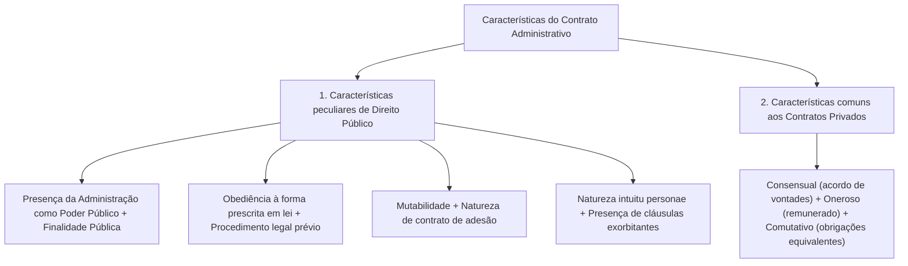

O estudo das **características e solenidades dos contratos administrativos** explica como o regime de direito público molda o nascimento, a execução e a produção de efeitos dos ajustes estatais. Embora partilhem atributos básicos com os negócios privados — por serem acordos consensuais, em regra onerosos e comutativos —, os contratos regidos pela **Lei 14.133/2021** destacam-se pela presença da Administração com prerrogativas de autoridade, pela mutabilidade das cláusulas regulamentares, pela padronização editalícia (natureza de adesão) e pelo caráter pessoal (*intuitu personae*). Neste capítulo, analisamos cada um desses atributos, as regras e proibições da **subcontratação** (art. 122), as hipóteses de substituição do **instrumento formal de contrato** (art. 95), a estreita exceção do **contrato verbal** e os prazos de **divulgação no PNCP** como condição indispensável de eficácia (art. 94).

> [!objetivos]
> - Identificar as características peculiares dos contratos administrativos (finalidade pública, forma prescrita em lei, mutabilidade, adesão, natureza *intuitu personae* e cláusulas exorbitantes) e as características comuns aos contratos privados (consensual, oneroso e comutativo).
> - Aplicar o regime jurídico da subcontratação (art. 122), diferenciando a regra parcial, a exceção do seguro-garantia com retomada (art. 102) e as duas vedações absolutas (inexigibilidade por notória especialização e nepotismo indireto).
> - Distinguir a obrigatoriedade da forma escrita (art. 91), as duas hipóteses de substituição do instrumento de contrato por nota de empenho ou carta-contrato (art. 95) e a exceção do contrato verbal para pronto pagamento (art. 95, § 2º).
> - Dominar o regime de publicidade e os prazos de divulgação no PNCP (20 e 10 dias úteis) como condição de eficácia contratual (art. 94).

## Características dos contratos administrativos

A doutrina administrativa sistematiza os atributos do contrato administrativo em dois blocos: as **características específicas de direito público** (que decorrem da posição vertical da Administração) e as **características comuns com os contratos privados** (que decorrem da teoria geral dos contratos).



Vamos examinar o conteúdo de cada uma dessas características:

### Características específicas de direito público

1. **Presença da Administração Pública agindo nessa qualidade**: em pelo menos um dos polos da relação figura o Poder Público investido de autoridade e supremacia, o que justifica a verticalidade do vínculo.
2. **Finalidade pública**: todo contrato administrativo visa, direta ou indiretamente, atender ao interesse coletivo (princípio da impessoalidade e da finalidade). Mesmo quando o particular aufere vantagem direta — como o comerciante que explora um quiosque mediante concessão de uso de bem público —, o fundamento da contratação continua sendo a utilidade proporcionada aos usuários do espaço público.
3. **Obediência à forma prescrita em lei e ao procedimento legal**: enquanto no Direito Civil vigora a liberdade das formas, os contratos administrativos são estritamente formais, exigindo, como regra, **instrumento escrito** juntado ao processo administrativo (art. 91) e **licitação prévia** (salvo nas hipóteses legais de dispensa e inexigibilidade dos arts. 72 a 75, conforme o art. 37, XXI, da CF).
4. **Mutabilidade**: diferentemente da rigidez clássica do *pacta sunt servanda* privado, o contrato administrativo admite que suas cláusulas regulamentares (de serviço ou projeto) sejam alteradas no curso da execução sempre que o interesse público superveniente o exigir — seja por **ato unilateral da Administração** (arts. 104, I, e 124, I), seja **por acordo entre as partes** (art. 124, II), inclusive diante de fatos imprevisíveis (teoria da imprevisão, caso fortuito ou força maior), resguardado sempre o equilíbrio econômico-financeiro.
5. **Natureza de contrato de adesão**: as cláusulas contratuais não são redigidas em mesa de negociação livre com o licitante. A Administração fixa **unilateralmente e previamente** todas as condições do ajuste na **minuta do contrato**, que constitui **anexo obrigatório do edital de licitação** (art. 18, VI, e art. 25, § 3º), devendo seguir **minutas padronizadas** com cláusulas uniformes quando cabível (art. 19, IV, e art. 25, § 1º) e passar por **análise jurídica prévia** (art. 53). Ao particular cabe aderir às condições do edital ao apresentar sua proposta, sem que isso retire a **bilateralidade** da formação do contrato (pois ninguém é obrigado a participar da licitação).
6. **Presença das cláusulas exorbitantes**: são as prerrogativas que exorbitam do Direito Comum (art. 104), tais como modificar e extinguir unilateralmente o ajuste, fiscalizar a execução e aplicar penalidades.
7. **Natureza *intuitu personae* (caráter pessoal)**: o contrato é celebrado em razão das condições pessoais e técnicas demonstradas pelo vencedor na habilitação licitatória (ou na justificativa de escolha do contratado direto do art. 72, VI). Por isso, o contratado deve executá-lo fielmente (art. 115). Eventos como a **quebra falimentar, a insolvência civil, a extinção da pessoa jurídica ou a morte do contratado pessoa física** constituem motivo legal para a **extinção do contrato** (art. 137, IV).

### Características comuns com os contratos privados

Ao lado das notas publicísticas acima, o contrato administrativo conserva três traços gerais dos contratos civis:
- **Consensual**: aperfeiçoa-se pelo acordo de vontades (consentimento das partes), e não pela entrega física prévia de uma coisa (não é contrato real);
- **Oneroso**: em regra, gera vantagens e sacrifícios patrimoniais para ambas as partes, mediante remuneração pactuada ao contratado (excepcionalmente pode haver concessão gratuita de uso de bem público);
- **Comutativo**: as prestações e contraprestações de ambas as partes são **certas, determinadas e equivalentes** desde o momento da celebração, não dependendo de sorte ou risco incerto (em regra, não é contrato aleatório, ressalvada a alocação específica da matriz de riscos ou a lógica própria das concessões).

| Atributo do Contrato Administrativo | Classificação | Oposto (que NÃO se aplica como regra) |
| --- | --- | --- |
| **Quanto à posição das partes** | **Vertical** (supremacia do Poder Público) | Horizontal (igualdade civil plena) |
| **Quanto à formação do vínculo** | **Consensual** (basta o acordo de vontades) | Real (exigiria entrega física do bem para nascer) |
| **Quanto à elaboração das cláusulas** | **De adesão** (minuta fixada no edital) | Paritário (discussão livre de cada cláusula) |
| **Quanto à equivalência das prestações** | **Comutativo** (prestações certas e conhecidas) | Aleatório (dependente de sorte ou evento incerto) |

> [!pegadinha] Como a banca cobra as características na múltipla escolha
> Fique atento a duas armadilhas clássicas em provas:
> 1. Se a alternativa afirmar que *"considerando a atuação do Poder Público com supremacia em face do particular contratado, a **verticalidade** é característica inerente aos contratos administrativos"*, marque como **correta**!
> 2. Se outra alternativa disser que *"todo contrato administrativo é de adesão, **real**, comutativo e **aleatório**"*, marque como **incorreta**! O contrato administrativo é **consensual** (e não real) e **comutativo** (o que se opõe a aleatório).

## Natureza *intuitu personae* e o regime da subcontratação (art. 122)

O caráter pessoal (*intuitu personae*) do contrato administrativo não impede, de modo absoluto, que o contratado transfira a terceiros a execução de partes acessórias do objeto. A **Lei 14.133/2021** disciplina a **subcontratação** no **art. 122**:

> [!lei] Lei 14.133/2021, art. 122, caput e §§ 1º a 3º
> Art. 122. Na execução do contrato e sem prejuízo das responsabilidades contratuais e legais, o contratado poderá subcontratar partes da obra, do serviço ou do fornecimento até o limite autorizado, em cada caso, pela Administração.
> § 1º O contratado apresentará à Administração documentação que comprove a capacidade técnica do subcontratado, que será avaliada e juntada aos autos do processo correspondente.
> § 2º Regulamento ou edital de licitação poderão vedar, restringir ou estabelecer condições para a subcontratação.
> § 3º Será vedada a subcontratação de pessoa física ou jurídica, se aquela ou os dirigentes desta mantiverem vínculo de natureza técnica, comercial, econômica, financeira, trabalhista ou civil com dirigente do órgão ou entidade contratante ou com agente público que desempenhe função na licitação ou atue na fiscalização ou na gestão do contrato, ou se deles for cônjuge, companheiro ou parente em linha reta, colateral, ou por afinidade, até o terceiro grau, devendo essa proibição constar expressamente do edital de licitação.

Extraia do art. 122 e da sistemática da lei as **quatro regras de ouro da subcontratação** para a prova:

1. **A subcontratação ordinária é sempre parcial e depende de autorização da Administração**: o contratado só pode subcontratar **parcelas** da obra, do serviço ou do fornecimento, dentro do limite autorizado pela Administração em cada caso, comprovando a capacidade técnica do subcontratado (§ 1º). Além disso, a subcontratação **não afasta a responsabilidade integral do contratado principal** perante o Poder Público (se a empresa subcontratada para construir a piscina de um centro esportivo entregar a estrutura com infiltração, a construtora titular do contrato responde integralmente pelo vício).
2. **A única exceção legal que admite subcontratação TOTAL**: ocorre no **seguro-garantia com cláusula de retomada** nas obras e serviços de engenharia (**art. 102, III, da Lei 14.133/2021**). Quando a empreiteira inadimplente falha e a companhia seguradora assume a execução para concluir o empreendimento, a lei autoriza expressamente que a seguradora **subcontrate a conclusão do objeto, total ou parcialmente** (já que a seguradora é instituição financeira, e não construtora).
3. **1ª Vedação absoluta — Serviços técnicos contratados por inexigibilidade por notória especialização (art. 74, § 4º)**: nas contratações diretas por inexigibilidade de licitação com fundamento no inciso III do caput do art. 74 (serviços técnicos especializados de natureza predominantemente intelectual com profissionais ou empresas de notória especialização), **é proibida a subcontratação de terceiros ou a atuação de profissionais diversos daqueles cujo renome motivou a contratação direta** (é a lógica do fotógrafo ou jurista renomado contratado especificamente pelo seu talento individual, que não pode terceirizar o serviço a um desconhecido).
4. **2ª Vedação absoluta — Prevenção ao nepotismo indireto e conflito de interesses (art. 122, § 3º)**: é proibida a subcontratação de pessoa física ou jurídica (ou seus dirigentes) que mantenha vínculo técnico, comercial, econômico, financeiro, trabalhista ou civil com dirigente do órgão contratante ou com agente que atue na licitação, fiscalização ou gestão do contrato. Essa proibição alcança igualmente quem seja **cônjuge, companheiro ou parente até o 3º grau** (em linha reta, colateral ou por afinidade) desses agentes públicos.

| Situação na Subcontratação | Regra jurídica na Lei 14.133/2021 | Fundamento legal |
| --- | --- | --- |
| **Regra geral (obras, serviços e compras)** | Admitida apenas **parcialmente**, até o limite autorizado pela Administração, mantendo-se a responsabilidade integral do contratado e comprovando-se a capacidade técnica da subcontratada. | Art. 122, caput e §§ 1º e 2º |
| **Seguro-garantia com cláusula de retomada** | A seguradora que assume a obra inadimplida pode subcontratar a conclusão do objeto **total ou parcialmente**. | Art. 102, III |
| **Inexigibilidade por notória especialização** | **Vedada** a subcontratação de empresas ou atuação de profissionais distintos daqueles que justificaram a inexigibilidade. | Art. 74, § 4º |
| **Vínculo ou parentesco até o 3º grau** | **Vedada** a subcontratação de vinculados ou parentes até o **3º grau** de dirigentes do órgão ou agentes da licitação/fiscalização/gestão. | Art. 122, § 3º |

## Solenidades dos contratos: forma escrita, instrumento e contrato verbal

Diferentemente do Direito Privado — em que alguém pode comprar ou vender um bem móvel por simples ajuste verbal —, a celebração dos contratos administrativos e de seus termos aditivos obedece a **solenidades formais estritas** previstas nos **arts. 91 e 95 da Lei 14.133/2021**.

### Regra da forma escrita, escritura pública e formato eletrônico (art. 91)

Nos termos do **art. 91, caput e §§ 1º a 3º, da Lei 14.133/2021**, aplicam-se três diretrizes formais:
- **Redação escrita e encarte no processo (caput)**: todo ajuste contratual e seus respectivos termos aditivos precisam ser lavrados **por escrito**, encartados nos autos do processo administrativo da contratação e disponibilizados para consulta pública no portal oficial do órgão.
- **Exigência de escritura pública em direitos reais imobiliários (§ 2º)**: quando o ajuste versar sobre **direitos reais sobre bens imóveis** (como compra e venda imobiliária ou constituição de servidão), a formalização exige **escritura pública em tabelionato de notas**, divulgando-se o seu conteúdo na internet oficial.
- **Celebração em formato digital (§ 3º)**: a lei autoriza expressamente que tanto os contratos quanto os termos aditivos sejam firmados em **meio eletrônico**, desde que observados os padrões de certificação definidos em regulamento.

### Obrigatoriedade do instrumento de contrato e hipóteses de substituição (art. 95)

Não confunda **forma escrita** com **instrumento de contrato** (o termo contratual solene assinado pelas partes). Todo ajuste escrito possui forma escrita, mas nem todo ajuste escrito exige a lavratura de um **termo formal de contrato**. Conforme o **art. 95 da Lei 14.133/2021**, o termo de contrato é a regra obrigatória, mas a Administração pode dispensá-lo e **substituí-lo por documentos equivalentes** (como **nota de empenho, carta-contrato, autorização de compra ou ordem de execução de serviço**) em duas situações específicas:

> [!lei] Lei 14.133/2021, art. 95, caput, I e II, e §§ 1º e 2º
> Art. 95. O instrumento de contrato é obrigatório, salvo nas seguintes hipóteses, em que a Administração poderá substituí-lo por outro instrumento hábil, como carta-contrato, nota de empenho de despesa, autorização de compra ou ordem de execução de serviço:
> I - dispensa de licitação em razão de valor;
> II - compras com entrega imediata e integral dos bens adquiridos e dos quais não resultem obrigações futuras, inclusive quanto a assistência técnica, independentemente de seu valor.
> § 1º Às hipóteses de substituição do instrumento de contrato, aplica-se, no que couber, o disposto no art. 92 desta Lei.
> § 2º É nulo e de nenhum efeito o contrato verbal com a Administração, salvo o de pequenas compras ou o de prestação de serviços de pronto pagamento, assim entendidos aqueles de valor não superior a R$ 10.000,00 (dez mil reais).

Analise com máximo cuidado esses dispositivos:
1. **Substituição na dispensa de licitação em razão do valor (art. 95, I)**: aplica-se às contratações diretas do art. 75, I e II (valores literais de até 100 mil reais para obras, serviços de engenharia e manutenção de veículos, e até 50 mil reais para compras e outros serviços, atualizados anualmente pelo decreto do art. 182 e dobrados para consórcios públicos e agências executivas).
2. **Substituição nas compras de entrega imediata e total sem deveres futuros (art. 95, II)**: aplica-se exclusivamente a **compras** (aquisição de bens, não abrangendo serviços!) cuja entrega seja **imediata** (em **até 30 dias** do pedido de fornecimento, art. 6º, X) e **integral** (de uma só vez). Além disso, a compra **não pode gerar deveres pós-entrega, tais como garantia de assistência técnica**, valendo a dispensa do termo contratual **qualquer que seja o preço da aquisição**! Assim, se um Ministério comprar 5 milhões de reais em resmas de papel A4 para entrega integral em 15 dias (sem assistência técnica futura), o termo de contrato pode ser substituído por simples nota de empenho. Já se comprar um único computador de 4 mil reais fora da dispensa por valor e exigir assistência técnica do fornecedor por 12 meses, o instrumento de contrato (ou ata) será necessário por haver obrigação futura.

> [!esquema] Roteiro decisório sobre a forma e o instrumento contratual (arts. 91 e 95)
> - **Regra geral**: forma escrita + instrumento formal de contrato obrigatório (ou escritura pública se envolver direito real sobre imóvel, art. 91, § 2º).
> - **Substituição do termo por Nota de Empenho / Carta-Contrato / Ordem de Serviço (art. 95, I e II)**: continua sendo escrito, mas dispensa o termo formal nas **dispensas por baixo valor** (art. 75, I e II) e nas **compras com entrega imediata (≤ 30 dias) e integral sem obrigações futuras** (qualquer valor).
> - **Ajuste verbal válido (art. 95, § 2º)**: restrito a **pequenas compras ou serviços de pronto pagamento** até o teto de 10 mil reais na lei (R$ 13.098,41 pelo Decreto 12.807/2025).

### A exceção do contrato verbal: pronto pagamento até 10 mil reais (art. 95, § 2º)

Como regra geral, **ajustes verbais firmados com o Poder Público são nulos e não produzem efeitos**. A única ressalva prevista no **art. 95, § 2º**, contempla as **despesas miúdas de pronto pagamento** (pequenas aquisições ou serviços imediatos) cujo montante não ultrapasse **10 mil reais no valor original da lei** (corrigido para **R$ 13.098,41** pelo Decreto 12.807/2025).

Trata-se das despesas miúdas e urgentes realizadas sob o regime de **suprimento de fundos (adiantamento)** — por exemplo, quando uma viatura do Corpo de Bombeiros fura o pneu durante uma missão no interior e o militar paga o borracheiro local com o cartão de pagamento corporativo, prestando contas posteriormente sem passar pelo rito prévio de licitação, empenho ordinário e termo contratual escrito.

> [!atencao] Cuidado com palavras absolutas sobre a forma escrita!
> Se uma questão afirmar que *"os contratos administrativos e seus aditamentos terão **sempre** forma escrita, não se admitindo em nenhuma hipótese ajuste verbal com o Poder Público"*, o item estará **errado**! Embora a forma escrita seja a regra geral do art. 91, o art. 95, § 2º, excepciona expressamente as pequenas compras e serviços de pronto pagamento até o limite legal.

## Publicidade e divulgação no PNCP como condição de eficácia (art. 94)

A transparência dos contratos públicos desdobra-se na divulgação no portal eletrônico oficial do órgão (art. 91, caput) — admitindo-se o **sigilo** somente quando for **indispensável à defesa da sociedade e do Estado**, conforme a Lei de Acesso à Informação (art. 91, § 1º; CF, art. 5º, XXXIII; Lei 12.527/2011) — e, sobretudo, na publicação centralizada no **Portal Nacional de Contratações Públicas (PNCP)**.

Veja a literalidade do **art. 94 da Lei 14.133/2021**:

> [!lei] Lei 14.133/2021, art. 94, caput, I e II, e §§ 1º e 3º
> Art. 94. A divulgação no Portal Nacional de Contratações Públicas (PNCP) é condição indispensável para a eficácia do contrato e de seus aditamentos e deverá ocorrer nos seguintes prazos, contados da data de sua assinatura:
> I - 20 (vinte) dias úteis, no caso de licitação;
> II - 10 (dez) dias úteis, no caso de contratação direta.
> § 1º Os contratos celebrados em caso de urgência terão eficácia a partir de sua assinatura e deverão ser publicados nos prazos previstos nos incisos I e II do caput deste artigo, sob pena de nulidade.
> § 3º No caso de obras, a Administração divulgará em sítio eletrônico oficial, em até 25 (vinte e cinco) dias úteis após a assinatura do contrato, os quantitativos e os preços unitários e totais que contratar e, em até 45 (quarenta e cinco) dias úteis após a conclusão do contrato, os quantitativos executados e os preços praticados.

```mermaid Prazos e efeitos da divulgação do contrato no PNCP (art. 94 da Lei 14.133/2021)
flowchart LR
    ASS["Assinatura do Contrato ou Aditamento (contrato já é VÁLIDO se regular)"] --> LIC["Decorrente de Licitação: divulgar no PNCP em até 20 DIAS ÚTEIS"]
    ASS --> DIR["Contratação Direta (dispensa/inexigibilidade): divulgar no PNCP em até 10 DIAS ÚTEIS"]
    ASS --> URG["Exceção de URGÊNCIA (art. 94, § 1º): tem eficácia desde a assinatura, mas deve ser publicado nos prazos acima SOB PENA DE NULIDADE"]
    LIC --> EFI["Produção de efeitos (EFICÁCIA: início da execução e pagamentos)"]
    DIR --> EFI
```

> [!bizu] Validade versus Eficácia e a regra de urgência no art. 94
> Nunca confunda **validade** com **eficácia** na prova:
> 1. **Regra geral (art. 94, caput)**: a publicação no PNCP (em **20 dias úteis** nas licitações e em **10 dias úteis** nas contratações diretas, contados da assinatura) é condição de **EFICÁCIA** (aptidão para produzir efeitos e autorizar execução/pagamento), e **não** de validade!
> 2. **Exceção nas contratações urgentes (art. 94, § 1º)**: nos ajustes firmados sob urgência, a **eficácia começa imediatamente na data da assinatura**, mas a divulgação no PNCP continua obrigatória nos mesmos prazos de 20 ou 10 dias úteis, **sob pena de nulidade**! Repare na inversão: na urgência, a eficácia nasce na assinatura, e a falta de publicação tempestiva no PNCP acarreta a **nulidade** superveniente do ajuste.
> 3. **Transparência adicional em obras (art. 94, § 3º)**: nas contratações de obras públicas, o órgão deve publicar em seu portal oficial os quantitativos e preços contratados em **até 25 dias úteis** da assinatura, bem como os quantitativos medidos e valores pagos em **até 45 dias úteis** depois de concluída a obra.

| Hipótese de Publicidade (Art. 94) | Onde publicar | Prazo legal | Efeito jurídico |
| --- | --- | --- | --- |
| **Contrato decorrente de licitação** | PNCP | **20 dias úteis** da assinatura | Condição indispensável de **eficácia** |
| **Contratação direta (dispensa/inexigibilidade)** | PNCP | **10 dias úteis** da assinatura | Condição indispensável de **eficácia** |
| **Contratação em caso de urgência (§ 1º)** | PNCP | **20 ou 10 dias úteis** da assinatura | Eficácia desde a assinatura; falta de publicação gera **nulidade** |
| **Obras — quantitativos e preços contratados (§ 3º)** | Sítio eletrônico oficial | **Até 25 dias úteis** da assinatura | Transparência ativa complementar da obra |
| **Obras — quantitativos medidos e pagos (§ 3º)** | Sítio eletrônico oficial | **Até 45 dias úteis** da conclusão | Transparência ativa final da execução |

## Mapa do capítulo

| Tema / Instituto | Dispositivo na Lei 14.133/2021 | Regra essencial para a prova |
| --- | --- | --- |
| **Características do contrato** | Doutrina / Arts. 89 a 104 | Verticalidade, cláusulas exorbitantes, mutabilidade, adesão, *intuitu personae*, consensual, oneroso e comutativo. |
| **Subcontratação ordinária** | Art. 122, caput e §§ 1º e 2º | Apenas **parcial**, mediante autorização da Administração, sem excluir a responsabilidade do contratado. |
| **Vedações à subcontratação** | Art. 74, § 4º, e Art. 122, § 3º | Vedada na inexigibilidade por notória especialização e para parentes até o **3º grau** ou vinculados a agentes do órgão. |
| **Subcontratação total** | Art. 102, III | Admitida excepcionalmente para a **seguradora** que assume obra no seguro-garantia com cláusula de retomada. |
| **Forma e Escritura Pública** | Art. 91, caput e §§ 1º a 3º | Regra escrita (física ou eletrônica). Direitos reais sobre imóveis exigem **escritura pública** em tabelionato. |
| **Substituição do instrumento** | Art. 95, I e II | Por nota de empenho/carta-contrato na **dispensa por valor** e nas **compras com entrega imediata (≤ 30 dias) e integral sem obrigações futuras**. |
| **Contrato verbal** | Art. 95, § 2º | Nulo, salvo **pequenas compras ou serviços de pronto pagamento** até 10 mil reais na lei (R$ 13.098,41 no decreto). |
| **Divulgação no PNCP** | Art. 94, caput e §§ 1º e 3º | Condição de **eficácia**: **20 dias úteis** (licitação) e **10 dias úteis** (contratação direta). Na urgência, eficácia na assinatura sob pena de nulidade. |

### Para fixar

- Os contratos administrativos caracterizam-se pela **verticalidade**, **cláusulas exorbitantes**, **finalidade pública**, **forma legal**, **mutabilidade**, natureza de **adesão** e caráter ***intuitu personae***, além de serem **consensuais**, **onerosos** e **comutativos**.
- A **subcontratação** (art. 122) é, em regra, **parcial**, depende de autorização da Administração e não exime o contratado de suas responsabilidades; contudo, no seguro-garantia com cláusula de retomada, a seguradora pode subcontratar a conclusão **total ou parcialmente** (art. 102, III).
- É **vedada a subcontratação** nos serviços técnicos contratados por inexigibilidade por notória especialização (art. 74, § 4º) e em favor de cônjuge, companheiro, parente até o **3º grau** ou pessoa vinculada a dirigente do órgão ou agente da licitação/fiscalização/gestão (art. 122, § 3º).
- Os contratos e aditivos têm **forma escrita** (física ou eletrônica), exigindo-se **escritura pública** quando versarem sobre direitos reais sobre imóveis (art. 91, § 2º).
- O **instrumento de contrato** pode ser substituído por nota de empenho, carta-contrato, autorização de compra ou ordem de serviço nas **dispensas em razão do valor** (art. 95, I) e nas **compras com entrega imediata (até 30 dias) e integral sem obrigações futuras**, independentemente do valor (art. 95, II).
- O **contrato verbal** com a Administração é nulo, salvo para pequenas compras ou serviços de **pronto pagamento** de valor não superior a 10 mil reais na literalidade da lei (art. 95, § 2º).
- A divulgação no **PNCP** é condição de **eficácia** (e não de validade), devendo ocorrer em **20 dias úteis** (licitação) ou **10 dias úteis** (contratação direta) da assinatura; nos casos de **urgência**, o contrato tem eficácia desde a assinatura, mas deve ser publicado nos mesmos prazos **sob pena de nulidade** (art. 94, § 1º).
