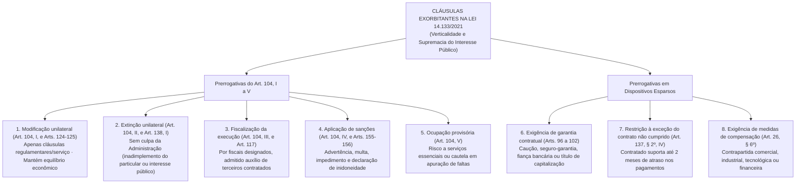

Encerramos este primeiro volume dedicado aos contratos administrativos mergulhando na característica mais marcante do regime jurídico de direito público: a verticalidade decorrente das **cláusulas exorbitantes**. Enquanto nos ajustes privados prevalece o equilíbrio horizontal entre os contratantes, nos contratos administrativos o Poder Público atua na tutela do interesse coletivo primário e, por isso, detém prerrogativas especiais fixadas diretamente na Lei nº 14.133/2021 (art. 104 e dispositivos conexos). Neste capítulo, examinaremos o panorama geral das cláusulas exorbitantes e estudaremos em profundidade cinco delas: a fiscalização da execução contratual (arts. 117 e 118), a ocupação provisória (art. 104, V), a restrição à oposição da exceção do contrato não cumprido (art. 137, § 2º, IV, e § 3º), a exigência de medidas de compensação (art. 26, § 6º) e o regime das garantias contratuais e do seguro-garantia com cláusula de retomada (arts. 96 a 102).

> [!objetivos]
> Ao final deste capítulo, você será capaz de:
> - Identificar o conceito, o fundamento e o rol completo das cláusulas exorbitantes na Lei nº 14.133/2021 (art. 104 e dispositivos esparsos).
> - Distinguir a atuação do fiscal do contrato e dos terceiros contratados para prestar-lhe apoio técnico (art. 117) da figura do preposto mantido pela empresa contratada (art. 118).
> - Compreender os pressupostos da ocupação provisória (art. 104, V), as regras sobre medidas de compensação (art. 26, § 6º) e o prazo de 2 meses aplicável à exceção do contrato não cumprido (art. 137, § 2º, IV, e § 3º).
> - Dominar o regime jurídico da garantia contratual (arts. 96 a 102), incluindo as quatro modalidades à escolha do contratado, os limites percentuais (5%, 10% e 30%) e as regras do seguro-garantia com cláusula de retomada em obras e serviços de engenharia.

## Panorama geral das cláusulas exorbitantes

Denominam-se **cláusulas exorbitantes** as prerrogativas conferidas à Administração Pública que extrapolam o direito comum dos particulares, colocando o ente estatal em posição de supremacia jurídica (verticalidade) perante o contratado a fim de resguardar a continuidade e a eficiência do interesse público. Como decorrem diretamente da lei (princípio da supremacia do interesse público sobre o privado), tais prerrogativas existem mesmo que não estejam transcritas de forma expressa no instrumento contratual, devendo sempre ser exercidas nos estritos limites legais e preservado o equilíbrio econômico-financeiro do ajuste.

A matriz principal das cláusulas exorbitantes encontra-se no **art. 104 da Lei nº 14.133/2021**, mas há também prerrogativas importantes espalhadas em outros artigos do diploma:

> [!lei] Lei nº 14.133/2021, art. 104, I a V, e §§ 1º e 2º
> Art. 104. O regime jurídico dos contratos instituído por esta Lei confere à Administração, em relação a eles, as prerrogativas de:
> I - modificá-los, unilateralmente, para melhor adequação às finalidades de interesse público, respeitados os direitos do contratado;
> II - extingui-los, unilateralmente, nos casos especificados nesta Lei;
> III - fiscalizar sua execução;
> IV - aplicar sanções motivadas pela inexecução total ou parcial do ajuste;
> V - ocupar provisoriamente bens móveis e imóveis e utilizar pessoal e serviços vinculados ao objeto do contrato nas hipóteses de:
> a) risco à prestação de serviços essenciais;
> b) necessidade de acautelar apuração administrativa de faltas contratuais pelo contratado, inclusive após extinção do contrato.
> § 1º As cláusulas econômico-financeiras e monetárias dos contratos não poderão ser alteradas sem prévia concordância do contratado.
> § 2º Na hipótese prevista no inciso I do caput deste artigo, as cláusulas econômico-financeiras do contrato deverão ser revistas para que se mantenha o equilíbrio contratual.

Como as hipóteses de **modificação unilateral** (arts. 124 a 136), de **extinção unilateral** (arts. 137 a 139) e de **aplicação de sanções** (arts. 155 a 163) possuem extensos regramentos próprios que estudaremos em detalhes no próximo volume (Contratos Administrativos II), cabe-nos aqui sintetizar suas linhas mestras e aprofundar imediatamente as demais cinco prerrogativas:
- **Modificação unilateral (art. 104, I, e §§ 1º e 2º)**: permite à Administração alterar unilateralmente apenas as **cláusulas regulamentares ou de serviço** (modificação qualitativa do projeto ou quantitativa do objeto dentro dos limites legais de 25% e 50% para reforma — art. 125). As **cláusulas econômico-financeiras e monetárias jamais podem ser alteradas unilateralmente** sem prévia concordância do contratado (§ 1º), e toda alteração unilateral de escopo que aumente os encargos do particular obriga a revisão simultânea da remuneração para manter o equilíbrio contratual (§ 2º).
- **Extinção unilateral (art. 104, II, e art. 138, I)**: faculta à Administração rescindir unilateralmente o vínculo nos casos de falha ou inadimplemento do contratado, caso fortuito/força maior ou razões de interesse público de alta relevância e amplo conhecimento (excluída a hipótese de descumprimento decorrente de conduta da própria Administração).
- **Aplicação direta de sanções (art. 104, IV, e arts. 155 e 156)**: em razão da autoexecutoriedade administrativa, o Poder Público pune diretamente o particular infrator (após contraditório e ampla defesa) com advertência, multa (de 0,5% a 30%), impedimento de licitar e contratar (até 3 anos) ou declaração de inidoneidade (de 3 a 6 anos), além de executar a garantia para ressarcir prejuízos e quitar multas.

## Fiscalização do contrato versus Preposto do contratado

A prerrogativa de **fiscalizar a execução do contrato** (art. 104, III) é detalhada no **art. 117 da Lei nº 14.133/2021**, devendo ser cuidadosamente diferenciada da figura do **preposto do contratado**, disciplinada no **art. 118**.

### O fiscal do contrato e a contratação de terceiros para assisti-lo

De acordo com o art. 117, caput e §§ 1º a 3º, o acompanhamento e a inspeção do ajuste incumbem a **um ou mais fiscais do contrato** (ou a seus respectivos substitutos), que atuam como representantes do Poder Público especialmente designados segundo os parâmetros do art. 7º da Lei (preferencialmente servidores efetivos ou empregados públicos permanentes, com qualificação compatível e sem parentesco ou conflito de interesses com o particular). No desempenho dessa função:
- Cabe ao fiscal lançar em **registro próprio** os fatos relevantes verificados durante o cumprimento contratual, exigindo as providências cabíveis para sanar falhas ou imperfeições (§ 1º);
- Sempre que uma demanda reclamar decisão ou medida que **exceda sua alçada decisória**, o fiscal deve reportar o fato tempestivamente aos seus **superiores hierárquicos** (§ 2º);
- As unidades de **assessoramento jurídico e de controle interno** do órgão prestam suporte ao fiscal, esclarecendo dúvidas jurídicas ou técnicas e fornecendo subsídios voltados à prevenção de riscos (§ 3º).

E se a fiscalização envolver objeto de alta complexidade técnica — como a aferição estrutural de uma grande barragem ou a auditoria de sistemas de tecnologia — para o qual o órgão não disponha de equipamentos ou especialistas suficientes? O caput do art. 117 faculta ao Poder Público **contratar particulares (terceiros) com a finalidade de prestar assistência e fornecer subsídios informativos** ao fiscal! Contudo, o **§ 4º do art. 117** fixa regras rigorosas para a atuação desses terceiros contratados:

> [!lei] Lei nº 14.133/2021, art. 117, § 4º, I e II
> § 4º Na hipótese da contratação de terceiros prevista no caput deste artigo, deverão ser observadas as seguintes regras:
> I - a empresa ou o profissional contratado assumirá responsabilidade civil objetiva pela veracidade e pela precisão das informações prestadas, firmará termo de compromisso de confidencialidade e não poderá exercer atribuição própria e exclusiva de fiscal de contrato;
> II - a contratação de terceiros não eximirá de responsabilidade o fiscal do contrato, nos limites das informações recebidas do terceiro contratado.

Guarde com muita atenção os detalhes do § 4º:
1. O terceiro contratado apenas **presta auxílio técnico e informativo** ao agente público, sendo-lhe **vedado assumir competência privativa de fiscal de contrato** (o terceiro jamais substitui o servidor fiscal!);
2. O profissional ou a pessoa jurídica contratada como auxiliar responde **civilmente de forma OBJETIVA** pela exatidão e fidelidade dos dados fornecidos, além de subscrever **termo de confidencialidade**;
3. Esse auxílio externo **não afasta a responsabilidade funcional do fiscal**, dentro do escopo dos elementos técnicos que lhe foram repassados pelo terceiro.

### Distinção entre o fiscal da Administração e o preposto do contratado

Não confunda o **fiscal do contrato** (representante da **Administração** — art. 117) com o **preposto** (representante da **empresa contratada** — art. 118). Pelo **art. 118 da Lei nº 14.133/2021**, incumbe à empresa contratada conservar no canteiro da obra ou no local da prestação do serviço um **preposto previamente aceito pelo Poder Público**, encarregado de representá-la ao longo de toda a execução contratual.

Repare na nuance decisiva de cada polo:
- O **fiscal** é designado unilateralmente pela **Administração** (dentre seus agentes públicos, observados os requisitos do art. 7º) para inspecionar o cumprimento do ajuste;
- O **preposto** é escolhido e remunerado pelo **contratado** para representá-lo *in loco* na obra ou no serviço, mas a sua indicação depende de **aceitação pela Administração** (que pode recusar justificadamente um preposto inidôneo ou tecnicamente incapaz de dialogar com a fiscalização).

| Figura no Contrato | Quem ele representa? | Quem o escolhe / designa? | Qual é a sua função essencial? |
| --- | --- | --- | --- |
| **Fiscal do contrato (Art. 117)** | A **Administração Pública** | Designado pela Administração (requisitos do art. 7º). | Acompanhar e fiscalizar a execução, registrar ocorrências, determinar correções e reportar o que exceder sua alçada. |
| **Terceiro auxiliar (Art. 117, § 4º)** | Presta apoio técnico ao **Fiscal** | Contratado pela Administração para assistir e subsidiar o fiscal. | Emitir laudos, medições e dados técnicos (com **responsabilidade civil objetiva** e sigilo, sem substituir o fiscal). |
| **Preposto (Art. 118)** | A **Empresa Contratada** | Escolhido pelo contratado, mas deve ser **aceito pela Administração**. | Permanecer no local da obra ou do serviço para representar o contratado perante a fiscalização pública. |

## Ocupação provisória, exceção do contrato não cumprido e compensação

Analisemos agora três prerrogativas de enorme incidência nas provas: a ocupação provisória de bens, pessoal e serviços (art. 104, V), a mitigação da *exceptio non adimpleti contractus* (art. 137, § 2º, IV) e as medidas de compensação (art. 26, § 6º).

### Ocupação provisória de bens, pessoal e serviços

Pelo **art. 104, V, da Lei nº 14.133/2021**, o ente público detém o poder de assumir temporariamente o uso de bens móveis e imóveis, bem como de empregar o pessoal e os serviços atrelados ao objeto contratual, em **duas situações taxativas**:
1. **Perigo à continuidade de serviços essenciais** (alínea *a*): busca impedir que a população fique desassistida diante de paralisação ou falha grave do particular;
2. **Garantia cautelar na apuração administrativa de infrações contratuais, mesmo depois de extinto o vínculo** (alínea *b*): atua como medida acautelatória para preservar provas, equipamentos e instalações enquanto se apuram faltas cometidas pelo particular, sendo cabível **inclusive após a extinção do contrato**.

### Restrição à oposição da exceção do contrato não cumprido

No direito privado comum (Código Civil, liv. I da Parte Especial), vigora plenamente a cláusula da **exceção do contrato não cumprido** (*exceptio non adimpleti contractus*): se você contrata um pintor para reformar sua residência mediante pagamentos semanais e deixa de pagar a primeira semana, o pintor pode suspender imediatamente o serviço no dia seguinte até que você quite o débito.

Nos contratos administrativos, porém, essa regra sofre forte temperamento em favor do princípio da **continuidade do serviço público**:
- Se o **contratado particular** ficar inadimplente, a **Administração pode opor imediatamente** a exceção do contrato não cumprido, retendo pagamentos proporcionais à parcela não executada e aplicando as sanções cabíveis;
- Se a **Administração Pública** atrasar os pagamentos devidos ao particular, o contratado **não pode interromper imediatamente** a execução da obra, do serviço ou do fornecimento! Ele é obrigado a continuar cumprindo suas obrigações até que o atraso supere o limite temporal fixado na lei.

Na antiga Lei nº 8.666/1993, o particular precisava suportar 90 dias de atraso nos pagamentos antes de poder suspender a execução. A **Lei nº 14.133/2021 reduziu esse prazo para 2 (dois) meses**! Veja a redação exata do art. 137, § 2º, IV, e § 3º:

> [!lei] Lei nº 14.133/2021, art. 137, § 2º, IV, e § 3º, I e II
> § 2º O contratado terá direito à extinção do contrato nas seguintes hipóteses:
> IV - atraso superior a 2 (dois) meses, contado da emissão da nota fiscal, dos pagamentos ou de parcelas de pagamentos devidos pela Administração por despesas de obras, serviços ou fornecimentos;
> § 3º As hipóteses de extinção a que se referem os incisos II, III e IV do § 2º deste artigo observarão as seguintes disposições:
> I - não serão admitidas em caso de calamidade pública, de grave perturbação da ordem interna ou de guerra, bem como quando decorrerem de ato ou fato que o contratado tenha praticado, do qual tenha participado ou para o qual tenha contribuído;
> II - assegurarão ao contratado o direito de optar pela suspensão do cumprimento das obrigações assumidas até a normalização da situação, admitido o restabelecimento do contrato, na forma da alínea "d" do inciso II do caput do art. 124 desta Lei.

> [!pegadinha] Prazo de 2 meses na Lei 14.133/2021 versus Concessões da Lei 8.987/1995
> Cuidado com três detalhes decisivos sobre a exceção do contrato não cumprido em provas:
> 1. **Prazo e termo inicial na NLLC**: nos contratos da Lei nº 14.133/2021, o contratado só pode optar pela **suspensão** do cumprimento de suas obrigações (ou pleitear a **extinção** do contrato) quando o atraso nos pagamentos for **superior a 2 meses** (e não mais 90 dias!), contado da **emissão da nota fiscal**.
> 2. **Vedações à suspensão/extinção (§ 3º, I)**: mesmo após 2 meses de atraso, o contratado **não poderá** suspender a execução nem extinguir o ajuste em caso de **calamidade pública, grave perturbação da ordem interna ou guerra**, ou quando o atraso decorrer de ato ou fato para o qual o próprio contratado tenha contribuído.
> 3. **Contraste com as concessões de serviço público (Lei nº 8.987/1995, art. 39, parágrafo único)**: nos contratos de concessão de serviço público, a inoponibilidade é ainda mais severa — a concessionária **jamais pode paralisar os serviços por decisão própria** em razão de inadimplemento do Poder Concedente, só podendo interromper a prestação **após o trânsito em julgado da sentença judicial** que decretar a rescisão do contrato!

### Exigência de medidas de compensação

Outra prerrogativa prevista na Lei nº 14.133/2021 encontra-se no **art. 26, § 6º**: mediante justificativa prévia da autoridade competente e previsão expressa no instrumento convocatório, os editais de licitação poderão exigir do licitante vencedor a prestação de **medidas de compensação** (*offset*) — consistentes em contrapartidas de natureza **comercial, industrial ou tecnológica** ou na concessão de **condições vantajosas de financiamento**, de forma isolada ou cumulativa — em benefício de órgão ou entidade pública ou de beneficiários selecionados por procedimento isonômico, segundo regulamentação do Poder Executivo federal. Pense, por exemplo, na compra governamental de aeronaves ou radares no exterior em que o edital exige como contrapartida o compartilhamento de tecnologia ou o treinamento de engenheiros nacionais.

## Garantia contratual e o seguro-garantia com cláusula de retomada

Chegamos ao último grande tema do capítulo: a **garantia de execução contratual**, disciplinada nos **arts. 96 a 102 da Lei nº 14.133/2021**. Assim como nas locações imobiliárias privadas o proprietário costuma exigir caução ou seguro-fiança para se proteger de eventual inadimplência do inquilino, a Administração Pública pode exigir que o contratado preste garantia destinada a assegurar o fiel cumprimento das obrigações assumidas, cobrindo eventuais prejuízos causados pelo particular e o pagamento de multas contratuais.

### Regra geral: exigência no edital e escolha pelo contratado

A leitura do **art. 96, caput e § 1º**, revela uma divisão fundamental de competências que despenca em concursos:
1. **A exigência da garantia é discricionária da Administração, condicionada à previsão no edital**: cabe à autoridade competente decidir se exigirá garantia nos contratos de obras, serviços e compras, mas tal exigência **precisa constar expressamente no edital**;
2. **A escolha da modalidade de garantia cabe, em regra, ao CONTRATADO**: exigida a garantia no edital, **caberá ao contratado optar** por uma das **quatro modalidades** previstas nos incisos I a IV do § 1º do art. 96!

> [!lei] Lei nº 14.133/2021, art. 96, § 1º, I a IV (com a redação da Lei nº 14.770/2023)
> § 1º Caberá ao contratado optar por uma das seguintes modalidades de garantia:
> I - caução em dinheiro ou em títulos da dívida pública emitidos sob a forma escritural, mediante registro em sistema centralizado de liquidação e de custódia autorizado pelo Banco Central do Brasil, e avaliados por seus valores econômicos, conforme definido pelo Ministério da Economia;
> II - seguro-garantia;
> III - fiança bancária emitida por banco ou instituição financeira devidamente autorizada a operar no País pelo Banco Central do Brasil;
> IV - título de capitalização custeado por pagamento único, com resgate pelo valor total.

Observe que a **Lei nº 14.770/2023** acrescentou o **inciso IV** ao § 1º do art. 96, passando a admitir uma quarta modalidade de garantia contratual: o **título de capitalização** pago em parcela única e resgatável pelo montante integral.

Além disso, atente para os §§ 2º e 3º do art. 96 e para os arts. 97 e 100:
- **Dispensa de renovação na suspensão por culpa/ordem estatal (art. 96, § 2º)**: se a execução contratual ficar paralisada por determinação ou mora da própria Administração, o particular fica **liberado do dever de renovar a garantia ou de endossar a apólice** até que sobrevenha a ordem de retomada ou a quitação do débito público;
- **Antecedência mínima de 1 mês para o seguro-garantia (art. 96, § 3º)**: caso o vencedor escolha a modalidade **seguro-garantia**, o instrumento convocatório deverá conceder-lhe o **prazo mínimo de 1 mês** — fluindo entre a **homologação do certame e a assinatura do ajuste** — para apresentar a apólice;
- **Vigência e prêmio do seguro-garantia (art. 97)**: a apólice deve ter duração **idêntica ou superior** à do contrato principal, acompanhando eventuais aditivos por meio de endosso (inciso I), e permanece **plenamente eficaz ainda que o tomador (contratado) deixe de quitar o prêmio junto à seguradora** nas datas ajustadas (inciso II);
- **Devolução da garantia (art. 100)**: cumprido integralmente o ajuste (ou rescindido o vínculo por culpa exclusiva do ente público), a garantia é liberada ou devolvida ao particular, devendo ser **corrigida monetariamente** quando houver sido prestada mediante **caução em dinheiro**.

### Limites percentuais da garantia contratual (5%, 10% e 30%)

Qual é o valor máximo que a Administração pode exigir a título de garantia contratual? Os **arts. 98, 99 e 101 da Lei nº 14.133/2021** estabelecem três faixas percentuais bem definidas, além de duas regras especiais de base de cálculo:

| Hipótese Legal | Limite Percentual Máximo | Base de Cálculo e Requisitos (Arts. 98, 99 e 101) |
| --- | --- | --- |
| **Regra geral (Art. 98, caput, 1ª parte)** | **Até 5%** | Calculado sobre o **valor inicial do contrato** (ou sobre o **valor anual** nos contratos contínuos com vigência > 1 ano — art. 98, parágrafo único). |
| **Exceção por complexidade e riscos (Art. 98, caput, 2ª parte)** | **Até 10%** | Sobre o valor inicial do contrato, desde que previamente **justificado pela análise da complexidade técnica e dos riscos envolvidos** no processo. |
| **Obras e serviços de engenharia de GRANDE VULTO (Art. 99)** | **Até 30%** | Sobre o valor inicial do contrato (grande vulto > 200 milhões de reais na lei), podendo ser exigido especificamente em **seguro-garantia**. |
| **Entrega de bens pela Administração ao contratado (Art. 101)** | **Soma-se o valor dos bens** | Quando o contratado ficar **depositário de bens** entregues pela Administração, ao valor da garantia **deverá ser acrescido o valor desses bens**. |

Veja um exemplo numérico rápido da regra do **art. 101**: se a Administração contrata um serviço por **10 milhões de reais**, fixando garantia ordinária de **5%** (500 mil reais), e entrega à empresa contratada maquinários públicos avaliados em **1 milhão de reais** dos quais ela ficará depositária, a garantia total exigida será de **1,5 milhão de reais** (500 mil reais dos 5% do contrato + 1 milhão de reais correspondentes ao valor integral dos bens entregues em depósito). Já nos ajustes de serviços e fornecimentos contínuos de duração superior a 1 ano (e em suas prorrogações), o percentual incide sobre o **valor anual do contrato**, e não sobre o valor global plurianual (art. 98, parágrafo único).

### Exceção do art. 102: seguro-garantia com cláusula de retomada

Vimos que, como regra geral (art. 96, § 1º), quem escolhe a modalidade de garantia é o **contratado**. Existe alguma exceção em que a própria **Administração Pública pode impor no edital** a modalidade **seguro-garantia**? **Sim!** Pelos **arts. 99 e 102 da Lei nº 14.133/2021**, nos ajustes de **obras e serviços de engenharia**, o instrumento convocatório pode exigir especificamente o **seguro-garantia com cláusula de retomada** (*step-in right*), obrigando a seguradora, diante da inadimplência do construtor, a **assumir a execução e concluir o objeto contratado**!

> [!lei] Lei nº 14.133/2021, art. 102, I a III, e parágrafo único
> Art. 102. Na contratação de obras e serviços de engenharia, o edital poderá prever a obrigação de seguradora, em caso de inadimplemento pelo contratado, assumir a execução e concluir o objeto do contrato, hipótese em que:
> I - a seguradora deverá firmar o contrato, inclusive os aditivos, como interveniente anuente [...];
> II - a emissão de empenho em nome da seguradora, ou a quem ela indicar para a conclusão do contrato, será autorizada desde que demonstrada sua regularidade fiscal;
> III - a seguradora poderá subcontratar a conclusão do contrato, total ou parcialmente.
> Parágrafo único. Na hipótese de inadimplemento do contratado, serão observadas as seguintes disposições:
> I - caso a seguradora execute e conclua o objeto do contrato, estará isenta da obrigação de pagar a importância segurada indicada na apólice;
> II - caso a seguradora não assuma a execução do contrato, pagará a integralidade da importância segurada indicada na apólice.

Repare nos quatro pilares do **seguro-garantia com cláusula de retomada (art. 102)**:
1. **Exclusivo para obras e serviços de engenharia**: a imposição editalícia dessa modalidade restringe-se a obras e serviços de engenharia (podendo alcançar **até 30%** nas obras e serviços de engenharia de **grande vulto** — art. 99);
2. **Seguradora como interveniente anuente e fiscalizadora (inciso I)**: a seguradora assina o contrato e seus aditivos como **interveniente anuente**, gozando de livre acesso às instalações, acompanhamento da obra, auditoria técnica e contábil e pedido de esclarecimentos ao responsável técnico;
3. **Subcontratação total ou parcial (inciso III)**: caso assuma a obra, a seguradora está autorizada a **subcontratar a conclusão do ajuste, TOTAL ou parcialmente** (única exceção na NLLC à regra da subcontratação apenas parcial do art. 122!);
4. **Alternativa diante do sinistro (parágrafo único)**: se **executar e concluir** o objeto, a seguradora fica **isenta de pagar a importância segurada**; se optar por **não assumir a execução**, deverá **pagar a integralidade da importância segurada** indicada na apólice.

> [!bizu] Garantia de Proposta (Art. 58) versus Garantia Contratual (Arts. 96 a 102)
> - **Garantia de Proposta (art. 58)**: exigida de **todos os licitantes** na fase de propostas (pré-habilitação); limitada a **até 1% do valor estimado**; devolvida em **10 dias úteis** após a assinatura do contrato ou licitação fracassada.
> - **Garantia Contratual (arts. 96 a 102)**: exigida apenas do **contratado** (prazo mínimo de **1 mês** entre homologação e assinatura se optar por seguro-garantia — art. 96, § 3º); limitada a **5%**, **10%** ou **30%** do valor inicial; restituída após a **fiel execução** ou extinção por culpa exclusiva da Administração (art. 100).

> [!esquema] Síntese das cláusulas exorbitantes, fiscalização e garantias
> - **Cláusulas exorbitantes (art. 104)**: alteração/extinção unilateral (nunca econômico-financeira sem anuência), fiscalização, sanções, ocupação provisória, garantia, exceção (2 meses) e compensação.
> - **Fiscal (art. 117) vs. Preposto (art. 118)**: **terceiros** auxiliam o fiscal com **responsabilidade civil objetiva** e sigilo, sem substituí-lo (§ 4º); **preposto** representa o contratado no local e deve ser **aceito pela Administração**.
> - **Garantia (arts. 96 a 102)**: contratado escolhe entre **4 modalidades** (inclui **título de capitalização**); limites de **5%**, **10%** e **30%** (+ bens depositados). Em obras/engenharia, edital pode impor **seguro-garantia com retomada** (subcontratação **total ou parcial**).

## Mapa do capítulo

| Prerrogativa / Instituto | Base Legal (Lei 14.133/2021) | Regra Essencial para a Prova |
| --- | --- | --- |
| **Alteração e Extinção Unilateral** | Art. 104, I e II, e §§ 1º e 2º | Altera apenas cláusulas de serviço (mantendo o equilíbrio financeiro); cláusulas econômico-financeiras exigem concordância do contratado. |
| **Fiscal do Contrato e Terceiros** | Art. 104, III, e Art. 117, § 4º | Terceiro contratado apenas assiste/subsidia o fiscal, tem **responsabilidade civil objetiva** e assina confidencialidade, sem eximir o fiscal. |
| **Preposto do Contratado** | Art. 118 | Representante do **contratado** mantido no local da obra/serviço, mas cujo nome deve ser **aceito pela Administração**. |
| **Ocupação Provisória** | Art. 104, V, *a* e *b* | Bens móveis/imóveis, pessoal e serviços: (a) risco a serviços essenciais; ou (b) cautela em apuração de faltas (**inclusive após a extinção**). |
| ***Exceptio non adimpleti contractus*** | Art. 137, § 2º, IV, e § 3º | Contratado só pode suspender ou extinguir após atraso de pagamento **superior a 2 meses** da emissão da nota fiscal (vedado em calamidade/guerra). |
| **Medidas de Compensação** | Art. 26, § 6º | Contrapartida comercial, industrial, tecnológica ou financeira exigida no edital mediante justificativa prévia da autoridade. |
| **Garantia Contratual (Regra)** | Arts. 96 a 101 | Contratado escolhe entre 4 modalidades (inclui **título de capitalização**). Limites: **5%** (regra), **10%** (complexidade/risco) + bens depositados. |
| **Seguro-Garantia com Retomada** | Arts. 99 e 102 | Exigível pela Administração em **obras/serviços de engenharia** (até **30%** em grande vulto). Seguradora pode **subcontratar total ou parcialmente**. |

### Para fixar

- As **cláusulas exorbitantes** (art. 104) conferem à Administração as prerrogativas de modificar e extinguir unilateralmente o ajuste, fiscalizar a execução, aplicar sanções e ocupar provisoriamente bens, pessoal e serviços; as cláusulas econômico-financeiras não podem ser alteradas sem concordância do contratado (§ 1º).
- A **execução é fiscalizada** por representantes designados pela Administração (art. 117), admitindo-se a contratação de **terceiros para prestar assistência e subsídios** — os quais assumem **responsabilidade civil objetiva** pelas informações, firmam compromisso de confidencialidade, não podem exercer atribuição exclusiva de fiscal e não afastam a responsabilidade do fiscal (§ 4º).
- O **preposto** (art. 118) é o representante da **empresa contratada** mantido no local da obra ou do serviço, devendo ser **aceito pela Administração**.
- A **ocupação provisória** de bens móveis e imóveis, pessoal e serviços (art. 104, V) cabe em caso de **risco a serviços essenciais** ou para **acautelar apuração administrativa de faltas contratuais**, inclusive após a extinção do contrato.
- O contratado só pode opor a **exceção do contrato não cumprido** (optando pela suspensão das obrigações ou extinção do ajuste) quando o atraso nos pagamentos devidos pela Administração for **superior a 2 meses**, contado da emissão da nota fiscal, salvo em caso de calamidade pública, grave perturbação da ordem interna, guerra ou culpa do próprio contratado (art. 137, § 2º, IV, e § 3º).
- A exigência de **garantia contratual** (art. 96) depende de previsão no edital, cabendo ao **contratado escolher** entre quatro modalidades: caução em dinheiro ou títulos da dívida pública, seguro-garantia (com prazo mínimo de 1 mês entre a homologação e a assinatura — § 3º), fiança bancária ou **título de capitalização** (Lei nº 14.770/2023).
- Os limites da garantia contratual são de **até 5%** do valor inicial em regra (ou do valor anual nos contratos contínuos > 1 ano), **até 10%** mediante justificativa de complexidade técnica e riscos (art. 98) e **até 30%** nas obras e serviços de engenharia de grande vulto em seguro-garantia (art. 99), somando-se o valor dos bens entregues em depósito ao contratado (art. 101).
- Nas **obras e serviços de engenharia**, o edital pode impor o **seguro-garantia com cláusula de retomada** (art. 102), em que a seguradora atua como interveniente anuente, pode **subcontratar total ou parcialmente** a conclusão do objeto e, caso o conclua, fica isenta de pagar a importância segurada (pagando-a integralmente se não assumir a execução).
