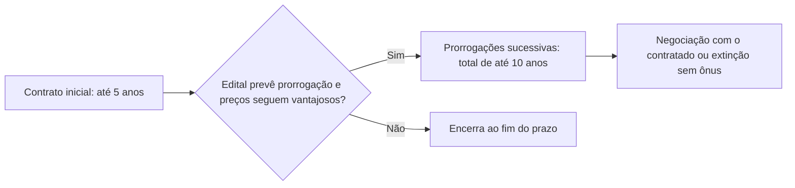

Todo contrato administrativo nasce com um prazo ou com um objetivo a cumprir, e saber qual dos dois governa a sua duração é o primeiro passo para acertar as questões sobre vigência. A Lei 14.133/2021 dedica a esse tema os arts. 105 a 114, e as bancas cobram quase sempre a mesma coisa: números. Quantos anos, em qual hipótese, com ou sem prorrogação. Este capítulo organiza todos esses prazos num roteiro único, explica a lógica de cada um e mostra as armadilhas mais comuns.

> [!objetivos]
> - Distinguir contratos por prazo, por escopo e mistos.
> - Aplicar as regras gerais de duração: edital, créditos orçamentários e plano plurianual.
> - Memorizar o prazo de cada hipótese: 5, 10, 15 e 35 anos, além da vigência indeterminada.
> - Explicar a prorrogação automática do contrato por escopo e a mora do contratado.
> - Calcular a vigência do regime de fornecimento e prestação de serviço associado.

## Prazo ou escopo: o que define o fim do contrato

Um contrato pode terminar de duas maneiras. Na primeira, o fator decisivo é o **tempo**: o contrato de limpeza das instalações de um quartel dura, por exemplo, três anos, pois a necessidade se renova todos os dias. Na segunda, o fator decisivo é o **resultado**: o contrato para construir um quartel termina quando o quartel fica pronto, seja em dois anos, seja em três. A primeira categoria é a dos contratos por **prazo**, e a segunda é a dos contratos por **escopo**, também chamados de contratos por objeto ou de execução imediata.

Existe ainda uma categoria mista. No contrato de fornecimento e prestação de serviço associado, há um resultado a entregar (o equipamento instalado) e um prazo a cumprir (a manutenção por certo período). Os dois fatores aparecem juntos.

| Espécie | O que governa o fim do contrato | Exemplo |
| --- | --- | --- |
| Por prazo | O tempo decorrido; a necessidade é contínua | Vigilância, limpeza, manutenção predial |
| Por escopo | A conclusão do objeto; o prazo é só uma meta | Obra de um quartel, reforma de um hangar |
| Misto | O objeto inicial mais um período de serviço | Sistema de radiocomunicação com manutenção por cinco anos |

## Regras gerais da duração (art. 105)

A duração é a **prevista em edital**. Em dois momentos, na assinatura e a cada exercício financeiro, a Administração deve verificar se há **créditos orçamentários**, isto é, a autorização da lei orçamentária anual para realizar a despesa. Quando o contrato ultrapassar um exercício financeiro, é preciso ainda que haja **previsão no plano plurianual** (PPA).

Um ponto prático: nas contratações diretas não há edital, de modo que a duração deve constar do documento que autoriza a contratação. O parágrafo único do art. 105, incluído pela Lei 14.770/2023, protege os restos a pagar ligados a contratos plurianuais: eles não são cancelados automaticamente enquanto o contrato estiver vigente, nem quando o contrato for rescindido nas hipóteses dos §§ 8º e 9º do art. 90.

> [!atencao] Prazos da lei geral cedem à lei especial
> Os prazos da Lei 14.133/2021 não excluem nem revogam os prazos previstos em lei especial (art. 112). As parcerias público-privadas, por exemplo, seguem os prazos da lei própria. É o gabarito de muitas assertivas que dizem que a nova lei "revogou" os prazos especiais: está errado.

## Serviços e fornecimentos contínuos

São contratos em que a necessidade da Administração é permanente: limpeza, vigilância, fornecimento mensal de combustível, alimentação. A Lei permite celebrá-los por **até 5 anos** (art. 106), desde que sejam observadas três diretrizes:

1. a autoridade competente **atesta a maior vantagem econômica** da contratação plurianual;
2. a Administração atesta, no início e a cada exercício, que há **créditos orçamentários** e que **manter o contrato continua vantajoso**;
3. a Administração pode **extinguir o contrato sem ônus** quando faltar crédito orçamentário ou quando o contrato deixar de ser vantajoso.

O § 1º do art. 106 acrescenta que essa extinção só ocorre na **próxima data de aniversário** do contrato e não pode ocorrer em prazo inferior a **dois meses** contado dessa data. O dispositivo é pouco claro, e o melhor caminho para a prova é memorizar a regra tal como escrita.

Depois dos 5 anos, o art. 107 permite **prorrogações sucessivas** até a vigência máxima **decenal**, desde que haja:

- previsão em edital;
- atestado da autoridade de que as condições e os preços seguem **vantajosos**.

Nessa prorrogação, a Administração pode negociar com o contratado e, se não houver acordo, extinguir o contrato **sem ônus para qualquer das partes**.

O § 2º do art. 106 manda aplicar a mesma regra ao **aluguel de equipamentos** e à **utilização de programas de informática**. Por falta de remissão ao art. 107, a leitura literal indica que esses contratos podem durar 5 anos, mas não chegam à prorrogação até 10. Esse ponto é objeto de debate e deve ser lido com cautela.

## Os dez anos de algumas dispensas (art. 108)

O art. 108 autoriza contratos de **até 10 anos** em algumas hipóteses de licitação dispensável do art. 75. Em vez de decorar os incisos, associe cada um a um tema:

| Dispensa do art. 75 | Tema |
| --- | --- |
| IV, "f" | Bens ou serviços nacionais de alta complexidade tecnológica e de defesa nacional |
| IV, "g" | Materiais de uso das Forças Armadas, para padronização logística |
| V | Contratação voltada à inovação e à pesquisa científica e tecnológica |
| VI | Comprometimento da segurança nacional |
| XII | Transferência de tecnologia de produtos estratégicos para o SUS |
| XVI | Insumos estratégicos para a saúde, em parceria com fundação de apoio |

O inciso XVI do art. 75 foi alterado por lei posterior; para a prova, guarde o tema (saúde estratégica) e o prazo (10 anos).

## Administração como usuária de serviço em monopólio (art. 109)

Há duas situações bem diferentes em que um serviço público entra num contrato. Na primeira, a Administração é **poder concedente**: ela delega o serviço a uma empresa, como na concessão do transporte coletivo. Aqui valem as leis específicas de concessão. Na segunda, a Administração é **mera usuária**, como qualquer consumidor: o quartel recebe energia elétrica da distribuidora da região.

> [!lei] Art. 109
> A Administração poderá estabelecer a vigência por prazo **indeterminado** nos contratos em que seja usuária de serviço público oferecido em regime de **monopólio**, desde que comprovada, a cada exercício financeiro, a existência de créditos orçamentários vinculados à contratação.

A lei antiga proibia expressamente os contratos de vigência indeterminada. Agora há uma exceção expressa. Como a distribuidora é sempre a mesma, não faria sentido licitar e renovar o contrato indefinidamente. A condição para manter o contrato é a comprovação anual dos créditos.

> [!pegadinha] "Vedado, em qualquer caso, o prazo indeterminado"
> Alternativa que afirma que a vigência indeterminada é sempre proibida está errada. O art. 109 admite a vigência indeterminada para a Administração usuária de serviço público em monopólio.

## Contratos que geram receita e contratos de eficiência (art. 110)

Esses contratos têm prazos longos porque o contratado muitas vezes precisa recuperar o que investe.

- **Contrato que gera receita**: a Administração recebe um valor do particular, como na concessão de uso de um espaço público para uma lanchonete ou um estacionamento.
- **Contrato de eficiência**: o contratado presta serviços, podendo executar obras e fornecer bens, para **reduzir despesas correntes** da Administração e é remunerado por um **percentual da economia gerada**. Exemplo: uma empresa moderniza o sistema de iluminação de um complexo de quartéis e recebe parte do que a Administração deixa de gastar com energia.

O prazo depende de haver ou não **investimento**, e a lei define o que isso significa: benfeitorias permanentes realizadas **exclusivamente às expensas do contratado** e que serão **revertidas ao patrimônio público** ao fim do contrato.

| Situação | Prazo máximo | Exemplo |
| --- | --- | --- |
| Sem investimento do contratado | 10 anos | Concessão de uso de sala para cantina, sem obras |
| Com investimento do contratado | 35 anos | Contratado constrói galpão com recursos próprios, que reverte à Administração |
| Obra paga pela Administração, ou sem reversão | 10 anos | Galpão custeado com recursos públicos |

> [!exemplo] Quem paga a obra?
> Uma empresa de logística assume o contrato de eficiência para reduzir os gastos com armazenagem de fardamento. Ela constrói, com dinheiro próprio, um depósito que passará ao órgão no fim do contrato. Como há investimento do contratado e reversão, o prazo pode chegar a 35 anos. Se o órgão pagasse a obra, ou se o depósito não revertesse, o limite seria de 10 anos.

## Contratos por escopo: prorrogação automática (art. 111)

No contrato por escopo, o prazo funciona como **meta de conclusão**, e não como fim do contrato. Se o prazo vence e a obra não está pronta, a vigência é **prorrogada automaticamente**, sem termo aditivo, pois o objeto ainda precisa ser concluído. Não existe teto legal de vigência: o contrato dura enquanto o objeto não for concluído.

Se o atraso decorrer de **culpa do contratado**, duas consequências se somam à prorrogação automática:

1. o contratado é **constituído em mora** e fica sujeito às sanções administrativas;
2. a Administração **pode optar pela extinção** do contrato e adotar as medidas legais para dar continuidade à execução.

> [!resolvido] Questão comentada: obra atrasada
> Uma empreiteira firmou contrato para construir uma delegacia em 24 meses. Ao fim do prazo, a obra estava com 80% de execução, por falha exclusiva da empresa. O contrato vence?
>
> **Resolução.** Não. Trata-se de contrato por escopo, e a vigência é prorrogada automaticamente enquanto o objeto não for concluído. A empresa fica em mora e sujeita às sanções, e a Administração pode, se preferir, extinguir o contrato e adotar as providências legais para concluir a obra.

## Paralisações de obras e serviços (art. 115)

A lei dá especial atenção às obras paradas. É **proibido** retardar imotivadamente a execução de obra ou serviço, mesmo na posse de novo chefe do Executivo ou de novo titular do órgão. A norma impede a paralisação por razões puramente políticas: uma obra só para por motivo determinado e indicado no processo.

Quando ocorrer impedimento, ordem de paralisação ou suspensão, o cronograma é **prorrogado automaticamente** pelo tempo correspondente, bastando anotar a circunstância por **simples apostila**, sem termo aditivo. Nas obras, se a paralisação passar de **um mês**, a Administração deve divulgar aviso público de obra paralisada, no sítio eletrônico oficial e em placa visível no local, com o motivo, o responsável pela inexecução temporária e a data prevista para o reinício. Os textos são elaborados pela própria Administração.

## Fornecimento e prestação de serviço associado (art. 113)

Nesse regime, além de fornecer o objeto (um bem ou uma obra), o contratado se responsabiliza por sua **operação, manutenção ou ambas**, por tempo determinado (art. 6º, XXXIV). Imagine o fornecimento e a instalação de um sistema de radiocomunicação para um comando regional, com torres e adequações civis, seguidos de cinco anos de manutenção.

A vigência é a **soma** de dois períodos:

1. o prazo do fornecimento inicial ou da entrega da obra;
2. o prazo da operação e manutenção, **limitado a 5 anos contados do recebimento** do objeto inicial, com possibilidade de prorrogação na forma do art. 107.

## Sistemas estruturantes de tecnologia da informação (art. 114)

O contrato que prevê a **operação continuada de sistemas estruturantes de tecnologia da informação** pode durar até **15 anos**. Sistemas estruturantes são os de uso comum a vários órgãos, que exigem coordenação central e cuja interrupção compromete a atuação do Estado, como os sistemas de administração financeira e de gestão de pessoal do governo federal.

## Quadro geral de prazos

| Hipótese | Prazo | Dispositivo |
| --- | --- | --- |
| Serviços e fornecimentos contínuos | Até 5 anos; prorrogável até 10 | Arts. 106 e 107 |
| Aluguel de equipamentos e programas de informática | Até 5 anos | Art. 106, § 2º |
| Dispensas específicas (alta complexidade, inovação, SUS, segurança nacional) | Até 10 anos | Art. 108 |
| Usuária de serviço público em monopólio | Indeterminado | Art. 109 |
| Receita ou eficiência, sem investimento | Até 10 anos | Art. 110, I |
| Receita ou eficiência, com investimento do contratado | Até 35 anos | Art. 110, II |
| Escopo predefinido | Prorrogação automática; sem teto | Art. 111 |
| Fornecimento e serviço associado | Soma: fornecimento mais serviço de até 5 anos, prorrogável | Art. 113 |
| Operação de sistemas estruturantes de TI | Até 15 anos | Art. 114 |

> [!bizu] Sequência dos números
> Memorize a escada **5, 10, 15, 35**: serviço contínuo começa com 5; chega a 10 com prorrogações; sistemas estruturantes de TI têm 15; contratos de receita ou eficiência com investimento têm 35. A vigência indeterminada fica só para o monopólio.

## Como a banca cobra este assunto

A banca costuma trocar números (5 por 10, 15 por 35), inverter o papel do investimento (que deve ser do contratado, e não da Administração), afirmar que o prazo indeterminado é sempre vedado ou sustentar que a lei geral revogou os prazos de leis especiais. Outra pegadinha frequente é tratar o contrato por escopo como se tivesse prazo máximo legal. Em questões de cálculo de vigência, separe sempre o prazo do fornecimento do prazo do serviço associado.

## Mapa do capítulo

| Tema | Ideia central | Armadilha |
| --- | --- | --- |
| Regra geral | Duração no edital; créditos a cada exercício; PPA se plurianual | Esquecer o PPA para contrato que ultrapassa o exercício |
| Serviço contínuo | 5 anos, prorrogável até 10 | Confundir o prazo inicial com o total |
| Aluguel de equipamentos e programas | Até 5 anos | Estender a prorrogação até 10 sem previsão expressa |
| Dispensas do art. 108 | Até 10 anos | Trocar os incisos |
| Monopólio | Vigência indeterminada possível | Dizer que é sempre proibida |
| Receita ou eficiência | 10 anos; 35 com investimento do contratado | Aceitar obra paga pela Administração como investimento |
| Escopo | Prorrogação automática; mora com culpa | Atribuir prazo máximo legal |
| Serviço associado | Soma de fornecimento e serviço | Contar só o serviço |
| Sistemas estruturantes de TI | Até 15 anos | Confundir com os 10 anos gerais |

### Para fixar

1. A duração do contrato é a prevista no edital, com créditos orçamentários na assinatura e a cada exercício.
2. Contrato que ultrapassa um exercício financeiro exige previsão no plano plurianual.
3. Serviços e fornecimentos contínuos: até 5 anos, prorrogáveis sucessivamente até 10.
4. A prorrogação exige previsão em edital e atestado de que as condições e os preços seguem vantajosos.
5. A Administração pode extinguir o contrato contínuo sem ônus se faltarem créditos ou se não houver mais vantagem.
6. As dispensas dos incisos IV "f" e "g", V, VI, XII e XVI do art. 75 admitem contratos de até 10 anos.
7. A Administração usuária de serviço público em monopólio pode contratar por prazo indeterminado, com créditos comprovados a cada exercício.
8. Contratos de receita ou eficiência: 10 anos sem investimento e 35 anos com investimento do contratado revertido à Administração.
9. No contrato por escopo, o prazo vencido prorroga a vigência automaticamente; com culpa do contratado há mora e sanções.
10. A vigência do fornecimento e serviço associado soma o fornecimento e o serviço (até 5 anos, contados do recebimento), e os sistemas estruturantes de TI admitem até 15 anos.
