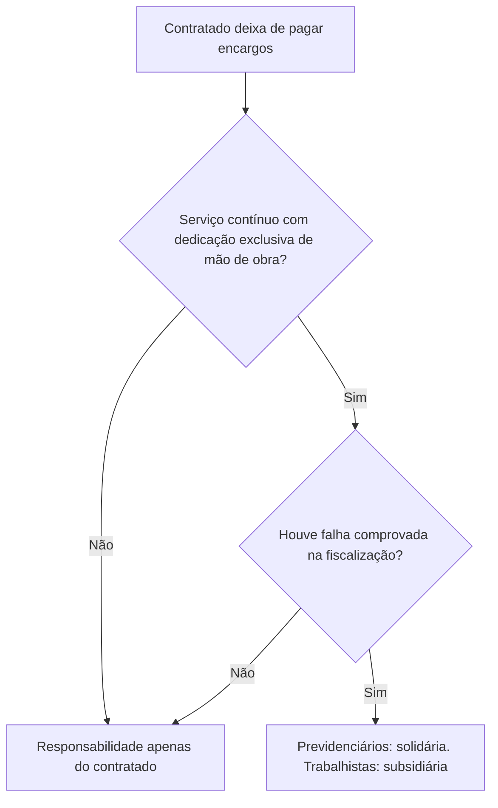
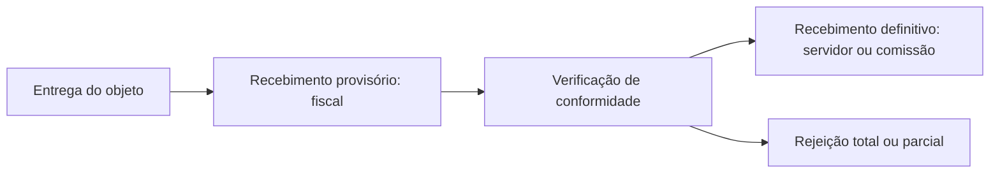

Depois de assinado, o contrato precisa ser cumprido, acompanhado, recebido e pago. Cada uma dessas quatro fases tem regras próprias na Lei 14.133/2021, e quase todas aparecem em prova: quem fiscaliza, quem responde pelos vícios da obra, quem paga os encargos dos empregados da empresa contratada, quando a Administração pode ser chamada a pagar, como se recebe uma obra, em que ordem se paga e quando é possível pagar adiantado. Este capítulo percorre essas fases na ordem em que acontecem no mundo real.

> [!objetivos]
> - Explicar o dever de execução fiel e o papel do fiscal e do preposto.
> - Distinguir a responsabilidade do contratado por vícios, por danos e por encargos.
> - Identificar a exceção de responsabilidade da Administração nos serviços com dedicação exclusiva de mão de obra.
> - Descrever o recebimento provisório e o definitivo e a garantia de cinco anos das obras.
> - Aplicar a ordem cronológica de pagamentos, a remuneração variável e as regras do pagamento antecipado.

## Execução fiel e quem a acompanha

O contrato deve ser executado **fielmente** pelas partes, conforme as cláusulas e a lei, e cada uma responde pelas consequências da inexecução total ou parcial (art. 115). Durante toda a execução, o contratado também deve cumprir as reservas legais de cargos para pessoa com deficiência, reabilitado da Previdência Social e aprendiz, e comprovar esse cumprimento quando a Administração solicitar, indicando os empregados que ocupam as vagas (art. 116).

### O fiscal do contrato

A execução é acompanhada e fiscalizada por **um ou mais fiscais**, representantes da Administração designados conforme os requisitos do art. 7º, ou por seus substitutos. A Administração pode contratar terceiros para assisti-los e fornecer informações (art. 117). O quadro abaixo resume as atribuições.

| Dispositivo | O que o fiscal faz ou recebe |
| --- | --- |
| § 1º | Anota em registro próprio todas as ocorrências e determina o necessário para corrigir faltas e defeitos |
| § 2º | Informa os superiores, em tempo hábil, sobre situações que ultrapassem a sua competência |
| § 3º | É auxiliado pelo assessoramento jurídico e pelo controle interno, que esclarecem dúvidas e previnem riscos |
| § 4º, I | O terceiro contratado para auxiliá-lo responde civilmente de forma objetiva pela veracidade das informações, assina termo de confidencialidade e não exerce atribuição exclusiva de fiscal |
| § 4º, II | A contratação de terceiros não afasta a responsabilidade do fiscal, nos limites das informações recebidas |

> [!pegadinha] O terceiro de apoio não fiscaliza
> A empresa ou o profissional que auxilia o fiscal pode produzir informações e relatórios, mas não pode exercer a atribuição própria e exclusiva de fiscal do contrato. Alternativa que trata o terceiro como substituto do fiscal está errada.

Imagine a reforma da sede de um comando regional. O fiscal visita a obra, nota que o concreto de uma laje foi lançado sem a espera do prazo de cura e registra a ocorrência. Em seguida, determina ao preposto que a etapa seja refeita. Como a correção ultrapassa a competência dele (envolve aditivo de prazo e custo), o fiscal comunica por escrito os superiores, que decidem com apoio da assessoria jurídica. O registro das ocorrências, o aviso tempestivo e o apoio do controle interno são o que, depois, protege o próprio fiscal e o órgão.

### O preposto

O contratado deve manter, no local da obra ou do serviço, um **preposto aceito pela Administração** para representá-lo (art. 118). É a pessoa a quem o fiscal se dirige para determinar correções e receber respostas.

### Subcontratação e dever de decidir

O contratado pode repassar a terceiros **parcelas** da obra, do serviço ou do fornecimento, mas só até o limite que a Administração autorizar em cada caso, e continua respondendo perante ela. Precisa apresentar documentos que comprovem a capacidade técnica do subcontratado, e o edital ou o regulamento pode proibir, restringir ou condicionar a prática (art. 122). Há uma vedação absoluta, por moralidade: não se pode subcontratar quem mantenha vínculo de qualquer natureza (técnico, comercial, econômico, financeiro, trabalhista ou civil) com dirigente do órgão, com agente da licitação ou com quem fiscalize ou gerencie o contrato, nem seus cônjuges, companheiros e parentes até o terceiro grau. Essa proibição deve estar escrita no edital.

A Administração tem o **dever de decidir explicitamente** sobre todas as solicitações e reclamações relativas à execução, salvo as manifestamente impertinentes ou protelatórias (art. 123). Salvo prazo específico em lei ou no contrato, concluída a instrução do pedido, ela tem **um mês** para decidir, com prorrogação motivada por igual período.

## Responsabilidades do contratado

O art. 119 impõe ao contratado o dever de **reparar, corrigir, remover, reconstruir ou substituir**, às suas expensas, o objeto com vícios, defeitos ou incorreções decorrentes da execução ou dos materiais empregados. Imagine que, meses depois da entrega de um alojamento, as paredes começam a rachar. A correção é por conta da empresa. A lei antiga exigia dolo ou culpa; a nova não repete essa exigência, e o regime de responsabilidade do contratado é **objetivo**, com expressa menção às obras (art. 140, § 6º).

O art. 120 trata dos prejuízos: o contratado responde pelos **danos que causar, diretamente, à Administração ou a terceiros** ao executar o contrato, e o acompanhamento feito pelo contratante **não exclui nem reduz** essa responsabilidade. A empresa não pode alegar que o fiscal viu o problema e nada disse. Se um caminhão da contratada derruba o muro de um vizinho durante a obra, a conta é dela.

| Situação | Base legal | Quem corrige ou indeniza |
| --- | --- | --- |
| Vício, defeito ou incorreção no objeto | Art. 119 | Contratado, às suas expensas |
| Dano à Administração ou a terceiros | Art. 120 | Contratado, mesmo com fiscalização |
| Falha de projeto | Art. 140, § 5º | Projetista ou consultor, objetivamente |
| Solidez e segurança da obra | Art. 140, § 6º | Contratado, por no mínimo cinco anos |

### Encargos: só o contratado responde

> [!lei] Art. 121, caput
> Somente o contratado será responsável pelos encargos trabalhistas, previdenciários, fiscais e comerciais resultantes da execução do contrato.

Cada encargo tem um significado:

- **trabalhistas**: salários, FGTS e demais benefícios dos empregados;
- **previdenciários**: contribuições à seguridade social;
- **fiscais**: tributos devidos aos entes federativos;
- **comerciais**: dívidas da empresa com fornecedores e parceiros.

Quando o contratado deixa de pagar encargos trabalhistas, fiscais ou comerciais, o dever de pagar **não passa à Administração** (art. 121, § 1º). Além disso, a dívida não grava o objeto contratado: uma obra entregue ao órgão público não fica presa a débitos da construtora, e a sua regularização e o seu uso seguem livres, até perante o cartório de registro de imóveis. Se uma empresa contratada para fornecer fardamentos deixa de pagar a tecelagem que lhe vendeu o tecido, a tecelagem cobra da empresa e não do órgão.

Esse desenho evita que o contrato público se torne um seguro gratuito para o mau empresário. O risco de inadimplência pertence ao particular, que formou o preço sabendo disso, e não ao contribuinte.

| Encargo | O que abrange | Quem responde como regra |
| --- | --- | --- |
| Trabalhista | Salários, FGTS, férias e demais direitos dos empregados | Contratado |
| Previdenciário | Contribuições à seguridade social | Contratado |
| Fiscal | Tributos devidos à União, aos estados e aos municípios | Contratado |
| Comercial | Dívidas com fornecedores e parceiros do contratado | Contratado |

### A exceção: dedicação exclusiva de mão de obra

Há uma exceção, e ela é pontual. Ela vale **somente** para os serviços contínuos prestados com **dedicação exclusiva de mão de obra**, e mesmo nesse caso a Administração só responde se ficar comprovada a **falha na fiscalização** do cumprimento das obrigações (art. 121, § 2º):

- **solidariamente** pelos encargos **previdenciários**;
- **subsidiariamente** pelos encargos **trabalhistas**.

Nesse regime, os empregados da contratada ficam à disposição nas dependências do contratante, a empresa não compartilha com outros contratos os recursos humanos e materiais alocados e permite a fiscalização da distribuição e do controle da equipe (art. 6º, XVI). Vigilância armada e limpeza das instalações de um batalhão são exemplos.

Na **solidariedade** a Administração e o contratado respondem em conjunto. Na **subsidiariedade** a Administração só é chamada se o contratado não tiver como pagar.

> [!jurisprudencia] STF: responsabilidade só com prova de omissão
> O STF declarou constitucional a regra da lei antiga de que a dívida trabalhista, fiscal e comercial do contratado não se transfere ao poder público (ADC 16). No RE 760.931, fixou tese segundo a qual o inadimplemento dos encargos trabalhistas pelo contratado **não** transfere automaticamente a responsabilidade ao contratante, seja solidária, seja subsidiária. Quem pede a indenização deve demonstrar a falha de fiscalização e o nexo entre a omissão do órgão e o dano. Em 2025, no Tema 1.118 (RE 1.298.647), o STF confirmou que essa prova cabe a quem alega: não basta inverter o ônus para condenar a Administração.

Na prática, isso significa que o empregado da empresa contratada não pode simplesmente cobrar do órgão porque este foi o tomador do serviço. É preciso provar que o órgão fiscalizou mal, por exemplo ao ignorar meses de atraso nos salários sem exigir os comprovantes de pagamento.

| Responsabilidade | Quem responde | Condição |
| --- | --- | --- |
| Encargos em geral | Contratado | Sempre |
| Encargos previdenciários em serviço com dedicação exclusiva | Contratado e Administração, em conjunto (solidária) | Falha de fiscalização comprovada |
| Encargos trabalhistas em serviço com dedicação exclusiva | Administração, apenas se o contratado não puder pagar (subsidiária) | Falha de fiscalização comprovada |

### Garantias do art. 121, § 3º

Nos serviços com dedicação exclusiva, o edital ou o contrato podem prever, entre outras medidas:

1. caução, fiança bancária ou seguro-garantia com cobertura para verbas rescisórias inadimplidas;
2. pagamento condicionado à comprovação de quitação das obrigações trabalhistas vencidas;
3. depósito em **conta vinculada**;
4. pagamento direto das verbas trabalhistas pelo órgão, deduzido do valor devido ao contratado, em caso de inadimplemento;
5. pagamento de férias, décimo terceiro, ausências legais e verbas rescisórias ao contratado **somente na ocorrência do fato gerador**.

Os valores depositados em conta vinculada são **absolutamente impenhoráveis** (art. 121, § 4º).

> [!resolvido] Questão comentada: serviço de vigilância
> Uma empresa de vigilância contratada por um batalhão deixou de recolher as contribuições previdenciárias e de pagar os salários dos vigilantes. Houve falha comprovada na fiscalização. A quem se pode cobrar?
>
> **Resolução.** O contrato é de serviço contínuo com dedicação exclusiva de mão de obra. Havendo falha de fiscalização, a Administração responde **solidariamente** pelos encargos previdenciários e **subsidiariamente** pelos trabalhistas. Sem falha de fiscalização, a responsabilidade permanece exclusivamente da empresa.

## Recebimento do objeto

Ao fim da execução, a Administração recebe o objeto em **duas etapas**, de modo parecido com o que ocorre quando alguém recebe um móvel montado: confere se chegou inteiro e, depois, usa e testa portas e gavetas. A lei diferencia obras e serviços de compras (art. 140).

| Objeto | Recebimento provisório | Recebimento definitivo |
| --- | --- | --- |
| Obras e serviços | Pelo responsável pelo acompanhamento e pela fiscalização, por termo detalhado, quando cumpridas as exigências de caráter técnico | Por servidor ou comissão designada pela autoridade, por termo detalhado que comprove o atendimento das exigências contratuais |
| Compras | Pelo responsável pelo acompanhamento e pela fiscalização, de forma sumária, com verificação posterior da conformidade do material | Por servidor ou comissão designada, por termo detalhado |

Pontos complementares do art. 140:

- O objeto pode ser **rejeitado, no todo ou em parte**, se estiver em desacordo com o contrato (§ 1º).
- Receber o objeto, seja de modo provisório, seja de modo definitivo, **não apaga** a responsabilidade civil do contratado pela firmeza e pela segurança do que foi construído, nem a sua responsabilidade ético-profissional, nos limites da lei ou do contrato (§ 2º).
- Os **prazos e os métodos** de recebimento são definidos em regulamento ou no contrato (§ 3º). A lei não os fixa.
- Os **ensaios, testes e provas** exigidos por normas técnicas oficiais correm por conta do contratado, salvo disposição em contrário no edital ou em ato normativo (§ 4º). Na prática o custo entra no preço, mas a regra legal é essa.
- O **projetista ou consultor** continua respondendo, mesmo depois do recebimento definitivo da obra, pelos prejuízos que um projeto falho venha a provocar, e a sua responsabilidade também é objetiva (§ 5º). Se o projeto básico de um posto de bombeiros tem erro de cálculo estrutural, o autor do projeto responde, e não só o construtor.

### Garantia mínima de cinco anos nas obras

Quem constrói, reforma, recupera ou amplia um imóvel para a Administração continua preso à obra mesmo depois do recebimento definitivo, **por no mínimo cinco anos**. O edital e o contrato podem estipular prazo maior, mas nunca menor. Durante esse período, a responsabilidade é objetiva e abrange três pontos: a **solidez** e a **segurança** dos materiais e dos serviços e a **funcionalidade** do bem. Surgindo vício, defeito ou incorreção, o contratado deve reparar, corrigir, reconstruir ou substituir o que for necessário (art. 140, § 6º).

| Fase | Quem atua | Efeito sobre a responsabilidade |
| --- | --- | --- |
| Execução | Contratado e fiscal | Contratado responde por vícios e danos |
| Recebimento provisório | Fiscal | Não encerra a responsabilidade |
| Recebimento definitivo | Servidor ou comissão | Não encerra a responsabilidade pela solidez, segurança e funcionalidade |
| Cinco anos de garantia | Contratado | Reparação, correção, reconstrução ou substituição, se houver vício |

> [!pegadinha] Comissão no recebimento provisório
> O recebimento **provisório** cabe ao responsável pelo acompanhamento e fiscalização, e não a uma comissão. A comissão ou o servidor designado entra no recebimento **definitivo**. A banca gosta de trocar as duas fases.

## Pagamentos

A antiga lei sofria com atrasos e faltas de pagamento, o que afastava bons fornecedores. A nova dedicou um capítulo ao tema.

### Ordem cronológica (art. 141)

O pagamento obedece à **ordem cronológica** de exigibilidade, que funciona como uma fila. Há várias filas, uma para cada **fonte de recursos**, subdivididas por categoria de contrato: fornecimento de bens, locações, prestação de serviços e realização de obras. Se duas empresas fornecem bens com os mesmos recursos e a primeira cumpriu a obrigação dez dias antes, ela recebe primeiro.

O objetivo é a **impessoalidade**: impedir que alguém receba antes por amizade ou que o pagamento vire moeda de troca. A inobservância imotivada da ordem leva à apuração de responsabilidade do agente, com fiscalização pelos órgãos de controle (§ 2º).

A ordem pode ser alterada **exclusivamente** nas hipóteses abaixo, com **prévia justificativa** da autoridade competente e **posterior comunicação** ao controle interno e ao tribunal de contas:

1. grave perturbação da ordem, emergência ou calamidade pública;
2. pagamento a contratados de menor porte (micro e pequenas empresas, agricultor familiar, produtor rural pessoa física, microempreendedor individual e cooperativa), desde que demonstrado o risco de interrupção do contrato;
3. serviços necessários ao funcionamento de sistemas estruturantes, com risco de descontinuidade;
4. valores devidos à empresa contratada que entrou em falência, recuperação judicial ou processo de dissolução;
5. contrato imprescindível para preservar o patrimônio público ou manter as atividades finalísticas, com risco de descontinuidade de serviço público relevante ou da missão institucional.

O órgão deve divulgar **mensalmente**, em seção específica de acesso à informação do seu sítio, a ordem cronológica dos pagamentos e as justificativas de eventuais alterações (§ 3º).

### Parcela incontroversa, conta vinculada e fato gerador (arts. 142 e 143)

Havendo controvérsia sobre a dimensão, a qualidade ou a quantidade do que foi executado, a **parcela incontroversa** deve ser liberada no prazo de pagamento. Se uma obra de recapeamento foi faturada por 12 quilômetros e a medição confirma 11,4, o órgão paga os 11,4 e apura o resto, em vez de reter tudo.

O edital ou o contrato também pode prever pagamento em **conta vinculada**, movimentada apenas com autorização do contratante, ou pagamento pela **efetiva comprovação do fato gerador**: a empresa comprova que o empregado entrou em férias e só então recebe o valor correspondente.

### Remuneração variável (art. 144)

Em obras, fornecimentos e serviços, inclusive os de engenharia, o valor pago pode ser atrelado ao **desempenho** do contratado. Quatro parâmetros aparecem na lei, todos definidos previamente no edital e no contrato: **metas**, **padrões de qualidade**, **critérios de sustentabilidade ambiental** e **prazos de entrega**. Quem entrega antes, com melhor qualidade e menor impacto ambiental, pode receber mais; quem fica abaixo da meta, menos.

Quando o contrato busca implantar um processo de racionalização, o pagamento pode ser um percentual sobre o valor economizado em certa despesa, e os gastos correm pelos mesmos créditos orçamentários. A remuneração variável precisa ser **motivada** e respeitar o limite orçamentário fixado para a contratação. O contrato de eficiência é um exemplo, mas **não é o único**: a remuneração variável alcança qualquer obra, fornecimento ou serviço.

> [!atencao] Remuneração variável não é exclusiva da eficiência
> A banca costuma afirmar que só o contrato de eficiência admite remuneração variável. O art. 144 vale para obras, fornecimentos e serviços em geral.

### Pagamento antecipado (art. 145)

A despesa pública segue a sequência natural **empenho, liquidação e pagamento**: o empenho reserva a dotação, a liquidação atesta que o objeto foi entregue e o pagamento desembolsa o dinheiro. Pagar antes da liquidação é antecipar o pagamento, e a lei **proíbe** a antecipação, parcial ou total, de parcelas ligadas a fornecimento de bens, execução de obras ou prestação de serviços.

A exceção exige três coisas, que aparecem juntas nas questões:

| Requisito | Conteúdo |
| --- | --- |
| Motivo | Sensível economia de recursos **ou** condição indispensável para obter o bem ou o serviço |
| Justificativa | Prévia, no processo licitatório |
| Previsão | Expressa no edital ou no instrumento formal de contratação direta |

A previsão no edital é essencial, porque os licitantes precisam calcular o preço sabendo que receberão antes. A Administração pode exigir **garantia adicional** como condição, e, se o objeto não for executado no prazo contratual, o valor antecipado deve ser **devolvido** (§§ 2º e 3º).

Por fim, ao liquidar a despesa, o setor de contabilidade informa à administração tributária as características da despesa e os valores pagos, para que o fisco acompanhe as obrigações do contratado (art. 146).

> [!exemplo] Antecipação que se justifica
> Um órgão precisa de licenças de um programa raro, vendido apenas com pagamento adiantado, e sem elas o serviço fica parado. A antecipação é condição indispensável para obter o bem, o motivo aparece no processo, o edital a prevê e o órgão exige garantia adicional. Se o fornecedor não entregar no prazo, devolve o valor recebido.

> [!bizu] Fila de pagamento
> Ordem cronológica é a regra; só se altera com justificativa **antes** e comunicação ao controle interno e ao tribunal de contas **depois**. Antecipar pagamento é exceção que precisa estar no edital.

## Como a banca cobra este assunto

A cobrança mais comum trata da responsabilidade por encargos: a alternativa afirma que a Administração responde sempre, ou nunca, pelos encargos trabalhistas, ou que a responsabilidade é solidária também quanto aos trabalhistas. A correta distingue a regra (só o contratado) da exceção (dedicação exclusiva, falha de fiscalização, solidária quanto à previdência e subsidiária quanto à trabalhista). A segunda linha trata do recebimento, trocando o fiscal pela comissão ou o provisório pelo definitivo. A terceira trata do pagamento antecipado, que a banca apresenta como regra livre ou como se dispensasse previsão no edital.

## Mapa do capítulo

| Tema | Ideia central | Armadilha |
| --- | --- | --- |
| Execução | Fiel, com fiscal e preposto | Atribuir ao terceiro de apoio a função de fiscal |
| Subcontratação | Limite autorizado, capacidade técnica comprovada | Esquecer as vedações por vínculo |
| Dever de decidir | Um mês, prorrogável por igual período | Dizer que a Administração pode silenciar |
| Vícios e danos | Responsabilidade objetiva; fiscalização não a afasta | Alegar que a fiscalização exonera |
| Encargos | Só o contratado responde | Fazer a Administração responder sempre |
| Dedicação exclusiva | Solidária (previdenciários), subsidiária (trabalhistas), com falha de fiscalização | Inverter solidária e subsidiária |
| Recebimento | Provisório pelo fiscal; definitivo por servidor ou comissão | Trocar as etapas |
| Garantia da obra | Mínimo de cinco anos, responsabilidade objetiva | Dizer que o recebimento definitivo encerra a responsabilidade |
| Pagamentos | Ordem cronológica por fonte e categoria | Alterar a ordem sem justificativa |
| Antecipação | Exceção prevista no edital | Admitir sem previsão |

### Para fixar

1. O contrato deve ser executado fielmente, acompanhado por fiscal e com preposto do contratado no local.
2. O terceiro contratado para auxiliar o fiscal não pode exercer atribuição exclusiva de fiscal.
3. A Administração deve decidir explicitamente os pedidos relativos à execução, em um mês, prorrogável por igual período.
4. O contratado repara, às suas expensas, vícios e defeitos, com responsabilidade objetiva, e a fiscalização não a reduz.
5. Somente o contratado responde pelos encargos trabalhistas, previdenciários, fiscais e comerciais.
6. Nos serviços contínuos com dedicação exclusiva, a Administração responde solidariamente pelos encargos previdenciários e subsidiariamente pelos trabalhistas, havendo falha de fiscalização.
7. A conta vinculada é impenhorável de modo absoluto.
8. O recebimento provisório cabe ao fiscal, e o definitivo, a servidor ou comissão, por termo detalhado.
9. Em obra, a garantia de solidez e segurança é de, no mínimo, cinco anos, mesmo após o recebimento definitivo.
10. O pagamento segue a ordem cronológica por fonte e categoria, e o antecipado é exceção justificada, prevista no edital e com devolução se o objeto não for executado.
