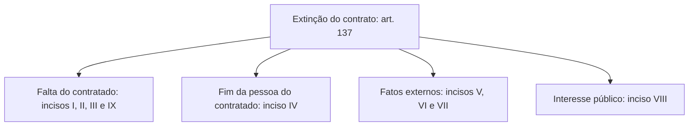
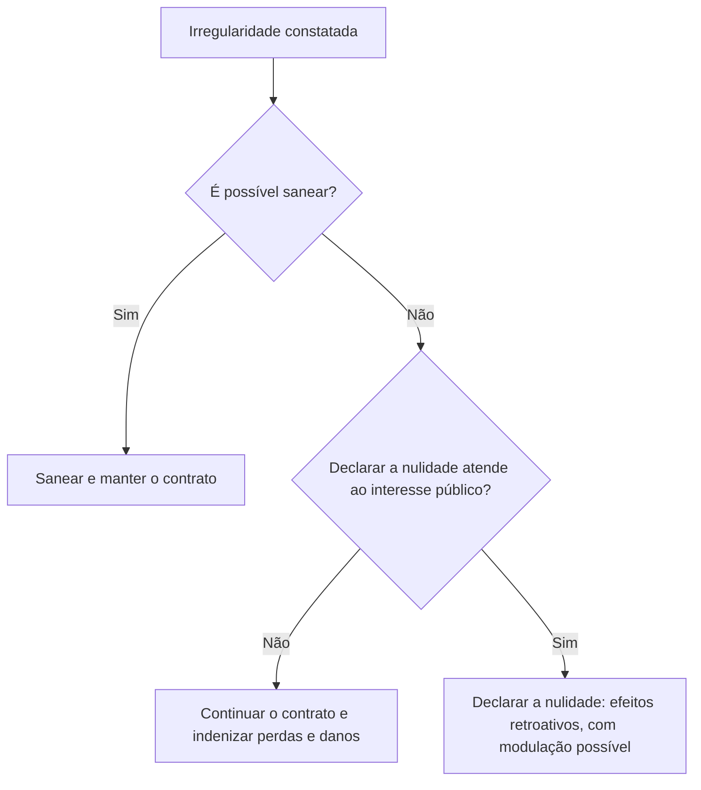

Um contrato não dura para sempre, e a forma como acaba importa muito. Pode terminar bem, quando o objeto é entregue ou o prazo vence. Pode terminar mal, por descumprimento, por falência da empresa, por interesse público ou por culpa da própria Administração. E pode ser desfeito porque nasceu com um vício que não dá para consertar. A Lei 14.133/2021 organiza esses cenários nos arts. 137 a 139 (extinção) e 147 a 150 (nulidade). Cada cenário tem motivos, procedimento e consequências próprias, e as bancas gostam de misturá-los. Este capítulo separa um do outro.

> [!objetivos]
> - Classificar as formas de término do contrato: natural, por impossibilidade, por nulidade e por vontade.
> - Enumerar os motivos de extinção do art. 137 e as hipóteses em que o contratado tem direito de exigi-la.
> - Distinguir extinção unilateral, consensual, arbitral e judicial.
> - Aplicar as consequências da extinção conforme a culpa seja da Administração ou do contratado.
> - Explicar os requisitos e os efeitos da declaração de nulidade e a modulação dos efeitos.

## Como um contrato termina

Em teoria, um contrato pode chegar ao fim de quatro maneiras.

| Forma | Quando ocorre | Exemplo |
| --- | --- | --- |
| Natural | Conclusão do objeto (escopo) ou advento do termo (prazo) | Obra entregue; fim do prazo de um serviço contínuo |
| Impossibilidade material ou jurídica | Não dá mais para executar o objeto nas condições pactuadas | Prédio a reformar destruído por enchente; engenheiro projetista falecido |
| Nulidade | Vício insanável na licitação ou na execução | Contrato assinado sem indicar créditos orçamentários |
| Vontade das partes ou de terceiro | Durante a vigência, antes da conclusão do objeto | Extinção unilateral, consensual, arbitral ou judicial |

A última forma, a **extinção volitiva**, é a que a lei chama simplesmente de **extinção**, expressão que substituiu a antiga "rescisão". Em prova, quando a lei nova fala em extinção, ela trata dos casos em que a vontade (da Administração, das partes, do árbitro ou do juiz) encerra o contrato antes do fim natural. Os motivos para isso estão no art. 137.

## Motivos de extinção (art. 137)

A extinção exige **motivação formal nos autos** do processo e a garantia do **contraditório e da ampla defesa**. Além disso, quando o contrato tem garantia (por exemplo, seguro-garantia), o contratante deve **notificar o emitente** (a seguradora ou o banco) do início do processo administrativo que apura o descumprimento (art. 137, § 4º). A razão é prática: a seguradora poderá ter de assumir a conclusão do objeto, então tem interesse em acompanhar o processo.

O regulamento pode detalhar procedimentos e critérios para verificar os motivos (§ 1º). Os motivos são nove. Para memorizar, agrupe-os por quem deu causa ou por que o contrato ficou inviável.

| Grupo | Motivos (incisos do art. 137) |
| --- | --- |
| Falta do contratado | I: descumprir ou cumprir irregularmente normas do edital, cláusulas, especificações, projetos ou prazos. II: desobedecer a ordens regulares do fiscal ou de autoridade superior. III: mudança na empresa (social, de finalidade ou de estrutura) que reduz sua capacidade de concluir. IX: descumprir a reserva de cargos legal |
| Fim da pessoa do contratado | IV: falência, insolvência civil, dissolução da sociedade ou falecimento do contratado |
| Fatos externos | V: caso fortuito ou força maior comprovados e impeditivos. VI: atraso ou impossibilidade na licença ambiental, ou mudança substancial do anteprojeto dela decorrente. VII: atraso ou impossibilidade na liberação de áreas sujeitas a desapropriação, desocupação ou servidão |
| Interesse público | VIII: conveniência pública, com justificativa assinada pela maior autoridade do órgão ou da entidade |

Alguns incisos merecem atenção:

- **Inciso IV.** Os contratos administrativos são **personalíssimos** em regra: foram feitos com aquele contratado. Se a empresa fecha, falece o empresário individual ou a sociedade se dissolve, o vínculo não tem como continuar.
- **Inciso V.** Caso fortuito ou força maior são eventos imprevisíveis ou inevitáveis e alheios à vontade das partes, como uma enchente histórica que isole a região da obra. Ninguém tem culpa, e a extinção ocorre sem penalidades. Mas, se o evento apenas aumentar os custos sem impedir a execução, o caminho é a **revisão** do contrato para recompor o equilíbrio econômico-financeiro (art. 124, II, "d"), e não a extinção.
- **Incisos VI e VII.** Embora a regra seja a de que esses motivos não decorrem de culpa da Administração, a licença ambiental e a liberação de áreas podem ser responsabilidades dela. A presunção de ausência de culpa não é absoluta.
- **Inciso VIII.** O interesse público permite extinguir um contrato legal e bem executado, desde que a **autoridade máxima** do órgão justifique. Imagine que a Administração contrata uma empresa para digitalizar arquivos e, depois, decide criar um setor próprio de documentação.

> [!pegadinha] Quem justifica o interesse público
> A justificativa das razões de interesse público (inciso VIII) é da **autoridade máxima** do órgão ou da entidade contratante. O fiscal do contrato não tem competência para isso.

### Passo a passo da extinção unilateral por falta do contratado

Para que a extinção seja válida e resista ao controle, o órgão segue uma sequência lógica, que as bancas gostam de embaralhar:

1. identifica o motivo do art. 137 e instaura o processo administrativo;
2. notifica o contratado, que apresenta defesa, com contraditório e ampla defesa;
3. notifica o emitente da garantia (seguradora ou banco), se houver;
4. decide com **autorização escrita e fundamentada** da autoridade competente;
5. reduz a decisão a **termo** no processo;
6. aplica as consequências do art. 139 e, se for o caso, as sanções.

> [!exemplo] Falência durante a obra
> Uma construtora contratada para ampliar o alojamento de um batalhão tem a falência decretada com a obra em 40%. O contrato é personalíssimo e a empresa não consegue mais concluí-lo. Há motivo de extinção (art. 137, IV). O órgão instaura o processo, notifica a seguradora, assume o objeto no estado em que está e pode executar o seguro-garantia para que a seguradora conclua a obra ou indenize os prejuízos.

## Quando o contratado tem direito à extinção

Até aqui, os motivos poderiam levar a Administração a extinguir o contrato. Há também situações em que o **contratado** pode exigi-la, inclusive pela via judicial, porque a culpa é da Administração. São os chamados **fatos da administração** (art. 137, § 2º):

| Hipótese | Limite ou prazo |
| --- | --- |
| Supressão de obras, serviços ou compras que altere o valor inicial além do limite legal | 25% (regra geral das alterações unilaterais) |
| Suspensão da execução por ordem escrita da Administração | Mais de 3 meses |
| Repetidas suspensões que, somadas, totalizem 90 dias úteis | 90 dias úteis, mesmo com indenização das desmobilizações |
| Atraso nos pagamentos devidos pela Administração | Mais de 2 meses, contados da emissão da nota fiscal |
| Não liberação, nos prazos, de área, local ou objeto e de fontes de materiais naturais previstos no projeto | Inclui atrasos em desapropriação, desocupação e licenciamento ambiental |

A exigência de esperar **dois meses** antes de pedir a extinção por falta de pagamento é uma restrição à chamada **exceção do contrato não cumprido**: em contratos privados, quem não recebe pode simplesmente parar de cumprir. No contrato administrativo, o contratado precisa suportar o atraso até o prazo legal. Na lei antiga, esse prazo era de 90 dias; hoje é de **dois meses**.

### Exceções e alternativa da suspensão (art. 137, § 3º)

Nas hipóteses de suspensão (mais de 3 meses e 90 dias úteis) e de atraso de pagamento (mais de 2 meses), o direito à extinção **não** se aplica:

1. em **calamidade pública, grave perturbação da ordem interna ou guerra**;
2. quando a suspensão ou o atraso decorrer de ato ou fato que o próprio contratado praticou, de que participou ou para o qual contribuiu.

Em compensação, nessas mesmas situações o contratado pode optar por **suspender o cumprimento das suas obrigações** até a normalização, com direito ao restabelecimento do equilíbrio econômico-financeiro. Imagine que a Administração passou de dois meses sem pagar a nota fiscal de uma empresa de manutenção predial. A empresa comunica que interrompe os serviços até o pagamento e, quando o dinheiro entra, retoma a execução do ponto em que parou, com o equilíbrio econômico-financeiro recomposto se houve custo adicional.

> [!atencao] Supressão, suspensão e atraso: não confunda os prazos
> Supressão acima de 25%: extinção por direito do contratado. Suspensão contínua acima de **3 meses**. Suspensões repetidas somando **90 dias úteis**. Atraso de pagamento acima de **2 meses**. A banca troca meses por dias, dias úteis por dias corridos e 25% por outros percentuais.

## Espécies de extinção (art. 138)

Quanto à forma, a extinção do contrato pode ser:

1. **Unilateral**: determinada por ato escrito da Administração, **exceto** quando o descumprimento decorrer da própria conduta dela;
2. **Consensual**: ajustada entre as partes, seja por simples acordo, seja com o apoio de conciliação, de mediação ou de um comitê de resolução de disputas, **sempre que isso convier à Administração**;
3. **Arbitral ou judicial**: determinada por decisão arbitral, quando há cláusula compromissória ou compromisso arbitral, ou por decisão judicial.

A extinção unilateral e a consensual exigem **autorização escrita e fundamentada** da autoridade competente e devem ser **reduzidas a termo** no processo (art. 138, § 1º). A extinção unilateral é uma **cláusula exorbitante**, pois só a Administração a possui: o particular, quando precisa se desligar, tem de buscar a via consensual, a arbitral ou a judicial.

### Conciliação, mediação, comitê e arbitragem

Os arts. 151 a 154 permitem que a Administração resolva controvérsias contratuais por meios alternativos ao processo judicial. Eles valem para **direitos patrimoniais disponíveis**, como o restabelecimento do equilíbrio econômico-financeiro, o inadimplemento de obrigações e o cálculo de indenizações.

| Meio | Quem decide | Característica |
| --- | --- | --- |
| Conciliação e mediação | As partes, por consenso | Conciliador ou mediador apenas facilitam o diálogo |
| Comitê de resolução de disputas | Comitê técnico, conforme previsto no contrato | Acompanha a execução e previne controvérsias |
| Arbitragem | Árbitro ou colegiado escolhido pelas partes | Decisão com força de sentença; sempre de direito e pública (art. 152) |

A diferença essencial está em quem toma a decisão. Na mediação e na conciliação, o resultado é obra das partes. Na arbitragem, funciona como um "juiz privado": o árbitro decide, e as partes se submetem. Esses meios não servem só para extinguir: podem também ajudar a revisar o contrato ou a calcular indenizações. Os contratos podem ser aditados para permitir sua adoção (art. 153), e a escolha dos árbitros e dos comitês segue critérios isonômicos, técnicos e transparentes (art. 154).

## Consequências da extinção

As consequências dependem de quem deu causa.

### Culpa exclusiva da Administração

Quando a extinção decorre de **culpa exclusiva da Administração** (art. 138, § 2º), o contratado não pode sair prejudicado. Ele tem direito a:

1. **ressarcimento** dos prejuízos regularmente comprovados (por exemplo, custos de demissão de empregados e de materiais já comprados);
2. **devolução da garantia**;
3. **pagamentos devidos** pelo que executou até a data da extinção (se construiu quatro dos doze pavimentos previstos, recebe pelos quatro, o que evita o enriquecimento sem causa da Administração);
4. **custo da desmobilização**, isto é, retirar do canteiro máquinas, materiais e instalações provisórias.

### Extinção por ato unilateral

Quando a Administração extingue por ato unilateral, sem que o descumprimento seja dela, a lei prevê consequências **sem prejuízo das sanções** administrativas (art. 139):

| Consequência | Conteúdo |
| --- | --- |
| Assunção imediata do objeto | A Administração toma o objeto no estado e no local em que se encontra |
| Ocupação e utilização | Local, instalações, equipamentos, material e pessoal usados na execução e necessários à continuidade |
| Execução da garantia | Para ressarcir prejuízos, pagar verbas trabalhistas, fundiárias e previdenciárias, quitar multas e, se houver seguro-garantia, exigir que a seguradora assuma e conclua o objeto |
| Retenção de créditos | Até o limite dos prejuízos e das multas aplicadas |

As medidas de assunção e de ocupação ficam a critério da Administração, que pode continuar a obra ou o serviço por **execução direta** (com meios próprios) ou **indireta** (contratando terceiro). A ocupação do local e dos bens é a mais invasiva das medidas e, por isso, só pode ocorrer com **autorização expressa** da maior autoridade da área: o ministro (no plano federal), o secretário estadual ou o secretário do município, conforme o ente (art. 139, § 2º).

A execução da garantia e a retenção de créditos revelam uma **autoexecutoriedade parcial**: a Administração cobra multas e prejuízos sem recorrer ao Judiciário até onde alcançam a garantia e os créditos retidos. Só o que ultrapassar esses valores depende de ação judicial. No seguro-garantia, a seguradora deve concluir o objeto (art. 97).

> [!resolvido] Questão comentada: extinção com culpa da Administração
> A Administração suspendeu por ordem escrita, por quatro meses, a obra de um pavilhão, sem culpa da construtora. A construtora pediu a extinção e, concedida, reclamou ressarcimento. Quais direitos tem?
>
> **Resolução.** A suspensão por mais de três meses é fato da Administração e dá direito à extinção. Como a culpa é exclusiva da Administração, a construtora tem direito ao ressarcimento dos prejuízos comprovados, à devolução da garantia, ao pagamento do que executou até a extinção e ao custo da desmobilização. Não sofre as consequências do art. 139, reservadas à extinção unilateral por culpa do contratado.

> [!pegadinha] Extinção unilateral com culpa da própria Administração
> A Administração não pode extinguir o contrato por ato unilateral quando o descumprimento decorre da sua própria conduta (art. 138, I). Nesse caso, resta ao contratado exigir a extinção e ser ressarcido.

## Nulidade do contrato

Nulidade é o **vício** constatado na licitação ou na execução. Na teoria geral dos atos administrativos, o ato inválido deve ser anulado, salvo se puder ser convalidado (saneado). Nos contratos, a Lei 14.133/2021 deu **prioridade ao saneamento**. Anular ou suspender um contrato que já está em execução pode causar mais prejuízo do que mantê-lo, por isso o art. 147 coloca duas condições.

> [!esquema] Quando se declara a nulidade
> - O vício precisa ser **insanável**: se for possível sanear, sanea-se.
> - A suspensão ou a nulidade deve ser **medida de interesse público**, com análise de aspectos como impactos econômicos e sociais do atraso, riscos ambientais e à segurança da população, custo da deterioração das parcelas executadas, despesas de preservação e de desmobilização, medidas já adotadas para sanear, estágio da execução, fechamento de postos de trabalho, custo de nova licitação e custo de oportunidade do capital.

Se a paralisação ou a anulação **não** for medida de interesse público, o poder público deve optar pela **continuidade** do contrato e resolver a irregularidade por **indenização por perdas e danos**, sem prejuízo da apuração de responsabilidades e das penalidades (art. 147, parágrafo único). O administrador não deve apenas conferir a letra da lei: ele pondera também a segurança jurídica, a eficiência e o interesse público.

### Efeitos da nulidade (arts. 148 e 149)

| Aspecto | Regra |
| --- | --- |
| Efeitos no tempo | A declaração opera **retroativamente** (ex tunc): impede efeitos futuros e desconstitui os já produzidos |
| Impossibilidade de retornar ao estado anterior | Resolve-se por **indenização por perdas e danos**, além da apuração de responsabilidades e de eventual sanção |
| Modulação dos efeitos | A autoridade pode determinar que a nulidade só tenha eficácia em momento futuro, suficiente para nova contratação, por até **6 meses**, prorrogável **uma única vez** |
| Dever de indenizar | A Administração indeniza o que o contratado executou até a declaração e outros prejuízos comprovados, **desde que a nulidade não lhe seja imputável** |
| Responsabilização | Quem deu causa à nulidade responde |

A modulação serve à continuidade do serviço público. Se um contrato de limpeza é considerado nulo, a Administração pode manter os efeitos por alguns meses, até concluir nova licitação. Já se a construtora levantou duas alas e não teve culpa, não dá para "desconstruir" o que foi feito, e a solução é indenizá-la pelo que executou. Se o contratado deu causa, por exemplo ao fraudar a licitação em conluio com outros licitantes, **não** tem direito sequer ao pagamento do que executou.

> [!lei] Art. 149, em síntese
> A nulidade **não livra** a Administração do dever de indenizar o contratado pelo que ele executou até o momento em que a nulidade foi declarada ou passou a valer, e por outros prejuízos comprovados, desde que a nulidade **não lhe seja imputável**. Também se promove a responsabilização de quem a causou.

O art. 150 acrescenta uma regra de prevenção: nenhuma contratação pode ocorrer sem a caracterização adequada do objeto e sem a indicação dos créditos orçamentários para pagar as parcelas que vencerem no exercício, **sob pena de nulidade** e de responsabilização.

> [!bizu] Nulidade retroage, extinção não
> A **nulidade** retroage (ex tunc), mas pode ter efeito futuro modulado por até 6 meses. A **extinção** do contrato encerra a relação a partir dela e gera as consequências dos arts. 138 e 139. Se a banca disser que a nulidade "em regra não retroage", está errada.

## Como a banca cobra este assunto

Quatro linhas se repetem. A primeira exige reconhecer o motivo de extinção correto num caso concreto, como falência do contratado ou atraso na liberação de áreas. A segunda explora os prazos dos fatos da Administração, trocando meses por dias ou três por seis. A terceira distingue as consequências: a culpa da Administração gera ressarcimento, devolução da garantia, pagamentos e desmobilização, enquanto a extinção unilateral permite assunção do objeto, ocupação, execução da garantia e retenção de créditos. A quarta cobra a nulidade, com seus dois requisitos (vício insanável e interesse público), o efeito retroativo e a indenização do que foi executado.

## Mapa do capítulo

| Tema | Ideia central | Armadilha |
| --- | --- | --- |
| Forma de término | Natural, impossibilidade, nulidade ou vontade | Confundir extinção com nulidade |
| Motivos do art. 137 | Nove motivos, com motivação e contraditório | Esquecer o contraditório e a ampla defesa |
| Notificação | O emitente da garantia é notificado do processo | Dispensar a notificação da seguradora |
| Fatos da Administração | Supressão acima de 25%, suspensão acima de 3 meses, 90 dias úteis, atraso acima de 2 meses | Trocar os prazos |
| Calamidade, guerra, ordem interna | Afasta o direito à extinção | Aplicar a regra a tempos de guerra |
| Espécies | Unilateral, consensual, arbitral e judicial | Dizer que a Administração extingue unilateralmente mesmo com culpa sua |
| Culpa da Administração | Ressarcimento, garantia devolvida, pagamentos e desmobilização | Aplicar as consequências do art. 139 |
| Extinção unilateral | Assunção, ocupação, execução da garantia e retenção | Dispensar autorização para ocupar |
| Nulidade | Vício insanável mais interesse público; efeito retroativo | Afirmar que não retroage |
| Modulação | Até 6 meses, prorrogável uma única vez | Aceitar prazo ilimitado |

### Para fixar

1. A extinção do contrato exige motivação formal e garante contraditório e ampla defesa.
2. O emitente da garantia é notificado do início do processo de apuração do descumprimento.
3. Falência, insolvência civil, dissolução ou falecimento do contratado são motivos de extinção.
4. Caso fortuito ou força maior que apenas aumente custos leva à revisão, e não à extinção.
5. Razões de interesse público são justificadas pela autoridade máxima do órgão ou da entidade.
6. O contratado pode exigir a extinção por supressão acima do limite, suspensão acima de três meses, 90 dias úteis de suspensões, atraso de pagamento acima de dois meses ou não liberação de áreas.
7. Em calamidade pública, grave perturbação da ordem interna ou guerra, não há direito à extinção por suspensão ou atraso, mas o contratado pode suspender as suas obrigações.
8. A extinção unilateral não é cabível quando o descumprimento decorre da conduta da própria Administração.
9. Com culpa exclusiva da Administração, o contratado recebe ressarcimento, garantia, pagamentos e custo da desmobilização.
10. A nulidade exige vício insanável e interesse público, opera retroativamente e pode ter eficácia futura por até seis meses, prorrogável uma vez.
