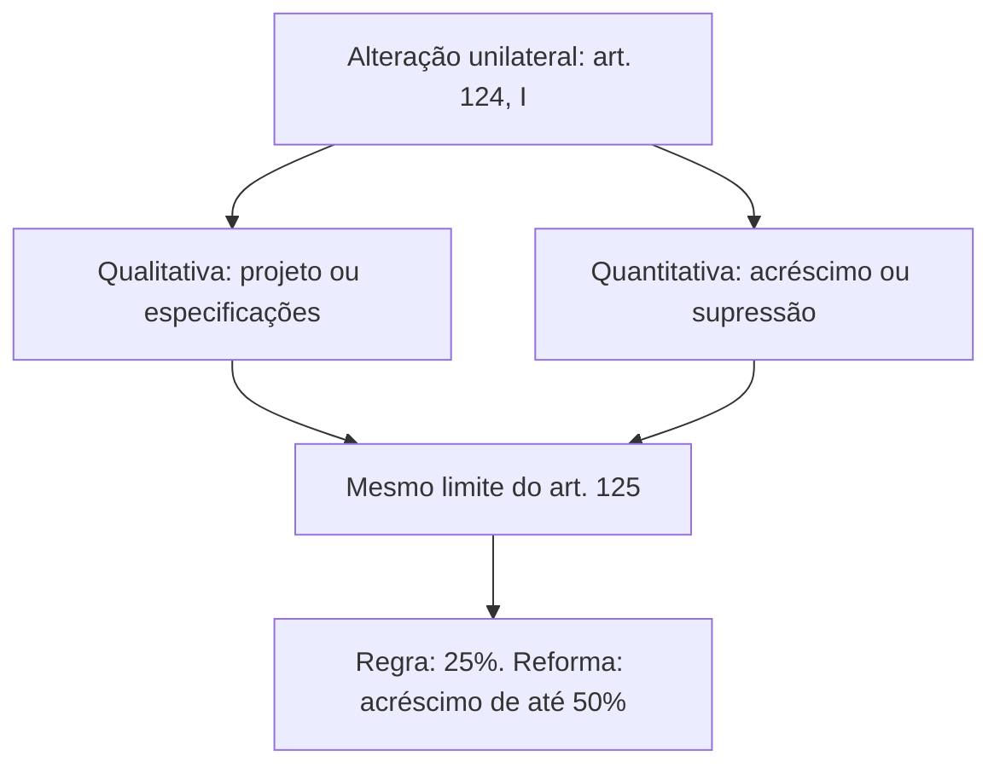
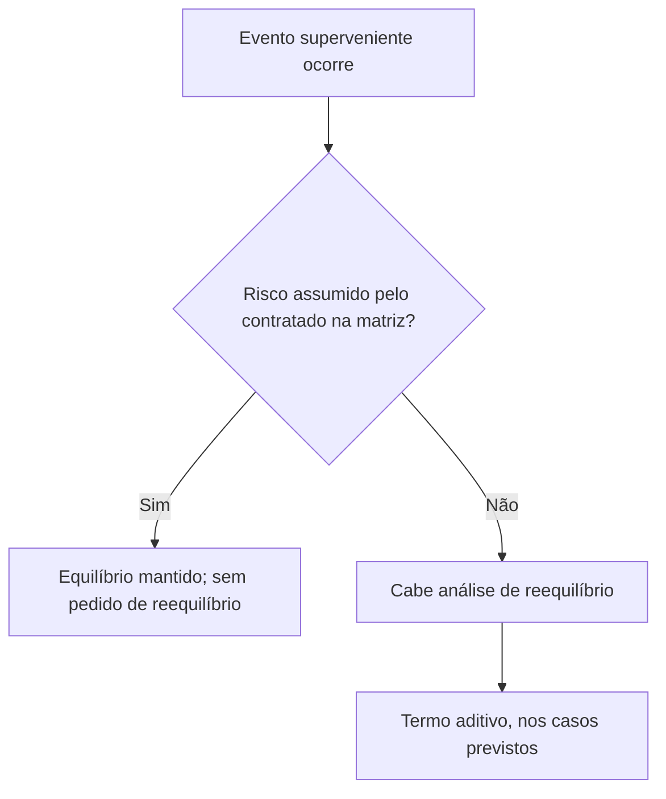

Contratos duram anos, e o mundo muda nesse tempo. O projeto de um quartel pode ficar desatualizado, a quantidade de notebooks pode precisar crescer, o salário dos auxiliares de limpeza sobe com a convenção coletiva, a chuva atrasa a obra. A lei responde com três instrumentos: a **alteração** do contrato, a **alocação de riscos** e a **manutenção do equilíbrio econômico-financeiro** por reajuste, repactuação ou revisão. Este capítulo cobre os dois primeiros e o reajuste. A revisão e o fato do príncipe ficam para o capítulo seguinte.

> [!objetivos]
> - Distinguir alteração unilateral e alteração por acordo, qualitativa e quantitativa.
> - Aplicar os limites de 25% e 50% e entender por que a Administração não altera cláusulas econômico-financeiras sozinha.
> - Explicar para que serve a matriz de riscos e quando ela é obrigatória.
> - Diferenciar reajuste em sentido estrito, repactuação e revisão.

## Duas portas para alterar o contrato

O contrato pode ser alterado, **com a devida justificativa**, de duas maneiras (art. 124): por ato **unilateral** da Administração ou **por acordo** com o contratado. A primeira é uma **cláusula exorbitante**: a Administração impõe a mudança sem que o contratado possa recusar, dentro dos limites da lei. A segunda não tem nada de exorbitante, porque depende da concordância dele.

| Característica | Alteração unilateral | Alteração por acordo |
| --- | --- | --- |
| Quem decide | A Administração | Administração e contratado |
| Natureza | Cláusula exorbitante | Ajuste bilateral |
| Hipóteses | Qualitativa e quantitativa | Garantia, regime de execução, forma de pagamento e equilíbrio |
| Limite percentual | 25% (50% nos acréscimos de reformas) | Sem limite fixo na lei, mas com justificativa |

## Alteração unilateral (art. 124, I)

A Administração pode alterar o contrato unilateralmente em dois casos.

1. **Alteração qualitativa**: a Administração refaz o projeto ou as especificações para atender melhor aos objetivos da contratação. Imagine que o projeto de um quartel é antigo e não previa acessibilidade. A Administração muda o projeto para incluir rampas e elevadores.
2. **Alteração quantitativa**: modificação do valor em decorrência de acréscimo ou diminuição das quantidades, nos limites da lei. Em uma compra de 80 notebooks, o órgão passa a querer 96 ou 64.

### Limites (art. 125)

O contratado não pode recusar a mudança dentro de certa margem: deve aceitar, **nas mesmas condições contratuais**, aumentos ou reduções de até **25% do valor inicial atualizado** do contrato, seja em obras, em serviços ou em compras. Para a **reforma de edifício ou de equipamento**, a margem de **aumento** sobe para **50%**. A margem de redução continua em 25%.

> [!jurisprudencia] TCU, Decisão Plenária 215/1999: limite também para a alteração qualitativa
> Ainda na vigência da lei antiga, o TCU entendia (Decisão Plenária 215/1999) que as alterações qualitativas e as quantitativas estavam sujeitas aos mesmos limites, ressalvadas situações excepcionais, feitas por acordo e sem transfigurar o objeto. A Lei 14.133/2021 acolheu esse entendimento ao remeter o art. 125 ao inciso I inteiro do art. 124.

| Situação | Acréscimo | Supressão |
| --- | --- | --- |
| Regra geral (obras, serviços, compras) | Até 25% | Até 25% |
| Reforma de edifício ou de equipamento | Até 50% | Até 25% |

Exemplo numérico: em um contrato de 80 notebooks a 4.000,00 reais a unidade, o valor inicial é 320.000,00 reais. Com acréscimo máximo de 25%, a Administração pode chegar a 100 notebooks e 400.000,00 reais; com supressão máxima, a 60 e 240.000,00 reais. A cada unidade acrescida ou suprimida, o valor muda em 4.000,00 reais, o que mantém a relação entre o encargo do contratado e a remuneração.

Observe que o art. 125 remete ao **inciso I inteiro** do art. 124, e não apenas à alteração quantitativa. Assim, o limite vale tanto para a alteração qualitativa quanto para a quantitativa. Esse entendimento, que o TCU já defendia na vigência da lei antiga, foi incorporado pela lei atual.

> [!pegadinha] Limite só para a alteração quantitativa
> Uma assertiva que diga que os percentuais de 25% e 50% valem apenas para as alterações quantitativas está errada para a Lei 14.133/2021. O art. 125 abrange as duas alterações unilaterais.

### Outras regras que cercam a alteração unilateral

- **Vedação de transfigurar o objeto** (art. 126): a Administração não pode usar a alteração para mudar a natureza do que foi licitado, como trocar a construção de um quartel por um estádio. A regra impede fraude ao dever de licitar.
- **Cláusulas regulamentares sim, econômico-financeiras não**: a alteração unilateral alcança apenas as cláusulas **regulamentares** (também chamadas de cláusulas de serviço ou de execução), que tratam de características, projeto e quantidades. As cláusulas **econômico-financeiras e monetárias** não podem ser alteradas sem prévia concordância do contratado (art. 104, § 1º).
- **Reequilíbrio no mesmo termo** (art. 104, § 2º; art. 130): quando a alteração unilateral aumentar ou diminuir os encargos, a Administração restabelece o equilíbrio inicial **no mesmo termo aditivo**.
- **Falhas de projeto** (art. 124, § 1º): nas obras e serviços de engenharia, a alteração que decorra de falha do projeto leva à apuração de responsabilidade do responsável técnico e às providências para ressarcir a Administração.
- **Preços novos** (art. 127): se o contrato não tem preço unitário para o item acrescentado, aplica-se a relação geral entre o valor da proposta e o orçamento-base sobre os preços de referência ou de mercado da data do aditamento, respeitados os limites do art. 125.
- **Redução do desconto** (art. 128): nas obras e serviços de engenharia, a diferença percentual entre o valor global do contrato e o preço global de referência não pode ser reduzida em favor do contratado por aditamentos que mudem a planilha. É a chamada vedação do "jogo de planilha".
- **Materiais já adquiridos** (art. 129): se a alteração suprime itens e o contratado já comprou e colocou os materiais no local, a Administração paga pelos custos de aquisição comprovados e reajustados, podendo indenizar outros danos comprovados.

> [!atencao] Aumento do valor sem consentimento
> A Administração pode alterar quantidades unilateralmente, mas o valor acompanha a mudança. O que ela não pode é alterar a **proporção** entre encargo e remuneração: isso depende do consentimento do contratado.

> [!exemplo] Alteração qualitativa na prática
> Um órgão licita a construção de uma unidade de atendimento com o projeto de dez anos atrás, sem acessibilidade. Durante a obra, decide trocar a escada principal por rampa e instalar sanitários adaptados. É alteração qualitativa, imposta ao contratado dentro dos limites do art. 125, com ajuste do preço no mesmo termo aditivo. Se, em vez disso, o órgão pretendesse transformar a unidade em um hospital de alta complexidade, haveria transfiguração do objeto, e o caminho seria nova licitação.

## Alteração por acordo das partes (art. 124, II)

O contrato também pode ser alterado por acordo, nestes casos:

| Hipótese | Exemplo |
| --- | --- |
| a) Substituição da garantia de execução | Trocar caução em dinheiro por seguro-garantia |
| b) Mudança do regime de execução da obra ou do serviço, ou do modo de fornecimento, por verificação técnica da inaplicabilidade dos termos originais | Passar de empreitada por preço unitário para preço global, porque o terreno exigiu solução diferente |
| c) Mudança da forma de pagamento por circunstâncias supervenientes, mantido o valor inicial atualizado, vedada a antecipação sem contrapartida | Parcelar de modo diferente, sem pagar adiantado |
| d) Restabelecimento do equilíbrio econômico-financeiro inicial por força maior, caso fortuito, fato do príncipe ou fatos imprevisíveis ou previsíveis de consequências incalculáveis | Reajuste de custos após uma pandemia |

A hipótese "d" é a mais cobrada e se apoia na **teoria da imprevisão**, que permite recompor o equilíbrio sem culpa das partes, sempre **respeitada a repartição objetiva de riscos** do contrato. Ela também se aplica às obras e serviços de engenharia cuja execução fique parada por atraso em desapropriação, desocupação, servidão administrativa ou licenciamento ambiental por circunstâncias alheias ao contratado (art. 124, § 2º).

### Formalização por termo aditivo e por apostila

A mudança de condições é formalizada por **termo aditivo**, que é condição para o contratado executar o que a Administração determinou no curso do contrato. Se houver necessidade justificada de antecipar os efeitos, o aditivo deve ser formalizado em no máximo **um mês** (art. 132). Já os registros que **não são alteração** podem ser feitos por **simples apostila**, sem aditivo (art. 136), como:

1. variação do valor para aplicar reajuste ou repactuação previstos no contrato;
2. atualizações, compensações ou penalizações financeiras decorrentes das condições de pagamento;
3. alteração da razão ou denominação social do contratado;
4. empenho de dotações orçamentárias.

Nas contratações **integrada** e **semi-integrada**, o contratado assume o projeto e os riscos associados, e a lei veda a alteração de valores, salvo em quatro situações (art. 133): caso fortuito ou força maior; alteração do projeto ou das especificações a pedido da Administração, não decorrente de erros do contratado e dentro do art. 125; alteração do projeto na semi-integrada, nos termos do art. 46, § 5º; e evento superveniente alocado na matriz como risco da Administração.

## Alocação de riscos e matriz de riscos

Toda execução envolve riscos: greve, falta de matéria-prima, variação de preços, clima. Alguns são **imprevisíveis** e, quando ocorrem, levam à revisão ou até à extinção sem culpa. Outros são **previsíveis ou presumíveis**, e o contrato pode distribuí-los de antemão (art. 103). Há dois níveis a distinguir.

- **Análise de riscos**: atividade de planejamento da fase preparatória, **obrigatória** em toda licitação (art. 18, X).
- **Matriz de alocação de riscos**: cláusula contratual que distribui os riscos entre contratante e contratado, em geral **facultativa**.

> [!lei] Matriz de riscos (art. 6º, XXVII)
> É a cláusula contratual que define riscos e responsabilidades entre as partes e caracteriza o equilíbrio econômico-financeiro inicial do contrato, quanto ao ônus financeiro de eventos supervenientes à contratação.

A matriz informa quais eventos supervenientes podem afetar o equilíbrio e quando será preciso celebrar termo aditivo. Para obrigações de **resultado**, indica as frações do objeto em que o contratado pode inovar; para obrigações de **meio**, as frações em que não há liberdade para inovar e deve haver aderência ao projeto.

### Quando é obrigatória

Em regra a matriz é facultativa. Torna-se **obrigatória** (art. 22, § 3º) em:

1. obras e serviços de **grande vulto** (valor estimado acima de 200 milhões de reais no texto da lei, valor atualizado periodicamente por decreto);
2. contratações sob os regimes de **contratação integrada** e **semi-integrada**.

### Como funciona a alocação

O art. 103, § 1º, manda considerar a natureza do risco, o beneficiário da prestação e a capacidade de cada parte para **gerenciá-lo melhor**. Os riscos que tenham **cobertura de seguradoras** são, preferencialmente, transferidos ao contratado (§ 2º), e a alocação é **quantificada** para refletir no valor estimado (§ 3º). O edital pode prever uma **taxa de risco** no cálculo do valor estimado (art. 22) e **seguros obrigatórios** cujo custo integra o preço da proposta. Assim, o preço já embute o risco assumido pelo contratado e, se o risco ocorrer, não há razão para pedir revisão.

Um exemplo é o da maré alta num canteiro portuário. Em região onde a maré impede o acesso ao canteiro por alguns dias por mês, o contrato pode determinar que o contratado suporta atrasos até certo número de dias de acesso interditado, porque isso é previsível. Acima do número de dias definido, os prazos se prorrogam e a Administração arca com os custos do excesso.

### O que a matriz não cobre

O art. 103, § 5º, estabelece que, atendidas as condições do contrato e da matriz, **o equilíbrio considera-se mantido**, e as partes renunciam aos pedidos de reequilíbrio dos riscos assumidos. Mas há duas exceções, que continuam permitindo o reequilíbrio:

1. as **alterações unilaterais** determinadas pela Administração (art. 124, I), que configuram a chamada álea administrativa;
2. o **aumento ou a redução de tributos** diretamente pagos pelo contratado por causa do contrato, por legislação superveniente, que é o fato do príncipe.

| Elemento | Regra |
| --- | --- |
| Natureza | Cláusula contratual |
| Regra geral | Facultativa |
| Obrigatória | Grande vulto; integrada; semi-integrada |
| Efeito | Define o equilíbrio inicial e a solução de pedidos de reequilíbrio |
| Exceções | Alterações unilaterais; tributos por lei superveniente |

> [!resolvido] Questão comentada: maré e prazo
> O contrato de uma obra portuária define que o contratado assume atrasos até 10 dias de acesso interditado por maré no período; acima disso, o prazo é prorrogado e a Administração arca com os custos adicionais. A maré interditou o acesso por 7 dias e a obra atrasou. A empresa pode pedir revisão do contrato?
>
> **Resolução.** Não. O risco até 10 dias foi alocado ao contratado e seu custo foi considerado no preço. Atendidas as condições do contrato e da matriz, o equilíbrio é considerado mantido, e as partes renunciam ao pedido de reequilíbrio dos riscos assumidos (art. 103, § 5º). A empresa teria direito apenas se o número de dias excedesse o limite.

## Equilíbrio econômico-financeiro e suas formas de recomposição

O **equilíbrio econômico-financeiro** é a relação estabelecida na assinatura entre o encargo do contratado e a contraprestação da Administração. Funciona como uma balança em equilíbrio no dia da assinatura. Como as cláusulas econômico-financeiras e monetárias não podem ser alteradas sem concordância do contratado (art. 104, § 1º), a balança só se mexe por meio de mecanismos previstos em lei ou no contrato.

A lei trabalha com o **reajuste em sentido amplo**, que se divide em dois mecanismos previstos no próprio contrato, e com a **revisão**, para fatos que ninguém previu.

### Reajustamento em sentido estrito

O contrato fixa um **índice de correção monetária** e, a cada aniversário, o valor é atualizado por ele. O índice deve refletir o custo real de produção, e a lei aceita índices específicos ou setoriais, mais fiéis ao mercado do insumo do que um índice geral (art. 6º, LVIII). Em termos simples, é a atualização do valor do contrato pelos **efeitos da inflação**.

Regras do reajuste (art. 92, § 3º):

- **independentemente do prazo** de duração, o edital deve prever o índice de reajustamento;
- a **data-base** é a do **orçamento estimado**, e não a da proposta;
- pode haver **mais de um índice** específico ou setorial, conforme os insumos.

### Repactuação

É o instrumento próprio dos **serviços contínuos em que a mão de obra é dedicada exclusivamente ao órgão ou predomina no custo**, como vigilância e limpeza. Em vez de aplicar um índice, examina-se como os **custos do contrato variaram** (art. 6º, LIX; art. 135). O edital deve prevê-la com datas de referência diferentes para cada tipo de custo:

- à **apresentação das propostas**, para os custos decorrentes do mercado;
- ao **acordo, à convenção coletiva ou ao dissídio coletivo** a que o orçamento esteja vinculado, para os custos de mão de obra.

Exemplo: o piso salarial dos auxiliares de limpeza sobe por convenção coletiva. O contrato de limpeza é repactuado para refletir o novo piso, mediante **demonstração analítica** da variação dos custos, por planilha de custos e formação de preços ou pela nova convenção ou sentença normativa.

### Regras comuns para serviços contínuos

Nos serviços contínuos, tanto o reajuste quanto a repactuação exigem **intervalo mínimo de um ano** (art. 25, § 8º; art. 92, § 4º; art. 135, § 3º), contado da proposta ou da última repactuação. A escolha entre eles não é livre: se há dedicação exclusiva ou predominância de mão de obra, é repactuação; se não há, reajuste em sentido estrito.

| Mecanismo | Quando se aplica | Base | Prazo mínimo |
| --- | --- | --- | --- |
| Reajuste em sentido estrito | Contratos em geral, inclusive serviços contínuos sem predominância de mão de obra | Índice de correção monetária previsto no contrato | 1 ano nos serviços contínuos |
| Repactuação | Serviços contínuos com dedicação exclusiva ou predominância de mão de obra | Demonstração analítica da variação dos custos | 1 ano |
| Revisão | Fatos imprevisíveis ou previsíveis de consequências incalculáveis, fato do príncipe, força maior e caso fortuito | Recomposição do equilíbrio inicial por acordo | Sem prazo mínimo |

O reajuste e a repactuação têm uma característica em comum: decorrem de **fatos previsíveis**, que devem e podem ser definidos no contrato. A revisão, tema do próximo capítulo, atende fatos **não previstos** no ajuste.

> [!bizu] Reajuste ou repactuação
> Pergunte primeiro: o serviço contínuo depende principalmente de **mão de obra** alocada com exclusividade? Se sim, repactuação com planilha de custos. Se não, reajuste com índice. Em ambos, intervalo de um ano.

## Como a banca cobra este assunto

A banca costuma testar os limites (25% geral, 50% só para acréscimos em reformas), a incidência do limite sobre as alterações qualitativas e quantitativas e a impossibilidade de alterar sozinha a cláusula econômico-financeira. Também cobra a distinção entre reajuste e repactuação, trocando as hipóteses e esquecendo o interregno de um ano. Outra armadilha é afirmar que a matriz de riscos é sempre obrigatória, quando só é nos casos de grande vulto, contratação integrada e semi-integrada.

## Mapa do capítulo

| Tema | Ideia central | Armadilha |
| --- | --- | --- |
| Formas de alteração | Unilateral e por acordo, sempre justificadas | Dizer que o contratado pode recusar a unilateral dentro do limite |
| Limites | 25% regra; 50% acréscimo em reformas | Aplicar 50% a supressões |
| Natureza das cláusulas | Regulamentares podem; econômico-financeiras dependem do contratado | Alterar a remuneração sem concordância |
| Reequilíbrio na alteração unilateral | No mesmo termo aditivo | Deixar para depois |
| Alteração por acordo | Garantia, regime, pagamento e equilíbrio | Esquecer a repartição de riscos |
| Matriz de riscos | Facultativa; obrigatória em grande vulto, integrada e semi-integrada | Torná-la sempre obrigatória |
| Exceções à matriz | Alterações unilaterais e tributos por lei superveniente | Dizer que a matriz cobre tudo |
| Reajuste e repactuação | Índice ou análise de custos; interregno de um ano | Confundir os dois |

### Para fixar

1. O contrato pode ser alterado com justificativa, de forma unilateral ou por acordo.
2. A alteração unilateral é cláusula exorbitante e pode ser qualitativa ou quantitativa.
3. O limite de acréscimos e supressões é de 25%, e de 50% nos acréscimos em reforma de edifício ou equipamento.
4. Os limites valem para as alterações qualitativas e quantitativas do art. 124, I.
5. A alteração unilateral não pode transfigurar o objeto nem mudar cláusulas econômico-financeiras sem consentimento do contratado.
6. Alterado unilateralmente o contrato, o equilíbrio é restabelecido no mesmo termo aditivo.
7. A alteração por acordo cobre garantia, regime de execução, forma de pagamento e restabelecimento do equilíbrio.
8. A matriz de riscos é facultativa, exceto em grande vulto, contratação integrada e semi-integrada.
9. A matriz não cobre alterações unilaterais nem tributos alterados por lei superveniente.
10. Reajuste exige índice previsto; repactuação exige demonstração analítica de custos; ambos, nos serviços contínuos, só após um ano.
