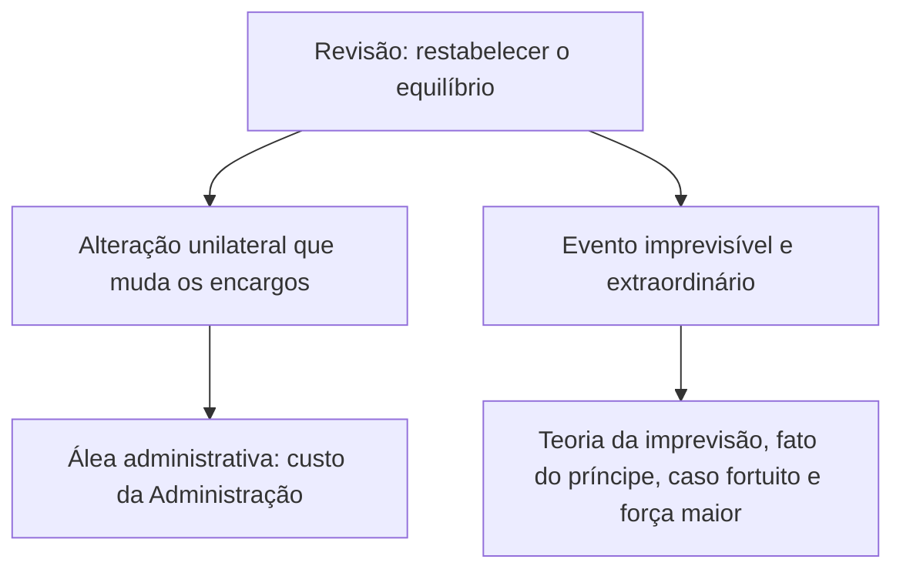

O capítulo anterior mostrou os mecanismos **previsíveis** de atualização do preço, o reajuste e a repactuação. Mas nem tudo o que abala um contrato público pode ser previsto num índice. Uma enchente histórica, o bloqueio de uma rodovia, um novo tributo, um atraso na liberação do terreno: nada disso tem índice. Para essas situações existe a **revisão**. Este capítulo mostra o que ela é, em que se diferencia do reajuste, qual o papel do fato do príncipe e como cada ajuste é formalizado.

> [!objetivos]
> - Definir revisão e distingui-la do reajuste e da repactuação.
> - Reconhecer a álea administrativa, o fato do príncipe e a teoria da imprevisão.
> - Diferenciar aditamento e apostila.
> - Aplicar as regras de repactuação do art. 135 e a vedação de revisões nas contratações integrada e semi-integrada.
> - Explicar o pedido de reequilíbrio após a extinção do contrato.

## O que é revisão

A Lei 14.133/2021 não define revisão, mas a doutrina a entende como a **alteração do contrato para restabelecer o equilíbrio econômico-financeiro** quando ele se rompe por duas razões:

1. uma **alteração unilateral** das cláusulas de execução que afeta a equação inicial;
2. **eventos imprevisíveis e extraordinários** que atingem a relação econômica do contrato.

O primeiro caso é simples. Se o órgão contratou 80 notebooks a 4 mil reais cada (total de 320 mil reais) e decide ampliar 25% da quantidade, o valor deve subir também em 25%. Se pedisse 100 notebooks pelo preço de 80, quebraria a balança. A alteração unilateral é risco da própria Administração e se chama **álea administrativa**: quem muda o contrato arca com o custo dessa mudança.

O segundo caso reúne fatos excepcionais, alheios à vontade das partes: eventos da natureza (enchente histórica), atos de terceiros (bloqueio de uma rodovia por manifestação), mudança de tributos, atraso na liberação do local da obra.

### Fatos que justificam a revisão

A doutrina agrupa os fatos que afetam o equilíbrio em três famílias, cuja base legal aparece no art. 124, II, "d", e no art. 134.

| Fato | Origem | Exemplo |
| --- | --- | --- |
| Fato do príncipe | Medida geral do poder público, que atinge o contrato de modo indireto | Criação de tributo depois da proposta |
| Fato da administração | Ato ou omissão da própria Administração contratante, que prejudica o contrato | Atraso na entrega do terreno da obra |
| Imprevisão (caso fortuito, força maior e fatos imprevisíveis) | Evento extraordinário, alheio às partes | Enchente histórica; bloqueio de rodovia |

O **fato do príncipe** merece atenção. Ele é uma decisão geral do Estado, tomada em outro papel que não o de contratante, e que onera o contrato por via reflexa. O exemplo mais conhecido é o tributo: o art. 134 determina que os preços sejam alterados, **para mais ou para menos**, se, depois da apresentação da proposta, houver criação, alteração ou extinção de tributos ou encargos legais, ou superveniência de disposições legais, com **repercussão comprovada** sobre os preços. Pelo art. 103, § 5º, II, esses tributos ficam fora da matriz de riscos.

> [!pegadinha] Tributo novo só aumenta o preço?
> Não. O art. 134 fala em alterar os preços "para mais ou para menos". Se um tributo for extinto ou reduzido depois da proposta, o preço pode diminuir. A banca costuma apresentar só o lado do aumento.

## Reajuste e revisão: as diferenças

O reajuste (em sentido estrito ou por repactuação) e a revisão têm o mesmo objetivo: manter o equilíbrio econômico-financeiro. Mas diferem em quase tudo.

| Aspecto | Reajuste (estrito e repactuação) | Revisão |
| --- | --- | --- |
| Previsibilidade | Previsível e periódico | Em regra imprevisível |
| Critério | Definido no próprio contrato | Não há como definir antes |
| Natureza | Não é alteração contratual | É alteração contratual |
| Formalização | Simples apostila | Termo aditivo |

> [!bizu] Apostila ou aditivo
> Se o ajuste estava previsto no contrato e é apenas cálculo (índice, convenção coletiva), vale a **apostila**. Se mudou algo do contrato ou o equilíbrio precisou ser refeito, é **aditivo**.

## Formalização: aditamento e apostila

As alterações do contrato são feitas por **termo aditivo**, que exige as mesmas formalidades do contrato: forma escrita (art. 91) e divulgação no Portal Nacional de Contratações Públicas, o PNCP, como condição de eficácia (art. 94). O contrato e os aditivos são públicos, salvo as hipóteses de sigilo admitidas em lei.

Os registros que **não são alteração** do contrato dispensam o aditivo e se fazem por simples **apostila** (art. 136):

1. variação do valor para aplicar reajuste ou repactuação previstos no contrato;
2. atualizações, compensações ou penalizações financeiras decorrentes das condições de pagamento (um pagamento atrasado, corrigido monetariamente, é exemplo);
3. mudança de razão ou denominação social do contratado;
4. empenho de dotações orçamentárias.

O termo aditivo é **condição para executar** o que a Administração determina no curso do contrato. Havendo necessidade justificada de antecipar os efeitos, o contratado cumpre a ordem e o aditivo é formalizado em até **um mês** (art. 132). Em regra, portanto, o aditivo é prévio; o mês é a exceção.

## Aprofundamento sobre a repactuação (art. 135)

Na repactuação, a data-base não é uma só. O preço é repactuado mediante **demonstração analítica** da variação dos custos, com data vinculada:

- à **proposta**, para os custos de mercado;
- ao **acordo, à convenção coletiva ou ao dissídio coletivo** a que a proposta esteja vinculada, para os custos de mão de obra.

Enquanto o reajuste em sentido estrito incide de modo linear por um índice, a repactuação depende de analisar cada componente da planilha de custos. O art. 135 fixa ainda as seguintes regras:

| Regra | Conteúdo |
| --- | --- |
| § 1º | A Administração não se vincula a cláusulas de acordos coletivos que tratem de matéria não trabalhista, de participação nos lucros do contratado ou de direitos não previstos em lei, como encargos obrigatórios e preços de insumos |
| § 2º | Também é vedado vincular-se a cláusulas que só se aplicam aos contratos com a Administração Pública |
| § 3º | Intervalo mínimo de **um ano** contado da proposta ou da última repactuação |
| § 4º | Pode ser dividida em parcelas, respeitada a anualidade, para custos com datas diferentes, como mão de obra e insumos |
| § 5º | Com várias categorias profissionais, pode ser dividida conforme cada acordo ou convenção |
| § 6º | Depende de solicitação do contratado, com planilha de custos ou com a nova convenção ou sentença normativa |

> [!atencao] Repactuação não é automática
> Ela só ocorre a pedido do contratado, instruído com a demonstração analítica. A Administração não repactua de ofício, e a simples assinatura de uma convenção coletiva não altera o preço sem esse procedimento.

## Contratação integrada e semi-integrada: revisões limitadas

Nesses regimes, o contratado assume quase tudo no empreendimento: na **integrada**, elabora até o projeto básico; na **semi-integrada**, o projeto básico é da Administração. Pense na construção de um complexo policial: em vez de contratar o projeto, a obra, o mobiliário e os sistemas de segurança em contratos separados, a Administração contrata um único responsável.

Como o contratado carrega os riscos associados à solução de projeto que escolheu, a lei **veda alterações de valor**, salvo nos casos do art. 133:

1. restabelecimento do equilíbrio por caso fortuito ou força maior;
2. alteração do projeto ou das especificações a pedido da Administração, sem erro ou omissão do contratado, dentro dos limites do art. 125;
3. alteração do projeto na semi-integrada, quando o contratado demonstra que sua solução é superior em custo, qualidade, prazo ou facilidade de manutenção, com prévia autorização e responsabilidade integral do contratado pelos riscos (art. 46, § 5º);
4. evento superveniente que a matriz de riscos atribuiu à Administração.

## Revisão depois da extinção do contrato

A extinção do contrato **não impede** o reconhecimento do desequilíbrio econômico-financeiro. Nesse caso, a indenização é concedida por **termo indenizatório** (art. 131). Se a empresa pediu a revisão e, enquanto o pedido era analisado, a obra foi concluída e recebida, a Administração ainda pode reconhecer o direito.

Há uma condição de tempo: o pedido de restabelecimento deve ser feito **durante a vigência do contrato e antes de eventual prorrogação** (art. 131, parágrafo único). Quem não pediu antes de prorrogar o contrato por mais cinco anos, por exemplo, perde a oportunidade de pleitear o desequilíbrio ocorrido no período anterior.

> [!resolvido] Questão comentada: tributo e vigilância
> Depois da apresentação da proposta, uma lei federal aumentou um tributo pago diretamente pela empresa de limpeza contratada por um batalhão. O contrato tem matriz de riscos que atribui ao contratado as variações de preço de insumos. A empresa pode pedir revisão?
>
> **Resolução.** Sim. A alteração de tributo por lei superveniente é fato do príncipe, e o art. 103, § 5º, II, a exclui da renúncia que a matriz impõe às partes. O art. 134 prevê a alteração do preço, desde que comprovada a repercussão sobre o contrato. A formalização é por termo aditivo, pois se trata de revisão, e não de reajuste.

## Como a banca cobra este assunto

A pegadinha clássica troca os institutos: apresenta como "reajuste" o que é repactuação, ou diz que a repactuação se faz por índice. Outra faz a revisão ser formalizada por apostila. Também aparecem alternativas que dizem que a extinção do contrato impede o reequilíbrio, ou que o pedido pode ser feito mesmo depois da prorrogação.

## Mapa do capítulo

| Tema | Ideia central | Armadilha |
| --- | --- | --- |
| Revisão | Alteração para restabelecer o equilíbrio | Confundir com reajuste |
| Álea administrativa | Risco da alteração unilateral é da Administração | Atribuir ao contratado |
| Fato do príncipe | Medida geral do Estado, como tributo novo | Dizer que só aumenta preço |
| Reajuste e repactuação | Previsíveis; apostila | Exigir aditivo |
| Revisão | Imprevisível; aditivo | Usar apostila |
| Repactuação | A pedido do contratado, com planilha; intervalo de um ano | Fazer de ofício |
| Integrada e semi-integrada | Alteração de valor só nos quatro casos do art. 133 | Admitir revisão ampla |
| Após a extinção | Termo indenizatório; pedido na vigência e antes da prorrogação | Dizer que a extinção impede o pedido |

### Para fixar

1. Revisão é a alteração que restabelece o equilíbrio por alteração unilateral ou por evento imprevisível e extraordinário.
2. A alteração unilateral é álea administrativa: o custo é da Administração.
3. O fato do príncipe é medida geral do poder público que onera o contrato, como a alteração de tributos.
4. O art. 134 admite alterar os preços para mais ou para menos conforme o tributo.
5. Reajuste e repactuação são previsíveis, constam do contrato e se registram por apostila.
6. A revisão é alteração contratual e se formaliza por termo aditivo.
7. O aditivo é condição para executar a ordem, podendo ser formalizado em até um mês nos casos de antecipação justificada.
8. A repactuação exige pedido do contratado, planilha de custos e intervalo mínimo de um ano.
9. Nas contratações integrada e semi-integrada, a alteração de valor é vedada, salvo nas quatro exceções do art. 133.
10. A extinção do contrato não impede o reequilíbrio, que se indeniza por termo indenizatório, mas o pedido deve ser feito na vigência e antes da prorrogação.
