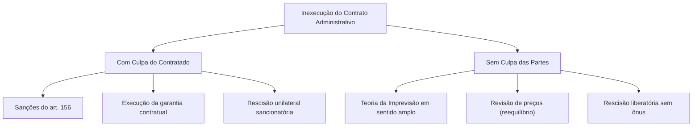
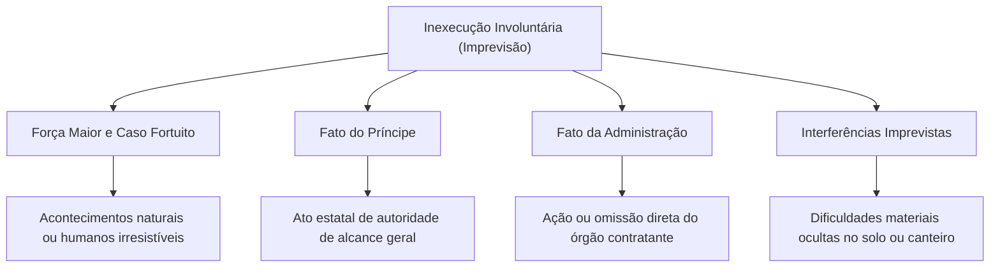
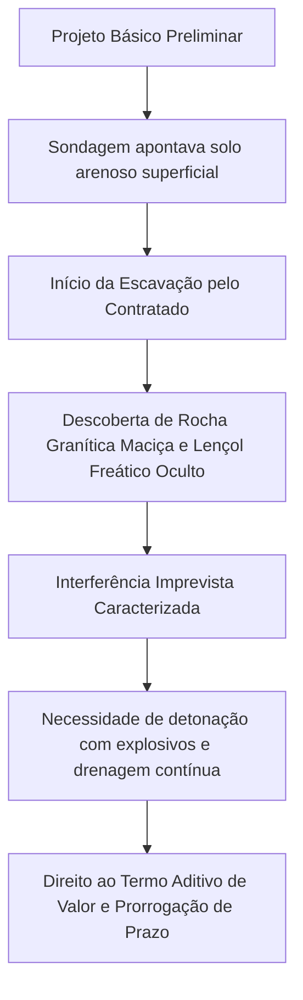

No regime dos contratos administrativos, o cumprimento tempestivo e integral das prestações pactuadas configura a regra jurídica fundamental. O contrato deve atingir a sua finalidade pública. Quando isso não ocorre, surge a inexecução contratual. A doutrina e a jurisprudência dividem essa inexecução em duas categorias: o inadimplemento com culpa e a inexecução sem culpa.

> [!objetivos]
> - Diferenciar a inexecução culposa da inexecução involuntária nos contratos administrativos regidos pela Lei nº 14.133/2021.
> - Compreender a distinção dogmática entre álea ordinária empresarial e álea extraordinária extracontratual à luz da cláusula *rebus sic stantibus*.
> - Identificar as quatro vertentes clássicas da imprevisão: eventos irresistíveis da natureza e humanos, atos soberanos de autoridade geral, condutas do órgão celebrante e obstáculos materiais de solo.
> - Conhecer as regras e vedações dos métodos adequados de resolução de controvérsias (arts. 151 a 154 da Lei nº 14.133/2021).

## Classificação da inexecução contratual

A inexecução contratual desdobra-se em duas vertentes jurídicas estruturantes. A diferenciação depende da existência de culpa do particular contratado.

1. **Inexecução com culpa (inadimplemento imputável):** ocorre quando a falha contratual advém de negligência, imprudência, imperícia, descumprimento injustificado de prazos ou má gestão societária da contratada. Nesses casos, o particular sujeita-se à imposição direta de penalidades administrativas previstas no art. 156 da Nova Lei de Licitações (advertência, multa moratória ou compensatória, impedimento de licitar e declaração de inidoneidade). Além disso, a Administração executa a garantia contratual e opera a extinção unilateral punitiva do vínculo, sem pagar indenização por lucros cessantes.
2. **Inexecução sem culpa (inadimplemento escusável ou involuntário):** ocorre quando acontecimentos externos, extraordinários, imprevisíveis ou inevitáveis, alheios ao controle e à vontade das partes celebrantes, inviabilizam a prestação. Nessas circunstâncias excepcionais, desconstitui-se qualquer imputação de culpa ao particular contratado. Abre-se caminho para o restabelecimento do equilíbrio econômico-financeiro da avença ou para a extinção consensual ou judicial sem penalidades.

A dogmática desse instituto ancora-se no confronto secular entre dois princípios. De um lado, a força vinculante estrita dos pactos (*pacta sunt servanda*). De outro lado, a manutenção do contexto original fático (*rebus sic stantibus*). No direito privado, prestigia-se a estabilidade estrita dos compromissos. No Direito Administrativo, a mutabilidade contratual é inerente ao regime de direito público. Essa prerrogativa atende à satisfação perene do interesse coletivo. Ela subordina-se à intangibilidade da equação econômico-financeira inicial (CF, art. 37, XXI).

## A cláusula rebus sic stantibus e a álea contratual

A equação econômico-financeira possui matriz constitucional expressa. Ela assegura que os encargos da empresa e a remuneração paga pelo Poder Público permaneçam equilibrados. Esse equilíbrio deve perdurar durante toda a vigência do contrato. Ao formular sua proposta, o licitante precifica custos com base no cenário econômico da época.

A quebra superveniente dessa equação decorre de riscos futuros. Na doutrina administrativista, essas incertezas dividem-se em duas categorias de álea.

| Modalidade de Álea | Conceito Operacional | Efeito Prático no Contrato | Repartição do Encargo |
|---|---|---|---|
| **Álea Ordinária (Empresarial)** | Riscos normais, corriqueiros e inerentes à exploração mercantil cotidiana (flutuações normais de mercado, inflação projetada nos índices editalícios, oscilações comuns de fretes e insumos). | Não enseja revisão tarifária ou repactuação de valor. O ajuste financeiro opera-se apenas por reajuste formal em sentido estrito pelos índices oficiais. | Suportada com exclusividade pela empresa contratada como custo do negócio. |
| **Álea Extraordinária (Extracontratual)** | Eventos futuros imprevistos e imprevisíveis, ou previsíveis de consequências incalculáveis, alheios à conduta das partes, que tornam a prestação excessivamente ruinosa. | Justifica a revisão imediata do contrato para restabelecer a equação financeira originária ou autoriza a rescisão consensual amigável. | Suportada pelo Poder Público mediante aditamento de valor e reequilíbrio econômico. |

> [!lei] Lei 14.133/2021, art. 124, II, d
> II - por acordo entre as partes: (...)
> d) para restabelecer o equilíbrio econômico-financeiro inicial do contrato em caso de força maior, caso fortuito ou fato do príncipe ou em decorrência de fatos imprevisíveis ou previsíveis de consequências incalculáveis, que inviabilizem a execução do contrato tal como pactuado, respeitada, em qualquer caso, a repartição objetiva de risco estabelecida no contrato.

> [!atencao]
> A Nova Lei de Licitações introduziu uma restrição fundamental ao deferimento da recomposição econômica: a observância compulsória da **matriz de alocação de riscos** (art. 103 da Lei nº 14.133/2021). Se o instrumento convocatório e o contrato estipularam previamente que determinado risco extraordinário (como oscilação de moeda estrangeira até certo patamar) correria por conta do licitante vencedor, essa cláusula contratual afasta o pedido de reequilíbrio, mantendo a obrigação com o contratado.

## Espécies da teoria da imprevisão em sentido amplo

A literatura jurídica especializada reconhece quatro vertentes tradicionais de inexecução escusável sem culpa: acontecimentos naturais ou humanos irresistíveis (força maior e caso fortuito), determinações gerais do poder soberano (fato do príncipe), condutas contratuais da própria entidade pública contratante (fato da administração) e obstáculos materiais ocultos no solo (sujeições imprevistas).

Cada uma dessas figuras ostenta pressupostos dogmáticos específicos, fontes de deflagração distintas e efeitos contratuais diferenciados sobre os prazos e a remuneração estipulada. Ao longo das próximas seções, examinaremos pontualmente os requisitos de cada instituto, a jurisprudência consolidada dos Tribunais Superiores e as hipóteses de incidência sob o prisma dos concursos públicos da segurança pública. 

É fundamental ressaltar que a teoria da imprevisão atua como contraponto harmonizador da supremacia do interesse público. Sem essa proteção contra desequilíbrios anormais, os licitantes seriam compelidos a majorar artificialmente seus preços para embutir contingências astronômicas, encarecendo desnecessariamente as compras públicas. Assim, a recomposição financeira justa estimula a concorrência ética e preserva a dignidade econômica dos contratados que cooperam com o Estado na consecução de suas obras e serviços essenciais.

O diagrama estruturado a seguir esquematiza as ramificações e os principais desdobramentos conceituais da imprevisão:

## Caso fortuito e força maior

O caso fortuito e a força maior identificam-se como acontecimentos imprevisíveis e inevitáveis, estranhos à conduta e à responsabilidade do particular e do ente estatal.

### Distinção dogmática e aplicação prática

Embora a legislação civil e a Lei nº 14.133/2021 confiram idênticas consequências práticas a ambos os conceitos, autores consagrados diferenciam sua causalidade física:

- **Força maior:** acontecimento irresistível e imprevisível derivado das **forças da natureza** (precipitações pluviométricas catastróficas, ressacas marítimas destruidoras, abalos sísmicos e vendavais anormais).
- **Caso fortuito:** acontecimento decorrente de **atos humanos imprevisíveis e inevitáveis** de terceiros (greve geral nos transportes rodoviários de carga, conflitos bélicos, tumultos civis generalizados ou bloqueios violentos de rodovias).

Nos contratos de obras, os Tribunais de Contas rejeitam alegações genéricas de chuva. Períodos chuvosos regulares caracterizam riscos normais da construção civil. Trata-se de álea ordinária suportada pelo particular. Para configurar força maior, exige-se índice pluviométrico absolutamente extraordinário. A impossibilidade física dos trabalhos deve ser comprovada por laudos meteorológicos oficiais.

### Efeitos no vínculo contratual

Verificada a força maior ou o caso fortuito:
- Se houver impedimento meramente temporário: prorroga-se o cronograma de entrega pelo período correspondente à paralisação, sem incidência de mora (art. 137, § 2º, V, da Lei nº 14.133/2021).
- Se houver perda material ou aumento imprevisto de custos operacionais: concede-se revisão financeira com suporte no art. 124, II, "d", da Lei nº 14.133/2021.
- Se a continuidade dos serviços tornar-se inviável em caráter definitivo: opera-se a dissolução contratual liberatória, restituindo-se a garantia depositada e ressarcindo-se o contratado pelos gastos regulares já efetuados.

> [!exemplo]
> Durante a execução de um quartel do Corpo de Bombeiros Militar de Pernambuco (CBMPE) na região metropolitana do Recife, uma cheia histórica do rio Capibaribe invadiu o canteiro de obras e subverteu as fundações recém-concluídas. Por se tratar de acontecimento irresistível e imprevisível da natureza, afasta-se qualquer penalidade por atraso. A empresa tem direito à prorrogação formal dos prazos executivos e ao ressarcimento das despesas documentadas para recompor a base danificada.

## Fato do príncipe

O fato do príncipe consiste em determinação estatal de alcance geral. O Poder Público edita o ato no exercício regular de sua soberania. A medida não tem como alvo direto o contrato administrativo. Todavia, ela onera de forma reflexa e imprevisível a execução do ajuste.

### Requisitos configuradores

Três elementos conjugados definem a configuração do fato do príncipe.
1. **Medida estatal genérica e abstrata:** o ato não emana da Administração enquanto parte contratante, mas do Estado soberano enquanto formulador de políticas gerais (criação de impostos, tabelamentos econômicos, fechamento de fronteiras alfandegárias ou restrições legais ao trânsito de certos materiais).
2. **Repercussão reflexa e indireta:** o ato normativo incide sobre o mercado de forma difusa, atingindo indistintamente os operadores do ramo, mas encarece consideravelmente os custos de execução daquele ajuste específico.
3. **Agravamento financeiro extraordinário:** o impacto tributário ou regulatório escapa à álea ordinária do empresário, desbalanceando a balança orçamentária do contrato.

### Disciplina tributária e o artigo 134 da Lei nº 14.133/2021

A Lei nº 14.133/2021 disciplina os efeitos de novos tributos. Os preços ajustados serão recalculados para majoração ou redução. Isso ocorre sempre que houver criação, alteração ou extinção de tributos supervenientes. Exige-se comprovação cabal do impacto na planilha de custos da contratação.

> [!pegadinha]
> **Tributos diretos não geram fato do príncipe:** o Superior Tribunal de Justiça (STJ) e o Tribunal de Contas da União (TCU) possuem entendimento sedimentado de que a majoração de tributos diretos incidentes sobre a renda ou o lucro empresarial (IRPJ e CSLL) constitui encargo ordinário da atividade econômica privada, não autorizando a revisão do contrato. Apenas os tributos indiretos e as contribuições que gravam diretamente o faturamento ou a circulação da mercadoria e do serviço (ICMS, ISS, IPI, PIS e Cofins) conferem direito ao reequilíbrio econômico-financeiro.

A tabela seguinte sistematiza o confronto direto entre fato do príncipe e fato da administração.

| Critério de Comparação | Fato do Príncipe | Fato da Administração |
|---|---|---|
| **Qualidade da Atuação Estatal** | O Estado atua como Poder Soberano no exercício de competências normativas, tributárias ou regulatórias gerais. | O Estado atua como Parte Contratante no interior da relação jurídica bilateral singular. |
| **Incidência sobre o Vínculo** | Repercussão indireta, reflexa e difusa no objeto contratado. | Repercussão direta, específica e imediata sobre o contrato em andamento. |
| **Exemplo Típico da Realidade** | Majoração imprevista da alíquota do ICMS incidente sobre peças mecânicas importadas de viaturas. | Omissão da Administração em expedir a ordem de início dos serviços ou em desapropriar o terreno da obra. |

## Fato da administração

O fato da administração decorre de ação ou omissão do próprio órgão contratante. Ocorre quando o ente público descumpre deveres contratuais específicos. Essa conduta retarda, onera ou impede a regular execução das obrigações pelo particular.

### Hipóteses comuns na administração pública

Configuram fato da administração diversas situações operacionais recorrentes.
- **Demora na desocupação ou desapropriação da área:** o ente público assina o contrato para construir um complexo operacional, mas não providencia a liberação desembaraçada do imóvel, impedindo a entrada de operários e máquinas.
- **Atraso prolongado na aprovação de estudos técnicos:** o fiscal da contratação retém por meses o exame dos projetos complementares entregues pela empresa, inviabilizando as concretagens programadas.
- **Inadimplemento no pagamento de faturas:** a Administração suspende os repasses financeiros regulares por período superior a 2 (dois) meses, ou impõe repetidas paralisações que superem 90 (noventa) dias, autorizando a empresa a suspender suas obrigações (art. 137, § 2º, inciso IV, da Lei nº 14.133/2021).
- **Alterações unilaterais sucessivas no projeto executivo:** ordens de serviço intempestivas que modificam a concepção básica da engenharia, gerando desmobilização e ociosidade de equipes.

### Prerrogativas protetivas do contratado

O fato da administração confere proteção jurídica expressa ao particular.
1. **Prorrogação de cronograma:** extensão automática dos prazos de conclusão sem cominação de penalidades de mora;
2. **Ressarcimento de perdas e danos:** pagamento das despesas comprovadas decorrentes da ociosidade de máquinas e trabalhadores mobilizados no canteiro;
3. **Suspensão dos trabalhos ou dissolução do vínculo:** faculdade de paralisar a prestação até a normalização dos pagamentos ou pleitear a dissolução contratual por culpa da Administração, com devolução das garantias e indenização das perdas sofridas (art. 138, § 2º, da Lei nº 14.133/2021).

> [!bizu]
> Fórmula mnemônica para a prova:
> - **Fato do Príncipe:** Estado como **Legislador Soberano** (lei ou imposto novo para toda a praça).
> - **Fato da Administração:** Estado como **Contratante Desidioso** (não entrega a área da obra, não paga faturas no prazo, atrasa laudos).

## Interferências imprevistas

As interferências imprevistas também são chamadas de sujeições imprevistas. Elas consistem em obstáculos materiais ocultos no terreno. São fatos preexistentes à conclusão da licitação. Porém, permanecem ignorados pelas partes durante a fase preliminar. O obstáculo surge de forma abrupta durante a execução prática da obra.

### Requisitos materiais e dogmáticos

A caracterização da sujeição imprevista requer a convergência de três fatores.
1. **Preexistência material do obstáculo:** a anomalia do terreno já existia fisicamente antes da licitação (enquanto o caso fortuito é sempre superveniente);
2. **Desconhecimento escusável:** a dificuldade não constava das sondagens preliminares do projeto básico da licitação e não podia ser identificada por diligência razoável dos licitantes em visita técnica;
3. **Onerosidade excessiva inevitável:** a superação do obstáculo físico exige alterações de métodos de engenharia, maquinário pesado especial ou reforços estruturais que extrapolam as previsões da planilha orçamentária.

O diagrama abaixo detalha a dinâmica das interferências imprevistas no solo:

### Exemplos na prática de engenharia pública

- **Maciços rochosos subterrâneos:** durante a terraplanagem para construir uma pista de treinamento operacional, descobre-se uma formação rochosa compacta a meio metro da superfície, exigindo perfuratrizes pneumáticas e detonações controladas;
- **Tubulações e redes subterrâneas clandestinas:** a retroescavadeira encontra dutos de combustível de alta pressão ou redes sanitárias antigas sem registro cadastral na prefeitura local;
- **Solo mole com presença de turfa:** o subsolo perde a capacidade portante em razão de camadas de turfa em profundidade, obrigando a substituição completa de sapatas comuns por estacas profundas de concreto armado.

Em todos esses cenários, a Administração Pública tem o dever de celebrar termo aditivo com suporte no art. 124, inciso II, alínea "d", da Lei nº 14.133/2021, readequando o orçamento e os prazos aos custos reais do enfrentamento.

## Meios alternativos de resolução de controvérsias

A Lei nº 14.133/2021 sistematizou os métodos adequados de resolução de disputas nos arts. 151 a 154. Historicamente, impasses sobre desequilíbrio financeiro resultavam em ações judiciais morosas. O litígio judicial paralisava obras essenciais por muitos anos.

Os contratos administrativos podem valer-se de métodos autocompositivos e heterocompositivos. O art. 151 da Lei nº 14.133/2021 autoriza a conciliação, a mediação, os comitês de resolução de disputas (*dispute boards*) e a arbitragem.

### Objeto e limites da arbitragem pública

A arbitragem não se aplica a qualquer controvérsia pública. A legislação impõe delimitação material estrita. Somente questões sobre **direitos patrimoniais disponíveis** podem ser submetidas a esses mecanismos.

Constituem exemplos expressos de direitos patrimoniais disponíveis:
- Pleitos de recomposição da equação econômico-financeira (revisões fundadas na teoria da imprevisão);
- Divergências sobre liquidação de parcelas financeiras decorrentes de inadimplemento;
- Arbitramento e cálculo de indenizações por perdas e danos oriundos de extinção contratual ou alterações unilaterais de escopo.

> [!jurisprudencia] STF e STJ: Arbitrabilidade patrimonial em contratos administrativos
> O Supremo Tribunal Federal e o Superior Tribunal de Justiça consagraram que a indisponibilidade do interesse público primário não obsta a arbitragem em matéria contratual patrimonial. O conteúdo econômico e os cálculos de ressarcimento possuem caráter patrimonial disponível, cabendo plenamente a via arbitral para solucionar impasses financeiros entre a empresa e o Estado.

### Regras imperativas da arbitragem na Lei nº 14.133/2021

A utilização da arbitragem perante a Administração Pública submete-se a quatro balizas vinculantes descritas nos arts. 152 a 154:

| Baliza Legal | Exigência da Lei nº 14.133/2021 | Finalidade e Proteção ao Interesse Público |
|---|---|---|
| **Arbitragem de Direito** | A decisão arbitral será fundamentada exclusivamente nas normas jurídicas vigentes (art. 152). Veda-se de forma expressa o julgamento por equidade. | Evita decisões subjetivas e garante a estrita observância da legalidade pública. |
| **Princípio da Publicidade** | O procedimento arbitral observará a ampla publicidade (art. 152, parágrafo único), assegurando transparência perante a sociedade civil e órgãos de controle externo. | Permite o controle social e a fiscalização pelos Tribunais de Contas e Ministério Público. |
| **Língua Nacional e Foro** | A arbitragem e as audiências devem ser conduzidas em língua portuguesa e sediadas no território brasileiro. | Preserva a soberania nacional e a igualdade processual no litígio. |
| **Comitês de Disputas** | Os comitês de prevenção (*dispute boards*) atuam durante a execução da obra, emitindo deliberações técnicas rápidas para prevenir a paralisação do canteiro. | Assegura a continuidade dos serviços essenciais e previne a degradação física das estruturas. |

> [!resolvido]
> **Caso prático para fixação de conceitos:**
> A sociedade empresária Alfa venceu concorrência promovida pelo Corpo de Bombeiros Militar para construir uma unidade de busca e resgate. Iniciadas as fundações, os trabalhadores depararam-se com uma linha de alta tensão subterrânea clandestina não cadastrada no projeto básico municipal. A realocação emergencial dos cabos elétricos provocou atraso de quarenta e cinco dias e onerou os custos de maquinário em quinze por cento. A autoridade militar rejeitou o pedido de reequilíbrio econômico-financeiro sob a alegação de que a empresa assumiu todo e qualquer risco construtivo ao assinar o contrato.
>
> **Solução comentada:**
> A negativa da autoridade administrativa é ilegal. O fato descrito enquadra-se no conceito de **interferências imprevistas** (sujeições imprevistas), consubstanciadas em obstáculo material fático oculto preexistente à contratação, mas ignorado escusavelmente pelas partes. Trata-se de hipótese legítima de álea extraordinária que atrai o art. 124, inciso II, alínea "d", da Lei nº 14.133/2021. O contratado faz jus à revisão contratual com recomposição das perdas e prorrogação temporal do cronograma. Caso subsista controvérsia sobre a quantificação do ressarcimento, as partes podem utilizar os meios alternativos de resolução de controvérsias (arts. 151 a 154), mediante mediação ou arbitragem de direito.

## Mapa do capítulo

A tabela a seguir compila as categorias centrais de inexecução sem culpa e os meios alternativos de controvérsia:

| Instituto | Causa Primária | Agente Causador | Consequência Típica | Amparo na Lei nº 14.133/2021 |
|---|---|---|---|---|
| **Força Maior** | Fenômenos imprevisíveis e irresistíveis da natureza física. | Natureza (chuvas históricas, ressacas marítimas) | Prorrogação do prazo executivo; reposição de perdas; rescisão liberatória. | Arts. 124, II, "d", e 137, § 2º |
| **Caso Fortuito** | Eventos humanos imprevisíveis e inevitáveis provocados por terceiros. | Terceiros da sociedade (greves gerais, insurreições civis) | Suspensão dos prazos de entrega ou rescisão sem imposição de penalidades. | Arts. 124, II, "d", e 137, § 2º |
| **Fato do Príncipe** | Determinação estatal imperativa e abstrata de alcance geral. | Estado atuando como Soberano regulador ou tributante | Alteração automática de preços em função de novos tributos ou leis. | Arts. 124, II, "d", e 134 |
| **Fato da Administração** | Ação ou omissão culposa singular do órgão contratante. | Estado atuando como Parte celebrante do ajuste | Prorrogação do cronograma; indenização por ociosidade; faculdade de rescindir. | Art. 137, § 2º, IV e V, e art. 138, § 2º |
| **Interferências Imprevistas** | Obstáculos materiais ocultos no solo, preexistentes à licitação. | Condições fáticas ignoradas no projeto preliminar | Celebração de aditivo financeiro e extensão do prazo de entrega da obra. | Art. 124, II, "d" |
| **Meios Alternativos** | Divergências patrimoniais sobre recomposição econômica e multas. | Partes em litígio no contrato administrativo | Solução autocompositiva ou arbitral rápida, sempre de direito e pública. | Arts. 151 a 154 |

### Para fixar

- A inexecução culposa gera imposição de sanções administrativas (art. 156), execução de garantias e rescisão punitiva unilateral; a inexecução sem culpa decorre da teoria da imprevisão e autoriza o reequilíbrio econômico ou a dissolução liberatória.
- A álea ordinária abrange os riscos empresariais normais suportados pelo particular contratado; a álea extraordinária envolve acontecimentos imprevisíveis e inevitáveis que justificam a recomposição da equação econômico-financeira (art. 124, II, "d").
- A Lei nº 14.133/2021 exige respeito compulsório à repartição objetiva de riscos estipulada na matriz contratual de riscos (art. 103) para a concessão de reequilíbrio financeiro.
- Força maior decorre de eventos da natureza irresistíveis (inundações sem precedentes); caso fortuito decorre de eventos humanos irresistíveis de terceiros (greve geral violenta).
- O fato do príncipe decorre de ato estatal de alcance geral que onera reflexamente o contrato; tributos indiretos (ICMS, ISS) geram reequilíbrio obrigatório (art. 134), ao passo que tributos diretos sobre o lucro (IRPJ, CSLL) não autorizam revisão de valores.
- O fato da administração consiste em atuação direta ou omissão desidiosa do órgão contratante singular (atraso na entrega do terreno ou inadimplência financeira superior a dois meses).
- As interferências imprevistas correspondem a obstáculos materiais ocultos preexistentes à licitação (rochas profundas, lençol freático, cabos subterrâneos) descobertos durante a execução da obra.
- Os meios alternativos de resolução de controvérsias (conciliação, mediação, *dispute boards* e arbitragem) aplicam-se exclusivamente a controvérsias patrimoniais disponíveis (art. 151).
- A arbitragem pública será sempre de direito, sendo vedado o julgamento por equidade, e observará o princípio constitucional da publicidade (art. 152).
