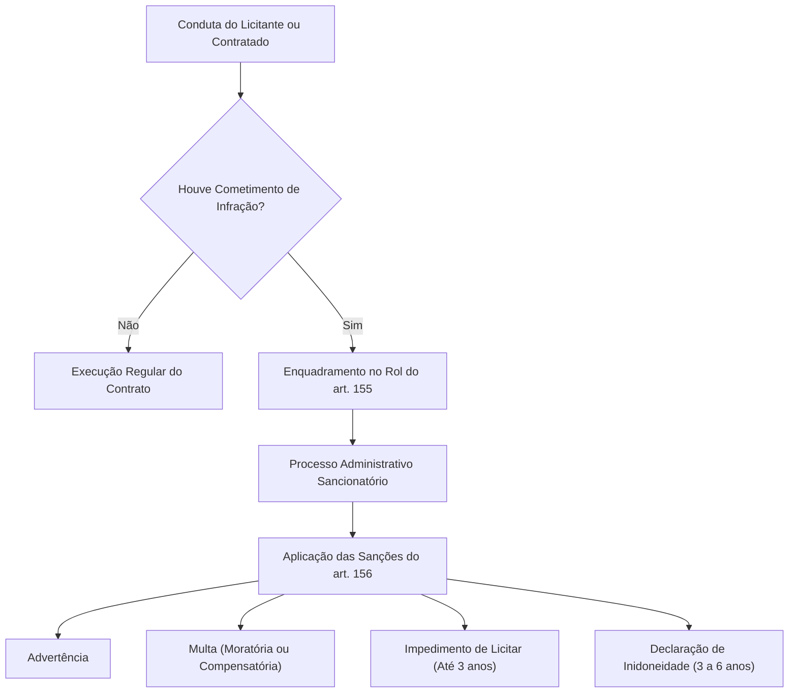
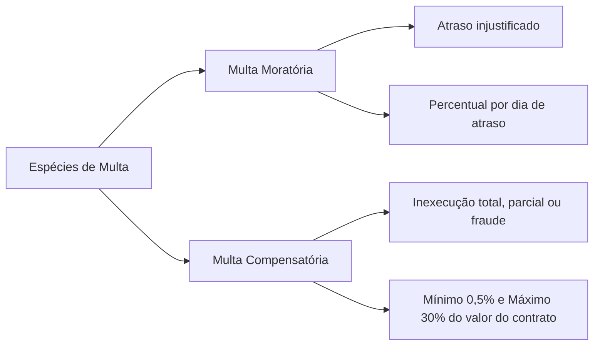
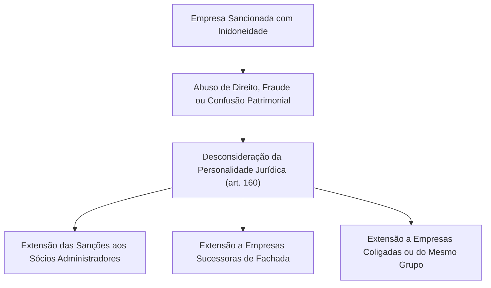

O poder sancionatório constitui uma das expressões mais enérgicas da supremacia do interesse público sobre o privado. Nas contratações públicas, a Administração dispõe de prerrogativas punitivas unilaterais para reprimir comportamentos ilícitos de licitantes e contratados. O regime disciplinar visa assegurar a probidade dos certames e garantir a execução fiel dos objetos pactuados. A Lei nº 14.133/2021 consolidou esse sistema em um catálogo moderno de infrações e sanções.

> [!objetivos]
> - Mapear as doze infrações administrativas tipificadas no art. 155 da Lei nº 14.133/2021.
> - Compreender a dosimetria e as hipóteses de cabimento das quatro sanções administrativas do art. 156.
> - Distinguir as espécies de multa: moratória por atraso injustificado e compensatória por inexecução.
> - Comparar os prazos, o alcance espacial e as competências decisórias do impedimento de licitar e da declaração de inidoneidade.
> - Identificar as regras de desconsideração da personalidade jurídica no art. 160 e a execução de penalidades pecuniárias no art. 162.

## O poder punitivo nas licitações e contratos

A incidência de penalidades nos contratos administrativos decorre diretamente do poder disciplinar do Estado. Ao celebrar um ajuste público ou participar de uma licitação, o particular submete-se a um vínculo jurídico de sujeição especial. Essa relação autoriza a imposição direta de penalidades administrativas pelo próprio Poder Público. 

O exercício desse poder punitivo não é arbitrário. Ele subordina-se estritamente aos princípios constitucionais da legalidade, do devido processo legal, do contraditório e da ampla defesa (CF, art. 5º, LV). Além disso, a Lei nº 14.133/2021 consagrou expressamente a observância dos princípios da razoabilidade, da proporcionalidade e da segurança jurídica na dosimetria das penas.

O fluxograma a seguir ilustra a estrutura básica do sistema sancionatório na Nova Lei de Licitações:

## Catálogo de infrações administrativas: artigo 155

O art. 155 da Lei nº 14.133/2021 prevê doze condutas reprováveis que configuram infração administrativa. O cometimento de qualquer delas enseja a responsabilização subjetiva do licitante ou do contratado. Para facilitar a compreensão didática, podemos agrupar essas doze infrações em quatro blocos temáticos:

| Bloco Temático | Incisos do Art. 155 | Descrição Resumida da Conduta Infracional |
|---|---|---|
| **Inadimplemento Contratual** | I, II e III | I: descumprimento parcial brando; II: inexecução parcial geradora de severo prejuízo à coletividade ou à rotina administrativa; III: inexecução total do ajuste celebrado. |
| **Descumprimento Procedimental do Certame** | IV, V e VI | IV: omissão na juntada de papéis e certidões editalícias; V: recusa em honrar os termos da oferta protocolada; VI: recusa injustificada em firmar o termo contratual ou retirar a ata no prazo. |
| **Retardamento da Execução** | VII | VII: procrastinação indevida do cronograma de obras ou da remessa de suprimentos sem justificativa idônea. |
| **Fraudes e Atos Corruptos Gravíssimos** | VIII, IX, X, XI e XII | VIII: uso de papéis inidôneos ou declarações inverídicas; IX: artifícios fraudulentos no certame ou no contrato; X: postura inidônea e ardilosa; XI: conluio e manobras para frustrar a concorrência; XII: atos lesivos tipificados na Lei Anticorrupção (Lei nº 12.846/2013). |

Esse agrupamento em blocos é crucial. A gravidade de cada bloco determina diretamente qual espécie de sanção poderá ser imposta pela autoridade competente.

## Espécies de sanções administrativas: artigo 156

O art. 156 da Nova Lei de Licitações estabelece quatro penalidades taxativas:
1. Advertência;
2. Multa;
3. Impedimento de licitar e contratar;
4. Declaração de inidoneidade para licitar ou contratar.

Examinemos as peculiaridades, limites temporais e condições de cabimento de cada sanção.

### Advertência

A advertência é a penalidade mais branda do regime disciplinar. Ela consiste em uma censura formal escrita direcionada ao infrator.

A advertência possui hipótese de incidência estrita na Lei nº 14.133/2021:
- Aplica-se exclusivamente à inexecução parcial leve (art. 155, inciso I).
- É cabível quando a irregularidade não trouxer dano relevante ao órgão, aos serviços essenciais ou à população.
- Exige que não se justifique a imposição de sanção mais grave (art. 156, § 2º).

A advertência não gera restrição direta ao direito de participar de futuras licitações. Entretanto, ela fica registrada no histórico cadastral do fornecedor. Esse registro desfavorável poderá ser sopesado como antecedente negativo em eventual infração futura.

### Multa: moratória versus compensatória

A multa é a única penalidade de caráter eminentemente financeiro prevista na lei. Ela possui duas características singulares de alta relevância:
1. É aplicável a qualquer das doze infrações previstas no art. 155 da lei.
2. É a única penalidade que pode ser cumulada com qualquer das outras três sanções (art. 156, § 7º). A Administração pode aplicar advertência cumulada com multa, impedimento cumulado com multa ou inidoneidade cumulada com multa.

O regime jurídico diferencia com nitidez a multa moratória da multa compensatória:

| Espécie de Multa | Fato Gerador Primário | Parâmetro e Base de Cálculo | Cumulação com Outras Medidas |
|---|---|---|---|
| **Multa Moratória (art. 162)** | Atraso injustificado no cumprimento das datas do cronograma físico ou na entrega final do objeto. | Cobrada por dia de atraso conforme percentual fixado no instrumento convocatório. | Não impede a rescisão unilateral do contrato se o atraso tornar a prestação inútil. |
| **Multa Compensatória (art. 156, § 3º)** | Inexecução parcial grave, inexecução total do contrato ou prática de fraudes do certame. | Balizada obrigatoriamente entre **0,5% e 30%** do valor do contrato licitado ou celebrado. | Indeniza perdas e danos e pode ser cumulada com rescisão unilateral e inidoneidade. |

> [!lei] Lei 14.133/2021, art. 156, §§ 3º e 7º
> § 3º A sanção prevista no inciso II do caput deste artigo, calculada na forma do edital ou do contrato, não poderá ser inferior a 0,5% (cinco décimos por cento) nem superior a 30% (trinta por cento) do valor do contrato licitado ou celebrado com contratação direta e será aplicada ao responsável por qualquer das infrações administrativas previstas no art. 155 desta Lei.
> (...)
> § 7º As sanções previstas nos incisos I, III e IV do caput deste artigo poderão ser aplicadas cumulativamente com a prevista no inciso II do caput deste artigo.

> [!pegadinha]
> **Pisos e tetos da multa compensatória:** a Lei nº 8.666/1993 não estipulava piso nem teto percentual para a multa compensatória geral. A Lei nº 14.133/2021 inovou ao criar balizas rígidas: a multa compensatória não pode ser inferior a 0,5% nem superior a 30% do valor contratual. O edital não pode estipular multa compensatória inferior a meio por cento nem superior a trinta por cento.

### Impedimento de licitar e contratar

O impedimento de licitar e contratar consubstancia sanção de gravidade intermediária. Essa penalidade impede temporariamente o particular de disputar novos certames e de firmar ajustes com o Poder Público.

Seus parâmetros operacionais fundamentais são os seguintes:
- **Infrações que ensejam a sanção:** condutas dos incisos II a VII do art. 155 (inexecução parcial com grave dano, inexecução total, não entrega de documentos da licitação, desistência injustificada da proposta, recusa em assinar o contrato e retardamento injustificado da execução).
- **Prazo de duração:** fixado pelo prazo máximo de **até 3 (três) anos** (art. 156, § 4º).
- **Âmbito de abrangência territorial:** restringe-se aos órgãos e entidades da esfera governamental punidora (União, Estado, Distrito Federal ou Município).

> [!atencao]
> Fique atento ao alcance espacial do impedimento. Uma empresa impedida de licitar pelo Estado de Pernambuco não pode contratar com os órgãos diretos e entidades indiretas do Estado de Pernambuco. Contudo, ela permanece plenamente apta a disputar certames realizados pela União, pelo Estado da Paraíba ou por Municípios pernambucanos. O impedimento vincula apenas o ente político que aplicou a pena.

### Declaração de inidoneidade para licitar ou contratar

A declaração de inidoneidade representa a sanção mais gravosa de todo o ordenamento jurídico das licitações públicas. Ela destina-se a punir condutas marcadas por dolo, má-fé, corrupção ou graves fraudes processuais.

Seus aspectos definidores estruturam-se da seguinte forma:
- **Infrações que ensejam a sanção:** incide compulsoriamente nas infrações dos incisos VIII a XII do art. 155 (apresentação de documentos falsos, fraudes à licitação ou ao contrato, comportamento inidôneo, frustração do certame e atos lesivos da Lei Anticorrupção). Também pode incidir sobre as condutas dos incisos II a VII quando a gravidade do caso justificar penalidade máxima.
- **Prazo de duração:** fixado pelo período de **3 (três) a 6 (seis) anos** (art. 156, § 5º).
- **Âmbito de abrangência territorial:** possui **alcance nacional pleno**. A empresa declarada inidônea fica impedida de licitar e contratar perante **todos os entes federativos** da Administração Pública direta e indireta do Brasil (União, todos os Estados, Distrito Federal e todos os Municípios).
- **Competência decisória privativa:** a declaração de inidoneidade é de competência exclusiva de Ministro de Estado, Secretário Estadual ou Secretário Municipal (art. 156, § 6º). Essa competência é indelegável a autoridades subalternas.

A tabela a seguir consolida o confronto definitivo entre impedimento e inidoneidade:

| Critério Jurídico | Impedimento de Licitar e Contratar | Declaração de Inidoneidade |
|---|---|---|
| **Fundamento Legal** | Art. 156, inciso III, e § 4º | Art. 156, inciso IV, e § 5º |
| **Infrações Típicas** | Art. 155, incisos II a VII (sem fraude gravíssima) | Art. 155, incisos VIII a XII (fraudes, falsidades e corrupção) |
| **Prazo Legal de Duração** | Até **3 (três) anos** (sem piso mínimo previsto) | De **3 (três) a 6 (seis) anos** (piso de 3 e teto de 6 anos) |
| **Abrangência Espacial** | Apenas no ente federativo aplicador (União, Estado, DF ou Município) | Todos os entes da Federação (União, Estados, DF e Municípios — alcance nacional) |
| **Autoridade Competente** | Autoridades administrativas designadas em regulamento próprio | Exclusiva de Ministro de Estado, Secretário Estadual ou Municipal |

> [!bizu]
> Memorize para gabaritar na prova:
> - **Impedimento:** prazo de **até 3 anos**; alcance apenas no **ente federativo sancionador**.
> - **Inidoneidade:** prazo de **3 a 6 anos**; alcance em **todo o território nacional** (todos os entes). Competência exclusiva do **Secretário ou Ministro**.

## Dosimetria e critérios de fixação das penalidades

A aplicação de sanções não se opera de forma mecânica ou automática. O art. 156, § 1º, da Lei nº 14.133/2021 estabelece os critérios legais obrigatórios de dosimetria que a comissão e a autoridade julgadora devem ponderar na motivação do ato sancionatório:

1. A natureza e a gravidade da infração cometida;
2. As peculiaridades do caso concreto enfrentado;
3. As circunstâncias agravantes (como reincidência específica e conduta dolosa) ou atenuantes (como confissão espontânea e tentativa imediata de mitigar o prejuízo);
4. Os danos reais que da infração provierem para a Administração Pública;
5. A implantação ou o aperfeiçoamento de programa de integridade (*compliance*), conforme normas e orientações dos órgãos de controle.

A existência de um programa de integridade efetivo atua como circunstância atenuante relevante na dosimetria da pena. Isso estimula as empresas contratadas pelo Estado a adotarem práticas preventivas contra a corrupção e desvios éticos. Em contratações de grande vulto (superiores a duzentos milhões de reais, na forma atualizada pelo Decreto nº 12.807/2025), a implantação de programa de integridade pelo licitante vencedor torna-se obrigatória no prazo de seis meses a contar da celebração do contrato (art. 25, § 4º). Caso a empresa já conte com código de conduta ativo, canais seguros de denúncia e auditorias periódicas, a autoridade sancionadora pode reduzir a sanção pecuniária ou modular o tempo de afastamento das licitações. Em contrapartida, a reincidência em fraudes documentais atua como circunstância agravante de peso, justificando a fixação da penalidade em patamares próximos ao teto legal.

## Desconsideração da personalidade jurídica: artigo 160

Na prática forense, era recorrente a criação de pessoas jurídicas de fachada para burlar as penalidades de impedimento ou inidoneidade. Os mesmos sócios de uma empresa punida abriam nova sociedade com outra denominação para disputar licitações no dia seguinte. 

Para aniquilar essa fraude, o art. 160 da Lei nº 14.133/2021 positivou a teoria da desconsideração da personalidade jurídica no âmbito das contratações públicas. A norma autoriza o afastamento do manto societário quando houver abuso de direito para dissimular ilícitos licitatórios ou promover confusão de patrimônios. Nesses casos, estendem-se as sanções de impedimento e inidoneidade aos administradores, sócios gestores, empresas sucessoras e pessoas jurídicas do mesmo grupo econômico.

### Requisitos e garantias do contraditório

A desconsideração exige a presença de dolo ou confusão patrimonial manifesta. Ela não pode decorrer de mera presunção. Além disso, a lei assegura formalmente aos sócios administradores e às empresas vinculadas o prévio exercício do contraditório e da ampla defesa antes da extensão dos efeitos punitivos.

> [!atencao] Contraditório antes da extensão
> Estender impedimento ou inidoneidade a sócios ou a empresas vinculadas exige demonstrar abuso de direito ou confusão patrimonial, com contraditório e ampla defesa prévios. Suspeita de fraude, sozinha, não basta.

O diagrama abaixo detalha a extensão dos efeitos da penalidade:

## Execução e cobrança das multas: artigo 162

A aplicação de multa administrativa enseja cobrança imediata pelo Poder Público. O art. 162 da Lei nº 14.133/2021 disciplina o rito sequencial de satisfação do crédito estatal decorrente de penalidades pecuniárias ou de indenizações devidas:

1. **Desconto direto dos pagamentos pendentes:** o valor da multa é retido e compensado imediatamente dos pagamentos devidos pela Administração ao contratado em faturas vigentes.
2. **Execução da garantia contratual:** inexistindo créditos a pagar ou sendo estes insuficientes, executa-se o montante faltante da garantia prestada no contrato (caução em dinheiro, seguro-garantia ou fiança bancária).
3. **Cobrança administrativa e judicial:** se o valor da garantia for insuficiente para liquidar a multa, o saldo remanescente será cobrado administrativamente no prazo assinalado pelo órgão. Persistindo o inadimplemento, o valor será inscrito em dívida ativa da Fazenda Pública e executado judicialmente pela Procuradoria competente por meio de Execução Fiscal.

> [!resolvido]
> **Questão prática de concurso:**
> A sociedade empresária Ômega venceu licitação para fornecimento de ambulâncias e viaturas de resgate para o Corpo de Bombeiros Militar. Durante a execução, constatou-se que a empresa falsificou os certificados de garantia dos equipamentos de salvamento importados, praticando fraude grave. A comissão processante recomendou a aplicação de declaração de inidoneidade pelo prazo de quatro anos cumulada com multa de vinte por cento do valor do contrato. O Diretor de Logística do órgão militar acolheu o relatório e assinou pessoalmente a portaria de declaração de inidoneidade.
>
> **Análise jurídica da conduta:**
> A tipificação da infração está perfeita. Apresentar documentação falsa e fraudar a execução contratual constituem infrações do art. 155, incisos VIII e IX, puníveis com inidoneidade de 3 a 6 anos (art. 156, § 5º) e multa compensatória entre 0,5% e 30% (art. 156, § 3º), perfeitamente cumuláveis (art. 156, § 7º). Contudo, o ato padece de vício de competência insanável. A declaração de inidoneidade é de competência privativa e indelegável de Ministro de Estado, Secretário Estadual ou Secretário Municipal (art. 156, § 6º). No âmbito estadual, somente o Secretário de Estado respectivo possui atribuição legal para assinar a penalidade de inidoneidade, sendo o ato praticado pelo Diretor de Logística nulo por usurpação de competência.

## Mapa do capítulo

A tabela a seguir sintetiza o regime disciplinar e sancionatório da Lei nº 14.133/2021:

| Sanção Administrativa | Hipótese Típica de Aplicação | Prazo Legal | Abrangência Espacial | Competência Julgadora | Cumulatividade |
|---|---|---|---|---|---|
| **Advertência** | Inexecução parcial leve sem grave dano (art. 155, I). | Imediata (registro cadastral) | Órgão ou entidade sancionadora | Autoridade prevista em regulamento | Pode cumular com multa |
| **Multa** | Todas as infrações (art. 155, I a XII). Mora ou compensação. | Pagamento em prazo fixado | Pecuniária (0,5% a 30% do contrato) | Autoridade competente para o contrato | Cumula com qualquer das outras três sanções |
| **Impedimento de Licitar** | Inexecução parcial com grave dano, inexecução total, atrasos (art. 155, II a VII). | Até **3 anos** | Apenas no ente federativo aplicador | Autoridade competente designada | Pode cumular com multa |
| **Declaração de Inidoneidade** | Falsidades, fraudes, atos lesivos e crimes licitatórios (art. 155, VIII a XII). | De **3 a 6 anos** | **Nacional** (todos os entes e esferas do Brasil) | Exclusiva de Ministro de Estado ou Secretário | Pode cumular com multa |

### Para fixar

- O poder disciplinar do Estado decorre da sujeição especial e exige observância do contraditório, da ampla defesa e da proporcionalidade.
- O art. 155 da Lei nº 14.133/2021 cataloga doze infrações distribuídas entre inexecuções, falhas procedimentais, atrasos injustificados e fraudes dolosas.
- A advertência aplica-se unicamente à inexecução parcial branda quando não houver dano expressivo e for desnecessária sanção mais enérgica.
- A multa pode incidir em qualquer infração e cumular-se com as demais sanções, variando a modalidade compensatória entre 0,5% e 30% do contrato (art. 156, § 3º).
- O impedimento de licitar alcança apenas o ente político sancionador pelo prazo máximo de até três anos (art. 156, § 4º).
- A declaração de inidoneidade possui eficácia em todo o território nacional, com duração de três a seis anos e competência exclusiva de Secretário ou Ministro de Estado.
- A dosimetria da sanção pondera gravidade, atenuantes, agravantes, danos públicos e eventual implantação de programa de integridade (*compliance*).
- A desconsideração da personalidade jurídica (art. 160) atinge sócios administradores e sucessoras em caso de fraude ou confusão patrimonial.
- A satisfação da multa (art. 162) segue ordem sucessiva: retenção em faturas devidas, execução da garantia e cobrança com inscrição em dívida ativa.
