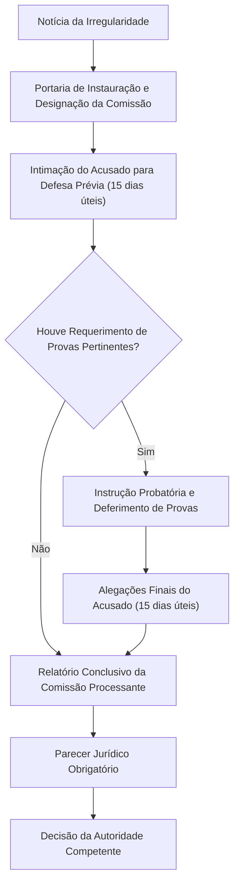
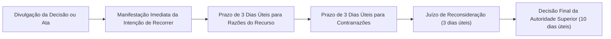
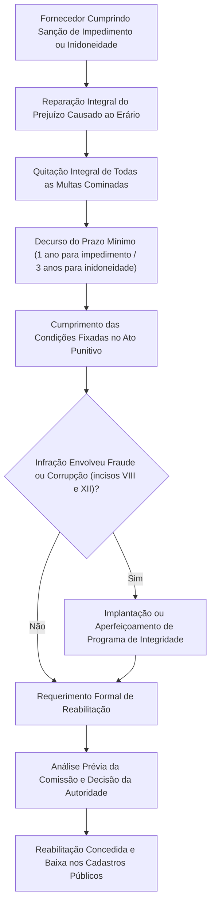

A punição de fornecedores no âmbito das compras governamentais não pode decorrer de arbítrio sumário. Toda penalidade administrativa pressupõe processo formal prévio, pautado pelo devido processo legal. A Lei nº 14.133/2021 estruturou um rito processual robusto nos arts. 157 a 168. Esse procedimento assegura o contraditório, disciplina a produção de provas, regula a impugnação de editais, padroniza os recursos e baliza a prescrição e a reabilitação das empresas punidas.

> [!objetivos]
> - Compreender o rito processual sancionatório e a comissão de no mínimo dois servidores estáveis (art. 158).
> - Analisar a disciplina da impugnação ao edital, pedidos de esclarecimento e recursos hierárquicos (arts. 164 e 165).
> - Dominar a sistemática da prescrição quinquenal punitiva contada da ciência da infração e suas causas interruptivas.
> - Conhecer as condições cumulativas para a reabilitação administrativa da empresa punida (art. 163).
> - Examinar a alimentação obrigatória do PNCP e dos cadastros federais CEIS e CNEP (art. 161).

## O devido processo legal sancionatório

Nenhuma sanção pode ser aplicada sem a prévia oportunidade de defesa do particular. O art. 157 e o art. 158 da Lei nº 14.133/2021 materializam as garantias constitucionais do art. 5º, incisos LIV e LV, da Constituição Federal. 

O procedimento varia conforme a gravidade da penalidade em perspectiva:
- Para a multa: o rito é simplificado, com prazo de defesa de 15 (quinze) dias úteis contado da intimação (art. 157). A lei não fixa prazo próprio para a advertência, mas a defesa prévia continua obrigatória por força da Constituição.
- Para sanções restritivas graves (impedimento de licitar ou declaração de inidoneidade): exige-se processo administrativo formal conduzido por comissão especial de servidores estáveis (art. 158).

O fluxograma a seguir esquematiza as fases fundamentais do processo sancionatório:

## Prazos de defesa e comissão processante

A Lei nº 14.133/2021 unificou o prazo de manifestação defensiva do interessado. Diferentemente do regime da Lei nº 8.666/1993, que fragmentava prazos em 5 e 10 dias úteis, o novo estatuto consagrou o prazo padrão de **15 (quinze) dias úteis**.

A tabela a seguir compara o tratamento defensivo segundo a natureza da punição cogitada:

| Sanção em Perspectiva | Prazo de Defesa Escrita | Órgão Condutor do Procedimento | Fase Instrutória de Provas |
|---|---|---|---|
| **Multa (art. 157)** | **15 dias úteis** contados da intimação oficial | Autoridade administrativa fiscalizadora ou gestora | Análise dos documentos apresentados com a defesa escrita inicial |
| **Impedimento ou Inidoneidade (art. 158)** | **15 dias úteis** contados da intimação formal | Comissão processante com 2 ou mais servidores estáveis | Ampla instrução com possibilidade de perícias, testemunhas e alegações finais |

> [!lei] Lei 14.133/2021, art. 157
> Art. 157. Na aplicação da sanção prevista no inciso II do caput do art. 156 desta Lei, será facultada a defesa do interessado no prazo de 15 (quinze) dias úteis, contado da data de sua intimação.

### Requisitos subjetivos da comissão processante

A condução do processo punitivo para as sanções de impedimento e de inidoneidade não pode ser atribuída a um único agente público isolado. O art. 158 da Lei nº 14.133/2021 impõe a obrigatoriedade de atuação colegiada.

A comissão processante deve atender aos seguintes requisitos legais de investidura:

| Esfera Governamental | Composição Obrigatória da Comissão | Requisito de Vínculo Funcional |
|---|---|---|
| **Administração Direta, Autárquica e Fundacional** | No mínimo **2 (dois) membros** | Servidores públicos com **estabilidade formal** comprovada |
| **Empresas Públicas e Sociedades de Economia Mista** | No mínimo **2 (dois) membros** | Empregados públicos pertencentes aos quadros permanentes |

> [!pegadinha]
> **Cuidado com cargos comissionados:** servidores temporários, terceirizados ou ocupantes exclusivamente de cargos em comissão **não podem** integrar a comissão processante sancionatória do art. 158. A estabilidade no serviço público ou a permanência no emprego estatal constitui exigência legal intransponível. A norma visa resguardar a imparcialidade das decisões punitivas contra pressões políticas indevidas.

## Instrução probatória e parecer jurídico obrigatório

Apresentada a defesa prévia no prazo de quinze dias úteis, o acusado pode requerer a produção de provas lícitas. Ele pode arrolar testemunhas, juntar laudos técnicos ou pedir vistorias periciais no canteiro de obras.

### Deferimento e indeferimento de provas

A comissão processante tem o dever de conduzir a instrução buscando a verdade material. Contudo, ela pode indeferir fundamentadamente os requerimentos de prova ilícitos, impertinentes, desnecessários ou manifestamente protelatórios (art. 158, § 2º).

Se a comissão deferir novas provas periciais ou testemunhais:
- A acusada será intimada para acompanhar todos os atos probatórios instrutórios.
- Encerrada a coleta probatória, abre-se novo prazo de **15 (quinze) dias úteis** para apresentação de alegações finais escritas.

### O papel da assessoria jurídica

Concluída a instrução, a comissão processante elabora relatório minucioso com a síntese dos fatos, as teses defensivas e a proposta motivada de punição ou arquivamento. 

Nos processos que visem à declaração de inidoneidade, o relatório da comissão é remetido compulsoriamente ao órgão de assessoramento jurídico da Administração (Procuradoria-Geral do Estado, da União ou do Município). A assessoria jurídica emite parecer técnico conclusivo sobre a legalidade do procedimento e a proporcionalidade da sanção antes do encaminhamento final ao Secretário ou Ministro de Estado (art. 158, § 1º).

## Impugnação ao edital e pedidos de esclarecimento

A higidez do certame licitatório depende do controle prévio das cláusulas do edital. Antes mesmo da abertura dos envelopes ou da disputa de lances, qualquer cidadão ou concorrente pode questionar exigências ilegais. O art. 164 da Lei nº 14.133/2021 disciplina esse direito republicano.

### Legitimidade e prazos do artigo 164

A legitimidade para impugnar edital ou formular pedidos de esclarecimento é universal:
- Todo cidadão ou entidade possui legitimidade ativa para contestar os termos do edital que contrariem os ditames legais.
- Qualquer pessoa pode solicitar esclarecimento sobre dúvidas nas cláusulas do instrumento convocatório.

Os prazos operam sob rigorosa contagem em dias úteis:

| Manifestação | Prazo Limite para Protocolo | Prazo da Administração para Resposta |
|---|---|---|
| **Impugnação ao Edital (art. 164)** | Até **3 (três) dias úteis** antes da abertura do certame | Até **3 (três) dias úteis**, devendo a resposta anteceder a data de início da sessão |
| **Pedido de Esclarecimento (art. 164)** | Até **3 (três) dias úteis** antes da abertura da sessão | Até **3 (três) dias úteis**, divulgado em sítio eletrônico oficial |

A resposta à impugnação ou ao pedido de esclarecimento deve ser disponibilizada publicamente em sítio eletrônico oficial para que todos os potenciais licitantes tenham acesso simultâneo às interpretações do órgão.

> [!atencao]
> A concessão de efeito suspensivo à impugnação não é automática. Em regra, a impugnação não impede a realização da sessão pública na data designada. Todavia, se a autoridade constatar risco iminente de nulidade insanável ou vício flagrante no edital, poderá suspender preventivamente o certame até a decisão definitiva da matéria.

## Recursos administrativos e juízo de reconsideração

O sistema recursal da Lei nº 14.133/2021 foi desenhado para harmonizar a ampla defesa com a celeridade procedimental dos certames públicos. Os arts. 165 a 168 estabelecem as hipóteses de cabimento, os prazos de tramitação e os efeitos das impugnações recursais.

### Hipóteses recursais e o prazo de três dias úteis

O recurso hierárquico é cabível contra os principais atos decisórios do procedimento licitatório:
- Ato que defere ou indefere pedido de pré-qualificação de interessado;
- Julgamento das propostas de preços e técnicas;
- Ato de habilitação ou inabilitação de concorrente;
- Anulação ou revogação da licitação pública;
- Extinção do contrato determinada por ato unilateral da Administração.

O prazo para interpor recurso contra esses atos é de **3 (três) dias úteis**, contados da data de intimação pessoal ou de divulgação formal da ata da sessão pública (art. 165, inciso I).

### Manifestação imediata e preclusão na sessão

Nas licitações processadas sob a modalidade pregão ou concorrência eletrônica, vigora a regra da **manifestação imediata da intenção de recorrer**. Ao término do julgamento ou da habilitação, a empresa inconformada deve declarar imediatamente na própria sessão pública sua intenção de interpor recurso.

Se o licitante não registrar imediatamente sua intenção com motivação sucinta:
- Opera-se a preclusão lógica e temporal do direito de recorrer.
- A autoridade adjudica o objeto licitado ao vencedor sem aguardar prazos recursais adicionais.

Havendo manifestação imediata aceita, abre-se o prazo legal de 3 (três) dias úteis para a juntada das razões recursais formais. Em seguida, os demais concorrentes são intimados para protocolar eventuais contrarrazões em igual prazo de 3 (três) dias úteis.

### Inversão de fases e fase recursal única

A Lei nº 14.133/2021 estabeleceu como padrão o julgamento de propostas antes da análise de habilitação (inversão de fases). Quando adotada essa modelagem, os recursos contra o julgamento de propostas e contra os atos de habilitação ou inabilitação serão apreciados em **fase recursal única** ao término do procedimento. Essa sistemática impede a paralisação do certame a cada fase intermediária, conferindo agilidade à contratação.

### Recursos contra sanções administrativas

Quando a decisão atacar a imposição de penalidades disciplinares, aplicam-se regras especiais de prazo e competência:
- Contra as sanções de **advertência, multa ou impedimento de licitar**: cabe recurso hierárquico no prazo de **15 (quinze) dias úteis** contados da intimação oficial (art. 165, § 1º, I).
- Contra a **declaração de inidoneidade**: cabe **pedido de reconsideração** à própria autoridade ministerial ou secretarial prolatora da decisão, no prazo de **15 (quinze) dias úteis** (art. 165, § 1º, II).

### Juízo de retratação e decisão superior

O recurso administrativo será dirigido à própria autoridade que proferiu a decisão recorrida. Essa autoridade dispõe de **3 (três) dias úteis** para exercer o juízo de retratação:
- Se reconsiderar sua decisão: o ato viciado é reformado diretamente, dando-se ciência aos interessados.
- Se mantiver a decisão atacada: encaminhará os autos recursais acompanhados de sua justificativa fundamentada à autoridade superior competente, que deverá proferir decisão final no prazo de **10 (dez) dias úteis** (art. 166).

## Prescrição da pretensão punitiva: artigo 158, § 4º

Um dos avanços mais salutares da Lei nº 14.133/2021 residiu na positivação do regime de prescrição da pretensão punitiva no art. 158, § 4º. Na vigência da legislação anterior, havia fundada celeuma jurisprudencial sobre o prazo prescricional para punir fornecedores em contratos estaduais e municipais.

### Prazo e termo inicial

A pretensão punitiva da Administração prescreverá no prazo de **5 (cinco) anos**. Esse prazo é contado da **ciência inequívoca da infração pelo órgão público**.

Não se conta o prazo do dia em que a fraude ocorreu na calada da noite, mas do dia em que o ente público tomou conhecimento inequívoco do fato (por relatório de fiscalização, denúncia autuada ou auditoria interna).

O cronograma a seguir ilustra a contagem da prescrição:

### Causas de interrupção e suspensão da prescrição

O curso do prazo quinquenal não corre de modo inexorável. A lei elenca causas formais que afetam a fluência da prescrição:

| Categoria | Causa Legal Concreta | Efeito Prático no Prazo Quinquenal |
|---|---|---|
| **Interrupção** | Instauração formal do processo de responsabilização | O prazo de 5 anos é zerado e recomeça a correr por inteiro a partir do ato inaugural. |
| **Interrupção** | Julgamento do processo administrativo sancionatório | O prazo zera novamente a partir da prolação da decisão punitiva pela autoridade. |
| **Interrupção** | Atos inequívocos de apuração dos fatos | Despachos decisórios de auditoria ou perícia que demonstrem atividade investigativa concreta reiniciam a contagem. |
| **Suspensão** | Celebração de acordo de leniência (Lei nº 12.846/2013) | O prazo para de correr enquanto vigorar o acordo de leniência, voltando a fluir de onde parou em caso de descumprimento. |

> [!atencao]
> Distinga interrupção de suspensão:
> - Na **interrupção**, o prazo volta a correr do **zero** (reinicia a contagem dos cinco anos).
> - Na **suspensão**, o tempo já decorrido é aproveitado, pausando-se o relógio durante a pendência do acordo de leniência.

## Reabilitação do contratado: requisitos e programa de integridade

A declaração de inidoneidade e o impedimento de licitar não constituem penas perpétuas. O art. 5º, inciso XLVII, "b", da Constituição Federal veda expressamente penalidades de caráter perpétuo no ordenamento brasileiro. Atendendo a essa diretriz, o art. 163 da Lei nº 14.133/2021 estabelece o instituto da reabilitação administrativa.

A reabilitação é concedida pela própria autoridade pública que aplicou a sanção, extinguindo os efeitos impeditivos residuais da punição.

### Requisitos cumulativos de reabilitação

Para obter a reabilitação, o interessado deve comprovar cumulativamente o preenchimento de todas as exigências legais postas no art. 163:

| Requisito Legal | Conteúdo do Requisito no Art. 163 | Justificativa de Proteção Pública |
|---|---|---|
| **1. Reparação do Dano** | Reparação integral do dano causado à Administração Pública. | Não há reabilitação com prejuízo financeiro pendente suportado pelo erário. |
| **2. Pagamento de Multas** | Quitação plena de todas as multas administrativas aplicadas no caso. | Satisfação integral do crédito estatal decorrente da condenação pecuniária. |
| **3. Prazo Mínimo** | Transcurso de **1 ano** da aplicação do impedimento, ou de **3 anos** da inidoneidade. | Assegura que o infrator cumpra parcela relevante da penalidade pedagógica. |
| **4. Condições do Ato** | Cumprimento de outras condições e exigências impostas no ato punitivo. | Atendimento a exigências operacionais ou sanatórias específicas fixadas pela autoridade. |
| **5. Programa de Integridade** | Implantação de *compliance* efetivo quando a infração envolveu fraude ou corrupção. | Garantia de que a empresa adotou mecanismos internos para prevenir novos ilícitos. |

> [!bizu]
> Prazos mínimos para pleitear a reabilitação:
> - **Impedimento:** decorrido **1 (um) ano** da aplicação da pena.
> - **Declaração de inidoneidade:** decorridos **3 (três) anos** da aplicação da pena.
> Note a coerência da lei: como a inidoneidade dura de 3 a 6 anos, a reabilitação só pode ser solicitada após cumprido o piso de 3 anos.

## Cadastro de sanções: CEIS, CNEP e integração ao PNCP

Para que as sanções produzam eficácia real e impeçam contratações fraudulentas por outros órgãos públicos, a Lei nº 14.133/2021 instituiu um sistema de transparência nacional unificado.

O art. 161 determina que os órgãos e entidades de todos os Poderes e esferas federativas devem registrar tempestivamente os dados sancionatórios nos sistemas integrados. O prazo legal para alimentar os cadastros é de **15 (quinze) dias úteis**, contados da data em que a sanção foi cominada.

A tabela a seguir apresenta os bancos de dados oficiais do controle de sanções:

| Cadastro Oficial | Órgão Gestor Central | Natureza das Informações Registradas | Integração Obrigatória |
|---|---|---|---|
| **PNCP (art. 174)** | Comitê Gestor do PNCP | Registro público centralizado de todas as sanções licitatórias do Brasil. | Divulgação obrigatória de advertências, multas, impedimentos e inidoneidades. |
| **CEIS (art. 161)** | Controladoria-Geral da União (CGU) | Cadastro Nacional de Empresas Inidôneas e Suspensas da Administração Pública. | Alimentado compulsoriamente pelos entes estaduais, distritais e municipais. |
| **CNEP (art. 161)** | Controladoria-Geral da União (CGU) | Cadastro Nacional de Empresas Punidas com suporte na Lei Anticorrupção (Lei nº 12.846/2013). | Registra sanções pecuniárias e declarações de inidoneidade decorrentes de atos lesivos. |

A consulta prévia ao PNCP, ao CEIS e ao CNEP constitui etapa instrutória obrigatória na fase de habilitação de qualquer licitação pública no Brasil. A comissão de contratação deve certificar se o licitante classificado em primeiro lugar não padece de restrição de direito ativa que o impeça de celebrar o contrato almejado.

> [!resolvido]
> **Questão prática de prova:**
> A sociedade empresária Delta foi punida pelo Estado de Pernambuco com declaração de inidoneidade para licitar e contratar pelo prazo de cinco anos em virtude de conluio fraudulento. Dois anos após a publicação da penalidade, a Delta ressarciu integralmente o erário pelos prejuízos causados e quitou todas as multas cominadas. Em seguida, formulou requerimento de reabilitação perante o Secretário de Estado, alegando que já reparou os danos e pagou as multas devidas.
>
> **Solução jurídica comentada:**
> O pedido de reabilitação deve ser liminarmente indeferido. Embora a Delta tenha ressarcido o dano e pago as multas, ela não cumpriu dois requisitos cumulativos indispensáveis previstos no art. 163 da Lei nº 14.133/2021:
> 1. Não decorreu o **prazo mínimo de 3 (três) anos** exigido expressamente para a reabilitação de inidoneidade (art. 163, parágrafo único, inciso II). Passaram-se apenas dois anos da condenação.
> 2. Por se tratar de infração gravíssima de fraude e conluio (art. 155, incisos VIII e IX), a lei impõe como condição obrigatória cumulativa a **implantação ou o aperfeiçoamento de programa de integridade** (*compliance*), o qual sequer foi comprovado pela peticionária.

## Mapa do capítulo

A tabela a seguir sintetiza o procedimento sancionatório, impugnações e recursos:

| Etapa do Procedimento | Regra Legal Específica | Dispositivo na Lei nº 14.133/2021 |
|---|---|---|
| **Defesa Prévia** | Prazo de **15 dias úteis** contados da intimação, na multa e nas sanções de impedimento e inidoneidade. | Arts. 157 e 158 |
| **Comissão Processante** | Obrigatória para impedimento e inidoneidade: mínimo de **2 servidores estáveis** ou empregados permanentes. | Art. 158, caput |
| **Instrução e Provas** | Indeferimento motivado de provas protelatórias; alegações finais em **15 dias úteis**. | Art. 158, § 2º |
| **Parecer Jurídico** | Obrigatório antes da decisão final em processos de declaração de inidoneidade. | Art. 158, § 1º |
| **Impugnação ao Edital** | Até **3 dias úteis** antes da abertura; resposta em até **3 dias úteis** antes da sessão. | Art. 164 |
| **Recursos Licitatórios** | Prazo de **3 dias úteis** com manifestação imediata da intenção de recorrer em sessão. | Art. 165, I |
| **Prescrição da Pretensão** | **5 anos** da ciência da infração; interrompe-se com a instauração e o julgamento. | Art. 158, § 4º |
| **Reabilitação: Prazos** | Requerimento após **1 ano** (impedimento) ou **3 anos** (inidoneidade). | Art. 163, parágrafo único |
| **Alimentação dos Cadastros** | Prazo de **15 dias úteis** para inclusão da sanção no PNCP, CEIS e CNEP. | Art. 161 |

### Para fixar

- O processo administrativo sancionatório materializa o devido processo legal com contraditório pleno e ampla defesa antes de penalidades.
- O prazo para apresentação de defesa prévia escrita foi unificado em quinze dias úteis para todas as quatro modalidades de sanção da lei.
- As sanções de impedimento de licitar e declaração de inidoneidade exigem condução por comissão de no mínimo dois servidores estáveis.
- A assessoria jurídica emite parecer técnico compulsório sobre o relatório da comissão antes da deliberação sobre inidoneidade.
- A impugnação ao edital e os pedidos de esclarecimento devem ser protocolados até três dias úteis antes da abertura da sessão pública (art. 164).
- Os recursos contra julgamento e habilitação possuem prazo de três dias úteis e exigem manifestação imediata da intenção de recorrer sob pena de preclusão.
- A pretensão punitiva prescreve em cinco anos contados da ciência inequívoca da infração pela Administração Pública (art. 158, § 4º).
- A reabilitação exige o preenchimento cumulativo de reparação integral do dano, quitação de multas e cumprimento do prazo mínimo de afastamento.
- O prazo temporal mínimo para requerer reabilitação é de um ano para impedimento de licitar e de três anos para declaração de inidoneidade.
- Os órgãos públicos devem registrar as sanções cominadas no PNCP, no CEIS e no CNEP no prazo máximo de quinze dias úteis a contar de sua aplicação.
