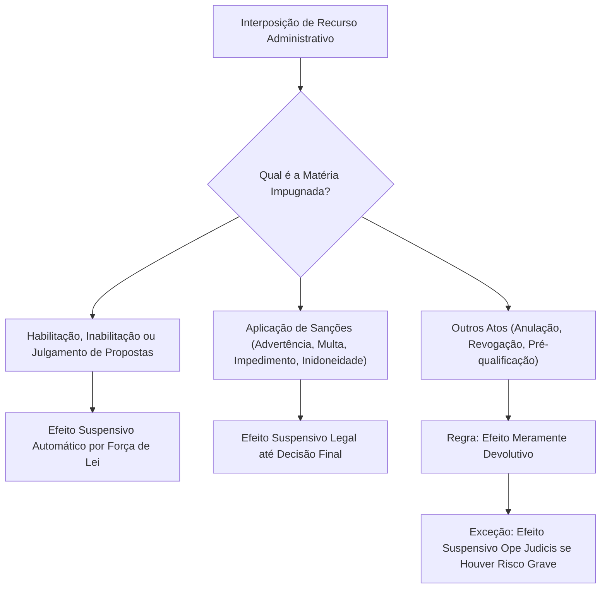
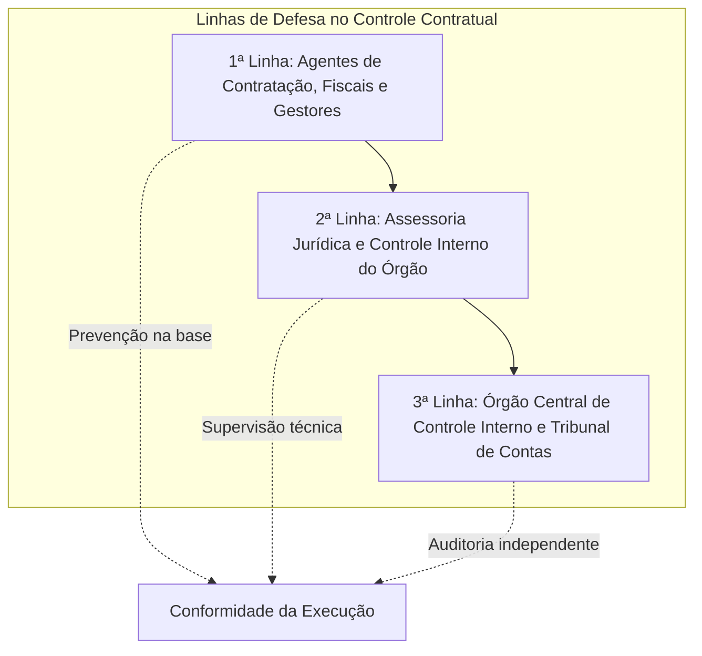
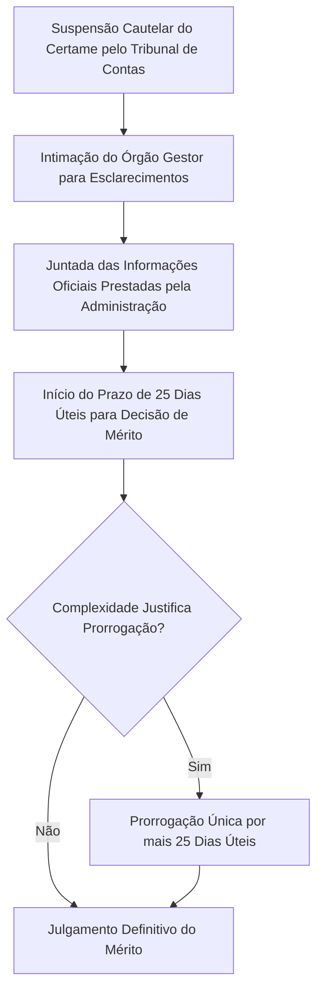

O encerramento do ciclo das contratações públicas demanda instrumentos seguros de impugnação, controle e governança. Para evitar arbitrariedades e assegurar a economicidade dos gastos estatais, o legislador estruturou o regime de efeitos recursais e desenhou um modelo moderno de gestão de riscos. A Lei nº 14.133/2021 inovou ao adotar o modelo internacional das três linhas de defesa, disciplinar a intervenção cautelar dos Tribunais de Contas e instituir o Portal Nacional de Contratações Públicas (PNCP).

> [!objetivos]
> - Compreender a disciplina do efeito suspensivo nos recursos e pedidos de reconsideração (art. 168).
> - Analisar o modelo das três linhas de defesa no controle das compras governamentais (art. 169).
> - Conhecer as regras e o prazo de 25 dias úteis na suspensão cautelar por Tribunais de Contas (art. 171).
> - Identificar a arquitetura e as ferramentas do Portal Nacional de Contratações Públicas (arts. 174 e 175).
> - Compreender as regras diferenciadas de transição para municípios com até vinte mil habitantes (art. 176).

## Efeito suspensivo dos recursos: artigo 168

A interposição de recursos administrativos pode paralisar ou não a eficácia do ato impugnado. O art. 168 da Lei nº 14.133/2021 estabeleceu uma divisão técnica precisa quanto à atribuição do efeito suspensivo.

O diagrama a seguir sintetiza a sistemática legal dos efeitos recursais:

### Regra geral e hipóteses com efeito suspensivo automático

A disciplina legal dos efeitos recursais organiza-se em três planos fundamentais:
1. **Fase de seleção do licitante (habilitação e propostas):** o recurso contra o julgamento de propostas e contra o ato de habilitação ou inabilitação tem **efeito suspensivo automático** (*ope legis*), conforme o caput do art. 168. O certame não avança para as fases seguintes até que as razões e contrarrazões sejam devidamente julgadas pela autoridade superior.
2. **Processo sancionatório punitivo:** o recurso contra aplicação de sanções administrativas (advertência, multa e impedimento) ou o pedido de reconsideração contra declaração de inidoneidade terá **efeito suspensivo obrigatório** até que sobrevenha a decisão final da autoridade competente (art. 168, parágrafo único). Nenhuma penalidade pecuniária é executada e nenhum impedimento cadastral é ativado antes da preclusão administrativa.
3. **Demais atos administrativos da contratação:** nos recursos contra anulação, revogação ou indeferimento de pré-qualificação, a regra geral é o **efeito meramente devolutivo**. Todavia, a autoridade competente pode conceder efeito suspensivo excepcional de forma motivada quando constatada a plausibilidade do direito e o perigo de dano irreparável.

A tabela a seguir consolida o regime de efeitos recursais:

| Ato Objeto do Recurso | Efeito Recursal Típico | Dispositivo Legal | Justificativa de Política Pública |
|---|---|---|---|
| **Julgamento de Propostas** | **Suspensivo Automático** | Art. 168, caput | Impede adjudicação precipitada a proposta inválida ou com sobrepreço. |
| **Habilitação ou Inabilitação** | **Suspensivo Automático** | Art. 168, caput | Garante isonomia e evita desclassificação indevida de competidores aptos. |
| **Sanções do Art. 156** | **Suspensivo Obrigatório** | Art. 168, parágrafo único | Resguarda o particular contra cobranças e restrições antes do julgamento final. |
| **Anulação ou Revogação** | **Devolutivo** (regra geral) | Art. 168, caput | Prestigia o juízo de conveniência e legalidade da autoridade administrativa. |

> [!pegadinha]
> **Efeito suspensivo em sanções pecuniárias:** na Lei nº 8.666/1993, os recursos contra multas não possuíam efeito suspensivo automático. A Lei nº 14.133/2021 alterou essa sistemática no parágrafo único do art. 168: os recursos contra quaisquer sanções administrativas do art. 156 (inclusive multa pecuniária) possuem efeito suspensivo garantido até a decisão final da instância julgadora.

## O modelo das três linhas de defesa: artigo 169

A Nova Lei de Licitações incorporou a melhor metodologia internacional de governança pública recomendada pelo Instituto dos Auditores Internos (*The Institute of Internal Auditors — IIA*). O art. 169 determina que as contratações públicas submetem-se a práticas contínuas de gestão de riscos e controle preventivo estruturadas em **três linhas de defesa**.

O modelo abandona o controle repressivo tardio e privilegia a conformidade procedimental concomitante à realização da despesa pública.

### Composição e responsabilidades de cada linha

Cada linha de defesa atua em uma camada de proteção progressiva:

| Linha de Defesa | Agentes e Unidades Integrantes | Foco Primário de Atuação |
|---|---|---|
| **1ª Linha de Defesa** | Servidores e empregados públicos que atuam na governança, agentes de contratação, comissão de contratação e fiscais/gestores de contratos. | Identificação precoce de riscos, verificação da conformidade documental, fiscalização diária do canteiro de obras e atesto dos serviços prestados. |
| **2ª Linha de Defesa** | Unidades setoriais de assessoramento jurídico (procuradorias) e unidades de controle interno do próprio órgão ou entidade contratante. | Emissão de pareceres jurídicos conclusivos, padronização de minutas de editais, orientação preventiva da gestão e monitoramento da conformidade legal. |
| **3ª Linha de Defesa** | Órgão central de controle interno da Administração (Controladorias-Gerais) e o respectivo Tribunal de Contas (controle externo). | Auditorias independentes de conformidade e operacional, avaliação de eficácia das políticas públicas, apuração de denúncias e responsabilização. |

> [!lei] Lei 14.133/2021, art. 169, § 3º, I
> § 3º Os integrantes das linhas de defesa a que se referem os incisos I, II e III do caput deste artigo observarão o seguinte:
> I - quando constatarem simples impropriedade formal, adotarão medidas para o seu saneamento e para a mitigação de riscos de sua nova ocorrência, preferencialmente com o aperfeiçoamento dos controles preventivos e com a capacitação dos agentes públicos responsáveis;

O inciso I do § 3º do art. 169 privilegia o saneamento. Diante de mera impropriedade formal, sem dano ao erário, os integrantes das linhas de defesa corrigem a falha e reforçam os controles preventivos, em vez de partir para a anulação do procedimento. Se a irregularidade configurar dano à Administração, vale o inciso II: apuração das infrações, com segregação de funções e individualização das condutas, e remessa de cópias ao Ministério Público.

## Acesso a informações, sigilo e representações

O art. 170 da Lei nº 14.133/2021 reforça o controle social das compras governamentais. Qualquer pessoa física ou jurídica possui legitimidade ativa para provocar a atuação fiscalizatória estatal. O cidadão ou licitante pode representar perante o controle interno ou o Tribunal de Contas competente contra desvios éticos ou irregularidades na aplicação do estatuto licitatório.

A representação cidadã prescinde de formalidades solenes excessivas, bastando a indicação fundamentada do ato suspeito e dos elementos mínimos de autoria. Para viabilizar a fiscalização, os órgãos de controle externo e interno detêm prerrogativa de acesso irrestrito a documentos, processos e sistemas eletrônicos da contratação.

Esse dever de franquear informações abrange também os dados gravados com restrição de publicidade:
- O acesso a informações classificadas como sigilosas não pode ser sonegado aos auditores do controle externo no desempenho de suas inspeções.
- Em contrapartida, o auditor ou servidor que tiver contato com esses papéis sigilosos torna-se pessoal e administrativamente corresponsável pela guarda do segredo funcional (art. 170, § 3º). Dessa forma, concilia-se a integridade da fiscalização pública com a proteção aos segredos industriais e de segurança estatal.

## Suspensão cautelar pelos Tribunais de Contas: artigo 171

Os Tribunais de Contas desempenham papel de destaque no controle externo dos certames licitatórios. No exercício de sua competência constitucional (CF, art. 71), as Cortes de Contas podem expedir medidas cautelares para suspender editais com suspeita de sobrepreço ou direcionamento.

Todavia, paralisações cautelares sem prazo definido geravam graves prejuízos sociais pela interrupção de obras de escolas, postos de bombeiros e hospitais. Para coibir esse vácuo temporal, o art. 171 da Lei nº 14.133/2021 fixou prazos rígidos para a decisão de mérito das medidas liminares.

### Regras temporais e procedimentais do artigo 171

O regime de cautelares submete-se às seguintes balizas normativas:

| Parâmetro Operacional | Regra Legal no Art. 171 | Finalidade da Disciplina Normativa |
|---|---|---|
| **Prazo de Julgamento de Mérito** | **25 (vinte e cinco) dias úteis**, contados do recebimento das informações do órgão licitante. | Impede que a suspensão liminar perdure indefinidamente sem análise aprofundada. |
| **Possibilidade de Prorrogação** | Prorrogável **uma única vez** por igual período de 25 dias úteis. | Atende a perícias de engenharia complexas sem desbordar para a morosidade excessiva. |
| **Fundamentação Objetiva** | Decisão fundamentada com avaliação expressa da essencialidade do objeto. | Evita a paralisação de serviços públicos vitais para a saúde e a segurança pública. |
| **Superação da Cautelar** | Prestadas as informações ou expirado o prazo legal sem julgamento, cessa a eficácia restritiva. | Preserva a continuidade da gestão administrativa e a supremacia do interesse público. |

> [!bizu]
> Prazos da cautelar no Tribunal de Contas para gabaritar na prova:
> - Prazo de julgamento definitivo: **25 dias úteis** após as informações.
> - Prorrogação admitida: **uma única vez por igual período** (mais 25 dias úteis).
> - Total máximo de suspensão: 50 dias úteis.

## Portal Nacional de Contratações Públicas: artigos 174 e 175

O Portal Nacional de Contratações Públicas (PNCP) configura a espinha dorsal de transparência da Nova Lei de Licitações. O art. 174 instituiu o PNCP como sítio eletrônico oficial centralizado para a divulgação obrigatória dos atos de todas as contratações públicas regidas pela lei.

O PNCP não se confunde com plataformas privadas de disputa de lances. Ele é a base pública oficial de dados da República. A publicação do edital e do contrato no PNCP constitui condição indispensável de eficácia jurídica dos atos administrativos (art. 94).

A tabela a seguir discrimina as principais funcionalidades operacionais mantidas pelo PNCP:

| Ferramenta Operacional | Função Primária no PNCP | Impacto na Gestão Pública |
|---|---|---|
| **Divulgação Centralizada** | Publicação de editais, avisos de contratação direta, atas de preços e contratos. | Assegura publicidade ampla e acesso gratuito a qualquer fornecedor do território nacional. |
| **Catálogo de Padronização** | Catálogo eletrônico unificado de bens, serviços e obras públicas. | Facilita a elaboração de termos de referência e unifica códigos de suprimentos federais e estaduais. |
| **Sistema de Compras Expressas** | Sistema informatizado de dispensa eletrônica e cotação rápida de baixo valor. | Permite aquisições céleres e transparentes de pronta entrega para suprimento de fundos. |
| **Painel de Consulta de Preços** | Banco de dados analítico de notas fiscais eletrônicas e preços praticados no mercado público. | Fornece parâmetros objetivos e confiáveis para a pesquisa de preços preliminar do certame. |
| **Registro de Sanções** | Integração direta com os cadastros de fornecedores punidos (CEIS e CNEP). | Impede a habilitação indevida de empresas suspensas ou declaradas inidôneas. |

O PNCP é administrado pelo Comitê Gestor da Rede Nacional de Contratações Públicas, órgão colegiado paritário composto por representantes da União, dos Estados, do Distrito Federal e dos Municípios (art. 174, § 1º).

## Regras de transição para municípios pequenos: artigo 176

O legislador federal reconheceu a heterogeneidade institucional dos mais de 5.500 municípios brasileiros. Pequenas municipalidades carecem de infraestrutura de internet de alta velocidade e de corpos técnicos especializados. 

Por essa razão, o art. 176 da Lei nº 14.133/2021 estabeleceu um prazo de transição dilatado de **6 (seis) anos** para os municípios com **até 20.000 (vinte mil) habitantes**.

A tabela seguinte sistematiza as dispensas temporárias asseguradas aos pequenos municípios:

| Exigência Ordinária da Lei | Regra Especial de Transição (Art. 176) | Prazo Máximo de Adaptação |
|---|---|---|
| **Agentes Públicos e Segregação de Funções** | Cumprimento dispensado das regras sobre gestão por competências e agentes específicos. | Até 6 (seis) anos da data de publicação da lei. |
| **Licitação Eletrônica Obrigatória** | Autorizada a realização de licitações sob a forma presencial como rito preferencial. | Até 6 (seis) anos da data de publicação da lei. |
| **Publicação Exclusiva no PNCP** | Autorizada a divulgação em diário oficial local e em quadro de avisos na sede da prefeitura. | Até 6 (seis) anos da data de publicação da lei. |

> [!atencao]
> As prerrogativas transitórias do art. 176 aplicam-se exclusivamente aos municípios de pequeno porte (até vinte mil habitantes). Elas não eximem os gestores locais de observarem os princípios constitucionais fundamentais da moralidade, da publicidade, da impessoalidade e do julgamento objetivo.

## Terceirização e responsabilidade subsidiária do Estado

Nas contratações de serviços contínuos com dedicação exclusiva de mão de obra (como vigilância, limpeza predial e brigadas contra incêndio), surge recorrentemente a discussão sobre a responsabilidade do Poder Público pelas verbas rescisórias dos terceirizados.

### Jurisprudência vinculante do Supremo Tribunal Federal

O art. 121, § 1º, da Lei nº 14.133/2021 reproduziu a regra histórica de que a inadimplência do contratado quanto aos encargos trabalhistas e previdenciários não transfere à Administração Pública a responsabilidade pelo seu pagamento.

Contudo, ao julgar a Ação Declaratória de Constitucionalidade nº 16 (ADC 16) e o Recurso Extraordinário nº 760.931 (Tema 246 com repercussão geral), o Supremo Tribunal Federal fixou balizas rigorosas:

> [!jurisprudencia] STF, Tema 246 da Repercussão Geral (RE 760.931)
> A falta de pagamento de obrigações trabalhistas devidas aos empregados da empresa terceirizada não enseja a imputação automática de responsabilidade ao Poder Público. A condenação subsidiária do ente estatal somente é cabível quando ficar provada, de forma cabal no caso concreto, a negligência culposa dos agentes públicos na fiscalização contratual (*culpa in vigilando*), reputando-se descabida qualquer presunção de culpa estatal.

Posteriormente, no julgamento do RE 1.298.647 (Tema 1.118), o STF reafirmou que cabe ao empregado ou ao Ministério Público do Trabalho o ônus processual de comprovar a falha concreta e negligente da fiscalização administrativa. A Administração não responde de forma objetiva ou automática pelas dívidas trabalhistas da empresa prestadora de serviços.

> [!resolvido]
> **Questão prática de prova:**
> O Município de Serra Talhada/PE contratou empresa de segurança patrimonial para vigilância de postos de bombeiros civis. Ao final de dois anos de contrato, a empresa terceirizada faliu e deixou de pagar salários e aviso prévio a trinta vigilantes. Os trabalhadores ajuizaram reclamação trabalhista em litisconsórcio contra a empresa e contra o Município, requerendo a condenação solidária da Fazenda Municipal com fundamento na proteção social do trabalhador. Em contestação, o Município juntou relatórios mensais dos fiscais de contrato que notificavam a empresa e exigiam comprovantes de FGTS e INSS.
>
> **Solução jurídica comentada:**
> O pedido de responsabilização automática do Município deve ser rejeitado. Conforme pacificado pelo STF no Tema 246 (RE 760.931) e pelo art. 121, § 1º, da Lei nº 14.133/2021:
> 1. É vedada a condenação solidária da Administração Pública por dívidas trabalhistas de contratados.
> 2. A condenação subsidiária exige a demonstração inequívoca de falha grave na fiscalização contratual (culpa *in vigilando*). Como o Município comprovou que os fiscais fiscalizavam ativamente os recolhimentos tributários e trabalhistas, resta descaracterizada a conduta culposa do ente público, afastando qualquer dever de indenizar os vigilantes.

## Mapa do capítulo

A tabela a seguir compila os temas estruturantes de controle, governança e recursos:

| Instituto | Regra Central | Dispositivo Legal |
|---|---|---|
| **Efeito Suspensivo de Recursos** | Automático em julgamento de propostas, habilitação e sanções; devolutivo nos demais atos. | Art. 168 |
| **1ª Linha de Defesa** | Agentes de contratação, equipes de planejamento e fiscais de contrato (gestão preventiva). | Art. 169, I |
| **2ª Linha de Defesa** | Assessoramento jurídico e controle interno setorial do órgão (conformidade e pareceres). | Art. 169, II |
| **3ª Linha de Defesa** | Órgão central de controle interno e Tribunal de Contas (auditorias independentes). | Art. 169, III |
| **Impropriedade Formal** | Prioridade de saneamento e capacitação sem anulação do ato quando ausente prejuízo real. | Art. 169, § 3º |
| **Cautelar no Tribunal de Contas** | Decisão de mérito em **25 dias úteis** após as informações, prorrogável uma vez por igual período. | Art. 171 |
| **PNCP: Sítio Oficial** | Publicação obrigatória de editais, atas e contratos como condição indispensável de eficácia. | Arts. 174 e 175 |
| **Transição para Pequenos Municípios** | Prazo de **6 anos** para municípios até 20.000 habitantes adaptarem eletrônico e PNCP. | Art. 176 |
| **Responsabilidade Terceirizada** | Subsidiária e dependente de prova de culpa *in vigilando* da fiscalização (STF, Tema 246). | Art. 121, § 1º |

### Para fixar

- Os recursos contra propostas e habilitação têm efeito suspensivo automático; os recursos contra sanções possuem efeito suspensivo legal até a decisão final (art. 168).
- Nos demais atos da contratação, os recursos operam em efeito meramente devolutivo, admitindo-se efeito suspensivo motivado pela autoridade diante de perigo de dano.
- O modelo das três linhas de defesa divide o controle entre agentes da ponta (1ª linha), assessoria jurídica e controle setorial (2ª linha) e controle central e Tribunais de Contas (3ª linha).
- Simples impropriedades formais sem prejuízo ao erário devem ser sanadas mediante aperfeiçoamento de controles e capacitação, vedada anulação precipitada (art. 169, § 3º).
- Qualquer cidadão ou licitante pode representar contra irregularidades perante o controle interno ou os Tribunais de Contas (art. 170).
- A suspensão cautelar deferida por Tribunal de Contas deve ser julgada no mérito em 25 dias úteis após o recebimento das informações, prorrogável uma única vez (art. 171).
- A publicação no Portal Nacional de Contratações Públicas (PNCP) constitui requisito obrigatório para a eficácia de contratos e termos aditivos (art. 174).
- Municípios com até 20.000 habitantes contam com prazo de transição de seis anos para adotarem licitações eletrônicas e publicações exclusivas no PNCP (art. 176).
- A responsabilidade da Administração Pública por dívidas trabalhistas de terceirizados é puramente subsidiária e exige prova robusta de culpa *in vigilando* (STF, Tema 246).
