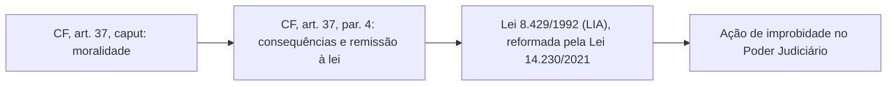
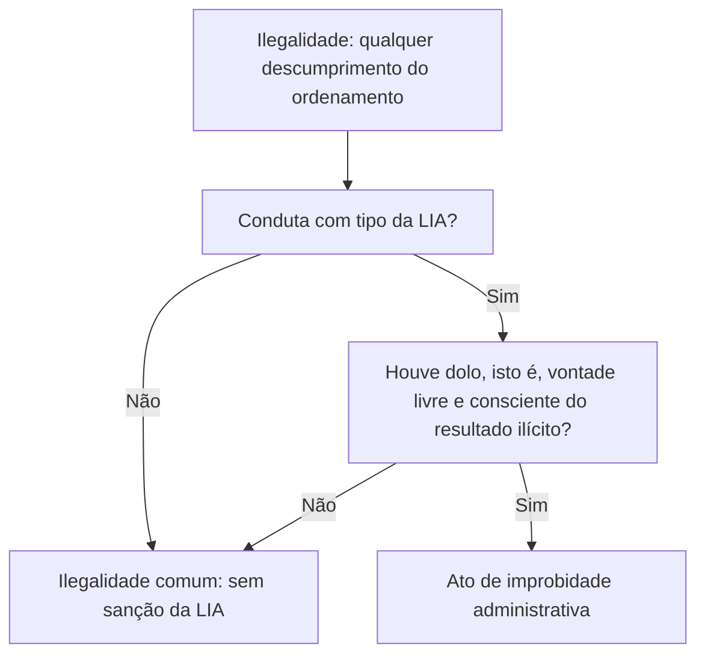
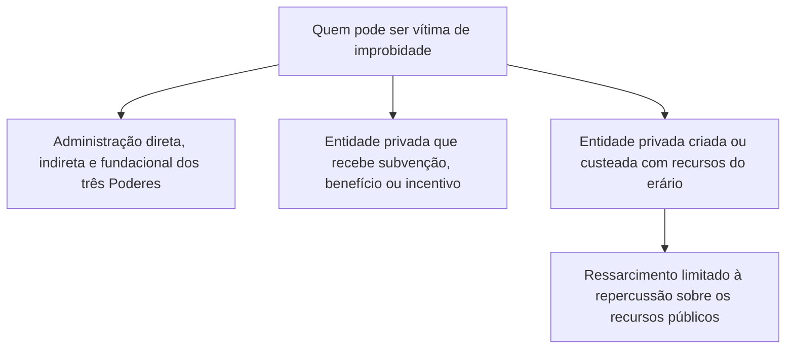

Poucos assuntos de direito administrativo mexem tanto com a imaginação do candidato quanto a improbidade. Todo mundo já ouviu falar de "político corrupto" ou de "servidor que enriqueceu no cargo", mas a prova não cobra o sentido popular da palavra. Cobra o que a Constituição e a **Lei 8.429/1992**, profundamente reformada pela **Lei 14.230/2021**, dizem sobre o tema. A reforma de 2021 mudou o centro de gravidade da lei: hoje só existe improbidade com **dolo**, o rol de condutas foi enxugado e o vocabulário ficou mais próximo do direito penal. Este capítulo apresenta a moldura geral: de onde vem a base constitucional, o que é um ato de improbidade, qual é a natureza desse ilícito e quem pode ser vítima dele (o sujeito passivo).

> [!objetivos]
> - Identificar a base constitucional da improbidade e a competência da União para legislar sobre o tema.
> - Definir o ato de improbidade, sua natureza civil e política e a diferença para o crime.
> - Explicar o dolo específico e aplicar a reforma de 2021 no tempo, conforme o Tema 1199 do STF.
> - Distinguir improbidade de ilegalidade e de imoralidade e aplicar os princípios do direito sancionador.
> - Reconhecer quem é sujeito passivo e como as sanções se limitam em cada caso.

## Base constitucional

O dever de probidade nasce do princípio da **moralidade administrativa**, que a Constituição Federal inscreveu expressamente no art. 37, caput, ao lado de legalidade, impessoalidade, publicidade e eficiência. Moralidade, nesse sentido, é atuar com ética, honestidade e boa-fé no trato da coisa pública. A palavra "improbidade", por sua vez, aparece em vários pontos do texto constitucional.

| Dispositivo | O que diz sobre improbidade ou probidade |
| --- | --- |
| Art. 37, § 4º | Base da responsabilização: lista as consequências dos atos de improbidade |
| Art. 15, V | A improbidade é uma das hipóteses em que os direitos políticos podem ser suspensos (a cassação é vedada) |
| Art. 14, § 9º | A proteção da probidade administrativa orienta a criação de casos de inelegibilidade por lei complementar |
| Art. 85, V | Atentar contra a probidade na administração é crime de responsabilidade do Presidente da República |
| ADCT, art. 97, § 10 | O chefe do Executivo que não libera, no prazo, os recursos para pagar precatórios responde por improbidade e por responsabilidade fiscal |

> [!lei] CF, art. 37, § 4º
> § 4º Os atos de improbidade administrativa importarão a suspensão dos direitos políticos, a perda da função pública, a indisponibilidade dos bens e o ressarcimento ao erário, na forma e gradação previstas em lei, sem prejuízo da ação penal cabível.

O dispositivo traz quatro consequências e uma ressalva. As consequências são o **ressarcimento ao erário**, a **indisponibilidade dos bens**, a **perda da função pública** e a **suspensão dos direitos políticos**, sem uma ordem de gravidade fixada pelo texto. Vale notar a diferença entre as quatro consequências: a suspensão dos direitos políticos e a perda da função pública atingem a pessoa do agente; a indisponibilidade dos bens é medida de garantia, que bloqueia patrimônio para assegurar a reparação; e o ressarcimento recompõe o dano. Cada uma tem regime próprio na lei, estudado nos capítulos sobre as sanções. A ressalva final, "sem prejuízo da ação penal cabível", indica que a responsabilização por improbidade não substitui a responsabilidade criminal: uma convive com a outra. A Constituição também não fixa a medida de cada sanção; remete a "forma e gradação previstas em lei". Essa lei é a Lei 8.429/1992, conhecida como **Lei de Improbidade Administrativa (LIA)**.

Como o art. 37 se dirige à administração pública direta e indireta de **qualquer dos Poderes e de todos os entes da federação**, a LIA é uma **lei nacional**, aplicável à União, aos estados, ao Distrito Federal e aos municípios. Sua estrutura básica segue esta ordem:

- **arts. 1º a 3º**: conceito geral e sujeitos (passivo e ativo);
- **arts. 9º, 10 e 11**: as três espécies de atos de improbidade;
- **art. 12**: as sanções;
- **art. 17**: a ação judicial.

## Competência legislativa da União

Há um detalhe que a banca explora de vez em quando: a Constituição não diz, em nenhum artigo, que cabe à União legislar sobre improbidade. Então, por que a lei é federal? Porque a LIA mistura temas que a Constituição reservou, **privativamente**, à União no art. 22:

| Tema da lei | Ramo do direito | Fundamento |
| --- | --- | --- |
| Suspensão de direitos políticos | Direito eleitoral e cidadania | CF, art. 22, I e XIII |
| Ressarcimento do dano | Direito civil | CF, art. 22, I |
| Penalidades | Regime punitivo de infrações contra o Estado, em sentido amplo | CF, art. 22, I |
| Tramitação da ação | Direito processual | CF, art. 22, I |

Isso não significa que os estados e os municípios nada possam fazer. A doutrina se divide. Uma corrente sustenta que, como as normas federais são exaustivas, não sobra espaço para legislação dos demais entes. Outra, mais flexível, admite que estados e Distrito Federal legislem **suplementarmente** sobre procedimentos em matéria processual, respeitadas as normas gerais da União (CF, art. 24, XI e § 2º), e que todos os entes tenham competência concorrente em temas administrativos específicos, como o processo administrativo de apuração, a declaração de bens e o direito de representação, este último apoiado no direito de petição (CF, art. 5º, XXXIV, "a"). Para prova, guarde o essencial: a LIA é **lei nacional**, de competência privativa da União.

## Conceito e natureza do ato de improbidade

Em linguagem comum, ato de improbidade é a conduta **desonesta, imoral e dolosa** com a coisa pública. "Coisa pública" aqui é mais que dinheiro: inclui os valores e princípios que a lei protege. Mas esse conceito é apenas didático. O conceito que vale é o **legal**.

> [!lei] Lei 8.429/1992, art. 1º, §§ 1º e 2º
> § 1º Consideram-se atos de improbidade administrativa as condutas dolosas tipificadas nos arts. 9º, 10 e 11 desta Lei, ressalvados tipos previstos em leis especiais.
> § 2º Considera-se dolo a vontade livre e consciente de alcançar o resultado ilícito tipificado nos arts. 9º, 10 e 11 desta Lei, não bastando a voluntariedade do agente.

"Tipificada" significa prevista em lei com descrição da conduta. Receber vantagem econômica para intermediar a liberação de verba pública é um exemplo de conduta tipificada no art. 9º, IX. Daí decorre que só há improbidade quando a conduta se encaixa em um tipo da LIA ou de lei especial. O texto do art. 1º, caput, indica o bem jurídico protegido: a **probidade na organização do Estado e no exercício de suas funções** e a **integridade do patrimônio público e social**.

### Natureza do ilícito

O ato de improbidade é um **ilícito de natureza civil e política**. As sanções tocam o patrimônio (ressarcimento e multa civil) e a vida política (suspensão dos direitos políticos). Não é, em si, crime: a ação de improbidade tem natureza **civil**, e não penal. Vale, então, separar três planos.

| Plano | Natureza | Quem aplica |
| --- | --- | --- |
| Improbidade (LIA) | Civil e política | Poder Judiciário, em ação própria |
| Crime | Penal | Poder Judiciário, em ação penal |
| Infração disciplinar | Administrativa | Autoridade administrativa, em processo disciplinar |

A mesma conduta pode cair em mais de um plano. Realizar operação financeira sem observar as normas legais é ato de improbidade (art. 10, VI) e, a princípio, não é crime. Já dispensar licitação indevidamente, com perda patrimonial efetiva, é improbidade e também pode ser crime contra licitações. Nessa hipótese, o agente responde a duas ações independentes: a penal e a de improbidade.

> [!atencao] As sanções da LIA são judiciais
> Mesmo as sanções com reflexo administrativo (perda da função pública, proibição de contratar com o poder público, vedação a benefícios fiscais ou creditícios) só são aplicadas pelo **Judiciário**, na ação de improbidade, e não por processo administrativo. Esse processo só apura fatos e envia a representação ao Ministério Público.

O ato de improbidade pode se manifestar por **ação ou por omissão**. Deixar de prestar contas para ocultar irregularidades, por exemplo, é omissão tipificada no art. 11, VI. Mas, depois da Lei 14.230/2021, **ambas exigem dolo**.

### Quem reage ao indício de improbidade

A lei também desenha o primeiro passo do procedimento. Se a autoridade que tomar conhecimento dos fatos perceber indícios de improbidade, deve representar ao **Ministério Público competente** para as providências cabíveis (art. 7º). A autoridade administrativa não aplica sanção nem decide se houve improbidade: ela leva a notícia ao órgão que pode propor a ação. Um comandante que descobre que um subordinado desviou combustível da corporação, por exemplo, pode abrir processo disciplinar, mas, quanto à improbidade, a via é a representação ao Ministério Público e, depois, a ação judicial.

## Espécies de ato e leis especiais

A LIA organiza os atos de improbidade em **três espécies**, que serão estudadas nos capítulos seguintes:

1. atos que importam **enriquecimento ilícito** (art. 9º);
2. atos que causam **prejuízo ao erário** (art. 10);
3. atos que **atentam contra os princípios da administração pública** (art. 11).

Como o art. 1º, § 1º, ressalva os "tipos previstos em leis especiais", outras leis podem definir atos de improbidade. É o caso do Estatuto da Cidade (Lei 10.257/2001, art. 52), que prevê hipóteses específicas aplicáveis a prefeitos. Assim, o conceito legal é fechado em torno de tipos expressos: quem quer saber se um fato é improbidade precisa encontrar o tipo na LIA ou em lei especial.

## Dolo: o elemento subjetivo da improbidade

Uma das mudanças mais importantes da Lei 14.230/2021 foi exigir **dolo em todas as espécies** de ato. Antes, apenas o art. 10 admitia a modalidade culposa, em que o agente causava prejuízo ao erário por negligência, imprudência ou imperícia. As outras duas espécies já eram dolosas. Hoje, **nenhuma** admite culpa.

A reforma foi além e definiu o próprio dolo (art. 1º, § 2º): é querer, livre e conscientemente, o **resultado ilícito descrito no tipo**. Praticar o ato de modo voluntário não basta. A diferença parece sutil, mas decide casos.

### Dolo genérico e dolo específico

- **Dolo genérico** é a intenção de praticar a conduta ilícita, sem um propósito particular. Era admitido pela jurisprudência do STJ antes da reforma, sobretudo nos atos do art. 11.
- **Dolo específico** é a vontade de praticar a conduta **para alcançar um resultado ilícito determinado**, como obter vantagem, lesar o erário ou favorecer alguém. É o exigido hoje.

> [!resolvido] Questão comentada: dispensa de licitação com e sem dolo
> Um chefe de setor sabe que a contratação de uma empresa de manutenção de viaturas exige licitação, mas contrata diretamente, por pressa. Não há prova de que quisesse favorecer a empresa, lesar o erário ou obter vantagem. Um segundo chefe, em outro órgão, contrata diretamente uma empresa do próprio irmão, sem licitação, com o fim de favorecê-lo. Em qual caso há improbidade?
>
> **Resolução.** No segundo. Ambos agiram com voluntariedade e conheciam o dever de licitar. Mas só o segundo agiu com **dolo específico**: a vontade de alcançar o resultado ilícito de favorecer o irmão. O primeiro cometeu uma irregularidade, que pode gerar outras consequências, mas faltou o propósito ilícito exigido pela LIA.

As descrições de algumas condutas mudaram para eliminar as formas culposas. O art. 10, X, que punia quem agisse "negligentemente" na arrecadação de tributo ou na conservação do patrimônio público, passou a punir quem age **ilicitamente**. O mesmo ocorreu com as hipóteses de agir negligentemente na celebração, fiscalização e prestação de contas de parcerias, que viraram agir para a configuração de ilícito.

O art. 1º, § 3º, reforça a ideia: quem apenas exerce a função e cumpre competências públicas, sem que se prove um ato doloso com finalidade ilícita, não responde por improbidade. Embora pareça redundante, o dispositivo existe para impedir que se puna quem apenas errou. O STF considerou constitucionais os dispositivos que exigem dolo (ADIs 7156 e 7236, julgamento concluído em 1º/7/2026).

> [!pegadinha] "A improbidade pode ser culposa"
> Depois de 2021, afirmações como "a lei pune a improbidade culposa por negligência" estão erradas. Os tipos dos arts. 9º, 10 e 11 exigem **dolo**, e o art. 1º, § 2º, afirma que a voluntariedade da conduta sozinha não basta.

### Divergência interpretativa

Pelo art. 1º, § 8º, quem age com base em uma leitura da lei sustentada por **jurisprudência**, ainda que ela não seja pacífica, não comete improbidade, mesmo que essa leitura perca depois a disputa nos órgãos de controle ou nos tribunais. É a chamada **divergência interpretativa**.

Veja um caso. Um tribunal superior firma entendimento de que uma restrição imposta em edital é válida. Um gestor a aplica, e uma empresa fica impedida de participar. Meses depois, o Supremo declara a restrição irregular. O Ministério Público processa o gestor por frustrar o caráter competitivo da licitação. Não há improbidade: o gestor seguiu uma interpretação então respaldada em jurisprudência, e a mudança posterior não o transforma em ímprobo.

O STF julgou esse dispositivo nas ADIs 7156 e 7236 e deu **interpretação conforme à Constituição**: a regra é válida desde que não haja dolo ou erro grosseiro na interpretação. A técnica mantém o texto, mas fixa o único sentido compatível com a Constituição. Duas cautelas ajudam a ler a decisão:

- a "jurisprudência" invocada deve ser a **assentada nos tribunais superiores ou no STF** e, na ausência dela, a decisão de mérito transitada em julgado de órgão colegiado de segundo grau. A decisão de um único juiz, em caráter singular, não serve;
- improbidade não existe por "erro grosseiro". A LIA exige sempre dolo, então a leitura correta é que o **entendimento adotado**, como um parecer, não pode ter sido construído com dolo ou erro grosseiro, e que a conduta do agente, em si, só configura improbidade se for dolosa.

## A reforma no tempo: Tema 1199 do STF

A exigência de dolo e a revogação da modalidade culposa deram origem a uma pergunta decisiva: a lei mais favorável retroage? Em matéria penal, a lei mais benéfica retroage (CF, art. 5º, XL). Mas a improbidade não é matéria penal. O STF respondeu no Tema 1199, em 2022.

> [!jurisprudencia] STF, Tema 1199 (ARE 843.989, rel. Min. Alexandre de Moraes, 2022)
> Em síntese: (1) a improbidade exige dolo nos arts. 9º, 10 e 11; (2) a revogação da modalidade culposa **não retroage** para atingir a coisa julgada nem a execução das penas; (3) a nova lei **se aplica** aos atos culposos da vigência da lei antiga ainda sem condenação transitada em julgado, cabendo ao juiz examinar se houve dolo; (4) o **novo regime de prescrição não retroage** e vale a partir da publicação da lei, em 26/10/2021.

| Situação | A Lei 14.230/2021 retroage? | Consequência |
| --- | --- | --- |
| Condenação por ato culposo já transitada em julgado | Não | A sanção continua, inclusive na execução; a ação rescisória não é o caminho |
| Processo em curso por ato culposo, sem trânsito em julgado | Sim | O juiz examina se houve dolo: se só houve culpa, o processo não prossegue; se houve dolo, segue |
| Prazos de prescrição, inclusive a intercorrente | Não | Os novos marcos contam a partir de 26/10/2021 |

Dois exemplos fixam o raciocínio. Primeiro, uma secretária municipal foi condenada, com trânsito em julgado, por dano culposo ao erário e teve a perda da função e a multa decretadas. Pediu ação rescisória alegando a lei mais benéfica. O pedido não prospera: a decisão já transitou e a retroatividade benéfica não é automática na esfera civil, onde vale a regra de que o tempo rege o ato.

Segundo, a reforma criou a **prescrição intercorrente**: se, entre dois marcos interruptivos (o ajuizamento da ação, a sentença condenatória, o acórdão que a confirma), passar o prazo do art. 23, § 5º, o juiz declara a prescrição. Esse prazo também só conta a partir de 26/10/2021: numa ação ajuizada em março de 2018, o tempo anterior à reforma não entra na conta. A lei fixava esse prazo na metade dos oito anos, mas o STF suspendeu a expressão "pela metade" em setembro de 2025 e a declarou inconstitucional no julgamento das ADIs 7156 e 7236, concluído em 1º/7/2026. Assim, interrompida a prescrição, o prazo recomeça por inteiro, por oito anos. O tema é desenvolvido no volume seguinte.

### Ampliação do entendimento

A reforma também beneficiou o réu em outros pontos além da culpa: passou a exigir dolo específico, extinguiu o enquadramento genérico no caput do art. 11 (que agora tem rol taxativo) e revogou os incisos I e II do art. 11. A jurisprudência passou a aplicar a lógica do Tema 1199 a esses casos, desde que não haja condenação transitada em julgado. O STF estendeu o entendimento, por exemplo, ao revogado art. 11, I (ARE 1.484.966), e o STJ, depois de resistir, passou a admitir a aplicação do dolo específico aos processos em curso (REsp 2.107.601).

> [!bizu] Regra de bolso para o tempo da lei
> Pergunte duas coisas: já transitou em julgado? É prazo de prescrição? Se transitou, a lei benéfica não retroage. Se não transitou, retroage quanto à exigência de dolo. Prazos prescricionais novos nunca retroagem.

## Improbidade, ilegalidade e imoralidade

Os três conceitos são parentes, mas não gêmeos.

- **Ilegalidade** é o gênero: tudo o que contraria o ordenamento. Todo ato de improbidade é ilícito, mas nem toda ilegalidade é improbidade.
- **Improbidade** é uma **ilegalidade qualificada** pela desonestidade, pela má-fé ou pelo dolo, na expressão da jurisprudência do STJ.
- **Imoralidade** é a violação dos padrões éticos; a doutrina diverge sobre qual dos dois conceitos é mais amplo, e as provas costumam evitar a polêmica.

Exemplo de ilegalidade sem improbidade: um motorista da corporação, conduzindo viatura oficial, bate em um carro particular por descuido. Há ato ilícito e dever de reparar, mas não há dolo nem fim ilícito, então não há improbidade.

## O direito administrativo sancionador

A Lei 14.230/2021 inseriu o art. 1º, § 4º: aplicam-se ao sistema de improbidade os **princípios constitucionais do direito administrativo sancionador**. É o ramo que reúne as garantias de quem pode sofrer uma punição estatal que não seja criminal. Entre os princípios que a doutrina e a jurisprudência associam a esse ramo, estão:

| Princípio | Ideia em poucas palavras |
| --- | --- |
| Legalidade e tipicidade | Só há sanção se a conduta e a pena estiverem previstas em lei |
| Culpabilidade | A punição depende de dolo e de responsabilidade pessoal do agente |
| Devido processo legal, contraditório e ampla defesa | O acusado tem direito de se defender antes de sofrer a sanção |
| Presunção de inocência | Ninguém é considerado culpado antes de condenação definitiva |
| Proporcionalidade | A sanção deve guardar relação com a gravidade do fato |
| Vedação ao *bis in idem* | O mesmo fato não pode ser punido duas vezes pelo mesmo fundamento |
| Irretroatividade da lei mais severa | A lei nova que agrava a situação não alcança fatos anteriores |

O art. 12, § 9º, por exemplo, reflete a presunção de inocência ao determinar que as sanções só sejam executadas depois do **trânsito em julgado** da condenação, e o art. 12, § 7º, protege contra o *bis in idem* nas sanções às pessoas jurídicas.

> [!pegadinha] "A improbidade pode ser culposa"
> Depois de 2021, afirmações como "a lei pune a improbidade culposa por negligência" estão erradas. Os tipos dos arts. 9º, 10 e 11 exigem **dolo**, e o art. 1º, § 2º, afirma que a voluntariedade da conduta sozinha não basta.

## Independência das instâncias

Como a improbidade é ilícito civil, a mesma conduta pode gerar responsabilidade em outras esferas. Um servidor que dispensa licitação fora das hipóteses legais pode responder:

| Esfera | Fundamento (exemplo) | Quem decide |
| --- | --- | --- |
| Penal | Código Penal, art. 337-E (contratação direta ilegal) | Juiz criminal |
| Administrativa | Estatuto do servidor, por infração disciplinar | Autoridade administrativa |
| Civil, por improbidade | LIA, art. 10, VIII (frustrar a licitude da licitação ou dispensá-la indevidamente com perda patrimonial efetiva) | Juiz cível, em ação de improbidade |

Por isso é errado afirmar que o ato de improbidade, por ser enquadrado na LIA, "exime a autoridade de apurar a responsabilidade disciplinar". As instâncias são independentes, com exceções que serão estudadas em outro momento (por exemplo, a absolvição criminal por inexistência do fato ou por negativa de autoria repercute nas demais).

## Sujeito passivo do ato de improbidade

O **sujeito passivo** é a vítima: a entidade lesada pela improbidade. A lei o descreve em três camadas (art. 1º).

1. **Administração pública direta, indireta e fundacional** dos três Poderes (Executivo, Legislativo e Judiciário) em todos os níveis da federação (§ 5º). Isso alcança autarquias, fundações, empresas públicas e sociedades de economia mista.
2. **Entidades privadas que recebem benefício de entes públicos**, seja subvenção, seja incentivo fiscal ou creditício (§ 6º). Uma associação que recebe repasse para tocar um projeto social é um exemplo.
3. **Entidades privadas que o erário ajudou a criar ou ajuda a manter**, mesmo sem integrarem a administração indireta (§ 7º).

O alcance sobre as entidades privadas não é igual ao da administração pública, e a lei põe um limite. Na terceira camada, a devolução de prejuízos só alcança o efeito do ilícito **sobre a parcela que veio dos cofres públicos**: se o erário aportou 20% do patrimônio da entidade, a reparação se ajusta a essa participação. As demais sanções seguem a lei.

| Camada | Exemplo | Particularidade |
| --- | --- | --- |
| Administração direta, indireta e fundacional | Ministérios, secretarias, autarquias, empresas públicas | Todas as sanções, sem a limitação do § 7º |
| Entidade privada com subvenção, benefício ou incentivo | ONG que recebe incentivo fiscal | Alcançada pela LIA |
| Entidade privada com custeio ou criação por recursos públicos | Entidade custeada em parte pelo erário | Ressarcimento limitado à repercussão sobre os cofres públicos |

### Exemplos de sujeito passivo

Para fixar, imagine quatro situações:

| Situação | É sujeito passivo? | Observação |
| --- | --- | --- |
| Desvio de combustível de um batalhão de bombeiros | Sim | Administração direta |
| Fraude em compras de uma empresa pública estadual | Sim | Administração indireta |
| Desvio em associação que recebe subvenção para um programa social | Sim | Entidade privada que recebe benefício público (§ 6º) |
| Desvio em uma empresa totalmente privada, sem relação com recursos públicos | Não | Fora da LIA; pode haver crime ou ilícito civil comum |

> [!bizu] Relação entre o art. 1º e as espécies de ato
> Guarde o par: o art. 1º, § 1º, define o ato (conduta dolosa tipificada) e o § 5º aponta quem é lesado (os Poderes e as administrações direta e indireta). Os §§ 6º e 7º estendem a proteção às entidades privadas ligadas a recursos públicos.

> [!resolvido] Questão comentada: improbidade contra associação privada
> Uma associação privada sem fins lucrativos recebeu recursos públicos por meio de termo de parceria para executar um projeto de capacitação. Um dirigente da associação desviou parte dos recursos em benefício próprio, com dolo. Esse fato pode ser objeto da LIA?
>
> **Resolução.** Sim. A entidade privada que recebe subvenção ou benefício de entes públicos é protegida pela LIA (art. 1º, § 6º), e o particular que celebra termo de parceria com a administração sujeita-se às sanções no tocante a recursos de origem pública (art. 2º, parágrafo único). Como o fato foi doloso, enquadra-se na lei.

## Como a banca cobra este assunto

As questões sobre noções gerais aparecem com poucas variações. Uma delas troca a natureza do ilícito: diz que a improbidade é crime ou que tem natureza exclusivamente administrativa, quando é civil e política. Outra afirma que a sanção é aplicada pela autoridade administrativa, quando só o Judiciário a impõe. Outra reintroduz a modalidade culposa. Uma quarta mistura os sujeitos passivos, esquecendo as entidades privadas, ou aplica à terceira camada o ressarcimento integral. Há ainda itens sobre a competência da União e sobre a base constitucional (art. 37, § 4º), em que o candidato precisa lembrar as quatro consequências. Um grupo crescente de questões envolve a aplicação da reforma no tempo e o Tema 1199, em geral com afirmações como "a lei nova retroage para extinguir condenações já definitivas" (errada) ou "a prescrição intercorrente alcança o tempo anterior à reforma" (errada). Por fim, é comum o item sobre a divergência interpretativa, que exige distinguir a decisão de um tribunal superior, que protege o agente, da decisão isolada de um juiz, que não o protege. Para acertar, leia o enunciado procurando o **dolo**, a **fase do processo** (transitou em julgado ou não) e o **tipo de entidade** lesada.

## Mapa do capítulo

| Tema | Ideia central | Armadilha |
| --- | --- | --- |
| Base constitucional | CF, art. 37, § 4º, quatro consequências e remissão à lei | Esquecer uma das consequências |
| LIA | Lei nacional, estrutura nos arts. 1º a 3º, 9º a 12 e 17 | Chamá-la de lei só federal |
| Competência | Privativa da União (CF, art. 22) | Dizer que a CF a prevê expressamente |
| Conceito | Conduta dolosa tipificada nos arts. 9º, 10 e 11 | Admitir culpa |
| Natureza | Ilícito civil e político, não penal | Chamar de crime |
| Aplicação | Sanções só pelo Judiciário | Atribuir à administração |
| Ilegalidade e improbidade | Improbidade é ilegalidade qualificada pelo dolo | Equiparar as duas |
| Direito sancionador | Princípios do art. 1º, § 4º | Ignorar as garantias |
| Sujeito passivo | Administração, entidades subvencionadas e custeadas | Ressarcimento integral na terceira camada |

### Para fixar

1. A moralidade administrativa é princípio expresso no art. 37, caput, da Constituição.
2. O art. 37, § 4º, enumera quatro consequências (direitos políticos, função pública, bens e erário) e preserva a ação penal.
3. A Lei 8.429/1992 é lei nacional, de competência privativa da União, reformada pela Lei 14.230/2021.
4. Ato de improbidade é a conduta dolosa tipificada nos arts. 9º, 10 e 11 ou em lei especial.
5. Dolo é a vontade livre e consciente de alcançar o resultado ilícito; a mera voluntariedade não basta.
6. O ilícito de improbidade é civil e político, e não penal.
7. As sanções da LIA só podem ser aplicadas pelo Poder Judiciário, em ação própria.
8. Improbidade é ilegalidade qualificada pelo dolo; nem toda ilegalidade é improbidade.
9. Divergência interpretativa baseada em jurisprudência, ainda que não pacificada, não configura improbidade.
10. O sujeito passivo inclui a administração direta e indireta e as entidades privadas ligadas a recursos públicos, com ressarcimento limitado no caso das custeadas pelo erário.
