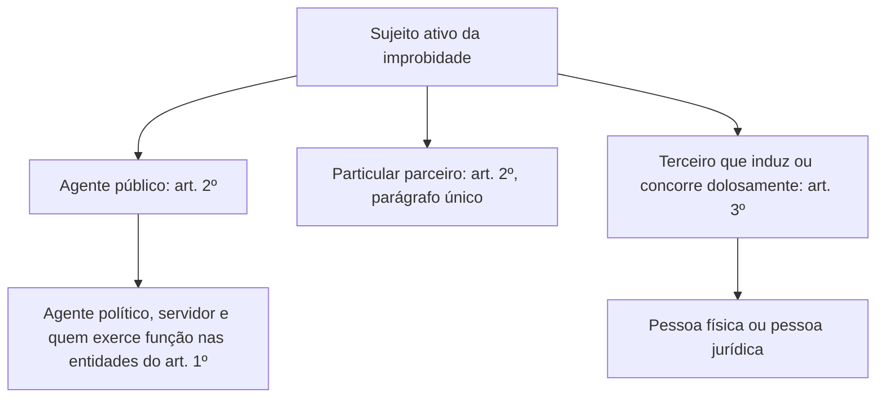
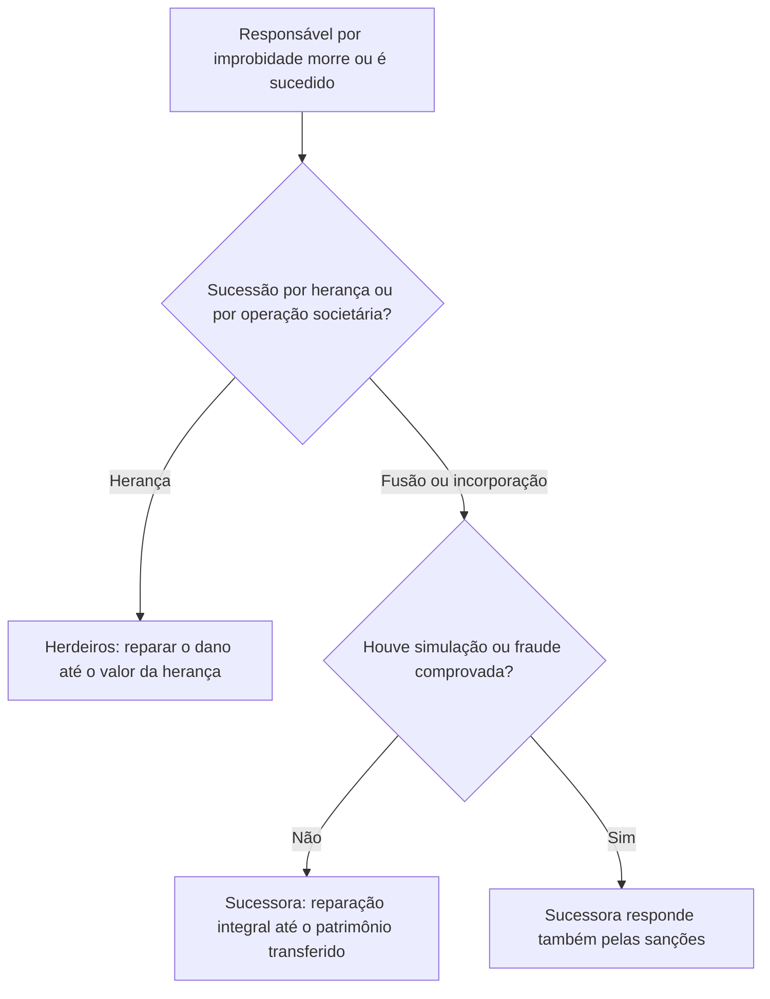

O capítulo anterior mostrou quem sofre o ato de improbidade. Agora a pergunta se inverte: **quem pode praticá-lo e ser punido**? A lei responde por camadas. No centro estão os **agentes públicos**, no sentido mais amplo possível. Ao redor, os **particulares que firmam parcerias** com a administração e os **terceiros** que induzem ou concorrem para o ilícito, entre eles as pessoas jurídicas. O capítulo termina com uma regra que costuma pegar candidatos distraídos: o que acontece com a obrigação de reparar quando o responsável morre ou quando a empresa condenada some em uma fusão. É a responsabilidade dos **sucessores**.

> [!objetivos]
> - Delimitar o conceito de agente público para fins de improbidade, com a exceção do Presidente da República.
> - Explicar a situação do particular que celebra parceria com a administração.
> - Distinguir a responsabilidade do terceiro e da pessoa jurídica, e dos sócios e administradores.
> - Aplicar o limite da responsabilidade dos sucessores e herdeiros.

## Retomada do sujeito passivo

Antes de passar adiante, vale fechar o raciocínio do capítulo anterior, porque a prova cobra os dois lados juntos. A vítima pode ser qualquer ente federado e qualquer órgão dos três Poderes, o que inclui os tribunais de contas e o Ministério Público. Na administração indireta, estão protegidas as autarquias, as fundações estatais e as empresas estatais, sejam públicas, sejam de economia mista. Isso significa que entidades de direito público e de direito privado estão no alcance da LIA, e o ramo de atuação da estatal não faz diferença: tanto a empresa que presta serviço público quanto a que explora atividade econômica podem ser lesadas por improbidade.

Nas duas camadas seguintes (entidade privada beneficiada com subvenção, incentivo ou benefício e entidade privada criada ou custeada pelo erário), a lei incide por causa dos **recursos públicos** repassados por fomento. Exemplos: serviços sociais autônomos, organizações sociais, organizações da sociedade civil de interesse público e qualquer entidade privada que receba recursos por meio de parceria com o Estado.

Quanto à devolução, o teto é o efeito do desvio sobre o aporte do Estado. Exemplo numérico: uma entidade privada recebeu 6 milhões de reais do Estado e 9 milhões de doações particulares. Seus dirigentes desviaram 12 milhões. O máximo de dinheiro público que poderia ter sido desviado é 6 milhões, então a ação de improbidade só alcança o ressarcimento de **6 milhões**. Os outros 6 milhões, de origem privada, devem ser cobrados por outras vias. Na redação antiga, a limitação só valia quando o Estado contribuía com menos de 50%; hoje ela vale em qualquer proporção.

## Sujeito ativo: duas categorias

Sujeito ativo é quem **pratica** o ato de improbidade e sofre as sanções da lei. A LIA o divide em duas grandes categorias: o **agente público** (art. 2º) e o **terceiro** (art. 3º). Dentro do agente público há um subgrupo novo, o do particular que celebra parceria com a administração (art. 2º, parágrafo único).

## Agente público

O art. 2º usa um conceito **amplo**: agente público é agentes políticos, servidores e qualquer pessoa que exerça, mesmo por pouco tempo ou sem salário, mandato, cargo, emprego ou função nas entidades protegidas pelo art. 1º, por qualquer forma de investidura ou vínculo. A lista de formas de investidura é exemplificativa.

| Elemento | Variações incluídas |
| --- | --- |
| Duração | Permanente (servidor efetivo) ou temporária (temporário, estagiário, comissionado) |
| Remuneração | Com ou sem pagamento (um jurado convocado para o tribunal do júri, por exemplo, pode responder) |
| Investidura | Eleição (parlamentares), nomeação (servidores estatutários), designação (função de confiança), contratação (empregados públicos) ou qualquer outra |
| Vínculo | Mandato, cargo, emprego ou função |
| Local de atuação | Qualquer entidade do art. 1º: administração direta e indireta e entidades privadas ligadas a recursos públicos |

Como o terceiro elemento do conceito ("todo aquele que exerce função") é residual, ele abrange os dois primeiros. Por isso, a discussão doutrinária entre o sentido estrito de servidor (só os estatutários) e o amplo (estatutários, empregados públicos e temporários) é irrelevante para a LIA: de uma forma ou de outra, todos entram. Uma questão que afirme que a lei se aplica só a servidores estatutários e não a empregados públicos da administração indireta está errada.

### Quem é agente público: exemplos

| Pessoa | Agente público para a LIA? | Razão |
| --- | --- | --- |
| Soldado do Corpo de Bombeiros | Sim | Servidor público |
| Secretário de estado | Sim | Agente político |
| Vereador | Sim | Agente político, eleito |
| Empregado de empresa pública | Sim | Exerce emprego em entidade da administração indireta |
| Estagiário de órgão público | Sim | Exerce função, ainda que transitória |
| Mesário nas eleições | Sim | Função transitória e sem remuneração |
| Presidente da República | Regime próprio (Pet 3240) | Responde por crime de responsabilidade |

### Agente político

Agentes políticos são as autoridades que exercem funções de governo, com garantias e responsabilidades definidas na Constituição: chefes do Executivo e seus auxiliares imediatos (ministros e secretários), parlamentares, magistrados e membros do Ministério Público, entre outros, conforme o autor. O que importa é que o art. 2º os inclui **expressamente** no conceito de agente público.

### A exceção do Presidente da República

O STF, no julgamento da **Pet 3240** (2018), decidiu que os agentes políticos se sujeitam a um **duplo regime sancionatório**: respondem pela LIA (responsabilidade civil por improbidade) e, ao mesmo tempo, pelos crimes de responsabilidade (responsabilidade político-administrativa). Não há bis in idem, porque as esferas são distintas.

A única exceção é o **Presidente da República**. O art. 85, V, da Constituição define como crime de responsabilidade o ato do Presidente que atente contra a probidade na administração. Por isso, ele responde apenas por crime de responsabilidade, e não pela LIA. A exceção **não alcança governadores nem prefeitos**, que respondem pelos dois regimes.

> [!jurisprudencia] STF, Pet 3240 (2018): duplo regime e exceção do Presidente
> Agentes políticos, com exceção do Presidente da República, submetem-se tanto à responsabilização civil por improbidade quanto à responsabilização por crimes de responsabilidade. O Presidente responde apenas por crime de responsabilidade (CF, art. 85, V). A exceção não consta literalmente na LIA e só deve ser considerada quando a questão a invocar.

### Particulares em entidades privadas com recursos públicos

O conceito amplo também alcança **pessoas que atuam em entidades privadas** beneficiadas por recursos públicos (art. 1º, §§ 6º e 7º). Um dirigente de uma organização social que gere recursos de um contrato de gestão é equiparado a agente público. Segundo a jurisprudência do STJ, a ação de improbidade não pode ser movida **apenas contra o particular**, sem a presença de um agente público no polo passivo, mas quem dirige entidades abastecidas com dinheiro público é tratado como agente público para fins da LIA.

## Dolo específico e sujeitos ativos

A exigência de dolo específico, estudada no capítulo anterior, vale para **todos** os sujeitos ativos. O agente público precisa querer o resultado ilícito do tipo. O terceiro, por sua vez, precisa induzir ou concorrer **dolosamente**, ou seja, saber que está contribuindo para um ato de improbidade e querer esse resultado. Um contador que, sem saber da fraude, preenche uma planilha pedida por um dirigente não age com dolo; um contador que forja valores para ocultar o desvio, sim.

Por isso, a mera participação objetiva em um procedimento (assinar, opinar, executar) não basta. A acusação precisa mostrar a ligação entre a conduta e o fim ilícito. Esse requisito protege, em particular, os servidores de apoio técnico e jurídico, que costumam ser alvo de ações apenas por terem opinado ou assinado.

## Particular que firma parceria com a administração

A Lei 14.230/2021 incluiu um parágrafo único no art. 2º. Na gestão de **recursos de origem pública**, ficam sujeitos às sanções da lei os particulares, sejam pessoas físicas ou jurídicas, que firmam parcerias com o poder público: convênios, contratos de repasse, contratos de gestão, termos de parceria, termos de cooperação e outros ajustes equivalentes.

Esses instrumentos são exemplos de parceria, e não uma lista fechada:

| Instrumento | Característica resumida |
| --- | --- |
| Convênio | Cooperação mútua para um objetivo comum |
| Contrato de repasse | Transferência de recursos por meio de instituição financeira pública |
| Contrato de gestão | Parceria com organizações sociais |
| Termo de parceria | Vínculo com organizações da sociedade civil de interesse público (Oscip) |
| Termo de cooperação e instrumentos equivalentes | Ajustes de mútua cooperação com entidades privadas |

O que importa é a natureza do vínculo: qualquer ajuste de cooperação entre o Estado e uma entidade privada, ainda que com outro nome. E a expressão "recursos de origem pública" tem leitura ampla, pois a parceria pode envolver bens, equipamentos ou pessoal cedidos. Se uma associação recebe emprestados, sem custo, equipamentos de um programa social e os usa para fins privados, há improbidade.

> [!pegadinha] Pessoa jurídica como "agente público"
> O texto legal menciona "pessoa física ou jurídica" no parágrafo único do art. 2º, embora a doutrina associe o conceito de agente público a pessoas físicas. Para prova, fique na literalidade: o particular, pessoa física ou jurídica, parceiro da administração, **está sujeito** à lei quanto aos recursos de origem pública, independentemente de ser tecnicamente chamado de agente público.

## Terceiro que induz ou concorre

O art. 3º alcança quem **não é agente público**, mas **induz ou concorre dolosamente** para o ato de improbidade. O terceiro é a figura que oferece vantagens, incentiva o ato ou o pratica em conjunto com o agente público. A reforma de 2021 introduziu duas mudanças:

1. saiu do texto a expressão "ou dele se beneficie": agora, só há dois verbos, **induzir** e **concorrer**;
2. a participação exige **dolo**: não responde o terceiro que age culposamente.

Além disso, o terceiro **não age sozinho**: é preciso que o ato se relacione com um agente público. E as normas da lei se aplicam a ele "no que couber", pois algumas sanções são incompatíveis com a sua condição. O terceiro não pode perder uma função pública que não exerce.

> [!resolvido] Questão comentada: empresário que paga vantagem
> Um empresário oferece vantagem indevida a um fiscal de obras para que este libere uma obra irregular. O fiscal aceita, com dolo. O empresário pode responder por improbidade?
>
> **Resolução.** Sim, como terceiro que induz e concorre dolosamente para o ato de improbidade (art. 3º), junto com o agente público, que responde como sujeito ativo principal (art. 9º). Ao empresário aplicam-se as sanções da LIA "no que couber", como multa e proibição de contratar com o poder público, mas não a perda de função pública.

## Pessoa jurídica, sócios e administradores

A pessoa jurídica pode ser **terceiro** na improbidade. O STJ já admitia isso antes da reforma, e agora a lei trata do tema de forma expressa. Como a pessoa jurídica não tem direitos políticos nem exerce função pública, **não sofre** a suspensão dos direitos políticos nem a perda da função. Pode sofrer, nos limites do art. 12, o ressarcimento do dano, a perda dos bens acrescidos ilicitamente, a multa civil e o impedimento de contratar com o poder público ou de obter benefícios fiscais e creditícios.

### Sócios, cotistas, diretores e colaboradores

A regra é a **separação entre a empresa e as pessoas físicas**. Os sócios, os cotistas, os diretores e os colaboradores da pessoa jurídica de direito privado **não respondem** pelo ato imputado à empresa, salvo se, comprovadamente, **participarem** dele. Nesse caso, respondem **nos limites da sua participação** (art. 3º, § 1º).

O texto aprovado em 2021 exigia, para a responsabilização, a participação **e** benefícios diretos. O STF, ao julgar as ADIs 7156 e 7236, considerou inconstitucional a exigência cumulativa de benefícios diretos: basta a comprovação da participação, sem prejuízo dos demais requisitos legais.

| Hipótese | Responde? |
| --- | --- |
| A pessoa jurídica induz o agente a praticar o ato | Sim, a empresa |
| Sócio, diretor ou colaborador que não participou | Não |
| Sócio, diretor ou colaborador que participou | Sim, nos limites da participação |

> [!pegadinha] "Em regra, os sócios respondem pelo ato da empresa"
> A regra é o contrário. Em regra, os sócios, cotistas, diretores e colaboradores **não** respondem pelo ato imputado à pessoa jurídica. A responsabilidade só nasce da participação comprovada.

### Lei Anticorrupção e non bis in idem

Se o mesmo fato também for punido como ato lesivo à administração pública pela **Lei Anticorrupção (Lei 12.846/2013)**, as sanções da LIA **não** se aplicam à pessoa jurídica (art. 3º, § 2º). A razão é evitar o duplo sancionamento de mesma natureza pelo mesmo fato. O art. 12, § 7º, reforça: as sanções às pessoas jurídicas com base nas duas leis devem respeitar o *non bis in idem*.

## Responsabilidade dos sucessores

A Constituição estabelece que nenhuma pena passa da pessoa do condenado, mas a obrigação de reparar o dano e o perdimento de bens podem ser estendidos aos sucessores, até o limite do patrimônio transferido (CF, art. 5º, XLV). A LIA aplica a regra no art. 8º.

> [!lei] Lei 8.429/1992, art. 8º
> Art. 8º O sucessor ou o herdeiro daquele que causar dano ao erário ou que se enriquecer ilicitamente estão sujeitos apenas à obrigação de repará-lo até o limite do valor da herança ou do patrimônio transferido.

Em outras palavras, a responsabilidade do sucessor é **exclusivamente patrimonial** e **limitada**. Essa lógica protege dois valores ao mesmo tempo: o interesse público na reparação do dano, que pode ser cobrada do patrimônio herdado, e o princípio da personalidade da pena, segundo o qual ninguém cumpre a punição imposta a outra pessoa. Penas que recaem sobre a própria pessoa, a exemplo da perda do cargo e da suspensão de direitos políticos, não são transmitidas ao herdeiro.

> [!resolvido] Questão comentada: herança menor que o dano
> Uma servidora causou, com dolo, dano de 140 mil reais ao erário e faleceu antes de repará-lo, deixando herança de 90 mil reais. Quanto os herdeiros respondem?
>
> **Resolução.** Respondem apenas pela obrigação de reparar, até o limite da herança: 90 mil reais. Os 50 mil restantes não podem ser cobrados deles. Se a servidora também tivesse sido condenada à suspensão dos direitos políticos, essa sanção não passaria aos herdeiros.

### Alterações societárias

O art. 8º-A estende a responsabilidade sucessória às hipóteses de **alteração contratual, transformação, incorporação, fusão ou cisão** societária. Nos casos de **fusão e de incorporação**, a sucessora responde apenas pela **reparação integral do dano, até o limite do patrimônio transferido**, e não responde pelas demais sanções decorrentes de atos e fatos anteriores à fusão ou à incorporação. A regra tem uma exceção: se houver **simulação ou evidente intuito de fraude, devidamente comprovados**, a sucessora também responde pelas sanções.

| Situação | Quem responde e até onde |
| --- | --- |
| Morte do responsável | Herdeiros, só pela reparação, até o valor da herança |
| Transformação, alteração contratual ou cisão | Sucessora, nos termos do art. 8º |
| Fusão ou incorporação | Sucessora, só pela reparação integral, até o patrimônio transferido |
| Fusão ou incorporação com simulação ou fraude comprovada | Sucessora responde também pelas sanções |

> [!bizu] Sanção do agente não passa
> Se a questão trouxer "perda da função", "suspensão dos direitos políticos" ou "proibição de contratar" contra os herdeiros, está errada. Sucessor só repara o dano, e até o limite do que recebeu.

## Resumo comparativo dos sujeitos ativos

Para revisar, compare o que cada sujeito ativo precisa para ser alcançado pela lei e como responde.

| Sujeito | Fundamento | Condição | Particularidade |
| --- | --- | --- | --- |
| Agente público | Art. 2º, caput | Exercer mandato, cargo, emprego ou função nas entidades do art. 1º | Pode ser eleito, nomeado, designado ou contratado; com ou sem remuneração |
| Particular parceiro | Art. 2º, parágrafo único | Ter celebrado convênio, contrato de repasse, de gestão, termo de parceria ou ajuste equivalente | Responde quanto aos recursos de origem pública |
| Terceiro | Art. 3º, caput | Induzir ou concorrer dolosamente | Aplica-se a lei no que couber; não age isoladamente |
| Pessoa jurídica | Art. 3º | Mesmos requisitos do terceiro | Não sofre perda de função nem suspensão de direitos políticos |
| Sócios e colaboradores | Art. 3º, § 1º | Participação comprovada | Respondem nos limites da participação |
| Sucessores | Arts. 8º e 8º-A | Sucessão por herança ou por operação societária | Só reparação, até o patrimônio transferido |

## Como a banca cobra este assunto

Quatro armadilhas se repetem. A primeira restringe o agente público aos servidores estatutários, esquecendo empregados, temporários e quem atua sem remuneração. A segunda mistura a exceção do Presidente da República com os demais chefes do Executivo. A terceira atribui aos sócios a responsabilidade automática pelo ato da pessoa jurídica. A quarta transfere aos herdeiros sanções pessoais ou a obrigação ilimitada de reparar. Há ainda itens que perguntam se o terceiro responde por culpa (não) e se pode ser punido sozinho, sem relação com agente público (não).

## Mapa do capítulo

| Tema | Ideia central | Armadilha |
| --- | --- | --- |
| Agente público | Conceito amplo, mesmo sem remuneração e por qualquer investidura | Limitar a estatutários |
| Agente político | Incluído no art. 2º | Excluí-lo |
| Presidente da República | Só crime de responsabilidade (Pet 3240) | Estender a governadores e prefeitos |
| Particular parceiro | Sujeito à lei quanto a recursos de origem pública | Exigir que seja agente público |
| Terceiro | Induz ou concorre dolosamente | Admitir culpa ou ação isolada |
| Pessoa jurídica | Pode responder; não perde função nem direitos políticos | Aplicar todas as sanções |
| Sócios | Em regra não respondem; só pela participação | Responsabilidade automática |
| Lei Anticorrupção | Afasta as sanções da LIA sobre o mesmo fato | Cumular as duas |
| Sucessores | Só reparam, até o limite da herança ou do patrimônio | Transmitir sanção pessoal |

### Para fixar

1. Sujeito ativo é o agente público (art. 2º) e o terceiro que induz ou concorre (art. 3º).
2. O conceito de agente público inclui agentes políticos, servidores e quem exerce função, ainda que transitoriamente ou sem remuneração.
3. O Presidente da República responde por crime de responsabilidade, e não pela LIA; governadores e prefeitos respondem pelos dois regimes.
4. O particular, pessoa física ou jurídica, que firma convênio ou parceria sujeita-se à lei quanto aos recursos de origem pública.
5. O terceiro só responde se induzir ou concorrer com dolo, e não age sozinho.
6. A pessoa jurídica pode ser punida, mas não sofre perda de função nem suspensão de direitos políticos.
7. Em regra, sócios, cotistas, diretores e colaboradores não respondem pelo ato da empresa; respondem se participarem, nos limites da participação.
8. Se o fato também for punido pela Lei Anticorrupção, as sanções da LIA não se aplicam à pessoa jurídica.
9. Herdeiros e sucessores respondem só pela reparação, até o limite da herança ou do patrimônio transferido.
10. Em fusão e incorporação, a sucessora só repara o dano, salvo simulação ou fraude comprovada.
