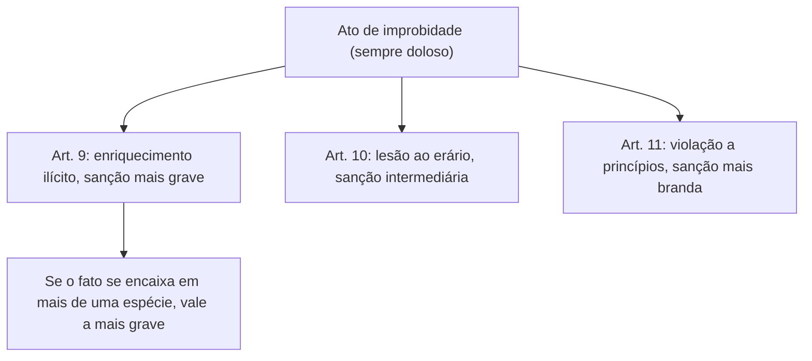

A LIA trabalha com três espécies de ato de improbidade, e é pelo seu enquadramento que o juiz escolhe as sanções. Neste capítulo estão as noções comuns às três, a ideia de **rol exemplificativo ou taxativo** e a análise do art. 9º, que trata do **enriquecimento ilícito**, a espécie mais grave. No final, o capítulo abre o art. 10 (lesão ao erário), com as mudanças que a reforma de 2021 trouxe e os incisos mais cobrados. A cobrança desses artigos é, em geral, literal: a banca troca uma palavra e o candidato precisa reconhecer qual espécie a conduta descreve.

> [!objetivos]
> - Identificar as três espécies de ato de improbidade e a gradação das sanções.
> - Distinguir rol exemplificativo de rol taxativo na LIA.
> - Reconhecer os incisos do art. 9º e a pista textual "perceber vantagem econômica".
> - Aplicar a regra de que o agente responde pela espécie mais grave.
> - Explicar as exigências do art. 10: dolo e perda patrimonial efetiva e comprovada.

## As três espécies e a hierarquia das sanções

Os atos de improbidade se dividem em:

| Espécie | Artigo | Ideia central | Gravidade |
| --- | --- | --- | --- |
| Enriquecimento ilícito | 9º | O agente obtém vantagem patrimonial indevida por causa da função | Mais grave |
| Lesão ao erário | 10 | O patrimônio público sofre perda efetiva | Intermediária |
| Violação a princípios | 11 | O agente ofende princípios da administração em condutas descritas na lei | Menos grave |

Há uma **gradação das sanções** (art. 12): a espécie do art. 9º recebe as penas mais severas, a do art. 10 as intermediárias e a do art. 11 as mais brandas. O art. 10-A, que tratava da concessão indevida de benefício financeiro ou tributário, foi revogado em 2021, e essa conduta passou para o art. 10 (inciso XXII). Hoje, portanto, só existem as três espécies clássicas.

Duas regras valem para todas:

1. todas exigem **dolo**, inclusive a lesão ao erário, que antes admitia culpa. Questões desatualizadas ainda mostram a modalidade culposa, e a banca usa isso como pegadinha;
2. se o mesmo fato se enquadra em mais de uma espécie, o agente responde **pela mais grave**. Quem recebe suborno para vender um bem público por preço baixo comete enriquecimento ilícito (art. 9º, III) e também causa perda ao patrimônio, mas responde pelo enriquecimento, pois a lesão fica absorvida.

## Rol exemplificativo ou taxativo

Um **rol taxativo** é uma lista fechada: o que não está nela não se aplica. Um **rol exemplificativo** é uma lista de exemplos de um conceito geral: outras hipóteses podem se encaixar, ainda que o texto não as cite. A lei de licitações, por exemplo, tem rol taxativo para a licitação dispensável (o administrador não cria novas hipóteses) e rol exemplificativo para a inexigibilidade (a regra geral é a inviabilidade de competição, e os incisos são ilustrações).

Na LIA, antes da reforma, os três artigos tinham rol exemplificativo, sinalizado pela expressão "e notadamente" no caput. Depois da reforma, a situação ficou assim:

| Artigo | Rol | Sinal no texto |
| --- | --- | --- |
| Art. 9º (enriquecimento ilícito) | Exemplificativo | "e notadamente" |
| Art. 10 (lesão ao erário) | Exemplificativo | "e notadamente" |
| Art. 11 (violação a princípios) | **Taxativo** | "caracterizada por uma das seguintes condutas" |

No art. 11, a reforma trocou o "e notadamente" por uma fórmula que fecha a lista. O STF, nas ADIs 7156 e 7236, declarou constitucionais os §§ 3º e 4º do art. 11, confirmando o caráter taxativo. Na prática, só há improbidade por ofensa a princípios quando a conduta se encaixa num dos incisos do art. 11: a violação genérica de um princípio, fora da lista, não basta.

> [!pegadinha] "Os três artigos têm rol exemplificativo"
> Essa assertiva era verdadeira antes de 2021 e hoje está errada. Só os arts. 9º e 10 continuam exemplificativos; o art. 11 é taxativo. Procure, no texto da assertiva, a expressão "e notadamente" ou a fórmula que lista condutas.

## Atos que importam enriquecimento ilícito (art. 9º)

> [!lei] Lei 8.429/1992, art. 9º, caput
> Art. 9º Constitui ato de improbidade administrativa importando em enriquecimento ilícito auferir, mediante a prática de ato doloso, qualquer tipo de vantagem patrimonial indevida em razão do exercício de cargo, de mandato, de função, de emprego ou de atividade nas entidades referidas no art. 1º desta Lei, e notadamente: (...)

Os elementos são quatro: (1) **vantagem patrimonial** (2) **indevida** (3) obtida **de forma dolosa** (4) **por causa da função pública**.

A vantagem pode vir do próprio patrimônio público (apropriação) ou de **fonte externa**, como um suborno pago por particular. Por isso o enriquecimento ilícito pode ou não causar lesão ao erário. Se um agente recebe dinheiro de uma empresa para antecipar a análise de um processo, o Estado não perde patrimônio, mas há enriquecimento ilícito.

Um exemplo do dolo: um servidor recebe por engano um valor maior que o devido em folha, sem ter consciência disso. Falta o dolo, e não há improbidade. Pode haver cobrança de devolução na esfera civil ou administrativa, mas sem as sanções da LIA.

### Os incisos do art. 9º

A tabela abaixo resume as condutas. Os incisos não têm tema comum; o que une todos é a vantagem indevida.

| Inciso | Conduta, em resumo | Exemplo |
| --- | --- | --- |
| I | Aceitar dinheiro, bens ou outro ganho, como comissão, porcentagem, gratificação ou presente, de alguém cujo interesse dependa de decisões do agente | Fiscal que aceita presente de empresa fiscalizada |
| II | Ganhar algo para facilitar compra, troca ou aluguel por preço acima do mercado | Agente que recebe comissão quando o órgão paga caro por equipamentos |
| III | Ganhar algo para facilitar venda, troca ou aluguel de bem público, ou serviço estatal, por preço abaixo do mercado | Agente que recebe para vender imóvel público abaixo do valor |
| IV | Empregar bem móvel da entidade, ou o trabalho de servidores, empregados ou terceiros contratados, em obra ou serviço particular | Secretário que usa caminhão e equipe do município na própria mudança |
| V | Receber vantagem (ou aceitar a promessa dela) para tolerar jogo de azar, narcotráfico, contrabando, usura ou outra atividade ilícita | Agente que recebe para ignorar uma casa de jogos |
| VI | Receber vantagem para atestar falsamente dados técnicos de obra ou serviço, ou a quantidade, o peso, a medida ou a qualidade de bens fornecidos | Fiscal que atesta uso de material que não foi usado |
| VII | Adquirir, por causa da função e em decorrência dos atos do caput, bens de valor desproporcional ao patrimônio ou à renda, ressalvada a prova da origem lícita | Servidor com patrimônio incompatível com o salário |
| VIII | Aceitar emprego, comissão ou consultoria de quem tenha interesse sujeito às decisões do agente, enquanto este atua | Secretário de fazenda que presta consultoria a empresa interessada em tributos |
| IX | Ganhar para intermediar a liberação ou a aplicação de verba pública | Lobista que recebe para influenciar o repasse de recursos |
| X | Receber vantagem para deixar de praticar ato, providência ou declaração que lhe cabe | Agente que engaveta um processo disciplinar mediante pagamento |
| XI | Passar para o próprio patrimônio bens, rendas, verbas ou valores do acervo das entidades | Dirigente que transfere para si um veículo comprado com dinheiro público |
| XII | Usar em proveito próprio bens, rendas, verbas ou valores do acervo das entidades | Servidor que usa o carro oficial para ir à faculdade |

### Detalhes que a banca cobra

- **Para si ou para outrem.** No inciso I, a vantagem pode ser destinada a terceiro. Se um agente aceita de "presente" uma viagem para a esposa, recebeu a vantagem "para outrem". Já permitir, sem receber nada, que terceiro se enriqueça ilicitamente é lesão ao erário (art. 10, XII).
- **Promessa basta.** No inciso V, aceitar a promessa da vantagem já configura o ato; o agente nem precisa receber.
- **Incisos II e III têm versões do art. 10.** Os incisos IV e V do art. 10 descrevem condutas parecidas (preço inferior ou superior ao de mercado), mas sem o recebimento de vantagem pelo agente. A diferença é essa: se há vantagem para o agente, é art. 9º; se não há, é art. 10.
- **Inciso VII.** A reforma exigiu que o bem seja adquirido **em razão** da função e **decorra** de algum ato do caput, e manteve a possibilidade de o agente demonstrar a licitude da origem. É um enriquecimento sem justificativa que a lei trata com certa presunção relativa, mas o agente pode se defender comprovando as fontes legítimas.

> [!resolvido] Questão comentada: inciso II ou art. 10, V?
> Um agente do almoxarifado facilita a compra de material por preço acima do mercado e, em troca, recebe uma parte do valor pago pelo órgão. Em qual espécie se enquadra?
>
> **Resolução.** Art. 9º, II. Como o agente **perceber vantagem econômica** para facilitar a compra por preço superior ao de mercado, há enriquecimento ilícito. Se ele apenas permitisse a compra superfaturada, sem receber nada, o enquadramento seria o art. 10, V (lesão ao erário).

> [!bizu] A pista "perceber vantagem"
> Nos incisos do art. 9º, a maioria das condutas usa "perceber", "receber" ou "aceitar" vantagem econômica. Se a alternativa usa essa fórmula, é provável que seja enriquecimento ilícito. Preste atenção aos cinco incisos que não usam esse verbo, porque as bancas os usam para dificultar: **IV, VII, VIII, XI e XII**.

| Condutas sem o verbo "perceber/receber" | Ideia |
| --- | --- |
| IV | Usar bens e pessoal em obra ou serviço particular |
| VII | Adquirir bens desproporcionais à renda |
| VIII | Aceitar emprego ou consultoria incompatível |
| XI | Incorporar bens da entidade ao patrimônio |
| XII | Usar bens da entidade em proveito próprio |

## Noções iniciais do art. 10: lesão ao erário

O art. 10 trata dos atos que causam **lesão ao erário**. A expressão "prejuízo ao erário" é sinônima. Pelo texto legal, o ato é uma ação ou omissão **dolosa** que provoque, de modo **efetivo e comprovado**, perda de patrimônio, desvio, apropriação, malbaratamento ou dilapidação de bens ou haveres das entidades protegidas. Os incisos trazem exemplos dessas situações. Foi um dos artigos mais alterados pela reforma.

### Primeira mudança: só o dolo

A forma culposa foi extinta. Mas é fundamental não confundir **improbidade** com **dever de reparar**. O agente que causa prejuízo ao erário por culpa não comete improbidade, mas continua podendo ser demandado civilmente: a Constituição permite o regresso contra o agente que causou dano a terceiros com dolo ou culpa (CF, art. 37, § 6º), e leis específicas, como os estatutos de servidores, preveem a responsabilidade civil por ato doloso ou culposo. Se um servidor dispensou licitação por imperícia e causou prejuízo, não responde por improbidade, mas pode ser alvo de ação de ressarcimento.

### Segunda mudança: perda efetiva e comprovada

A lei exige que a perda seja **efetiva e comprovada**. Isso afasta o dano presumido (*in re ipsa*) que a jurisprudência admitia, por exemplo, em dispensas indevidas de licitação. O inciso VIII (frustrar a licitude da licitação ou dispensá-la indevidamente) passou a dizer expressamente que a conduta deve acarretar **perda patrimonial efetiva**. E o § 1º do art. 10 completa: se o descumprimento de formalidades não causar perda patrimonial efetiva, **não se impõe ressarcimento**, pois a lei proíbe que a entidade pública fique com um ganho sem causa. O § 2º acrescenta que a mera perda patrimonial decorrente de atividade econômica não é improbidade, salvo se comprovado ato doloso com essa finalidade.

> [!atencao] Sem perda efetiva, sem ressarcimento
> Descumprir formalidade, por si, não gera ressarcimento. Só se devolve o que foi efetivamente perdido, e com prova. Exigir devolução sem demonstrar o dano seria cobrar uma dívida inexistente.

### Incisos do art. 10 estudados neste capítulo

Alguns incisos são comparados com o art. 9º porque descrevem condutas parecidas, mas sem a vantagem para o agente. Os terceiros é que se beneficiam.

| Inciso | Conduta | Diferença para o art. 9º |
| --- | --- | --- |
| I | Favorecer ou colaborar para que bens, rendas, verbas ou valores públicos acabem no patrimônio particular de alguém | No art. 9º, XI, o agente os leva para o **próprio** patrimônio |
| II | Consentir ou colaborar para que particular use bens e valores públicos sem seguir as formalidades | No art. 9º, XII, o agente usa **em proveito próprio** |
| IV | Consentir ou facilitar a venda, troca ou aluguel de bem público, ou a prestação de serviço estatal, por preço **inferior** ao de mercado | No art. 9º, III, o agente **recebe vantagem** |
| V | Consentir ou facilitar a compra, troca ou aluguel de bem ou serviço por preço **superior** ao de mercado | No art. 9º, II, o agente **recebe vantagem** |
| XII | Consentir, facilitar ou colaborar para que um terceiro enriqueça de forma ilícita | No art. 9º, I, o agente **recebe** a vantagem |
| XIII | Consentir o uso de veículos, máquinas, equipamentos ou do trabalho de servidores e terceiros contratados em obra ou serviço particular de outra pessoa | No art. 9º, IV, o agente usa **em seu favor** |

> [!resolvido] Questão comentada: uso de caminhão do município
> O prefeito usa um caminhão e dois servidores do município para a mudança da própria casa. O chefe de gabinete, sabendo, permite que a mudança de uma amiga seja feita com o mesmo caminhão e a mesma equipe. Que espécies de ato se configuram?
>
> **Resolução.** O prefeito praticou o art. 9º, IV, pois utilizou bens e trabalho públicos em seu serviço particular. O chefe de gabinete, que **permitiu** o uso em favor de terceira, praticou o art. 10, XIII. A diferença é quem se beneficia: o próprio agente (art. 9º) ou outra pessoa (art. 10).

## Exemplos de aplicação

> [!exemplo] Dolo, vantagem e espécie
> Um chefe de almoxarifado deixa de conferir uma entrega e a empresa envia menos material que o contratado. Se ele agiu por descuido, não há improbidade. Se combinou com a empresa que ela entregaria menos, em troca de um valor para ele, há enriquecimento ilícito (art. 9º, VI ou X, conforme o caso) e a lesão ao erário fica absorvida pela espécie mais grave. Se combinou a entrega menor sem receber nada, mas favorecendo o fornecedor, há lesão ao erário (art. 10, XII ou V), desde que a perda seja efetiva e comprovada.

O raciocínio de prova segue três perguntas, nesta ordem: (1) houve **dolo específico**? (2) o **agente** obteve vantagem patrimonial indevida? Se sim, é art. 9º; (3) se não obteve, o **patrimônio público** sofreu perda efetiva comprovada? Se sim, é art. 10; (4) se não houve nenhuma das duas coisas, a conduta só é improbidade se estiver numa das hipóteses taxativas do art. 11.

## Como a banca cobra este assunto

Esse bloco é cobrado quase sempre de forma literal. As bancas trazem uma conduta e perguntam a espécie, trocando "perceber vantagem" por "permitir" para confundir o art. 9º com o art. 10. Também são frequentes as perguntas sobre o rol (taxativo no art. 11), sobre a modalidade culposa (extinta), sobre a necessidade de dano efetivo no art. 10 e sobre a regra de que o agente responde pela espécie mais grave. Em questões de certo ou errado, uma assertiva do tipo "o enriquecimento ilícito pressupõe lesão ao erário" é falsa, pois a vantagem pode vir de fonte privada.

## Mapa do capítulo

| Tema | Ideia central | Armadilha |
| --- | --- | --- |
| Espécies | Arts. 9º, 10 e 11; art. 10-A revogado | Citar quatro espécies |
| Gradação | Art. 9º é o mais grave | Inverter a gravidade |
| Dolo | Exigido em todas as espécies | Admitir culpa no art. 10 |
| Rol | Arts. 9º e 10 exemplificativos; art. 11 taxativo | Dizer que os três são exemplificativos |
| Art. 9º | Vantagem patrimonial indevida, dolosa, por causa da função | Exigir lesão ao erário |
| Concurso de espécies | Responde pela mais grave | Cumular as sanções das três |
| Art. 10 | Perda efetiva e comprovada | Presumir o dano |
| Ressarcimento | Sem perda efetiva, não há | Impor ressarcimento por mera falha formal |
| Art. 10, IV e V | Parecem o art. 9º, II e III, mas sem vantagem para o agente | Confundir os artigos |

### Para fixar

1. A LIA tem três espécies de ato: enriquecimento ilícito (art. 9º), lesão ao erário (art. 10) e violação a princípios (art. 11).
2. As sanções são mais graves para o art. 9º e mais brandas para o art. 11.
3. Todas as espécies exigem dolo; a modalidade culposa foi extinta.
4. Se o fato se encaixa em mais de uma espécie, o agente responde pela mais grave.
5. Os arts. 9º e 10 têm rol exemplificativo; o art. 11 tem rol taxativo.
6. O enriquecimento ilícito é a obtenção dolosa de vantagem patrimonial indevida em razão da função, e pode vir de fonte privada.
7. Os incisos IV, VII, VIII, XI e XII do art. 9º não usam o verbo "perceber" vantagem.
8. Aceitar a promessa de vantagem já configura o inciso V do art. 9º.
9. A lesão ao erário exige perda patrimonial efetiva e comprovada; sem ela, não há ressarcimento por falha formal.
10. O dever civil de reparar o dano por culpa subsiste, mas não é improbidade.
