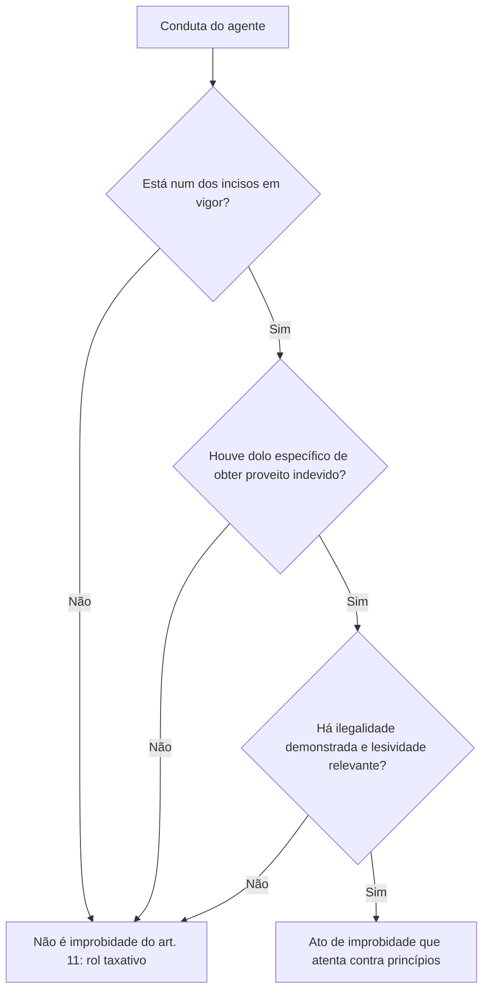

O capítulo anterior trouxe o enriquecimento ilícito e as bases do art. 10. Aqui o estudo se completa. Primeiro, os demais incisos do art. 10, que reúnem condutas de gestão de dinheiro público: operações financeiras, benefícios fiscais, licitações, despesas, tributos, consórcios e parcerias. Depois, o art. 11, a espécie das **violações a princípios**, que foi a mais reformulada pela Lei 14.230/2021: perdeu o caráter aberto, ganhou parágrafos que limitam seu alcance e recebeu dois tipos novos, o nepotismo e a promoção pessoal. É o conteúdo mais literal de toda a LIA, então a precisão na leitura dos incisos faz diferença.

> [!objetivos]
> - Reconhecer as condutas do art. 10 que a reforma alterou ou acrescentou.
> - Aplicar a exigência de dano efetivo e a regra do art. 10, § 2º, sobre a atividade econômica.
> - Identificar as mudanças do art. 11: dolo específico, rol taxativo e condutas revogadas.
> - Explicar os parágrafos do art. 11: fim de proveito indevido, demonstração objetiva e lesividade relevante.
> - Reconhecer as condutas dos incisos III a VIII, XI e XII do art. 11.

## Demais condutas do art. 10

As condutas do art. 10 já vistas no capítulo anterior (incisos I, II, IV, V, XII e XIII) representam apenas parte do rol. Os demais incisos tratam de operações e procedimentos em que o administrador lida com recursos, e todos exigem **dolo** e **perda patrimonial efetiva**.

| Inciso | Conduta, em resumo | Exemplo |
| --- | --- | --- |
| III | Doar bens, rendas, verbas ou valores a pessoa física, jurídica ou ente despersonalizado, mesmo com fins sociais, sem seguir as formalidades legais | Agente que doa veículos do órgão a uma associação sem autorização legal |
| VI | Realizar operação financeira sem seguir as normas ou aceitar garantia insuficiente ou inadequada | Agente de banco estatal que concede crédito sem garantia suficiente, de propósito |
| VII | Conceder benefício administrativo ou fiscal sem as formalidades legais | Isenção tributária concedida fora do rito legal |
| VIII | Frustrar a licitude de licitação ou de seleção de parcerias com entidades sem fins lucrativos, ou dispensá-las indevidamente, **com perda patrimonial efetiva** | Dispensa indevida de licitação com sobrepreço comprovado |
| IX | Ordenar ou permitir despesa que a lei ou o regulamento não autoriza | Pagamento fora do que prevê a lei orçamentária |
| X | Agir **ilicitamente** na arrecadação de tributo ou renda ou na conservação do patrimônio público | Deixar, dolosamente, de cobrar tributo devido para favorecer um contribuinte |
| XI | Liberar verba pública sem seguir as normas, ou influir para sua aplicação irregular | Autorizar repasse sem prestação de contas anterior |
| XIV | Celebrar contrato de gestão associada de serviços públicos sem observar as formalidades legais | Ajuste entre entes para um serviço comum, sem o rito exigido |
| XV | Celebrar contrato de rateio de consórcio público sem dotação orçamentária prévia e suficiente ou sem as formalidades legais | Município que assina rateio sem previsão no orçamento |
| XVI a XVIII | Favorecer a incorporação de recursos de parcerias ao patrimônio particular, permitir seu uso privado ou celebrar parcerias sem as formalidades | Entidade parceira que usa verba pública para fins particulares, com a ajuda do agente |
| XIX | Agir **para configurar ilícito** na celebração, fiscalização ou análise de contas de parcerias | Aprovar prestação de contas sabendo da fraude |
| XX | Liberar recursos de parcerias sem observar as normas ou influir para sua aplicação irregular | Repasse sem seguir o plano de trabalho |
| XXII | Conceder, aplicar ou manter benefício financeiro ou tributário contrário às regras do ISS da Lei Complementar 116/2003 | Incentivo que reduza o ISS abaixo da alíquota mínima |

### O que a reforma mudou nos incisos

Duas mudanças aparecem nas descrições:

1. **Verbos que indicavam culpa foram trocados.** O inciso X, que punia o agir "negligentemente" na arrecadação de tributo ou na conservação do patrimônio, passou a punir o agir "ilicitamente". O inciso XIX, que punia o agir negligente na celebração e fiscalização de parcerias, passou a punir o agir "para a configuração de ilícito". O inciso XXI foi revogado.
2. **A lesão precisa ser efetiva.** O inciso VIII exige "perda patrimonial efetiva". Se o responsável frustrou a licitação com o fim de obter benefício, mas a contratação ocorreu sem prejuízo ao erário, a conduta pode ser improbidade como violação a princípios (art. 11, V), e não como lesão.

O termo "dispensá-los indevidamente" no inciso VIII é interpretado de forma ampla para alcançar todas as formas de contratação direta ilegal, como a inexigibilidade indevida. Mas atenção: há hipóteses lícitas de dispensa. Só a dispensa indevida configura o ato.

### O caso do inciso XXII

A conduta de conceder benefícios tributários contrários à Lei Complementar 116/2003 foi criada em 2016 como art. 10-A, uma "quarta espécie" que quebrava o escalonamento das três clássicas. A reforma revogou o art. 10-A e levou a conduta ao inciso XXII do art. 10. A regra de fundo é a alíquota mínima de 2% do Imposto sobre Serviços (ISS): o município não concede isenção, incentivo ou benefício que deixe a carga abaixo disso, salvo exceções previstas na própria lei complementar, em especial para alguns serviços de construção civil, de reparação de edifícios e de transporte coletivo municipal.

### Duas regras complementares

O art. 10 recebeu dois parágrafos em 2021:

- **§ 1º:** se o descumprimento de formalidades não causar perda patrimonial efetiva, não há ressarcimento, para evitar o enriquecimento sem causa da entidade pública;
- **§ 2º:** o simples prejuízo **inerente à atividade econômica** não gera improbidade, a menos que se prove ato doloso praticado para esse fim.

Explorar atividade econômica envolve riscos: concorrência, mudanças de mercado, inadimplência. Se uma empresa estatal sofre um calote numa operação que seguiu as cautelas esperadas, não há improbidade dos responsáveis. Mas, se um dirigente concede crédito com recursos públicos, sem observar as regras, para favorecer a empresa de um amigo, há improbidade, e o ressarcimento pode ser imputado a ele.

> [!pegadinha] Prejuízo não é sinônimo de improbidade
> O prejuízo comercial de uma estatal não é automaticamente lesão ao erário para a LIA. É preciso demonstrar **dolo** de lesar ou de beneficiar indevidamente alguém, e perda efetiva comprovada.

> [!resolvido] Questão comentada: dispensa indevida sem prejuízo
> Um gestor dispensa licitação fora das hipóteses legais, com o objetivo de beneficiar a empresa de um parente. O preço contratado foi compatível com o de mercado, e não houve perda patrimonial. Qual é o enquadramento?
>
> **Resolução.** Não há art. 10, VIII, porque falta a perda patrimonial **efetiva**. Mas a conduta frustra, em ofensa à imparcialidade, o caráter competitivo do procedimento com vistas a benefício de terceiro, o que se encaixa no **art. 11, V**. Há improbidade, só que como violação a princípios, e o ressarcimento não é cabível, porque não houve dano.

## Atos que atentam contra os princípios (art. 11)

O art. 11 alcança a conduta **dolosa**, por ação ou omissão, que ofenda os deveres de **honestidade, imparcialidade e legalidade** e que esteja entre as hipóteses listadas na própria lei. Este artigo independe da ocorrência de dano ao erário ou de enriquecimento ilícito (art. 11, § 4º): protege os valores da administração, ainda que o patrimônio fique intacto. Mas não basta violar um princípio. É preciso dolo e finalidade específica.

> [!lei] Lei 8.429/1992, art. 11, caput, §§ 1º e 2º
> Art. 11. Constitui ato de improbidade administrativa que atenta contra os princípios da administração pública a ação ou omissão dolosa que viole os deveres de honestidade, de imparcialidade e de legalidade, caracterizada por uma das seguintes condutas: (...)
> § 1º Nos termos da Convenção das Nações Unidas contra a Corrupção, promulgada pelo Decreto nº 5.687, de 31 de janeiro de 2006, somente haverá improbidade administrativa, na aplicação deste artigo, quando for comprovado na conduta funcional do agente público o fim de obter proveito ou benefício indevido para si ou para outra pessoa ou entidade.
> § 2º Aplica-se o disposto no § 1º deste artigo a quaisquer atos de improbidade administrativa tipificados nesta Lei e em leis especiais e a quaisquer outros tipos especiais de improbidade administrativa instituídos por lei.

### Mudanças da reforma de 2021

| Mudança | Antes | Depois |
| --- | --- | --- |
| Elemento subjetivo | Dolo, genérico bastava (jurisprudência) | Dolo específico |
| Natureza do rol | Exemplificativo ("e notadamente") | Taxativo ("caracterizada por uma das seguintes condutas") |
| Deveres violados | Honestidade, imparcialidade, legalidade e lealdade às instituições | Honestidade, imparcialidade e legalidade (a lealdade às instituições saiu) |
| Incisos | I, II, IX e X existiam | I, II, IX e X foram revogados |
| Novos tipos | Inexistentes | Nepotismo (XI) e promoção pessoal (XII) |

Entre os incisos revogados está o antigo I, que punia a prática de ato visando fim proibido em lei ou diverso do da competência, e o II, que punia retardar ou deixar de praticar indevidamente ato de ofício. Com a revogação, não é mais improbidade, por si só, o desvio de finalidade genérico nem a simples omissão.

### Os parágrafos que limitam o art. 11

Como esse é o artigo mais subjetivo, a lei acrescentou parágrafos para evitar que toda ilegalidade vire improbidade.

| Dispositivo | Regra |
| --- | --- |
| § 1º | A conduta funcional precisa revelar o objetivo de conseguir vantagem ou benefício ilegítimo, para o próprio agente ou para qualquer outra pessoa ou entidade |
| § 2º | A regra do § 1º vale para todos os atos de improbidade da LIA e das leis especiais |
| § 3º | A configuração exige a demonstração objetiva de ilegalidade no exercício da função, com indicação das normas constitucionais, legais ou infralegais violadas |
| § 4º | O ato exige lesividade relevante ao bem jurídico tutelado e independe de dano ao erário ou de enriquecimento ilícito |
| § 5º | A mera nomeação ou indicação política por detentores de mandato eletivo não configura improbidade; é preciso dolo com finalidade ilícita |

O § 4º consagra, na prática, o **princípio da insignificância**: violações de bens jurídicos de pequeno valor ou com efeitos mínimos não são puníveis como improbidade.

> [!esquema] Quando o art. 11 se configura
> - Dolo específico, com a finalidade de obter proveito ou benefício indevido (§ 1º).
> - Conduta que se encaixa em um dos incisos, pois o rol é taxativo.
> - Demonstração objetiva da ilegalidade e das normas violadas (§ 3º).
> - Lesividade relevante, e não mera irregularidade (§ 4º).

### Condutas do art. 11

Os incisos hoje em vigor são os seguintes:

| Inciso | Conduta, em resumo | Observação |
| --- | --- | --- |
| III | Revelar segredo de que tem ciência em razão das atribuições, gerando benefício por informação privilegiada ou risco à segurança da sociedade e do Estado | A revelação precisa ter uma dessas duas consequências |
| IV | Negar publicidade a atos oficiais, salvo se o sigilo for imprescindível à segurança da sociedade e do Estado ou previsto em lei | Violação do princípio da publicidade |
| V | Frustrar, em ofensa à imparcialidade, o caráter competitivo de concurso público, chamamento ou licitação, para obter benefício próprio ou de terceiros | A conduta mais cobrada do artigo |
| VI | Deixar de prestar contas quando obrigado e com condições de fazê-lo, para ocultar irregularidades | O dever de prestar contas vale para quem gere recursos públicos |
| VII | Revelar ou deixar chegar a terceiro, antes da divulgação oficial, o teor de medida política ou econômica capaz de afetar preços | Exemplo: vazamento de medida do Banco Central |
| VIII | Descumprir normas de celebração, fiscalização e aprovação de contas de parcerias com entidades privadas | Versão sem dano das condutas dos incisos XVI a XX do art. 10 |
| XI | Prover cargo em comissão, cargo de confiança ou função gratificada com cônjuge, companheiro ou parente (reta, colateral ou afinidade) até o 3º grau da autoridade que nomeia ou de servidor de direção, chefia ou assessoramento no mesmo órgão, inclusive por troca de nomeações | Segue a Súmula Vinculante 13 |
| XII | Praticar publicidade custeada pelo erário que contrarie o art. 37, § 1º, da Constituição, promovendo enaltecimento do agente e personalização de atos, programas, obras, serviços ou campanhas | Promoção pessoal |

Observe o inciso V: ele ampliou a lista de procedimentos protegidos (antes só o concurso público) para incluir o chamamento público e a licitação. A frustração precisa vir acompanhada do propósito de obter benefício. Observe também o inciso VI: a omissão de prestar contas só é improbidade quando há condições de prestá-las e a finalidade é ocultar irregularidades.

### Nepotismo e promoção pessoal

O inciso XI trouxe para a LIA a mesma redação da **Súmula Vinculante 13** do STF, que impede a nomeação de parentes de autoridades para cargos em comissão ou funções de confiança. A proibição atinge a administração direta e a indireta, em qualquer Poder e em qualquer ente federado, e inclui a troca de nomeações entre autoridades, que a prática chama de nepotismo cruzado. O § 5º, porém, ressalva que a simples nomeação ou indicação política por detentores de mandato eletivo, sem dolo com finalidade ilícita, não é improbidade.

### Roteiro de análise do art. 11

### Entendendo a Súmula Vinculante 13

A súmula proíbe a nomeação de cônjuge, companheiro ou parente até o terceiro grau, em linha reta, colateral ou por afinidade, da autoridade nomeante ou de servidor da mesma pessoa jurídica que ocupe cargo de direção, chefia ou assessoramento, para cargo em comissão ou de confiança ou função gratificada. Para contar o grau de parentesco: pais e filhos são de primeiro grau; avós, netos e irmãos, de segundo; tios, sobrinhos e bisavós, de terceiro. Sogros, genros e noras são parentes por afinidade em primeiro grau. Assim, o cunhado (parente por afinidade em segundo grau) e o tio do cônjuge (terceiro grau) também entram na proibição.

| Parentesco com a autoridade | Grau | Dentro do limite? |
| --- | --- | --- |
| Filho | 1º | Sim |
| Irmão | 2º | Sim |
| Sobrinho | 3º | Sim |
| Primo | 4º | Não |
| Sogro | 1º (afinidade) | Sim |
| Cunhado | 2º (afinidade) | Sim |

Observe que a lista inclui o primo, de quarto grau, como situação **fora** da proibição. Por isso, a nomeação do primo, sozinha, não se enquadra no inciso XI.

O inciso XII reflete o art. 37, § 1º, da Constituição: a publicidade oficial deve ser educativa, informativa ou de orientação social e não pode trazer nomes, símbolos ou imagens que sirvam à promoção pessoal de autoridades ou servidores.

> [!bizu] Incisos revogados do art. 11
> Memorize que **I, II, IX e X** foram revogados. Então, assertivas que descrevam como improbidade do art. 11 (a) atos com fim proibido por lei, (b) retardar ato de ofício, (c) deixar de cumprir acessibilidade ou (d) transferir recurso sem contrato na área da saúde estão desatualizadas e erradas.

> [!resolvido] Questão comentada: nomeação de parente
> Um secretário nomeia a prima de um diretor da mesma secretaria para um cargo em comissão de assessoramento. Em troca, o diretor nomeia o sobrinho do secretário para outro cargo de confiança. Há improbidade?
>
> **Resolução.** Em tese, sim, pelo art. 11, XI, que alcança parentes até o terceiro grau de autoridade nomeante ou de servidor em cargo de direção, chefia ou assessoramento, e expressamente inclui o ajuste por designações recíprocas. Para a configuração, é preciso, porém, demonstrar o dolo com finalidade ilícita (art. 11, § 5º, e § 1º), pois a nomeação política, por si só, não basta.

### Nepotismo: ilícito administrativo e improbidade

Convém separar dois planos. A **proibição de nepotismo** decorre dos princípios constitucionais e da Súmula Vinculante 13 e vale mesmo sem lei específica: a nomeação irregular pode e deve ser anulada pela administração. Já a **improbidade** do art. 11, XI, é mais exigente: além do parentesco, requer dolo com a finalidade de obter proveito indevido, nos termos dos §§ 1º e 5º. Por isso uma nomeação que viola a súmula pode ser ilegal e ser desfeita, sem que o gestor seja condenado por improbidade. Também há situações que a súmula não abrange, como as nomeações de agentes políticos para cargos de natureza política, tema fora do alcance deste volume.

## Distinguindo as três espécies na prática

Ao ler um caso, três perguntas separam as espécies. Primeiro: o agente **obteve vantagem patrimonial** indevida? Se sim, art. 9º. Segundo: o patrimônio público sofreu **perda efetiva comprovada**, causada pelo agente ou por sua omissão dolosa? Se sim, art. 10. Terceiro: a conduta está num dos incisos do art. 11, com fim de proveito indevido e lesividade relevante? Se sim, art. 11. Nessa ordem, a espécie mais grave prevalece.

> [!exemplo] O mesmo fato, três enquadramentos
> Um gestor frauda a licitação de uma obra para contratar a empresa de um amigo. Se recebeu parte do contrato (vantagem), a conduta é do art. 9º. Se não recebeu nada, mas a obra foi paga acima do preço de mercado e o sobrepreço está comprovado, é do art. 10. Se o preço foi correto e a obra foi bem executada, mas ficou provado que ele frustrou, com dolo, o caráter competitivo para favorecer o amigo, aplica-se o art. 11, V.

## Como a banca cobra este assunto

O art. 10 aparece com assertivas que descrevem uma conduta e perguntam a espécie, ou que reproduzem a redação antiga com o verbo "negligentemente". No art. 11, o tema campeão é a mudança: dolo específico, rol taxativo, incisos revogados, deveres violados. Outro favorito é o inciso V, pela troca do objeto protegido. Há ainda itens sobre os parágrafos: a alternativa afirma que o art. 11 depende de dano ao erário (errada, § 4º) ou que basta violar o princípio (errada, § 1º). Para acertar, relacione cada conduta ao verbo-chave e ao artigo.

## Mapa do capítulo

| Tema | Ideia central | Armadilha |
| --- | --- | --- |
| Art. 10, inciso VIII | Licitação ou seleção frustrada, com perda efetiva | Exigir só a ilegalidade |
| Verbos culposos | "Negligentemente" virou "ilicitamente" ou "para configurar ilícito" | Usar a redação antiga |
| Art. 10-A | Revogado; conduta migrou para o inciso XXII | Citar quatro espécies |
| Art. 10, § 2º | Perda da atividade econômica não é improbidade | Presumir improbidade em prejuízo comercial |
| Art. 11 | Dolo específico, rol taxativo, três deveres | Incluir lealdade às instituições |
| Incisos revogados | I, II, IX e X | Tratá-los como vigentes |
| Parágrafos do art. 11 | Proveito indevido, demonstração objetiva, lesividade | Dispensar a lesividade |
| Inciso XI | Nepotismo, como a SV 13 | Esquecer designações recíprocas |
| Inciso XII | Promoção pessoal com publicidade | Confundir com publicidade comum |

### Para fixar

1. Todos os incisos do art. 10 exigem dolo e perda patrimonial efetiva e comprovada.
2. Os verbos "negligentemente" foram trocados por "ilicitamente" ou por "agir para configurar ilícito".
3. O art. 10-A foi revogado e a conduta passou ao art. 10, XXII.
4. Perda patrimonial da atividade econômica só é improbidade se houver ato doloso com essa finalidade.
5. O art. 11 exige dolo específico, tem rol taxativo e protege honestidade, imparcialidade e legalidade.
6. Os incisos I, II, IX e X do art. 11 foram revogados.
7. O art. 11 exige fim de proveito indevido, demonstração objetiva da ilegalidade e lesividade relevante.
8. O art. 11 independe de dano ao erário e de enriquecimento ilícito.
9. O art. 11, V, protege concurso, chamamento e licitação contra a frustração do caráter competitivo.
10. Nepotismo (XI) e promoção pessoal (XII) são tipos novos; a mera nomeação política não é improbidade.
