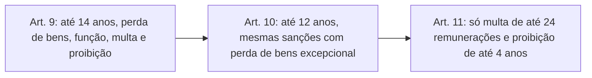

As sanções são o ponto em que as provas gostam de cobrar números: anos de suspensão dos direitos políticos, anos de proibição de contratar, múltiplos da multa. A Lei 14.230/2021 reescreveu todo o art. 12, e decisões do STF ajustaram alguns de seus parágrafos. Este capítulo organiza as penalidades por espécie de ato, mostra as regras de dosimetria e de execução e fecha com o afastamento preventivo do agente, medida cautelar que muita gente confunde com sanção.

> [!objetivos]
> - Distinguir as sanções do art. 12 por espécie de ato e memorizar os limites de cada uma.
> - Explicar por que o ressarcimento não é sanção em sentido estrito e como se relaciona com as demais.
> - Aplicar a perda da função pública, a multa, a proibição de contratar e as regras de dosimetria.
> - Reconhecer que as sanções só se executam após o trânsito em julgado.
> - Descrever o afastamento preventivo e seus prazos.

## Noções gerais sobre as sanções

As sanções por improbidade são aplicadas pelo **Poder Judiciário**, na ação de improbidade, que segue o Código de Processo Civil e as regras próprias da LIA. O art. 12 define o regime: o responsável fica sujeito às cominações previstas, **isolada ou cumulativamente**, conforme a gravidade do fato, e isso sem prejuízo do ressarcimento integral do dano, se efetivo, e das sanções penais, civis e administrativas da legislação específica.

Quatro ideias do caput merecem destaque.

1. **O ressarcimento saiu da lista de sanções.** Reparar o prejuízo é obrigação civil: quem bate no carro de outro tem de pagar o conserto, e isso não é pena. Mesmo assim, é comum chamar o ressarcimento de "sanção". O essencial é que ele ocorre **sempre que houver dano patrimonial efetivo**, e **não impede** as demais sanções.
2. **Independência das instâncias.** A aplicação das penas por improbidade independe das sanções penais, civis, administrativas e de responsabilidade previstas em outras leis. O agente pode, por exemplo, ser demitido em processo disciplinar e condenado por improbidade, e o agente político pode responder também por crime de responsabilidade, formando o duplo regime sancionatório.
3. **Dosimetria pelo juiz.** Cabe ao juiz decidir, de forma motivada, quais sanções aplicar e em que medida, de acordo com a gravidade do fato.
4. **Dedução do ressarcimento já obtido.** Se houver lesão ao patrimônio público, a reparação nesta lei deve deduzir o que já foi ressarcido nas esferas criminal, civil e administrativa pelos mesmos fatos (art. 12, § 6º).

### Independência das sanções em relação a dano e a contas

O art. 21 estabelece que a aplicação das sanções independe: (a) da efetiva ocorrência de dano ao patrimônio público, salvo quanto ao ressarcimento e às condutas de lesão ao erário (art. 10); e (b) da aprovação ou rejeição das contas pelo controle interno ou pelo Tribunal ou Conselho de Contas.

Isso decorre de duas coisas. Enriquecimento ilícito e violação a princípios não exigem dano ao erário. E a aprovação das contas não afasta a improbidade, porque a análise das contas não tem como objetivo apurar esse ilícito. Mas as decisões do controle serão consideradas pelo juiz se o agente se baseou neles ao agir, e as provas produzidas perante os órgãos de controle entram na formação do convencimento, sem dispensar a análise do dolo (art. 21, §§ 1º e 2º).

> [!pegadinha] "Contas aprovadas afastam a improbidade"
> O julgamento regular das contas pelo tribunal de contas **não** afasta, por si só, a responsabilidade por improbidade. A decisão do controle é elemento de prova, mas o juiz continua a avaliar o dolo.

## Sanções por espécie de ato

As sanções variam conforme a espécie:

| Sanção | Enriquecimento ilícito (art. 9º) | Lesão ao erário (art. 10) | Violação a princípios (art. 11) |
| --- | --- | --- | --- |
| Perda dos bens ou valores acrescidos ilicitamente | Sempre | Se concorrer essa circunstância | Não |
| Perda da função pública | Sim | Sim | Não |
| Suspensão dos direitos políticos | Até 14 anos | Até 12 anos | Não |
| Multa civil | Equivalente ao acréscimo patrimonial | Equivalente ao dano | Até 24 vezes a remuneração do agente |
| Proibição de contratar com o poder público e de receber benefícios ou incentivos fiscais ou creditícios | Até 14 anos | Até 12 anos | Até 4 anos |

O ressarcimento aplica-se sempre que houver dano efetivo, em qualquer espécie.

> [!bizu] Os números 14, 12 e 24
> Associe cada espécie a um número: enriquecimento ilícito, **14**; lesão ao erário, **12**; violação a princípios, **24**. O "24" lembra três coisas do art. 11: são apenas **duas sanções** (multa e proibição), o limite da multa é de **24 vezes** a remuneração e o limite da proibição de contratar é de **4 anos**.

As penalidades de enriquecimento ilícito e lesão ao erário são parecidas, com três diferenças: a perda de bens na lesão só ocorre quando o agente se enriquece também (por exemplo, ao permitir que terceiro se enriqueça); a multa equivale ao acréscimo (art. 9º) ou ao dano (art. 10); e os prazos são de até 14 ou de até 12 anos.

O STF considerou constitucional a limitação das sanções do art. 11 a apenas duas. O argumento é que o art. 37, § 4º, da Constituição prevê as consequências "na forma e gradação previstas em lei", de modo que a definição de quais sanções cabem em cada ato está dentro da liberdade do legislador.

## Perda da função pública

A perda da função pública é cabível nos atos de **enriquecimento ilícito e de lesão ao erário**, e não nos que atentam contra os princípios. A redação da reforma previa que a sanção só alcançasse o vínculo da mesma espécie que o agente mantinha quando cometeu a infração, e só excepcionalmente, no enriquecimento ilícito, o juiz poderia estendê-la a outros vínculos. Isso gerava absurdos: um prefeito condenado por improbidade poderia, no trânsito em julgado, já ocupar mandato de deputado e conservá-lo, pois o vínculo seria de outra natureza.

No julgamento das ADIs 7156 e 7236, concluído em 1º/7/2026, o STF retirou do art. 12, § 1º, as expressões "apenas", "na hipótese do inciso I do caput deste artigo" e "em caráter excepcional" e deu interpretação conforme a Constituição ao restante, de modo que, **tanto no enriquecimento ilícito quanto na lesão ao erário, a regra é a perda se estender a todos os cargos e vínculos**. Em casos excepcionais, devidamente motivados, o juiz pode limitar o alcance. Um exemplo plausível: um vereador condenado que também ocupa cargo efetivo de enfermeiro em hospital público, onde atua sem qualquer relação com o ilícito; o juiz pode decretar a perda do mandato e preservar o cargo efetivo.

| Aspecto | Redação da reforma | Entendimento do STF (ADIs 7156 e 7236) |
| --- | --- | --- |
| Alcance da perda | Só o vínculo de mesma natureza | Regra: todos os vínculos |
| Extensão a outros vínculos | Exceção, só no enriquecimento ilícito | Vale também na lesão ao erário |
| Exceção | Estender | Limitar, em decisão motivada |

## Multa civil

A multa tem base no valor do acréscimo (art. 9º), do dano (art. 10) ou da remuneração do agente (art. 11). Se o juiz considerar que, pela situação econômica do réu, o valor calculado não é suficiente para reprovar e prevenir o ato, ele pode **aumentá-la até o dobro** (art. 12, § 2º). Quando o réu é pessoa jurídica, o juiz pesa o impacto econômico e social da punição para que a empresa possa continuar funcionando (§ 3º). É a aplicação da função social da empresa: uma sanção que fecha a empresa fecha também postos de trabalho. Exemplo numérico: se a base legal da multa é de 200 mil reais e o juiz entende que, diante da fortuna do réu, esse valor não cumpre a função de reprovar e prevenir, a multa pode chegar a 400 mil reais, mas não passar disso.

## Proibição de contratar com o poder público

A proibição de contratar, e de receber benefícios ou incentivos fiscais ou creditícios, abrange a contratação direta e a indireta, inclusive por pessoa jurídica de que o agente seja sócio majoritário. A reforma tentou limitá-la ao ente lesado, com exceções para casos relevantes. O STF, nas ADIs 7156 e 7236, declarou esse dispositivo (art. 12, § 4º) **inconstitucional** e entendeu que a proibição se aplica a **todos os entes da federação**. A sanção deve constar do Cadastro Nacional de Empresas Inidôneas e Suspensas (CEIS), observadas as limitações territoriais da decisão judicial (§ 8º).

> [!atencao] Se a decisão for limitada ao ente lesado
> O texto legal original do § 4º previa que a sanção poderia extrapolar o ente lesado apenas em caráter excepcional. Com o entendimento do STF descrito acima, a regra é que a sanção alcança todos os entes. Verifique sempre o comando da questão: se ela se refere ao texto da lei ou à decisão do STF.

## Atos de menor ofensa

Quando o ato ofende pouco os bens jurídicos protegidos, a punição se restringe à **multa**; ainda assim, se houver dano, ele é reparado, e os valores obtidos indevidamente são perdidos (art. 12, § 5º). Na prática, é a válvula que impede punições desproporcionais a irregularidades de pequena repercussão, como um uso eventual e de baixo valor de um bem público. O texto cita apenas a multa, mas ela convive com a devolução do prejuízo e com o confisco do que o agente obteve de forma ilícita.

## Execução das sanções: trânsito em julgado

> [!lei] Lei 8.429/1992, art. 12, § 9º
> § 9º As sanções previstas neste artigo somente poderão ser executadas após o trânsito em julgado da sentença condenatória.

Isso vale para **todas** as sanções. O art. 20, caput, que dizia o mesmo apenas sobre a perda da função e a suspensão dos direitos políticos, ficou como resquício da redação antiga, e o § 9º tem alcance mais amplo. A regra reflete a presunção de inocência.

O § 10 do art. 12 previa que o prazo da suspensão dos direitos políticos fosse contado **retroativamente** a partir da decisão colegiada, descontando o intervalo até o trânsito em julgado. Seria um mecanismo que reduziria, às vezes a zero, a sanção: um réu condenado a oito anos de suspensão, com seis anos entre a decisão de segundo grau e o trânsito, cumpriria apenas dois. O STF declarou essa regra inconstitucional nas ADIs 7156 e 7236. Assim, o prazo corre normalmente a partir da execução.

## Afastamento preventivo

O juiz pode afastar o agente do cargo, emprego ou função, mantendo a remuneração, se isso for indispensável para a **instrução do processo** ou para impedir que **novos ilícitos** estejam prestes a ocorrer (art. 20, § 1º). Não é sanção: é medida **cautelar**, e por isso mantém a remuneração. Também não é exceção à regra do trânsito em julgado, porque a perda da função, essa sim sanção, só ocorre depois dele.

| Característica | Regra após a reforma |
| --- | --- |
| Quem determina | Apenas a autoridade judicial (antes, a autoridade administrativa também podia) |
| Hipóteses | Necessidade da instrução ou risco de novos ilícitos |
| Remuneração | Mantida |
| Prazo | Até 90 dias, prorrogável uma única vez por igual prazo, por decisão motivada |

> [!resolvido] Questão comentada: afastamento e remuneração
> Um juiz determina o afastamento de um servidor suspeito de destruir documentos de um processo de improbidade. A defesa alega que o afastamento sem trânsito em julgado viola a regra de que as sanções só se executam depois da decisão definitiva e que o servidor não poderia ser afastado sem remuneração. A defesa está correta?
>
> **Resolução.** Não. O afastamento não é sanção, é medida cautelar judicial para proteger a instrução e evitar novos ilícitos (art. 20, § 1º), e a remuneração é **mantida**. Por isso, a regra do trânsito em julgado não se aplica a ele. O prazo máximo é de 90 dias, prorrogável uma vez.

## Como a banca cobra este assunto

O foco é numérico. A banca troca 14 por 12 ou 12 por 14, inverte o limite do art. 11 ou atribui a suspensão dos direitos políticos aos atos que atentam contra os princípios. Também cobra o conceito do ressarcimento, a regra do trânsito em julgado e o afastamento preventivo (prazo de 90 dias, remuneração mantida, só o Judiciário). Para acertar, monte mentalmente a tabela das três espécies e confira cada sanção.

## Mapa do capítulo

| Tema | Ideia central | Armadilha |
| --- | --- | --- |
| Competência | Sanções aplicadas pelo Judiciário | Atribuir à administração |
| Ressarcimento | Obrigação civil, sempre que houver dano efetivo | Chamá-lo de sanção exclusiva do art. 10 |
| Instâncias | Independentes | Dizer que a condenação criminal impede a improbidade |
| Enriquecimento ilícito | Até 14 anos; multa igual ao acréscimo | Trocar prazos |
| Lesão ao erário | Até 12 anos; multa igual ao dano | Trocar prazos |
| Violação a princípios | Multa de até 24 vezes a remuneração; proibição de até 4 anos | Incluir suspensão de direitos políticos |
| Perda da função | Todos os vínculos como regra | Limitar ao vínculo da época |
| Execução | Só após o trânsito em julgado | Executar a perda da função antes |
| Afastamento | Cautelar, judicial, 90 dias, com remuneração | Tratá-lo como sanção |

### Para fixar

1. As sanções por improbidade são aplicadas pelo Judiciário, isolada ou cumulativamente, conforme a gravidade.
2. O ressarcimento é obrigação civil, devido sempre que houver dano efetivo.
3. As instâncias são independentes, e as contas aprovadas não afastam a improbidade.
4. Enriquecimento ilícito: perda de bens, perda da função, suspensão dos direitos políticos até 14 anos, multa igual ao acréscimo e proibição de contratar até 14 anos.
5. Lesão ao erário: as mesmas sanções, com suspensão e proibição até 12 anos e multa igual ao dano.
6. Violação a princípios: apenas multa de até 24 vezes a remuneração e proibição de contratar até 4 anos.
7. A multa pode ser aumentada até o dobro, em razão da situação econômica do réu.
8. Em atos de menor ofensa, a sanção é limitada à multa, sem prejuízo de ressarcimento e perda de valores.
9. Todas as sanções só se executam após o trânsito em julgado.
10. O afastamento preventivo é cautelar, judicial, com remuneração e dura até 90 dias, prorrogáveis uma vez.
