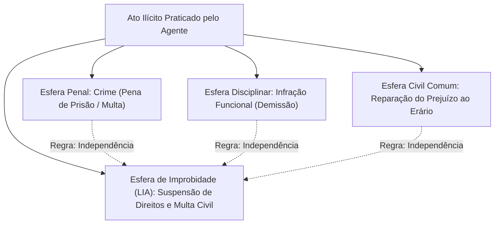
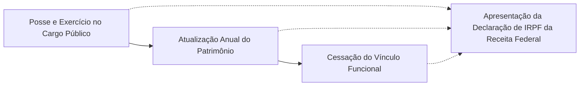

O ordenamento jurídico adota a pluralidade sancionatória: um mesmo ato ilícito pode repercutir nas esferas penal, civil, disciplinar e de improbidade. A Lei nº 8.429/1992, reformada pela Lei nº 14.230/2021 e interpretada pelo STF nas ADIs 7156 e 7236, fixou diretrizes sobre a independência das instâncias, a comunicação das decisões penais, a declaração de bens e o procedimento de apuração.

> [!objetivos]
> - Compreender a regra da independência das instâncias e as hipóteses de comunicação vinculante da absolvição criminal nos termos do art. 21, § 3º, e a decisão do STF nas ADIs 7156 e 7236.
> - Analisar a disciplina da dedução do ressarcimento ao erário e da compensação de sanções sancionatórias (art. 12, §§ 6º e 7º, e art. 21, § 5º).
> - Identificar as regras e consequências da declaração de imposto de renda apresentada à Receita Federal pelo agente público (art. 13).
> - Conhecer as formalidades da representação administrativa perante a autoridade competente (art. 14) e as prerrogativas de investigação do Ministério Público (art. 22 e art. 23, § 2º).

## A regra da independência das instâncias

A responsabilização por improbidade administrativa possui natureza estritamente civil-política. Ela tutela a probidade e a moralidade no trato da coisa pública, não se confundindo com a infração penal típica nem com a transgressão disciplinar funcional. Por essa razão fundamental, o art. 12 da Lei nº 8.429/1992 consagra que as sanções da LIA são aplicadas independentemente das sanções penais, civis e administrativas previstas na legislação específica.

Na prática operacional da administração pública, essa autonomia viabiliza que um mesmo fato ilícito deflagre apurações paralelas e simultâneas. Um servidor público que pratique desvio de verbas estatais pode sofrer a penalidade de demissão em processo administrativo disciplinar, responder a ação penal perante a Justiça Criminal sujeitando-se a pena privativa de liberdade e, cumulativamente, figurar no polo passivo de ação de improbidade na qual se cominem a suspensão de direitos políticos, a perda dos bens acrescidos ilicitamente e a condenação em ressarcimento ao erário.

O fluxograma a seguir ilustra a coexistência das esferas de apuração:

> [!esquema]
> A pluralidade sancionatória permite a cumulação de punições de naturezas distintas. A demissão funcional aplicada em PAD não impede a imposição judicial de suspensão dos direitos políticos e multa civil na ação de improbidade.

## Exceções à independência: reflexos da absolvição criminal

Embora vigore o princípio da autonomia entre as jurisdições, essa independência não é absoluta. O Direito não tolera contradições lógicas que comprometam a segurança jurídica. O art. 21, § 3º, da Lei nº 8.429/1992 positivou a comunicação vinculante das decisões absolutórias:

> [!lei] Art. 21, § 3º, da Lei nº 8.429/1992
> As sentenças civis e penais produzirão efeitos em relação à ação de improbidade quando concluírem pela inexistência da conduta ou pela negativa da autoria.

A absolvição criminal extingue a ação de improbidade ou impede a sua propositura exclusivamente quando fundamentada em:
1. **Inexistência material do fato ou da conduta:** o juízo criminal declara categoricamente que o fato imputado não ocorreu no mundo fenomênico (CPP, art. 386, I).
2. **Negativa categórica de autoria:** o juízo penal reconhece de forma inequívoca que o acusado não foi o autor nem concorreu para a prática da infração (CPP, art. 386, II).

### A declaração de inconstitucionalidade do art. 21, § 4º (ADIs 7156 e 7236)

A Lei nº 14.230/2021 havia inserido o § 4º no art. 21 da LIA para vincular a improbidade a qualquer absolvição criminal colegiada do art. 386 do CPP. Todavia, no julgamento das **ADIs 7156 e 7236** (concluído em 1º/7/2026), o STF declarou a **inconstitucionalidade do art. 21, § 4º**, reafirmando que a independência das esferas decorre do art. 37, § 4º, da CF/88 e que apenas a inexistência do fato ou a negativa de autoria (art. 21, § 3º) vincula a jurisdição cível.

A tabela a seguir sistematiza as repercussões da sentença criminal na esfera de improbidade:

| Fundamento da Sentença Penal | Efeito na Ação de Improbidade Administrativa | Dispositivo Legal de Regência |
|---|---|---|
| **Negativa de Autoria ou Inexistência da Conduta** | **Vinculação Obrigatória:** extingue a ação de improbidade e afasta as sanções civis. | Art. 21, § 3º, da LIA e art. 386, I e II, do CPP |
| **Falta ou Insuficiência de Provas (*in dubio pro reo*)** | **Não Vincula:** a ação de improbidade prossegue sob os padrões probatórios da jurisdição cível. | Art. 21, § 3º, da LIA e art. 386, VII, do CPP |
| **Atipicidade Penal da Conduta** | **Não Vincula:** o fato pode não constituir crime, mas caracterizar ato ímprobo doloso. | Jurisprudência consolidada do STJ e STF |
| **Extinção da Punibilidade (Prescrição Penal)** | **Não Vincula:** a prescrição penal não interfere no regime autônomo da LIA. | Art. 12 e art. 23 da LIA |

> [!pegadinha]
> **Absolvição por falta de provas não vincula:** preste atenção nas pegadinhas de prova. Se o réu foi absolvido no juízo criminal por insuficiência de provas (art. 386, VII, do CPP), essa decisão **não** impede a condenação por improbidade. O art. 21, § 4º, que ampliava a vinculação para todas as hipóteses do art. 386 do CPP, foi declarado inconstitucional pelo STF nas ADIs 7156 e 7236.

## Compensação de sanções e dedução de ressarcimento

A Lei nº 14.230/2021 estabeleceu regras expressas para evitar o enriquecimento sem causa do Estado e a punição dúplice pelo mesmo fato material (*bis in idem*).

A sistemática legal organiza-se em pilares essenciais:
- **Dedução do ressarcimento (art. 12, § 6º):** abatem-se da condenação indenizatória quantias já pagas nas esferas penal, administrativa ou cível sobre o mesmo fato.
- **Compensação de sanções (art. 21, § 5º):** penalidades pecuniárias de mesma natureza aplicadas em outras instâncias são compensadas com as multas da LIA.
- **Vedação de bis in idem (art. 12, § 7º):** sanções a pessoas jurídicas pela LIA e pela Lei nº 12.846/2013 não podem incidir em duplicidade.
- **Atos de controle (art. 21, § 1º):** pareceres de órgãos de controle que serviram de suporte à conduta do agente devem ser considerados pelo juiz.

> [!lei] Art. 21, § 1º, da Lei nº 8.429/1992
> Os atos do órgão de controle interno ou externo serão considerados pelo juiz quando tiverem servido de fundamento para a conduta do agente público.

## Declaração de bens e valores: artigo 13

A transparência patrimonial dos agentes públicos constitui mecanismo preventivo fundamental contra o enriquecimento ilícito. O art. 13 da Lei nº 8.429/1992, com a redação dada pela Lei nº 14.230/2021, reformulou a apresentação da declaração de bens.

### Apresentação da declaração de imposto de renda

O art. 13 da LIA vinculou o controle patrimonial diretamente aos dados fiscais:

> [!lei] Art. 13, caput, da Lei nº 8.429/1992
> A posse e o exercício de agente público ficam condicionados à apresentação de declaração de imposto de renda e proventos de qualquer natureza, que tenha sido apresentada à Secretaria Especial da Receita Federal do Brasil, a fim de ser arquivada no serviço de pessoal competente.

A declaração deve ser apresentada em momentos obrigatórios da carreira pública:
1. No instante da **posse e exercício** do mandato, cargo, emprego ou função pública;
2. Com periodicidade **anual**, para acompanhamento da evolução patrimonial (art. 13, § 2º);
3. No momento em que o servidor **cessar o exercício** de suas atribuições públicas (art. 13, § 2º).

É fundamental notar que a Lei nº 14.230/2021 **revogou** os antigos §§ 1º e 4º do art. 13. O antigo § 1º continha uma lista minuciosa de bens a declarar (imóveis, móveis, semoventes, bens de cônjuge e dependentes), e o antigo § 4º tratava de autorização de acesso a dados. Hoje, o agente público cumpre a obrigação mediante a simples entrega da declaração apresentada à Receita Federal.

### Penalidade disciplinar por recusa ou falsidade

A omissão deliberada na apresentação da declaração ou a inserção intencional de dados falsos sujeita o agente público a grave sanção administrativa:
- Aquele que se recusar a cumprir essa obrigação cadastral no prazo fixado ou que prestar declarações inverídicas sofrerá a penalidade funcional de **demissão** (art. 13, § 3º).
- A redação atualizada do art. 13, § 3º, prevê a sanção de "demissão" simples, sem a antiga locução "a bem do serviço público", uniformizando a terminologia sancionatória funcional.

## Procedimento administrativo de apuração

A persecução dos atos de improbidade pode ter início perante a própria Administração Pública ou no âmbito do Ministério Público. Os arts. 14, 15 e 22 da Lei nº 8.429/1992 estruturam o procedimento de apuração preliminar.

### A representação de qualquer pessoa: artigo 14

Qualquer cidadão possui a faculdade de noticiar a ocorrência de ato de improbidade à autoridade administrativa competente:

> [!lei] Art. 14, §§ 1º e 2º, da Lei nº 8.429/1992
> § 1º A representação, que será escrita ou reduzida a termo e assinada, conterá a qualificação do representante, as informações sobre o fato e sua autoria e a indicação das provas de que tenha conhecimento.
> § 2º A autoridade administrativa rejeitará a representação, em despacho fundamentado, se esta não contiver as formalidades estabelecidas no § 1º deste artigo. A rejeição não impede a representação ao Ministério Público, nos termos do art. 22 desta lei.

A lei exige formalidades mínimas para resguardar a Administração contra denúncias infundadas. A peça deve conter a **qualificação do representante**, a narrativa do fato e as provas conhecidas. Se a autoridade administrativa rejeitar formalmente a representação, essa decisão não obsta o envio da notícia diretamente ao Ministério Público.

> [!atencao]
> **Denúncias anônimas:** o STF e o STJ admitem denúncias anônimas, mas a peça não deflagra de imediato o processo formal: exige prévia averiguação sumária de verossimilhança.

### Investigação pelo Ministério Público: artigo 22 e artigo 23, § 2º

O Ministério Público possui ampla atribuição para investigar atos de improbidade administrativa. O art. 22 da LIA delimita suas prerrogativas:
- **Procedimentos investigativos:** o órgão ministerial pode instaurar inquérito civil, conduzir procedimentos preparatórios sumários ou requisitar a apuração criminal à autoridade policial competente (art. 22, caput).
- **Garantia de contraditório preliminar:** no curso do procedimento de apuração, assegura-se ao investigado a prerrogativa formal de apresentar manifestação escrita e juntar elementos de prova que auxiliem na elucidação dos acontecimentos (art. 22, parágrafo único).
- **Prazo do inquérito civil:** o procedimento investigativo ministerial possui prazo legal de **365 dias corridos**, comportando prorrogação justificada única por igual período mediante decisão fundamentada, conforme estipulado expressamente no **art. 23, § 2º**, da Lei nº 8.429/1992.
- **Crime de representação caluniosa (art. 19):** é crime punido com detenção e multa acionar autoridade ou o Ministério Público contra pessoa sabidamente inocente.

> [!resolvido]
> **Caso prático de prova:**
> Um servidor público civil da Secretaria de Educação do Estado de Pernambuco foi denunciado criminalmente na Vara Criminal da Justiça Comum pela suposta prática de peculato. Concomitantemente, o Ministério Público ajuizou ação de improbidade administrativa contra o servidor pelos mesmíssimos fatos. No juízo criminal, após instrução detalhada, foi proferida sentença penal absolutória transitada em julgado com base na comprovação cabal de inexistência material do fato (CPP, art. 386, I). Na ação de improbidade, o juiz cível decidiu condenar o servidor à perda do cargo, argumentando a independência absoluta das instâncias.
>
> **Análise jurídica da controvérsia:**
> A condenação cível é manifestamente ilegal. Embora vigore a regra geral da independência das instâncias (art. 12 da LIA), o art. 21, § 3º, introduzido pela Lei nº 14.230/2021, determina expressamente que as sentenças penais produzem efeitos vinculantes imediatos sobre a ação de improbidade quando concluírem pela inexistência do fato ou pela negativa de autoria. Uma vez comprovado pelo juízo penal que o fato material jamais ocorreu, a ação de improbidade deve ser julgada improcedente, cessando qualquer cominação de sanção contra o servidor.

## Mapa do capítulo

A tabela sintetiza os eixos centrais do capítulo:

| Tema Central | Regra Positivada | Fundamento na Lei nº 8.429/1992 |
|---|---|---|
| **Independência das Instâncias** | As esferas penal, civil, disciplinar e de improbidade são autônomas e cumuláveis. | Art. 12, caput |
| **Vinculação da Decisão Penal** | A sentença penal por inexistência do fato ou negativa de autoria vincula a ação de improbidade. | Art. 21, § 3º |
| **Inconstitucionalidade do § 4º** | O STF invalidou a vinculação por todos os incisos do art. 386 do CPP (ADIs 7156 e 7236). | STF (ADIs 7156 e 7236) |
| **Dedução do Ressarcimento** | O ressarcimento deduz quantias já recuperadas nas instâncias penal, civil ou administrativa. | Art. 12, § 6º |
| **Compensação de Sanções** | Sanções pecuniárias aplicadas em outras esferas devem ser compensadas com as da LIA. | Art. 21, § 5º |
| **Non bis in idem** | Aplicação harmônica e não cumulativa de sanções com a Lei nº 12.846/2013. | Art. 12, § 7º |
| **Declaração de Bens** | Apresentação da declaração de imposto de renda da Receita Federal na posse, anualmente e no desligamento. | Art. 13, caput e § 2º |
| **Punição por Recusa** | Sujeita o agente faltoso à penalidade disciplinar de demissão. | Art. 13, § 3º |
| **Representação Cidadã** | Exige qualificação do representante, narrativa do fato e indicação de provas. | Art. 14, § 1º |
| **Inquérito Civil Público** | Conduzido pelo MP com prazo de 365 dias corridos prorrogável uma vez por igual período. | Art. 22 e art. 23, § 2º |

### Para fixar

- A responsabilização por improbidade possui natureza civil-política e opera de forma autônoma em relação às sanções penais e disciplinares.
- A sentença penal absolutória vincula compulsoriamente a ação de improbidade quando fundada em negativa de autoria ou inexistência material do fato (art. 21, § 3º).
- O STF declarou inconstitucional o art. 21, § 4º, nas ADIs 7156 e 7236, afastando a vinculação da improbidade em casos de absolvição penal por insuficiência de provas.
- A reparação do dano em improbidade deduz os valores já ressarcidos nas esferas penal, civil e administrativa pelos mesmos fatos (art. 12, § 6º).
- A entrega de declaração de imposto de renda à Receita Federal é condição para a posse e exercício, sendo atualizada anualmente e no desligamento do agente público (art. 13).
- A recusa voluntária na apresentação da declaração de bens ou a prestação de informações falsas sujeita o servidor à pena de demissão (art. 13, § 3º).
- A representação administrativa por improbidade exige a qualificação do representante, narrativa circunstanciada do fato e indicação de provas conhecidas (art. 14, § 1º).
- O inquérito civil para apuração de improbidade tem prazo legal de 365 dias corridos, admitida prorrogação única por idêntico intervalo (art. 23, § 2º).
