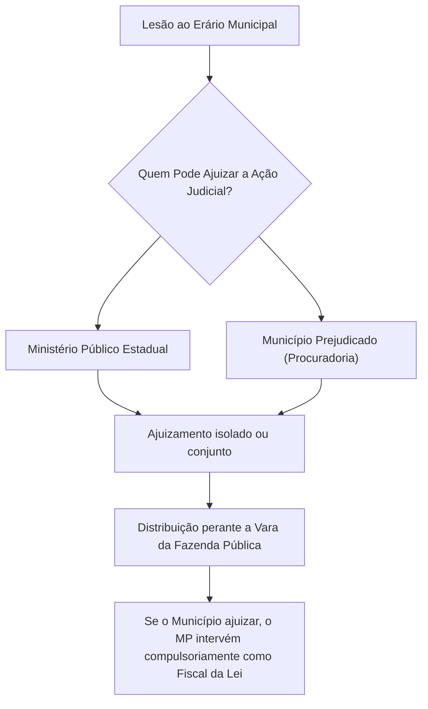
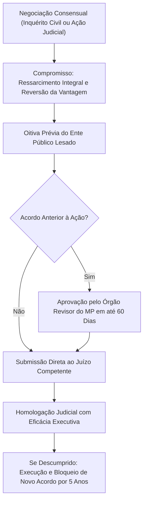

A concretização das sanções da Lei nº 8.429/1992 exige a instauração de processo judicial contraditório perante o Poder Judiciário. A imposição de penalidades graves como a perda da função pública e a suspensão de direitos políticos não pode ocorrer na via puramente administrativa. O art. 17 da Lei nº 8.429/1992 estabelece o rito processual da demanda judicial. Esse rito passou por profunda reformulação com o advento da Lei nº 14.230/2021 e os julgamentos vinculantes do Supremo Tribunal Federal nas ADIs 7042, 7043, 7156 e 7236.

> [!objetivos]
> - Compreender a legitimidade ativa concorrente e disjuntiva fixada pelo STF nas ADIs 7042 e 7043.
> - Dominar os requisitos da petição inicial, a citação direta e a contagem do prazo de resposta de trinta dias úteis.
> - Analisar as peculiaridades probatórias: vedação dos efeitos materiais da revelia e vedação da remessa necessária.
> - Conhecer a vinculação do juiz aos fatos narrados (ADIs 7156 e 7236) e a conversão em Ação Civil Pública (art. 17, § 16).
> - Examinar a disciplina do Acordo de Não Persecução Civil (Lei nº 8.429/1992, art. 17-B) e a inconstitucionalidade da oitiva da Corte de Contas.

## Legitimidade ativa: o julgamento das ADIs 7042 e 7043

A redação aprovada na Lei nº 14.230/2021 pretendia conferir monopólio processual ao Ministério Público para o ajuizamento da ação de improbidade e celebração de transações resolutivas. Essa previsão retirava a histórica prerrogativa das pessoas jurídicas lesadas (União, Estados, Municípios e entidades autárquicas) de acionarem judicialmente os causadores de prejuízos ao erário.

Contudo, ao apreciar as Ações Diretas de Inconstitucionalidade nº 7.042 e nº 7.043, o Supremo Tribunal Federal assentou que o art. 37, § 4º, da Constituição Federal outorga a legitimidade sancionatória à própria Administração Pública prejudicada:

> [!jurisprudencia] STF, ADIs 7042 e 7043 (Plenário, Rel. Min. Alexandre de Moraes)
> É inconstitucional o monopólio ministerial para ajuizar a demanda sancionatória por improbidade ou firmar termo de autocomposição. A legitimidade ativa é concorrente e disjuntiva entre o Ministério Público e a pessoa jurídica interessada prejudicada (União, Estados, Distrito Federal, Municípios e entidades da administração indireta).

A tabela a seguir sistematiza a configuração da legitimidade processual ativa:

| Ente com Legitimidade Ativa | Fundamento Constitucional e Legal | Prerrogativas Processuais na Demanda |
|---|---|---|
| **Ministério Público (Federal ou Estadual)** | CF/88, art. 129, inciso III, e art. 17 da Lei nº 8.429/1992 | Atua como autor principal ou como fiscal da ordem jurídica (*custos iuris*) se a ação for ajuizada pelo ente lesado. |
| **Pessoa Jurídica Prejudicada (Direta ou Indireta)** | CF/88, art. 37, § 4º, e STF (ADIs 7042 e 7043) | Pode ajuizar autonomamente a petição inicial, ingressar como litisconsorte ativa do MP ou firmar acordo consensual. |

O diagrama abaixo detalha a dinâmica da legitimidade concorrente disjuntiva:

## O rito processual comum da ação de improbidade

O art. 17, caput, da Lei nº 8.429/1992 estabelece que a ação para aplicação das sanções adotará o rito ordinário regulado no diploma processual civil brasileiro (CPC), ressalvadas as particularidades da LIA.

### Supressão da notificação prévia e citação direta

No texto anterior da própria Lei nº 8.429/1992 (antigo art. 17, § 7º), existia uma fase preliminar de notificação prévia para manifestação escrita em quinze dias antes do recebimento da inicial. A Lei nº 14.230/2021 suprimiu essa notificação prévia, adotando a citação direta para conferir maior celeridade processual.

A marcha procedimental inicial organiza-se da seguinte forma:
1. A petição inicial é distribuída com individualização da conduta e documentos probatórios;
2. Estando a inicial apta, o juiz determina a **citação direta** do réu;
3. O requerido dispõe do prazo de **30 (trinta) dias** para apresentar sua contestação escrita (art. 17, § 7º).

Esse prazo de 30 dias é prazo comum contado na forma do art. 231 do CPC. A contagem em **dias úteis** decorre da aplicação subsidiária da regra geral do art. 219 do CPC ao procedimento comum da LIA.

### Requisitos substanciais da petição inicial

A petição inicial deve individualizar de forma pormenorizada a conduta atribuída a cada um dos requeridos (art. 17, § 6º). A peça vestibular precisa apontar a atuação comissiva ou omissiva do agente, a demonstração do elemento subjetivo dolo, a indicação precisa do tipo violado e a instrução documental necessária. A imputação genérica ou desprovida de individualização enseja o indeferimento da inicial por inépcia.

## Regras processuais especiais: revelia, remessa necessária e recursos

Para harmonizar as garantias republicanas com o interesse público indisponível, a Lei nº 14.230/2021 estabeleceu normas especiais derrogatórias do direito processual geral:

| Instituto Processual | Regra Específica na Ação de Improbidade | Dispositivo Legal na Lei nº 8.429/1992 |
|---|---|---|
| **Efeitos da Revelia** | **Inaplicabilidade da presunção de veracidade.** A revelia não opera efeito material de confissão ficta sobre os fatos imputados na inicial. | Art. 17, § 19, inciso I |
| **Remessa Necessária** | **Não há reexame obrigatório.** A sentença que julgar improcedente ou extinguir a ação sem mérito submete-se exclusivamente a recurso voluntário. | Art. 17, § 19, IV, e art. 17-C, § 3º |
| **Decisões Interlocutórias** | Das decisões interlocutórias cabe **Agravo de Instrumento**, inclusive contra rejeição de preliminares na contestação. | Art. 17, § 21 |
| **Litisconsórcio Passivo** | O terceiro particular beneficiário não pode figurar isoladamente no polo passivo desacompanhado de agente público corréu. | Jurisprudência consolidada do STJ |

> [!pegadinha]
> **Ausência de remessa necessária:** no processo civil ordinário contra a Fazenda Pública, a sentença desfavorável ao Estado costuma submeter-se ao duplo grau de jurisdição. Na ação de improbidade, essa regra foi expressamente afastada (art. 17, § 19, IV, e art. 17-C, § 3º). Julgada improcedente a demanda, a decisão transita em julgado se não houver apelação voluntária das partes.

## A vinculação do juiz aos fatos narrados: ADIs 7156 e 7236

A reforma da Lei nº 14.230/2021 incluiu os §§ 10-C, 10-D e 10-F, I, no art. 17, buscando proibir que o magistrado alterasse a capitulação legal sugerida pelo autor e cominando nulidade à sentença que condenasse por tipo diverso do capitulado na inicial.

Contudo, ao julgar as **ADIs 7156 e 7236** (concluídas em 1º/7/2026), o Supremo Tribunal Federal invalidou esses dispositivos:
- O STF declarou inconstitucionais a expressão "e a capitulação legal apresentada pelo autor" do art. 17, § 10-C, o § 10-D e o inciso I do § 10-F.
- **Regra vigente:** o juiz fica vinculado estritamente aos **fatos narrados** na petição inicial (*narra mihi factum, dabo tibi ius*), e não à capitulação legal adotada pelo autor. O magistrado não pode condenar por fatos não narrados, mas pode reenquadrar juridicamente a conduta (por exemplo, condenar pelo art. 9º ou art. 10 caso a narrativa fática comprove essas espécies, ainda que a inicial tenha indicado o art. 11), assegurado o contraditório prévio das partes.

## Conversão da ação de improbidade em ação civil pública

Na prática judiciária, ações de improbidade eram ajuizadas para combater irregularidades puramente administrativas, sem comprovação de dolo ou desonestidade. Com a extinção da improbidade culposa pela Lei nº 14.230/2021, tais atos não configuram infração de improbidade.

Para evitar a extinção inútil do processo e assegurar o saneamento da administração, o legislador consagrou a regra de conversão:

> [!lei] Art. 17, § 16, da Lei nº 8.429/1992
> A qualquer momento, se o magistrado identificar a existência de ilegalidades ou de irregularidades administrativas a serem sanadas sem que estejam presentes todos os requisitos para a imposição das sanções aos agentes incluídos no polo passivo da demanda, poderá, em decisão motivada, converter a ação de improbidade administrativa em ação civil pública, regulada pela Lei nº 7.347, de 24 de julho de 1985.

O art. 17, § 17, complementa expressamente que **da decisão que converter a ação de improbidade em ação civil pública caberá agravo de instrumento**. A conversão afasta as severas sanções político-civis da LIA, permitindo que a demanda prossiga sob o rito da Lei da Ação Civil Pública com o objetivo de anular o ato nulo ou recompor eventuais prejuízos.

## Atuação defensiva da assessoria jurídica: artigo 17, § 20

Servidores e gestores públicos frequentemente respondem a processos judiciais decorrentes de decisões tomadas com respaldo formal em estudos técnicos e pareceres exarados pela assessoria jurídica do respectivo órgão estatal. Em diversas situações, o administrador limita-se a acolher conclusões jurídicas especializadas da procuradoria, sem deter conhecimentos aprofundados sobre minúcias do direito administrativo.

Visando resguardar a atuação regular do gestor de boa-fé, o art. 17, § 20, da LIA previu que o órgão de consultoria que subscreveu parecer prévio favorável à prática do ato administrativo poderá assumir a defesa judicial do agente público demandado. Todavia, ao apreciar as ADIs 7042 e 7043, o Supremo Tribunal Federal conferiu interpretação conforme à Constituição a essa previsão legal. O STF assentou categoricamente que a defesa técnica do administrador pela advocacia pública não tem natureza mandatória ou compulsória para a instituição. Trata-se de prerrogativa e faculdade institucional do órgão de advocacia estatal, ao qual compete avaliar, em cada caso concreto, se o servidor agiu em estrita fidelidade aos parâmetros do parecer e se a sua conduta não colide frontalmente com a proteção do erário e com os interesses republicanos primários do ente público.

## Acordo de Não Persecução Civil (ANPC): artigo 17-B

A Lei nº 14.230/2021 estruturou de forma minuciosa a solução consensual na improbidade administrativa por meio do Acordo de Não Persecução Civil (ANPC), disciplinado no art. 17-B. O termo de ajustamento pode ser pactuado tanto no curso do inquérito civil quanto na fase judicial ou na execução da sentença condenatória (Lei nº 8.429/1992, art. 17-B, § 4º).

### Requisitos e cláusulas obrigatórias

Para a celebração válida do acordo resolutivo, o art. 17-B impõe a obtenção cumulativa de resultados materiais inafastáveis:
1. **Ressarcimento integral do dano:** obrigação compulsória de recompor todo o prejuízo econômico infligido ao erário (Lei nº 8.429/1992, art. 17-B, I);
2. **Reversão da vantagem indevida:** devolução integral à pessoa jurídica prejudicada de qualquer proveito patrimonial ilícito auferido (Lei nº 8.429/1992, art. 17-B, II).

### Procedimento do acordo e afastamento da oitiva das Cortes de Contas

A eficácia do ANPC subordina-se a formalidades procedimentais estritas (Lei nº 8.429/1992, art. 17-B, § 1º):
- **Oitiva do ente federativo lesado:** prévia manifestação da pessoa jurídica prejudicada, seja antes ou depois da propositura da ação (inciso I);
- **Aprovação em até 60 dias:** se o termo for celebrado antes do ajuizamento da demanda, deve ser aprovado pelo órgão do Ministério Público competente para revisar promoções de arquivamento de inquérito civil no prazo máximo de 60 dias (inciso II);
- **Homologação judicial obrigatória:** o acordo depende indispensavelmente de homologação pelo magistrado competente para produzir efeitos de título executivo judicial (inciso III).

> [!jurisprudencia] STF, ADIs 7156 e 7236: Inconstitucionalidade da oitiva do Tribunal de Contas
> O art. 17-B, § 3º, exigia a oitiva obrigatória do Tribunal de Contas no prazo de 90 dias para manifestação sobre os parâmetros do dano a ressarcir. No julgamento das ADIs 7156 e 7236, o Supremo Tribunal Federal declarou a **inconstitucionalidade do art. 17-B, § 3º**, por entender que condicionar a celebração do acordo ministerial à manifestação prévia da Corte de Contas ofende a autonomia funcional do Ministério Público e a separação de poderes.

### Critérios de celebração e impedimento temporal por descumprimento

Na dosagem e celebração do ANPC, as partes considerarão a personalidade do agente, a natureza, as circunstâncias, a gravidade e a repercussão social do ato, bem como as vantagens práticas da rápida resolução do caso para o interesse público (Lei nº 8.429/1992, art. 17-B, § 2º).

Ademais, para coibir a má-fé, o art. 17-B, § 7º, prescreve que o investigado ou demandado que descumprir injustificadamente as cláusulas pactuadas no acordo **ficará impedido de celebrar novo ANPC pelo prazo de 5 (cinco) anos**, contado do conhecimento do efetivo descumprimento pelo Ministério Público.

> [!resolvido]
> **Questão prática de prova:**
> O Secretário de Saúde de determinado município pernambucano realizou aquisição de medicamentos com fundamento em parecer favorável formal da Procuradoria Municipal. O Ministério Público ajuizou ação de improbidade capitulando a conduta no art. 11 da LIA. Durante o processo, restou apurado que a contratação gerou sobrepreço e benefício ilícito ao fornecedor (art. 10), tendo sido narrados com detalhes todos os fatos na inicial. Em contestação, o réu defendeu que a petição era nula por capitulação diversa e exigiu que sua defesa fosse patrocinada compulsoriamente pela Procuradoria Municipal. Concomitantemente, propôs ANPC com ressarcimento, mas sem aprovação do Tribunal de Contas.
>
> **Análise jurídica da controvérsia:**
> 1. Conforme assentado pelo STF nas ADIs 7156 e 7236, o magistrado fica vinculado aos fatos narrados na petição inicial, sendo inconstitucional a proibição de enquadrar a conduta no tipo correto do art. 10 da LIA, assegurado o contraditório prévio.
> 2. A advocacia pública municipal pode atuar na defesa de atos respaldados em parecer prévio, mas essa atuação não é obrigatória, configurando faculdade institucional (STF, ADIs 7042 e 7043).
> 3. A proposta de ANPC não depende de oitiva prévia do Tribunal de Contas, haja vista que o STF declarou inconstitucional o art. 17-B, § 3º, da LIA, bastando a oitiva do ente municipal lesado, a aprovação institucional e a homologação judicial indispensável.

## Mapa do capítulo

A tabela a seguir compila os temas estruturantes da ação de improbidade, rito e consenso:

| Instituto Processual | Regra Positivada | Dispositivo Legal |
|---|---|---|
| **Legitimidade Ativa** | Concorrente e disjuntiva entre Ministério Público e pessoa jurídica lesada. | STF (ADIs 7042 e 7043) |
| **Prazo de Contestação** | **30 dias úteis** contados na forma do CPC (CPC, art. 219 e art. 231). | Art. 17, § 7º |
| **Efeitos da Revelia** | Inaplicabilidade da presunção de veracidade das alegações fáticas. | Art. 17, § 19, I |
| **Remessa Necessária** | Inexistência de reexame obrigatório em caso de improcedência da demanda. | Art. 17, § 19, IV, e art. 17-C, § 3º |
| **Vinculação aos Fatos** | Juiz adstrito aos fatos narrados, podendo reclassificar o tipo violado. | STF (ADIs 7156 e 7236) |
| **Conversão em ACP** | Conversão em ação civil pública comum cabendo agravo de instrumento. | Art. 17, §§ 16 e 17 |
| **Defesa por Procuradoria** | Faculdade da advocacia pública quando o ato fundar-se em parecer prévio. | Art. 17, § 20, e ADIs 7042/7043 |
| **ANPC: Resultados** | Integral recomposição do dano e reversão da vantagem ilícita obtida. | Art. 17-B, caput |
| **ANPC: Procedimento** | Oitiva do ente lesado, homologação do juiz e aprovação do órgão do MP em 60 dias. | Art. 17-B, § 1º |
| **ANPC: Sem Tribunal de Contas** | Inconstitucionalidade da manifestação obrigatória da Corte de Contas. | STF (ADIs 7156 e 7236) |
| **Descumprimento de ANPC** | Gera impedimento de celebração de novo acordo pelo prazo de 5 anos. | Art. 17-B, § 7º |

### Para fixar

- O STF fixou a legitimidade ativa concorrente e disjuntiva entre o Ministério Público e a pessoa jurídica lesada para a ação de improbidade (ADIs 7042 e 7043).
- O rito da ação segue o procedimento comum do CPC, com citação pessoal direta e prazo de resposta de trinta dias úteis.
- Os efeitos materiais da revelia não incidem na ação de improbidade, sendo vedada a presunção de veracidade das imputações fáticas.
- A sentença que extinguir a ação sem julgamento de mérito ou julgar os pedidos improcedentes não se submete à remessa necessária.
- O juiz vincula-se aos fatos alegados na petição inicial e não à capitulação legal apresentada pelo autor, consoante julgamento das ADIs 7156 e 7236.
- É facultado ao magistrado converter a ação de improbidade em ação civil pública comum, cabendo agravo de instrumento dessa decisão (art. 17, §§ 16 e 17).
- A advocacia pública não está compulsoriamente obrigada a defender o agente que agiu respaldado em parecer técnico, tratando-se de faculdade institucional (ADIs 7042 e 7043).
- O ANPC pressupõe o ressarcimento integral do prejuízo e a reversão dos bens ilícitos, com oitiva do ente lesado e homologação judicial obrigatória.
- A oitiva prévia do Tribunal de Contas no ANPC foi declarada inconstitucional pelo STF nas ADIs 7156 e 7236, e o descumprimento do acordo veda nova transação por cinco anos.
