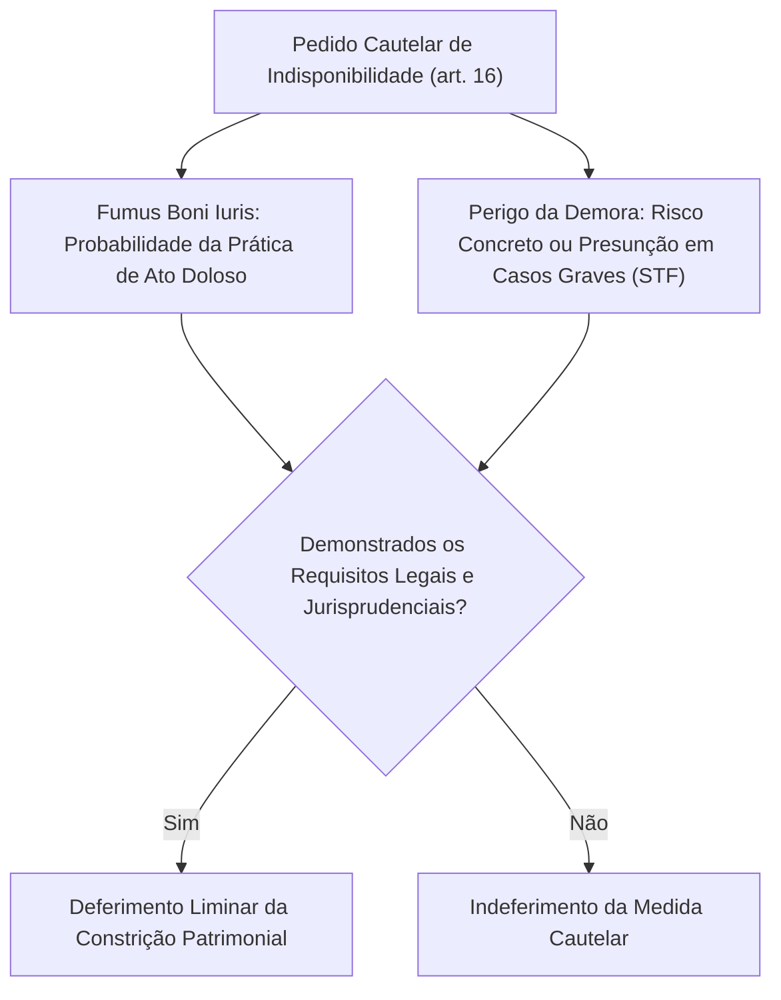
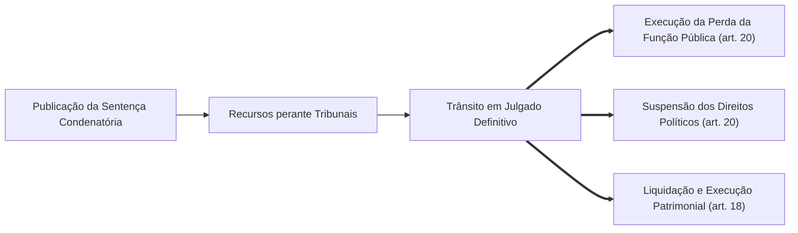

A efetividade da Lei de Improbidade Administrativa depende de medidas cautelares garantidoras do ressarcimento público e de uma sentença judicial válida. Ao ajuizar a demanda, o autor precisa assegurar que o patrimônio dos investigados não seja dissipado antes do desfecho do processo. Por outro lado, a imposição de sanções definitivas exige o cumprimento estrito do devido processo legal. A Lei nº 14.230/2021 e as decisões do Supremo Tribunal Federal nas ADIs 7156 e 7236 introduziram mudanças estruturantes na tutela de indisponibilidade de bens, nos efeitos da sentença condenatória e na sua liquidação.

> [!objetivos]
> - Compreender os pressupostos da tutela de indisponibilidade de bens (art. 16) e a interpretação fixada pelo STF nas ADIs 7156 e 7236.
> - Dominar a ordem legal de preferência de constrição patrimonial (art. 16, § 11) e as impenhorabilidades legais.
> - Conhecer a competência jurisdicional de primeiro grau no Tema 576 do STF e a prerrogativa do Presidente da República (Pet 3240).
> - Analisar a exigência de trânsito em julgado para a eficácia da perda da função e suspensão de direitos políticos (art. 20), bem como o afastamento preventivo cautelar.
> - Examinar a abrangência da perda do cargo (art. 12, § 1º), a liquidação e cumprimento da sentença (art. 18), o parcelamento em até 48 vezes (art. 18, § 4º) e as custas e honorários do art. 23-B.

## Indisponibilidade de bens: regime do artigo 16 e decisões do STF

A indisponibilidade de bens representa tutela provisória de urgência de natureza cautelar. Sua finalidade reside em resguardar o patrimônio público contra manobras de dilapidação financeira praticadas pelos demandados durante o curso do litígio, garantindo a integral recomposição do erário ou a reversão do enriquecimento ilícito (art. 16, caput).

Historicamente, o Superior Tribunal de Justiça adotava a tese do dano presumido (*periculum in mora* implícito no Tema 701 dos Repetitivos). A Lei nº 14.230/2021 buscou superar essa orientação no art. 16, § 3º, exigindo a evidência concreta de risco ao resultado prático do processo ou de perigo de dano irreversível.

Contudo, ao julgar as **ADIs 7156 e 7236** (concluídas em 1º/7/2026), o Supremo Tribunal Federal conferiu interpretação conforme à Constituição aos §§ 3º, 4º e 10 do art. 16:
- O STF admitiu a concessão de tutela de evidência e reconheceu que o perigo da demora pode ser presumido em situações excepcionais de comprovada gravidade ou quando demonstrados atos concretos de dissipação iminente do patrimônio;
- A indisponibilidade de bens pode alcançar a garantia do ressarcimento do dano ao erário e também o acréscimo patrimonial decorrente de enriquecimento ilícito.

### Limites quantitativos e regras dos parágrafos do artigo 16

O art. 16 estabelece parâmetros estritos para que a indisponibilidade não configure confisco abusivo:
- **Limite global em caso de múltiplos réus (art. 16, § 5º):** na hipótese de litisconsórcio passivo, a soma dos bens tornados indisponíveis não pode ultrapassar o teto apontado na inicial como prejuízo estatal ou acréscimo indevido.
- **Multa civil excluída da indisponibilidade (art. 16, § 10):** a sanção pecuniária punitiva de multa civil está totalmente livre de constrição provisória, vedando a lei qualquer bloqueio preventivo a esse título.
- **Impenhorabilidade da poupança e aplicações (art. 16, § 13):** resguarda-se a quantia limite de até 40 salários mínimos mantida em reservas de poupança, aplicações financeiras ou contas bancárias.
- **Proteção do bem de família (art. 16, § 14):** é vedada a decretação de indisponibilidade do bem de família, salvo se comprovado que o imóvel foi adquirido com o produto ou o proveito do ato de improbidade previsto no art. 9º desta Lei.

### Ordem de preferência legal de constrição: artigo 16, § 11

A ordem legal de constrição foi minuciosamente estabelecida pela Lei nº 14.230/2021. Ao contrário do regime processual civil comum (em que o dinheiro lidera a ordem de penhora), a LIA colocou o bloqueio de contas bancárias em **último lugar**, priorizando a constrição de outros bens menos gravosos para a subsistência do demandado:

> [!lei] Art. 16, § 11, da Lei nº 8.429/1992
> A ordem de indisponibilidade de bens deverá priorizar veículos de via terrestre, bens imóveis, bens móveis em geral, semoventes, navios e aeronaves, ações e quotas de sociedades simples e empresárias, pedras e metais preciosos e, apenas na inexistência desses, o bloqueio de contas bancárias, de forma a garantir a subsistência do acusado e a manutenção da atividade empresária ao longo do processo.

A tabela a seguir sistematiza a ordem legal de preferência do art. 16, § 11:

| Ordem de Preferência | Categoria de Bens a Constritar | Particularidades Legais |
|---|---|---|
| **1ª Preferência** | Veículos de via terrestre | Restrição judicial de transferência e circulação via sistema Renajud. |
| **2ª Preferência** | Bens imóveis | Averbação da indisponibilidade na matrícula imobiliária, ressalvado o bem de família (art. 16, § 14). |
| **3ª Preferência** | Bens móveis em geral | Arrolamento e depósito judicial de maquinários e bens duráveis. |
| **4ª Preferência** | Semoventes | Animais de rebanho e produção econômica rural. |
| **5ª Preferência** | Navios e aeronaves | Inscrição perante capitanias dos portos e registro aeronáutico da Anac. |
| **6ª Preferência** | Ações e quotas de sociedades | Quotas de sociedades limitadas e ações empresariais. |
| **7ª Preferência** | Pedras e metais preciosos | Depósito em instituição financeira pública. |
| **8ª Preferência** | Outros bens, inclusive bloqueio bancário | Bloqueio de contas bancárias e ativos financeiros (última opção legal). |

> [!bizu] Regras de Ouro da Indisponibilidade de Bens
> - Bloqueio bancário é a última opção: a ordem do art. 16, § 11, prioriza veículos e imóveis, deixando o dinheiro em último lugar.
> - Proteção da poupança: são intocáveis até quarenta salários mínimos em poupança, conta-corrente ou renda fixa.
> - Multa civil não entra na indisponibilidade: a constrição restringe-se ao dano e enriquecimento ilícito, vedada a inclusão da multa civil (art. 16, § 10).
> - Bem de família protegido: só pode ser bloqueado se foi adquirido com a vantagem do ato do art. 9º (art. 16, § 14).

## Competência jurisdicional e regime dos agentes políticos

A ação de improbidade administrativa possui natureza jurídica cível e não penal. Por essa razão, a competência jurisdicional não segue as regras do foro especial penal por prerrogativa de função.

### Inexistência de foro por prerrogativa de função: Tema 576 do STF

O Supremo Tribunal Federal pacificou em definitivo que os agentes políticos respondem à ação de improbidade perante a **Justiça de 1º Grau de Jurisdição** (STF, ADI 2.797 e **Tema 576 da Repercussão Geral** — RE 976.566). Governadores, Prefeitos, Secretários de Estado, Deputados e magistrados não detêm foro privilegiado na esfera de improbidade.

A competência de primeiro grau distribui-se segundo o ente prejudicado:
- **Justiça Federal de 1º Grau:** quando a causa envolver bens, serviços ou interesse da União, de suas autarquias federais ou de empresas públicas da União (CF, art. 109, I);
- **Justiça Estadual de 1º Grau:** quando a lesão disser respeito aos Estados, ao Distrito Federal, aos Municípios ou às suas respectivas entidades da administração indireta.

### A situação constitucional do Presidente da República: Pet 3240

A única autoridade que não se submete à Lei de Improbidade Administrativa é o **Presidente da República**. Conforme jurisprudência pacífica do Supremo Tribunal Federal (STF, **Pet 3240**), o Presidente da República responde exclusivamente pelo regime político-institucional de crimes de responsabilidade disciplinado no art. 85 da CF/88 e na Lei nº 1.079/1950, julgado pelo Senado Federal, não respondendo por improbidade perante a Justiça de primeiro grau. Os demais agentes políticos submetem-se ao duplo regime: respondem por crime de responsabilidade na esfera política e por improbidade na jurisdição cível comum.

## A sentença condenatória, trânsito em julgado e afastamento cautelar

A imposição de penalidades de improbidade subordina-se ao trânsito em julgado definitivo e às garantias do devido processo legal.

> [!lei] Art. 20, caput e §§ 1º e 2º, da Lei nº 8.429/1992
> Art. 20. A perda da função pública e a suspensão dos direitos políticos só se efetivam com o trânsito em julgado da sentença condenatória.
> § 1º A autoridade judicial competente poderá determinar o afastamento do agente público do exercício do cargo, do emprego ou da função, sem prejuízo da remuneração, quando a medida for necessária à instrução processual ou para evitar a iminente prática de novos ilícitos.
> § 2º O afastamento previsto no § 1º deste artigo será de até 90 (noventa) dias, prorrogáveis uma única vez por igual prazo, mediante decisão motivada.

### O afastamento preventivo cautelar

O magistrado pode ordenar o afastamento cautelar de noventa dias, admitida prorrogação justificada única por idêntico período (art. 20, § 2º). Trata-se de medida cautelar (não de sanção), exigindo que a remuneração do agente seja integralmente preservada para assegurar a subsistência durante a instrução probatória.

### Extensão da perda da função pública: art. 12, § 1º, e o STF

A sanção de perda da função pública encontra-se positivada no **art. 12, § 1º**, da Lei nº 8.429/1992. O texto da Lei nº 14.230/2021 pretendia restringir a perda ao vínculo de mesma qualidade e natureza que o agente detinha na época do ilícito, admitindo extensão a outros cargos apenas em caráter excepcional nos atos de enriquecimento ilícito do art. 9º.

Contudo, no julgamento das **ADIs 7156 e 7236**, o Supremo Tribunal Federal invalidou essa restrição:
- O STF assentou que a perda da função pública **se estende como regra a todos os vínculos públicos** que o condenado detenha no momento da execução da sentença;
- Não é admissível que um servidor condenado definitivamente por improbidade administrativa grave seja afastado de um cargo e continue exercendo outro cargo público no aparelho estatal;
- A probidade administrativa é atributo moral indivisível: quem demonstrou inaptidão ética para o serviço público perde a condição de integrar os quadros estatais em qualquer esfera de poder.

## Execução da sentença, parcelamento e custas: artigos 18 e 23-B

A recuperação prática dos ativos desviados e a imposição de encargos processuais regem-se pelos arts. 18 e 23-B da legislação.

### Destinação dos valores e execução pelo Ministério Público: artigo 18

O art. 18 disciplina o cumprimento da sentença condenatória:
- **Destinação ao ente lesado (art. 18, caput):** a sentença que julgar procedente a ação condenará ao ressarcimento dos danos e à perda ou reversão dos bens e valores ilícitos em favor da pessoa jurídica prejudicada pelo ilícito.
- **Liquidação e execução prioritária (art. 18, § 1º):** cabe à pessoa jurídica lesada promover a liquidação do dano e a execução da sentença condenatória.
- **Atuação subsidiária do Ministério Público (art. 18, § 2º):** se a pessoa jurídica prejudicada não adotar as providências de liquidação ou execução no prazo de **6 (seis) meses** a contar do trânsito em julgado, o Ministério Público promoverá a respectiva liquidação e cumprimento da sentença, sem prejuízo da apuração de responsabilidade pela omissão.
- **Desconto dos serviços prestados (art. 18, § 3º):** para apuração do valor real a ressarcir, deverão ser descontados os serviços que tenham sido efetivamente prestados à Administração.

### Parcelamento do débito patrimonial: artigo 18, § 4º

A condenação patrimonial atinge cifras expressivas. Para assegurar a efetividade do ressarcimento sem inviabilizar a subsistência do executado, o art. 18, § 4º, autoriza o parcelamento:

> [!lei] Art. 18, § 4º, da Lei nº 8.429/1992
> O juiz poderá autorizar o parcelamento, em até 48 (quarenta e oito) parcelas mensais corrigidas monetariamente, do débito resultante de condenação pela prática de improbidade administrativa se o réu demonstrar incapacidade financeira de saldá-lo de imediato.

A concessão do benefício exige demonstração da incapacidade momentânea de adimplemento imediato. Não há previsão legal de vencimento antecipado automático de parcelas na lei, submetendo-se a execução do saldo remanescente aos trâmites do Código de Processo Civil.

### Custas e honorários advocatícios: artigo 23-B

As despesas processuais da ação de improbidade regem-se pelo art. 23-B da Lei nº 8.429/1992:
- **Sem adiantamento de custas:** não há adiantamento de custas, preparo, emolumentos, honorários periciais ou quaisquer despesas pelo autor da ação.
- **Sem honorários pelo autor vencedor ou vencido:** não haverá condenação do autor ao pagamento de honorários advocatícios, custas e despesas processuais, salvo se comprovada a sua litigância de má-fé (Lei nº 8.429/1992, art. 23-B, caput).
- **Ressarcimento pelo réu condenado:** se a demanda for julgada procedente, o réu condenado ressarcirá as custas e despesas do processo (Lei nº 8.429/1992, art. 23-B, § 1º).
- **Perícias oficiais:** as perícias serão realizadas preferencialmente por peritos do quadro de servidores do Poder Judiciário ou de outros órgãos públicos (Lei nº 8.429/1992, art. 23-B, § 2º).

> [!resolvido]
> **Caso prático de prova:**
> Em ação de improbidade administrativa ajuizada perante a Vara da Fazenda Pública Estadual, o Ministério Público postulou a condenação de um Tenente-Coronel do Corpo de Bombeiros Militar por enriquecimento ilícito (art. 9º), pleiteando a decretação de indisponibilidade de bens no valor de quinhentos mil reais. O magistrado decretou cautelarmente o bloqueio imediato das contas bancárias do militar, atingindo uma aplicação financeira de trinta e cinco salários mínimos, e incluiu na constrição o valor projetado de multa civil. Anos depois, sobreveio sentença condenatória definitiva transitada em julgado com perda do cargo público. À época da execução, o réu exercia também o cargo de docente em universidade pública estadual, defendendo que a perda funcional não poderia atingir seu cargo docente.
>
> **Solução jurídica comentada:**
> 1. A decisão cautelar é ilegal em dois pontos: violou a ordem do art. 16, § 11 (que posiciona o bloqueio de contas bancárias em último lugar, após veículos e imóveis), desrespeitou a impenhorabilidade de até 40 salários mínimos em conta ou aplicação financeira (art. 16, § 13) e incluiu a multa civil, vedada expressamente pelo art. 16, § 10.
> 2. Quanto à perda da função pública, o STF assentou nas ADIs 7156 e 7236 a inconstitucionalidade da limitação da perda funcional ao cargo de origem. A perda da função pública atinge como regra todos os vínculos públicos que o agente mantenha com a administração, alcançando plenamente o cargo docente na execução da condenação.

## Mapa do capítulo

A tabela a seguir compila os temas estruturantes da tutela cautelar, competência e sentença:

| Instituto | Regra Positivada | Dispositivo Legal |
|---|---|---|
| **Indisponibilidade: Requisitos** | Exige perigo da demora ou demonstração de risco concreto (ADIs 7156 e 7236). | Art. 16, § 3º |
| **Limite da Constrição** | Restringe-se ao valor do dano e acréscimo; vedada inclusão de multa civil. | Art. 16, §§ 5º e 10 |
| **Impenhorabilidade de 40 SM** | Proteção absoluta de até 40 salários mínimos em poupança, conta ou renda fixa. | Art. 16, § 13 |
| **Ordem de Preferência** | Veículos (1º), imóveis (2º), móveis (3º)... bloqueio bancário em último lugar (8º). | Art. 16, § 11 |
| **Competência Jurisdicional** | Juízo de 1º grau da Justiça Comum; ausente foro privilegiado (Tema 576). | STF (Tema 576 e ADI 2.797) |
| **Presidente da República** | Responde exclusivamente por crime de responsabilidade no Senado Federal. | STF (Pet 3240) |
| **Eficácia da Condenação** | Perda da função pública e suspensão de direitos exigem trânsito em julgado. | Art. 20, caput |
| **Afastamento Preventivo** | Medida cautelar de até 90 dias prorrogável uma vez, com remuneração integral. | Art. 20, §§ 1º e 2º |
| **Extensão da Perda da Função** | Estende-se como regra aos demais vínculos públicos mantidos pelo condenado. | Art. 12, § 1º, e ADIs 7156/7236 |
| **Execução pelo MP** | MP executa se o ente lesado não o fizer em 6 meses do trânsito em julgado. | Art. 18, § 2º |
| **Parcelamento em 48 Vezes** | Possibilidade de quitação em até 48 parcelas mensais corrigidas monetariamente. | Art. 18, § 4º |
| **Custas e Honorários** | Sem adiantamento de custas e sem honorários sucumbenciais pelo autor, salvo má-fé. | Art. 23-B |

### Para fixar

- A indisponibilidade de bens exige risco concreto ou dissipação comprovada, admitida tutela de evidência e presunção em casos graves (ADIs 7156 e 7236).
- A ordem legal do art. 16, § 11, prioriza veículos e imóveis, deixando o bloqueio de contas em último lugar, sendo impenhoráveis até quarenta salários mínimos e vedada a constrição de multa civil.
- Os agentes públicos respondem perante a 1ª instância sem foro privilegiado (Tema 576 do STF), salvo o Presidente da República, que responde no Senado por crime de responsabilidade (Pet 3240).
- A perda da função pública e a suspensão de direitos políticos dependem do trânsito em julgado (art. 20), mas admite-se afastamento cautelar de 90 dias com remuneração.
- A perda da função pública estende-se como regra aos demais vínculos públicos exercidos pelo condenado (STF, ADIs 7156 e 7236).
- A pessoa jurídica lesada tem preferência para liquidar e executar a condenação em 6 meses, atuando o MP subsidiariamente (art. 18, §§ 1º e 2º).
- É cabível o desconto dos serviços prestados (art. 18, § 3º) e o parcelamento da condenação em até 48 vezes mensais corrigidas (art. 18, § 4º).
- O autor da ação não adianta custas nem responde por honorários advocatícios, salvo má-fé comprovada (Lei nº 8.429/1992, art. 23-B).
