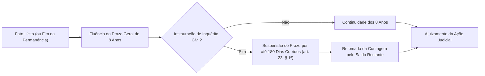
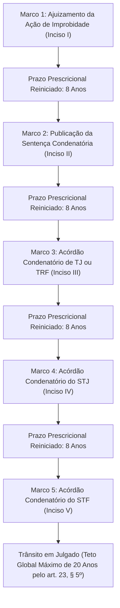
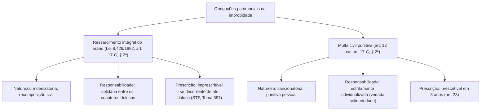
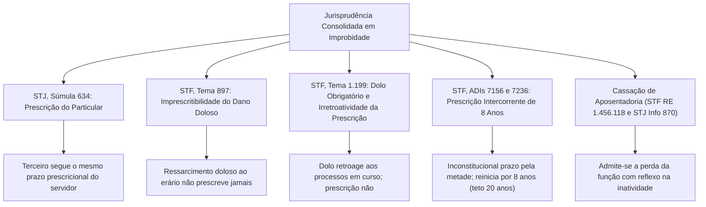
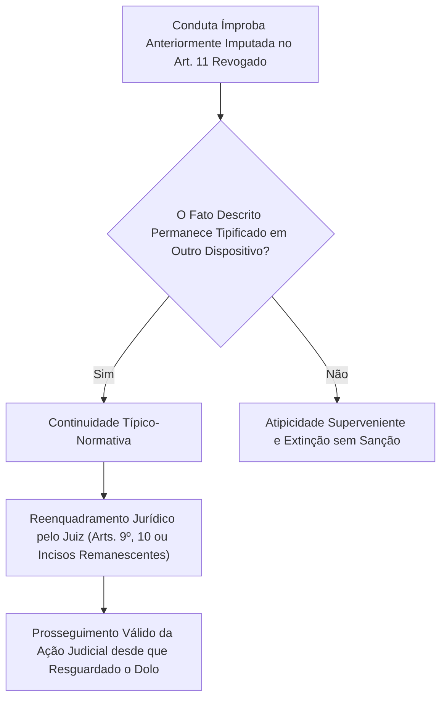

A segurança jurídica exige limites temporais para o exercício do poder punitivo estatal. A perseguição judicial indefinida de condutas passadas compromete a estabilidade das relações sociais e as garantias individuais do cidadão. Para harmonizar a repressão à desonestidade com a estabilidade das relações jurídicas, a Lei nº 14.230/2021 reformulou integralmente o regime de prescrição da Lei nº 8.429/1992. Além disso, a aplicação cotidiana da Lei de Improbidade produziu uma vasta jurisprudência nos Tribunais Superiores, fixando teses indispensáveis para as provas, notadamente após o julgamento de mérito das ADIs 7156 e 7236 pelo Supremo Tribunal Federal.

> [!objetivos]
> - Dominar a disciplina da prescrição geral de oito anos e a suspensão por inquérito civil (art. 23, caput e § 1º).
> - Compreender os cinco marcos interruptivos do art. 23, § 4º, a decisão do STF nas ADIs 7156 e 7236 e o teto de vinte anos.
> - Analisar as teses vinculantes dos Temas 1.199, 897 e 666 do STF sobre dolo, irretroatividade da prescrição e imprescritibilidade.
> - Examinar as regras de solidariedade no ressarcimento e individualização da multa (Lei nº 8.429/1992, art. 17-C, § 2º) e a Súmula 634 do STJ.
> - Compreender o princípio da continuidade típico-normativa e o regime de cassação de aposentadoria nos Tribunais Superiores.

## O novo regime prescricional geral: artigo 23

Na vigência da redação original da Lei nº 8.429/1992, o prazo prescricional operava de forma fragmentada e confusa. Para ocupantes de cargos em comissão ou mandatos eletivos, a prescrição ocorria em cinco anos contados da data de cessação do vínculo. Para servidores estatutários efetivos, o prazo acompanhava a prescrição da falta disciplinar prevista no estatuto funcional próprio. Essa disparidade gerava situações em que servidores que praticavam o mesmo ato ilícito submetiam-se a prazos prescricionais completamente diferentes.

A Lei nº 14.230/2021 unificou a matéria de forma categórica no art. 23, caput:

> [!lei] Art. 23, caput, da Lei nº 8.429/1992
> A ação para a aplicação das sanções previstas nesta Lei prescreve em 8 (oito) anos, contados a partir da ocorrência do fato ou, no caso de infrações permanentes, do dia em que cessou a permanência.

### Termo inicial e infrações permanentes

O novo estatuto adotou um critério objetivo para o início da fluência prescricional:
- **Infrações instantâneas ou de efeitos permanentes:** o prazo de **8 (oito) anos** começa a correr da **data de ocorrência do fato** delituoso. Não importa o momento em que o Poder Público descobriu a fraude ou o dia em que o servidor deixou o cargo.
- **Infrações permanentes:** quando a consumação da conduta ilícita se protrai continuamente no tempo (como no enriquecimento ilícito continuado com recebimento mensal de vantagem financeira indevida), o prazo de 8 anos conta-se a partir do **dia em que cessou a permanência**.

O diagrama abaixo ilustra a linha temporal da prescrição geral:

### Suspensão da prescrição pelo inquérito civil: artigo 23, § 1º

A instauração de investigações preliminares afeta o curso do prazo prescricional:

> [!lei] Art. 23, § 1º, da Lei nº 8.429/1992
> A instauração de inquérito civil ou de processo administrativo para apuração dos ilícitos referidos nesta Lei suspende o curso do prazo prescricional por, no máximo, 180 (cento e oitenta) dias corridos, recomeçando a correr após a sua conclusão ou, caso não concluído o processo, esgotado o prazo de suspensão.

Essa causa suspensiva subordina-se a regras precisas:
- O prazo de prescrição fica suspenso pelo período máximo de **180 (cento e oitenta) dias corridos**;
- Se a apuração for concluída antes de 180 dias, a suspensão cessa na data de conclusão formal do procedimento;
- Expirado o prazo de 180 dias corridos sem conclusão da investigação, o prazo prescricional de 8 anos volta a correr pelo saldo remanescente, independentemente do término do inquérito civil.

É essencial distinguir a causa suspensiva da prescrição (art. 23, § 1º, que dura até 180 dias) do prazo próprio de duração do inquérito civil, previsto no art. 23, § 2º, que é de 365 dias corridos, prorrogável uma única vez por igual período.

## Prescrição intercorrente e os cinco marcos interruptivos

A inovação processual mais debatida da Lei nº 14.230/2021 residiu na positivação da **prescrição intercorrente** no art. 23, §§ 4º e 5º. A prescrição intercorrente destina-se a punir a inércia durante a marcha processual judicial, evitando que ações de improbidade tramitem indefinidamente sem julgamento de mérito.

### Os cinco marcos interruptivos do artigo 23, § 4º

A interrupção zera a contagem do prazo prescricional. O art. 23, § 4º, estabelece um rol taxativo de **cinco marcos interruptivos**:

> [!lei] Art. 23, § 4º, da Lei nº 8.429/1992
> O prazo da prescrição referido no caput deste artigo interrompe-se:
> I - pelo ajuizamento da ação de improbidade administrativa;
> II - pela publicação da sentença condenatória;
> III - pela publicação de decisão ou acórdão de Tribunal de Justiça ou Tribunal Regional Federal que confirma sentença condenatória ou que reforma sentença de improcedência;
> IV - pela publicação de decisão ou acórdão do Superior Tribunal de Justiça que confirma acórdão condenatório ou que reforma acórdão de improcedência;
> V - pela publicação de decisão ou acórdão do Supremo Tribunal Federal que confirma acórdão condenatório ou que reforma acórdão de improcedência.

A tabela a seguir sistematiza os cinco marcos interruptivos:

| Marco Interruptivo | Ato Processual Materializador | Efeito no Curso da Prescrição |
|---|---|---|
| **1º Marco (Inciso I)** | **Ajuizamento** da ação de improbidade administrativa perante o juízo competente. | Interrompe o prazo prescricional do caput. |
| **2º Marco (Inciso II)** | Publicação da **sentença condenatória** proferida pelo magistrado de primeiro grau. | Zera e reinicia a contagem do prazo prescricional. |
| **3º Marco (Inciso III)** | Publicação de acórdão de **TJ ou TRF** que confirma condenação ou reforma improcedência. | Zera e reinicia o prazo prescricional perante a Corte local. |
| **4º Marco (Inciso IV)** | Publicação de acórdão do **Superior Tribunal de Justiça** condenatório ou reformador. | Zera e reinicia o prazo prescricional em grau recursal superior. |
| **5º Marco (Inciso V)** | Publicação de acórdão do **Supremo Tribunal Federal** condenatório ou reformador. | Zera e reinicia o prazo prescricional perante a Corte Constitucional. |

> [!atencao]
> Pronunciamentos judiciais de **improcedência** ou que extinguem o processo sem resolução de mérito **não interrompem** a prescrição. Apenas pronunciamentos com conteúdo condenatório (condenação originária, confirmação de condenação prévia ou reforma de improcedência) operam o efeito interruptivo do art. 23, § 4º.

### Decisão do STF nas ADIs 7156 e 7236 e o teto de vinte anos

A redação original do art. 23, § 5º, dada pela Lei nº 14.230/2021, dispunha que, interrompida a prescrição por qualquer dos marcos do § 4º, o prazo recomeçaria a correr "pela metade do prazo previsto no caput" (ou seja, no prazo de quatro anos).

Contudo, ao julgar em definitivo o mérito das **ADIs 7156 e 7236** em 1º/7/2026, o Plenário do Supremo Tribunal Federal declarou a **inconstitucionalidade da expressão "pela metade"** contida no art. 23, § 5º da LIA:
- Com a invalidação da regra da metade, uma vez interrompida a prescrição por qualquer dos cinco marcos legais, **o prazo recomeça a correr por inteiro, isto é, por 8 (oito) anos**;
- Não subsiste mais o prazo intercorrente de quatro anos no ordenamento brasileiro para as ações de improbidade;
- Além disso, o STF ratificou o **teto total de 20 (vinte) anos** para a prescrição intercorrente, previsto na parte final do art. 23, § 5º: em qualquer hipótese processual, somadas todas as interrupções havidas durante o trâmite da causa, o tempo total da demanda não poderá ultrapassar vinte anos.

## O julgamento do Tema 1.199 do Supremo Tribunal Federal

A entrada em vigor da Lei nº 14.230/2021 provocou imenso debate jurídico sobre a aplicação retroativa de suas normas mais benéficas aos processos em andamento. A reforma extinguiu a modalidade culposa de improbidade do art. 10 e instituiu um novo regime prescricional.

Para pacificar em definitivo a matéria, o Supremo Tribunal Federal fixou teses vinculantes no **Tema 1.199 da Repercussão Geral** (ARE 843.989, Relator Ministro Alexandre de Moraes):

> [!jurisprudencia] STF, Tema 1.199 da Repercussão Geral (ARE 843.989)
> 1. A configuração dos atos de improbidade dos arts. 9º, 10 e 11 pressupõe a demonstração inequívoca de responsabilidade subjetiva mediante dolo específico, operando-se a revogação integral da modalidade culposa do art. 10.
> 2. A revogação da modalidade culposa da improbidade administrativa aplica-se retroativamente aos atos praticados sob a vigência do texto anterior, desde que não haja condenação transitada em julgado.
> 3. O novo regime prescricional instituído pela Lei nº 14.230/2021 é irretroativo, aplicando-se os novos lapsos temporais somente a partir da publicação da referida Lei (26/10/2021).
> 4. O juízo competente em processos sem trânsito em julgado deve reabrir a instrução probatória para verificar se a conduta anteriormente qualificada como culposa foi praticada com dolo pelo agente.

A tabela a seguir sistematiza a aplicação prática das diretrizes do Tema 1.199:

| Matéria Controvertida | Regra Firmada pelo STF no Tema 1.199 | Impacto nos Processos em Andamento |
|---|---|---|
| **Exigência de Dolo Específico** | O dolo é obrigatório em todas as modalidades (arts. 9º, 10 e 11). Não existe improbidade culposa no Brasil. | Ações em curso fundadas exclusivamente em culpa devem ser extintas ou readequadas pelo autor. |
| **Retroatividade do Dolo** | A exigência de dolo retroage aos fatos anteriores à lei para ações sem trânsito em julgado. | Permite a absolvição de réus que respondiam por lesão ao erário culposa sem dolo comprovado. |
| **Coisa Julgada Material** | Condenações por culpa transitadas em julgado antes da lei permanecem intocáveis. | Não cabe ação rescisória para desconstituir condenação transitada em julgado com base na lei nova. |
| **Irretroatividade da Prescrição** | O novo regime prescricional não retroage a períodos pretéritos. | A contagem do novo regime prescricional opera-se apenas a partir da publicação da Lei 14.230 (26/10/2021). |

> [!pegadinha]
> **Prescrição não retroage para extinguir processos pretéritos:** candidatos costumam errar ao presumir que os novos prazos da Lei nº 14.230/2021 extinguem automaticamente demandas antigas. Conforme tese fixada no Tema 1.199, o novo regime prescricional da LIA não retroage, contando-se os novos lapsos temporais exclusivamente a partir de 26 de outubro de 2021.

## Imprescritibilidade do ressarcimento ao erário: Temas 897 e 666 do STF

A Constituição Federal estabelece no art. 37, § 5º, que a lei fixará prazos de prescrição para ilícitos que causem prejuízos ao erário, ressalvadas as respectivas ações de ressarcimento.

Ao delimitar o alcance desse preceito, o Supremo Tribunal Federal fixou distinções paradigmáticas:

| Hipótese Fática da Pretensão | Regime Prescricional Aplicável | Tese Vinculante do STF |
|---|---|---|
| **Dano decorrente de ato DOLOSO de improbidade** | **Imprescritível.** A pretensão de ressarcimento do dano ao erário decorrente de ato doloso não prescreve jamais. | **Tema 897 do STF** (RE 852.475) |
| **Reparação de danos decorrente de ilícito civil comum** | **Prescritível.** A reparação de prejuízos civis comuns ou culposos sujeita-se à prescrição ordinária. | **Tema 666 do STF** (RE 669.069) |
| **Ressarcimento fundado em decisão de Tribunal de Contas** | **Prescritível.** A pretensão de ressarcimento configurada em título executivo de Corte de Contas prescreve em 5 anos. | **Tema 899 do STF** (RE 636.886) |

Portanto, apenas o ressarcimento fundado em ato doloso tipificado na Lei de Improbidade goza da garantia constitucional de imprescritibilidade (Tema 897). As penalidades sancionatórias de natureza pessoal (como a perda do cargo, a suspensão dos direitos políticos e a multa civil) sujeitam-se ao prazo prescricional de oito anos (art. 23). Na hipótese do Tema 666, o STF fixou a prescritibilidade das ações de reparação de danos à Fazenda decorrentes de ilícitos civis gerais, aplicando-se na prática a legislação de regência das dívidas fazendárias.

## Solidariedade passiva e individualização das sanções: artigo 17-C, § 2º

Nas irregularidades que envolvem múltiplos participantes, a legislação e a jurisprudência estabelecem uma rigorosa diferenciação entre a recomposição do prejuízo e a aplicação de sanções punitivas:

> [!lei] Art. 17-C, § 2º, da Lei nº 8.429/1992
> Na hipótese de litisconsórcio passivo, a condenação ocorrerá no limite da participação e dos benefícios diretos, vedada qualquer solidariedade.

O texto da lei veda **qualquer** solidariedade. No julgamento das ADIs 7156 e 7236, o STF deu interpretação conforme ao dispositivo: a vedação vale para as sanções, mas os corréus continuam respondendo solidariamente pelo ressarcimento do dano ao erário.

### Solidariedade no ressarcimento do erário

A obrigação de reparar o dano patrimonial possui natureza de indenização civil de recomposição material:
- Todos os corréus que concorreram dolosamente para a prática do ilícito respondem de forma **solidária** pela restituição integral do valor desviado;
- O ente público lesado pode exigir o montante total de qualquer um dos condenados ou de todos conjuntamente;
- O corréu que pagar a totalidade do prejuízo sub-roga-se no crédito e pode exercer direito de regresso contra os demais devedores na proporção de sua culpabilidade;
- A solidariedade restringe-se ao valor real da lesão, vedando-se a repetição em duplicidade que gere enriquecimento ilícito estatal.

### Vedação de solidariedade na multa civil: caráter estritamente pessoal

Diferentemente da indenização ressarcitória, a multa civil possui natureza puramente punitiva e sancionatória. Pelo princípio constitucional da intranscendência das penas (CF, art. 5º, XLV), a sanção punitiva não passa da pessoa do infrator:
- O art. 17-C, § 2º, veda de forma terminante a imposição de responsabilidade solidária para a multa civil;
- Cada réu condenado terá sua multa civil **dosada e individualizada** de acordo com sua culpabilidade, seu grau de participação e seu poder econômico;
- Ao apreciar as ADIs 7156 e 7236, o STF confirmou que a solidariedade é admitida exclusivamente para a reparação do dano ao erário, sendo vedada em relação a qualquer sanção pecuniária punitiva.

## O terceiro particular e a Súmula 634 do STJ

O art. 3º da Lei nº 8.429/1992 estabelece que as cominações legais estendem-se ao particular que induz, concorre dolosamente ou se beneficia diretamente do ato de improbidade praticado com o agente público.

Contudo, a submissão do particular ao microssistema da improbidade exige a observância de duas diretrizes consolidadas pelo Superior Tribunal de Justiça:

1. **Vedação de ação de improbidade exclusiva contra particulares:** o particular não comete ato de improbidade isoladamente. A presença de pelo menos um agente público no polo passivo da ação constitui requisito indispensável de procedibilidade. Conforme jurisprudência reiterada do STJ (REsp 1.171.017/PA), é inadmissível a propositura de ação de improbidade exclusivamente contra particulares ou pessoas jurídicas privadas desacompanhados de servidor público corréu.
2. **Mesmo regime prescricional do servidor:** o particular concorrente submete-se ao mesmo prazo e causas interruptivas incidentes sobre o agente público coautor, entendimento cristalizado na **Súmula 634 do STJ**:

> [!jurisprudencia] STJ, Súmula 634
> O prazo prescricional para ajuizamento da ação em face do particular segue o mesmo regime temporal cominado ao agente público corréu.

## Inexigibilidade de licitação e requisitos de tipificação

A contratação direta sem licitação fora das hipóteses legais ou com inobservância de formalidades constitui tema frequente nas bancas de concurso. A jurisprudência da 1ª Seção do STJ pacificou critérios objetivos para a caracterização de ato ímprobo:

Para que a contratação direta irregular configure improbidade lesiva ao erário (art. 10, VIII), exige-se:
1. **Dolo específico:** vontade consciente de fraudar a competitividade do certame para beneficiar terceiro ou locupletar-se indevidamente;
2. **Dano patrimonial real e efetivo:** comprovação de superfaturamento de preços ou inexecução do objeto pactuado.

Se o serviço técnico ou artístico contratado por inexigibilidade foi prestado a contento e o valor ajustado revelava-se compatível com a média praticada no mercado, não há prejuízo ao erário. Não havendo sobrepreço nem desvio patrimonial, resta afastada a tipificação do art. 10. Eventual irregularidade procedimental formal pode sujeitar os envolvidos a sanções perante a Corte de Contas, mas não legitima condenação por improbidade administrativa.

> [!exemplo]
> Determinada corporação militar contratou instituição especializada para capacitação em resgate aeromédico por inexigibilidade. O procedimento apresentou falhas formais na juntada de orçamentos prévios comparativos, mas o curso foi ministrado com excelência técnica e os valores cobrados eram plenamente compatíveis com o mercado de instrução especializada. Conforme jurisprudência pacífica do STJ, a falha procedimental isolada, desacompanhada de dolo de desvio e de sobrepreço real, afasta a caracterização de ato de improbidade administrativa.

## A controvérsia sobre a cassação de aposentadoria

A incidência da penalidade de perda da função pública sobre servidores públicos já inativos ou aposentados produziu relevante divergência doutrinária e jurisprudencial nos Tribunais Superiores.

Historicamente, a 1ª Seção do Superior Tribunal de Justiça fixou o entendimento de que a cassação de aposentadoria exigiria expressa previsão em lei específica, inexistindo previsão expressa dessa sanção autônoma no rol taxativo do art. 12 da Lei nº 8.429/1992 (EREsp 1.496.347/ES, Rel. Min. Benedito Gonçalves, 2021). Sob essa ótica inicial, a perda da função pública não poderia ser automaticamente transmutada em cassação de aposentadoria pelo juiz da causa sem texto legal expresso.

Por outro lado, o Supremo Tribunal Federal admitiu a conversão da penalidade de perda do cargo público em cassação de aposentadoria no julgamento do **RE 1.456.118**. A Corte Constitucional entendeu que permitir ao servidor ímprobo escapar da perda funcional mediante a aposentadoria voluntária antes do trânsito em julgado violaria o princípio republicano e a moralidade administrativa (CF, art. 37, § 4º).

Em virtude desse posicionamento do STF, o Superior Tribunal de Justiça alinhou recentemente seu entendimento à orientação da Corte Constitucional (**STJ, Informativo 870, de 11/11/2025**), passando a admitir a cassação da aposentadoria como decorrência da sanção de perda do cargo aplicada em improbidade para evitar a frustração da tutela jurisdicional contra atos desonestos praticados durante a atividade funcional.

## Princípio da continuidade típico-normativa na jurisprudência

A ampla reforma introduzida pela Lei nº 14.230/2021 transformou profundamente os tipos sancionatórios da Lei de Improbidade Administrativa. No art. 11, o rol exemplificativo de atos violadores dos princípios da administração pública foi convertido em um catálogo taxativo e estrito. Essa alteração acarretou a revogação expressa de incisos genéricos anteriores, como o antigo inciso I do art. 11, que punia genericamente a conduta de praticar ato visando a fim proibido em lei ou diverso daquele previsto na regra de competência.

Diante dessa revogação legislativa, instalou-se intensa controvérsia prática sobre o destino das ações judiciais em andamento que haviam sido ajuizadas sob a égide do texto antigo da LIA. Argumentou-se que a supressão do tipo genérico operaria uma espécie de abolição da improbidade (*abolitio improbitatis*), impondo a extinção sumária de todos os processos pendentes.

Contudo, a jurisprudência do STJ e do STF estabeleceu de forma pacífica a plena incidência do **princípio da continuidade típico-normativa**:

### Critérios de aplicação da continuidade típico-normativa

O princípio estabelece que a revogação puramente formal de um preceito legal não acarreta a atipicidade da conduta se o mesmo fato histórico continuar previsto e sancionado em outro dispositivo do ordenamento jurídico vigente:
1. **Reclassificação jurídica permitida:** se a conduta praticada pelo agente sob a vigência do texto revogado também se amolda com perfeição a uma das hipóteses de enriquecimento ilícito (art. 9º), de lesão patrimonial efetiva ao erário (art. 10) ou aos incisos taxativos vigentes do art. 11, o processo judicial não deve ser extinto. O julgador pode proceder à desclassificação e reenquadramento dos fatos descritos, desde que assegurado o contraditório prévio às partes.
2. **Exigência cumulativa de dolo:** a continuidade típico-normativa somente legitima o prosseguimento da demanda se restar cabalmente demonstrado o dolo específico na atuação do agente, em consonância estrita com as diretrizes do Tema 1.199 do STF. A conduta puramente negligente ou imprudente não pode ser reaproveitada sob nova roupagem formal.
3. **Hipótese de extinção por atipicidade superveniente:** apenas naqueles casos em que a conduta do agente público consistia em mera violação a princípio que não encontre correspondência em nenhum dos novos incisos taxativos do art. 11 nem importe em dano ou enriquecimento ilícito, o juiz deverá extinguir a pretensão sancionatória pela atipicidade superveniente do fato.

## Duplo regime dos agentes políticos e competência

Os agentes políticos submetem-se ao **duplo regime de responsabilização**, conforme pacificado pelo STF no Tema 576 da Repercussão Geral:
- **Crime de responsabilidade:** apurado perante órgãos políticos institucionais (Câmara Municipal para prefeitos; Assembleia Legislativa para governadores; Congresso Nacional para ministros de Estado);
- **Improbidade administrativa:** julgado perante a Justiça de primeiro grau (Varas de Fazenda Pública Estadual ou Varas Federais) com suporte na Lei nº 8.429/1992.

A única autoridade que não se submete à Lei de Improbidade Administrativa é o **Presidente da República**. Conforme fixado na Pet 3240 pelo STF, o Presidente responde exclusivamente por crime de responsabilidade perante o Senado Federal (CF, art. 85, e Lei nº 1.079/1950), não se sujeitando às sanções da Lei nº 8.429/1992 por atos praticados no desempenho do mandato presidencial.

> [!resolvido]
> **Questão prática de prova:**
> Em 2017, um Secretário Estadual de Saúde e um empresário particular atuaram dolosamente para fraudar licitação hospitalar, gerando sobrepreço comprovado de dois milhões de reais. A ação de improbidade foi ajuizada em 2019 (1º marco). A sentença condenatória foi publicada em 2023 (2º marco), cominando perda da função pública, ressarcimento solidário e multa civil. Em 2026, pendente apelação no Tribunal de Justiça, a defesa alegou que: (a) a ação prescreveu pela regra da prescrição intercorrente de quatro anos entre a sentença e o julgamento colegiado; (b) o particular não pode responder solidariamente pelo dano; e (c) a multa civil deve ser cobrada em solidariedade de ambos.
>
> **Solução jurídica comentada:**
> 1. A tese da prescrição intercorrente de quatro anos improcede totalmente. No julgamento das ADIs 7156 e 7236, o STF declarou inconstitucional a expressão "pela metade" do art. 23, § 5º da LIA. Assim, com a publicação da sentença condenatória (2º marco), o prazo prescricional recomeçou a correr por inteiro (oito anos). Logo, em 2026 haviam transcorrido apenas 3 anos, estando a pretensão punitiva plenamente íntegra.
> 2. O particular que concorreu para o ilícito submete-se ao mesmo regime prescricional do agente público (Súmula 634 do STJ).
> 3. Quanto às obrigações patrimoniais, o art. 17-C, § 2º, estabelece expressamente a solidariedade entre os coautores dolosos para o ressarcimento do erário. Todavia, a sanção de multa civil é estritamente pessoal e individualizada, sendo vedada a imposição de solidariedade para as penas pecuniárias punitivas.

## Mapa do capítulo

A tabela a seguir compila os temas estruturantes da prescrição, teses vinculantes e jurisprudência:

| Instituto / Precedente | Regra Consolidada na Legislação e Jurisprudência | Fundamento Vinculante |
|---|---|---|
| **Prescrição Geral** | Prazo unificado de **8 anos** contados do fato ou da cessação da permanência. | Art. 23, caput, da LIA |
| **Suspensão por Inquérito** | Suspende o prazo prescricional por até **180 dias corridos**. | Art. 23, § 1º, da LIA |
| **Marcos Interruptivos** | Rol taxativo de **cinco marcos** (ajuizamento, sentença e acórdãos de TJ/TRF, STJ e STF). | Art. 23, § 4º, I a V |
| **Prescrição Intercorrente** | Recomeça por **8 anos** após cada marco (inconstitucional a metade); teto de 20 anos. | STF (ADIs 7156 e 7236) |
| **Tema 1.199 do STF** | Dolo é obrigatório; retroatividade aos processos em curso; irretroatividade da prescrição. | STF (ARE 843.989) |
| **Tema 897 do STF** | Imprescritibilidade da pretensão de ressarcimento decorrente de improbidade dolosa. | STF (RE 852.475) |
| **Solidariedade do Dano** | Solidária para o ressarcimento; estritamente individualizada para a multa civil. | Art. 17-C, § 2º, da LIA |
| **Súmula 634 do STJ** | Prescrição do terceiro particular segue o mesmo regime aplicável ao servidor corréu. | STJ (Súmula 634) |
| **Cassação de Aposentadoria** | Admissibilidade da perda da função com reflexos na inatividade funcional. | STF (RE 1.456.118) e STJ (Info 870) |
| **Inexigibilidade de Licitação** | Exige dolo específico e comprovação de sobrepreço real; afasta dano presumido. | STJ (1ª Seção) |
| **Presidente da República** | Responde exclusivamente por crime de responsabilidade perante o Senado Federal. | STF (Pet 3240) |

### Para fixar

- O prazo prescricional geral da ação de improbidade é de oito anos contados da ocorrência do fato ou da cessação da permanência (art. 23, caput).
- O inquérito civil suspende o curso da prescrição pelo prazo máximo de cento e oitenta dias corridos (art. 23, § 1º).
- A prescrição interrompe-se em cinco marcos taxativos (art. 23, § 4º, I a V), não operando efeito interruptivo a sentença ou acórdão de improcedência.
- O STF declarou inconstitucional a prescrição intercorrente pela metade nas ADIs 7156 e 7236: interrompido o prazo, ele recomeça por oito anos, com teto de 20 anos.
- O Tema 1.199 do STF exigiu dolo específico para todos os atos ímprobos, com retroatividade aos processos sem trânsito em julgado e irretroatividade do regime prescricional.
- O ressarcimento ao erário por ato doloso de improbidade é imprescritível perante o texto constitucional (STF, Tema 897).
- A responsabilidade pelo ressarcimento do dano é solidária entre os coautores dolosos, mas a multa civil sancionatória é estritamente pessoal e individualizada (Lei nº 8.429/1992, art. 17-C, § 2º).
- É inadmissível a propositura de ação de improbidade exclusivamente contra particular, aplicando-se ao terceiro o mesmo regime prescricional do servidor (STJ, Súmula 634).
- O STF (RE 1.456.118) e o STJ (Informativo 870) admitem a conversão da perda da função pública em cassação de aposentadoria para servidores inativos.
- O Presidente da República responde privativamente por crimes de responsabilidade no Senado Federal, não respondendo por improbidade na jurisdição ordinária (Pet 3240).
