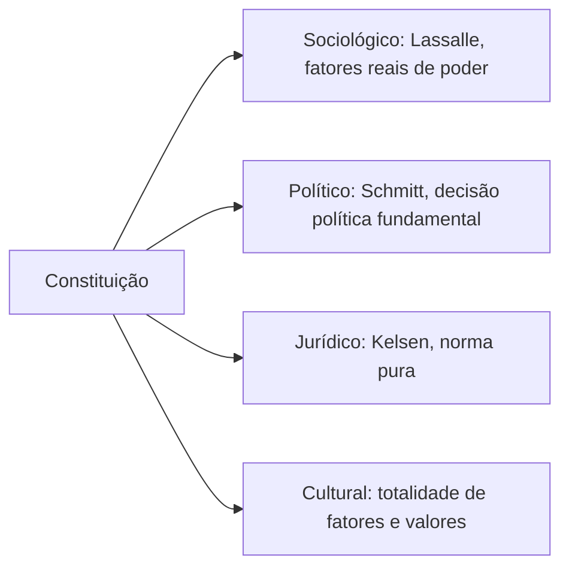

Quem estuda para concursos costuma começar o Direito Constitucional pelos direitos fundamentais ou pela organização do Estado. Mas todo o edifício se apoia em um andar anterior, a **teoria da Constituição**: o que é Constituição, como ela nasce, quais são seus tipos, como suas normas valem e quem pode criá-las. As bancas cobram esse andar com frequência, geralmente por meio de nomes de autores e de classificações. Este capítulo abre o volume com a natureza do Direito Constitucional e com os diversos **sentidos** que a palavra "Constituição" pode ter.

> [!objetivos]
> - Definir Direito Constitucional e indicar seu lugar entre os ramos do Direito.
> - Distinguir Direito Constitucional positivo, comparado e geral.
> - Diferenciar regras e princípios como espécies de norma jurídica.
> - Associar cada sentido de Constituição (sociológico, político, jurídico, cultural) ao seu autor e à sua ideia central.
> - Explicar a força normativa da Constituição.

## O Direito e a norma jurídica

O Direito é o conjunto de prescrições que organiza a vida em sociedade. Vale a máxima latina *ubi societas, ibi ius*: onde há sociedade, há direito. O que distingue a regra jurídica de outras regras de comportamento, como as de etiqueta ou de religião, é a **juridicidade**: o caráter jurídico, que dá à regra obrigatoriedade e eficácia garantida pelo Estado.

A **norma jurídica** é o gênero, e tem duas espécies: **regras** e **princípios**. A diferença, na lição de Robert Alexy, é qualitativa.

| Espécie | Característica | Funcionamento |
| --- | --- | --- |
| Regra | Determina, dentro do que é fático e juridicamente possível, exatamente o que deve ser feito | Cumpre-se ou não se cumpre (tudo ou nada) |
| Princípio | Mandamento de otimização: ordena que algo seja realizado na maior medida possível | Pode ser cumprido em graus diferentes, ponderando-se com outros princípios |

Quando duas **regras** entram em conflito, uma delas é inválida ou abre-se uma exceção. Quando dois **princípios** colidem, nenhum deles é invalidado: o intérprete pondera, dando a cada um o peso adequado ao caso. As duas espécies são normas porque ambas dizem o que deve ser, e se expressam em termos de mandamento, permissão e proibição.

> [!bizu] Regra é tudo ou nada; princípio é mais ou menos
> Se a questão disser que os princípios "só podem ser cumpridos ou não", está errada: isso descreve as regras. Os princípios admitem aplicação gradual, e é por isso que Alexy os chama de mandamentos de otimização.

## O lugar do Direito Constitucional

O Direito é um sistema normativo que se divide em ramos, a depender do critério. A divisão clássica separa o **Direito Público** (Constitucional, Administrativo, Penal, Tributário, Processual, Internacional) do **Direito Privado** (Civil, Comercial, entre outros). O Direito Constitucional integra o Direito Público e, na expressão de José Afonso da Silva, é o **Direito Público fundamental**, porque trata diretamente da organização e do funcionamento do Estado, da articulação de seus elementos primários e das bases da estrutura política.

As normas constitucionais fundam o equilíbrio entre os elementos do grupo, e as demais disciplinas jurídicas buscam nelas o seu fundamento. Por essa razão, diz-se que o Direito Constitucional é o **tronco** do qual saem os outros ramos.

### Conceito e objeto

José Afonso da Silva define o Direito Constitucional como o ramo do Direito Público encarregado de **expor, interpretar e sistematizar** as normas e os princípios básicos do Estado. Como essas normas e princípios compõem o conteúdo das constituições, o ramo também é descrito como a ciência positiva das constituições.

O objeto, isto é, aquilo de que o ramo trata, é descrito de formas ligeiramente diferentes pelos autores.

| Autor | Objeto do Direito Constitucional |
| --- | --- |
| Paulo Bonavides | Definir como o Estado se organiza (forma de Estado e de governo) e reconhecer os direitos individuais |
| José Afonso da Silva | Análise sistemática das normas que formam a constituição do Estado: sua estrutura, o governo, como o poder é obtido e exercido, os órgãos, os limites da atuação estatal, os direitos fundamentais com suas garantias e as bases da ordem econômica e social |

Os dois se completam. Para a prova, guarde a ideia central: o objeto são as normas fundamentais da organização do Estado e dos direitos das pessoas.

### Espécies de Direito Constitucional

José Afonso da Silva distingue três disciplinas:

- **Direito Constitucional Positivo (ou particular)**: trata da Constituição de um Estado em especial, interpretando, organizando e criticando suas normas. Exemplo: o estudo da Constituição brasileira de 1988.
- **Direito Constitucional Comparado**: estudo teórico das normas constitucionais de vários países, destacando semelhanças e diferenças. Seu método é cotejar instituições políticas e jurídicas.
- **Direito Constitucional Geral**: delineia princípios, conceitos e instituições presentes em vários direitos positivos, para classificá-los e sistematizá-los em visão unitária.

> [!pegadinha] Positivo não é "bom" nem "moral"
> Positivo, nesse contexto, quer dizer **concreto**, referente ao direito posto de um Estado determinado. Alternativas que associem o Direito Constitucional positivo a um estudo teórico dos vários países estão trocando o conceito com o do Direito Comparado.

## Sentidos de Constituição

A palavra "Constituição" admite vários sentidos, e cada um corresponde a uma escola de pensamento. A banca costuma pedir a associação entre sentido, autor e ideia central.

| Sentido | Autor | Ideia central |
| --- | --- | --- |
| Sociológico | Ferdinand Lassalle | A Constituição real é a soma dos fatores reais de poder |
| Político | Carl Schmitt | Decisão política fundamental |
| Jurídico | Hans Kelsen | Norma pura, fundada em uma norma hipotética fundamental |
| Cultural | Meirelles Teixeira e outros | Produto da cultura de um povo, em interação com os valores |

### Sentido sociológico

Ferdinand Lassalle enxerga a Constituição como um **fato da vida social**, e não como norma jurídica. Interessa o que ela é de verdade, e não como foi criada: a Constituição efetiva de um país é o resultado dos **fatores reais de poder** que atuam na sociedade, ou seja, a disputa entre forças econômicas, políticas, sociais e religiosas. Na Prússia da época de Lassalle, esses fatores eram a monarquia, o Exército, a aristocracia, os grandes industriais, os banqueiros e a classe operária.

Se uma Constituição escrita não corresponde a esses fatores, ela é uma mera "folha de papel", sem valor. No cenário ideal, os fatores reais ganham forma escrita, e a Constituição escrita e a real coincidem. Quando isso não ocorre, a real prevalece sobre o texto.

### Sentido político

Para Carl Schmitt, a Constituição é a **decisão política fundamental**: a escolha que o titular do poder constituinte faz sobre a forma de Estado, a forma de governo, os direitos fundamentais e a organização do poder. Daí a distinção entre **Constituição** (as decisões políticas fundamentais) e **leis constitucionais** (as demais normas do texto constitucional, que podem ser alteradas por procedimento mais simples). Só a Constituição em sentido estrito é fruto da decisão política fundamental.

### Sentido jurídico

Para Hans Kelsen, a Constituição é uma **norma jurídica pura**, o "dever ser", que não se mistura com fatores sociais, políticos ou filosóficos. No ápice do ordenamento está a Constituição positiva, que retira validade da **norma hipotética fundamental**, um pressuposto lógico, e não um ato real. Daí a imagem da **pirâmide**: cada norma tira validade da norma superior, até chegar à Constituição.

Kelsen também distingue dois sentidos dentro do jurídico: o **lógico-jurídico**, em que a Constituição é a norma hipotética fundamental, e o **jurídico-positivo**, em que é a norma positiva suprema.

### Sentido cultural

Na concepção cultural, a Constituição é o **produto de uma cultura**, uma totalidade que resulta de fatores sociológicos, políticos e jurídicos, sempre ligada aos valores de um povo. Ela é fruto da vida em sociedade e, ao mesmo tempo, a condiciona. Essa visão busca superar a visão unilateral das anteriores, reunindo os três fatores em um conjunto cultural.

> [!exemplo] Cada sentido, uma pergunta
> Uma Constituição escrita que garante direitos que o poder real não respeita: para Lassalle, é "folha de papel"; para Schmitt, a decisão política tomada pelo titular do poder; para Kelsen, uma norma válida; para a concepção cultural, um produto do ambiente cultural, que precisa se realizar na prática. Cada autor responde à mesma situação de modo diferente.

## Força normativa da Constituição

Em reação à ideia sociológica, Konrad Hesse sustentou a **força normativa da Constituição**. Para ele, a Constituição não é uma mera folha de papel: embora condicionada pela realidade, ela também a condiciona, e tem força própria para a transformar. A Constituição deixa de ser mera descrição do poder real para tornar-se um **dever ser** capaz de ordenar a vida política e social, desde que haja **vontade de Constituição**, isto é, disposição das pessoas e dos poderes de cumpri-la.

Hesse afirma que a força normativa depende de três ordens de fatores: o conteúdo da Constituição deve corresponder à natureza do presente, a Constituição deve estar atenta às mudanças da realidade, e deve haver prática constitucional coerente, com respeito às normas.

> [!atencao] Hesse x Lassalle
> A questão frequentemente opõe os dois: Lassalle diz que a Constituição escrita só vale se refletir os fatores reais de poder; Hesse responde que a Constituição tem força própria, pode transformar a realidade e exige vontade de Constituição. Quem confundir os autores troca os gabaritos.

## Concepção estrutural

A **concepção estrutural** vê a Constituição como a estrutura normativa fundamental do Estado: o conjunto de normas que organiza o poder, define os órgãos, limita sua atuação e protege os direitos. É a visão jurídica de dentro, que trata o documento como um sistema com partes, hierarquia e funções. Ela prepara a análise do capítulo seguinte, que examina a estrutura e os elementos do texto constitucional.

Vale ilustrar com a Constituição de 1988. Ela se estrutura em um preâmbulo, uma parte permanente dividida em títulos (princípios fundamentais, direitos e garantias, organização do Estado e dos Poderes, defesa do Estado, tributação, ordem econômica e social e disposições gerais) e uma parte transitória, o Ato das Disposições Constitucionais Transitórias. Cada parte cumpre uma função: a primeira orienta a interpretação, a segunda traz normas de vigência duradoura, e a terceira regula a passagem do regime anterior ao novo. Perceber a estrutura ajuda a localizar rapidamente um assunto e a identificar o tipo de norma que se tem diante de si.

Há ainda uma relação entre estrutura e hierarquia. Dentro do texto, as normas têm a mesma hierarquia formal, mas não a mesma importância. Os princípios fundamentais irradiam sentido para o restante, e os direitos fundamentais recebem proteção especial, como a que impede sua abolição por emenda. Por isso o intérprete deve ler cada artigo à luz do conjunto, e não de forma isolada: é o que a doutrina chama de unidade da Constituição.

> [!atencao] Unidade e força normativa andam juntas
> A força normativa de que fala Hesse se reforça pela unidade: um texto lido de forma coerente é mais fácil de aplicar. Quando uma norma parece contradizer outra, o intérprete procura harmonizá-las, e não declarar uma delas sem efeito. Essa ideia reaparece no estudo da hierarquia e da aplicabilidade das normas constitucionais.

## Visão de conjunto dos sentidos

Para guardar as quatro visões, ajuda pensar no que cada uma "olha":

- **Sociológico** olha para a **sociedade**: o poder real.
- **Político** olha para a **decisão**: quem escolhe o formato do Estado.
- **Jurídico** olha para a **norma**: o texto como dever ser.
- **Cultural** olha para a **cultura**: o conjunto de valores de um povo.

Há ainda duas ideias que aparecem em obras recentes e que convém conhecer. A primeira é a de **Constituição dirigente**, associada a Canotilho: uma Constituição que não apenas organiza o poder, mas define metas e programas a serem cumpridos pelo Estado, como a redução das desigualdades. A segunda é a de **Constituição aberta**, de Peter Häberle: a interpretação da Constituição não é monopólio dos juízes, e envolve a sociedade em um processo contínuo, de modo que o texto permanece vivo. Ambas dialogam com a ideia de força normativa.

> [!bizu] Duas perguntas que organizam tudo
> Diante de um nome de autor, pergunte: "ele fala de poder real, de decisão, de norma ou de cultura?" A resposta a essa pergunta leva ao sentido. Lassalle: poder real. Schmitt: decisão. Kelsen: norma. Cultural: valores.

## Do conceito ao texto: o que vem a seguir

A teoria dos sentidos mostra que a palavra Constituição pode significar coisas diferentes, mas, para a prova, sempre se volta ao texto concreto de 1988, que é uma Constituição em sentido **jurídico**, com forte influência do sentido **político** (porque nasce de uma decisão política fundamental) e do **cultural** (porque expressa valores do povo brasileiro). Nos capítulos seguintes, a Constituição será examinada em sua estrutura, seus elementos, seus tipos, a aplicabilidade das suas normas e o poder que a cria. Todos esses temas dependem do vocabulário apresentado aqui.

> [!resolvido] Questão comentada: Schmitt e a distinção entre Constituição e leis constitucionais
> Para Carl Schmitt, qual é a diferença entre Constituição e lei constitucional?
>
> **Resolução.** A Constituição é o conjunto de decisões políticas fundamentais tomadas pelo titular do poder constituinte, como a forma de Estado e de governo e os direitos fundamentais. As leis constitucionais são as demais normas que, embora estejam no texto, não tratam dessas decisões, e por isso podem ser modificadas por um procedimento menos rigoroso. Só a Constituição em sentido estrito é política; as leis constitucionais são normas formais.

## Como a banca cobra este assunto

Os padrões são previsíveis: (1) **autor e sentido** (Lassalle é sociológico; Schmitt é político; Kelsen é jurídico); (2) **regras e princípios**, com a ideia de mandamento de otimização; (3) **conceito e objeto**, com Bonavides e José Afonso da Silva; (4) **Hesse e a força normativa**, em oposição a Lassalle; (5) **Direito Constitucional positivo, comparado e geral**.

> [!resolvido] Questão comentada: sentidos de Constituição
> A Constituição de um país é apenas a soma dos fatores reais de poder nele existentes. A que sentido de Constituição essa ideia se liga?
>
> **Resolução.** Ao sentido sociológico, de Ferdinand Lassalle. O que ele chama de Constituição real é a soma dos fatores reais de poder, e a Constituição escrita, se destoar deles, é "folha de papel".

## Mapa do capítulo

| Tema | Ideia central | Armadilha |
| --- | --- | --- |
| Norma jurídica | Gênero, com regras e princípios | Dizer que princípio é "tudo ou nada" |
| Posição do ramo | Direito Público fundamental | Colocá-lo no Direito Privado |
| Conceito | Expõe, interpreta e sistematiza as normas fundamentais | Reduzir a lei ordinária |
| Espécies | Positivo, comparado e geral | Trocar comparado e geral |
| Sentido sociológico | Lassalle: fatores reais de poder | Atribuir a Kelsen |
| Sentido político | Schmitt: decisão política fundamental | Atribuir a Lassalle |
| Sentido jurídico | Kelsen: norma pura | Atribuir a Hesse |
| Força normativa | Hesse: vontade de Constituição | Confundir com Lassalle |

### Para fixar

1. Norma jurídica é o gênero, e regras e princípios são suas espécies.
2. Princípios são mandamentos de otimização; regras são cumpridas ou não.
3. O Direito Constitucional integra o Direito Público e é o "Direito Público fundamental".
4. Para José Afonso da Silva, o Direito Constitucional expõe, interpreta e sistematiza os princípios e normas fundamentais do Estado.
5. O Direito Constitucional pode ser positivo (de um Estado), comparado (de vários) ou geral (conceitos comuns).
6. No sentido sociológico, de Lassalle, a Constituição é a soma dos fatores reais de poder.
7. No sentido político, de Schmitt, é a decisão política fundamental.
8. No sentido jurídico, de Kelsen, é norma pura, que retira validade da norma hipotética fundamental.
9. No sentido cultural, é produto da cultura de um povo.
10. Konrad Hesse defende a força normativa da Constituição, que exige vontade de Constituição.
