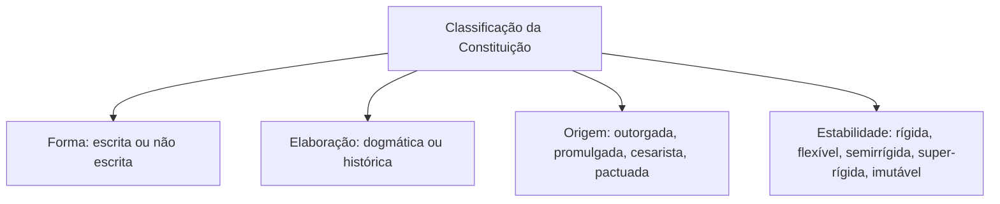

Depois de entender os sentidos de Constituição, é hora de olhar o documento de perto. O que ela contém, em que partes se divide, quais tipos de norma abriga e como as constituições se classificam. Essas perguntas rendem muitas questões, porque se prestam a listas de classificação e a pegadinhas sobre nomes. Este capítulo tem duas metades: a primeira trata de conceito, estrutura e elementos; a segunda abre as classificações quanto à forma, ao modo de elaboração e à estabilidade.

> [!objetivos]
> - Definir Constituição em sentido material e formal.
> - Descrever as três partes da Constituição e o valor do preâmbulo segundo o STF.
> - Listar os cinco elementos da Constituição e associá-los a exemplos.
> - Classificar uma Constituição quanto à forma, ao modo de elaboração e à estabilidade.

## Conceito de Constituição

Constituição é a lei maior de um Estado, fruto da vontade soberana do povo e situada acima de todas as demais normas. Ela organiza o Estado do ponto de vista político e jurídico, definindo sua forma, os órgãos que o compõem com as respectivas competências e a maneira de conquistar e exercer o poder. Cabe a ela também impor limites ao poder estatal e listar os direitos e as garantias fundamentais.

### Sentido material e sentido formal

A doutrina distingue dois aspectos:

| Sentido | O que considera | Exemplo |
| --- | --- | --- |
| Material | O **conteúdo**: as normas que tratam da organização do poder, da distribuição de competências, do exercício da autoridade, da forma de governo e dos direitos da pessoa | A divisão entre União, Estados e Municípios |
| Formal | O **modo de criação** e a posição no texto: é constitucional tudo o que está escrito na Constituição, por ter sido elaborado com o rito próprio | A regra sobre o Colégio Pedro II, que consta da Constituição sem ser matéria estrutural |

A Constituição tem sempre aspecto formal, porque tudo o que está nela foi criado pelo poder constituinte. Mas nem tudo o que está nela é materialmente constitucional. Há normas "enxertadas" no texto que não tratam dos elementos básicos da organização política: são de aparência constitucional. Em uma Constituição analítica como a brasileira, isso é frequente.

### A Constituição ideal

Para Canotilho, a **Constituição ideal** é de matriz liberal e deve ter três elementos: ser **escrita**, conter um **sistema de direitos fundamentais** individuais (liberdades negativas) e adotar o princípio da **separação dos poderes**. Todos esses elementos limitam o poder coercitivo do Estado. A ideia é ligada ao art. 16 da Declaração dos Direitos do Homem e do Cidadão (1789): a sociedade em que não estejam assegurados os direitos nem separados os poderes não tem Constituição.

## Estrutura da Constituição

Em geral, as constituições têm três partes: **preâmbulo**, **parte dogmática** e **disposições transitórias**.

### Preâmbulo

O preâmbulo antecede o texto. Declara as intenções do constituinte, proclama os princípios da nova ordem e marca a ruptura com a anterior. Serve de elemento de integração e de orientação na interpretação dos artigos. Sintetiza a ideologia do poder constituinte originário e os valores que ele adotou. O preâmbulo da Constituição de 1988 menciona, em linhas gerais, o Estado Democrático que se pretende instituir, os direitos sociais e individuais que ele deve garantir e uma lista de valores supremos: liberdade, segurança, bem-estar, desenvolvimento, igualdade e justiça. Retrata uma sociedade fraterna, plural e sem preconceitos, voltada à paz e à harmonia social.

> [!lei] Constituição Federal, Preâmbulo
> Nós, representantes do povo brasileiro, reunidos em Assembleia Nacional Constituinte para instituir um Estado Democrático, destinado a assegurar o exercício dos direitos sociais e individuais, a liberdade, a segurança, o bem-estar, o desenvolvimento, a igualdade e a justiça como valores supremos de uma sociedade fraterna, pluralista e sem preconceitos, fundada na harmonia social e comprometida, na ordem interna e internacional, com a solução pacífica das controvérsias, promulgamos, sob a proteção de Deus, a seguinte Constituição da República Federativa do Brasil.

> [!jurisprudencia] STF, ADI 2.076/AC
> O preâmbulo da Constituição não é norma constitucional: não serve de parâmetro para controle de constitucionalidade, não limita o poder de reforma nem o poder constituinte decorrente, e suas frases não precisam ser copiadas pelas constituições dos Estados. Tem relevância como diretriz de interpretação, mas não tem força normativa própria.

Em uma frase: o preâmbulo tem **valor interpretativo**, e não valor normativo, segundo o Supremo Tribunal Federal. A doutrina, porém, não o considera juridicamente irrelevante.

### Parte dogmática

É o texto constitucional propriamente dito, com os direitos e deveres criados pelo poder constituinte. É o corpo permanente da Constituição e, na de 1988, vai do **art. 1º ao art. 250**. É "permanente" porque, em princípio, as normas não têm caráter transitório, embora possam ser modificadas por emenda constitucional.

### Disposições transitórias

O **Ato das Disposições Constitucionais Transitórias (ADCT)** integra a ordem jurídica antiga à nova, ao tempo da edição da Constituição, para dar segurança jurídica e evitar o colapso da transição. Tem a mesma hierarquia das demais normas constitucionais, mas é concebido para vigência limitada no tempo em muitos de seus dispositivos. Também pode ser alterado por emenda.

| Parte | Função | Observação |
| --- | --- | --- |
| Preâmbulo | Intenções, valores, orientação | Para o STF, sem força normativa |
| Parte dogmática | Normas permanentes | Do art. 1º ao 250 na CF/88 |
| ADCT | Transição entre a ordem velha e a nova | Mesma hierarquia constitucional |

## Elementos da Constituição

José Afonso da Silva divide o conteúdo da Constituição em **cinco categorias de elementos**:

| Elemento | Conteúdo | Exemplo |
| --- | --- | --- |
| Orgânicos | Organização do Estado e dos Poderes | Normas sobre os Poderes e a repartição de competências |
| Limitativos | Limitam o poder do Estado: direitos e garantias individuais | Direitos individuais, políticos e de nacionalidade |
| Sócio-ideológicos | Revelam o compromisso do constituinte entre ideologias | Direitos sociais e normas da ordem econômica e social |
| De estabilização constitucional | Garantem a solução de conflitos e a defesa da Constituição e das instituições | Intervenção federal, estado de defesa, jurisdição constitucional |
| Formais de aplicabilidade | Regras de aplicação da Constituição | Preâmbulo, ADCT, aplicação imediata dos direitos fundamentais |

> [!bizu] Cinco elementos, cinco verbos
> Orgânicos **organizam**; limitativos **limitam**; sócio-ideológicos **conciliam** ideologias; de estabilização **estabilizam** conflitos; formais de aplicabilidade **aplicam** as normas. A banca troca os nomes: "limitativos" é o que protege direitos individuais.

## Classificação quanto à forma

A primeira classificação olha para a **forma**: a Constituição existe em um documento ou decorre dos costumes?

| Tipo | Característica | Exemplo |
| --- | --- | --- |
| Escrita | Normas reunidas em um texto, ou em vários | CF/88 |
| Não escrita (costumeira) | Normas baseadas em costumes, jurisprudência e convenções | Inglaterra |

A Constituição escrita pode ser:

- **Codificada (ou unitária)**: toda a matéria está reunida em um só documento, sistematizado. É o caso do Brasil.
- **Legal (ou variada)**: a matéria está espalhada em vários textos, como leis, e não em um documento único.

Note que a **Constituição não escrita** não significa que nada esteja escrito; significa que as normas decorrem dos costumes, da jurisprudência e de textos esparsos, sem um documento único e solene. A Inglaterra é o exemplo clássico.

## Classificação quanto ao modo de elaboração

A segunda classificação olha para como a Constituição nasce.

| Tipo | Como surge | Exemplo |
| --- | --- | --- |
| Dogmática | Elaborada de uma vez, escrita, sistematizada, expressando ideias da teoria política dominante | CF/88 |
| Histórica | Resulta de lenta evolução das tradições e costumes, sem elaboração sistemática | Constituição inglesa |

A Constituição **dogmática** é sempre escrita; a **histórica** é sempre não escrita. Vale a relação: escrita e dogmática andam juntas, assim como costumeira e histórica.

> [!pegadinha] Dogmática não é "autoritária"
> Dogmática, no vocabulário do Direito Constitucional, é a Constituição escrita e sistematizada, elaborada em um momento determinado. A palavra nada diz sobre a legitimidade de sua origem. Uma Constituição dogmática pode ser democrática (a de 1988) ou imposta (a de 1937).

## Classificação quanto à origem (outorgada e promulgada)

Em relação à origem ou ao procedimento de criação, as constituições se dividem em:

| Tipo | Como surge | Exemplo no Brasil |
| --- | --- | --- |
| Outorgada | Imposta por um governante ou grupo, sem participação popular | 1824, 1937 e 1967 (formalmente votada, mas imposta) |
| Promulgada (democrática ou popular) | Elaborada por representantes eleitos do povo | 1891, 1934, 1946 e 1988 |
| Cesarista (bonapartista) | Elaborada por um governante e submetida a plebiscito popular que a ratifica | Sem exemplo brasileiro |
| Pactuada | Resulta de um acordo entre forças rivais, como o rei e a burguesia | Magna Carta, na Inglaterra |

## Classificação quanto à estabilidade

A estabilidade mede quão difícil é alterar a Constituição.

| Tipo | Procedimento de alteração | Exemplo |
| --- | --- | --- |
| Rígida | Exige processo mais difícil que o das leis ordinárias | CF/88 (art. 60) |
| Flexível | Alterável pelo mesmo processo das leis ordinárias | Constituição inglesa |
| Semirrígida (ou semiflexível) | Parte rígida e parte flexível | Constituição de 1824 |
| Super-rígida | Rígida, com núcleo intangível (cláusulas pétreas) | CF/88, para parte da doutrina |
| Imutável (granítica) | Não admite alteração | Constituições que se pretendem eternas |

A Constituição de 1988 é rígida: para alterar o texto, exige-se emenda, aprovada em dois turnos em cada Casa por três quintos dos membros (art. 60, § 2º). Para parte da doutrina, é ainda **super-rígida**, porque algumas matérias nem sequer podem ser objeto de emenda (cláusulas pétreas, art. 60, § 4º).

A Constituição de 1824, em seu art. 178, distinguia as matérias constitucionais por natureza, que só podiam ser alteradas por procedimento rígido, das demais, que podiam ser modificadas pelo legislativo ordinário: por isso é considerada **semirrígida**.

> [!resolvido] Questão comentada: rígida ou flexível?
> Uma Constituição que pode ser alterada pelo mesmo procedimento usado para aprovar leis ordinárias é classificada como...?
>
> **Resolução.** Flexível. A rigidez exige procedimento mais difícil do que o das leis ordinárias, e a flexibilidade aceita o mesmo procedimento. A Constituição de 1988 é rígida porque a emenda exige quórum de três quintos, em dois turnos.

> [!atencao] Rígida não é imutável
> Constituição rígida pode ser alterada, mas por processo especial. A imutável (ou granítica) é a que não admite alteração. A confusão é frequente em provas: dizer que "a CF/88 é imutável" está errado.

## Classificando a Constituição de 1988

Reunidas as categorias, é possível classificar a Constituição brasileira em cada critério. Essa lista é cobrada com frequência, em formato de afirmativa a julgar.

| Critério | Classificação da CF/88 |
| --- | --- |
| Forma | Escrita e codificada |
| Modo de elaboração | Dogmática |
| Origem | Promulgada (democrática ou popular) |
| Estabilidade | Rígida (e super-rígida, para parte da doutrina) |

Os próximos capítulos acrescentam outros critérios, como o conteúdo (formal), a extensão (analítica), a função (dirigente), a ideologia (eclética) e a correspondência com a realidade (normativa). Com todos reunidos, a Constituição de 1988 fica assim descrita: escrita, codificada, dogmática, promulgada, rígida, formal, analítica, dirigente, eclética e normativa. Quem decora essa sequência resolve boa parte das questões do tema.

### Um raciocínio para não errar

Diante de uma afirmação do tipo "a Constituição X é histórica e escrita", há um teste rápido: **histórica** é sempre costumeira, e portanto **não escrita**. A afirmação é contraditória. Da mesma forma, "dogmática e não escrita" não existe. Outro teste: uma Constituição **flexível** pode, em tese, ser alterada por simples lei, de modo que não faz sentido falar em cláusula pétrea nela. Já a **imutável** não admite alteração, mas na prática é rara, porque entra em conflito com a necessidade de adaptação ao tempo.

> [!exemplo] Aplicando os critérios
> Imagine uma Constituição elaborada de uma só vez, em documento único, por assembleia eleita, que só pode ser alterada por processo especial com quórum elevado. Ela é escrita, codificada, dogmática, promulgada e rígida. É o perfil da brasileira. Agora, uma Constituição formada por costumes, precedentes e leis esparsas, alterável por lei comum, é não escrita, histórica e flexível: é o perfil da inglesa.

## Como a banca cobra este assunto

As questões exploram (1) o **valor do preâmbulo** (para o STF, sem força normativa e sem reprodução obrigatória nas constituições estaduais); (2) a **ligação entre as classificações** (escrita e dogmática; costumeira e histórica); (3) a **classificação da CF/88** (escrita, codificada, dogmática, promulgada, rígida, analítica); (4) os **tipos de elemento** da Constituição; e (5) a **Constituição de 1824** como outorgada e semirrígida.

## Mapa do capítulo

| Tema | Ideia central | Armadilha |
| --- | --- | --- |
| Conceito material | Conteúdo básico da organização do poder | Achar que tudo o que está no texto é material |
| Conceito formal | Tudo que está na Constituição | Negar que normas "enxertadas" são formalmente constitucionais |
| Preâmbulo | Valor interpretativo; sem força normativa | Dizer que é norma de reprodução obrigatória |
| Parte dogmática | Arts. 1º ao 250 | Incluir o ADCT |
| Elementos | Orgânicos, limitativos, sócio-ideológicos, estabilização, formais de aplicabilidade | Trocar limitativos por orgânicos |
| Forma | Escrita (codificada ou legal) ou não escrita | Associar não escrita a Brasil |
| Elaboração | Dogmática ou histórica | Confundir com outorgada |
| Estabilidade | Rígida, flexível, semirrígida, super-rígida, imutável | Dizer que rígida não muda |

### Para fixar

1. Constituição é a lei fundamental e suprema do Estado, criada pela vontade soberana do povo.
2. No sentido material, importa o conteúdo; no formal, o modo de criação e o fato de estar no texto.
3. Canotilho descreve a Constituição ideal como escrita, com direitos individuais e com separação de poderes.
4. A Constituição se divide em preâmbulo, parte dogmática (arts. 1º a 250) e ADCT.
5. Para o STF, o preâmbulo não é norma constitucional nem de reprodução obrigatória.
6. Os elementos são orgânicos, limitativos, sócio-ideológicos, de estabilização e formais de aplicabilidade.
7. Quanto à forma, a Constituição é escrita (codificada ou legal) ou não escrita (costumeira).
8. Quanto ao modo de elaboração, é dogmática (escrita e sistematizada) ou histórica (costumeira).
9. Quanto à origem, é outorgada, promulgada, cesarista ou pactuada.
10. Quanto à estabilidade, é rígida, flexível, semirrígida, super-rígida ou imutável; a CF/88 é rígida.
