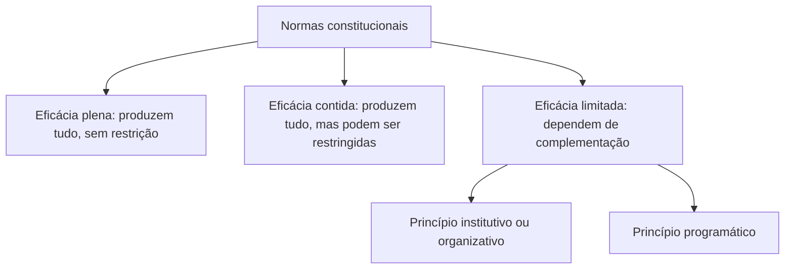

Uma norma constitucional que existe no papel mas não produz efeitos de pouco serve. Por isso, a pergunta "a norma pode ser aplicada desde logo, ou precisa de uma lei para completá-la?" é central para quem estuda o Direito Constitucional. A resposta está na **aplicabilidade** das normas constitucionais, cuja classificação mais aceita no Brasil é a de José Afonso da Silva. Este capítulo apresenta essa classificação, mostra exemplos de cada tipo e encerra com a **hierarquia das normas**.

> [!objetivos]
> - Distinguir eficácia jurídica de eficácia social e aplicabilidade imediata de eficácia plena.
> - Classificar normas constitucionais em eficácia plena, contida e limitada.
> - Reconhecer as espécies de normas de eficácia limitada.
> - Explicar a hierarquia das normas e a inexistência de hierarquia entre normas constitucionais originárias.

## Todas as normas têm juridicidade

Todas as normas constitucionais são jurídicas: são imperativas e cogentes. Todas produzem efeitos. O que varia é o **grau** desses efeitos e o **momento** em que se manifestam. Uma norma pode produzir todos os efeitos desde logo; outra, apenas alguns, até que uma lei a complete.

### A doutrina americana

A doutrina clássica dos Estados Unidos divide as normas em duas espécies:

| Espécie | Característica |
| --- | --- |
| Autoexecutáveis (*self-executing*) | Completas, aplicáveis sem qualquer complementação |
| Não autoexecutáveis | Dependem de lei antes de serem aplicadas: normas incompletas, programáticas ou de estruturação |

A divisão é didática, mas no Brasil prevalece a classificação de José Afonso da Silva, mais detalhada.

### Eficácia jurídica e eficácia social

A classificação de José Afonso da Silva trata da **eficácia jurídica**: a aptidão da norma para produzir efeitos jurídicos. Não se confunde com a **eficácia social** (ou efetividade), que mede o quanto a norma é efetivamente cumprida na sociedade. Uma norma pode ter ampla eficácia jurídica e baixa efetividade, como um direito que existe e é plenamente aplicável, mas que a população pouco exerce ou que o poder público não respeita.

> [!atencao] Aplicabilidade x efetividade
> "Aplicável" fala do que a norma pode produzir em tese; "efetiva" fala do que ela produz na vida real. As provas só pedem a primeira, a eficácia jurídica. Se a assertiva falar em "cumprimento pela sociedade", trata-se de eficácia social.

## Normas de eficácia plena

São as que produzem, ou têm possibilidade de produzir, **desde a entrada em vigor da Constituição, todos os efeitos** que o constituinte quis regular. O exemplo clássico é o art. 2º, que declara que os Poderes são independentes e harmônicos.

Características:

- **autoaplicáveis**: não dependem de lei regulamentadora para produzir efeitos (pode haver lei, mas a norma já funciona sem ela);
- **não restringíveis**: lei posterior não pode limitar seu alcance;
- aplicabilidade **direta, imediata e integral**.

Outros exemplos: o art. 1º (fundamentos), o art. 18 (autonomia dos entes), as normas que fixam a competência privativa da União para legislar sobre certas matérias e as que criam imunidades tributárias. Em todos esses casos, o texto é completo: diz quem pode fazer o quê, sem deixar lacunas a serem preenchidas.

Um bom teste prático é perguntar: "se o Congresso nunca editar nenhuma lei sobre esse assunto, a norma funciona?". Se a resposta for sim, e se for impossível a lei restringi-la, a norma é de eficácia plena. Se funciona, mas a lei pode restringir, é contida. Se não funciona direito sem a lei, é limitada.

| Pergunta | Plena | Contida | Limitada |
| --- | --- | --- | --- |
| Funciona sem lei? | Sim | Sim | Só em parte |
| A lei pode restringir? | Não | Sim | Não se aplica |
| O silêncio do legislador prejudica? | Não | Não | Sim |

## Normas de eficácia contida (prospectiva)

São normas aptas a produzir **todos os seus efeitos desde a promulgação**, mas que **podem ser restringidas** pelo poder público. A atuação do legislador, nesses casos, é **discricionária**: ele não precisa restringir.

O exemplo mais cobrado é o art. 5º, XIII, que assegura a liberdade de trabalho, ofício ou profissão, ressalvadas as qualificações que a lei exigir. Desde 1988, qualquer pessoa pode exercer qualquer profissão; mas a lei pode impor requisitos, como a aprovação no exame da OAB para a advocacia ou a graduação em Medicina para exercer a medicina.

Características:

- **autoaplicáveis**, isto é, produzem todos os efeitos independentemente de lei; antes da lei restritiva, o direito é exercido de modo amplo;
- **restringíveis**, ou seja, sujeitas a limitações;
- aplicabilidade **direta, imediata e possivelmente não integral** (podem sofrer limitações).

A restrição pode vir de três fontes:

| Fonte da restrição | Exemplo |
| --- | --- |
| Lei | O direito de greve na iniciativa privada (art. 9º) é pleno, mas a lei define os serviços essenciais e o atendimento das necessidades inadiáveis |
| Outra norma constitucional | O art. 139 permite restringir certos direitos durante o estado de sítio |
| Conceitos ético-jurídicos indeterminados | O "iminente perigo público" (art. 5º, XXV) autoriza o Estado a requisitar propriedade particular |

> [!bizu] Contida é "plena, mas com tesoura"
> A eficácia contida começa como plena (produz tudo desde logo), mas o poder público tem a "tesoura" para restringir. A limitada começa vazia e só enche com lei. É a diferença entre ter o direito já em vigor (contida) e esperá-lo (limitada).

## Normas de eficácia limitada

São normas que **dependem de complementação legislativa** (ou de outra providência) para produzir todos os seus efeitos. Têm **aplicabilidade indireta, mediata e reduzida**: produzem alguns efeitos desde logo, mas não os principais, enquanto não vier a norma que as complete.

Duas espécies se destacam:

| Espécie | Ideia | Exemplo |
| --- | --- | --- |
| Declaratórias de princípio institutivo ou organizativo | Indicam à lei a criação ou estruturação de órgãos, instituições ou institutos | O art. 88: a lei disporá sobre a criação e extinção de Ministérios |
| Declaratórias de princípio programático | Fixam programas, fins e metas a serem cumpridos pelo Estado | O art. 196: a saúde é direito de todos e dever do Estado, mediante políticas sociais |

As de princípio **institutivo** se subdividem em **impositivas** (a lei é obrigatória) e **facultativas** (a lei é possível, mas não obrigatória). As **programáticas** estabelecem programas para as políticas públicas, e o legislador e o administrador são os destinatários principais.

Mesmo as de eficácia limitada produzem **efeitos mínimos** desde logo: revogam normas anteriores incompatíveis, impedem a edição de leis que as contrariem e servem de parâmetro para o controle de constitucionalidade. Têm, portanto, eficácia jurídica, ainda que reduzida.

> [!exemplo] A greve do servidor público
> O art. 37, VII, previa que o direito de greve dos servidores seria exercido nos termos e nos limites definidos em lei específica. Por muito tempo, a lei não veio. Era uma norma de eficácia limitada. O Supremo, em mandado de injunção, determinou a aplicação, por analogia, das regras da greve na iniciativa privada, até que sobrevenha a lei específica. O caso mostra como o sistema reage à omissão do legislador.

> [!pegadinha] Eficácia limitada é eficácia zero?
> Não. Mesmo a norma limitada produz efeitos: impede leis contrárias, orienta a interpretação e serve de parâmetro para o controle de constitucionalidade. Afirmações que digam que a norma de eficácia limitada "não produz nenhum efeito" estão erradas.

### Comparação entre as três

| Tipo | Produz efeitos desde logo? | Lei pode restringir? | Precisa de lei? |
| --- | --- | --- | --- |
| Plena | Todos | Não | Não |
| Contida | Todos | Sim | Não |
| Limitada | Reduzidos | Não se aplica | Sim |

Essa tabela sintetiza o que é mais cobrado. Memorize em três verbos: a plena **basta**, a contida **pode ser contida**, a limitada **espera**.

### A classificação de Maria Helena Diniz

Maria Helena Diniz acrescenta uma categoria à classificação: a **supereficácia absoluta**. Seriam as normas intangíveis, que não podem sequer ser modificadas por emenda, como as cláusulas pétreas. Ficariam, assim, quatro grupos: supereficácia absoluta (cláusulas pétreas), plena, contida e limitada. A banca costuma perguntar de qual autora é a quarta categoria.

> [!atencao] Quem é quem
> A classificação em plena, contida e limitada é de **José Afonso da Silva**. A de **Maria Helena Diniz** acrescenta a supereficácia absoluta, e trata a plena como alterável por emenda. Cuidado com a troca de autores.

## Exemplos para memorizar

A prova adora pedir a classificação de um dispositivo específico. Vale reunir exemplos clássicos, em um quadro de consulta.

| Dispositivo | Conteúdo | Classificação |
| --- | --- | --- |
| Art. 2º | Poderes independentes e harmônicos | Plena |
| Art. 5º, XIII | Liberdade profissional, observadas as qualificações legais | Contida |
| Art. 5º, XXV | Requisição em caso de iminente perigo público | Contida |
| Art. 9º | Direito de greve, com serviços essenciais definidos em lei | Contida (setor privado) |
| Art. 37, VII | Greve do servidor, nos termos de lei específica | Limitada |
| Art. 88 | Lei disporá sobre criação e extinção de Ministérios | Limitada institutiva |
| Art. 196 | Saúde como direito de todos e dever do Estado | Limitada programática |
| Art. 205 | Educação como direito de todos, a ser promovida com a sociedade | Limitada programática |
| Art. 7º, XXI | Aviso prévio proporcional ao tempo de serviço, nos termos da lei | Limitada |

Observe que um mesmo artigo pode abrigar normas de tipos diferentes: o art. 9º tem o direito de greve (contido) e, no § 1º, a delegação à lei para definir os serviços essenciais, o que justifica a restrição.

## Normas programáticas e o dever do Estado

As normas programáticas despertam uma dúvida natural: se elas dependem de política pública, o cidadão pode exigir o cumprimento? A resposta da doutrina e da jurisprudência é matizada. Essas normas **vinculam** o legislador e o administrador, que não podem agir de modo contrário ao programa. Têm eficácia **negativa**: impedem a edição de normas que as contrariem. E produzem **eficácia interpretativa**: orientam a leitura de outras normas.

Em alguns casos, o Judiciário determina o cumprimento da norma programática, sobretudo quando está em jogo o **mínimo existencial**, o conjunto de condições básicas para uma vida digna (como o acesso a medicamentos essenciais). O Estado costuma invocar a **reserva do possível**, isto é, a limitação de recursos. A tensão entre mínimo existencial e reserva do possível é um dos grandes debates do tema. Além disso, a doutrina defende a **vedação do retrocesso**: uma vez efetivado um direito social por lei, o legislador não pode simplesmente suprimi-lo, a menos que garanta compensação equivalente.

> [!atencao] Programática não é "mera recomendação"
> Dizer que as normas programáticas são meras recomendações, sem valor jurídico, é erro. Elas são jurídicas e produzem efeitos, ainda que menos intensos do que os das plenas. O nível de cobrança judicial é que varia conforme o caso.

### Um olhar prático sobre a restrição das normas contidas

Vale detalhar como funciona a restrição de uma norma de eficácia contida, porque é nesse ponto que o aluno costuma tropeçar. Enquanto não existe lei restritiva, o direito é exercido em toda a sua amplitude: qualquer pessoa pode, em princípio, exercer qualquer profissão. Quando a lei é editada, ela passa a condicionar o exercício a certas qualificações. A norma constitucional continua a mesma; o que muda é o espaço de liberdade. Se a lei for revogada, o direito volta à amplitude original. Isso mostra por que se diz que a eficácia contida é "plena com possibilidade de contenção".

Outro ponto: a restrição só é válida se respeitar os limites da própria Constituição. A lei que exige qualificação profissional precisa ser razoável e proporcional; uma exigência desproporcional, que na prática impeça o exercício da profissão, seria inconstitucional. O mesmo vale para as restrições durante o estado de sítio, que só podem alcançar os direitos e pelo tempo que a Constituição autoriza. A contenção não equivale a poder ilimitado de supressão.

## Aplicabilidade imediata dos direitos fundamentais

O art. 5º, § 1º, estabelece que as normas definidoras de direitos e garantias fundamentais têm **aplicação imediata**. Isso não transforma todas em normas de eficácia plena. Significa que o intérprete deve extrair delas o máximo de eficácia possível, sem esperar a lei, e que o Judiciário pode aplicá-las diretamente. Mesmo uma norma de direito fundamental de eficácia limitada produz efeitos imediatos, como impedir leis contrárias e permitir o reconhecimento de omissões.

## Quando a lei não vem: omissão legislativa

A omissão do legislador em regulamentar uma norma limitada é um problema real. A Constituição oferece dois instrumentos. O **mandado de injunção** (art. 5º, LXXI) é cabível quando a falta de norma regulamentadora torna inviável o exercício de direitos e liberdades constitucionais e de prerrogativas ligadas à nacionalidade, à soberania e à cidadania. A **ação direta de inconstitucionalidade por omissão** (art. 103, § 2º) busca declarar a omissão e dar ciência ao Poder competente. O primeiro tutela situação concreta; a segunda, o interesse abstrato de que a Constituição seja cumprida.

| Instrumento | Finalidade | Natureza |
| --- | --- | --- |
| Mandado de injunção | Viabilizar o exercício de um direito diante da falta de regulamentação | Controle concreto |
| ADO | Declarar a inconstitucionalidade por omissão de norma necessária | Controle abstrato |

## Outras classificações e conceitos vizinhos

A classificação de José Afonso da Silva é a mais cobrada, mas outras ideias aparecem em provas e ajudam a compreender o tema.

**Normas de eficácia exaurida e de aplicabilidade esgotada.** Algumas normas, sobretudo do ADCT, cumprem sua finalidade uma vez, e depois perdem a utilidade prática. Um exemplo é a norma que fixou o término dos mandatos de determinados cargos logo após a promulgação. Uma vez aplicada, ela se exauriu: continua no texto, mas já não tem o que regular. Essa categoria é lembrada por alguns autores como um quarto grupo, ao lado das plenas, contidas e limitadas.

**A tripartição de Luís Roberto Barroso.** Outra forma de ver as normas é pelo seu papel: normas **constitucionais de organização** (estruturam o poder e o Estado), normas **constitucionais definidoras de direitos** (criam direitos subjetivos, de liberdade, políticos, sociais) e normas **constitucionais programáticas** (traçam fins e programas). A classificação por papel dialoga com a classificação por eficácia: as de organização costumam ser plenas; as definidoras de direitos variam; as programáticas são limitadas.

**Autoaplicabilidade e regulamentação.** Uma pegadinha recorrente é supor que "autoaplicável" significa "sem lei nenhuma". Autoaplicável quer dizer que a norma produz efeitos sem depender de lei que a complete. Pode haver lei que a regulamente, mas ela não é indispensável. A norma de eficácia plena e a de eficácia contida são ambas autoaplicáveis; a limitada não é.

> [!resolvido] Treino: classifique cada uma
> (a) "A República Federativa do Brasil constitui-se em Estado Democrático de Direito." (b) "É livre a locomoção no território nacional em tempo de paz, nos termos da lei." (c) "A lei disporá sobre a organização do Ministério Público da União." (d) "A família é a base da sociedade e tem especial proteção do Estado." (e) "São Poderes da União, independentes e harmônicos entre si."
>
> **Resolução.** (a) Plena: declara a forma do Estado e produz todos os efeitos de imediato. (b) Contida: a liberdade de locomoção vale desde logo, mas a lei pode regulá-la. (c) Limitada institutiva: depende de lei para organizar o órgão. (d) Limitada programática: fixa um programa de proteção, cuja concretização depende de políticas públicas. (e) Plena: independência e harmonia dos Poderes valem sem restrição legal. Observe a expressão "nos termos da lei" em (b): sozinha, ela não basta para dizer que a norma é limitada, e é preciso verificar se o direito já vale sem a lei, como vale.

## Hierarquia das normas

Em uma ordem jurídica, as normas não têm todas a mesma posição. Segundo Kelsen, o ordenamento se organiza em uma **pirâmide**: cada norma retira sua validade da norma superior, até chegar à Constituição. No Brasil, o quadro é este.

| Nível | Normas |
| --- | --- |
| Topo | Constituição, com suas emendas e os tratados de direitos humanos aprovados com quórum de emenda (art. 5º, § 3º) |
| Intermediário | Tratados de direitos humanos sem esse quórum (supralegais) |
| Legal | Leis complementares, ordinárias, delegadas, medidas provisórias, decretos legislativos e resoluções |
| Infralegal | Decretos regulamentares, portarias, instruções normativas |

Normas inferiores devem respeito às superiores: uma lei contrária à Constituição é inconstitucional, e um decreto contrário à lei é ilegal. Disso decorre o controle de constitucionalidade.

### Hierarquia entre normas constitucionais?

Embora haja hierarquia entre a Constituição e as demais normas, **não há hierarquia entre normas constitucionais originárias**. Elas têm todas o mesmo valor, ainda que umas tratem de assuntos mais relevantes que outras. O STF decidiu, na ADI 815, que não existe norma constitucional originária inconstitucional: o poder constituinte originário é ilimitado, e a tese da "hierarquia" entre normas do texto originário foi rejeitada.

Isso significa que:

- as normas do **ADCT** têm a mesma hierarquia das demais;
- **normas constitucionais originárias** não podem ser declaradas inconstitucionais;
- as **emendas constitucionais**, que são produto do poder derivado, podem ser objeto de controle de constitucionalidade, porque estão sujeitas aos limites do art. 60.

> [!jurisprudencia] STF, ADI 815/DF
> Não existe hierarquia entre normas constitucionais originárias, e por isso não cabe ação direta de inconstitucionalidade contra norma da Constituição elaborada pelo poder constituinte originário. A tese da "norma constitucional inconstitucional" foi rejeitada.

## Como a banca cobra este assunto

O formato típico é a **assertiva com exemplo**: "a norma X é de eficácia contida". É preciso saber os exemplos clássicos: art. 2º (plena), art. 5º, XIII (contida), art. 196 (programática), art. 88 (institutiva). Outro formato é a **troca de características**: dizer que a norma de eficácia plena pode ser restringida por lei, ou que a limitada é autoaplicável. Também aparecem a **classificação de Diniz** e a **hierarquia entre normas constitucionais originárias**.

> [!resolvido] Questão comentada: discriminação punida por lei
> Julgue: a norma constitucional segundo a qual a lei punirá qualquer discriminação atentatória dos direitos e liberdades fundamentais é de eficácia contida.
>
> **Resolução.** Errado. Ela depende de lei punitiva para produzir seus efeitos principais, como a definição do crime e da pena. É norma de eficácia limitada, e não contida: a contida produz todos os efeitos desde logo, e a lei apenas pode restringir.

## Mapa do capítulo

| Tema | Ideia central | Armadilha |
| --- | --- | --- |
| Juridicidade | Todas as normas produzem efeitos | Dizer que a limitada não produz nenhum |
| Eficácia jurídica | Aptidão para produzir efeitos | Confundir com eficácia social |
| Plena | Todos os efeitos, sem restrição | Dizer que a lei pode restringi-la |
| Contida | Todos os efeitos, mas restringível | Dizer que depende de lei para existir |
| Limitada | Depende de lei; institutiva ou programática | Dizer que é autoaplicável |
| Diniz | Acrescenta a supereficácia absoluta | Atribuir a José Afonso da Silva |
| Hierarquia | Constituição no topo; supralegalidade dos tratados | Falar em hierarquia entre normas originárias |
| ADI 815 | Norma originária não é inconstitucional | Admitir ADI contra norma originária |

### Para fixar

1. Todas as normas constitucionais têm juridicidade e produzem algum efeito.
2. A eficácia jurídica (aptidão para produzir efeitos) não se confunde com a eficácia social (efetividade).
3. Normas de eficácia plena produzem todos os efeitos desde logo e não podem ser restringidas por lei.
4. Normas de eficácia contida produzem todos os efeitos desde logo, mas podem ser restringidas por lei, por outra norma constitucional ou por conceitos indeterminados.
5. Normas de eficácia limitada dependem de complementação e se dividem em institutivas e programáticas.
6. O art. 2º é de eficácia plena; o art. 5º, XIII, de eficácia contida; os arts. 88 e 196 são de eficácia limitada.
7. A limitada produz efeitos mínimos: revoga normas anteriores incompatíveis e impede leis contrárias.
8. Maria Helena Diniz acrescenta a categoria da supereficácia absoluta (cláusulas pétreas).
9. A pirâmide de Kelsen coloca a Constituição no topo, e os tratados de direitos humanos têm status de emenda ou supralegal.
10. Não há hierarquia entre normas constitucionais originárias, e elas não podem ser declaradas inconstitucionais (ADI 815).
