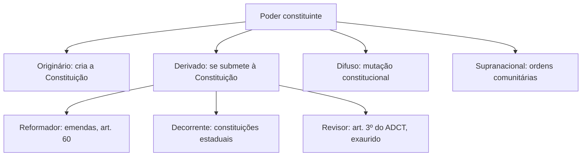

De onde vem o poder de fazer uma Constituição? Quem pode alterá-la? A resposta está na teoria do **Poder Constituinte**, um dos temas mais cobrados do Direito Constitucional. Ela explica por que a Constituição é suprema, por que só o povo pode ser seu autor e por que uma emenda tem limites que a Constituição originária não tem. Este capítulo percorre a origem da teoria, a titularidade, os poderes **originário** e **derivado** (reformador, decorrente e revisor), o poder constituinte **difuso** e **supranacional**, e a **mutação constitucional**.

> [!objetivos]
> - Distinguir poder constituinte de poderes constituídos e indicar o titular.
> - Descrever as características do poder constituinte originário e suas espécies.
> - Diferenciar poder constituinte reformador, decorrente e revisor, com seus limites.
> - Explicar o poder constituinte difuso, o supranacional e a mutação constitucional.

## Origem da teoria

A teoria do poder constituinte foi formulada pelo abade francês Emmanuel Sieyès, no século XVIII, em seu livro "O que é o Terceiro Estado?", concluído às vésperas da Revolução Francesa. Sua tese rompia com a legitimação dinástica do poder, segundo a qual o rei, representante de Deus na Terra, tinha toda a legitimidade. Para Sieyès, o poder de criar a Constituição pertence à **nação**.

A teoria se aplica a Estados com **Constituição escrita e rígida**, e distingue:

| Poder | Quem é | Exemplo |
| --- | --- | --- |
| Constituinte | O que cria ou atualiza a Constituição | A Assembleia que elaborou o texto de 1988 |
| Constituído | O que é criado e organizado pela Constituição | Legislativo, Executivo, Judiciário |

Para Paulo Bonavides, a teoria busca responder por que o poder é legítimo: é, no fundo, uma **teoria sobre a legitimidade do poder**. Do ponto de vista formal, o poder constituinte sempre existiu e sempre existirá, como instrumento para estabelecer a Constituição e a forma de Estado. Do ponto de vista material, é um conceito novo, que exprime uma filosofia do poder.

## Titularidade e exercício

Quem é o **titular** do poder constituinte? Para Sieyès, a nação. Na leitura moderna, o **povo**: só ele pode decidir criar ou modificar a Constituição. Canotilho resume: o problema do titular só tem hoje resposta democrática, e poder constituinte significa poder constituinte do povo.

Titularidade e **exercício** são coisas diferentes. O povo é sempre o titular, mas o exercício pode ser:

| Forma | Quem exerce | Exemplo |
| --- | --- | --- |
| Democrática (por convenção) | O povo, direta ou indiretamente | Assembleia Constituinte eleita |
| Autocrática (por outorga) | Usurpadores do poder: ditadores, grupos que tomam o poder | Constituição imposta por golpe |

Uma corrente minoritária, que inclui juristas como Gilmar Mendes, sustenta que o documento redigido sem participação do povo ou de seus legítimos representantes é uma "Carta constitucional", e não uma Constituição. A corrente majoritária entende que, mesmo quando o poder foi usurpado na elaboração, o texto resultante continua sendo Constituição.

### Exercício democrático: direto e indireto

A forma democrática pode ser **direta**, quando o povo participa diretamente da elaboração, por plebiscito, referendo ou proposta popular de dispositivos, e **indireta**, que é a mais frequente, por meio de uma **Assembleia Constituinte** composta por representantes eleitos.

- A Assembleia é **soberana** quando elabora e promulga a Constituição sem consulta ou ratificação popular, por representar a vontade do povo.
- É **exclusiva** quando composta apenas por pessoas eleitas para essa tarefa, sem outras funções legislativas.

A Assembleia Nacional Constituinte de 1988 foi **congressual** (formada pelos próprios membros da Câmara e do Senado, que acumularam as funções), e não exclusiva. Foi convocada pela Emenda Constitucional 26/1985.

> [!bizu] Titular é o povo; exerce quem for
> Uma pergunta clássica: "quem é o titular do poder constituinte?" Resposta: o povo. Outra: "quem o exerce?" Pode ser o povo, por seus representantes, ou usurpadores. Não confunda titularidade com exercício.

## Poder constituinte originário

O poder constituinte originário, também chamado de primeiro grau ou genuíno, é o que **dá ao Estado uma Constituição nova**. Distingue-se do derivado por seis características.

| Característica | Significado |
| --- | --- |
| Político | É um poder de fato, extrajurídico, anterior ao Direito |
| Inicial | Inaugura uma nova ordem jurídica, rompendo com a anterior |
| Incondicionado e insubordinado | Não se sujeita a forma ou procedimento predeterminado |
| Permanente | Não se esgota com a nova Constituição; fica em estado de latência |
| Ilimitado juridicamente | Não se submete a limites do direito anterior |
| Autônomo | Decide por si o conteúdo do novo texto |

### Um poder de fato

A doutrina dominante segue a corrente **positivista**: o poder constituinte originário é uma força da realidade, um **fato**, e não um direito previsto em alguma norma. Ele vem antes do Direito e funda a validade da nova ordem. Os **jusnaturalistas** defendem que ele é um poder jurídico limitado pelo direito natural.

### Inicial, incondicionado e permanente

Ele é **inicial** porque inaugura a ordem jurídica. É **incondicionado** porque não precisa seguir procedimento. Por isso não há controle de constitucionalidade sobre norma constitucional originária: o STF não pode declarar inconstitucional uma norma elaborada pelo poder originário, como visto no capítulo anterior.

É **permanente**: não se esgota com a promulgação. O que se dissolve após a Constituição é a **Assembleia Constituinte**, e não o poder, que permanece latente, esperando novo "momento constituinte". O poder constituinte não se confunde com a Constituição nem com a Assembleia.

### Ilimitado e autônomo

Para os positivistas, é **ilimitado juridicamente**: pode mudar a estrutura do Estado e os direitos dos cidadãos sem que sua validade seja contestada com base no ordenamento anterior. Por isso o STF decidiu (RE 94.414/SP, rel. Min. Moreira Alves) que **não há direito adquirido contra norma constitucional originária**. Para os jusnaturalistas, a ilimitação é apenas relativa, porque o poder encontra limites no direito natural, em valores suprapositivos e em normas internacionais de direitos humanos.

Mesmo entre os positivistas, Canotilho recorda que o poder constituinte precisa respeitar os valores espirituais, culturais, éticos e sociais enraizados na consciência jurídica da comunidade. E Paulo Gustavo Gonet Branco acrescenta que um grupo que redigir uma Constituição que hostilize os valores dominantes da nação não terá êxito nem será reconhecido como poder constituinte.

A isso se soma o princípio da **vedação do retrocesso**, também chamado de **efeito cliquet**, em matéria de direitos fundamentais. Em homenagem à dignidade da pessoa humana e à segurança jurídica, não se deve admitir retrocesso em relação a direitos já conquistados. Jorge Miranda sintetiza: a Constituição tem de evoluir, e não retroceder.

> [!pegadinha] Inicial não é ilimitado
> A banca costuma trocar a justificativa. "O poder originário é inicial porque não sofre limitação de norma anterior" está errada: ele é **inicial** porque inaugura a ordem jurídica, e é **ilimitado** porque não sofre limitação de norma anterior. Associe cada característica à sua justificativa.

### Espécies de poder originário

Quanto ao momento da manifestação, o poder originário pode ser:

- **Histórico (fundacional)**: cria a primeira Constituição de um Estado, quando ele nasce ou se separa de outro.
- **Pós-fundacional (revolucionário)**: elabora uma nova Constituição para um Estado já existente, rompendo com a anterior.

## Poder constituinte derivado

O poder constituinte derivado é aquele que retira sua força do originário e se submete às regras que ele fixou. É um poder **jurídico**, **condicionado**, **subordinado** e **limitado**. É também chamado de poder de segundo grau, instituído ou constituído. Tem três espécies: **reformador**, **decorrente** e **revisor**.

### Poder constituinte reformador

É o poder de **alterar** o texto constitucional, por meio de **emenda constitucional**, nos limites e procedimento do art. 60. É derivado porque se fundamenta na Constituição, e limitado porque deve respeitar seus limites.

Os limites se dividem em quatro grupos.

| Tipo de limite | Conteúdo | Base |
| --- | --- | --- |
| Formais (procedimentais) | Iniciativa e votação: proposta de um terço de membros de uma Casa, do Presidente ou de mais da metade das Assembleias Legislativas; dois turnos em cada Casa, com três quintos | Art. 60, I a III e § 2º |
| Circunstanciais | Proíbem emendar durante intervenção federal, estado de defesa ou estado de sítio | Art. 60, § 1º |
| Materiais | Cláusulas pétreas: forma federativa, voto direto, secreto, universal e periódico, separação de Poderes, direitos e garantias individuais | Art. 60, § 4º |
| Temporais | Impedem alterar a Constituição por certo prazo (não há na CF/88) | Constituições anteriores, como a de 1824 |

Há ainda uma vedação de repetição: uma proposta de emenda rejeitada ou considerada prejudicada só pode voltar a ser apresentada em outra sessão legislativa (art. 60, § 5º). Também se discutem **limites implícitos**, como a impossibilidade de alterar o próprio procedimento de reforma ou os titulares do poder constituinte originário.

> [!lei] Constituição Federal, art. 60, § 4º
> Não será objeto de deliberação a proposta de emenda tendente a abolir a forma federativa de Estado; o voto direto, secreto, universal e periódico; a separação dos Poderes; e os direitos e garantias individuais.

> [!atencao] "Tendente a abolir"
> A cláusula pétrea não impede qualquer emenda sobre aquelas matérias. Impede a emenda **tendente a abolir**, isto é, a que as elimine ou as esvazie. Emendas que ampliem direitos individuais, ou que alterem pontos secundários da federação, são admitidas.

### Poder constituinte decorrente

É o poder dos **Estados-membros** de elaborar as suas próprias constituições, em respeito à Constituição Federal. O fundamento está no art. 25 e no art. 11 do ADCT, que atribuiu a cada Assembleia Legislativa, com poderes constituintes, a elaboração da Constituição do Estado, obedecidos os princípios da Constituição Federal. É chamado "decorrente" porque **decorre** da Constituição Federal.

O Distrito Federal tem **lei orgânica** (art. 32), e os Municípios também (art. 29), mas essas leis não são constituições. Por isso, **Municípios não têm poder constituinte**. A doutrina discute se a lei orgânica do DF seria exercício de poder decorrente, mas a tendência é tratá-la como equivalente a uma Constituição estadual para alguns fins.

O poder decorrente é limitado pelos princípios da Constituição Federal. A doutrina costuma dividi-los em:

- **princípios sensíveis**: cujo desrespeito pode gerar intervenção federal (art. 34, VII);
- **princípios estabelecidos**: normas de organização e limitação que restringem a autonomia do Estado;
- **princípios extensíveis**: normas da Constituição Federal que se estendem aos Estados, como as regras sobre o processo legislativo.

### Poder constituinte revisor

É o poder de **rever** a Constituição, previsto no art. 3º do ADCT. A revisão aconteceria cinco anos depois da promulgação, com votação por **maioria absoluta** dos parlamentares, reunidos em **sessão unicameral**, isto é, Câmara e Senado deliberando em conjunto. Foi exercido uma única vez, em 1993-94, e resultou em **seis emendas de revisão**. Hoje, esgotado, não há mais revisão constitucional. As alterações dependem de emenda, com quórum de três quintos e dois turnos.

| Aspecto | Reforma (emenda) | Revisão |
| --- | --- | --- |
| Base | Art. 60 | Art. 3º do ADCT |
| Quórum | Três quintos, dois turnos, em cada Casa | Maioria absoluta, em sessão unicameral |
| Situação | Em vigor | Exaurida (feita uma vez, em 1993-94) |

## Os limites materiais em detalhe

O art. 60, § 4º, merece uma leitura cuidadosa, porque cada cláusula pétrea tem seu alcance.

| Cláusula | O que protege | Observação |
| --- | --- | --- |
| Forma federativa de Estado | A repartição do poder entre União, Estados, DF e Municípios, com autonomia | Não impede mudanças de competências que preservem o núcleo da autonomia |
| Voto direto, secreto, universal e periódico | O sistema de escolha dos representantes | O voto obrigatório e o sistema de eleição não estão protegidos |
| Separação dos Poderes | A independência e a harmonia entre Legislativo, Executivo e Judiciário | Admite rearranjos que não esvaziem as funções |
| Direitos e garantias individuais | Os direitos fundamentais de liberdade e igualdade | O STF reconhece direitos individuais fora do art. 5º |

O conteúdo da última cláusula é debatido. Para o Supremo, os direitos individuais protegidos não se limitam ao art. 5º: a garantia da anterioridade tributária, prevista no art. 150, já foi tratada como direito individual do contribuinte e, por isso, cláusula pétrea. Há autores que também incluem os direitos sociais, sob o argumento de que são condição para o exercício real das liberdades, mas o entendimento não é pacífico.

Outro ponto é o controle das emendas. Como a emenda é produto do poder derivado, pode ser declarada inconstitucional, seja por vício formal (descumprimento do procedimento do art. 60) seja por vício material (violação de cláusula pétrea). A Constituição originária não está sujeita a esse controle.

> [!bizu] Quem pode ser inconstitucional?
> Norma constitucional originária: nunca. Emenda constitucional: sim, por vício formal ou material. Lei: sim. Essa escala de três degraus costuma aparecer em provas.

## Poder originário e a ordem anterior

Uma nova Constituição substitui a anterior, mas não elimina de uma só vez todo o resto do ordenamento. As leis anteriores que forem compatíveis com o novo texto continuam em vigor: é a **recepção**. As incompatíveis são revogadas. Trata-se de um efeito do poder constituinte originário, que decide o que mantém e o que descarta.

Duas consequências são cobradas em prova. A primeira: o direito adquirido e o ato jurídico perfeito, protegidos pela Constituição contra leis, **não são oponíveis ao poder constituinte originário**, como já decidiu o STF. A segunda: como não há controle de constitucionalidade sobre normas originárias, não cabe alegar incompatibilidade entre uma regra da Constituição de 1988 e um princípio do mesmo texto. Ambas têm a mesma hierarquia.

## Simetria e limites do poder decorrente

O poder decorrente pode dispor sobre a organização do Estado, mas deve observar o **princípio da simetria**, ou seja, a reprodução, em escala estadual, de regras de organização da Constituição Federal, sobretudo no processo legislativo e na estrutura dos Poderes. As constituições estaduais não podem criar um Poder Executivo parlamentarista ou modificar a competência privativa da União. A margem de criação do Estado existe, mas dentro dos moldes federais.

O Estado também não pode, em sua Constituição, ampliar o rol de cláusulas pétreas nem criar hipóteses de emenda mais fáceis que as exigidas por princípios da Constituição Federal. O fato de a Constituição estadual ser elaborada por Assembleia Legislativa com poderes constituintes não lhe dá poder ilimitado.

## Poder constituinte difuso e mutação constitucional

O **poder constituinte difuso** é aquele que atua de modo informal e contínuo, por meio da interpretação, dos costumes e da prática, e que altera o sentido da Constituição **sem mudar o texto**. Seu produto é a **mutação constitucional**: mudança de sentido e alcance das normas constitucionais por vias informais.

As mutações ocorrem por:

- **interpretação**, especialmente dos tribunais constitucionais, que atribuem novo sentido a um dispositivo;
- **usos e costumes**, que criam práticas aceitas;
- **atuação legislativa**, quando leis alteram o alcance de normas constitucionais.

A mutação tem **limites**: não pode contrariar o texto expresso nem os princípios fundamentais da Constituição. Se a interpretação extrapola o possível sentido do texto, haveria alteração indevida, ou "mutação inconstitucional". Um exemplo é o julgado em que o Supremo Tribunal Federal reconheceu uma nova leitura de certo dispositivo diante da evolução social, sem que o texto fosse emendado.

> [!exemplo] Mutação na prática
> Quando o Supremo passa a entender, por evolução do contexto social, que um dispositivo permite situação antes considerada proibida, o texto continua o mesmo, mas seu significado muda. Essa mudança, que ocorre sem emenda, é mutação constitucional, atribuída ao poder constituinte difuso.

## Roteiro de revisão do capítulo

Para consolidar, convém percorrer os conceitos em uma sequência lógica, a mesma que a banca costuma seguir. Primeiro, **quem cria a Constituição?** O povo, titular do poder constituinte, que o exerce por assembleia ou por outras vias. Segundo, **como é esse poder quando cria uma nova Constituição?** Originário: político, inicial, incondicionado, permanente, ilimitado juridicamente e autônomo. Terceiro, **e quando o poder atua depois de a Constituição existir?** Derivado: reformador (emenda), decorrente (constituições estaduais) ou revisor (ADCT, esgotado). Quarto, **e se o sentido muda sem mudar o texto?** Poder difuso, com a mutação constitucional.

Uma forma de testar a compreensão é imaginar situações. Se o Congresso aprova uma emenda que acaba com o voto secreto, qual limite foi violado? O material, porque é cláusula pétrea. Se uma emenda é votada durante intervenção federal, qual limite foi violado? O circunstancial. Se uma emenda é aprovada em turno único por maioria simples? O formal. Se o Supremo passa a interpretar um dispositivo de modo diferente, sem emenda? Mutação, fruto do poder difuso. Se uma Assembleia Legislativa estadual redige a Constituição do Estado? Poder decorrente.

> [!pegadinha] Reformar não é rever
> Muitas questões trocam os termos. **Reforma** é a alteração por emenda, com o procedimento do art. 60 e limites materiais, circunstanciais e formais. **Revisão** é o procedimento único e excepcional do art. 3º do ADCT, de quórum mais baixo e sem os limites circunstanciais, já esgotado. Atenção também a que a revisão não podia desrespeitar as cláusulas pétreas, porque o poder revisor também era derivado e limitado.

## Poder constituinte supranacional

É o poder que criaria uma ordem constitucional **acima** dos Estados, em processos de integração. Seria o poder de uma comunidade de Estados (como a União Europeia) de criar normas que obrigam os membros. Sua existência é debatida, e a doutrina brasileira o apresenta mais como hipótese teórica do que como realidade. Para quem defende essa ideia, o processo de integração regional gera uma nova fonte de normas, com supremacia sobre as ordens nacionais dos países-membros, o que reduziria a soberania de cada um. Os críticos respondem que a soberania, ao ser exercida voluntariamente pelo ato de aderir, continua preservada. No Brasil, o parágrafo único do art. 4º prevê a busca por integração econômica, política, social e cultural dos povos da América Latina, mas não cria um poder supranacional: o país continua soberano.

## Como a banca cobra este assunto

Os padrões são: (1) a **titularidade** (povo) e o exercício; (2) as **características do poder originário**, com a justificativa certa para cada uma; (3) as **limitações do reformador** (formais, circunstanciais, materiais); (4) o **poder decorrente** e sua relação com Estados, DF e Municípios; (5) o **poder revisor**, que se esgotou em 1993-94; e (6) a **mutação constitucional**, como produto do poder difuso.

> [!resolvido] Questão comentada: poder revisor
> A revisão constitucional prevista no ADCT foi concluída em 1994 e não pode mais ser realizada. Como se classifica o poder que a exerceu, e com que quórum?
>
> **Resolução.** Foi o poder constituinte derivado revisor, exercido pelo Congresso Nacional em sessão unicameral, por maioria absoluta dos membros (art. 3º do ADCT). Era uma revisão única, após cinco anos da promulgação. Hoje, mudanças ocorrem por emenda (art. 60), com três quintos e dois turnos.

## Mapa do capítulo

| Tema | Ideia central | Armadilha |
| --- | --- | --- |
| Sieyès | Origem da teoria, titularidade da nação | Atribuir ao rei |
| Titular | O povo | Confundir com exercício |
| Exercício | Democrático ou autocrático | Dizer que autocrático muda a titularidade |
| Originário | Político, inicial, incondicionado, permanente, ilimitado, autônomo | Trocar justificativas |
| Direito adquirido | Não vale contra norma originária | Dizer que vale |
| Reformador | Emenda; limites formais, circunstanciais, materiais | Dizer que tem limite temporal na CF/88 |
| Decorrente | Constituições estaduais | Estender aos Municípios |
| Revisor | ADCT, art. 3º, esgotado | Dizer que ainda é possível |
| Difuso | Mutação constitucional | Confundir com emenda |

### Para fixar

1. A teoria do poder constituinte nasce com Sieyès e se aplica a Estados com Constituição escrita e rígida.
2. O titular do poder constituinte é o povo; o exercício pode ser democrático ou autocrático.
3. Assembleia constituinte soberana elabora a Constituição sem ratificação; a exclusiva é composta só por constituintes.
4. O poder originário é político, inicial, incondicionado, permanente, ilimitado juridicamente e autônomo.
5. Não há controle de constitucionalidade sobre norma constitucional originária, nem direito adquirido contra ela.
6. O poder derivado é jurídico, condicionado e limitado; suas espécies são reformador, decorrente e revisor.
7. O reformador está sujeito a limites formais, circunstanciais e materiais (cláusulas pétreas do art. 60, § 4º).
8. O poder decorrente cria as constituições estaduais; Municípios e DF têm leis orgânicas, e não constituições.
9. O poder revisor (ADCT, art. 3º) foi exercido uma única vez, em 1993-94, e está esgotado.
10. O poder constituinte difuso produz mutações constitucionais, que mudam o sentido do texto sem alterá-lo.
