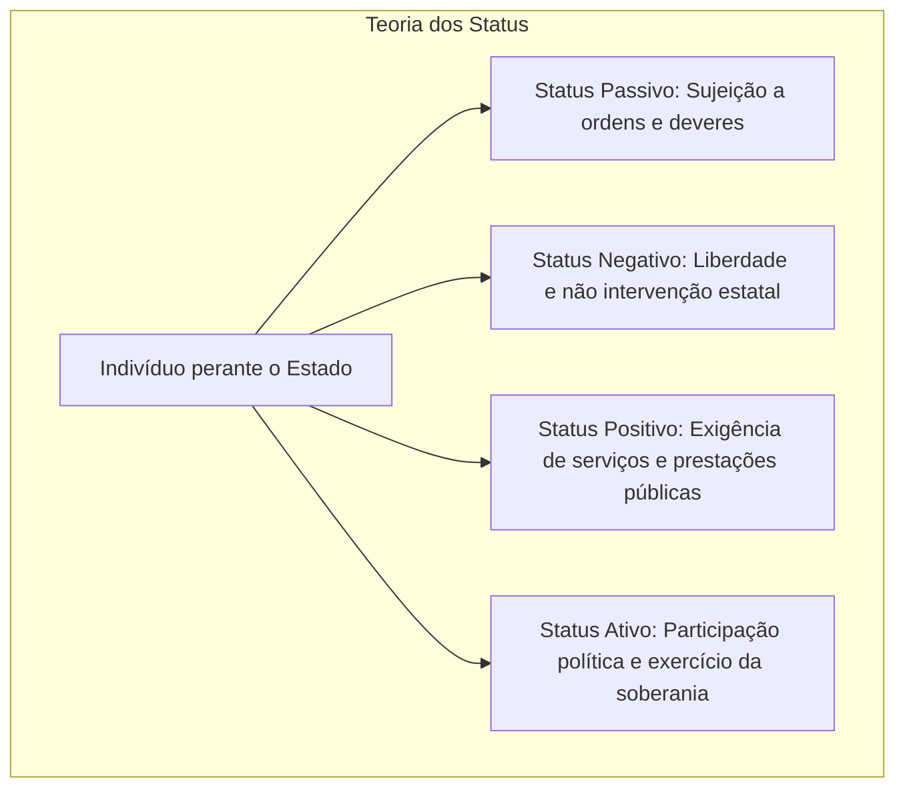
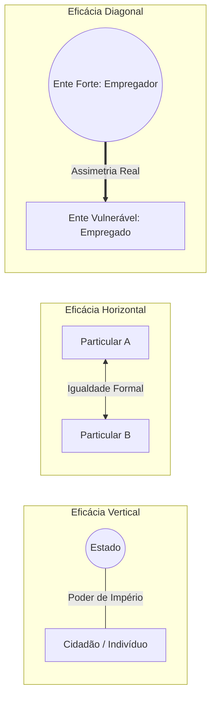

A teoria geral dos direitos fundamentais estabelece as bases conceituais, históricas e estruturais para a compreensão de todo o sistema constitucional protetivo. Em concursos, as bancas examinadoras cobram com frequência as distinções terminológicas entre direitos e garantias, as sucessivas dimensões de direitos, as características intrínsecas e a aplicação direta das normas fundamentais às relações privadas. Compreender essa estrutura geral é indispensável para interpretar corretamente os direitos em espécie previstos no texto constitucional.

> [!objetivos]
> - Diferenciar direitos do homem, direitos fundamentais e direitos humanos, bem como distinguir disposições declaratórias de assecuratórias.
> - Identificar os valores, marcos históricos e conteúdos de cada geração ou dimensão dos direitos fundamentais.
> - Compreender a teoria dos quatro status de Jellinek e suas repercussões na classificação dos direitos de defesa, prestação e participação.
> - Analisar as características dos direitos fundamentais, com destaque para a relatividade, a vedação ao retrocesso e a dupla dimensão.
> - Explicar a teoria dos limites dos limites e a incidência da eficácia horizontal e diagonal nas relações jurídicas entre particulares.

## Conceito, terminologia e distinção entre direitos e garantias

O estudo dos direitos voltados à dignidade humana exige rigor conceitual inicial. Três expressões correlatas aparecem reiteradamente na doutrina e nas provas: direitos do homem, direitos fundamentais e direitos humanos. Embora compartilhem o mesmo propósito ético de proteção da dignidade individual, diferenciam-se pelo plano de positivação e pela esfera de validade jurídica.

A expressão **direitos do homem** possui natureza jusnaturalista. Trata-se do conjunto de faculdades inerentes à própria condição humana, anteriores e superiores à criação do Estado. Esses direitos não dependem de texto escrito, lei positiva ou tratado para existirem, sendo válidos universalmente com base no direito natural.

Por sua vez, os **direitos fundamentais** são os direitos da pessoa humana expressamente reconhecidos e positivados na ordem jurídica interna de determinado Estado soberano, em sua Constituição. Trata-se do direito positivo constitucional, situado no Título II da Constituição Federal de 1988 ("Dos Direitos e Garantias Fundamentais").

Já a denominação **direitos humanos** é reservada aos direitos positivados no plano internacional por meio de tratados e pactos celebrados entre Estados soberanos. Exemplificam essa categoria a Declaração Universal dos Direitos Humanos de 1948, o Pacto Internacional sobre Direitos Civis e Políticos de 1966 e o Pacto de São José da Costa Rica de 1969.

A tabela abaixo sintetiza os traços distintivos dessas três categorias fundamentais.

| Expressão | Natureza jurídica | Esfera de positivação | Exemplo característico |
| --- | --- | --- | --- |
| Direitos do homem | Jusnaturalista | Não positivados (plano filosófico) | Direito inato à liberdade |
| Direitos fundamentais | Direito constitucional positivo | Ordem jurídica interna (Constituição) | CF/88, art. 5º, caput |
| Direitos humanos | Direito internacional público | Tratados e convenções internacionais | Pacto de São José da Costa Rica |

A relação entre a ordem internacional e a ordem interna não é excludente. Um direito pode constar de tratado internacional e ainda não ter sido incorporado na legislação interna de um país. Da mesma forma, a Constituição de um Estado pode conferir proteção superior àquela prevista nos tratados mínimos internacionais.

Outro ponto de destacada cobrança em provas é a distinção dogmática entre **direitos fundamentais** e **garantias fundamentais**. A clássica lição de Ruy Barbosa estabeleceu que os direitos são as disposições declaratórias que imprimem existência jurídica aos bens protegidos, ao passo que as garantias são disposições assecuratórias destinadas a defender tais direitos contra o arbítrio estatal ou de terceiros.

Em termos práticos, o direito representa o bem substantivo assegurado à pessoa, como a vida, a honra, a intimidade e a liberdade de locomoção. A garantia constitui o instrumento processual apto a tutelar ou restaurar o direito violado ou ameaçado de lesão. A liberdade de locomoção é o bem protegido; o *habeas corpus* é a sua garantia instrumental assecuratória.

> [!atencao] Distinção entre direitos e garantias
> O direito define o bem protegido pela norma constitucional; a garantia estabelece o instrumento protetivo destinado a viabilizar a exigibilidade ou a restauração desse bem. Na lição de Canotilho, contudo, as próprias garantias constituem verdadeiros direitos subjetivos instrumentais.

A doutrina brasileira, inspirada na lição de José Afonso da Silva, classifica ainda as garantias em gerais e constitucionais. As garantias gerais referem-se às condições estruturais e políticas necessárias para a eficácia dos direitos. Já as garantias constitucionais consubstanciam os mecanismos previstos no próprio texto supremo, dividindo-se em gerais (como a separação dos Poderes) e especiais (remédios constitucionais colocados à disposição do cidadão).

## Evolução histórica: gerações ou dimensões dos direitos fundamentais

Os direitos fundamentais resultam de lutas sociais travadas ao longo de séculos contra formas autoritárias de dominação. Para organizar essa trajetória evolutiva, o jurista Karel Vasak propôs, em 1979, a classificação dos direitos em gerações, associando cada etapa aos lemas da Revolução Francesa: liberdade, igualdade e fraternidade.

Os **direitos de primeira geração** têm como valor nuclear a **liberdade**. Surgiram ao término dos anos setecentos, no contexto dos movimentos liberais na França e nos Estados Unidos, marcando a transição do Estado Absolutista para o Estado Liberal de Direito. Seu objetivo primordial era conter o poder do soberano e assegurar ao cidadão uma esfera de autonomia imune a interferências estatais indevidas.

Trata-se dos direitos civis e políticos, como a vida, a propriedade privada, a segurança individual, a locomoção, a manifestação do pensamento, a reunião e o voto. Qualificam-se predominantemente como **liberdades negativas** ou direitos de defesa (*status negativus*), exigindo do Estado uma abstenção (*non facere*). Vale notar que esses direitos também requerem prestações positivas para sua garantia material, como a criação de forças de segurança pública e de tribunais judiciais.

Os **direitos de segunda geração** consagram o valor da **igualdade material**. Emergiram no início do século XX, impulsionados pela industrialização e pelas reivindicações da classe trabalhadora, tendo como marcos as Constituições do México (1917) e de Weimar (1919). O Estado Liberal abstencionista cedeu lugar ao Estado Social de Direito.

Compreendem os direitos econômicos, sociais e culturais, como saúde, educação, trabalho, moradia e previdência social. Classificam-se como **liberdades positivas** ou direitos prestacionais, exigindo atuação positiva do Poder Público (*facere*) mediante serviços e políticas públicas redutoras das desigualdades fáticas.

Os **direitos de terceira geração** consubstanciam o ideal de **fraternidade ou solidariedade**. Desenvolveram-se na segunda metade do século XX, após a Segunda Guerra Mundial, voltados a tutelar interesses que ultrapassam o indivíduo isolado.

São os direitos transindividuais, que abrangem direitos difusos e coletivos, titularizados por grupos indeterminados. Exemplificam essa dimensão o direito ao meio ambiente equilibrado, a defesa do consumidor, o progresso econômico sustentável, a autodeterminação dos povos e a preservação do patrimônio histórico-cultural.

> [!pegadinha] Terminologia de gerações versus dimensões
> A doutrina moderna prefere o termo **dimensões** em vez de gerações. A palavra "geração" sugere que uma nova categoria substitui ou anula a anterior. Em verdade, os novos direitos se **acumulam e integram** aos preexistentes, mantendo plena vigência conjunta.

A doutrina constitucional brasileira, notadamente na obra de Paulo Bonavides, ampliou esse quadro:
- **Quarta dimensão**: para Paulo Bonavides, decorre da globalização e compreende o direito à democracia, à informação e ao pluralismo político. Já Norberto Bobbio insere nessa dimensão a bioética e a manipulação genética.
- **Quinta dimensão**: Bonavides aponta o direito à **paz** como direito autônomo de quinta dimensão.

A tabela a seguir apresenta a síntese comparativa das dimensões dos direitos fundamentais.

| Dimensão | Valor central | Conteúdo predominante | Papel do Estado | Exemplos expressivos |
| --- | --- | --- | --- | --- |
| 1ª dimensão | Liberdade | Civis e políticos | Abstenção (dever de não intervir) | Vida, propriedade, locomoção e voto |
| 2ª dimensão | Igualdade | Sociais, econômicos e culturais | Ação positiva (prestação material) | Saúde, educação, moradia e trabalho |
| 3ª dimensão | Fraternidade / Solidariedade | Transindividuais, difusos e coletivos | Tutela coletiva e preventiva | Meio ambiente, consumidor e patrimônio |
| 4ª dimensão | Pluralismo / Globalização | Democracia, informação ou bioética | Regulação protetiva e transparência | Pluralismo político e integridade genética |
| 5ª dimensão | Paz universal | Defesa da humanidade desarmada | Cooperação internacional mútua | Paz perpétua e segurança global |

## Teoria dos quatro status de Jellinek

Para classificar as posições jurídicas do indivíduo perante o Estado, o jurista Georg Jellinek elaborou a Teoria dos Quatro Status (*Statuslehre*). O status define a posição do cidadão em face do poder estatal soberano em dado momento:

1. **Status passivo (*status subjectionis*)**: reflete a subordinação do indivíduo perante o poder de império do Estado. O cidadão encontra-se em sujeição, devendo cumprir deveres e ordens estatais, a exemplo do pagamento de tributos e do alistamento militar obrigatório.
2. **Status negativo (*status libertatis*)**: delimita o espaço de liberdade pessoal livre de intromissões estatais. Impõe ao Estado um dever de abstenção, servindo de base para os direitos de defesa (liberdade de expressão, inviolabilidade domiciliar e locomoção).
3. **Status positivo (*status civitatis*)**: confere ao indivíduo o direito subjetivo de exigir do Estado prestações e serviços concretos, como fornecimento de medicamentos e oferta de ensino fundamental gratuito.
4. **Status ativo (*status activus civitatis*)**: retrata a participação política do cidadão na formação da vontade estatal e no exercício da soberania, como votar, concorrer a cargos públicos e propor ação popular.

O esquema abaixo sintetiza essas quatro posições concebidas por Jellinek.

Essa construção teórica fundamenta a **classificação trialista** das funções dos direitos fundamentais: direitos de defesa (status negativo), direitos a prestações (status positivo) e direitos de participação (status ativo).

> [!bizu] Memorização dos status de Jellinek
> Para memorizar com facilidade as quatro posições de Jellinek:
> - **Passivo**: o Estado exige do cidadão (deveres e sujeição).
> - **Negativo**: o Estado se abstém (liberdade e defesa).
> - **Positivo**: o cidadão exige do Estado (serviços e prestações).
> - **Ativo**: o cidadão atua no Estado (voto e participação).

## Características dos direitos fundamentais

Os direitos fundamentais apresentam características que os distinguem dos demais direitos subjetivos privados, orientando a solução de conflitos normativos concretos:

- **Universalidade**: destinam-se a todos os seres humanos indistintamente, guardadas proteções específicas a grupos vulneráveis (crianças, idosos e trabalhadores).
- **Historicidade**: são frutos de lutas e transformações sociais graduais, sendo mutáveis e ampliáveis no tempo.
- **Indivisibilidade**: formam um conjunto integrado centrado na dignidade humana, não se admitindo proteger direitos civis em sacrifício dos direitos sociais.
- **Inalienabilidade**: são intransferíveis e inegociáveis, não possuindo conteúdo patrimonial alienável.
- **Imprescritibilidade**: não se perdem pelo não uso ou pelo decurso do tempo, sendo sempre exigíveis.
- **Irrenunciabilidade**: o titular não pode abrir mão em definitivo de sua condição de sujeito de direitos fundamentais.

> [!exemplo] Autolimitação voluntária do direito à privacidade
> Participantes de programas de confinamento televisivo autorizam temporariamente a exibição de sua imagem e de sua rotina. Cuida-se de autolimitação voluntária do exercício do direito, específica e revogável, e não de renúncia definitiva à garantia constitucional da privacidade.

- **Relatividade ou limitabilidade**: nenhum direito fundamental é absoluto; todos encontram limites na ordem constitucional e nos direitos alheios.
- **Complementaridade**: devem ser interpretados sistematicamente para assegurar a harmonia do texto constitucional.
- **Concorrência**: admitem exercício cumulativo pelo mesmo titular em uma mesma circunstância fática.
- **Efetividade**: impõe ao Poder Público atuação concreta para viabilizar o gozo efetivo dos direitos declarados.
- **Proibição do retrocesso (*efeito cliquet*)**: veda ao legislador suprimir ou esvaziar conquistas protetivas já consolidadas sem contrapartida protetiva equivalente.
- **Expansividade e abertura**: o rol constitucional é aberto, admitindo a inclusão de novos direitos implícitos e internacionais.

A tabela a seguir consolida as características essenciais para rápida fixação.

| Característica | Conteúdo essencial | Ponto de atenção para a prova |
| --- | --- | --- |
| Universalidade | Destinados a todas as pessoas | Admite proteções especiais a vulneráveis |
| Historicidade | Frutos de conquistas sociais evolutivas | Explica as sucessivas dimensões |
| Inalienabilidade | Intransferíveis e indisponíveis | Não possuem preço nem valor de troca |
| Imprescritibilidade | Não se extinguem pelo decurso do tempo | Sempre exigíveis contra agressões |
| Irrenunciabilidade | Titularidade inegociável da pessoa | Distingue-se da autolimitação do exercício |
| Relatividade | Não existem direitos absolutos | Conflitos resolvem-se por ponderação |
| Proibição de retrocesso | Vedação à supressão injustificada (*cliquet*) | Protege conquistas de direitos sociais |

## A relatividade e a dupla dimensão dos direitos fundamentais

A **relatividade** é a característica mais cobrada pelas bancas de concurso. O princípio reitor é direto: inexiste direito fundamental absoluto na Constituição de 1988. Mesmo o direito à vida sofre mitigações constitucionais expressas, como a autorização de pena de morte em caso de guerra externa declarada (CF, art. 5º, XLVII, "a", c/c art. 84, XIX).

Do mesmo modo, a locomoção pode ser restringida em estado de defesa ou de sítio (CF, arts. 136 e 137). A inviolabilidade do domicílio cede em flagrante delito, desastre ou ordem judicial diurna (CF, art. 5º, XI). A manifestação do pensamento é freada pela vedação ao anonimato e à ofensa à honra.

Embora parte da doutrina trate a vedação à tortura e ao trabalho escravo como vedações absolutas na ordem prática, a regra cobrada em provas é a de que nenhum direito é ilimitado, pois não pode amparar práticas ilícitas.

Cumpre destacar ainda a **dupla dimensão dos direitos fundamentais**:
1. **Dimensão subjetiva**: confere aos indivíduos direitos públicos subjetivos exigíveis perante o Estado ou particulares, permitindo buscar tutela jurisdicional diante de lesões.
2. **Dimensão objetiva**: estabelece que os direitos fundamentais expressam os valores centrais da comunidade política, irradiando sua força vinculante por todo o ordenamento jurídico.

Essa dimensão objetiva produz dois efeitos fundamentais:
- **Efeito irradiante**: as normas de direitos fundamentais direcionam a interpretação de todas as leis civis, penais, administrativas e trabalhistas.
- **Dever de proteção estatal (*Schutzpflicht*)**: impõe ao Estado tanto a proibição do excesso de intervenção (*Übermaßverbot*) quanto a proibição da proteção deficiente (*Untermaßverbot*), exigindo tutela penal e policial adequada para resguardar a coletividade contra agressões de terceiros.

## Limites aos direitos fundamentais e a teoria dos limites dos limites

Por serem relativos, os direitos fundamentais comportam limites impostos pela Constituição e pelas leis ordinárias. A doutrina analisa o tema sob dois modelos principais:

Na **teoria interna** (absoluta), os limites são intrínsecos ao próprio direito. Direito e limite nascem juntos: o que está além do limite jamais integrou a garantia. Não há verdadeira restrição externa, e o núcleo essencial é fixo e abstrato.

Na **teoria externa** (relativa), amplamente acolhida pela jurisprudência, o direito tem abrangência inicial ampla (*prima facie*), e as restrições legais operam como fatores externos colidentes. O direito definitivo é fixado caso a caso pela aplicação da ponderação e da proporcionalidade.

A tabela comparativa a seguir destaca as divergências entre essas duas teorias.

| Critério de comparação | Teoria interna (absoluta) | Teoria externa (relativa) |
| --- | --- | --- |
| Origem dos limites | Intrínseca: imanente ao próprio direito | Extrínseca: decorre de colisões e restrições legais |
| Conceito de restrição | Inexistente: definir o contorno não é restringir | Real: o direito amplo sofre contenções no caso concreto |
| Definição do núcleo essencial | Fixo, abstrato e imune a ponderações | Identificado e protegido caso a caso pela proporcionalidade |

Para impedir que leis ordinárias desnaturem garantias constitucionais sob pretexto de regulamentá-las, surgiu a teoria dos **limites dos limites** (*Schranken-Schranken*). As leis restritivas também encontram barreiras intransponíveis:
1. **Preservação do núcleo essencial**: a lei não pode aniquilar a substância protetiva da garantia.
2. **Generalidade e abstração**: a restrição não pode ter caráter individual ou discriminatório.
3. **Princípio da proporcionalidade**: a restrição deve atender ao tríplice teste de adequação (meio idôneo), necessidade (meio menos gravoso) e proporcionalidade em sentido estrito (benefício maior que o prejuízo imposto).

> [!atencao] Teoria dos limites dos limites e proporcionalidade
> Embora a Constituição de 1988 não consagre expressamente a fórmula "limites dos limites", o Supremo Tribunal Federal entende que ela decorre implicitamente do devido processo legal substantivo (CF, art. 5º, LIV), servindo de fundamento ao controle de constitucionalidade de leis restritivas.

## Eficácia vertical, horizontal e diagonal dos direitos fundamentais

Originariamente, os direitos fundamentais foram concebidos com **eficácia vertical**, operando na relação entre o Estado (possuidor de poder soberano) e o cidadão (sujeito vulnerável). Serviam exclusivamente como escudo defensivo contra o arbítrio governamental.

Nas relações privadas contemporâneas, o poder de grandes entidades e corporações fez surgir a teoria da **eficácia horizontal** (ou eficácia externa / privada) dos direitos fundamentais (*Drittwirkung*):
- **Eficácia indireta e mediata**: preconiza que os direitos fundamentais vinculam apenas o legislador, exigindo normas de direito privado para incidir entre particulares. Essa tese foi rejeitada no Brasil em face da aplicabilidade imediata do art. 5º, § 1º, da CF/88.
- **Eficácia direta e imediata**: determina a incidência imediata das normas fundamentais sobre as relações privadas, sem necessidade de intermediação legal.

O Brasil adotou a **teoria da eficácia direta e imediata**, consolidada pelo STF no histórico RE 201.819/RJ, que anulou a exclusão de sócio da União Brasileira de Compositores (UBC) realizada sem contraditório e ampla defesa.

> [!jurisprudencia] STF e eficácia horizontal direta (RE 201.819)
> Entidades privadas que exercem poder regulador ou punitivo sobre seus membros devem respeitar as garantias do devido processo legal, do contraditório e da ampla defesa (CF, art. 5º, LIV e LV), sendo nulas punições sumárias sem oportunidade de manifestação.

Ao lado dessas formas, a doutrina reconhece a **eficácia diagonal**, aplicável às relações privadas assimétricas marcadas por manifesto desequilíbrio fático entre as partes, a exemplo das relações de emprego e dos contratos de consumo.

O esquema a seguir sintetiza as três formas de eficácia dos direitos fundamentais.

## Os direitos fundamentais na Constituição de 1988 e o catálogo aberto

A Constituição Federal de 1988 colocou os Direitos e Garantias Fundamentais no Título II (arts. 5º a 17), logo após os Princípios Fundamentais, evidenciando a centralidade da pessoa humana. O Título II divide os direitos fundamentais em cinco espécies:
1. Direitos e deveres individuais e coletivos (art. 5º);
2. Direitos sociais (arts. 6º a 11);
3. Direitos de nacionalidade (arts. 12 e 13);
4. Direitos políticos (arts. 14 a 16);
5. Direitos relacionados aos partidos políticos (art. 17).

> [!pegadinha] Direitos individuais não esgotam os direitos fundamentais
> "Direitos fundamentais" é o **gênero**, do qual os direitos individuais e coletivos, os direitos sociais, a nacionalidade e os direitos políticos são **espécies**. A prova comumente tenta igualar gênero e espécie para confundir o candidato.

O artigo 5º, § 1º, da CF/88 consagra o princípio da aplicabilidade imediata das normas fundamentais:

> [!lei] CF, art. 5º, § 1º
> As normas definidoras dos direitos e garantias fundamentais têm aplicação imediata.

Esse mandamento orienta os órgãos estatais a conferirem a máxima eficácia às normas protetivas. Mesmo as normas de eficácia limitada produzem efeitos imediatos, como a revogação de disposições contrárias e a viabilização de mandado de injunção em caso de omissão legislativa inconstitucional.

Pelo artigo 5º, § 2º, a Constituição consagrou a cláusula de abertura material: o rol de direitos fundamentais não é taxativo, admitindo direitos implícitos decorrentes do regime democrático e de tratados internacionais ratificados pelo país. Distinguem-se, assim:
- **Direitos catalogados**: previstos expressamente no Título II da CF (arts. 5º a 17).
- **Direitos não catalogados**: situados fora do Título II da Constituição (como a anterioridade tributária no art. 150, III, "b", e o meio ambiente no art. 225) ou derivados de tratados internacionais de direitos humanos.

Por fim, os direitos e garantias individuais consubstanciam cláusulas pétreas expressas (CF, art. 60, § 4º, IV), não podendo ser suprimidos por emenda à Constituição.

## Mapa do capítulo

A tabela a seguir sistematiza todos os tópicos nucleares da Teoria Geral dos Direitos Fundamentais examinados neste capítulo, permitindo uma revisão imediata dos conceitos indispensáveis para a resolução das questões de concurso.

| Eixo temático | Ideia central e postulados | Aplicação prática na prova |
| --- | --- | --- |
| Terminologia básica | Direitos do homem (jusnaturalistas); fundamentais (positivados na CF); humanos (tratados internacionais) | Identificar a fonte e o plano de positivação |
| Direitos × Garantias | Direitos declaram bens materiais; garantias asseveram proteção processual e instrumentos de defesa | Locomoção é o direito; *habeas corpus* é a garantia |
| Gerações / Dimensões | 1ª (Liberdade/Civil-Político); 2ª (Igualdade/Social); 3ª (Solidariedade/Difuso); 4ª (Democracia); 5ª (Paz) | Direitos novos se acumulam aos preexistentes |
| Teoria de Jellinek | Passivo (sujeição), Negativo (liberdade), Positivo (prestação) e Ativo (participação política) | Fundamenta as funções de defesa, prestação e participação |
| Características | Universalidade, historicidade, inalienabilidade, imprescritibilidade, irrenunciabilidade e relatividade | Não existem direitos absolutos; vedação ao retrocesso (*cliquet*) |
| Dupla dimensão | Subjetiva (direitos subjetivos contra o Estado); Objetiva (valores e efeito irradiante no ordenamento) | Proibição de excesso e proibição de proteção deficiente |
| Limites dos limites | Restrições legais a direitos fundamentais devem resguardar o núcleo essencial e a proporcionalidade | Controle de constitucionalidade de leis restritivas |
| Eficácia privada | Eficácia direta e imediata (STF): direitos fundamentais vinculam particulares sem mediação legislativa | Ampla defesa na exclusão de associados; eficácia diagonal |
| Catálogo da CF/88 | Título II (arts. 5º a 17) não é taxativo; prevê direitos catalogados e não catalogados (arts. 150 e 225) | Rol materialmente aberto; cláusula pétrea (art. 60, § 4º, IV) |

### Para fixar

- Os direitos do homem decorrem do direito natural; os direitos fundamentais estão no texto constitucional interno; os direitos humanos integram tratados internacionais.
- O direito declara o bem da vida tutelado pela norma; a garantia constitui o instrumento assecuratório de proteção contra violações.
- As dimensões fundamentais consagram sucessivamente a liberdade (1ª), a igualdade material (2ª) e a solidariedade ou fraternidade (3ª), somando-se sem substituição.
- Conforme a teoria de Jellinek, o status negativo embasa os direitos de defesa e o status positivo embasa a exigência de prestações estatais de serviços públicos.
- A relatividade impõe que nenhum direito fundamental seja considerado absoluto, resolvendo-se eventuais colisões pela técnica da ponderação harmônica.
- O efeito irradiante e a dimensão objetiva dos direitos fundamentais vinculam a interpretação de todas as normas civis, penais e administrativas infraconstitucionais.
- Pela teoria dos limites dos limites, as restrições editadas pelo legislador ordinário devem respeitar o núcleo essencial e o princípio da proporcionalidade.
- A eficácia horizontal direta e imediata vincula os particulares à observância das garantias fundamentais do contraditório e da ampla defesa em punições privadas.
- O Título II da CF/88 é o gênero dos direitos fundamentais, composto por cinco espécies, possuindo catálogo materialmente aberto a normas e tratados externos.
- Os direitos e garantias individuais constituem cláusulas pétreas que não podem ser abolidos por meio de emenda constitucional (art. 60, § 4º, IV).
