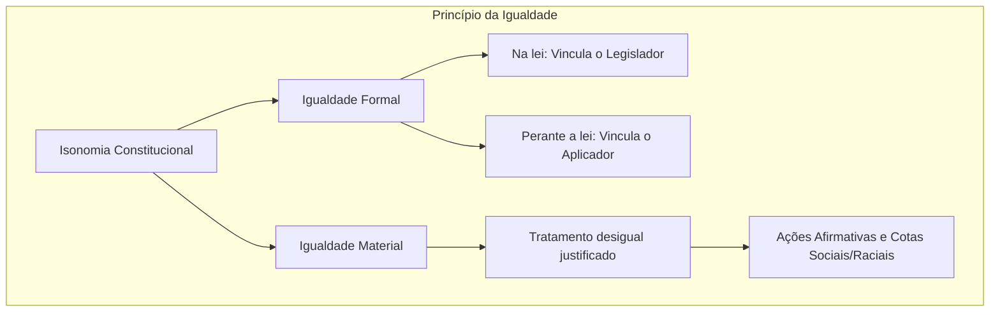
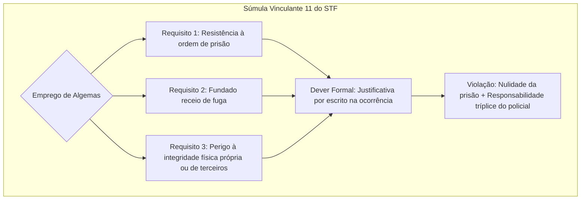

O artigo 5º da Constituição Federal de 1988 reúne as normas centrais dos direitos individuais e coletivos. O dispositivo inicia com a proclamação de cinco direitos fundamentais em sua cabeça e ramifica-se em inúmeros incisos protetivos. Neste capítulo, estudamos a amplitude dos sujeitos protegidos, a tutela da vida e da segurança, o princípio da igualdade e suas repercussões materiais, as fronteiras entre legalidade e reserva legal e a vedação incondicional à tortura e ao tratamento degradante.

> [!objetivos]
> - Identificar os titulares dos direitos fundamentais segundo o caput do art. 5º e a interpretação ampliativa fixada pelo Supremo Tribunal Federal.
> - Compreender a dupla acepção do direito à vida, a proteção ao nascituro e as decisões do STF sobre anencefalia e células-tronco.
> - Diferenciar igualdade formal de igualdade material, identificando a legitimidade das ações afirmativas e das cotas raciais.
> - Distinguir o princípio da legalidade ampla da reserva legal absoluta, relativa, simples e qualificada.
> - Explicar as exigências constitucionais contra a tortura e os requisitos obrigatórios para o emprego de algemas fixados na Súmula Vinculante 11.

## O caput do artigo 5º e a titularidade dos direitos fundamentais

O caput do artigo 5º consagra formalmente o postulado da isonomia. A norma proclama a inviolabilidade de cinco direitos basilares: a **vida**, a **liberdade**, a **igualdade**, a **segurança** e a **propriedade**. Todos os incisos do artigo desdobram essas matrizes protetivas.

Embora o texto cite literalmente brasileiros e estrangeiros residentes, a jurisprudência pacífica do Supremo Tribunal Federal confere interpretação ampliativa. A proteção estende-se a qualquer ser humano sob a autoridade estatal brasileira. Os **estrangeiros em trânsito** ou domiciliados fora do território nacional gozam plenamente dessas prerrogativas.

Um turista estrangeiro em visita ao país pode impetrar *habeas corpus* caso sofra constrangimento ilegal em sua locomoção. Ele tem direito assegurado ao devido processo legal perante nossos tribunais. Da mesma forma, o STF já pacificou que o estrangeiro não residente tem resguardado o seu direito de propriedade sobre bens situados no Brasil.

Por sua vez, os estrangeiros com residência habitual no país fazem jus a benefícios assistenciais de prestação continuada (BPC). Essa assistência alcança idosos e pessoas com deficiência em situação de vulnerabilidade social que comprovem os requisitos da lei.

A proteção constitucional não se limita aos indivíduos físicos. As **pessoas jurídicas** de direito privado e de direito público titularizam direitos fundamentais compatíveis com a sua natureza jurídica. Podem invocar a proteção à honra objetiva, à imagem, ao sigilo bancário, ao domicílio de seus estabelecimentos e às garantias do processo judicial. O próprio **Poder Público** detém prerrogativas processuais fundamentais no âmbito litigioso.

A tabela a seguir sistematiza a amplitude dos titulares reconhecidos pela ordem constitucional.

| Sujeito de direito | Alcance da proteção | Prerrogativas exemplificativas |
| --- | --- | --- |
| Brasileiros natos e naturalizados | Integral | Direitos civis, políticos e sociais plenos |
| Estrangeiros residentes no Brasil | Amplo | Direitos civis, garantias sociais e benefício do BPC |
| Estrangeiros em trânsito (turistas) | Direitos compatíveis com a permanência | Vida, liberdade, *habeas corpus* e propriedade |
| Pessoas jurídicas | Prerrogativas compatíveis com sua estrutura | Honra objetiva, sigilo de dados e ampla defesa |
| Estado / Fazenda Pública | Garantias processuais básicas | Devido processo legal, contraditório e juiz natural |

> [!pegadinha] Titularidade dos direitos fundamentais
> As bancas costumam afirmar que pessoas jurídicas ou estrangeiros sem domicílio no país não possuem direitos fundamentais em virtude da redação literal do caput do artigo 5º. Essa afirmação é incorreta. O STF estende as garantias compatíveis a esses sujeitos de direito.

## O direito à vida e à segurança individual

O direito à vida sustenta todo o edifício dos direitos fundamentais, pois sem ele nenhuma outra faculdade jurídica pode ser exercida. A doutrina analisa esse direito sob duas vertentes inseparáveis:
1. O direito de **continuar vivo**: impede atos arbitrários de violência e privação da vida pelo Estado ou por particulares.
2. O direito a uma **vida digna**: impõe condições mínimas de existência material e espiritual, ligando-se ao princípio da dignidade da pessoa humana e à busca da felicidade.

A tutela jurídica alcança tanto a vida extrauterina quanto a vida **intrauterina**. Por essa razão, o aborto constitui crime em regra. O ordenamento jurídico admite a interrupção da gravidez apenas em casos estritos: para salvar a vida da gestante (aborto terapêutico) e na gravidez decorrente de estupro (aborto humanitário).

O Supremo Tribunal Federal estabeleceu importantes entendimentos sobre os contornos do direito à vida:

- **Feto anencéfalo (ADPF 54)**: o STF julgou lícita a antecipação terapêutica do parto em gravidez de feto com anencefalia confirmada por laudo médico. A Corte entendeu que o feto anencéfalo não possui viabilidade biológica para a vida após o nascimento. A conduta não configura aborto e dispensa prévia autorização judicial.
- **Pesquisas com células-tronco embrionárias (ADI 3510)**: o tribunal considerou constitucional o uso de embriões inviáveis ou congelados há mais de três anos em processos de fertilização *in vitro*. A pesquisa com fins científicos e terapêuticos não fere o direito à vida nem a dignidade humana.
- **Relatividade da vida e pena de morte**: o direito à vida não tem natureza absoluta no Brasil. A Constituição prevê a pena de morte no caso de guerra externa declarada pelo Presidente da República, após anuência do Congresso Nacional (CF, art. 5º, XLVII, "a", c/c art. 84, XIX). Por figurar entre as cláusulas pétreas, o legislador constituinte derivado não pode instituir novas hipóteses de pena capital em tempos de paz.
- **Uso de força letal pelas forças policiais (ADPF 635)**: o emprego de armas com resultado fatal por agentes de segurança pública é medida extrema. Só é permitida diante de ameaça concreta e iminente à vida, após esgotados os meios não letais. As ocorrências exigem apuração célere e independente pelo Ministério Público.

A tabela abaixo sintetiza os principais julgamentos do STF sobre a proteção da vida.

| Julgamento / Tema | Processo paradigma | Decisão fixada pelo STF |
| --- | --- | --- |
| Feto anencéfalo | ADPF 54 | Parto antecipado admitido; atipicidade da conduta; dispensa alvará judicial |
| Células-tronco embrionárias | ADI 3510 | Pesquisa terapêutica válida com embriões fecundados *in vitro* |
| Pena de morte | Art. 5º, XLVII, "a" | Admissível exclusivamente em guerra declarada; rol fechado |
| Força letal policial | ADPF 635 | Hipótese excepcional de legítima defesa; exige controle ministerial |

> [!jurisprudencia] STF e anencefalia (ADPF 54)
> O feto com anencefalia carece de viabilidade extrauterina. A antecipação médica do parto não tipifica o crime de aborto, cuidando-se de situação de atipicidade material que dispensa permissão judicial ou autorização do Estado.

Em relação à **segurança**, o caput do artigo 5º preserva a tranquilidade individual e a incolumidade pessoal e patrimonial. Ao lado dessa dimensão individual, a segurança configura direito social no artigo 6º e dever estatal prioritário no artigo 144, organizando a atuação dos órgãos policiais e dos corpos de bombeiros militares.

## O princípio da igualdade e as ações afirmativas (artigo 5º, inciso I)

O primeiro inciso do artigo 5º consagra a igualdade entre homens e mulheres em direitos e deveres na forma da Constituição. A norma busca superar preconceitos históricos de gênero e vincula todas as manifestações estatais.

A doutrina divide o princípio da isonomia em duas acepções:

1. **Igualdade formal**: assegura a igualdade de tratamento perante as normas jurídicas, proibindo privilégios pessoais e discriminações odiosas. Manifesta-se em dois planos complementares:
   - *Igualdade na lei*: impõe limites ao Poder Legislativo, proibindo a edição de regras que criem diferenciações injustificadas entre pessoas em situações equivalentes.
   - *Igualdade perante a lei*: vincula juízes e administradores públicos, impedindo interpretações seletivas das normas em vigor.
2. **Igualdade material**: fundamenta-se no preceito de conferir tratamento isonômico aos iguais e tratamento diferenciado aos desiguais, na proporção de suas disparidades reais. Reconhece que desvantagens socioeconômicas exigem medidas ativas de compensação.

O esquema a seguir demonstra as ramificações do princípio da igualdade no texto constitucional.

As **ações afirmativas** são políticas estatais formuladas para acelerar a integração social de grupos vulneráveis. O STF assentou a plena legitimidade dessas medidas:

- **Cotas raciais em concursos e universidades (RE 597.285)**: a reserva de vagas para pessoas negras e indígenas concretiza a igualdade material. O tribunal autorizou o uso conjunto da **autodeclaração** do candidato com a verificação por comissões de **heteroidentificação**, desde que assegurados o respeito à dignidade e o direito à ampla defesa recursal.
- **Lei Maria da Penha (Lei 11.340/2006)**: os instrumentos protetivos específicos concedidos à mulher vítima de agressão doméstica constituem discriminação positiva voltada a reequilibrar relações historicamente desiguais.
- **Limite de idade em concursos públicos (Súmula 683 do STF)**: a exigência de limite de idade só é válida se a natureza do cargo demandar vigor físico diferenciado (como no serviço operacional de bombeiros e policiais) e **desde que haja expressa previsão em lei em sentido formal**. O edital não pode inovar na matéria.
- **Critérios diferenciados para promoção militar**: o STF reputou legítima a fixação de parâmetros distintos de promoção para os quadros feminino e masculino na caserna quando houver justificativa razoável de equalização funcional.

> [!atencao] Súmula 683 do STF e restrição etária
> A fixação de idade máxima em concursos públicos exige dois requisitos conjuntos: justificativa fundada nas atribuições funcionais do cargo e expressa previsão legal em sentido formal. O edital do certame não pode criar restrições sem base em lei.

Em julgados recentes, a Suprema Corte firmou teses expressivas:
- **Identidade de gênero (ADI 4275)**: transgêneros e transexuais têm direito a retificar prenome e sexo diretamente perante o Cartório de Registro Civil das Pessoas Naturais, sem necessidade de cirurgia, terapias hormonais ou autorização judicial.
- **Inconstitucionalidade da legítima defesa da honra (ADPF 779)**: a tese de legítima defesa da honra é nula no Tribunal do Júri em casos de feminicídio, por atentar contra a dignidade humana, a proteção da vida e a igualdade material.
- **Vedação ao aumento judicial de vencimentos (Súmula Vinculante 37)**: a Corte assentou que o Judiciário não possui função legislativa para conceder reajustes ou aumentos salariais a servidores públicos invocando o princípio da isonomia.

> [!jurisprudencia] STF, Súmula Vinculante 37
> O Supremo Tribunal Federal pacificou que não cabe ao Poder Judiciário, desprovido de competência legislativa, majorar vencimentos ou estender vantagens pecuniárias a servidores públicos sob invocação do princípio da isonomia.

## Princípio da legalidade e reserva legal (artigo 5º, inciso II)

O artigo 5º, inciso II, estabelece que ninguém é compelido a agir ou a se omitir senão em decorrência de determinação legal. Trata-se da garantia central que subordina a convivência social às normas aprovadas pelos representantes do povo.

A legalidade opera de modo distinto para os cidadãos e para a Administração Pública:
- **Para os particulares (autonomia da vontade)**: prevalece a liberdade de conduta. O indivíduo pode realizar tudo o que a lei não vedar expressamente.
- **Para a Administração Pública (estrita legalidade)**: vigora o dever de subordinação. O administrador e o agente público só podem atuar quando houver autorização ou determinação expressa em lei (art. 37, caput).

A teoria constitucional diferencia o princípio da legalidade ampla da garantia da **reserva legal**:

| Critério de distinção | Princípio da legalidade ampla | Princípio da reserva legal |
| --- | --- | --- |
| Sentido do vocábulo lei | Sentido amplo: leis, decretos, resoluções válidas | Sentido estrito: lei formal votada no Legislativo |
| Campo de incidência | Vigora de modo universal em todo o ordenamento | Incide somente nas matérias reservadas pela Constituição |
| Efeito prático | Submissão aos atos normativos estatais legítimos | Exigência indelegável de manifestação parlamentar |

A reserva legal classifica-se sob dois critérios principais:

1. **Quanto à intensidade da atuação legislativa**:
   - **Reserva legal absoluta**: a matéria requer disciplina integral por lei formal elaborada pelo Parlamento, inexistindo espaço para regulamentos autônomos. Exemplo: remuneração de servidores públicos disciplinada privativamente por lei específica (CF, art. 37, X).
   - **Reserva legal relativa**: a Constituição exige lei formal para traçar diretrizes gerais, autorizando o regulamento infralegal a detalhar aspectos técnicos de execução.
2. **Quanto ao grau de vinculação do conteúdo**:
   - **Reserva legal simples**: o constituinte exige lei formal, mas confere ampla discricionariedade ao Congresso sobre o conteúdo do ato. Exemplo: prestação de assistência religiosa em entidades de internação coletiva "nos termos da lei" (CF, art. 5º, VII).
   - **Reserva legal qualificada**: o texto constitucional exige lei formal e já pré-estabelece os limites, as condições e a finalidade que a norma restritiva deve observar. Exemplo: a autorização de interceptação telefônica restrita à apuração criminal por ordem judicial (CF, art. 5º, XII).

> [!exemplo] Aplicação da reserva legal qualificada
> No caso da interceptação telefônica (art. 5º, XII), o constituinte delimitou antecipadamente os fins da restrição: somente cabe para investigação criminal ou instrução penal, e sob comando privativo do juiz competente.

## Vedação à tortura e o uso de algemas (artigo 5º, inciso III)

O artigo 5º, inciso III, da Carta Magna estabelece a proteção da integridade física e moral:

> [!lei] CF, art. 5º, III
> ninguém será submetido a tortura nem a tratamento desumano ou degradante;

Essa proibição constitui cláusula de eficácia absoluta, impedindo agressões físicas, tormentos psicológicos e humilhações impostas pelo Estado ou por terceiros para extrair declarações, aplicar castigos ou rebaixar a dignidade pessoal.

No plano institucional, a Lei Federal 12.847/2013 estruturou o Sistema Nacional de Prevenção e Combate à Tortura, criando o Comitê Nacional e o Mecanismo Nacional de Prevenção e Combate à Tortura, com autoridade para fiscalizar presídios, unidades policiais e centros de internação.

No cotidiano das corporações de segurança, a vedação ao tratamento desumano repercute diretamente no **emprego de algemas**. O uso rotineiro de algemas em pessoas que não oferecem resistência viola a dignidade e constitui constrangimento abusivo. Em resposta a condutas desproporcionais, o STF editou a Súmula Vinculante 11.

> [!lei] STF, Súmula Vinculante 11
> Só é lícito o uso de algemas em casos de resistência e de fundado receio de fuga ou de perigo à integridade física própria ou alheia, por parte do preso ou de terceiros, justificada a excepcionalidade por escrito, sob pena de responsabilidade disciplinar, civil e penal do agente ou da autoridade e de nulidade da prisão ou do ato processual a que se refere, sem prejuízo da responsabilidade civil do Estado.

O emprego do instrumento de contenção tem natureza excepcional. Exige a comprovação de ao menos um dos seguintes requisitos materiais:
1. **Resistência** fática à prisão emanada de ordem legítima;
2. **Fundado receio de fuga** evidenciado por circunstâncias do caso;
3. **Perigo à integridade física** do detido, dos policiais ou de terceiros.

O esquema abaixo apresenta os fundamentos e as exigências da Súmula Vinculante 11.

A violação desses parâmetros acarreta consequências jurídicas imediatas:
- **Nulidade do ato processual** ou da prisão efetuada de modo abusivo;
- **Responsabilização jurídica do policial**: esfera administrativa disciplinar, esfera civil pessoal regressiva e esfera penal por crime de abuso de autoridade;
- **Responsabilidade civil objetiva do Estado** pelos prejuízos morais causados ao indivíduo custodiado.

Ademais, o STF declarou a **ilicitude da revista íntima vexatória** em presídios. O desnudamento forçado de familiares em visitas sociais e as inspeções corporais invasivas violam o artigo 5º, inciso III, reputando-se ilícita qualquer prova colhida mediante procedimentos degradantes aplicados a visitantes, idosos ou crianças.

## Mapa do capítulo

A tabela a seguir sistematiza as regras e princípios examinados neste capítulo, reunindo a titularidade dos direitos, a salvaguarda da vida, o princípio da isonomia, a legalidade e a vedação à tortura em uma visão panorâmica integrada.

| Eixo temático | Regra constitucional e parâmetros doutrinários | Precedentes e súmulas de destaque |
| --- | --- | --- |
| Titularidade (art. 5º, caput) | Brasileiros, estrangeiros residentes e em trânsito; pessoas jurídicas e o Estado nos direitos compatíveis | STF assegura *habeas corpus* e propriedade a turistas |
| Direito à vida | Abrange vida intrauterina e existência digna; pena de morte apenas em guerra declarada | ADPF 54 (anencefalia); ADI 3510 (células-tronco); ADPF 635 |
| Princípio da isonomia (art. 5º, I) | Igualdade na lei (legislador) e perante a lei (aplicador); igualdade material e ações afirmativas | RE 597.285 (cotas); Súmula 683; Súmula Vinculante 37 |
| Identidade de gênero e honra | Alteração de prenome/sexo no cartório; inconstitucionalidade da legítima defesa da honra | ADI 4275 (transgêneros); ADPF 779 (Tribunal do Júri) |
| Legalidade × Reserva legal (art. 5º, II) | Legalidade ampla para particulares; estrita legalidade para o Estado; reserva legal absoluta e relativa | Reserva legal simples (art. 5º, VII) e qualificada (art. 5º, XII) |
| Vedação à tortura (art. 5º, III) | Vedação de tortura e tratamento degradante; vedação à revista íntima vexatória em presídios | Súmula Vinculante 11 (algemas); Lei Federal 12.847/2013 |

### Para fixar

- Os direitos fundamentais protegem qualquer pessoa sob a jurisdição brasileira, alcançando turistas em trânsito e pessoas jurídicas.
- O direito à vida tutela a gestação, mas o STF declarou atípica a antecipação de parto de feto anencéfalo (ADPF 54).
- A pena de morte é permitida somente em guerra externa declarada (CF, art. 5º, XLVII, "a"), constituindo cláusula pétrea imutável.
- A igualdade material legitima ações afirmativas e cotas raciais com comissões de heteroidentificação que respeitem a dignidade.
- Limite de idade em concurso exige justificativa nas funções do cargo e previsão em lei formal (Súmula 683 do STF).
- Ao Poder Judiciário é vedado majorar remuneração de servidores públicos com base no princípio da isonomia (Súmula Vinculante 37).
- A tese da legítima defesa da honra em crimes passionais perante o Júri é inconstitucional (ADPF 779).
- A legalidade permite ao particular agir quando a lei não proíbe, enquanto a Administração depende de expressa autorização legal.
- A reserva legal qualificada impõe lei formal e já fixa as balizas e os fins materiais da intervenção estatal (art. 5º, XII).
- O uso de algemas demanda resistência, fundado receio de fuga ou perigo à integridade, com justificativa escrita obrigatória (Súmula Vinculante 11).
