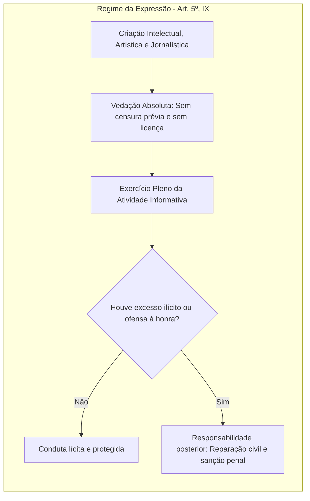

As liberdades de pensamento, crença e expressão representam o esteio da sociedade democrática e pluralista. No artigo 5º da Constituição Federal de 1988, os incisos IV a IX formam um bloco normativo harmônico destinado a resguardar a manifestação de ideias, a liberdade de culto, a objeção de consciência e a livre criação intelectual sem censura prévia. Neste capítulo, estudamos as balizas dessas prerrogativas, a vedação ao anonimato, as regras do direito de resposta, os precedentes do Supremo Tribunal Federal sobre liberdade religiosa e os limites da escusa de consciência.

> [!objetivos]
> - Compreender a liberdade de manifestação do pensamento, a vedação ao anonimato e o tratamento dado às denúncias apócrifas.
> - Analisar as regras do direito de resposta proporcional e a cumulação de indenizações por danos patrimoniais, morais e à imagem.
> - Examinar a inviolabilidade da liberdade de consciência e de crença, a laicidade do Estado brasileiro e os precedentes religiosos do STF.
> - Explicar os requisitos constitucionais da escusa de consciência, sua classificação como norma de eficácia contida e a vacinação obrigatória de menores.
> - Dominar a vedação absoluta à censura prévia e a responsabilidade posterior por abusos na atividade jornalística e comunicacional.

## Manifestação do pensamento e vedação do anonimato (artigo 5º, inciso IV)

O artigo 5º, inciso IV, da Constituição consagra a livre exteriorização de opiniões, ideias e juízos de valor:

> [!lei] CF, art. 5º, IV
> é livre a manifestação do pensamento, sendo vedado o anonimato;

A livre manifestação do pensamento é indispensável ao Estado Democrático de Direito e ao pluralismo político. Ao mesmo tempo em que garante a livre circulação de ideias, o constituinte vedou expressamente o **anonimato**. Essa proibição tem finalidade preventiva e repressiva: permite identificar o autor da mensagem para que ele responda perante a lei caso cause dano à honra, à intimidade ou à integridade de terceiros.

A vedação ao anonimato projeta reflexos diretos na atividade policial e investigativa no que concerne às **denúncias anônimas** (notícias apócrifas). O Supremo Tribunal Federal e o Superior Tribunal de Justiça firmaram entendimento pacífico de que a deliberação anônima não pode, por si só, fundamentar a instauração imediata de inquérito policial ou de processo administrativo disciplinar.

A comunicação apócrifa serve unicamente como elemento deflagrador de **averiguações preliminares sumárias**. A autoridade policial deve realizar diligências prévias e discretas para averiguar a verossimilhança das informações noticiadas. Apenas quando existirem indícios autônomos de materialidade e autoria é que se instaura formalmente o procedimento investigatório.

Documentos apócrifos não podem ser juntados aos autos processuais como meio de prova. A única exceção admitida ocorre quando o documento anônimo constituir o próprio corpo de delito do crime investigado, a exemplo de uma carta de ameaça ou do bilhete de resgate utilizado em crime de extorsão mediante sequestro.

A tabela abaixo sintetiza o regime jurídico aplicável às informações anônimas na persecução criminal.

| Hipótese | Admissibilidade jurídica | Condição ou justificativa |
| --- | --- | --- |
| Instauração direta de inquérito | Vedada | Afronta à vedação ao anonimato (art. 5º, IV) |
| Averiguação preliminar sumária | Permitida | Verificação prévia da plausibilidade dos fatos |
| Juntada aos autos como prova | Vedada em regra | Documento apócrifo não constitui elemento probatório |
| Documento como corpo de delito | Permitida | Quando a carta anônima integra a própria conduta típica |

> [!atencao] Denúncias anônimas e persecução penal
> O documento anônimo não autoriza a abertura direta de inquérito policial ou a decretação de medidas invasivas (como busca e apreensão ou interceptação telefônica). Ele autoriza apenas investigações preliminares para colher elementos concretos autônomos.

A liberdade de expressão não é ilimitada. Ela não ampara manifestações voltadas ao cometimento de ilícitos nem o chamado **discurso de ódio** (*hate speech*). A jurisprudência do STF assentou que a Constituição não protege discursos racistas, antissemitas (HC 82.424, Caso Ellwanger), homofóbicos ou que incitem a violência contra instituições republicanas e a extinção do Estado de Direito (AP 1044/DF).

Por outro lado, o STF consagrou que a defesa pacífica da descriminalização ou legalização de condutas (como o consumo de drogas na chamada "Marcha da Maconha", julgada na ADPF 187, ou a descriminalização do aborto) não configura apologia ao crime. Trata-se de legítimo debate político sobre alterações legislativas, garantido pelo livre pensar.

No caso dos **militares estaduais e federais**, a liberdade de expressão sofre restrições disciplinares compatíveis com a hierarquia e a disciplina da caserna (CF, arts. 42 e 142). É legítimo punir a manifestação pública desrespeitosa contra ordens superiores, resoluções de comando ou a disciplina da corporação (ADPF 475), devendo cada caso ser sopesado em suas circunstâncias concretas.

Ademais, a **imunidade parlamentar** (CF, art. 53) protege discursos e votos proferidos no exercício do mandato legislativo, exigindo nexo funcional com a atividade pública. Ofensas puramente pessoais e agressões verbais dolosas sem pertinência com a função parlamentar não gozam de imunidade jurídica.

Por fim, o STF afastou expressamente a existência do chamado **direito ao esquecimento** no ordenamento jurídico brasileiro (Tema 786, RE 1.010.606). Não é possível impedir a divulgação de dados verdadeiros e licitamente obtidos apenas pelo decurso dos anos, devendo eventuais abusos ser reparados pelos meios cíveis e penais ordinários.

## Direito de resposta e reparação de danos (artigo 5º, inciso V)

Como contrapeso essencial à liberdade de manifestação, a Constituição assegura o direito de resposta e a indenização em caso de excessos:

> [!lei] CF, art. 5º, V
> é assegurado o direito de resposta, proporcional ao agravo, além da indenização por dano
> material, moral ou à imagem;

O direito de resposta aplica-se a qualquer ofensa veiculada nos meios de comunicação social, independentemente de a conduta configurar ou não ilícito tipificado no Código Penal. A resposta deve ser estritamente **proporcional ao agravo sofrido**:
- Deve ser divulgada no mesmo veículo de comunicação utilizado pelo ofensor;
- Deve contar com idêntico destaque, espaço, horário e duração da matéria agressora;
- Não acarreta despesas financeiras para a vítima ofendida.

O direito de resposta protege tanto as pessoas físicas quanto as **pessoas jurídicas**, resguardando a reputação corporativa e o bom nome da empresa perante o público consumidor e o mercado.

Outro ponto de destacada incidência em provas é a autonomia entre a resposta e o dever de indenizar. O direito à indenização por prejuízos patrimoniais, morais ou à imagem não depende de a vítima ter pleiteado ou exercido a resposta. Trata-se de garantias cumuláveis e autônomas.

A jurisprudência sumulada do Superior Tribunal de Justiça consolidou a viabilidade de cumulação indenizatória quando o mesmo fato acarretar múltiplos prejuízos.

> [!jurisprudencia] STJ, Súmula 37
> A jurisprudência consolidada do Superior Tribunal de Justiça pacificou a possibilidade jurídica de cumulação das indenizações por danos patrimoniais e danos morais quando ambos forem decorrentes do mesmo evento danoso.

A indenização possui caráter reparatório e pedagógico, fixando-se em proporção à gravidade da culpa e à extensão do abalo produzido.

A tabela a seguir compara o direito de resposta e o dever de indenização.

| Aspecto | Direito de resposta | Indenização civil |
| --- | --- | --- |
| Finalidade | Retificação pública e esclarecimento dos fatos | Compensação pecuniária pelo dano causado |
| Veiculação | No mesmo órgão de imprensa e com mesmo destaque | Pagamento em dinheiro fixado pelo juízo cível |
| Titularidade | Pessoas físicas e pessoas jurídicas ofendidas | Pessoas físicas e jurídicas titulares de honra |
| Relação mútua | Autônomo em relação à reparação patrimonial | Cumulável com a resposta e entre dano moral e patrimonial |

Em relação à transparência pública, o STF assentou que o Tribunal de Contas da União não pode manter em segredo a identidade de autores de denúncias formuladas contra administradores públicos. O sigilo do denunciante prejudicaria o exercício do direito de defesa e do contraditório da autoridade acusada.

## Liberdade de consciência, de crença e de culto (artigo 5º, incisos VI e VII)

A liberdade religiosa compõe o núcleo das liberdades públicas fundamentais em um Estado Democrático de Direito. O artigo 5º, incisos VI e VII, da Constituição Federal estabelece:

> [!lei] CF, art. 5º, VI e VII
> VI - é inviolável a liberdade de consciência e de crença, sendo assegurado o livre exercício dos cultos religiosos e garantida, na forma da lei, a proteção aos locais de culto e a suas liturgias;
> VII - é assegurada, nos termos da lei, a prestação de assistência religiosa nas entidades civis e militares de internação coletiva;

O preceito protege três dimensões complementares da fé:
1. **Liberdade de consciência**: foro íntimo do indivíduo, que pode adotar valores éticos, morais, religiosos, agnósticos ou ateus;
2. **Liberdade de crença**: escolha e adesão a determinada religião ou doutrina espiritual, bem como o direito de mudar de religião ou de não ter religião alguma;
3. **Liberdade de culto**: manifestação exterior da fé por meio de cerimônias, orações, liturgias, símbolos e reuniões em templos ou em espaços públicos autorizados.

O Brasil é um **Estado laico** (ou secular). A República mantém neutralidade em relação a todas as denominações confessionais, não adotando religião oficial e proibindo a subvenção, a criação de cultos ou a discriminação de igrejas pelo Poder Público (CF, art. 19, I).

Em razão dessa laicidade, a assistência religiosa prevista no inciso VII para entidades civis e militares de internação coletiva (hospitais, penitenciárias e quartéis) possui natureza privada. O Estado deve apenas franqueá-la, cabendo a sua prestação aos ministros e membros habilitados de cada confissão religiosa interessada, sem que a Administração Pública assuma encargos eclesiásticos.

> [!pegadinha] Assistência religiosa e laicidade
> A assistência religiosa em estabelecimentos de internação coletiva é garantida pela Constituição, mas é de natureza privada. O Estado não remunera os capelães particulares nem assume a liturgia religiosa, cabendo aos líderes credenciados de cada crença o atendimento aos fiéis internados.

Da inviolabilidade dos templos e locais de culto decorre a **imunidade tributária** prevista no artigo 150, inciso VI, "b", da Constituição, que veda a instituição de impostos sobre templos de qualquer culto. O Supremo Tribunal Federal estendeu essa imunidade tributária aos cemitérios que constituem extensão de entidades religiosas e mantêm finalidade não lucrativa (RE 578.562).

O STF produziu decisões paradigmáticas sobre a convivência religiosa:

- **Ensino religioso confessional (ADI 4439)**: o STF julgou constitucional o ensino religioso confessional nas escolas públicas de ensino fundamental. O tribunal concluiu que a matrícula é estritamente facultativa (CF, art. 210, § 1º) e não viola a laicidade do Estado brasileiro.
- **Sacrifício ritual em cerimônias religiosas (RE 494.601)**: a Corte confirmou a validade de lei estadual que autoriza a prática de sacrifícios rituais de animais em cerimônias litúrgicas tradicionais de matriz africana, reconhecendo que a liberdade de culto e o patrimônio imaterial prevalecem sobre regras genéricas de proteção animal.
- **Intolerância e discurso de ódio contra religiões (RHC 146.303)**: o STF diferenciou o discurso de pregação religiosa (centrado na própria fé) do discurso ofensivo contra crenças alheias. Manifestações que rebaixam, hostilizam ou promovem ódio contra outros credos não encontram amparo constitucional.
- **Guarda sabática em concursos públicos (Tema 386, RE 611.874)**: candidatos adventistas e judeus que guardam o sábado podem realizar etapas de certames públicos em dias ou horários alternativos por motivo de escusa de consciência, desde que haja razoabilidade, preservação da igualdade e ausência de ônus desproporcional à Administração.
- **Vestimentas religiosas em fotografias oficiais (Tema 953, RE 859.376)**: é lícito o uso de vestimentas, véus e adornos religiosos em fotos para documentos públicos de identificação, desde que a face permaneça visível.
- **Símbolos religiosos em edifícios públicos (Tema 1086, ARE 1.249.095)**: a presença de crucifixos e imagens religiosas em prédios dos três Poderes não fere a laicidade nem a impessoalidade quando ostenta valor histórico e tradição cultural brasileira.
- **Testemunhas de Jeová e transfusão de sangue**: pacientes adultos e plenamente lúcidos têm autonomia de vontade para recusar transfusões de sangue com base em conviçção religiosa. Tratando-se de crianças e adolescentes, o dever médico de preservação da vida prevalece sobre a vontade dos genitores em situações de risco iminente de morte.

A tabela a seguir sistematiza as decisões do STF sobre a liberdade religiosa.

| Tema analisado | Julgado do STF | Decisão firmada pela Corte Suprema |
| --- | --- | --- |
| Ensino religioso público | ADI 4439 | Válido o modelo confessional; matrícula estritamente facultativa |
| Sacrifício ritual em matriz africana | RE 494.601 | Constitucional; manifestação litúrgica resguardada |
| Guarda sabática em concursos | Tema 386 | Remarcação de horários possível mediante critérios razoáveis |
| Trajes religiosos em fotos | Tema 953 | Autorizado o uso, com a exigência de identificação facial nítida |
| Símbolos em órgãos públicos | Tema 1086 | Permitidos quando retratam tradição cultural da sociedade |

> [!jurisprudencia] STF, Tema 386 e guarda sabática
> O STF autorizou a realização de etapas de concurso público em datas ou turnos alternativos por candidato que invoca convicção religiosa fundada na guarda sabática, desde que observada a razoabilidade administrativa, a igualdade de condições no certame e a inexistência de ônus desproporcional.

## Escusa de consciência e seus limites (artigo 5º, inciso VIII)

A objeção ou escusa de consciência consagra o direito de o indivíduo recusar-se a praticar condutas que contrariem seus imperativos religiosos, morais ou filosóficos:

> [!lei] CF, art. 5º, VIII
> ninguém será privado de direitos por motivo de crença religiosa ou de convicção filosófica ou política, salvo se as invocar para eximir-se de obrigação legal a todos imposta e recusar-se a cumprir prestação alternativa, fixada em lei;

A redação do inciso evidencia que a perda de direitos não decorre da simples invocação da escusa. Para que o cidadão sofra sanção jurídica com restrição de direitos, faz-se indispensável o preenchimento de **dois requisitos cumulativos**:
1. Recusar-se a cumprir uma obrigação legal imperativa imposta a todos os cidadãos (obrigação de caráter geral);
2. Recusar-se, em seguida, a prestar a atividade alternativa fixada expressamente em lei ordinária.

O exemplo clássico é o **serviço militar obrigatório** (CF, art. 143, § 1º). O jovem que, por convicção pacifista ou religiosa, recusa o alistamento armado, tem direito de cumprir serviço civil alternativo fixado na Lei 8.239/1991. Caso cumpra a prestação alternativa, ele preserva todos os seus direitos civis e políticos. Se, todavia, recusar o serviço militar e também recusar a prestação alternativa, sofrerá a privação de seus direitos políticos (CF, art. 15, IV).

O esquema abaixo apresenta a cadeia de requisitos cumulativos que norteia o instituto.

```mermaid Requisitos para a restrição de direitos por escusa de consciência
flowchart TD
  subgraph EscusaDeConsciencia [Regime da Escusa de Consciência - Art. 5º, VIII]
    A[Obrigação legal a todos imposta] --> B{Cidadão cumpre a obrigação?}
    B -- Sim --> C[Direitos preservados integralmente]
    B -- Não: Invoca escusa de crença ou convicção --> D{Existe prestação alternativa em lei?}
    D -- Não há lei regulamentadora --> E[Direitos permanecem intocados]
    D -- Há lei regulamentadora --> F{Cidadão cumpre a prestação alternativa?}
    F -- Sim --> G[Direitos preservados integralmente]
    F -- Não: Recusa cumulativa --> H[Sanção constitucional: Perda de direitos políticos - Art. 15, IV]
  end
```

Do ponto de vista da aplicabilidade, a norma do artigo 5º, inciso VIII, possui **eficácia contida**. A prerrogativa de invocar a escusa é plena e imediata desde a promulgação da Constituição. Apenas a edição de lei instituidora de prestação alternativa pode restringir a liberdade, exigindo conduta substitutiva do cidadão. Se o legislador permanecer inerte e não instituir a obrigação alternativa, o objetor de consciência não poderá sofrer nenhuma restrição em seus direitos.

Outro ponto de destacada repercussão em concursos diz respeito à **vacinação compulsória de crianças e adolescentes (Tema 1103 do STF)**. O plenário do STF fixou a tese de que os pais não podem recusar a imunização de filhos menores com base em convicções filosóficas, morais ou religiosas. Em caso de colisão entre as crenças paternas e o direito à vida e à saúde coletiva da criança, prevalece a tutela integral do menor.

A vacinação deve estar incluída no Programa Nacional de Imunizações (PNI) ou ter amparo em lei e consenso científico. A vacinação compulsória autoriza medidas indiretas legítimas (como restrição temporária à frequência escolar ou acesso a locais públicos), mas não autoriza a vacinação forçada mediante intervenção corporal coercitiva.

> [!atencao] Eficácia contida e vacinação de menores
> O direito de escusa de consciência é norma de eficácia contida. Em matéria de imunização infantil, contudo, a convicção filosófica dos pais não prevalece sobre a proteção à vida e à saúde de crianças e adolescentes (Tema 1103 do STF).

## Liberdade de expressão e vedação à censura (artigo 5º, inciso IX)

A liberdade de expressão e de manifestação do pensamento é assegurada de forma plena pelo artigo 5º, inciso IX, da Carta da República:

> [!lei] CF, art. 5º, IX
> é livre a expressão da atividade intelectual, artística, científica e de comunicação, independentemente de censura ou licença;

A Constituição de 1988 baniu terminantemente a **censura prévia** no país. Nenhuma autoridade estatal, órgão administrativo ou agente do Poder Executivo detém prerrogativa de submeter produções intelectuais, peças teatrais, livros, filmes ou notícias a exame prévio ou aprovação ideológica governamental. A proibição atinge tanto a censura política quanto a censura moral ou artística.

O constituinte proibiu igualmente a exigência de **licença prévia** para a criação intelectual e jornalística. Com base nessa diretriz libertária, o Supremo Tribunal Federal assentou que o exercício da profissão de jornalista independe de diploma de curso superior de jornalismo e de registro obrigatório no Ministério do Trabalho (RE 511.961). A atividade de informar e opinar confunde-se com a própria essência da liberdade comunicacional.

A vedação à censura alcança inclusive o próprio **Poder Judiciário**. O STF assentou que ordens judiciais determinando a retirada precipitada de reportagens ou notícias veiculadas em portais jornalísticos configuram indevida censura judicial, contrária ao que o STF decidiu na ADPF 130. Contra deliberações judiciais dessa natureza, cabe o ajuizamento de reclamação constitucional perante a Suprema Corte para restabelecer a livre circulação de informações.

O diagrama a seguir resume a atuação da liberdade comunicacional em face do controle de abusos.



Não obstante a vedação à censura, a liberdade de expressão não é um escudo para a prática de crimes. Os profissionais de imprensa respondem integralmente pelos abusos e excessos cometidos contra a honra, a intimidade e a imagem de terceiros. As salvaguardas constitucionais operam a posteriori, mediante o direito de resposta e o dever de indenização por perdas morais e patrimoniais, além da persecução penal pelos crimes contra a honra.

Por fim, o STF reputou constitucionais as restrições legais à propaganda comercial de produtos de tabaco e a inclusão compulsória de advertências sanitárias em embalagens de cigarros. A intervenção legislativa fundamenta-se na adequação, necessidade e proporcionalidade em sentido estrito para proteger a saúde pública.

## Mapa do capítulo

A tabela a seguir sintetiza os temas centrais examinados neste capítulo, permitindo uma revisão esquematizada das regras relativas às liberdades de expressão, crença e consciência.

| Inciso e prerrogativa | Conteúdo nuclear do dispositivo | Principais balizas e precedentes |
| --- | --- | --- |
| Art. 5º, IV: Pensamento | Livre manifestação do pensamento; vedação irrestrita ao anonimato | Denúncia apócrifa não abre inquérito direto; veda discurso de ódio |
| Art. 5º, V: Resposta | Direito de resposta proporcional ao agravo e indenização ampla | Indenizações cumuláveis (Súmula 37 do STJ); tutela pessoa jurídica |
| Art. 5º, VI: Liberdade de crença | Inviolabilidade da fé, consciência e cultos; proteção aos locais de liturgia | Ensino confessional válido (ADI 4439); sacrifício animal (RE 494.601) |
| Art. 5º, VII: Assistência religiosa | Assegurada em locais civis e militares de internação coletiva | Prestação de caráter privado; respeito à laicidade estatal |
| Art. 5º, VIII: Escusa de consciência | Proteção contra privação de direitos; exige dupla recusa cumulativa | Norma de eficácia contida; vacinação compulsória válida (Tema 1103) |
| Art. 5º, IX: Livre expressão | Atividade intelectual, artística e científica sem censura ou licença | Inexigibilidade de diploma de jornalista; censura judicial nula |

### Para fixar

- A manifestação do pensamento é livre, sendo terminantemente proibido o anonimato na ordem jurídica brasileira.
- Denúncias anônimas autorizam somente investigações preliminares sumárias, não podendo embasar diretamente a abertura de inquérito.
- O direito de resposta deve ser proporcional ao agravo e não impede a cumulação de indenização por prejuízos patrimoniais e morais.
- O Brasil é um Estado laico, cabendo a assistência religiosa em entidades de internação coletiva a entidades privadas.
- O STF considerou legítimo o ensino religioso confessional facultativo e o sacrifício ritual de animais em cultos de matriz africana.
- A guarda sabática autoriza a remarcação de etapas de concursos públicos por motivo de crença, desde que atendida a razoabilidade (Tema 386).
- A escusa de consciência só gera restrição de direitos políticos se houver recusa simultânea da obrigação geral e da prestação alternativa da lei.
- Em matéria de vacinação infantil, os pais não podem invocar convicção filosófica para deixar de imunizar os filhos menores (Tema 1103).
- A censura prévia é absolutamente vedada na Constituição, alcançando deliberações administrativas e decisões emanadas do Poder Judiciário.
- A liberdade de expressão jornalística dispensa exigência de diploma de curso superior e de registro perante o Ministério do Trabalho.
