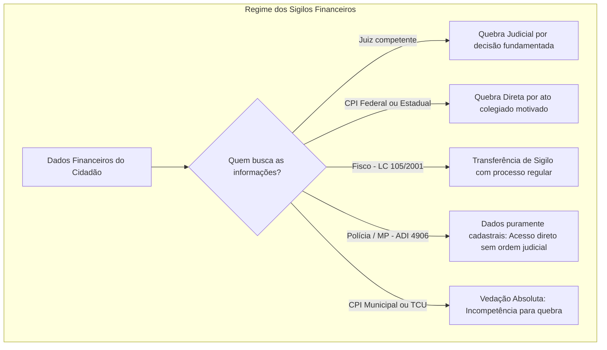
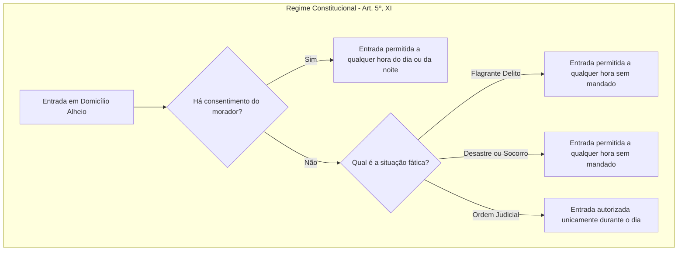

A tutela da privacidade e do refúgio domiciliar consagra barreiras intransponíveis contra o arbítrio estatal e a indiscrição alheia. No artigo 5º da Constituição Federal de 1988, os incisos X e XI resguardam a intimidade, a vida privada, a honra, a imagem e a inviolabilidade da casa. Neste capítulo, examinamos a extensão dos direitos da personalidade, a disciplina jurídica das quebras de sigilo bancário e fiscal, o conceito constitucional ampliado de domicílio e os limites estritos para a entrada forçada de forças policiais em residências.

> [!objetivos]
> - Diferenciar intimidade, vida privada, honra e imagem, compreendendo as hipóteses de reparação pecuniária e a titularidade de pessoas jurídicas.
> - Analisar a jurisprudência do STF sobre a desnecessidade de autorização para biografias e a recusa à realização de exame de DNA.
> - Identificar as autoridades competentes para determinar a quebra de sigilo bancário e fiscal e os limites da atuação do Fisco e do TCU.
> - Compreender a abrangência do conceito de casa para fins constitucionais e as restrições reconhecidas pelo Superior Tribunal de Justiça.
> - Explicar as quatro hipóteses de ingresso domiciliar, os critérios temporais e a tese do Tema 280 do STF sobre flagrante em crimes permanentes.

## Intimidade, vida privada, honra e imagem (artigo 5º, inciso X)

O artigo 5º, inciso X, da Constituição erige um escudo protetivo em torno dos direitos mais caros da personalidade individual:

> [!lei] CF, art. 5º, X
> são invioláveis a intimidade, a vida privada, a honra e a imagem das pessoas, assegurado o direito a indenização pelo dano
> material ou moral decorrente de sua violação;

A doutrina constitucional decompõe esse comando em quatro dimensões autônomas:
1. **Intimidade**: representa o círculo mais reservado e impenetrável da existência humana. Abrange os segredos pessoais, diários íntimos, hábitos confessionais e convicções mantidas em segredo.
2. **Vida privada**: envolve o relacionamento da pessoa com seus familiares, amigos e círculos sociais restritos. Trata-se de condutas que, embora exteriorizadas em comunidade fechada, não pertencem ao domínio público.
3. **Honra**: expressa a dignidade do indivíduo. Subdivide-se em honra subjetiva (o sentimento próprio de autoestima, decoro e dignidade moral) e honra objetiva (a reputação, o bom nome e o conceito desfrutado pela pessoa perante a sociedade).
4. **Imagem**: constitui a representação visual, sonora ou fisionômica do indivíduo perante a coletividade, abrangendo tanto a imagem física quanto a imagem social construída ao longo da vida.

A ofensa injustificada a esses bens acarreta reparação civil. A jurisprudência consolidou que as indenizações por prejuízos de ordem patrimonial e por danos morais podem ser cumuladas quando oriundas do mesmo episódio lesivo.

As **pessoas jurídicas** também titularizam garantias da personalidade. Embora não experimentem abalo psicológico ou sentimentos internos próprios da honra subjetiva, são dotadas de **honra objetiva** e imagem institucional perante terceiros. Uma empresa que tenha seu título comercial protestado indevidamente ou seja falsamente acusada de fraude sofre evidente abalo em seu crédito e em sua reputação mercadológica.

> [!jurisprudencia] STJ, Súmula 227
> O Superior Tribunal de Justiça assentou de modo categórico que a pessoa jurídica pode sofrer dano moral, ensejando reparação em caso de violação à sua honra objetiva e imagem comercial.

O Supremo Tribunal Federal pacificou teses relevantes sobre a aplicação do inciso X:

- **Exame de DNA e dignidade corporal**: ninguém pode ser coagido fisicamente a fornecer material biológico para a realização de exame de DNA em ação de investigação de paternidade. A condução forçada ofenderia a intangibilidade corporal e a intimidade. A recusa injustificada do suposto pai, todavia, gera presunção relativa de paternidade a ser apreciada em conjunto com os demais elementos de convicção constantes dos autos.
- **Biografias não autorizadas (ADI 4815)**: o STF julgou inexigível o consentimento prévio do biografado para a publicação de obras literárias ou audiovisuais de caráter biográfico. Dispensou igualmente a autorização de familiares de pessoas falecidas ou de coadjuvantes da narrativa histórica. A Corte fez prevalecer a liberdade de expressão e o acesso público à informação histórica, resguardando à pessoa retratada o direito de pleitear indenização posterior caso ocorram ofensas dolosas à verdade ou à honra.
- **Relatividade da privacidade de agentes públicos e políticos**: governantes e servidores públicos sujeitam-se ao escrutínio permanente da cidadania. Por essa razão, o STF declarou legítima a divulgação nominal e transparente dos vencimentos e das vantagens financeiras pagas aos servidores públicos na rede mundial de computadores (Tema 483, ARE 652.777). Em litígios cíveis indenizatórios movidos por agentes estatais contra matérias jornalísticas de crítica funcional, aplica-se a cláusula de modicidade, reduzindo-se o valor das condenações pecuniárias.

> [!jurisprudencia] STF, ADI 4815 e biografias
> É inexigível a autorização prévia de pessoa biografada para a veiculação de obras biográficas literárias ou audiovisuais, sendo desnecessária a anuência de familiares de pessoas mortas ou ausentes, sem prejuízo da responsabilidade cível por eventuais abusos.

## Sigilo bancário e sigilo fiscal: regras de quebra e requisição

O sigilo das operações financeiras e das informações tributárias consubstancia desdobramento natural do direito à intimidade e à vida privada. O sigilo bancário impede o acesso indiscriminado a extratos de contas correntes, investimentos e movimentações pecuniárias. O sigilo fiscal protege as declarações de bens e rendimentos apresentadas à administração fazendária.

Nenhum desses sigilos tem caráter absoluto. Quando confrontados com a investigação de delitos e a preservação do patrimônio público, eles cedem perante autoridades competentes munidas de justificativa adequada. A principal questão cobrada em concursos consiste em identificar **quem possui competência constitucional para decretar a quebra** dessas garantias.

O **Poder Judiciário** dispõe de competência plena para decretar a quebra do sigilo bancário e fiscal. A decisão judicial deve ser necessariamente fundamentada, demonstrando a indispensabilidade da providência e delimitando o período e as contas alcançadas.

As **Comissões Parlamentares de Inquérito (CPIs)** instituídas no âmbito da Câmara dos Deputados, do Senado Federal, do Congresso Nacional e das Assembleias Legislativas estaduais também podem decretar diretamente a quebra de sigilos bancário e fiscal. Elas são investidas de poderes de investigação próprios das autoridades judiciais (CF, art. 58, § 3º). Em contrapartida, as **CPIs municipais** (criadas pelas Câmaras de Vereadores) não possuem esse poder, pois o Município não conta com estrutura própria de Poder Judiciário.

A atuação das **autoridades fiscais** (Receita Federal e Fazendas estaduais e municipais) rege-se pela Lei Complementar 105/2001. O STF julgou constitucional a requisição direta de dados bancários pelo Fisco junto às instituições financeiras sem prévia ordem judicial. Essa medida ocorre quando houver processo administrativo tributário em curso e as informações forem indispensáveis à fiscalização. Os ministros assentaram que não se trata de quebra de sigilo, mas de mera **transferência de sigilo** do ambiente bancário para o âmbito fiscal, mantendo-se o dever de confidencialidade da autoridade fazendária.

O **Ministério Público**, em regra, não pode quebrar diretamente o sigilo bancário de particulares. Excepcionalmente, o STF e o STJ admitem a requisição de informações financeiras pelo órgão ministerial quando o procedimento versar sobre a defesa do patrimônio público e houver envolvimento direto de verbas públicas. Além disso, as contas correntes de órgãos públicos e prefeituras não gozam de intimidade, podendo ser requisitadas diretamente pelo Ministério Público sem autorização judicial para apurar desvios de recursos.

O **Tribunal de Contas da União (TCU)** e os Tribunais de Contas estaduais **não possuem poder** para decretar a quebra de sigilo bancário ou fiscal de empresas e cidadãos. O STF assentou, contudo, que o TCU detém competência para requisitar informações a bancos estatais sobre operações de financiamento que utilizem verbas públicas (como empréstimos concedidos pelo BNDES no MS 33.340), pois transações com recursos da sociedade submetem-se ao princípio da publicidade (art. 37 da CF).

A tabela a seguir sistematiza as competências sobre sigilos bancário e fiscal.

| Autoridade ou Órgão | Pode determinar a quebra? | Requisitos e fundamentos jurídicos |
| --- | --- | --- |
| Poder Judiciário | Sim | Decisão judicial fundamentada e individualizada |
| CPI federal ou estadual | Sim | Poderes de investigação judiciais (CF, art. 58, § 3º) |
| CPI municipal (Câmara de Vereadores) | Não | Inexistência de Poder Judiciário no âmbito local |
| Administração Tributária (Fisco) | Transfere o sigilo | LC 105/2001; processo instaurado e dados essenciais |
| Ministério Público | Somente em exceções | Defesa de verbas públicas e contas de prefeituras |
| Tribunais de Contas (TCU e TCEs) | Não quebram | Requisitam apenas contratos com dinheiro público |

> [!pegadinha] Competência de CPIs e Tribunais de Contas
> Atenção às pegadinhas costumeiras de prova:
> 1. CPI federal e CPI estadual podem quebrar sigilo bancário; CPI municipal não pode.
> 2. O TCU não decreta quebra de sigilo bancário de terceiros; ele apenas requisita dados de empréstimos com recursos estatais.

O diagrama abaixo ilustra o fluxo de transferência e acesso legítimo a dados financeiros.

Quanto às exigências formais de qualquer quebra, a jurisprudência impõe a demonstração da necessidade concreta e a **individualização subjetiva e objetiva**: devem ser apontadas as pessoas investigadas e os fatos sob apuração. É nula a quebra de sigilo genérica ou indeterminada destinada a pescar provas (*fishing expedition*).

Vale destacar que na ADI 4906 o STF declarou constitucional a regra que autoriza a polícia judiciária e o Ministério Público a requisitarem diretamente dados cadastrais de pessoas investigadas (nome, filiação e endereço) sem necessidade de autorização judicial prévia. O acesso a dados bancários, fiscais ou telefônicos pretéritos, todavia, continua dependendo de reserva de jurisdição.

## Inviolabilidade do domicílio (artigo 5º, inciso XI)

O artigo 5º, inciso XI, consagra a casa como asilo sagrado do indivíduo, resguardando o sossego, a vida privada e a paz familiar:

> [!lei] CF, art. 5º, XI
> a casa é asilo inviolável do indivíduo, ninguém nela podendo penetrar sem consentimento do morador, salvo em caso de flagrante delito ou desastre, ou para prestar socorro, ou, durante o dia, por determinação judicial;

Para conferir efetividade à garantia, o Supremo Tribunal Federal atribui ao termo **casa** um conceito jurídico ampliado. A proteção constitucional não contempla apenas a residência particular da pessoa, abrangendo:
- Qualquer compartimento habitado em que alguém resida de forma permanente ou eventual;
- Aposentos ocupados de habitação coletiva, tais como quartos de hotel, pousadas, motéis e chalés;
- Compartimentos privados não abertos ao público onde alguém exerce profissão ou atividade particular, a exemplo de consultórios odontológicos, escritórios de advocacia, salas de contabilidade, oficinas fechadas e cabines de embarcações privadas.

Em contrapartida, os tribunais superiores excluem do conceito constitucional de casa:
- Bares, restaurantes, boates e estabelecimentos comerciais durante o horário aberto ao público;
- A **boleia de caminhão**: o Superior Tribunal de Justiça assentou que o veículo de carga é ambiente móvel de circulação viária e não constitui domicílio ou local privativo de trabalho estático. A localização de arma no interior da boleia tipifica o crime de **porte ilegal de arma de fogo**, e não mera posse irregular de arma no interior de residência (REsp 1.362.124/MG).

A tabela comparativa a seguir demarca os limites do conceito de casa.

| Enquadramento jurídico | Locais e compartimentos correspondentes | Fundamentação jurisprudencial |
| --- | --- | --- |
| Abrangidos pelo conceito de casa | Residências, quartos de hotel, consultórios, escritórios | STF confere interpretação ampla e protetiva |
| Não abrangidos pelo conceito de casa | Lojas abertas, restaurantes e boleia de caminhão | Ambientes públicos ou veículos móveis de transporte |

> [!exemplo] Boleia de caminhão e porte de arma
> O motorista abordado em rodovia com revólver oculto sob o banco da boleia de seu caminhão responde por porte ilegal de arma de fogo. O veículo em circulação não se equipara a residência ou domicílio profissional protegido pelo art. 5º, XI.

O ingresso em domicílio alheio sem a anuência de quem nele reside é rigorosamente excepcional. O texto constitucional prevê quatro situações taxativas:

1. **Consentimento do morador**: autoriza a entrada a qualquer hora do dia ou da noite.
2. **Flagrante delito**: autoriza a entrada a qualquer hora (dia ou noite), independentemente de mandado ou autorização do morador.
3. **Desastre**: autoriza o socorro e a intervenção protetiva a qualquer hora do dia ou da noite.
4. **Prestação de socorro**: autoriza a intervenção emergencial em qualquer horário.
5. **Ordem judicial (mandado de busca e apreensão)**: o cumprimento do mandado só pode ocorrer **durante o dia**. É expressamente vedado o cumprimento de mandado de busca e apreensão domiciliar durante a noite sem o consentimento do habitante.

O esquema gráfico abaixo demonstra as condicionantes temporais do ingresso domiciliar.

## O conceito de dia e as fundadas razões em crimes permanentes

A definição exata do que constitui o período diurno sempre gerou debates entre juristas. Tradicionalmente, confrontavam-se dois critérios: o critério temporal ou cronológico (período das 6 horas às 18 horas) e o critério físico-astronômico (período compreendido entre a aurora e o crepúsculo solar).

Com a edição da Nova Lei de Abuso de Autoridade (Lei 13.869/2019), o legislador tipificou como crime a conduta do agente público que executa mandado judicial de busca no interior da residência fora do horário legal, especificamente após as 21 horas ou antes das 5 horas (art. 22, III).

Parte da literatura chegou a sustentar que a lei teria definido o conceito de dia como o intervalo entre 5 horas e 21 horas. Todavia, o Superior Tribunal de Justiça rejeitou expressamente essa premissa no Informativo 800. A Corte Especial esclareceu que a lei penal apenas delimitou uma faixa horária específica cuja transgressão gera crime de abuso.

Dessa forma, cumprir uma busca domiciliar após as 18 horas quando já houver ocorrido o anoitecer (por exemplo, às 20 horas no inverno), embora não configure crime de abuso de autoridade por estar antes das 21 horas, **permanece um ato ilícito**, acarretando a nulidade absoluta de todas as provas apreendidas por manifesta violação da garantia constitucional do domicílio.

> [!atencao] Conceito de dia e mandado judicial (Informativo 800 do STJ)
> A tipificação do crime de abuso de autoridade entre 21 horas e 5 horas não transformou o período entre 5 horas e 21 horas em período diurno automático. O mandado cumprido sob a noite física continua nulo, ainda que o agente público não incida no tipo penal da Lei 13.869/2019.

A aplicação do flagrante delito em **crimes permanentes** (como o tráfico de drogas na modalidade ter em depósito ou o cárcere privado) demanda cautela operacional. Por se prolongar a consumação no tempo, agentes estatais ingressavam reiteradamente em residências sem mandado apenas com base em meras intuições subjetivas.

Para balizar essas operações e combater abusos, o Supremo Tribunal Federal fixou a tese de repercussão geral no **Tema 280 (RE 603.616)**. O tribunal assentou que o ingresso forçado em domicílio sem ordem judicial, inclusive no período noturno, só é legítimo quando apoiado em **fundadas razões**, aferíveis de forma objetiva pelas circunstâncias prévias e devidamente justificadas *a posteriori*.

A justificativa das fundadas razões é apresentada **após o ingresso**, cabendo aos policiais registrar as circunstâncias prévias que tornavam verossímil a prática delitiva no interior da casa. Caso a entrada seja arbitrária, o ato será considerado nulo, tornando ilícitas as apreensões e sujeitando o policial à responsabilidade funcional, civil e penal.

Em decisão recente de 2024, o STF reputou lícito o ingresso de policiais militares que, em patrulhamento de rotina, observaram indivíduo correr para dentro do imóvel ao avistar a guarnição policial em local conhecido de comercialização de entorpecentes (HC 169.788/SP), considerando atendido o padrão de fundadas razões.

A tabela abaixo resume os parâmetros do Tema 280 do STF para a atuação policial.

| Requisito do Tema 280 | Parâmetro fixado pelo STF | Consequência da inobservância |
| --- | --- | --- |
| Existência de indícios | Fundadas razões objetivas prévias | Mera intuição ou suspeita gera nulidade da diligência |
| Momento da justificativa | Justificação formal *a posteriori* | A fundamentação deve constar no auto de prisão em flagrante |
| Responsabilidade do agente | Sanção funcional, civil e penal | Crime de abuso de autoridade e nulidade probatória |

> [!jurisprudencia] STF, Tema 280 (RE 603.616)
> O Supremo Tribunal Federal assentou que o ingresso coercitivo no domicílio sem ordem judicial, ainda que em horário noturno, somente se reveste de licitude quando respaldado em fundadas razões objetivas, a serem justificadas a posteriori pelos agentes, sob pena de nulidade dos atos probatórios e responsabilização tríplice do policial.

Por fim, a doutrina admite que uma diligência judicial iniciada validamente durante a claridade diurna possa se estender pelo período noturno até sua conclusão, desde que mantida a continuidade operacional. Além disso, o STF julgou válida a autorização judicial concedida à polícia judiciária para penetrar em escritório de advocacia durante a noite unicamente para instalar equipamento de escuta ambiental secreta, pois a medida seria inviável de ser executada durante o expediente de atendimento diurno.

## Mapa do capítulo

A tabela a seguir sistematiza as matérias desenvolvidas neste capítulo, permitindo uma revisão esquematizada das regras relativas à intimidade, ao sigilo bancário e à inviolabilidade do domicílio.

| Tema constitucional | Regra central e enquadramento doutrinário | Precedentes e balizas judiciais |
| --- | --- | --- |
| Art. 5º, X: Intimidade | Inviolabilidade da vida privada, honra e imagem; reparação civil plena | Súmula 227 do STJ; ADI 4815 (biografias livres); Tema 483 |
| Exame de DNA | Proibição de condução forçada ou coação física ao fornecimento | Presunção relativa de paternidade por outros elementos |
| Sigilo bancário e fiscal | Quebra por Judiciário e CPI federal/estadual; vedado a CPI local e TCU | LC 105/2001 (transferência fiscal); ADI 4906 (dados cadastrais) |
| Art. 5º, XI: Domicílio | Casa é asilo inviolável; conceito abrange escritórios e quartos de hotel | Exclui bares abertos e boleia de caminhão (porte de arma) |
| Horários de ingresso | Consentimento, flagrante, desastre e socorro (qualquer hora); mandado (só dia) | Conceito de dia: mandado à noite continua ilegal (Inf. 800 STJ) |
| Flagrante permanente | Ingresso sem mandado exige fundadas razões justificadas posteriormente | Tema 280 do STF; controle rigoroso sobre arbitrariedades |

### Para fixar

- A violação da intimidade enseja reparação pecuniária por prejuízos materiais e morais cumuláveis perante o mesmo fato ilícito.
- Pessoas jurídicas são titulares de honra objetiva e imagem comercial, podendo sofrer dano moral indenizável (Súmula 227 do STJ).
- A publicação de biografias independe de autorização prévia do biografado ou de herdeiros de pessoas falecidas (ADI 4815).
- A quebra de sigilo bancário cabe ao Judiciário e às CPIs federais e estaduais, sendo vedada a CPIs municipais e aos Tribunais de Contas.
- A Receita Federal e os Fiscos locais realizam transferência legítima de sigilo financeiro nas condições da LC 105/2001.
- O conceito de casa para fins de proteção constitucional abrange residências, consultórios, escritórios e aposentos ocupados de hotéis.
- A boleia de caminhão não é abrangida pela inviolabilidade domiciliar, configurando porte ilegal a guarda de arma em seu interior.
- O mandado judicial de busca domiciliar somente pode ser cumprido durante o dia, sendo ilícito o ingresso forçado noturno por mandado.
- A realização de busca domiciliar com mandado durante a noite física continua ilegal e sujeita a nulidade, conforme o STJ (Informativo 800).
- Em crimes permanentes, a entrada policial forçada sem mandado depende de fundadas razões devidamente justificadas a posteriori (Tema 280 do STF).
