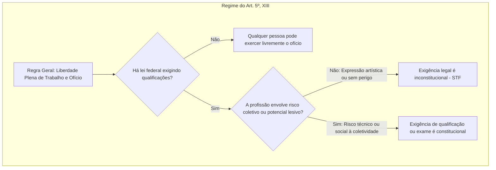

A circulação confidencial do pensamento e a autonomia para exercer atividades produtivas integram o núcleo de liberdades fundamentais do cidadão. No artigo 5º da Constituição Federal de 1988, os incisos XII e XIII tutelam o sigilo da correspondência e das comunicações e consagram o livre exercício profissional. Ambas as normas classificam-se como de eficácia contida, facultando ao legislador ordinário estabelecer restrições para resguardar a ordem pública. Neste capítulo, estudamos as exigências legais da interceptação telefônica, a disciplina das comunicações em presídios e os limites constitucionais para a fixação de requisitos ao trabalho.

> [!objetivos]
> - Compreender a inviolabilidade da correspondência e das comunicações e a distinção entre fluxo de dados e dados armazenados.
> - Diferenciar a quebra de sigilo de registros telefônicos da interceptação do conteúdo das conversas.
> - Dominar os requisitos materiais e formais da interceptação telefônica previstos na Constituição e na Lei 9.296/1996.
> - Distinguir interceptação, escuta e gravação clandestina, identificando as hipóteses de legítima defesa do interlocutor.
> - Explicar a liberdade profissional como norma de eficácia contida e as decisões do STF sobre OAB, jornalistas, músicos e motoristas.

## O sigilo das comunicações e a tutela dos dados (artigo 5º, inciso XII)

O artigo 5º, inciso XII, da Constituição Federal estabelece a inviolabilidade de quatro esferas de transmissão informativa:

> [!lei] CF, art. 5º, XII
> é inviolável o sigilo da correspondência e das comunicações telegráficas, de dados e das comunicações telefônicas, salvo, no último caso, por ordem judicial, nas hipóteses e na forma que a lei estabelecer para fins de investigação criminal ou instrução processual penal;

O preceito complementa a proteção da vida privada esculpida no inciso X. Pela literalidade do texto, apenas a comunicação telefônica conteria exceção expressa autorizada pela Constituição. Todavia, a jurisprudência dominante assentou que nenhum direito ostenta natureza absoluta. Quando a garantia constitucional for utilizada para encobrir a prática de infrações penais, admite-se a flexibilização do sigilo epistolar, telegráfico e telemático por decisão motivada.

No âmbito dos **estabelecimentos penitenciários**, o STF já pacificou que a administração prisional pode interceptar cartas enviadas por sentenciados quando houver razões fundadas de segurança pública, preservação da disciplina ou ordem jurídica, com esteio no artigo 41 da Lei de Execução Penal. O sigilo das cartas não pode servir de escudo protetor para o comando de facções criminosas a partir do cárcere.

Outro ponto de relevante cobrança doutrinária reside na distinção entre **comunicação de dados** e **dados em si (dados armazenados)**:
- A Constituição tutela a *comunicação* de dados, isto é, o fluxo de transmissão de mensagens no exato instante em que transitam entre emissor e receptor por redes telemáticas.
- Os *dados armazenados* estaticamente em suportes materiais (computadores, servidores e discos rígidos) submetem-se ao regime geral dos documentos privados.

No histórico julgamento do RE 418.416/SC, o STF assentou que a apreensão judicial de um disco rígido (HD) em busca e apreensão autoriza a leitura dos e-mails arquivados no equipamento. Não ocorre aí interceptação telemática clandestina, mas mera análise de documentos em suporte eletrônico apreendidos validamente.

> [!atencao] Comunicação de dados versus dados armazenados
> A proteção estrita do art. 5º, XII, incide sobre a transmissão ou o tráfego dos dados em tempo real. A apreensão física do disco rígido com autorização judicial permite a consulta aos arquivos e mensagens nele guardados sem caracterizar interceptação telefônica ou telemática.

Em relação aos **telefones celulares apreendidos**, o STF fixou tese de repercussão geral em junho de 2025 (Tema 977, ARE 1.042.075). Apreender o aparelho, no flagrante ou na investigação, não depende de ordem judicial. Já o acesso aos registros de chamadas, à agenda e às mensagens de aplicativos do celular apreendido com o suspeito depende do **consentimento expresso e livre do dono** ou de **prévia decisão judicial fundamentada**. Se o celular foi achado no local do crime, sem dono identificado, a polícia pode tomar as providências para preservar os dados antes da ordem judicial, justificando o acesso depois. A tese vale para o futuro.

A busca feita por policiais no celular do preso, no momento da prisão, sem consentimento nem ordem judicial, gera prova ilícita. Caso o celular tenha sido recolhido durante o cumprimento de mandado de busca e apreensão deferido pelo juiz, os policiais podem examinar diretamente o conteúdo sem nova ordem.

## Quebra de sigilo telefônico versus interceptação telefônica

É indispensável diferenciar a quebra de sigilo telefônico da interceptação das conversas telefônicas:

1. **Quebra do sigilo dos registros telefônicos**: compreende o acesso aos dados pretéritos cadastrais e às faturas detalhadas emitidas pelas operadoras de telefonia. Revela quem ligou para quem, os horários das chamadas, a duração das conversas e os números de telefone envolvidos, sem registrar o conteúdo falado. Medida menos gravosa, pode ser determinada tanto pelo **Poder Judiciário** quanto pelas **Comissões Parlamentares de Inquérito (CPIs)** federais e estaduais.
2. **Interceptação telefônica**: consubstancia a captação, escuta e gravação em tempo real do diálogo mantido pelos interlocutores. Por atingir profundamente a privacidade das falas, submete-se ao princípio da **reserva absoluta de jurisdição**: **somente o Poder Judiciário** tem competência para decretá-la. É vedada a decretação de interceptação telefônica por CPIs, autoridades policiais ou pelo Ministério Público.

A tabela comparativa a seguir destaca as fronteiras entre os dois institutos.

| Critério de distinção | Quebra de registros telefônicos | Interceptação telefônica |
| --- | --- | --- |
| Conteúdo atingido | Extrato de chamadas, datas, duração e horários | Gravação e captação do teor do diálogo em tempo real |
| Grau de intromissão | Menor gravidade na esfera privada | Máxima intromissão na privacidade das partes |
| Autoridades competentes | Poder Judiciário ou CPIs federais e estaduais | Privativa do Poder Judiciário (reserva de jurisdição) |
| Norma reguladora | Lei Complementar 105/2001 e marco civil | Lei Federal 9.296/1996 |

> [!pegadinha] Competência das CPIs em matéria telefônica
> As Comissões Parlamentares de Inquérito têm poderes para determinar a quebra do sigilo dos registros telefônicos (extratos de chamadas passadas). Elas jamais podem decretar a interceptação telefônica de conversas em andamento, matéria restrita privativamente aos juízes togados.

## Requisitos da interceptação telefônica (Lei 9.296/1996)

A interceptação das comunicações telefônicas e telemáticas configura típica norma de reserva legal qualificada. A disciplina infraconstitucional foi estabelecida pela Lei Federal 9.296/1996.

Para que a ordem de interceptação seja juridicamente válida, o juiz deve verificar a presença conjunta de **três requisitos cumulativos**:
1. Existência de indícios razoáveis de autoria ou participação em infração penal;
2. Inviabilidade de produzir a prova por outros meios menos invasivos à disposição dos investigadores;
3. O fato investigado deve constituir infração penal apenada com **reclusão**.

Se a infração sob apuração for punida com detenção ou com pena de contravenção penal, a interceptação não pode ser decretada pelo magistrado.

O esquema a seguir detalha os pressupostos obrigatórios fixados pelo legislador.

```mermaid Requisitos cumulativos para a decretação da interceptação telefônica
flowchart TD
  subgraph InterceptacaoTelefonica [Requisitos da Lei 9.296/1996]
    A{Pedido de Interceptação} --> B[Requisito 1: Indícios razoáveis de autoria]
    A --> C[Requisito 2: Indispensabilidade da prova por outros meios]
    A --> D[Requisito 3: Crime apenado com reclusão]
    B & C & D --> E[Decisão Judicial Fundamentada]
    E --> F[Prazo: 15 dias, renovável por igual período]
  end
```

A autorização da interceptação pode ocorrer de ofício pelo magistrado ou mediante requerimento da autoridade policial ou do Ministério Público. A decisão deve indicar a forma de cumprimento, com prazo de até **15 dias**, prorrogável por igual período.

O Supremo Tribunal Federal assentou a legitimidade de **renovações sucessivas** do prazo quinzenal (Tema 661 de Repercussão Geral, RE 625.263). O tribunal admitiu que investigações complexas demandem dilações periódicas, exigindo que cada prorrogação seja fundamentada com elementos concretos dos autos. Modelos padronizados ou reproduções genéricas tornam a interceptação ilegal.

Outros aspectos jurisprudenciais de grande relevância compreendem:

- **Encontro fortuito de provas (crime-achado)**: quando a interceptação telefônica legitimamente instaurada para apurar determinado delito de reclusão descobre fortuitamente um crime conexo, a prova é plenamente válida para apurar o segundo fato, mesmo que a nova infração seja apenada apenas com detenção ou imputada a terceiros.
- **Diálogo entre investigado e advogado**: a prerrogativa de sigilo profissional do advogado não impede a interceptação de conversas caso existam elementos concretos de que o próprio causídico atua em conluio na prática de infrações delituosas. O sigilo funcional não outorga salvo-conduto para o cometimento de crimes.
- **Prova emprestada em processo administrativo**: o STF admite o aproveitamento de gravações interceptadas por ordem judicial criminal como prova documental em processo administrativo disciplinar (PAD) instaurado contra os mesmos servidores investigados ou outros agentes públicos envolvidos no ilícito funcional.
- **Denúncia anônima isolada**: a notícia apócrifa não sustenta, por si só, a decretação judicial de interceptação telefônica. Faz-se obrigatória a realização de investigações preliminares autônomas para lastrear o pedido policial.

A teoria processual penal e a jurisprudência do Superior Tribunal de Justiça distinguem com precisão três modalidades de captação de áudio:
- **Interceptação telefônica em sentido estrito**: gravação efetuada por um terceiro sem o conhecimento de nenhum dos dois interlocutores da conversa.
- **Escuta telefônica**: gravação realizada por terceiro com a prévia anuência de apenas um dos interlocutores, sem que o outro participante saiba da captação.
- **Gravação clandestina (ou gravação ambiental/telefônica)**: gravação executada diretamente por um dos próprios interlocutores que participam do diálogo, sem que o outro participante seja alertado.

A tabela abaixo sintetiza a diferenciação dogmática desses três mecanismos.

| Modalidade | Sujeito que grava | Conhecimento dos interlocutores | Exigência judicial |
| --- | --- | --- | --- |
| Interceptação em sentido estrito | Terceiro alheio | Nenhum participante sabe | Privativa do Poder Judiciário |
| Escuta telefônica | Terceiro alheio | Apenas um participante sabe | Exige decisão judicial prévia |
| Gravação clandestina | O próprio interlocutor | Apenas quem grava sabe | Válida em legítima defesa sem juiz |

> [!exemplo] Gravação clandestina e legítima defesa
> A vítima de extorsão ou sequestro que grava diretamente o telefonema do chantagista comete ato lícito. Essa gravação dispensa autorização prévia de magistrado e configura legítima defesa de direitos, constituindo prova admissível na instrução criminal.

## Liberdade profissional e seus limites constitucionais (artigo 5º, inciso XIII)

O artigo 5º, inciso XIII, da Constituição Federal dispõe:

> [!lei] CF, art. 5º, XIII
> é livre o exercício de qualquer trabalho, ofício ou profissão, atendidas as qualificações profissionais que a lei estabelecer;

A norma consagra a liberdade de iniciativa laboral e classifica-se tecnicamente como de **eficácia contida** (ou restringível). O direito ao trabalho pode ser exercido livremente por qualquer indivíduo desde a promulgação constitucional. O legislador ordinário, contudo, dispõe de competência para restringir essa faculdade ao editar leis que exijam qualificações acadêmicas, registros ou fiscalizações técnicas para ofícios determinados.

A regra geral do sistema é a plena liberdade profissional. Conforme assentado pelo Supremo Tribunal Federal, o legislador só tem autorização constitucional para criar barreiras à atuação profissional quando a atividade contiver **potencial lesivo à sociedade** ou envolver riscos técnicos diretos à integridade e à segurança de terceiros.

O esquema a seguir ilustra a dinâmica da eficácia contida aplicada à liberdade de ofício.



O Supremo Tribunal Federal julgou controvérsias paradigmáticas com base nesses postulados:

- **Exame da Ordem dos Advogados do Brasil (RE 603.583)**: a Corte declarou plenamente constitucional a exigência do Exame de Ordem como pré-requisito para o exercício da advocacia. Entendeu-se que o patrocínio de causas em juízo envolve risco coletivo à sociedade e à correta administração da Justiça, revelando-se o exame proporcional e compatível com o artigo 5º, XIII.
- **Inexigibilidade de conselho para músicos (Tema 738, RE 795.467)**: o STF julgou inconstitucional a obrigatoriedade de filiação à Ordem dos Músicos do Brasil (OMB) e o pagamento de anuidade para a atuação musical. A música constitui manifestação artística protegida pela liberdade de expressão, não apresentando qualquer potencial de dano social que justifique fiscalização burocrática.
- **Inexigibilidade de diploma para jornalistas (RE 511.961)**: o STF julgou inconstitucional a exigência de diploma de curso superior de jornalismo e de registro ministerial para o exercício da profissão jornalística, por ofensa direta às liberdades de pensamento e comunicação.
- **Suspensão da carteira de motorista profissional (Tema 486, RE 607.107)**: a Corte fixou tese afirmando a constitucionalidade da imposição da pena de suspensão da habilitação para dirigir veículo automotor aplicada a motorista profissional condenado por homicídio culposo na direção. Não existe direito absoluto ao exercício do ofício quando em confronto com a tutela da vida no trânsito.
- **Vedação a sanções políticas no âmbito tributário (Súmula 323 do STF)**: a Fazenda Pública não pode utilizar a apreensão de mercadorias ou o cancelamento do registro comercial de empresas para forçar a quitação de tributos atrasados. A imposição de fiança pecuniária para a liberação de notas fiscais de empresas em débito foi declarada inconstitucional no RE 565.048, por ofensa à livre iniciativa e ao trabalho.

A tabela a seguir consolida as decisões da Suprema Corte sobre as qualificações profissionais.

| Atividade ou Profissão | Condicionamento examinado | Decisão firmada pelo STF |
| --- | --- | --- |
| Advocacia privada | Exame de Ordem (OAB) | Constitucional; atividade com risco coletivo |
| Músicos e artistas | Registro na OMB e anuidade | Inconstitucional; ofensa à manifestação artística |
| Jornalistas | Diploma de graduação em jornalismo | Inconstitucional; atividade imbricada na livre expressão |
| Motorista profissional | Suspensão da CNH por homicídio culposo | Constitucional (Tema 486); prevalência do direito à vida |
| Empresas contribuintes | Fiança para emitir notas fiscais | Inconstitucional; viola a livre iniciativa e o trabalho |

Complementando a proteção ao trabalho, a Lei Federal 13.874/2019 (Declaração de Direitos de Liberdade Econômica) consagrou o livre exercício de atividades econômicas de baixo risco, dispensando autorizações, alvarás ou atos públicos de liberação, em sintonia com o artigo 170, parágrafo único, da Constituição.

## Mapa do capítulo

A tabela a seguir sistematiza as regras e princípios abordados neste capítulo, permitindo uma revisão imediata dos tópicos essenciais sobre sigilo das comunicações e liberdade profissional.

| Eixo normativo | Regra central e enquadramento doutrinário | Precedentes e súmulas dos tribunais |
| --- | --- | --- |
| Art. 5º, XII: Comunicações | Inviolabilidade de correspondência, telégrafo, dados e telefone; eficácia contida | Cartas em presídios podem ser interceptadas pela LEP |
| Comunicação × Dados | Proteção incide no tráfego em tempo real; apreensão de HD é válida | RE 418.416/SC; dados em celular exigem ordem judicial |
| Registros × Conteúdo | Quebra de registros cabe a juiz e CPI; interceptação é privativa do juiz | Reserva de jurisdição na interceptação de conversas |
| Lei 9.296/1996 | Requisitos: indícios, prova indispensável e crime com reclusão; prazo de 15 dias | Tema 661 do STF: renovações sucessivas motivadas |
| Crime-achado e Prova | Encontro fortuito válido para crimes conexos; admissível em PAD | Prova emprestada válida com contraditório assegurado |
| Modalidades de captação | Interceptação (terceiro sem ciência), escuta (um sabe) e gravação clandestina | Gravação pela vítima é válida em legítima defesa |
| Art. 5º, XIII: Profissão | Livre exercício de trabalho ou ofício; eficácia contida; exige potencial lesivo | Exame da OAB é válido; músicos e jornalistas livres |
| Sanções indiretas fiscais | Vedada a interdição da atividade profissional para forçar pagamento de tributos | Súmula 323 do STF; inconstitucionalidade de fiança fiscal |

### Para fixar

- O sigilo das comunicações protege a transmissão de dados no fluxo e não impede a apreensão judicial de discos rígidos e suportes físicos.
- O acesso aos dados e mensagens em celular apreendido com o suspeito depende de consentimento do dono ou de ordem judicial prévia fundamentada (Tema 977, ARE 1.042.075).
- A quebra de registros telefônicos pretéritos pode ser determinada pelo Judiciário ou por CPI, ao passo que a interceptação de conversas é privativa do juiz.
- A interceptação telefônica exige indícios de autoria, indispensabilidade probatória e infração apenada com reclusão (Lei 9.296/1996).
- O STF validou renovações sucessivas da interceptação quinzenal, desde que amparadas em motivos concretos da investigação (Tema 661).
- O crime conexo descoberto acidentalmente durante a interceptação (crime-achado) admite apuração válida, inclusive se punido com detenção.
- A gravação clandestina executada por um dos interlocutores sem conhecimento do outro é lícita quando realizada para repelir conduta criminosa.
- A liberdade profissional (art. 5º, XIII) tem eficácia contida, exigindo risco coletivo ou potencial lesivo para que a lei crie barreiras de acesso.
- O STF considerou constitucional o Exame de Ordem da OAB e inconstitucional a exigência de diploma para jornalistas e de registro para músicos.
- A imposição de pena de suspensão da habilitação a motorista profissional condenado por homicídio culposo é constitucional (Tema 486).
